# Component registry

This is the current architecture of Thermus. It describes component intent,
important collaborations, and known limits. The [review rules](../docs/implementation/pr-review-rules.yaml)
remain the machine authority for source ownership, public modules, and permitted
imports. This registry is not another import allowlist.

Use the [registry update workflow](../docs/implementation/component-registry-workflow.md)
when a change affects this view. Git history and pull request diffs show its
evolution. The [component structure proposal](../docs/design/component-structure-proposal.md)
records the migration design; this page describes the resulting system.

This baseline uses selected arc42 sections: context (3), building blocks (5),
runtime (6), and deployment (7). It does not fill the complete template.
[C4 notation](https://c4model.com/diagrams/notation) supplies element types,
responsibilities, technologies, and labelled relationships. A
[C4 container](https://c4model.com/diagrams/container) means an application,
process, or datastore; it does not mean a Docker container or a source folder.
The [arc42 building-block view](https://docs.arc42.org/section-5/) adds the
static decomposition. Ordinary Mermaid expresses these views without special
C4 syntax. Each heading gives the diagram type and scope.

## Context

C4 system context; scope: Thermus as one software system. Thermus converts
public pages and Brave HTML search results to cleaned Markdown for MCP clients,
and provides account and connection pages. External clients and websites are
outside its trust boundary. Local Better Auth belongs inside Thermus. With
`MCP_TENANTS_ENABLED=true`, the hosted control plane also creates the services
of its tenants through the Render API.

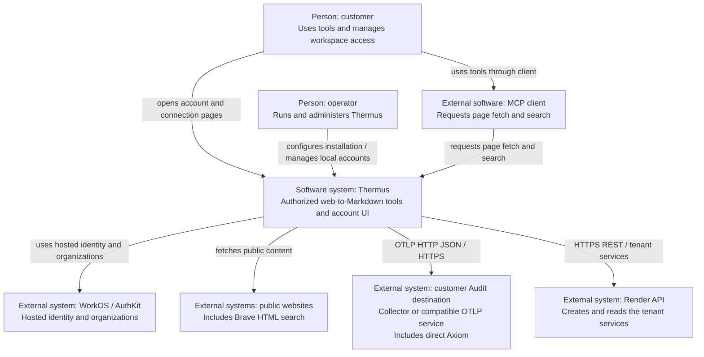

## arc42 building-block view

### C4 containers: hosted edition

Scope: Thermus hosted system. The browser portal is a separate browser
application. The Node server serves its assets and routes. Lightpanda is a
short-lived process container even when it shares the server's Docker image.
The optional PostgreSQL datastore uses a private schema for destination settings,
removal intent, and the tenant registry; its subscription and billing-event
tables wait for Slice 3. The Collector is the configured customer destination,
including compatible OTLP services such as Axiom; WorkOS includes AuthKit.
The portal's HTTP arrow covers account requests and server-provided assets.
The tenant server is the same image with `THERMUS_ROLE=tenant` (SO-03): it
serves `/healthz` and `/mcp` for one organization and holds no secret. Dotted
arrows are planned: the gateway that forwards MCP requests with a signed access
context and the route `/internal/audit` that receives the audit relay come with
SO-05, so no production deployment runs a tenant yet. With
`MCP_TENANTS_ENABLED=true`, the provisioner of the server creates each tenant
server as a Render private service through the Render API (SO-06); Render pulls
the image from GHCR by digest.

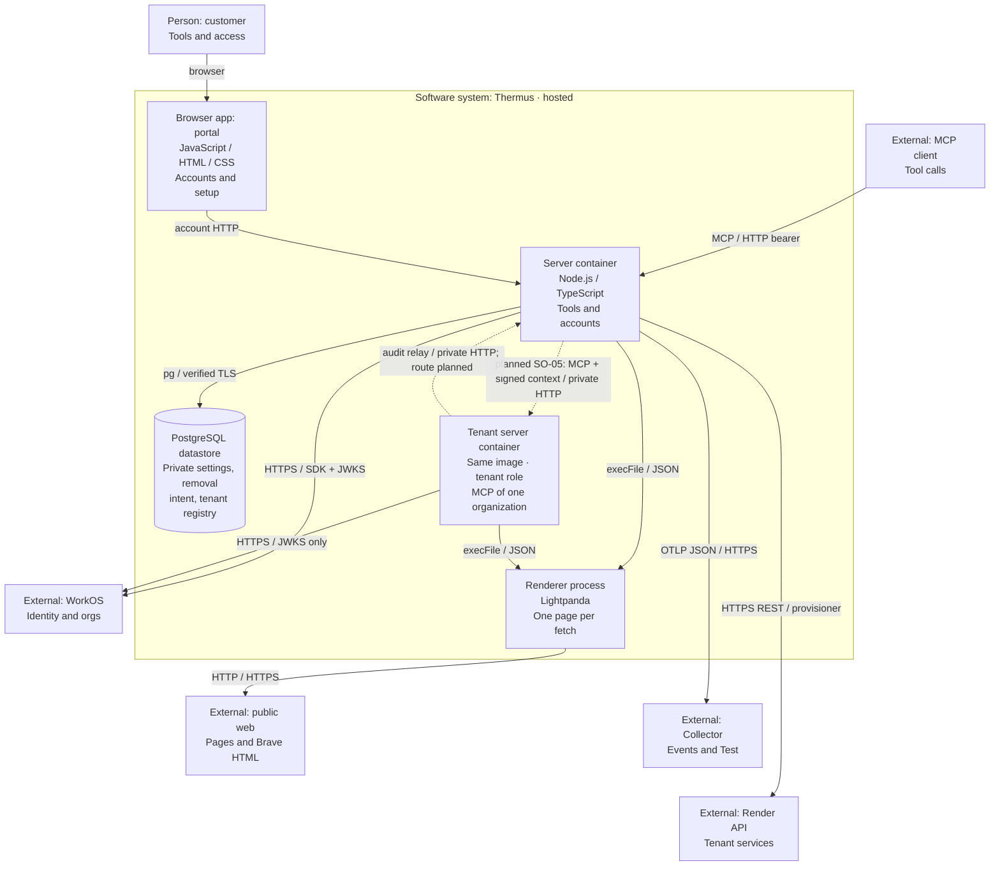

### C4 containers: local edition

Scope: Thermus self-hosted system. Better Auth is built into the server;
it is not an external service. Local authentication pages are server-generated
HTML responses, not a second browser application. The operator runs CLI
administration while the server is stopped, using the same installation data.

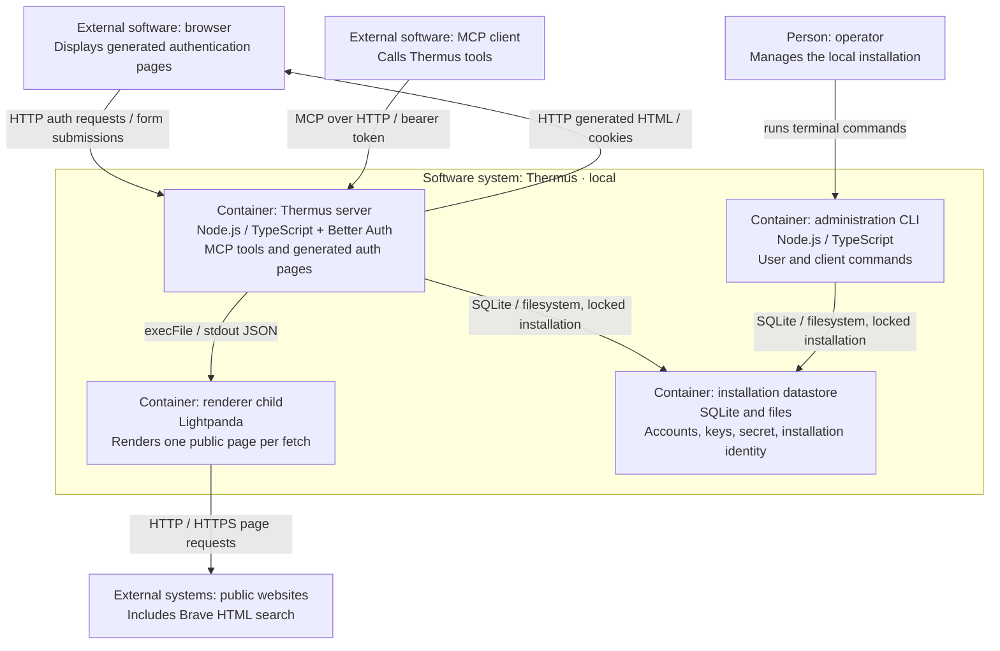

### Containers and source owners

This mapping lists principal contributors from the 23 registry IDs
without turning them into 23 containers. Owners are logical source boundaries;
some contribute code to both server and CLI. The [Ownership](#ownership) table retains the full source
roots, responsibilities, and public contracts.

| Container or artifact | Registry owners that contribute |
| --- | --- |
| Both Node server editions | `app`, `config`, `http`, `system-logs`, `mcp`, `web`, `identity`, `execution`, `page-fetch`, `search`, `html-processing`, `website-fetcher`, `search-engine` |
| Hosted server additions | `organizations`, `billing`, `workos`, `audit-logs` (capture, dispatch, settings, removal intent, and Test), `sql` (the bounded SQL runtime), `tenants` (the tenant registry and provisioner), `render` (the Render adapter of the provisioner) |
| Hosted tenant server (same image, `THERMUS_ROLE=tenant`) | `app` (tenant composition and routes), `config` (role and tenant settings), `http`, `system-logs`, `mcp`, `identity` (signed access context and its access), `workos` (Connect token check only), `audit-logs` (relay sink only), `web` (the `product:access` name only), and the tool owners `execution`, `page-fetch`, `search`, `html-processing`, `website-fetcher`, `search-engine` |
| Local server addition | `better-auth` |
| Local administration CLI | `app`, `cli`, `config`, `http` (client-address helper), `system-logs`, `identity`, `better-auth` |
| Hosted browser application and build assets | `user-portal`; app's `HostedPortal` loads its built files |
| Renderer process | External Lightpanda binary, controlled by `website-fetcher`; no new source owner |
| Local installation datastore | Opened and owned by `better-auth`; no new source owner |
| Optional hosted admin datastore | `sql` owns the pool and the bounded runtime; `audit-logs` owns the settings and removal statements, and `tenants` the registry and provisioning statements; `app` opens the runtime and owns its lifetime |

### Selected C4 components: tool processing in the Node server

Scope: one Thermus Node server container, in either edition. Each component
box gives its stable owner ID, responsibility, and technology. Solid arrows
show selected collaborations through supplied roles or directly held objects;
they do not assert source imports of the selected implementation. Thick arrows
show app composition. The [review rules](../docs/implementation/pr-review-rules.yaml)
remain the complete source-import policy. Supporting process containers and
external systems sit outside the server boundary.

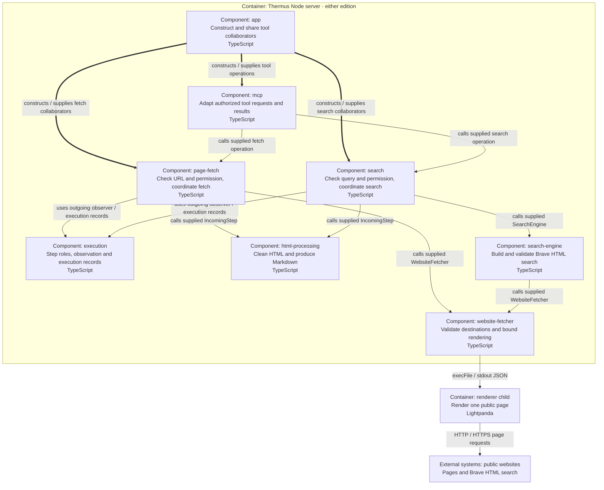

[Tool composition](../src/app/fetch-tool.ts) shares one fetcher, ad cleaner,
sanitizer, observer, record sink, and renderer-report closures between both
operations. Each tool has its own `ProcessHtmlStep`, HTML runner, and Markdown
converter. Fetch uses ads → sanitizer → Markdown; search inserts Brave
projection before Markdown. [PipelineStep](../src/pipelines/execution/pipeline-step.ts)
and [HtmlTransformation](../src/pipelines/html-processing/html-to-markdown-pipeline.ts)
are distinct protocols, not a generic pipeline engine. `ProcessHtmlStep`
implements the execution-owned incoming role; callers need not import its
concrete class. Each operation has fresh execution and HTML context. Hosted
composition wraps fetch and search in one application-wide capacity of
`OPERATION_CAPACITY` calls, default 10.

### Selected C4 components: hosted authentication in the Node server

Scope: one hosted Node server container. The browser application and WorkOS
service remain outside that boundary. Role use follows calls on supplied
collaborators; it does not reverse the source dependency from provider
implementations to neutral contracts.
The session/access arrow denotes BrowserSession and AccessResolver; the
verification/access arrow denotes IdentityVerifier and AccessResolver. The
directory and billing arrows use OrganizationDirectory and Billing; the plan
read of web is a Billing read that app supplies to the portal request.

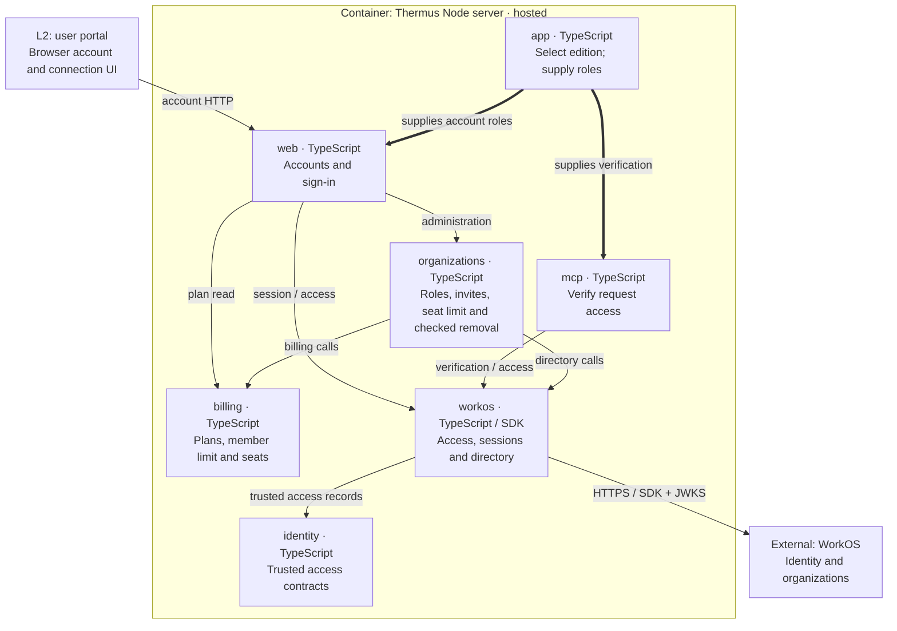

[Hosted composition](../src/app/hosted-workos-application.ts) shares a WorkOS
SDK client, key-set resolver, and directory and selects `BillingFree`, unless an
explicit composition supplies another `Billing`. Since SO-08,
[OrganizationAdministration](../src/accounts/organizations/organization-administration.ts)
reads the plan at each invitation send that is not a repeat and in the
invitation overview. On a free plan, its
[member limit](../src/accounts/organizations/member-limit.ts) counts the seats
from complete reads of the active member facts and the pending invitations,
refuses a send at the limit with `limit-reached`, and runs the check and the
send of one organization one at a time in the process. The
[portal request](../src/interfaces/web/account/portal-access.ts) gets the plan,
and the member limit of a free plan, from the supplied billing read after its
product access check.
[WorkOSAuthProvider](../src/accounts/providers/workos/workos-auth-provider.ts)
implements identity-owned verifier/resolver contracts;
[WorkOSOrganizations](../src/accounts/providers/workos/workos-organizations.ts)
implements the organizations-owned directory role. Removal supplies an optional
server-owned stop signal to directory reads. WorkOS checks it before and after
each remote read; existing callers omit it and keep their current behavior.
`WorkOSBrowserSession`
implements the identity-owned `BrowserSessionControls`, including profile data
for display and trusted identity from a completed sign-in. A missing sealed
return destination selects the default landing; an explicit safe destination
keeps its existing behavior. The callback uses the same supplied access resolver
to check the selected organization before the default portal redirect. Signup
uses the organizations-owned `SignupActivation` contract,
including the requested organization name and purpose-marked legal bundle. The
signup form calls the public organizations name validator, so this dependency
includes runtime behavior. The dependency rules declare that existing owner pair.
The WorkOS adapter saves the canonical creator/authority record on the named
organization and confirms active Admin/product access after a new create. The
signup route uses supplied session controls to select that organization after
a current-membership check, then opens its MCP guide. A failed switch does not
repeat the grant. Existing records remain replay barriers.
The web routes use these neutral contracts; WorkOS cookie and document-validation
helpers remain provider-specific. Composition supplies the portal's allowed
form destinations. The portal uses a supplied current active-organization name
read for workspace display; an absent or blank name returns unavailable rather
than a fallback identity. Profile data does not grant access.

### Selected C4 components: tenant role in the hosted image

Scope: one tenant server container, the hosted image with
`THERMUS_ROLE=tenant` (SO-03). The control plane is a supporting Level 2
container: its gateway, which signs the `Thermus-Access` context of each
request, and its route `/internal/audit` are planned for SO-05 and drawn
dotted. Thick arrows show composition; solid arrows show runtime calls. The
tool owners and the renderer keep the tool processing view above.

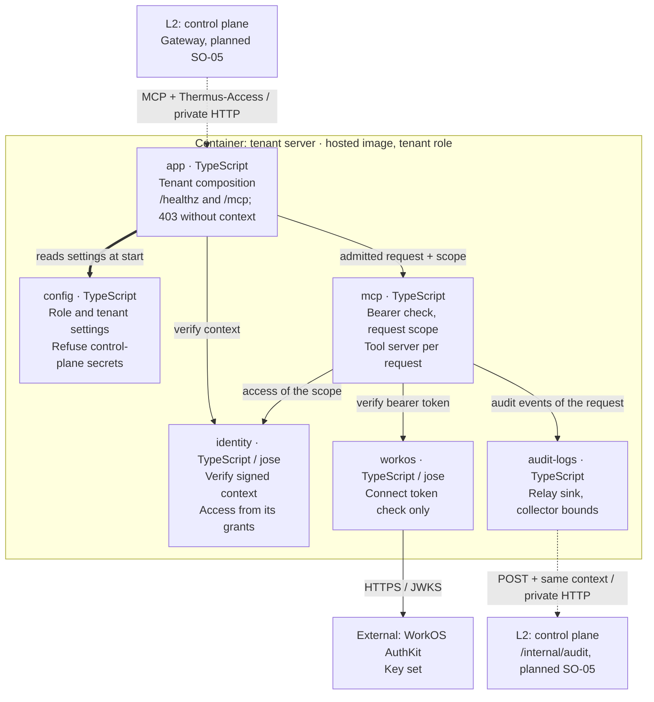

[Tenant composition](../src/app/tenant-application.ts) reads no WorkOS secret
and no database. [Tenant requests](../src/app/tenant-requests.ts) answer
`/healthz`, give `404` to each other path, and refuse an MCP request with `403`
before MCP handling unless
[`AccessContextVerifier`](../src/accounts/identity/access-context-verifier.ts)
verifies its context: a valid signature of one of the gateway keys, the pinned
organization, the hash of the bearer token, and time left. The
[tenant MCP server](../src/app/tenant-mcp.ts) keeps the bearer check of today
with [`WorkOSTokenVerifier`](../src/accounts/providers/workos/workos-auth-provider.ts)
and the AuthKit key set, and gives each admitted request a scope:
[`ContextAccessResolver`](../src/accounts/identity/context-access-resolver.ts)
with the grants of the context, and a tool server whose `AuditLog` writes to the
[relay sink](../src/logs/audit/audit-relay-sink.ts) with the context of that
request. The tenant reads no membership. The
[authentication design](../docs/design/authentication-design.md#tenant-role-and-signed-access-context)
gives the header contract and the relay contract.

### Selected C4 components: hosted membership removal in the Node server

Scope: one hosted Node server container. Organizations owns the checked removal
operation and its lifetime. App supplies the existing SQL adapter through the
organizations-owned RemovalOperationStore role; the adapter runs on the one
bounded runtime of the `sql` owner, which app opens. Thick arrows show composition;
solid arrows show runtime calls. The adapter's source type dependency points
from audit-logs to organizations and is omitted from this runtime view.
PostgreSQL is an existing supporting Level 2 container. Web invokes the operation
only after session, current-access, trusted-tenant, and native form checks.
Customer capture uses the existing audit-logs owner and does not settle removal.

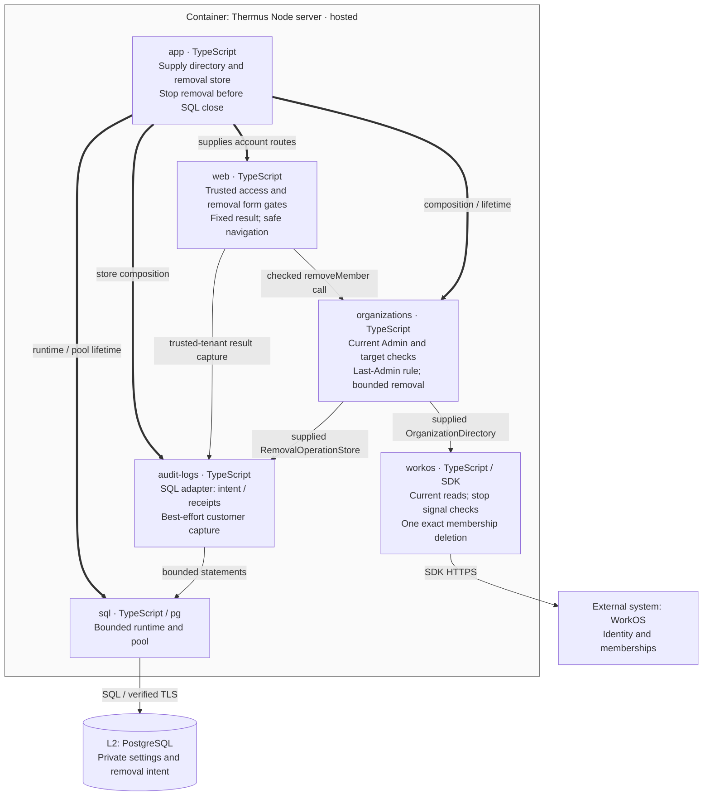

[OrganizationAdministration](../src/accounts/organizations/organization-administration.ts)
owns one [removal coordinator](../src/accounts/organizations/membership-removal.ts).
It checks current Admin authority before admission. The existing
[SQL adapter](../src/logs/audit/pg-destination-settings-store.ts) implements the
organizations-owned [store role](../src/accounts/organizations/removal-operation-store.ts)
through the shared [bounded runtime](../src/runtime/sql/bounded-sql-runtime.ts) of the
`sql` owner.
It admits at most one pending operation per organization in a short atomic
statement. A conflicting pending row returns busy. Each statement releases its
client before provider HTTP; no transaction spans those calls. A terminal receipt
stays until the next operation replaces it. The pending row has no lease.

After admission, the [current checks](../src/accounts/organizations/membership-removal-checks.ts)
reread the actor, exact target, roles, management, revision, and all active-member
pages within a fixed ten-page limit. Only active Admin memberships with the
required product and administration permissions count; pending records and
invitations do not count. MFA proof is not required. Unsafe, stale, unsupported,
incomplete, or last-Admin removal stops before the existing exact-ID WorkOS
boundary can delete once. These are current reads, not a remote transaction;
independent provider/operator writes remain a runbook constraint.

The scan uses the directory's
[membership-facts page](../src/accounts/organizations/organization-directory.ts)
for current IDs, subject, organization, status, management, all grants and
revision. The WorkOS adapter reads memberships and the current role catalog
without a user lookup for each member. The direct target `member()` read still
includes email; the safety comparison does not use it. Members display and seat
counts retain the complete display pages and their current email reads.

Unknown admission dispatches nothing. A possible provider effect keeps the pending
row. Confirmed no-send or provider settlement can complete only the matching
organization and operation ID. An uncertain completion requires a matching
terminal readback before the caller can claim the proven result; missing or
replaced rows do not prove completion. No polling, replay, worker, or lease
takeover is added.

The [server-owned lifetime](../src/accounts/organizations/membership-removal-lifetime.ts)
has a fixed 30-second monotonic budget, independent of browser cancellation.
It checks before and after each awaited step and supplies its stop signal to
directory reads. WorkOS checks that signal around each remote read, so expiry
and close stop later read calls and pre-dispatch deletion. They do not cancel
an SDK request or roll back a SQL write already in flight. Late provider answers
cannot start completion; an already-started terminal write may still settle its
own row. Removal uses the existing safe internal change recorder.

[Administration routes](../src/interfaces/web/account/administration-routes.ts)
accept POST `/members/remove` only after current selected-organization access.
They require the configured origin, valid CSRF token, and exact organization,
membership, and revision fields. A mismatched organization does not call removal.
The [member overview](../src/accounts/organizations/administration-overviews.ts)
supplies a read-time `removable` hint for ordinary active User/Admin targets; it
gives no authority to remove. Native confirmation names the target and carries its saved
revision. Cancel is a GET and writes no intent. The coordinator still checks
current authority, target support, revision, and last-Admin safety.

The POST returns a fixed result without a follow-up Members read. Applied,
refused, busy, unavailable, and unknown results remain distinct. Last-Admin
guidance links to invitations on Members. Result pages offer read-only Members,
identity-only workspace selection, and sign-in guidance without a removal form.
Self-removal uses those existing selection, eligibility, and saved-start paths;
it adds no session mutation or recovery store. Subsequent portal and MCP requests
resolve current access. A refresh does not prove that an unknown operation settled.

Web captures `remove-member`, membership ID, and the safe outcome through the
existing AuditLog using the trusted tenant ID, never the submitted organization.
Capture failure cannot change the result, complete an intent, or repeat deletion.
The existing snapshot and collector rules still decide whether export occurs.

### Selected C4 components: hosted Audit logs settings and delivery in the Node server

Scope: one hosted Node server container. Current Admins read and save their
organization's destination and test its saved revision through web routes.
Captured events use the same service and sender for current-revision dispatch.
PostgreSQL is a supporting Level 2 container; the configured customer Audit
destination is an external Collector or compatible OTLP service, including Axiom.
WorkOS remains the identity and organization authority.

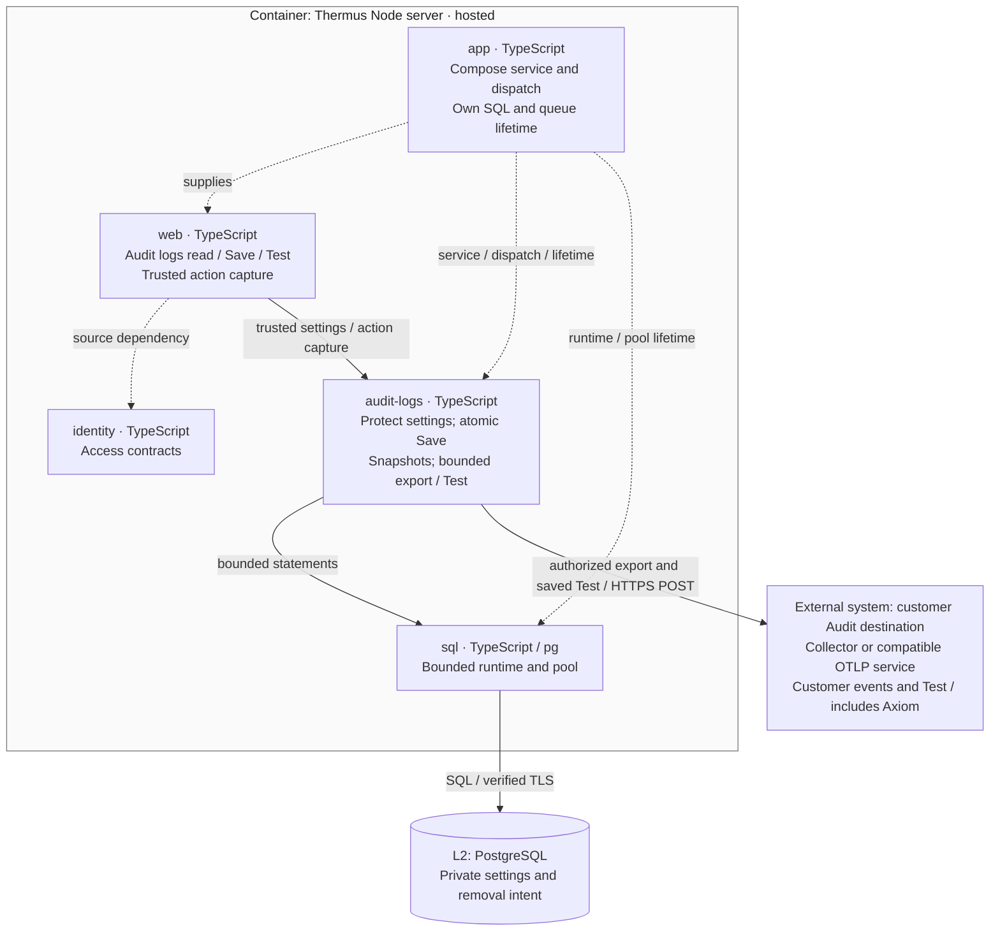

[Audit settings composition](../src/app/logging-storage.ts) supplies the settings store
and server key only when hosted storage configuration is available. It constructs
one service, collector, and sender; saved Test and export use that same sender.
The same adapter and pool implement the organizations-owned removal store.
App opens the one [bounded SQL runtime](../src/runtime/sql/bounded-sql-runtime.ts)
of the `sql` owner and gives it to this adapter and to the tenant registry.
Destination settings and export keep their existing contracts.
[Config](../src/runtime/config/logging-storage-config.ts) validates the URI,
independent 32-byte base64 key, and optional PEM CA bundle. URI query parameters
cannot override TLS or connection options. Dotted arrows show labelled composition
or source dependencies; solid arrows show runtime collaboration through supplied roles.

The [settings service](../src/logs/audit/destination-settings-service.ts) validates
settings, including an optional Axiom dataset, and exposes token presence plus
a narrow saved preview, never the complete token. For a valid Bearer credential
longer than four characters, the preview is its first four characters plus
`****`; credentials of four or fewer characters are fully masked. The preview is derived after
decryption, not stored separately, and reaches only the Admin form placeholder.
The input value stays empty. Web omits the preview from Test input; sender
destinations and Audit events do not gain it.
A nonblank dataset contains at most 128 ASCII letters, digits, or
hyphens. The web form offers Axiom and Custom choices and only Bearer
authentication. Axiom requires a dataset; Custom excludes it. The web boundary
maps that choice into the existing service input and rejects duplicate or
contradictory fields. The saved dataset determines the selected choice on read;
the storage format and service contract do not need a separate destination kind.
Existing None-auth rows remain readable; the form requires a Bearer token Save.
The web Test action saves the form first, including the export switch, then
calls the service Test with the returned saved settings and revision, and a
blank token input. Only saved or unchanged outcomes permit that call. Failed,
stale, or uncertain saves send no Test event. The service Test compares the
dataset with the saved version; it still refuses unsaved input. The
[credential codec](../src/logs/audit/destination-credential-codec.ts) uses AES-256-GCM
with tenant ID as authenticated data. Wrong keys, changed ciphertext, and tenant
mismatch fail closed. Blank Bearer input retains the saved token only when
endpoint and auth are unchanged. None clears it. A semantic no-op preserves
ciphertext and revision, including when the same token is entered again. A
dataset-only change retains an otherwise unchanged Bearer token and advances
the revision. Clearing the dataset returns to generic OTLP headers.

The [SQL adapter](../src/logs/audit/pg-destination-settings-store.ts) stores the
optional dataset with the destination and enforces tenant selection and expected
revision in one SQL statement. The additive dataset migration uses NULL for
existing generic destinations; it must precede activation of the new adapter.
The earlier adapter can still read its original columns after this migration.
Stale writes and first-save races return conflict. A write with an unknown commit result returns unconfirmed.
The native browser response offers only a GET saved-state link, with no Save
form or automatic retry. It adds no server-wide or session write hold. Every
later Save, including a manual old-form submission and a late commit, remains
subject to the atomic expected-revision rule.
Save validates endpoint syntax and literal addresses. Test uses the sender's
actual-connection address and TLS checks. No provider SDK enters the
[store contract](../src/logs/audit/destination-settings-store.ts).

### Selected C4 components: hosted tenant registry and provisioning in the Node server

Scope: one hosted Node server container, the control plane of the self
on-boarding plan. App reads `FREE_TENANT_LIMIT` and the switch
`MCP_TENANTS_ENABLED` through config, opens the one bounded SQL runtime of the
`sql` owner, and composes the `tenants` owner on it next to the settings and
removal adapter of audit-logs. With the switch on, app also reads the tenant
settings, composes the `render` adapter, and starts the provisioner loop of
`tenants`; it stops the loop at close, before the SQL runtime closes. Thick
arrows show composition; solid arrows show runtime calls; the dashed arrow is
the type-only source dependency of the adapter on the `TenantPlatform` contract
of `tenants`. PostgreSQL is the existing supporting Level 2 container, and the
Render API an external system. The gateway (SO-05) and signup (SO-07) are
planned callers of the request and the lookup and are not in this view.

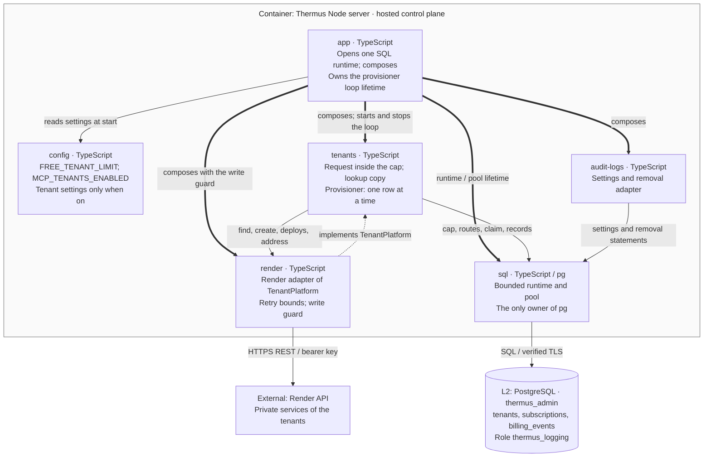

[TenantRequests](../src/tenancy/tenants/tenant-requests.ts) makes the tenant
request one idempotent insert of a `requested` row. The
[SQL adapter](../src/tenancy/tenants/pg-tenant-registry-store.ts) takes the
`tenants` table in `SHARE ROW EXCLUSIVE` mode, counts the rows by state, and
inserts only when the request allows it, in one transaction. That mode conflicts
with itself and with row writes but not with reads, so concurrent requests from
any pool take turns at the cap while lookups read on. An existing row stays as
it is in every state; a new row needs a free place under `FREE_TENANT_LIMIT`,
where every row except a `failed` or a `deleted` one holds a place. At a full cap
nothing is inserted and the result says full. A failure before the commit
destroys the client, so PostgreSQL rolls back; an unconfirmed insert gives an
unavailable result, and a repeat finds the committed row.

[TenantLookup](../src/tenancy/tenants/tenant-lookup.ts) keeps an in-memory copy of
every row's state and internal address. It reads the registry on demand, at the
first ask and at an ask 10 s or more after the start of the last successful read;
concurrent asks share one read. After a failed read, it serves the copy until it
is 60 s old, then reports unavailable. It has no timer and opens no connection at
startup. The [migration](../sql/migrations/20261027175430_tenant_registry_and_billing.sql)
holds the row rules: seven states, a service ID and address for a `live` row,
and a plain HTTP address to a private service name. The `subscriptions` and
`billing_events` tables have no store until Slice 3.

The [provisioner](../src/tenancy/tenants/tenant-provisioner.ts) moves rows only
from `requested` to `live` and, after a resume, from `deploying` to `live`. Its
[SQL adapter](../src/tenancy/tenants/pg-tenant-provisioning-store.ts) claims the
next row in one short [transaction](../src/tenancy/tenants/pg-tenant-claim.ts):
a `creating` or `deploying` row first, else the oldest `requested` row, which
becomes `creating` with its service name, the prefix of `TENANT_NAME_PREFIX` and
the organization ID in lower case with each character outside a-z, 0-9, and
hyphen as a hyphen, and the free plan. Each later record names the state that it
starts from. The loop works behind the
[`TenantPlatform`](../src/tenancy/tenants/tenant-platform.ts) contract: the
search by name, the create, the newest deploy, the internal address, and the
delete. The [Render adapter](../src/tenancy/providers/render/render-tenant-platform.ts)
implements it with the calls of the SO-01c probe. The create call carries a
closed list of tenant variables of plan section 4.1 with `OPERATION_CAPACITY=5`
and no secret. The adapter refuses a write for a service ID that the registry
does not own, and always for the production service.

### Selected C4 components: system and audit logs in the Node server

Scope: one Thermus Node server container. Solid arrows show runtime calls;
thick arrows show composition. Dashed arrows show type-only source dependencies.
App composition supplies the concrete sender to the settings service's required
DestinationTestSender role. The service does not select its own transport.
App also constructs SystemLog and the hosted settings service/runtime. Audit-logs
retains type-only ChangeOutcome and RemovalOperationStore dependencies on
organizations; that source edge is omitted here. The saved-destination Test uses the sender in production. MCP and protected web
boundaries capture customer events through a supplied AuditLog. The composition
uses activity-driven enabled/revision snapshots when hosted settings storage is
available. Hosted storage supplies bounded dispatch with a fresh saved-version
authorization read for each attempt.

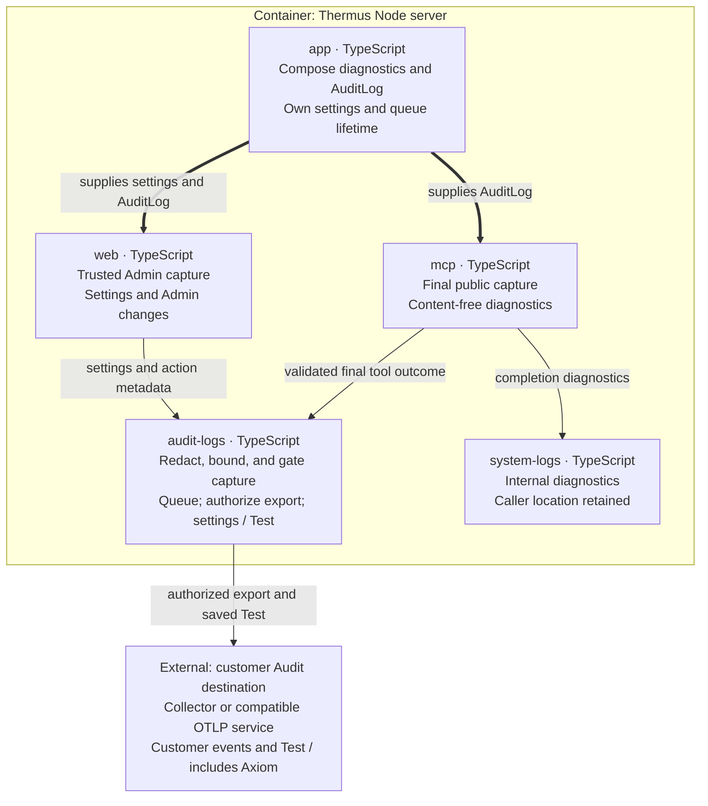

HTTP and CLI also use the narrow [SystemLog](../src/logs/system/system-logger.ts)
contract for errors. `SystemLog` is `Pick<SystemLogger, 'info' | 'error'>`,
exported by the SystemLogger module. It accepts plain objects with those methods.
The production entry composes SystemLogger with
[ConsoleSystemLogSink](../src/logs/system/console-system-log-sink.ts) on stderr.
SystemLogger filters by level and prepares local time, failure text, and caller
location before it calls the synchronous `SystemLogSink.writeSystemLog` role.
[OtelSystemLogSink](../src/logs/system/otel-system-log-sink.ts) maps that record
to the SDK; composition owns SDK export, flush, and shutdown. It ignores the
formatted local time because the SDK assigns its event timestamp. No production
exporter is configured here. The separate
[System Axiom test composition](../test/support/in-process/axiom-test-export.ts)
owns its SDK exporter, endpoint, and credentials; customer destination settings do
not configure it. Direct Audit delivery to Axiom uses the audit-owned sender and
adds no SystemLog forwarding path. A synchronous sink failure still reaches its
caller. Existing account and tool completion diagnostics remain internal. Tool records contain operation, tool,
status, duration, and opaque identities; they omit URL, query, reason, and result.

The concrete [AuditLog](../src/logs/audit/audit-log.ts) class exposes
`toolCompleted`, `administrationChanged`, and `destinationChanged`. It validates
and copies named event fields, redacts recognized credential fields and URL
parameters from tool input/results, and bounds the exported copy. It adds no
source location or stack, has no generic message method, and catches projection
and synchronous sink failures. It imports no system logger. There is no shared
base class or forwarding path between these owners.
Customer events retain authoritative `actor.authority` and `actor.subject` and
can add optional `actor.name` from the resolved account profile. The name is an
event-time snapshot for readability, not identity authority. The projection
omits blank, control, ill-formed, or over-1,024-UTF-8-byte names and keeps the
ID-only event. MCP, portal administration, destination metadata, and synthetic
Test events use this field. System logs retain their existing ID-only contract.
The identity owner defines optional resolved `user.name`. WorkOS reads the
matching profile through its existing SDK only after authority, organization,
and current grant checks allow access. It prefers a nonempty native name. A
missing, null, or blank native name permits joined trimmed first/last names. An
invalid nonempty native name is omitted, even if the split fields are valid.
One read has no retries and a five-second deadline that aborts
the request and body read. Failure omits the name without changing access. This
read occurs even with export disabled; denied resolutions make no profile read.
Better Auth uses the name from its existing account read. There is no new cache,
datastore, token-template change, component, or dependency edge.
AuditLog needs no separate role interface while it has one implementation.
AuditEventSink is the neutral destination contract: its synchronous
`writeAuditEvent` call may refuse admission and does not await export. When hosted
settings storage is available, app supplies one AuditLog backed by
[AuditSnapshots](../src/logs/audit/audit-snapshots.ts) to MCP and web. The snapshot
owner uses the existing settings store to load enabled/revision metadata.
Fresh enabled snapshots forward detached, frozen events with a saved revision to
RevisionBoundAuditSink. Hosted storage supplies an
[AuditCollector](../src/logs/audit/audit-collector.ts) through that contract.
For a missing or expired snapshot, the owner holds bounded projected events
while one asynchronous settings load runs. A current enabled result binds that
batch once to its observed revision. It reports the observation before admitting
the batch in arrival order. A fresh disabled snapshot refuses new events;
disabled, absent, invalid, failed, or late load results discard pending content.
Loading never waits in a product response. `true` from capture can mean only
provisional pending admission, not dispatch or receipt.

The first metadata read decides admission. An Enable concurrent with that read
can be observed and authorize pending content; the read does not establish the
settings at each event's timestamp. Once a batch is discarded, later Enable or
recovery cannot revive it. The collector still checks current enabled state and
the exact captured revision before every send. Without hosted storage, and in
the local edition, app retains the discard AuditLog. The collector owns bounded
memory admission and asynchronous dispatch. No event content is written to SQL.

MCP captures validated fetch/search input and final public text after SDK
projection and safe error/cancellation mapping. Invalid arguments, unknown tools,
request metadata, raw errors, and intermediate HTML are excluded. Fetch withholding
still projects to empty success; search withholding stays an explicit safe error.
Capture records produced content, not client receipt. Web captures invitation
send/resend/revoke, checked member removal, and Audit logs Save/Test metadata
with its current access context. Submitted organization IDs cannot route events. A stale A form naming B
stays in A's trusted tenant context. Unattributable requests produce no customer
event. A Test action event is separate from its labelled synthetic Test record.
Settings reads and sender/retry diagnostics do not capture themselves.

The [snapshot state owner](../src/logs/audit/audit-snapshot-state.ts) sets a
30-second freshness period, five-second failure backoff, 2.5-second load deadline,
two scheduled/active loads, 256 combined resident/load map entries, and 256 KiB of
accounted metadata. Tenant IDs are at most 1,024 UTF-8 bytes; saved revisions are
at most 128. Resident accounting reserves tenant bytes, the full revision
allowance, and 128 bookkeeping bytes. A load also reserves tenant bytes and 256
bookkeeping bytes, including its reference to an expired resident after eviction. This bounds retained fields and record counts; it does not
measure JavaScript heap. Resident entries hold metadata only, with no endpoint,
ciphertext, credential, or event content. Each load may separately retain 16
events and 1 MiB of serialized UTF-8 event bytes, with a 131,072-byte event limit.
The two-load bound therefore permits at most 32 pending events and 2 MiB,
separate from the collector's queue. Events are detached and frozen at pending
admission. Freshness/backoff eviction happens on activity, with no idle poll or
refresh timer. Unexpired failure backoff cannot be evicted to bypass it.

An absolute load deadline starts at admission; later events share it without
extension. Expired work cannot start a read or apply a result even if its timer
has not run. Expiry clears pending payloads and invalidates capture, but keeps an
active read's global and per-tenant metadata reservation until the underlying
store promise settles. An identity check rejects late results after timeout,
eviction, or close. Close cancels scheduled callbacks and deadlines, clears
resident snapshots and pending payloads, and prevents new reads without waiting
for an uncooperative store. At most two started unresolved read reservations can
remain until settlement; the SQL owner bounds and closes its separate work.
Snapshots are not authority for remote dispatch; the destination service freshly
checks saved settings before each attempt. See the [snapshot record](../docs/implementation/admin-s2-03b.md).

The [collector](../src/logs/audit/audit-collector.ts) copies admitted content and
charges one item and serialized-envelope byte account across queued, reading,
sending, and backoff states. Defaults are 128 global/16 tenant items, 8 MiB/1 MiB
serialized envelopes, 131,072 event bytes, 32 tenants, and two active exports with
one per tenant. Tenant FIFO includes backoff. Each item has one 30-second age
from admission; an authorization read has at most 2.5 seconds. These are content
and record bounds, not measured JavaScript heap. Pending capture can add up to
2.5 seconds before collector admission, so content retention across those owners
can reach 32.5 seconds. Physical read/native cleanup can retain charged metadata
after content has been cleared.

The destination service reads one full current saved version before each attempt.
It requires enabled state and the captured revision, then recovers that version's
credential and optional dataset. The collector forwards that authorized
destination to the sender without selecting a provider or copying System
settings. Missing/disabled/changed settings discard matching old work without
retargeting it. Read failure starts no send. Three authorization cycles include
read failure and sender busy. Only temporary read failure, busy, or typed transient
send failure permits retry. Exponential delay starts at 250 ms, caps its base at
two seconds, and adds up to 25% jitter. Retry-After is a minimum; work drops if
its delay cannot fit remaining age. No SQL transaction spans network work.

Successful current, unexpired snapshot loads report an observed enabled revision,
or no active revision for disabled/absent settings. The collector cancels existing
mismatches, or all existing work on no active revision. Failed loads notify
nothing; unknown tenants retain no state. This activity-scoped observation is no
global revision order or Save/Test broadcast. A late observation can lose work
conservatively; it cannot revive or retarget it. A later Save can race a send
already authorized, and sent data cannot be recalled.

A read deadline, age, observed change, or close clears the collector's event and
aborts its attempt. Unsettled reads/native work retain charged metadata
reservations until physical settlement, without retaining queue content or
releasing admission early. The sender clears its owned request body and auth on
abort, even during uncancellable DNS. `start` returns separate outcome and
physical-settlement promises; the collector holds its slot through settlement.
See the [dispatch record](../docs/implementation/admin-s2-03c.md) for retry,
lifetime, shutdown, and evidence limits.

The [projection owner](../src/logs/audit/audit-event-projection.ts) reserves
serialized input/metadata space before assigning result space. Fixed limits are
65,536 result UTF-8 bytes, 131,072 serialized event UTF-8 bytes, and 1,024 UTF-8
bytes per opaque metadata field. Maximum valid product input contracts stay
unchanged. Oversized or unsupported required metadata drops the event; an
invalid optional actor name is omitted without dropping the event. Only the
exported result is truncated at Unicode boundaries, with a marker and original/captured
UTF-8 sizes; the client result stays complete. Redaction covers recognized
credential patterns, not arbitrary secrets in free text. See the
[capture record](../docs/implementation/admin-s2-03a.md) for the supported fields
and evidence limits. The feature has no in-app event viewer.
Web reads, saves, and tests through the destination service. Storage, credential
protection, event projection, and the sender share the audit owner. The Test
operation connects saved settings to the sender.
`DestinationSettingsStore` stores endpoint, optional dataset, auth, enabled state,
encrypted credential, and revision. It is a settings port, separate from
AuditEventSink; the Slice 2 PostgreSQL settings store holds no audit history or event buffer.

The [Test operation](../src/logs/audit/destination-settings-service.ts) takes the
trusted tenant and actor from the protected web route. It compares submitted
fields with one fresh full saved version, decrypts its credential, and sends one
`audit.destination.test` event even when export is disabled. This service operation
neither calls Save nor changes Enable. The web Test action performs Save first;
a failed Test cannot undo that committed write. The route records the Save and
Test phases separately. A fresh post-settlement read must confirm the same
revision before a sender outcome can leave the service. A changed or absent
revision suppresses it; a failed read gives an unconfirmed result. No SQL lock
spans the network attempt. A Save can race an attempt; sent data cannot be recalled.
Save and Test return fixed safe results inside the Audit settings layout. A
confirmed Save shows `saved` above the buttons for 30 seconds or until another
edit. A small hash-pinned page script keeps a one-use, expiring scroll position
and timestamp in tab storage; it stores no form or credential data. Browser
storage failure does not prevent native submission. Timed hiding and scroll
restoration need scripts; native forms and honest results remain available
without them. An uncertain Save keeps only the styled GET recovery link, without
a write form or automatic retry. Direct POST responses add no server-side result
history or session state;
a deliberate browser resubmission can send another synthetic event.

[DestinationTestLifetime](../src/logs/audit/destination-test.ts) permits four
active operations per service and gives the caller a five-second total deadline.
Cancellation reaches the sender. A cancelled or timed-out operation retains its
Test slot until its callback, including late store reads, settles. Late reads
cannot start a send. The sender can settle its caller before native DNS cleanup;
its separate sender slot stays occupied until that work ends.
The operation has no queue, retry loop, result history, or background polling.
Hosted composition shares one sender between Test and export, with four native
DNS/TLS/HTTP slots and the same request/security limits. They also share the SQL
runtime (two active/four pending calls). Test retains its four-operation bound;
the collector separately permits two active exports, one per tenant.

The one-shot [OtlpAuditSender](../src/logs/audit/otlp-audit-sender.ts) accepts a
supplied destination/auth record, projected AuditEvent, and optional AbortSignal.
It sends one OTLP/HTTP JSON request to the configured Collector or compatible
OTLP service. Direct Axiom adds only the validated saved `x-axiom-dataset` header
to that same request; a blank dataset adds no such header. The endpoint remains
the Admin-supplied full logs URL, with the same public-address and TLS rules.
The encoder writes the captured Audit timestamp to both `timeUnixNano` and
`observedTimeUnixNano` as decimal-string nanoseconds. Thermus observes these events
at capture; queue delay and retries preserve that time instead of using send time.
`send` retains its typed outcome contract;
`start` also exposes physical settlement. Preparation is synchronous; native work
holds a clearable encoded body/auth/dataset holder, not the original event or
destination. Abort zeroes the body and clears its auth and dataset references. Its
[destination policy](../src/logs/audit/public-audit-destination.ts) checks every
DNS answer; its [TLS owner](../src/logs/audit/audit-https-connection.ts) pins the
selected address and checks the actual peer and server certificate before HTTP
content or auth. Redirects are refused. The sender owns four active slots per
instance, no queue, and a five-second caller deadline. A cancelled or timed-out
native DNS lookup retains its slot until it settles. No retry loop, settings
lookup, or SystemLog dependency is part of this operation. See the
[implementation record](../docs/implementation/admin-s2-02a.md) for protocol
outcomes, fixed bounds, and the isolated fixture's evidence limits.

### Selected C4 components: local authentication in the Node server

Scope: one local Node server container. Offline CLI administration belongs to
a separate process, shown in the container view and source-owner mapping.

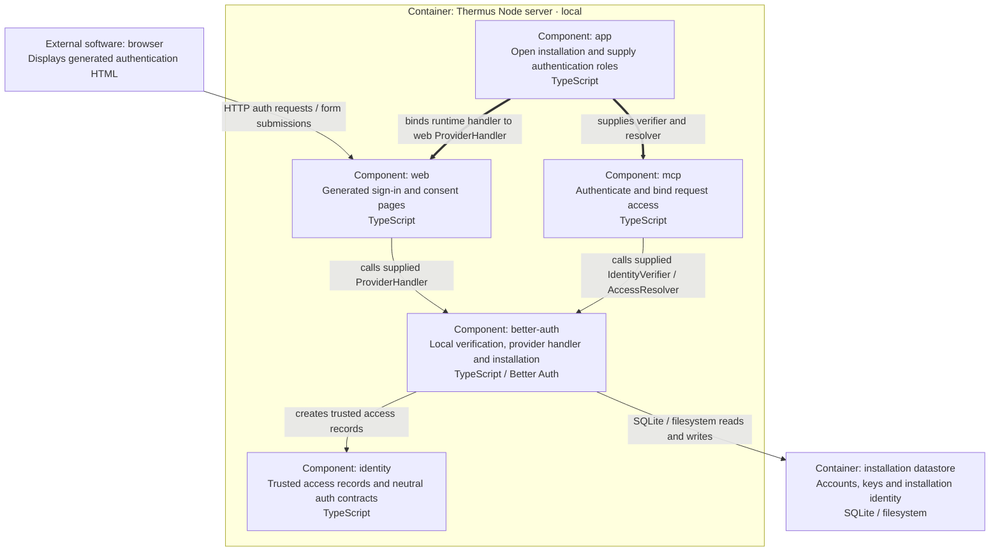

[Application composition](../src/app/application.ts) uses edition-specific
dynamic imports. It supplies `runtime.auth.handler` to
[LocalAuthPages](../src/interfaces/web/auth/better-auth/local-auth-pages.ts)
through the web-owned [ProviderHandler](../src/interfaces/web/auth/better-auth/local-auth-provider-routes.ts)
function contract. The collaboration arrow above is that supplied call, not a
source import from web to Better Auth. The provider implements neutral
identity contracts. Local composition does not construct hosted organization
administration. The [Better Auth runtime](../src/accounts/providers/better-auth/better-auth-runtime.ts)
owns its database and data-directory lock until app or offline CLI closure.
App closes request work before provider resources. HTTP listener drain and
logging sinks retain their responsibilities in the source-owner mapping.

## Runtime view

arc42 section 6 describes runtime scenarios. The collaboration overview below
keeps the broad map; the sequences show selected request and failure paths.
They follow [arc42 runtime guidance](https://docs.arc42.org/section-6/).

### Collaboration overview

Arrows show selected runtime collaborations, not TypeScript imports. Each box
can group several component IDs. These diagram groups are not source owners;
the table below defines the owners. Group node IDs stay stable for readable
Git diffs. WorkOS and public websites are external services. The local auth data
directory is application-owned storage.

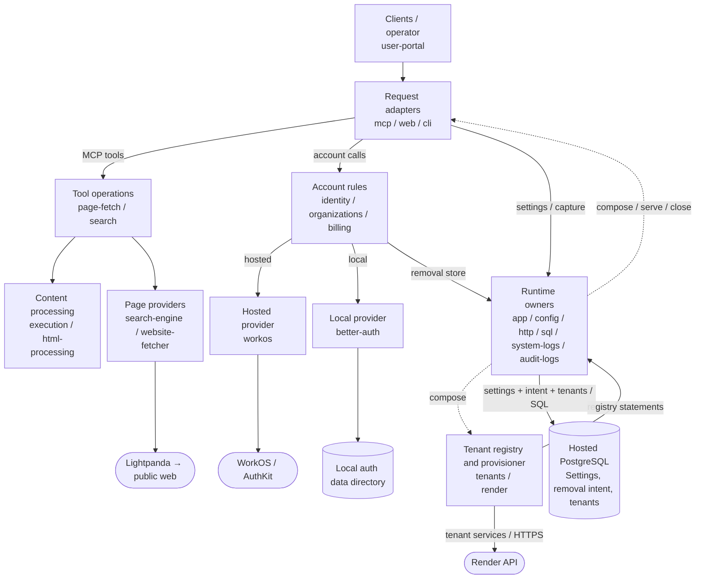

App constructs the collaborators and selects one authentication edition. The
account/provider arrows summarize that binding; identity records and contracts
do not themselves call providers. Hosted web uses sessions and organization
administration backed by WorkOS. Local CLI commands use supplied Better Auth
administration roles. The browser portal calls web routes over HTTP; app loads
its built assets through [HostedPortal](../src/app/hosted-portal.ts).

Within the provider group, the Brave search engine calls the supplied website
fetcher. Both search and page fetch reach external pages through Lightpanda;
search uses Brave HTML rather than a separate external API. Within the runtime
group, app owns composition and lifetimes, config validates settings, HTTP serves
the composed handler, and system-logs formats internal engineering diagnostics.
Audit-logs owns the optional hosted settings service, credential protection,
store, and saved-destination Test; sql owns the one bounded SQL runtime and pool
of every hosted store. App composes the tenant registry on that runtime; no
request adapter calls the registry yet. With `MCP_TENANTS_ENABLED=true`, app
also starts the provisioner loop of tenants, which creates the tenant services
through the Render adapter of render. Web calls the service
for the trusted current tenant and actor. Test sends one synthetic event; the
separate tool and administration capture shares hosted activity-driven snapshots.
Organizations calls the same SQL adapter through its supplied removal store for
admission and terminal receipts. This runtime call points from organizations to
audit-logs; the adapter's type-only source dependency points the other way.
The collector admits bounded memory and freshly authorizes each attempt before
using the same sender as Test. Neither stream enters SystemLog.

An **import dependency** points from an importer to the component whose module
it imports. The rules count runtime and whole-statement type-only imports
separately; inline `import { type X }` can still load a module. A **runtime
collaboration** follows calls on supplied objects/functions. For example,
page-fetch calls HTML processing through `IncomingStep`, but does not import
its implementation. Organizations calls a supplied WorkOS directory while
importing only neutral roles. The [review rules](../docs/implementation/pr-review-rules.yaml)
and generated metrics reports provide the complete import view; this diagram
does not duplicate it.

### Scenario: MCP page fetch and renderer cancellation

Scope: one authenticated MCP fetch in either server edition. The hosted server
adds a shared capacity check after authentication and access resolution: each
call holds one of the `OPERATION_CAPACITY` slots, default 10. Role
participants can be implemented by either selected provider. The incoming HTML
work runs only when rendering succeeds. Cancellation holds the hosted slot of
the call until renderer completion and cleanup settle.

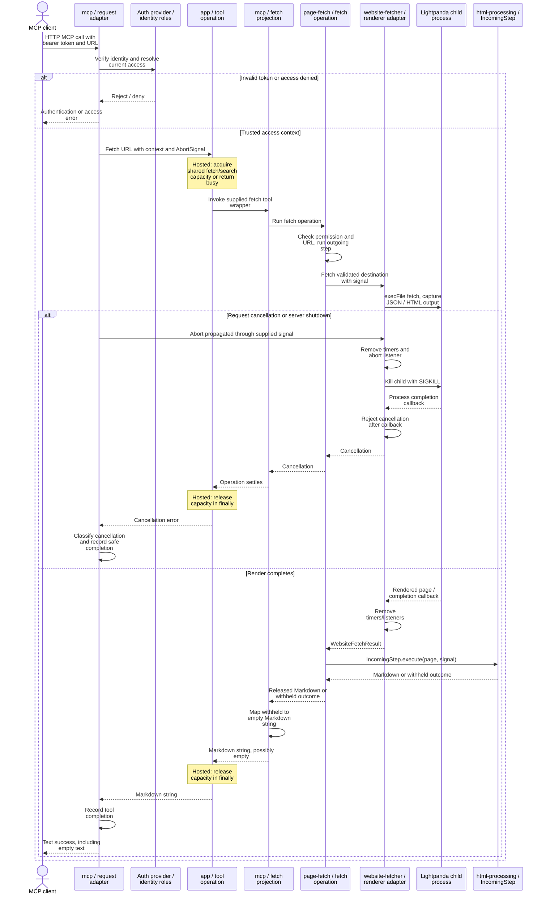

[Request authentication and shutdown](../src/interfaces/mcp/mcp-server.ts),
[tool adaptation](../src/interfaces/mcp/fetch-tool-server.ts),
[fetch ordering](../src/pipelines/page-fetch/fetch-page.ts), and
[renderer cleanup](../src/pipelines/providers/website-fetcher/website-fetcher-lightpanda.ts)
provide the contracts. HTTP disconnect handling and MCP shutdown propagate
cancellation; a disconnected client cannot receive a final response. Ordinary
failures, invalid inputs, blocked content, and cancellation remain distinct
inside the pipeline. The MCP-owned fetch wrapper maps withheld content to empty
Markdown text success. MCP records the safe completion status in its finalizer.

### Scenario: hosted default sign-in landing

Scope: the hosted callback after AuthKit sign-in, including native invitation
acceptance. AuthKit owns invitation acceptance. Thermus neither receives an
invitation token in this contract nor infers a joined organization from query
parameters. The WorkOS adapter maps validated exchange facts to neutral identity.

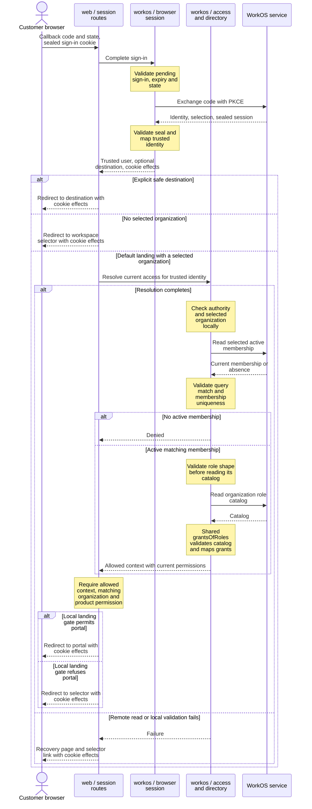

[Session routes](../src/interfaces/web/auth/workos/workos-session-routes.ts)
do not select the first or only membership. The existing
[workspace selector](../src/interfaces/web/account/account-routes.ts) handles
single, multiple, and no eligible memberships and rechecks access on selection.
An access-read failure after code exchange retains the new session and clears
the used sign-in cookie; recovery does not replay the code. Old sealed sign-ins
with an explicit destination remain valid. Explicit destinations retain their
own route access checks. Forged query hints grant no access. Joining creates no
creator agreement or local activation record. Browser selection does not change
the organization bound to an existing MCP token.

### Scenario: hosted member read

Scope: GET `/members` in the hosted Node server. The WorkOS adapter participant
groups the session, access resolver, and shared directory; each return follows
the request through that adapter. A signed-in session alone does not authorize
the read. Organization administration checks current Admin authority before
reading the overview. This groups remote reads, not a remote transaction. The
billing participant is the in-process `Billing` of the composition.

```mermaid
%%{init: {"sequence": {"wrap": true, "actorMargin": 20, "width": 140}}}%%
sequenceDiagram
  actor Browser as Customer browser
  participant Routes as web / account routes
  participant Provider as workos / auth and directory
  participant Admin as organizations / admin rules
  participant Billing as billing / plan
  participant Remote as WorkOS service
  Browser->>Routes: GET /members with Cookie
  Routes->>Provider: Authenticate cookie
  Provider->>Remote: Session validation / refresh when needed
  Remote-->>Provider: Session facts
  alt Signed out
    Provider-->>Routes: Signed-out state and cookie effects
    Routes-->>Browser: Signed-out notice with cookie effects
  else Signed-in session
    Provider-->>Routes: User and cookie effects
    Routes->>Provider: Resolve current access
    Provider->>Remote: Read current organization grants
    Remote-->>Provider: Current membership and roles
    alt Access denied
      Provider-->>Routes: Deny
      Routes-->>Browser: Access notice with cookie effects
    else Access allowed
      Provider-->>Routes: Trusted organization context
      Routes->>Admin: memberOverview(actor, organization)
      Admin->>Provider: Read current actor memberships and roles
      Provider->>Remote: Current membership and catalog reads (condensed)
      Remote-->>Provider: Current facts
      Provider-->>Admin: Validated memberships and grants
      Note over Admin: Check current authority and organization name
      alt Member overview denied
        Admin-->>Routes: Denied
        Routes-->>Browser: Refusal page with cookie effects
      else Member overview authorized
        Admin->>Provider: Read complete member pages
        Provider->>Remote: Member, catalog and user reads (condensed)
        Remote-->>Provider: Member data
        Provider-->>Admin: Safe member fields
        Admin-->>Routes: Complete member overview and organization name
        Routes->>Admin: invitationOverview(actor, organization)
        Admin->>Provider: Read current actor memberships and roles again
        Provider->>Remote: Current membership and catalog reads (condensed)
        Remote-->>Provider: Current facts
        Provider-->>Admin: Validated memberships and grants
        Note over Admin: Recheck current authority and organization name
        alt Invitation overview denied
          Admin-->>Routes: Denied
          Routes-->>Browser: Refusal page, no partial Members page
        else Invitation overview authorized
          Admin->>Provider: Read complete invitation pages
          Provider->>Remote: Invitation pages (condensed)
          Remote-->>Provider: Invitation data
          Provider-->>Admin: Safe invitation fields
          Admin->>Billing: Read the plan
          Billing-->>Admin: Plan, with the member limit of a free plan
          opt Free plan
            Admin->>Provider: Read complete active member fact pages
            Provider->>Remote: Membership and catalog reads (condensed)
            Remote-->>Provider: Member facts
            Provider-->>Admin: Status and grants
            Note over Admin: Seats: product members + pending invitations
          end
          Admin-->>Routes: Complete invitation overview, with seats on a free plan
          Routes-->>Browser: Combined Members HTML with cookie effects
        end
      end
    end
  end
```

[Account routes](../src/interfaces/web/account/account-routes.ts) authenticate
before access resolution. Signed-in route failures are reported and become a
request-failed page with the session cookie effects; a failure during initial
session authentication follows the outer failure handler instead.
An automatic WorkOS refresh that returns OAuth 400
`organization_membership_not_found` ends the local browser session and clears its
cookie. A new sign-in can then show current workspace choices. Other errors and
refresh refusal results keep their existing handling. Retryable outages and
unrecognized thrown errors retain the cookie; an explicit refused workspace
switch keeps its session. Membership removal and current-access checks remain
separate.
[Administration routes](../src/interfaces/web/account/administration-routes.ts)
permit GET/HEAD reads without a CSRF check.
[OrganizationAdministration](../src/accounts/organizations/organization-administration.ts)
checks current Admin authority separately before each overview. The
[shared directory](../src/accounts/providers/workos/workos-organizations.ts)
reads current remote state with bounded complete pagination. The route renders
only after both reads succeed; a denial or failed read cannot produce a partial
page. These are separate remote reads, not a transaction. The member overview
includes the organization name from the same current membership read that
authorizes it. Trusted member subjects supply the You label; safe invitation
fields supply expiry. The page shows only active members and pending invitations.
The directory member contract also retains `ordinary`, `external`, or `unknown`
management evidence, and includes it in the membership revision. All current
role grants remain available to callers; display roles do not replace them.
Hosted composition supplies `workosMembershipReads()` through the shared SDK
client. It maps raw membership GET/list replies before the SDK can default a
missing or null management field to false. Each read still sends one request.
The directory can delete one exact membership ID through WorkOS. A normal
void completion reports applied. Only the documented directory-managed 422
refusal reports unsupported without effect; other failures leave the effect
unknown. The existing client sends no automatic retry and keeps its five-second
request timeout. The checked administration removal operation calls this boundary
after durable admission and current safety checks. The provider boundary itself
supplies no admission, current-authority, or last-Admin check. The checked browser
removal route calls the coordinator, not that provider boundary directly.
The old `/invitations` page checks current authority and redirects to Members.
Privileged mutations and their recording rules
remain described under resource ownership and design choices below.
The former POST `/members/grants` route is absent. A request with current account
access reaches the existing 404 response after the session and access checks. The Members
page has no grant forms, and neither administration nor the directory exposes
a grant writer. Admin manages native invitations for User or Admin. Both roles
permit product and MCP access in their authorized organization. Unknown/default
grants give no access; invalid role catalogs fail closed. Browser sessions report
`mfaCompleted: false`, including retained cookies on read, refresh, and selection.
The member overview counts each active product-authorized membership once,
including Admin alone, and labels the count Active product members. These access
changes add no provider, process, datastore, or component boundary. On a free
plan, the invitation overview also gives the seats: the active memberships with
product access and the pending invitations, from complete reads. The page shows
"N of 5 seats used" in the Active members card; a failed read fails the whole
page, so no partial seat count shows (SO-08).

The portal uses the current access response to show Connect and Switch Workspace,
plus Members and Audit Log for the exact `admin` role. Connect and the admin pages
use one compact header menu in that order. Link visibility gives no authority.
The organization picker uses the same menu with Switch Workspace active. Identity
still admits it. An optional current-access read controls Admin links for the
selected workspace only; a denial, mismatch, or lookup outage keeps the picker
usable. Its selection POST still checks current membership and session authority.
Without an explicit safe return path, a successful choice opens Connect at the
public base path.
Invitation POST routes retain origin, CSRF, selected-organization, current-role,
and pending-target checks. A send beyond the member limit of a free plan gets
`409` with "This free workspace has 5 of 5 seats. Upgrade to Team to add more
members.", without a link, and its record and audit event keep `limit-reached`. A failure after a directory write starts raises the
neutral `UnconfirmedChangeError` and keeps an unknown change record. The route
returns a fixed notice with a read-only Check status link. It does not repeat the
write, show its private cause, or claim that a pending read proves email delivery.

### Scenario: tenant provisioning

Scope: the provisioner loop of the hosted control plane with
`MCP_TENANTS_ENABLED=true`, for one claimed row. App starts the loop after it
composes the hosted storage and stops it at close, before the SQL runtime
closes. The SQL adapter participant is the provisioning store of tenants on the
shared runtime; each Render call goes through the render adapter.

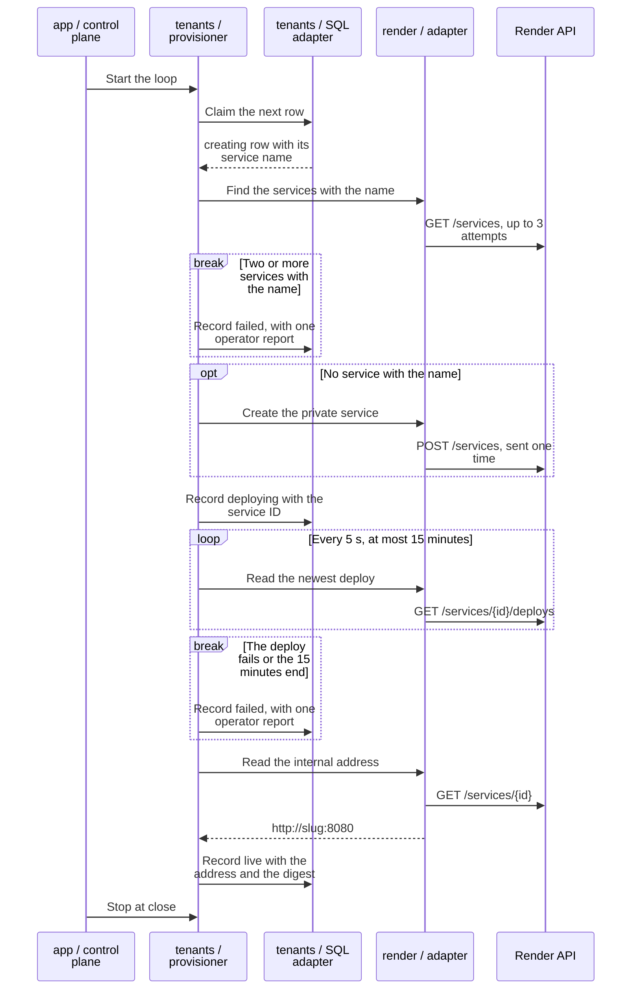

A claim without a row waits 5 s. A create that Render limits waits for
`Retry-After`, at most one hour, and a create without a clear answer waits 30 s;
the next attempt searches by name again, so a lost answer never makes a second
service, and a row has at most three attempts. A `deploying` row after a resume
skips the search and the create. A stop leaves a `creating` or `deploying` row
for the next start, which searches by name or reads the newest deploy again.
An unreadable registry or a failed record logs one error and waits 60 s.

## Deployment view

C4 deployment view; scope: source-defined local topology and recorded hosted
target. This is not a live cloud inventory. The
[self-hosted Compose contract](../compose.yaml) runs one Docker container;
its Node server and per-fetch Lightpanda child are two C4 process containers
inside that same Docker boundary. An offline CLI uses the same image and data
volume while the server is stopped. A data-directory lock prevents concurrent
installation ownership.

### Self-hosted Compose

The Node server listens on port 8080. Compose publishes it only at
`127.0.0.1:8080`, mounts `thermus-data` at `/var/lib/thermus`, and supplies
`/etc/thermus/ad-rules.txt` through a read-only bind mount. The server reads
that file at startup. These host bindings are described here to keep the
process and datastore view readable.

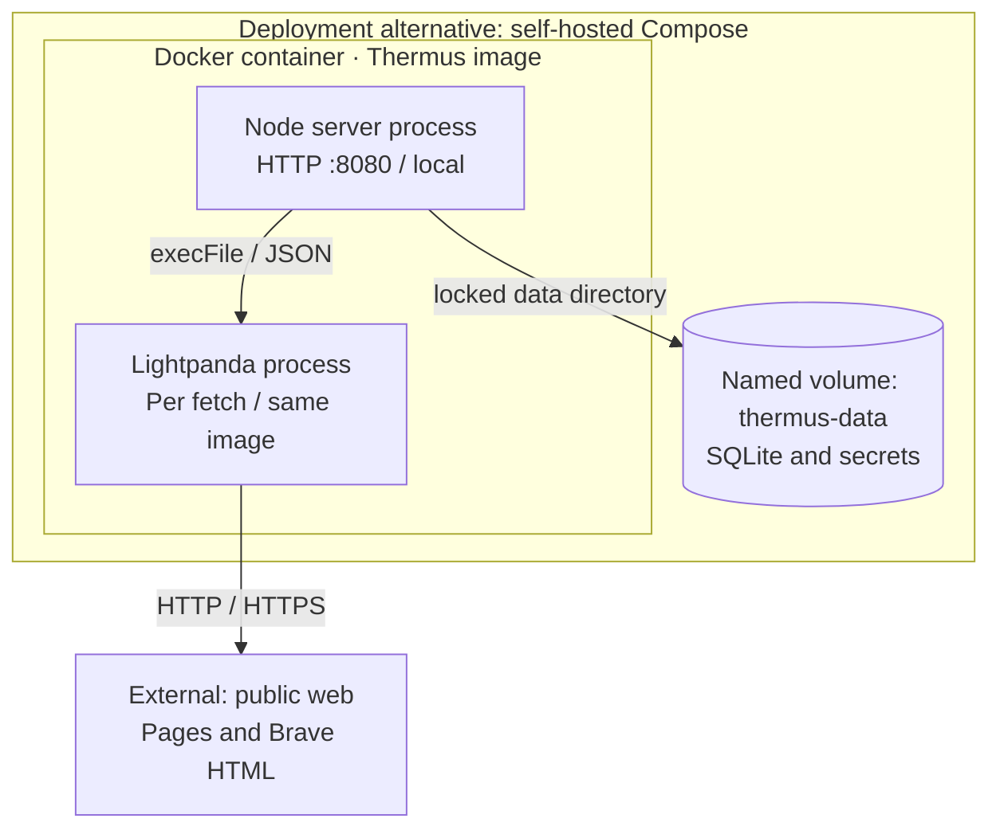

### Recorded hosted Render target

The recorded Render HTTPS edge forwards requests to the Node process on port
8080. PostgreSQL is the optional selected Supabase target with a private
`thermus_admin` schema; the diagram does not verify its rollout. The customer
Collector denotes the configured Collector or compatible OTLP service, including
Axiom. WorkOS includes AuthKit. The short labels retain process placement,
SQL/HTTPS connections, and the shared Docker image; ingress is described here.

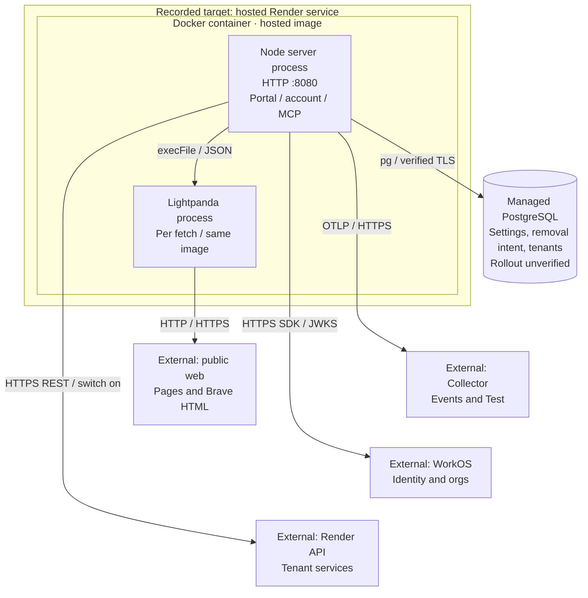

Both renderer children use HTTP or HTTPS to reach public websites and Brave.

[Dockerfile](../Dockerfile) pins Node and Lightpanda, runs as the `node` user,
and selects self-hosted operation. [Dockerfile.hosted](../Dockerfile.hosted)
includes the built portal and trusted rules and selects hosted operation.
The [recorded Render topology](../docs/implementation/render-hosted-docker-plan.md)
describes the earlier single-service target without a separate frontend, database,
Redis, disk, or worker. Source now supports an optional external PostgreSQL
datastore for destination settings, removal intent, and the tenant registry. The selected Supabase target and ordered setup are recorded in
the [organization-admin plan](../docs/design/organization-admin-plan.md#owner-setup-for-supabase--slice-2);
the [rollout ledger](../docs/implementation/admin-s2-04.md#evidence-and-release-holds)
records applied SQL and the remaining live connection, configuration, destination,
and capacity proof. Backup and recovery are future Slice 4 work under the owner
decision. Neither this source map nor that dated record verifies current cloud
configuration or claims a deployed Axiom destination.
Current replica count and activated database settings are unknown here. The
[removal-operation migration](../sql/migrations/20261025082850_membership_removal_operations.sql)
still needs deployment verification; this map does not claim that the live target
has its new table. The [tenant registry migration](../sql/migrations/20261027175430_tenant_registry_and_billing.sql)
is not applied there: SO-12 of the self on-boarding plan applies it.
Compose publishes only loopback HTTP. A different public address requires the
HTTPS reverse proxy described by the installation contract; this diagram does
not invent that infrastructure.

The tenant role of the same image (SO-03) has no recorded deployment yet. The
plan places each tenant in a Render private service of the workspace and region
of the control plane. With `MCP_TENANTS_ENABLED=true`, the provisioner of SO-06
creates it through the Render API in the workspace `RENDER_OWNER_ID` and the
region oregon, as an image-backed private service of `TENANT_IMAGE` with the
registry credential `RENDER_REGISTRY_CREDENTIAL_ID`; the recorded target runs
with the switch off. Two live interface runs each created and deleted one such
service in the workspace Thermus AI
([record](../docs/implementation/self-onboarding-s1.md#so-06-live-interface-run-of-the-render-adapter)). Measured on disposable services, a
private service reaches a web service at `http://<slug>:8080`, the
`CONTROL_PLANE_INTERNAL_URL` of a tenant, once the private address of a new web
service accepts connections; the
[SO-03 record](../docs/implementation/self-onboarding-s1.md#so-03-private-address-of-the-control-plane)
gives the runs and limits. This map draws no tenant deployment until one exists.

The hosted release path is source-defined since SO-02 of the self on-boarding
plan. At each merge to `main`, [`hosted-image.yml`](../.github/workflows/hosted-image.yml)
builds `Dockerfile.hosted` on a GitHub-hosted AMD64 runner, runs the hosted
image gate against that image, and pushes it by digest to the private GHCR
package `ghcr.io/tomer-mayara/thermus-hosted`. Only a manual dispatch on `main`
with a digest and a service ID deploys: the deploy job calls the Render API
deploy with `imageUrl` for an image-backed web service of the Thermus AI
workspace, which also sets its image setting `imagePath`, and Render pulls the
image by digest. The recorded hosted target above still builds from Git with
automatic deploys off, so its diagram does not change; step 5 of the SO-12
order moves it to the image. GHCR keeps every digest that a service runs and
the last ten release digests ([Hosted release](../README.md#hosted-release)).

## Ownership

The 23 IDs below are stable logical component names. Each root owns its source
files recursively. `app` also owns exactly `src/index.ts`. The directories
`accounts`, `accounts/providers`, `interfaces`, `pipelines`,
`pipelines/providers`, `runtime`, and `tenancy` group components; they do not own code.
Private subdirectories below an owner are implementation areas, not separate
components. These source owners are logical boundaries in the Thermus codebase.
They do not define deployment units.

Public boundaries use named modules, not a barrel. App has construction access
to concrete implementations. That access does not make every implementation
module a contract for other callers. The review rules define the exact checked
surface and the narrower file-context restrictions.

| Stable ID and source root | Responsibility and main parts | Boundary |
| --- | --- | --- |
| `app` — [`src/app/`](../src/app/), plus [`src/index.ts`](../src/index.ts) | Select hosted or self-hosted operation and the role of the hosted image; construct providers, routes, tools, logs, and shared services; own startup, shutdown, capacity, portal loading, the tenant composition and its routes, and hidden terminal input. | Entrypoint and application lifecycle; documented [tool composition](../src/app/fetch-tool.ts). Other components do not import app. |
| `identity` — [`src/accounts/identity/`](../src/accounts/identity/) | Define authenticated users, grants, immutable request contexts, permission checks, verification, browser sessions and profile controls, and local administration roles. Sign and verify the signed access context of a tenant with `jose`, and give the access of a verified context. | [Access context](../src/accounts/identity/access-context.ts), verifier, browser-session, browser-session-controls, local-user-administration, and [signed-access-context](../src/accounts/identity/signed-access-context.ts) contracts. The signer, the verifier, and the context resolver are for app. No provider or UI implementation belongs here. |
| `organizations` — [`src/accounts/organizations/`](../src/accounts/organizations/) | Customer roles, administration rules, member/invitation overviews, directory reads and native invitations, the member limit of a plan at invitation send, durable removal coordination and last-Admin checks, signup activation, seat calculations, and privileged change recording. | Directory, administration, overview, customer-role, change-record, removal-store, and signup-activation modules. Administration exposes removal requests/results and close. Directory-read, member-limit, and removal helpers remain private. |
| `billing` — [`src/accounts/billing/`](../src/accounts/billing/) | Report plan state, `free` with its member limit or `team`, and accept seat updates. `BillingFree` is the current implementation. | [Billing roles](../src/accounts/billing/billing.ts); app selects the implementation. |
| `workos` — [`src/accounts/providers/workos/`](../src/accounts/providers/workos/) | Hosted token/access verification, sessions, organization operations, signup/onboarding, settings, cookies, and signup-document validation. `WorkOSTokenVerifier` is the Connect token check alone, for a tenant. | App constructs provider/SDK objects. Web uses neutral supplied session, signup, and account roles; its WorkOS auth area still uses provider cookie and document-validation helpers. |
| `better-auth` — [`src/accounts/providers/better-auth/`](../src/accounts/providers/better-auth/) | Local authentication, access resolution, user/client administration, installation storage, data-directory lock, and cleanup. | Provider, runtime-opening, and administration-opening modules for app; storage and lock mechanics remain private. |
| `mcp` — [`src/interfaces/mcp/`](../src/interfaces/mcp/) | Adapt protocol requests to trusted access contexts and supplied tool operations. Own schemas, metadata, protocol errors, request lifetimes, and completion presentation. A request can carry its own scope: the access resolver and the tool server of an admitted tenant request. | Server/tool composition modules, protected-resource endpoint, and client-visible schema modules. SDK adaptation stays inside this owner. |
| `web` — [`src/interfaces/web/`](../src/interfaces/web/) | Account/admin/organization-selection routes, portal access, sign-in/out, signup, consent, forms, pages, escaping, and browser request protection. `account/` and `auth/` are private areas of this one owner. | Route constructors for app; shared account-form, page-html, and html-escape modules. Provider-specific browser adapters have narrower access than the whole owner. |
| `cli` — [`src/interfaces/cli/`](../src/interfaces/cli/) | Parse local user/client commands, use supplied administration and hidden-input roles, format output and exit status. | [Local command](../src/interfaces/cli/local-auth-command.ts). App opens and closes administration/input resources. |
| `user-portal` — [`src/interfaces/user-portal/`](../src/interfaces/user-portal/) | Browser portal behavior, connection instructions, styles, and static assets; Vite build configuration and declarations. | Browser HTTP interactions and rendered output. Vite runs in Node; browser modules cannot inherit its server/build access. |
| `execution` — [`src/pipelines/execution/`](../src/pipelines/execution/) | Operation IDs/context, outgoing/incoming step roles, bounded best-effort records, and pass-through request observation. | Execution-context, pipeline-step, and step-record modules. App constructs the observer. |
| `page-fetch` — [`src/pipelines/page-fetch/`](../src/pipelines/page-fetch/) | Check product permission and URL; run outgoing work, fetch, and incoming work; preserve cancellation, withholding, and safe failures. | [Fetch operation](../src/pipelines/page-fetch/fetch-page.ts), URL validation, and failure modules. Step executors remain private. |
| `search` — [`src/pipelines/search/`](../src/pipelines/search/) | Check permission/query, use a supplied search engine, process its page, and preserve cancellation, no-results, withholding, and safe failures. | Search-pipeline, search-query, and search-failure modules; private step executors and cancellation helper. |
| `html-processing` — [`src/pipelines/html-processing/`](../src/pipelines/html-processing/) | Input/depth limits; ad removal; hidden-content/control sanitation; Brave result projection; Markdown conversion. Transformer subdirectories remain inside one owner. | ProcessHtmlStep and documented [HTML runner](../src/pipelines/html-processing/html-to-markdown-pipeline.ts); documented ad-cleaner construction and depth-limit error. App selects concrete transformations. |
| `website-fetcher` — [`src/pipelines/providers/website-fetcher/`](../src/pipelines/providers/website-fetcher/) | Render pages with Lightpanda; destination/process policy; safe renderer failures and reports. | Fetcher/result/failure roles, renderer-failure-reports, and documented [network policy](../src/pipelines/providers/website-fetcher/network-policy.ts). App selects Lightpanda. |
| `search-engine` — [`src/pipelines/providers/search-engine/`](../src/pipelines/providers/search-engine/) | Build Brave search requests, validate the returned origin/document, and fetch through a supplied website fetcher. | [Search engine/document roles](../src/pipelines/providers/search-engine/search-engine.ts). App selects the Brave HTTP adapter. |
| `system-logs` — [`src/logs/system/`](../src/logs/system/) | Format internal engineering diagnostics with caller file and line. Customers cannot access this stream. | SystemLog for callers; concrete SystemLogger/LogLevel with a supplied SystemLogSink. ConsoleSystemLogSink and OtelSystemLogSink own output only. |
| `audit-logs` — [`src/logs/audit/`](../src/logs/audit/) | Own customer audit event projection, activity snapshots, bounded queue and current-revision dispatch, tenant destination validation and credential protection, atomic settings revisions, saved-destination Tests, and one-shot OTLP requests to the configured Collector or compatible service, including direct Axiom. Its SQL adapter also stores removal intent and terminal receipts on the shared `sql` runtime. The relay sink of a tenant sends its events to the control plane with the bounds of the collector. | AuditLog event methods and AuditEventSink; AuditSnapshots and RevisionBoundAuditSink; AuditCollector; destination-settings service with fresh export authorization and Test outcomes; neutral settings store, private codec, and SQL adapter; implementation of the organizations-owned removal store; OtlpAuditSender with tracked physical settlement. MCP and web share hosted snapshots and bounded dispatch; web reads, saves, and tests settings. |
| `http` — [`src/runtime/http/`](../src/runtime/http/) | Node listener, HTTP-to-Fetch exchange, trusted client address, request cancellation, connection tracking, and listener drain. | Server for app; client-address and request-cancellation modules for other consumers. Exchange mechanics remain private. |
| `config` — [`src/runtime/config/`](../src/runtime/config/) | Validate deployment/listen settings, `THERMUS_ROLE` and the tenant settings with the refusal of control-plane secrets, optional hosted logging storage settings, the hosted operation capacity, the free-tenant cap, and the switch `MCP_TENANTS_ENABLED` with the provisioning settings that only the switch reads, and read trusted ad rules. Provider settings stay with their provider; a tenant has no provider settings. | Deployment-config and ad-rules-file modules; app selects the logging-storage settings reader, the operation-capacity reader, and the free-tenant-limit reader. |
| `sql` — [`src/runtime/sql/`](../src/runtime/sql/) | Own the one bounded SQL runtime of the hosted stores: the `pg` pool with verified TLS, admission of active and pending work, acquisition, operation and statement deadlines, late-work accounting, and bounded close. The only owner that imports `pg`. | [Bounded SQL runtime](../src/runtime/sql/bounded-sql-runtime.ts) for the stores; app opens it and owns its lifetime. |
| `tenants` — [`src/tenancy/tenants/`](../src/tenancy/tenants/) | Own the tenant registry of the control plane: the tenant request inside the free-tenant cap, the in-memory route lookup with its refresh bounds, the provisioner state machine with its bounds, and the SQL adapters of the `tenants` table. | [Tenant platform](../src/tenancy/tenants/tenant-platform.ts), the contract that render implements; app composes the request, the lookup, the provisioner, and the adapters. The gateway and signup use the request and the lookup in later tickets. |
| `render` — [`src/tenancy/providers/render/`](../src/tenancy/providers/render/) | The Render API adapter of the tenant platform: the search by name, the create of an image-backed private service, the newest deploy, the internal address, and the delete, with the retry bounds, the count of the create limit, and the write guard. It holds the Render API key. | No public module; app composes it with the write guard of the registry. It imports only the contract types of tenants. Another platform would be a sibling owner under `src/tenancy/providers/` behind the same contract; the soft spots below name what moves with it. |

## Behavior and resource ownership

The [tool composition](../src/app/fetch-tool.ts) shares one fetcher, ad cleaner,
sanitizer, outgoing observer, step-record sink, and renderer-report closures
between fetch and search. Each operation gets fresh execution/HTML context.
Markdown converters are separate instances. Hosted fetch and search share one
[operation capacity](../src/app/operation-capacity.ts) of
`OPERATION_CAPACITY` calls, default 10, that the
[config reader](../src/runtime/config/operation-capacity-config.ts) checks at
startup. A call above that limit gets a busy error. This capacity has
application scope, not tenant scope or cluster scope.

Fetch runs ads → sanitizer → Markdown. Search runs ads → sanitizer → Brave
projection → search-preserving Markdown. The full search page is cleaned before
projection. [ProcessHtmlStep](../src/pipelines/html-processing/process-html-step.ts)
converts completed HTML work to the step outcome and preserves scan withholding.
`PipelineStep.execute` gives allow/block results; `HtmlTransformation.invoke`
updates HTML context. These are distinct protocols, not a generic Pipeline/Step
framework. Permission checks, invalid inputs, cancellation, withheld content,
and ordinary failures are distinct pipeline contract outcomes. The MCP fetch
[projection](../src/interfaces/mcp/get-url-as-markdown.ts) maps withheld content
to empty Markdown text success; clients cannot distinguish it from an ordinary
empty result. This baseline records that behavior; it does not change it.

The [MCP server](../src/interfaces/mcp/mcp-server.ts) binds a copied, frozen access
context to each authenticated request and tracks its work and cleanup. Shutdown
aborts request work and drains owned servers/transports. The
[application lifecycle](../src/app/application.ts) closes MCP work, waits for
listener drain, then disposes provider resources. The
[HTTP listener](../src/runtime/http/server.ts) tracks sockets and bounds drain
with a grace period.

The shared [Lightpanda adapter](../src/pipelines/providers/website-fetcher/website-fetcher-lightpanda.ts)
starts a child process for each fetch. It checks public destinations, sets
renderer network restrictions, bounds output/time, and removes timers/listeners
on completion. Cancellation kills the child. Search reaches Brave's public
HTML search page through that same adapter; it does not use a separate search
API service.

The local [Better Auth runtime](../src/accounts/providers/better-auth/better-auth-runtime.ts)
owns a data-directory lock and installation resources. The
[installation](../src/accounts/providers/better-auth/local-installation.ts)
keeps SQLite authentication/installation data, the secret, and the resource-server
client record together. Opening failure releases acquired resources; application
or CLI closure releases the database and lock. These files survive process
closure and must retain a consistent installation identity.

Hosted [composition](../src/app/hosted-workos-application.ts) shares a WorkOS SDK
client, remote key-set resolver, and organization directory. WorkOS owns remote
identity/organization data. Provider calls run during requests with a short
timeout and no SDK retry. Self-serve signup follows configured enablement and
selected organization/authority documents. Production composition supplies the
[purpose-marked organization removal bundle](../src/accounts/providers/workos/workos-organization-removal-documents.ts).
The bundle holds exact versioned bytes; the separate approval and rollout record
decides publication and deployment. Existing approved and historical bundles stay
unchanged. Account pages render the complete approved Audit and Members removal
help in native expandable regions; the frozen help bytes remain inside the web
component.
Signup remains false by default. The unchanged historical personal-User bundle
does not authorize new named creation; marked test documents prove behavior only.
The selected document versions and hashes use the existing WorkOS creator-record
fields. WorkOS organization metadata and the deterministic external ID retain
creation/legal facts independently of the optional logging-settings datastore. Google enrollment is an optional explicit composition;
production does not supply its onboarding settings.

The shared hosted [SQL runtime](../src/runtime/sql/bounded-sql-runtime.ts) of the
`sql` owner serves the settings and removal adapter and the tenant registry with
one pool and one role. It bounds active
and pending work, acquisition, caller duration and PostgreSQL statements. Caller
timeout does not free unsettled work from accounting. Late clients are destroyed;
late results cannot complete an expired caller. Idle-pool errors are observed.
The pool is lazy: configuration does not establish a live SQL connection or prove
TLS/grants. Missing or failed storage blocks removal but leaves MCP and admitted
product access independent of SQL. The local edition does not open this pool.
Each client of the pool has an error listener, so a connection that the database
ends while work holds the client between two statements fails that work and
does not end the process.

The provisioner loop has one lifetime, which app owns: it starts with the hosted
storage when `MCP_TENANTS_ENABLED` is on, and the storage close stops it before
the SQL runtime closes. The loop works on one row at a time and holds no state
between rows except the create window of the Render adapter. Each step can
repeat: the service is found by its name, and the newest deploy is read again.
Reads and the delete of the adapter have up to 3 attempts after a `429`, a `5xx`,
or no answer; a create is sent one time in each attempt; a deploy is read every
5 s for at most 15 minutes. The adapter keeps the Render API key in a private
field, and no log line holds it.

A tenant composes one MCP server, one relay sink, and the hosted tool
operations with one `OPERATION_CAPACITY` owner. Each admitted request gets its
own access resolver and tool server; the relay sink and the capacity are
shared. Close aborts the request signals, closes the MCP server and its tool
work, then closes the relay sink, which aborts its attempts and drops the
pending events. The tenant holds no database pool and no WorkOS client.

Hosted application close starts MCP cleanup and the administration/storage cleanup
chain together. It stops removal before hosted composition closes snapshots and
clears their pending content. The collector then stops admission, clears content
and aborts attempts, and SQL closes. The SQL runtime rejects new work, expires
admitted calls and bounds pool closure within the existing process
shutdown deadline. Unsettled read/native work retains charged metadata
reservations; late results cannot start dispatch or restore content. Destination
settings, pending removal rows, and terminal receipts persist across runtime
closure; export queues are memory-only. A terminal write that started before a
removal stopped may still commit for the same operation.

## Design choices and current soft spots

The source uses a composition root and role-based adapters: app selects concrete
implementations while callers use supplied verifier, directory, engine, fetcher,
and step roles. Edition-specific dynamic imports keep provider startup separate.
Immutable [access records](../src/accounts/identity/access-context.ts) keep trusted
identity and permissions together. Ordered HTML transformations separate cleanup
operations; [ChangeRecording](../src/accounts/organizations/change-records.ts)
separates invitation checks from one directory mutation and records uncertain
outcomes without repeating a mutation. Removal uses its safe record sink after
its own durable coordination; the sink does not own admission, settlement, or retry.
A failed post-write recorder cannot replace the completed outcome or the original
failure. Disposable stacks and idempotent close
promises make ownership explicit. These are observed uses, not requirements to
add a class hierarchy or a shared workflow engine.

The following limits affect architectural decisions today:

- HTML safety and conversion depend on local [pinned patches](../pnpm-workspace.yaml)
  for agent-input-sanitizer 1.47.14, Defuddle 0.19.4, and LinkeDOM 0.18.13.
  Dependency upgrades must preserve deletion ranges, extraction checks, joiner
  handling, and attribute escaping. Use the existing affected interface and
  acceptance contracts described in the [README](../README.md) to verify them.
- Privileged account changes still go to the internal system log through
  [accountChangeRecorder](../src/app/application.ts). Step records are explicitly
  [best effort](../src/pipelines/execution/step-record.ts). These streams provide
  no customer audit access. Separate customer capture is wired through a supplied
  AuditLog. Hosted activity-driven snapshots gate capture and retain bounded
  events while initial or expired settings load. Bounded asynchronous dispatch
  freshly authorizes each attempt. Queue pressure, expiry, failure, and restart
  can lose events; retries can duplicate receipt. Thermus
  stores no audit history and promises no durable destination storage.
- [BillingFree](../src/accounts/billing/billing-free.ts) returns a free plan with
  the member limit 5 and zero billed seats, including after seat updates. The
  billing role is a seam, but there is no paid-plan implementation or durable
  seat billing here.
- The [member limit](../src/accounts/organizations/member-limit.ts) runs the
  sends of one organization one at a time in one process, because the hosted
  control plane runs one instance. Two instances, for example in a deploy
  overlap, do not share the queue. The application cannot refuse a native
  acceptance in AuthKit, so a pending invitation reserves its seat at send time.
- The [Brave adapter](../src/pipelines/providers/search-engine/search-engine-brave-http.ts)
  validates specific HTML selectors and no-results text. Upstream page changes
  can reject search responses; the separate
  [result projection](../src/pipelines/html-processing/search-results/brave-http-result-cleanup.ts)
  also contains Brave document knowledge. Changes to that external format need
  review across both owners.
- Browser authentication is only partly provider-neutral. Web's
  [WorkOS session routes](../src/interfaces/web/auth/workos/workos-session-routes.ts)
  use neutral session controls but retain provider cookie helpers; signup uses
  a neutral activation contract with provider document validation. Local pages
  use a supplied Response-returning handler. A provider change must preserve each browser
  contract, cookie, Origin/CSRF, and return-path protection; a common provider
  interface alone does not cover this work.
- The tenant role exists in code, but its callers do not: the gateway of the
  control plane and the route `/internal/audit` come with SO-05. Until then no
  deployment runs a tenant. The relay is best effort like the capture of today:
  a refused, failed, slow, or excess relay loses its event. Traffic on the
  private network is plain HTTP, and a context can repeat within its 2 minutes,
  but only with its own bearer token and at the tenant of its organization.
- The application-wide hosted capacity bounds this process only, to
  `OPERATION_CAPACITY` calls. It rejects a call above that limit instead of
  queuing work and does not coordinate multiple instances. A deployment change
  must account for that actual scope.
- One control plane runs one provisioner loop. Its claim is a short
  transaction, not a lease: a second instance would work on the same rows. A
  slow deploy holds the queue for up to 15 minutes, and the creates of one hour
  are 20 for each Render user. The tenants run in the region oregon, the region
  of the control plane, as a constant of the adapter.
- Render shortens a long service name into its hostname at a separator and
  keeps hostnames unique: names of up to 33 characters stayed whole, names of
  42 and 45 characters became `thermus-spike-tenant-org`, and a second service
  with that start got a suffix (SO-06 live runs). A production tenant name has
  45 characters, so the provisioner stores the address that Render returns, and
  the gateway uses it, never one computed from the name. Since 27 October 2026
  each character of the organization ID outside a-z, 0-9, and hyphen becomes a
  hyphen in the name, which keeps it DNS-safe. The name is one to one only for
  organization IDs of the WorkOS form, `org_` and capital letters and digits: two
  IDs that differ only in case or in such a character would share a name, and
  the search by name would take the service of the other organization.
- The platform of the tenant containers is replaceable behind the
  [`TenantPlatform`](../src/tenancy/tenants/tenant-platform.ts) contract of
  `tenants`: only app composes the Render adapter
  ([`src/tenancy/providers/render/`](../src/tenancy/providers/render/)),
  `render` imports only the types of `tenants`, and `tenants` never names
  `render`. A second platform, such as another managed container service, is a
  new owner under `src/tenancy/providers/<platform>/` that implements the five
  operations, a settings reader of its credentials in `config`, and one line in
  the composition; the provisioner, the registry statements, the gateway, and
  the loop tests stay. Three things outside the adapter still carry the shape of
  Render and move with it: the registry column `render_service_id` and its
  `srv-` check and the live-row constraint of the SO-04 migration; the
  Render-named settings `RENDER_API_KEY`, `RENDER_OWNER_ID`, and
  `RENDER_REGISTRY_CREDENTIAL_ID`, and the plan values of `TENANT_PLAN_FREE`,
  which are Render plan names behind the opaque `plan` of the contract; and the
  internal address, a plain HTTP origin whose column check and design assume a
  flat private network with name-based DNS. A fourth is wording, not a
  dependency: six operator-facing reason strings and some comments inside
  `tenants` say "Render" (for example `Render refused the create`, `The Render
  service <id> no longer exists`, and `No Render service after 3 attempts`);
  SO-09, which changes the same loop messages for the fleet commands, makes them
  platform-neutral ("the platform", "the tenant service"). The unit tests of the
  loop run on `TenantPlatformFake` (the port), and the acceptance and PostgreSQL
  cases on `RenderFake` (the protocol), so only the live interface test touches
  Render (28 October 2026, owner review of PR #283).
- The free-tenant cap counts registry rows by state, not by tier, and a tenant
  request keeps an existing row in every state, also `failed` and `deleted`.
  Slice 3 must decide whether a team tenant holds a free place, and the repair
  of SO-09 ("delete, then request") needs its own registry operation.
- The tenant registry shares the two active and four pending slots of the one
  SQL runtime with the settings and removal adapter, and it exists only when the
  hosted storage settings are valid. The composition keeps its logging name
  (`HostedLoggingStorage`) while it carries the registry; a rename can come with
  the Slice 4 cleanup, together with the role name `thermus_logging`.

These statements identify source behavior and its effects. They do not assign
quality scores or claim that an unmeasured component needs a rewrite.
