# Component registry

This is the current architecture of Thermus. It describes component intent,
important collaborations, and known limits. The [review rules](../docs/implementation/pr-review-rules.yaml)
remain the machine authority for source ownership, public modules, and permitted
imports. This registry is not another import allowlist.

Use the [registry update workflow](../docs/implementation/component-registry-workflow.md)
when a change affects this view. Git history and pull request diffs show its
evolution. The [component structure proposal](../docs/design/component-structure-proposal.md)
records the migration design; this page describes the resulting system.

This baseline uses selected arc42 sections: context (3), building blocks (5),
runtime (6), and deployment (7). It does not fill the complete template.
[C4 notation](https://c4model.com/diagrams/notation) supplies element types,
responsibilities, technologies, and labelled relationships. A
[C4 container](https://c4model.com/diagrams/container) means an application,
process, or datastore; it does not mean a Docker container or a source folder.
The [arc42 building-block view](https://docs.arc42.org/section-5/) adds the
static decomposition. Ordinary Mermaid expresses these views without special
C4 syntax. Each heading gives the diagram type and scope.

## Context

C4 system context; scope: Thermus as one software system. Thermus converts
public pages and Brave HTML search results to cleaned Markdown for MCP clients,
and provides account and connection pages. External clients and websites are
outside its trust boundary. Local Better Auth belongs inside Thermus.

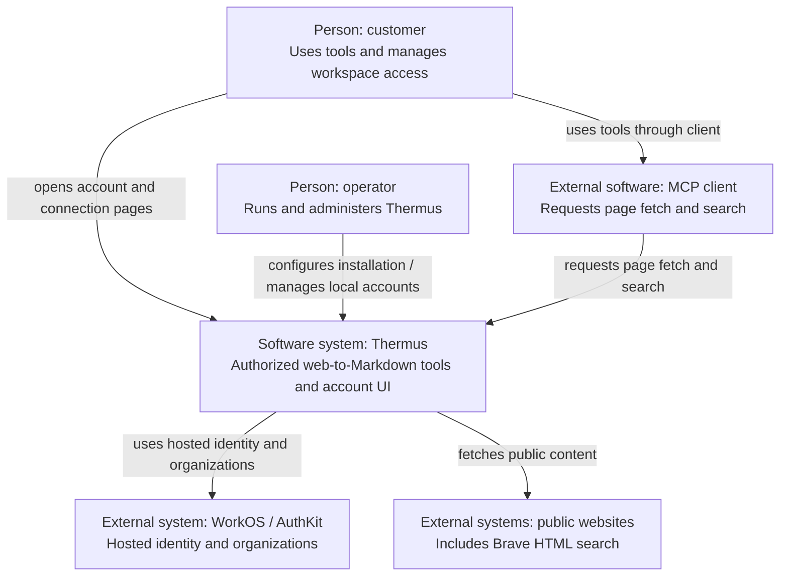

## arc42 building-block view

### C4 containers: hosted edition

Scope: Thermus hosted system. The browser portal is a separate browser
application. The Node server serves its assets and routes. Lightpanda is a
short-lived process container even when it shares the server's Docker image.

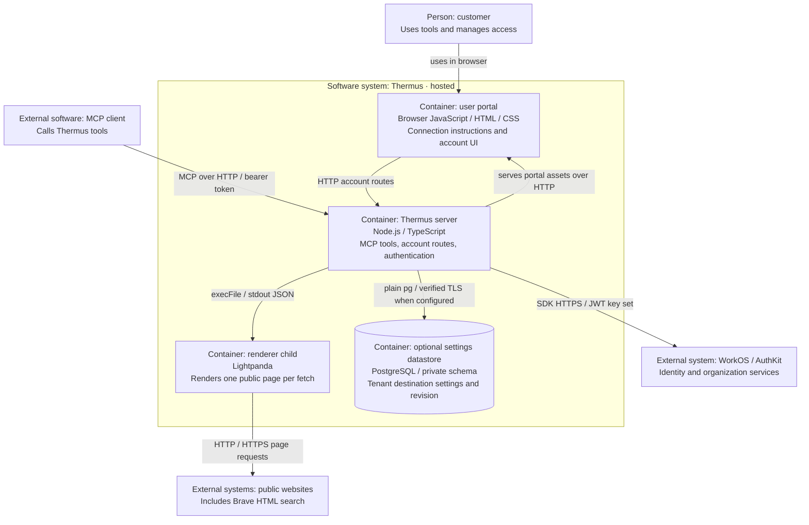

### C4 containers: local edition

Scope: Thermus self-hosted system. Better Auth is built into the server;
it is not an external service. Local authentication pages are server-generated
HTML responses, not a second browser application. The operator runs CLI
administration while the server is stopped, using the same installation data.

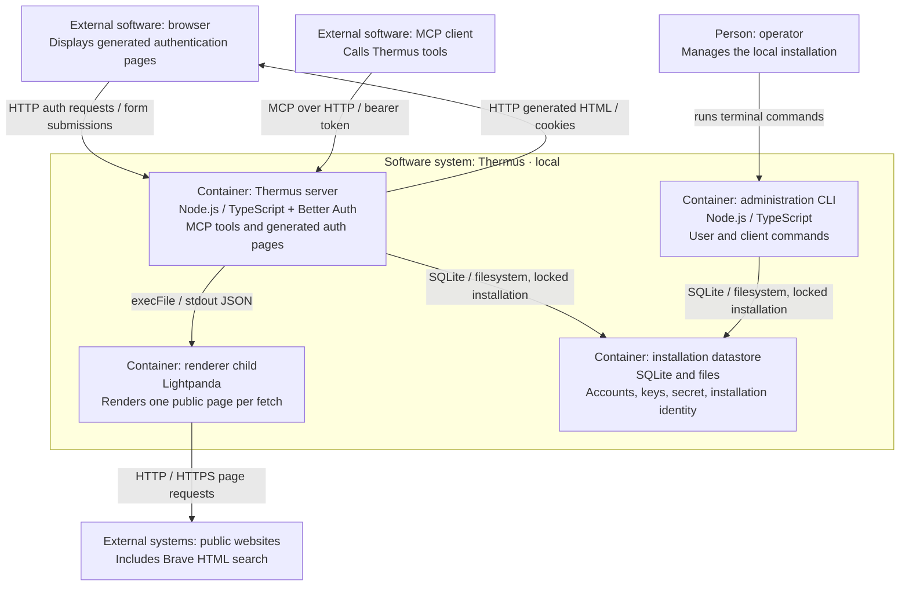

### Containers and source owners

This mapping lists principal contributors from the 20 registry IDs
without turning them into 20 containers. Owners are logical source boundaries;
some contribute code to both server and CLI. The [Ownership](#ownership) table retains the full source
roots, responsibilities, and public contracts.

| Container or artifact | Registry owners that contribute |
| --- | --- |
| Both Node server editions | `app`, `config`, `http`, `system-logs`, `mcp`, `web`, `identity`, `execution`, `page-fetch`, `search`, `html-processing`, `website-fetcher`, `search-engine` |
| Hosted server additions | `organizations`, `billing`, `workos`, `audit-logs` (settings runtime only) |
| Local server addition | `better-auth` |
| Local administration CLI | `app`, `cli`, `config`, `http` (client-address helper), `system-logs`, `identity`, `better-auth` |
| Hosted browser application and build assets | `user-portal`; app's `HostedPortal` loads its built files |
| Renderer process | External Lightpanda binary, controlled by `website-fetcher`; no new source owner |
| Local installation datastore | Opened and owned by `better-auth`; no new source owner |
| Optional hosted settings datastore | `audit-logs` owns SQL access; `app` owns its runtime lifetime; no new source owner |

### Selected C4 components: tool processing in the Node server

Scope: one Thermus Node server container, in either edition. Each component
box gives its stable owner ID, responsibility, and technology. Solid arrows
show selected collaborations through supplied roles or directly held objects;
they do not assert source imports of the selected implementation. Thick arrows
show app composition. The [review rules](../docs/implementation/pr-review-rules.yaml)
remain the complete source-import policy. Supporting process containers and
external systems sit outside the server boundary.

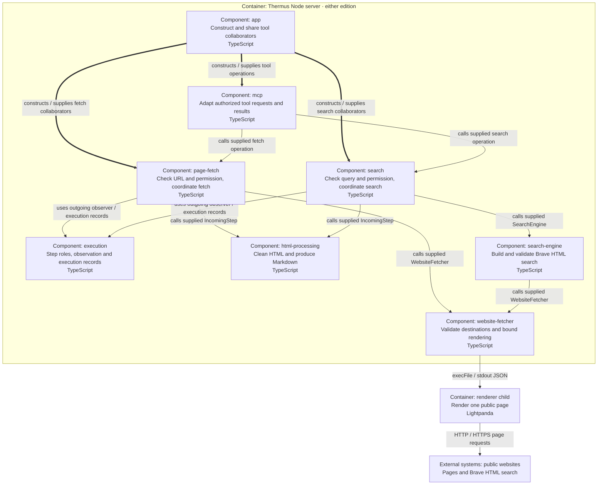

[Tool composition](../src/app/fetch-tool.ts) shares one fetcher, ad cleaner,
sanitizer, observer, record sink, and renderer-report closures between both
operations. Each tool has its own `ProcessHtmlStep`, HTML runner, and Markdown
converter. Fetch uses ads → sanitizer → Markdown; search inserts Brave
projection before Markdown. [PipelineStep](../src/pipelines/execution/pipeline-step.ts)
and [HtmlTransformation](../src/pipelines/html-processing/html-to-markdown-pipeline.ts)
are distinct protocols, not a generic pipeline engine. `ProcessHtmlStep`
implements the execution-owned incoming role; callers need not import its
concrete class. Each operation has fresh execution and HTML context. Hosted
composition wraps fetch and search in one application-wide capacity slot.

### Selected C4 components: hosted authentication in the Node server

Scope: one hosted Node server container. The browser application and WorkOS
service remain outside that boundary. Role use follows calls on supplied
collaborators; it does not reverse the source dependency from provider
implementations to neutral contracts.

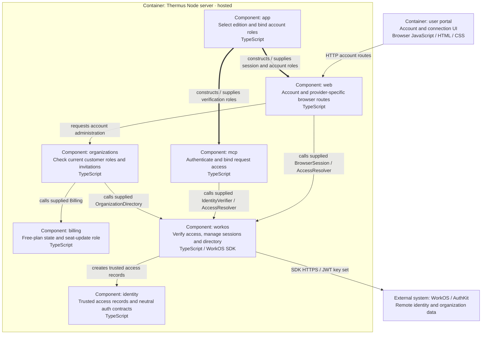

[Hosted composition](../src/app/hosted-workos-application.ts) shares a WorkOS
SDK client, key-set resolver, and directory and selects `BillingFree`.
[WorkOSAuthProvider](../src/accounts/providers/workos/workos-auth-provider.ts)
implements identity-owned verifier/resolver contracts;
[WorkOSOrganizations](../src/accounts/providers/workos/workos-organizations.ts)
implements the organizations-owned directory role. `WorkOSBrowserSession`
implements the identity-owned `BrowserSessionControls`, including profile data
for display and trusted identity from a completed sign-in. A missing sealed
return destination selects the default landing; an explicit safe destination
keeps its existing behavior. The callback uses the same supplied access resolver
to check the selected organization before the default portal redirect. Signup
uses the organizations-owned `SignupActivation` contract,
including the requested organization name and purpose-marked legal bundle. The
signup form calls the public organizations name validator, so this dependency
includes runtime behavior. The dependency rules declare that existing owner pair.
The WorkOS adapter saves the canonical creator/authority record on the named
organization and confirms active Admin/product access after a new create. The
signup route uses supplied session controls to select that organization after
a current-membership check, then opens its MCP guide. A failed switch does not
repeat the grant. Existing records remain replay barriers.
The web routes use these neutral contracts; WorkOS cookie and document-validation
helpers remain provider-specific. Composition supplies the portal's allowed
form destinations. The portal uses a supplied current active-organization name
read for workspace display; an absent or blank name returns unavailable rather
than a fallback identity. Profile data does not grant access.

### Selected C4 components: hosted settings storage in the Node server

Scope: one hosted Node server container. This optional foundation has no browser
Save route or customer export caller. The PostgreSQL datastore is a supporting
Level 2 container; WorkOS remains the authority for identity and organizations.

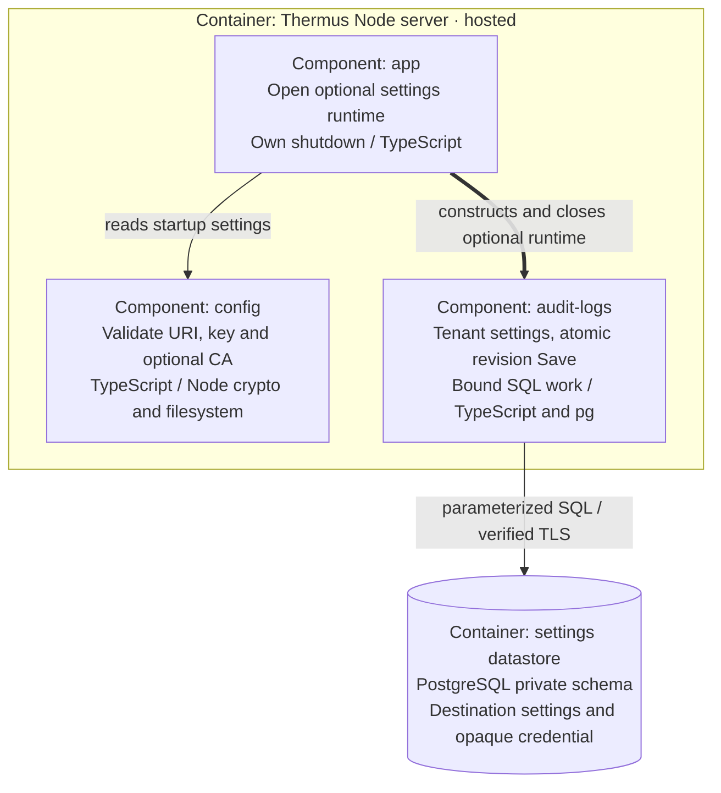

[Audit settings storage composition](../src/app/logging-storage.ts) returns unavailable
when settings are absent or invalid. [Config](../src/runtime/config/logging-storage-config.ts)
validates the PostgreSQL URI, independent 32-byte base64 key and optional PEM CA
bundle. URI query parameters cannot override TLS or connection options. The
[SQL adapter](../src/logs/audit/pg-destination-settings-store.ts) uses the
[neutral settings contract](../src/logs/audit/destination-settings-store.ts).
It stores an opaque credential; encryption and destination decisions are not
implemented here. No provider SDK types enter that contract.

The store selects by tenant ID and compares the expected revision in one SQL
statement. First-save races and stale writes return conflict. An identical row
keeps its revision; an actual change gets a new revision. A write whose outcome
cannot be confirmed returns unconfirmed. The future caller must supply the
trusted tenant ID and preserve ciphertext for semantic no-op decisions.

### Selected C4 components: system and audit logs in the Node server

Scope: one Thermus Node server container. Solid arrows show runtime calls or
composition. Dashed arrows show type-only source dependencies. Audit event
projection is implemented but has no production caller or exporter.

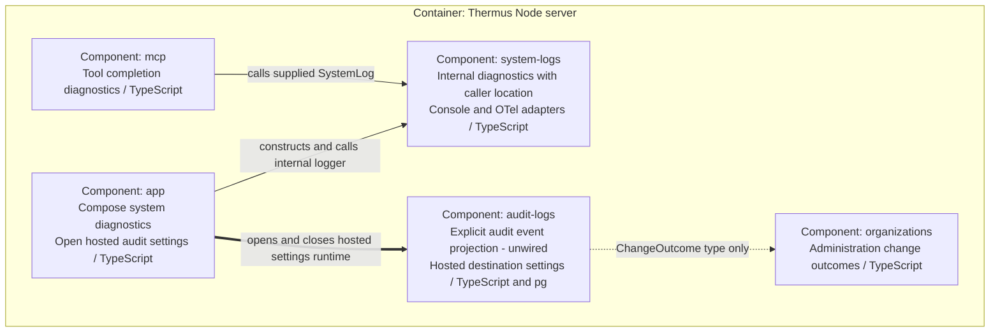

HTTP and CLI also use the narrow [SystemLog](../src/logs/system/system-logger.ts)
contract for errors. `SystemLog` is `Pick<SystemLogger, 'info' | 'error'>`,
exported by the SystemLogger module. It accepts plain objects with those methods.
The production entry selects
[ConsoleSystemLogger](../src/logs/system/console-system-logger.ts) on stderr;
[OtelSystemLogger](../src/logs/system/otel-system-logger.ts) remains an internal
adapter, with no production exporter configured here. Both inherit caller
location and severity behavior from SystemLogger. Existing account and tool
completion diagnostics remain internal.

The concrete [AuditLog](../src/logs/audit/audit-log.ts) class exposes
`toolCompleted` and `administrationChanged`. It copies named event fields,
including nested actor and target fields, to a supplied AuditEventSink.
It adds no source location or exception stack, has no generic message method,
and catches a synchronous sink failure. It imports no system logger. There is
no shared base class or forwarding path between these owners.
AuditLog needs no separate role interface while it has one implementation.
AuditEventSink is the neutral destination contract: it separates projection from delivery; its synchronous
`writeAuditEvent` call does not await export. No production sink is wired, and
there is no SQL audit event writer.

The event API currently carries metadata only. S2-03a must add bounded, redacted
MCP inputs and final public results before production capture. The customer
feature will export to the organization's Collector configured by its Admins;
there is no in-app event viewer in Slice 2. Storage and event projection share
the audit owner, but neither calls the other in this foundation.
`DestinationSettingsStore` stores endpoint, auth, enabled state, encrypted
credential, and revision. It is a settings port, separate from AuditEventSink;
the Slice 2 PostgreSQL settings store holds no audit history or event buffer.

### Selected C4 components: local authentication in the Node server

Scope: one local Node server container. Offline CLI administration belongs to
a separate process, shown in the container view and source-owner mapping.

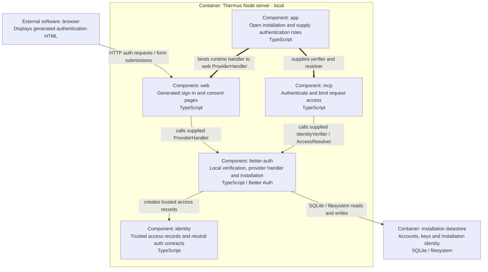

[Application composition](../src/app/application.ts) uses edition-specific
dynamic imports. It supplies `runtime.auth.handler` to
[LocalAuthPages](../src/interfaces/web/auth/better-auth/local-auth-pages.ts)
through the web-owned [ProviderHandler](../src/interfaces/web/auth/better-auth/local-auth-provider-routes.ts)
function contract. The collaboration arrow above is that supplied call, not a
source import from web to Better Auth. The provider implements neutral
identity contracts. Local composition does not construct hosted organization
administration. The [Better Auth runtime](../src/accounts/providers/better-auth/better-auth-runtime.ts)
owns its database and data-directory lock until app or offline CLI closure.
App closes request work before provider resources. HTTP listener drain and
logging sinks retain their responsibilities in the source-owner mapping.

## Runtime view

arc42 section 6 describes runtime scenarios. The collaboration overview below
keeps the broad map; the sequences show selected request and failure paths.
They follow [arc42 runtime guidance](https://docs.arc42.org/section-6/).

### Collaboration overview

Arrows show selected runtime collaborations, not TypeScript imports. Each box
can group several component IDs. These diagram groups are not source owners;
the table below defines the owners. Group node IDs stay stable for readable
Git diffs. WorkOS and public websites are external services. The local auth data
directory is application-owned storage.

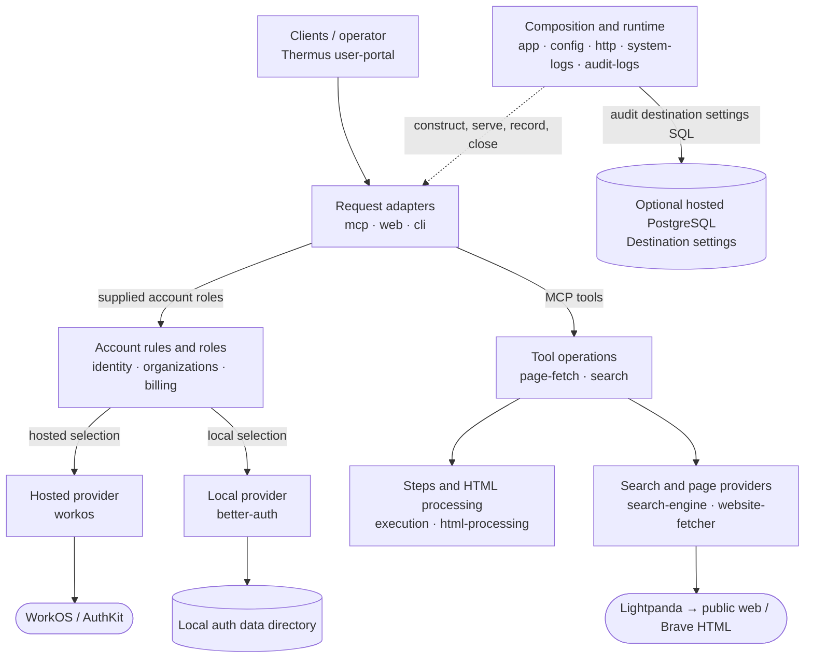

App constructs the collaborators and selects one authentication edition. The
account/provider arrows summarize that binding; identity records and contracts
do not themselves call providers. Hosted web uses sessions and organization
administration backed by WorkOS. Local CLI commands use supplied Better Auth
administration roles. The browser portal calls web routes over HTTP; app loads
its built assets through [HostedPortal](../src/app/hosted-portal.ts).

Within the provider group, the Brave search engine calls the supplied website
fetcher. Both search and page fetch reach external pages through Lightpanda;
search uses Brave HTML rather than a separate external API. Within the runtime
group, app owns composition and lifetimes, config validates settings, HTTP serves
the composed handler, and system-logs formats internal engineering diagnostics.
Audit-logs owns the optional hosted settings store and bounded SQL runtime. Its
separate event API has no production capture or export caller yet. No tool or
browser route calls the store in this foundation.

An **import dependency** points from an importer to the component whose module
it imports. The rules count runtime and whole-statement type-only imports
separately; inline `import { type X }` can still load a module. A **runtime
collaboration** follows calls on supplied objects/functions. For example,
page-fetch calls HTML processing through `IncomingStep`, but does not import
its implementation. Organizations calls a supplied WorkOS directory while
importing only neutral roles. The [review rules](../docs/implementation/pr-review-rules.yaml)
and generated metrics reports provide the complete import view; this diagram
does not duplicate it.

### Scenario: MCP page fetch and renderer cancellation

Scope: one authenticated MCP fetch in either server edition. The hosted server
adds a shared capacity slot after authentication and access resolution. Role
participants can be implemented by either selected provider. The incoming HTML
work runs only when rendering succeeds. Cancellation holds the hosted slot
until renderer completion and cleanup settle.

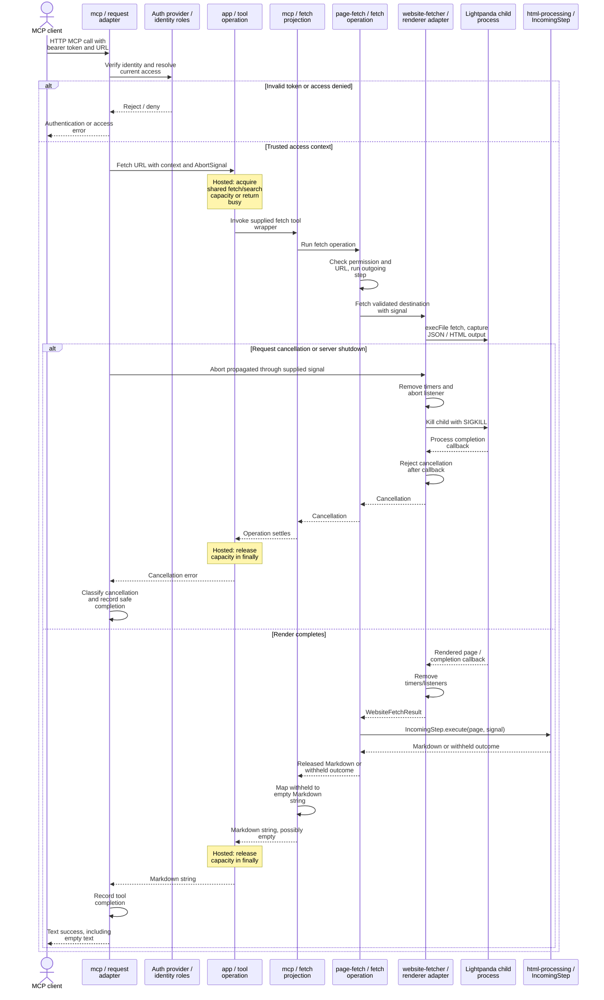

[Request authentication and shutdown](../src/interfaces/mcp/mcp-server.ts),
[tool adaptation](../src/interfaces/mcp/fetch-tool-server.ts),
[fetch ordering](../src/pipelines/page-fetch/fetch-page.ts), and
[renderer cleanup](../src/pipelines/providers/website-fetcher/website-fetcher-lightpanda.ts)
provide the contracts. HTTP disconnect handling and MCP shutdown propagate
cancellation; a disconnected client cannot receive a final response. Ordinary
failures, invalid inputs, blocked content, and cancellation remain distinct
inside the pipeline. The MCP-owned fetch wrapper maps withheld content to empty
Markdown text success. MCP records the safe completion status in its finalizer.

### Scenario: hosted default sign-in landing

Scope: the hosted callback after AuthKit sign-in, including native invitation
acceptance. AuthKit owns invitation acceptance. Thermus neither receives an
invitation token in this contract nor infers a joined organization from query
parameters. The WorkOS adapter maps validated exchange facts to neutral identity.

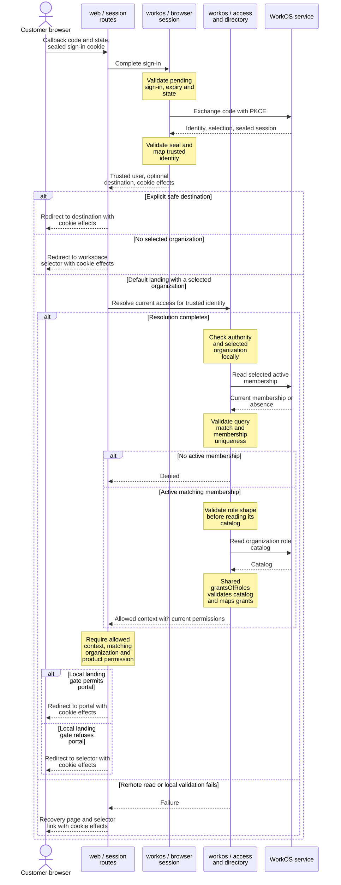

[Session routes](../src/interfaces/web/auth/workos/workos-session-routes.ts)
do not select the first or only membership. The existing
[workspace selector](../src/interfaces/web/account/account-routes.ts) handles
single, multiple, and no eligible memberships and rechecks access on selection.
An access-read failure after code exchange retains the new session and clears
the used sign-in cookie; recovery does not replay the code. Old sealed sign-ins
with an explicit destination remain valid. Explicit destinations retain their
own route access checks. Forged query hints grant no access. Joining creates no
creator agreement or local activation record. Browser selection does not change
the organization bound to an existing MCP token.

### Scenario: hosted member read

Scope: GET `/members` in the hosted Node server. The WorkOS adapter participant
groups the session, access resolver, and shared directory; each return follows
the request through that adapter. A signed-in session alone does not authorize
the read. Organization administration checks current Admin authority before
reading the overview. This groups remote reads, not a remote transaction.

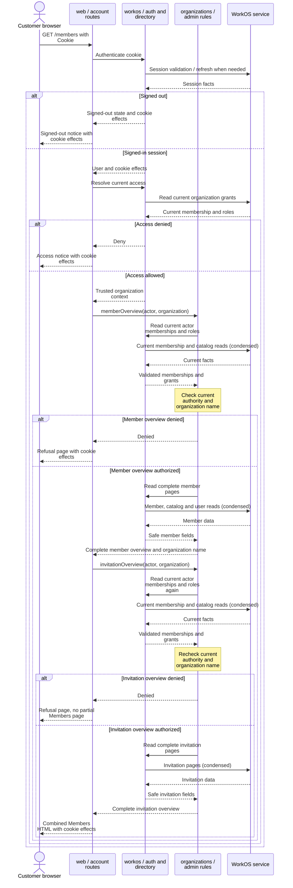

[Account routes](../src/interfaces/web/account/account-routes.ts) authenticate
before access resolution. Signed-in route failures are reported and become a
request-failed page with the session cookie effects; a failure during initial
session authentication follows the outer failure handler instead.
[Administration routes](../src/interfaces/web/account/administration-routes.ts)
permit GET/HEAD reads without a CSRF check.
[OrganizationAdministration](../src/accounts/organizations/organization-administration.ts)
checks current Admin authority separately before each overview. The
[shared directory](../src/accounts/providers/workos/workos-organizations.ts)
reads current remote state with bounded complete pagination. The route renders
only after both reads succeed; a denial or failed read cannot produce a partial
page. These are separate remote reads, not a transaction. The member overview
includes the organization name from the same current membership read that
authorizes it. Trusted member subjects supply the You label; safe invitation
fields supply expiry. The page shows only active members and pending invitations.
The old `/invitations` page checks current authority and redirects to Members.
Privileged mutations and their recording rules
remain described under resource ownership and design choices below.
The former POST `/members/grants` route is absent. A request with current account
access reaches the existing 404 response after the session and access checks. The Members
page has no grant forms, and neither administration nor the directory exposes
a grant writer. Admin manages native invitations for User or Admin. Both roles
permit product and MCP access in their authorized organization. Unknown/default
grants give no access; invalid role catalogs fail closed. Browser sessions report
`mfaCompleted: false`, including retained cookies on read, refresh, and selection.
The member overview counts each active product-authorized membership once,
including Admin alone, and labels the count Active product members. These access
changes add no provider, process, datastore, or component boundary.

The portal uses the current access response to show Product / Connect and
workspace selection, plus Members for Admin. Link visibility gives no authority.
Invitation POST routes retain origin, CSRF, selected-organization, current-role,
and pending-target checks. A failure after a directory write starts raises the
neutral `UnconfirmedChangeError` and keeps an unknown change record. The route
returns a fixed notice with a read-only Check status link. It does not repeat the
write, show its private cause, or claim that a pending read proves email delivery.

## Deployment view

C4 deployment view; scope: source-defined local topology and recorded hosted
target. This is not a live cloud inventory. The
[self-hosted Compose contract](../compose.yaml) runs one Docker container;
its Node server and per-fetch Lightpanda child are two C4 process containers
inside that same Docker boundary. An offline CLI uses the same image and data
volume while the server is stopped. A data-directory lock prevents concurrent
installation ownership.

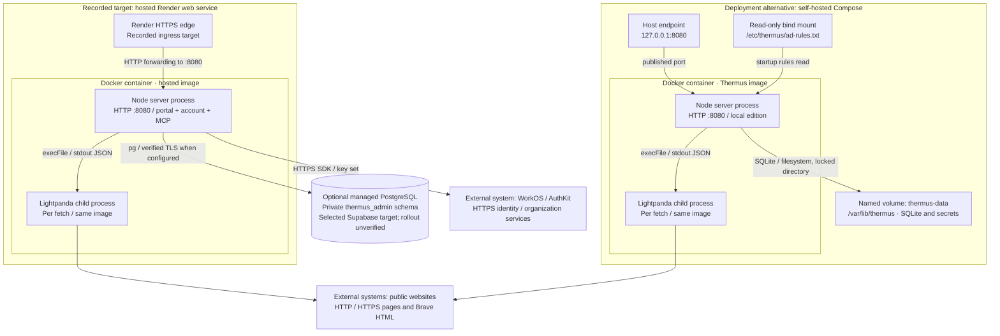

Both renderer children use HTTP or HTTPS to reach public websites and Brave.

[Dockerfile](../Dockerfile) pins Node and Lightpanda, runs as the `node` user,
and selects self-hosted operation. [Dockerfile.hosted](../Dockerfile.hosted)
includes the built portal and trusted rules and selects hosted operation.
The [recorded Render topology](../docs/implementation/render-hosted-docker-plan.md)
describes the earlier single-service target without a separate frontend, database,
Redis, disk, or worker. Source now supports an optional external PostgreSQL
settings datastore. The selected Supabase target and ordered setup are recorded in
the [organization-admin plan](../docs/design/organization-admin-plan.md#owner-setup-for-supabase--slice-2);
actual TLS, grants, backup/restore and cost proof remain rollout holds. Neither
this source map nor that dated record verifies current cloud configuration.
Current replica count and activated database settings are unknown here.
Compose publishes only loopback HTTP. A different public address requires the
HTTPS reverse proxy described by the installation contract; this diagram does
not invent that infrastructure.

## Ownership

The 19 IDs below are stable logical component names. Each root owns its source
files recursively. `app` also owns exactly `src/index.ts`. The directories
`accounts`, `accounts/providers`, `interfaces`, `pipelines`,
`pipelines/providers`, and `runtime` group components; they do not own code.
Private subdirectories below an owner are implementation areas, not separate
components. These source owners are logical boundaries in the Thermus codebase.
They do not define deployment units.

Public boundaries use named modules, not a barrel. App has construction access
to concrete implementations. That access does not make every implementation
module a contract for other callers. The review rules define the exact checked
surface and the narrower file-context restrictions.

| Stable ID and source root | Responsibility and main parts | Boundary |
| --- | --- | --- |
| `app` — [`src/app/`](../src/app/), plus [`src/index.ts`](../src/index.ts) | Select hosted or self-hosted operation; construct providers, routes, tools, logs, and shared services; own startup, shutdown, capacity, portal loading, and hidden terminal input. | Entrypoint and application lifecycle; documented [tool composition](../src/app/fetch-tool.ts). Other components do not import app. |
| `identity` — [`src/accounts/identity/`](../src/accounts/identity/) | Define authenticated users, grants, immutable request contexts, permission checks, verification, browser sessions and profile controls, and local administration roles. | [Access context](../src/accounts/identity/access-context.ts), verifier, browser-session, browser-session-controls, and local-user-administration contracts. No provider or UI implementation belongs here. |
| `organizations` — [`src/accounts/organizations/`](../src/accounts/organizations/) | Customer roles, administration rules, member/invitation overviews, directory reads and native invitations, signup activation, seat calculations, and privileged change recording. | Directory, administration, overview, customer-role, change-record, and signup-activation modules. Directory-read helpers remain private. |
| `billing` — [`src/accounts/billing/`](../src/accounts/billing/) | Report plan state and accept seat updates. `BillingFree` is the current implementation. | [Billing roles](../src/accounts/billing/billing.ts); app selects the implementation. |
| `workos` — [`src/accounts/providers/workos/`](../src/accounts/providers/workos/) | Hosted token/access verification, sessions, organization operations, signup/onboarding, settings, cookies, and signup-document validation. | App constructs provider/SDK objects. Web uses neutral supplied session, signup, and account roles; its WorkOS auth area still uses provider cookie and document-validation helpers. |
| `better-auth` — [`src/accounts/providers/better-auth/`](../src/accounts/providers/better-auth/) | Local authentication, access resolution, user/client administration, installation storage, data-directory lock, and cleanup. | Provider, runtime-opening, and administration-opening modules for app; storage and lock mechanics remain private. |
| `mcp` — [`src/interfaces/mcp/`](../src/interfaces/mcp/) | Adapt protocol requests to trusted access contexts and supplied tool operations. Own schemas, metadata, protocol errors, request lifetimes, and completion presentation. | Server/tool composition modules, protected-resource endpoint, and client-visible schema modules. SDK adaptation stays inside this owner. |
| `web` — [`src/interfaces/web/`](../src/interfaces/web/) | Account/admin/organization-selection routes, portal access, sign-in/out, signup, consent, forms, pages, escaping, and browser request protection. `account/` and `auth/` are private areas of this one owner. | Route constructors for app; shared account-form, page-html, and html-escape modules. Provider-specific browser adapters have narrower access than the whole owner. |
| `cli` — [`src/interfaces/cli/`](../src/interfaces/cli/) | Parse local user/client commands, use supplied administration and hidden-input roles, format output and exit status. | [Local command](../src/interfaces/cli/local-auth-command.ts). App opens and closes administration/input resources. |
| `user-portal` — [`src/interfaces/user-portal/`](../src/interfaces/user-portal/) | Browser portal behavior, connection instructions, styles, and static assets; Vite build configuration and declarations. | Browser HTTP interactions and rendered output. Vite runs in Node; browser modules cannot inherit its server/build access. |
| `execution` — [`src/pipelines/execution/`](../src/pipelines/execution/) | Operation IDs/context, outgoing/incoming step roles, bounded best-effort records, and pass-through request observation. | Execution-context, pipeline-step, and step-record modules. App constructs the observer. |
| `page-fetch` — [`src/pipelines/page-fetch/`](../src/pipelines/page-fetch/) | Check product permission and URL; run outgoing work, fetch, and incoming work; preserve cancellation, withholding, and safe failures. | [Fetch operation](../src/pipelines/page-fetch/fetch-page.ts), URL validation, and failure modules. Step executors remain private. |
| `search` — [`src/pipelines/search/`](../src/pipelines/search/) | Check permission/query, use a supplied search engine, process its page, and preserve cancellation, no-results, withholding, and safe failures. | Search-pipeline, search-query, and search-failure modules; private step executors and cancellation helper. |
| `html-processing` — [`src/pipelines/html-processing/`](../src/pipelines/html-processing/) | Input/depth limits; ad removal; hidden-content/control sanitation; Brave result projection; Markdown conversion. Transformer subdirectories remain inside one owner. | ProcessHtmlStep and documented [HTML runner](../src/pipelines/html-processing/html-to-markdown-pipeline.ts); documented ad-cleaner construction and depth-limit error. App selects concrete transformations. |
| `website-fetcher` — [`src/pipelines/providers/website-fetcher/`](../src/pipelines/providers/website-fetcher/) | Render pages with Lightpanda; destination/process policy; safe renderer failures and reports. | Fetcher/result/failure roles, renderer-failure-reports, and documented [network policy](../src/pipelines/providers/website-fetcher/network-policy.ts). App selects Lightpanda. |
| `search-engine` — [`src/pipelines/providers/search-engine/`](../src/pipelines/providers/search-engine/) | Build Brave search requests, validate the returned origin/document, and fetch through a supplied website fetcher. | [Search engine/document roles](../src/pipelines/providers/search-engine/search-engine.ts). App selects the Brave HTTP adapter. |
| `system-logs` — [`src/logs/system/`](../src/logs/system/) | Format internal engineering diagnostics with caller file and line. Customers cannot access this stream. | SystemLog for callers; SystemLogger/LogLevel and ConsoleSystemLogger/OtelSystemLogger implementations selected at composition. |
| `audit-logs` — [`src/logs/audit/`](../src/logs/audit/) | Own customer audit event projection and tenant destination settings with atomic revisions and bounded SQL work. | AuditLog event methods and AuditEventSink; neutral settings store, private pg adapter and SQL runtime. The metadata-only event API is unwired. No browser Save or customer export caller yet. |
| `http` — [`src/runtime/http/`](../src/runtime/http/) | Node listener, HTTP-to-Fetch exchange, trusted client address, request cancellation, connection tracking, and listener drain. | Server for app; client-address and request-cancellation modules for other consumers. Exchange mechanics remain private. |
| `config` — [`src/runtime/config/`](../src/runtime/config/) | Validate deployment/listen settings, optional hosted logging storage settings, and read trusted ad rules. Provider settings stay with their provider. | Deployment-config and ad-rules-file modules; app selects the logging-storage settings reader. |

## Behavior and resource ownership

The [tool composition](../src/app/fetch-tool.ts) shares one fetcher, ad cleaner,
sanitizer, outgoing observer, step-record sink, and renderer-report closures
between fetch and search. Each operation gets fresh execution/HTML context.
Markdown converters are separate instances. Hosted fetch and search share one
[capacity slot](../src/app/operation-capacity.ts); a concurrent operation gets a
busy error. This slot has application scope, not tenant scope or cluster scope.

Fetch runs ads → sanitizer → Markdown. Search runs ads → sanitizer → Brave
projection → search-preserving Markdown. The full search page is cleaned before
projection. [ProcessHtmlStep](../src/pipelines/html-processing/process-html-step.ts)
converts completed HTML work to the step outcome and preserves scan withholding.
`PipelineStep.execute` gives allow/block results; `HtmlTransformation.invoke`
updates HTML context. These are distinct protocols, not a generic Pipeline/Step
framework. Permission checks, invalid inputs, cancellation, withheld content,
and ordinary failures are distinct pipeline contract outcomes. The MCP fetch
[projection](../src/interfaces/mcp/get-url-as-markdown.ts) maps withheld content
to empty Markdown text success; clients cannot distinguish it from an ordinary
empty result. This baseline records that behavior; it does not change it.

The [MCP server](../src/interfaces/mcp/mcp-server.ts) binds a copied, frozen access
context to each authenticated request and tracks its work and cleanup. Shutdown
aborts request work and drains owned servers/transports. The
[application lifecycle](../src/app/application.ts) closes MCP work, waits for
listener drain, then disposes provider resources. The
[HTTP listener](../src/runtime/http/server.ts) tracks sockets and bounds drain
with a grace period.

The shared [Lightpanda adapter](../src/pipelines/providers/website-fetcher/website-fetcher-lightpanda.ts)
starts a child process for each fetch. It checks public destinations, sets
renderer network restrictions, bounds output/time, and removes timers/listeners
on completion. Cancellation kills the child. Search reaches Brave's public
HTML search page through that same adapter; it does not use a separate search
API service.

The local [Better Auth runtime](../src/accounts/providers/better-auth/better-auth-runtime.ts)
owns a data-directory lock and installation resources. The
[installation](../src/accounts/providers/better-auth/local-installation.ts)
keeps SQLite authentication/installation data, the secret, and the resource-server
client record together. Opening failure releases acquired resources; application
or CLI closure releases the database and lock. These files survive process
closure and must retain a consistent installation identity.

Hosted [composition](../src/app/hosted-workos-application.ts) shares a WorkOS SDK
client, remote key-set resolver, and organization directory. WorkOS owns remote
identity/organization data. Provider calls run during requests with a short
timeout and no SDK retry. Self-serve signup follows configured enablement and
approved organization/authority documents. Production supplies the approved
[purpose-marked organization bundle](../src/accounts/providers/workos/workos-approved-organization-documents.ts).
Signup remains false by default. The unchanged historical personal-User bundle
does not authorize new named creation; marked test documents prove behavior only.
The approved document versions and hashes use the existing WorkOS creator-record
fields. WorkOS organization metadata and the deterministic external ID retain
creation/legal facts independently of the optional logging-settings datastore. Google enrollment is an optional explicit composition;
production does not supply its onboarding settings.

The hosted [audit settings runtime](../src/logs/audit/bounded-sql-runtime.ts) bounds active
and pending work, acquisition, caller duration and PostgreSQL statements. Caller
timeout does not free unsettled work from accounting. Late clients are destroyed;
late results cannot complete an expired caller. Idle-pool errors are observed.
The pool is lazy: configuration does not establish a live SQL connection or prove
TLS/grants. Missing or failed storage leaves MCP and admitted product access
independent of SQL. The local edition does not open this pool.

Hosted application close starts MCP cleanup and SQL cleanup together. The SQL
runtime rejects new work, expires admitted calls and bounds pool closure within
the existing process shutdown deadline. The settings datastore persists across
runtime closure; tool content and export queues are not stored here.

## Design choices and current soft spots

The source uses a composition root and role-based adapters: app selects concrete
implementations while callers use supplied verifier, directory, engine, fetcher,
and step roles. Edition-specific dynamic imports keep provider startup separate.
Immutable [access records](../src/accounts/identity/access-context.ts) keep trusted
identity and permissions together. Ordered HTML transformations separate cleanup
operations; [ChangeRecording](../src/accounts/organizations/change-records.ts)
separates current checks from one directory mutation and records uncertain
outcomes without repeating a mutation. Disposable stacks and idempotent close
promises make ownership explicit. These are observed uses, not requirements to
add a class hierarchy or a shared workflow engine.

The following limits affect architectural decisions today:

- HTML safety and conversion depend on local [pinned patches](../pnpm-workspace.yaml)
  for agent-input-sanitizer 1.47.14, Defuddle 0.19.4, and LinkeDOM 0.18.13.
  Dependency upgrades must preserve deletion ranges, extraction checks, joiner
  handling, and attribute escaping. Use the existing affected interface and
  acceptance contracts described in the [README](../README.md) to verify them.
- Privileged account changes still go to the internal system log through
  [accountChangeRecorder](../src/app/application.ts). Step records are explicitly
  [best effort](../src/pipelines/execution/step-record.ts). These streams provide
  no customer audit access. The separate audit API is unwired; the planned
  customer export is best effort, and Thermus does not store audit event history.
- [BillingFree](../src/accounts/billing/billing-free.ts) returns a free plan and
  zero billed seats, including after seat updates. The billing role is a seam,
  but there is no paid-plan implementation or durable seat billing here.
- The [Brave adapter](../src/pipelines/providers/search-engine/search-engine-brave-http.ts)
  validates specific HTML selectors and no-results text. Upstream page changes
  can reject search responses; the separate
  [result projection](../src/pipelines/html-processing/search-results/brave-http-result-cleanup.ts)
  also contains Brave document knowledge. Changes to that external format need
  review across both owners.
- Browser authentication is only partly provider-neutral. Web's
  [WorkOS session routes](../src/interfaces/web/auth/workos/workos-session-routes.ts)
  use neutral session controls but retain provider cookie helpers; signup uses
  a neutral activation contract with provider document validation. Local pages
  use a supplied Response-returning handler. A provider change must preserve each browser
  contract, cookie, Origin/CSRF, and return-path protection; a common provider
  interface alone does not cover this work.
- The application-wide hosted capacity slot bounds this process only. It rejects
  overlap instead of queuing work and does not coordinate multiple instances.
  A deployment change must account for that actual scope.

These statements identify source behavior and its effects. They do not assign
quality scores or claim that an unmeasured component needs a rewrite.
