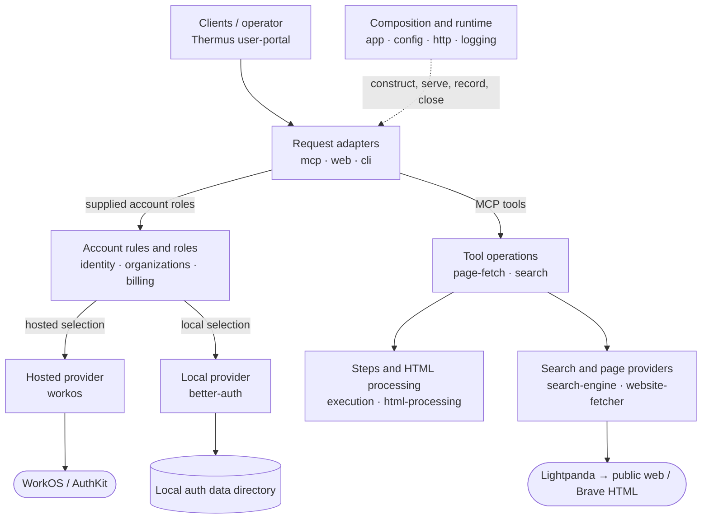

# Component registry

This is the current architecture of Thermus. It describes component intent,
important collaborations, and known limits. The [review rules](../docs/implementation/pr-review-rules.yaml)
remain the machine authority for source ownership, public modules, and permitted
imports. This registry is not another import allowlist.

Use the [registry update workflow](../docs/implementation/component-registry-workflow.md)
when a change affects this view. Git history and pull request diffs show its
evolution. The [component structure proposal](../docs/design/component-structure-proposal.md)
records the migration design; this page describes the resulting system.

## Runtime view

Arrows show selected runtime collaborations, not TypeScript imports. Each box
can group several component IDs. These diagram groups are not source owners;
the table below defines the owners. Group node IDs stay stable for readable
Git diffs. WorkOS and public websites are external services. The local auth data
directory is application-owned storage.

App constructs the collaborators and selects one authentication edition. The
account/provider arrows summarize that binding; identity records and contracts
do not themselves call providers. Hosted web uses sessions and organization
administration backed by WorkOS. Local CLI commands use supplied Better Auth
administration roles. The browser portal calls web routes over HTTP; app loads
its built assets through [HostedPortal](../src/app/hosted-portal.ts).

Within the provider group, the Brave search engine calls the supplied website
fetcher. Both search and page fetch reach external pages through Lightpanda;
search uses Brave HTML rather than a separate external API. Within the runtime
group, app owns composition and lifetimes, config validates settings, HTTP serves
the composed handler, and logging receives supplied record/report sinks.

An **import dependency** points from an importer to the component whose module
it imports. The rules count runtime and whole-statement type-only imports
separately; inline `import { type X }` can still load a module. A **runtime
collaboration** follows calls on supplied objects/functions. For example,
page-fetch calls HTML processing through `IncomingStep`, but does not import
its implementation. Organizations calls a supplied WorkOS directory while
importing only neutral roles. The [review rules](../docs/implementation/pr-review-rules.yaml)
and generated metrics reports provide the complete import view; this diagram
does not duplicate it.

## Ownership

The 19 IDs below are stable logical component names. Each root owns its source
files recursively. `app` also owns exactly `src/index.ts`. The directories
`accounts`, `accounts/providers`, `interfaces`, `pipelines`,
`pipelines/providers`, and `runtime` group components; they do not own code.
Private subdirectories below an owner are implementation areas, not separate
components. Components here are logical boundaries within one application,
not independently deployed services.

Public boundaries use named modules, not a barrel. App has construction access
to concrete implementations. That access does not make every implementation
module a contract for other callers. The review rules define the exact checked
surface and the narrower file-context restrictions.

| Stable ID and source root | Responsibility and main parts | Boundary |
| --- | --- | --- |
| `app` — [`src/app/`](../src/app/), plus [`src/index.ts`](../src/index.ts) | Select hosted or self-hosted operation; construct providers, routes, tools, logs, and shared services; own startup, shutdown, capacity, portal loading, and hidden terminal input. | Entrypoint and application lifecycle; documented [tool composition](../src/app/fetch-tool.ts). Other components do not import app. |
| `identity` — [`src/accounts/identity/`](../src/accounts/identity/) | Define authenticated users, grants, immutable request contexts, permission checks, verification, browser sessions, and local administration roles. | [Access context](../src/accounts/identity/access-context.ts), verifier, browser-session, and local-user-administration contracts. No provider or UI implementation belongs here. |
| `organizations` — [`src/accounts/organizations/`](../src/accounts/organizations/) | Customer roles, administration rules, member/invitation overviews, directory roles, seat calculations, and privileged change recording. | Directory, administration, overview, customer-role, and change-record modules. Directory-read helpers remain private. |
| `billing` — [`src/accounts/billing/`](../src/accounts/billing/) | Report plan state and accept seat updates. `BillingFree` is the current implementation. | [Billing roles](../src/accounts/billing/billing.ts); app selects the implementation. |
| `workos` — [`src/accounts/providers/workos/`](../src/accounts/providers/workos/) | Hosted token/access verification, sessions, organization operations, signup/onboarding, settings, cookies, and signup-document validation. | App constructs provider/SDK objects. Web's WorkOS auth area uses selected session/signup roles and cookie/document helpers; account routes use neutral supplied roles. |
| `better-auth` — [`src/accounts/providers/better-auth/`](../src/accounts/providers/better-auth/) | Local authentication, access resolution, user/client administration, installation storage, data-directory lock, and cleanup. | Provider, runtime-opening, and administration-opening modules for app; storage and lock mechanics remain private. |
| `mcp` — [`src/interfaces/mcp/`](../src/interfaces/mcp/) | Adapt protocol requests to trusted access contexts and supplied tool operations. Own schemas, metadata, protocol errors, request lifetimes, and completion presentation. | Server/tool composition modules, protected-resource endpoint, and client-visible schema modules. SDK adaptation stays inside this owner. |
| `web` — [`src/interfaces/web/`](../src/interfaces/web/) | Account/admin/organization-selection routes, portal access, sign-in/out, signup, consent, forms, pages, escaping, and browser request protection. `account/` and `auth/` are private areas of this one owner. | Route constructors for app; shared account-form, page-html, and html-escape modules. Provider-specific browser adapters have narrower access than the whole owner. |
| `cli` — [`src/interfaces/cli/`](../src/interfaces/cli/) | Parse local user/client commands, use supplied administration and hidden-input roles, format output and exit status. | [Local command](../src/interfaces/cli/local-auth-command.ts). App opens and closes administration/input resources. |
| `user-portal` — [`src/interfaces/user-portal/`](../src/interfaces/user-portal/) | Browser portal behavior, connection instructions, styles, and static assets; Vite build configuration and declarations. | Browser HTTP interactions and rendered output. Vite runs in Node; browser modules cannot inherit its server/build access. |
| `execution` — [`src/pipelines/execution/`](../src/pipelines/execution/) | Operation IDs/context, outgoing/incoming step roles, bounded best-effort records, and pass-through request observation. | Execution-context, pipeline-step, and step-record modules. App constructs the observer. |
| `page-fetch` — [`src/pipelines/page-fetch/`](../src/pipelines/page-fetch/) | Check product permission and URL; run outgoing work, fetch, and incoming work; preserve cancellation, withholding, and safe failures. | [Fetch operation](../src/pipelines/page-fetch/fetch-page.ts), URL validation, and failure modules. Step executors remain private. |
| `search` — [`src/pipelines/search/`](../src/pipelines/search/) | Check permission/query, use a supplied search engine, process its page, and preserve cancellation, no-results, withholding, and safe failures. | Search-pipeline, search-query, and search-failure modules; private step executors and cancellation helper. |
| `html-processing` — [`src/pipelines/html-processing/`](../src/pipelines/html-processing/) | Input/depth limits; ad removal; hidden-content/control sanitation; Brave result projection; Markdown conversion. Transformer subdirectories remain inside one owner. | ProcessHtmlStep and documented [HTML runner](../src/pipelines/html-processing/html-to-markdown-pipeline.ts); documented ad-cleaner construction and depth-limit error. App selects concrete transformations. |
| `website-fetcher` — [`src/pipelines/providers/website-fetcher/`](../src/pipelines/providers/website-fetcher/) | Render pages with Lightpanda; destination/process policy; safe renderer failures and reports. | Fetcher/result/failure roles, renderer-failure-reports, and documented [network policy](../src/pipelines/providers/website-fetcher/network-policy.ts). App selects Lightpanda. |
| `search-engine` — [`src/pipelines/providers/search-engine/`](../src/pipelines/providers/search-engine/) | Build Brave search requests, validate the returned origin/document, and fetch through a supplied website fetcher. | [Search engine/document roles](../src/pipelines/providers/search-engine/search-engine.ts). App selects the Brave HTTP adapter. |
| `logging` — [`src/logging/`](../src/logging/) | Format and emit operator logs through console or OpenTelemetry implementations. | BaseLogger/LogLevel and concrete logger modules selected at composition. |
| `http` — [`src/runtime/http/`](../src/runtime/http/) | Node listener, HTTP-to-Fetch exchange, trusted client address, request cancellation, connection tracking, and listener drain. | Server for app; client-address and request-cancellation modules for other consumers. Exchange mechanics remain private. |
| `config` — [`src/runtime/config/`](../src/runtime/config/) | Validate deployment/listen settings and read trusted ad rules. Provider settings stay with their provider. | Deployment-config and ad-rules-file modules. |

## Behavior and resource ownership

The [tool composition](../src/app/fetch-tool.ts) shares one fetcher, ad cleaner,
sanitizer, outgoing observer, step-record sink, and renderer-report closures
between fetch and search. Each operation gets fresh execution/HTML context.
Markdown converters are separate instances. Hosted fetch and search share one
[capacity slot](../src/app/operation-capacity.ts); a concurrent operation gets a
busy error. This slot has application scope, not tenant scope or cluster scope.

Fetch runs ads → sanitizer → Markdown. Search runs ads → sanitizer → Brave
projection → search-preserving Markdown. The full search page is cleaned before
projection. [ProcessHtmlStep](../src/pipelines/html-processing/process-html-step.ts)
converts completed HTML work to the step outcome and preserves scan withholding.
`PipelineStep.execute` gives allow/block results; `HtmlTransformation.invoke`
updates HTML context. These are distinct protocols, not a generic Pipeline/Step
framework. Permission checks, invalid inputs, cancellation, withheld content,
and ordinary failures stay separate observable outcomes.

The [MCP server](../src/interfaces/mcp/mcp-server.ts) binds a copied, frozen access
context to each authenticated request and tracks its work and cleanup. Shutdown
aborts request work and drains owned servers/transports. The
[application lifecycle](../src/app/application.ts) closes MCP work, waits for
listener drain, then disposes provider resources. The
[HTTP listener](../src/runtime/http/server.ts) tracks sockets and bounds drain
with a grace period.

The shared [Lightpanda adapter](../src/pipelines/providers/website-fetcher/website-fetcher-lightpanda.ts)
starts a child process for each fetch. It checks public destinations, sets
renderer network restrictions, bounds output/time, and removes timers/listeners
on completion. Cancellation kills the child. Search reaches Brave's public
HTML search page through that same adapter; it does not use a separate search
API service.

The local [Better Auth runtime](../src/accounts/providers/better-auth/better-auth-runtime.ts)
owns a data-directory lock and installation resources. The
[installation](../src/accounts/providers/better-auth/local-installation.ts)
keeps SQLite authentication/installation data, the secret, and the resource-server
client record together. Opening failure releases acquired resources; application
or CLI closure releases the database and lock. These files survive process
closure and must retain a consistent installation identity.

Hosted [composition](../src/app/hosted-workos-application.ts) shares a WorkOS SDK
client, remote key-set resolver, and organization directory. WorkOS owns remote
identity/organization data. Provider calls run during requests with a short
timeout and no SDK retry. Self-serve signup follows configured enablement and
approved documents. Google enrollment is an optional explicit composition;
production does not supply its onboarding settings.

## Design choices and current soft spots

The source uses a composition root and role-based adapters: app selects concrete
implementations while callers use supplied verifier, directory, engine, fetcher,
and step roles. Edition-specific dynamic imports keep provider startup separate.
Immutable [access records](../src/accounts/identity/access-context.ts) keep trusted
identity and permissions together. Ordered HTML transformations separate cleanup
operations; [ChangeRecording](../src/accounts/organizations/change-records.ts)
separates current checks from one directory mutation and records uncertain
outcomes without repeating a mutation. Disposable stacks and idempotent close
promises make ownership explicit. These are observed uses, not requirements to
add a class hierarchy or a shared workflow engine.

The following limits affect architectural decisions today:

- HTML safety and conversion depend on local [pinned patches](../pnpm-workspace.yaml)
  for agent-input-sanitizer 1.47.14, Defuddle 0.19.4, and LinkeDOM 0.18.13.
  Dependency upgrades must preserve deletion ranges, extraction checks, joiner
  handling, and attribute escaping. Use the existing affected interface and
  acceptance contracts described in the [README](../README.md) to verify them.
- Privileged account changes go to the operator log through
  [accountChangeRecorder](../src/app/application.ts). Step records are explicitly
  [best effort](../src/pipelines/execution/step-record.ts). Neither is a durable
  application audit store; log retention and delivery determine later evidence.
- [BillingFree](../src/accounts/billing/billing-free.ts) returns a free plan and
  zero billed seats, including after seat updates. The billing role is a seam,
  but there is no paid-plan implementation or durable seat billing here.
- The [Brave adapter](../src/pipelines/providers/search-engine/search-engine-brave-http.ts)
  validates specific HTML selectors and no-results text. Upstream page changes
  can reject search responses; the separate
  [result projection](../src/pipelines/html-processing/search-results/brave-http-result-cleanup.ts)
  also contains Brave document knowledge. Changes to that external format need
  review across both owners.
- Browser authentication is only partly provider-neutral. Web's
  [WorkOS session routes](../src/interfaces/web/auth/workos/workos-session-routes.ts)
  use selected provider roles/helpers, while local pages use a supplied
  Response-returning handler. A provider change must preserve each browser
  contract, cookie, Origin/CSRF, and return-path protection; a common provider
  interface alone does not cover this work.
- The application-wide hosted capacity slot bounds this process only. It rejects
  overlap instead of queuing work and does not coordinate multiple instances.
  A deployment change must account for that actual scope.

These statements identify source behavior and its effects. They do not assign
quality scores or claim that an unmeasured component needs a rewrite.
