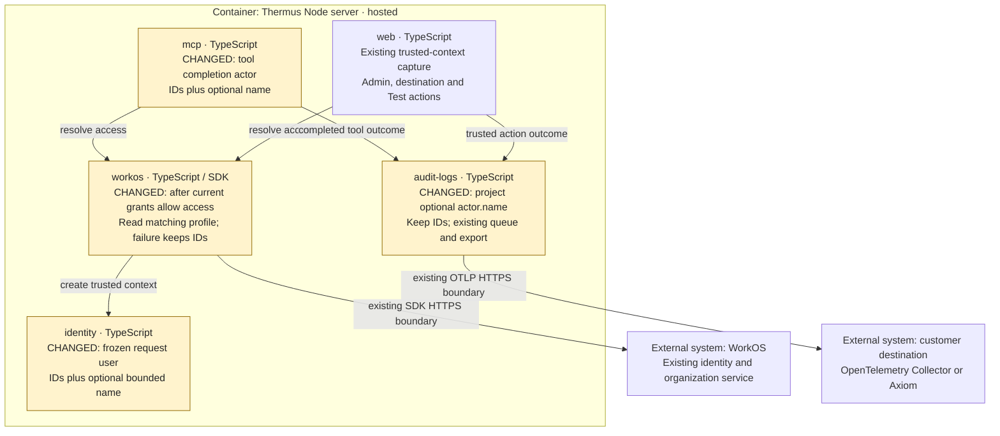

## Description

Customer Audit events now include an optional trusted profile name beside the stable WorkOS ID. The name is display data; missing or invalid names keep ID-only events. A small JSDoc coverage-mapper repair makes existing exact function matching work for the new documented functions.

## Review

**T2 Need architect**  
**Architecture: T2: declarations changed in 3 public modules**  
Also: declared contract/internal-interface impact and sensitive display-data handling.

**Architecture facts** (19e60e2b against 4d7f845b):

- `src/logs/audit/destination-settings-service.ts (+2 -4 lines)`
- `src/logs/audit/audit-log.ts (+1 -0 lines)`
- `src/accounts/identity/access-context.ts (+1 -0 lines)`

<details><summary>Declaration diffs</summary>

```diff
diff --git a/docs/api-surface/src/logs/audit/destination-settings-service.d.ts b/docs/api-surface/src/logs/audit/destination-settings-service.d.ts
index 1c0e69b6..86ff91e9 100644
--- a/docs/api-surface/src/logs/audit/destination-settings-service.d.ts
+++ b/docs/api-surface/src/logs/audit/destination-settings-service.d.ts
@@ -1,3 +1,4 @@
+import type { AuditContext } from './audit-log.ts';
 import type { DestinationSettingsStore } from './destination-settings-store.ts';
 import type { AuditDestination } from './audit-send.ts';
 import type { DestinationTestResult, DestinationTestSender } from './destination-test.ts';
@@ -47,10 +48,7 @@ export declare class DestinationSettingsService {
     private readonly tests;
     constructor(store: DestinationSettingsStore, key: Uint8Array, sender: DestinationTestSender);
     authorizeExport(tenantId: string, expectedRevision: string, signal?: AbortSignal): Promise<ExportAuthorization>;
-    test(tenantId: string, input: DestinationSettingsSaveInput, actor: {
-        readonly authority: string;
-        readonly subject: string;
-    }, signal?: AbortSignal): Promise<DestinationTestResult>;
+    test(tenantId: string, input: DestinationSettingsSaveInput, actor: AuditContext['actor'], signal?: AbortSignal): Promise<DestinationTestResult>;
     private testSaved;
     read(tenantId: string): Promise<DestinationSettingsReadResult>;
     save(tenantId: string, input: DestinationSettingsSaveInput): Promise<DestinationSettingsSaveResult>;
```

```diff
diff --git a/docs/api-surface/src/logs/audit/audit-log.d.ts b/docs/api-surface/src/logs/audit/audit-log.d.ts
index dcddf95e..e81e5922 100644
--- a/docs/api-surface/src/logs/audit/audit-log.d.ts
+++ b/docs/api-surface/src/logs/audit/audit-log.d.ts
@@ -6,6 +6,7 @@ export interface AuditContext {
     readonly actor: {
         readonly authority: string;
         readonly subject: string;
+        readonly name?: string;
     };
 }
 interface ToolOutcome extends AuditContext {
```

```diff
diff --git a/docs/api-surface/src/accounts/identity/access-context.d.ts b/docs/api-surface/src/accounts/identity/access-context.d.ts
index c7c9174b..64066d49 100644
--- a/docs/api-surface/src/accounts/identity/access-context.d.ts
+++ b/docs/api-surface/src/accounts/identity/access-context.d.ts
@@ -1,6 +1,7 @@
 export interface AuthenticatedUser {
     readonly authority: string;
     readonly subject: string;
+    readonly name?: string;
     readonly selectedOrganizationId?: string;
 }
 export interface RoleGrant {
```

</details>

[`.pr-impact.json`](https://github.com/tomer-mayara/Thermus/blob/19e60e2b14a36bb1a1527309dd31e78b7ef28e5d/.pr-impact.json) declares optional identity/Audit fields and provider enrichment. No components, dependencies, storage, or deployment are added. Registry prose changes; all 13 registry drawings stay unchanged.

**Merge status: blocked; Draft.** Required container checks are blocked by a full Docker disk; permission to remove unused anonymous volumes is pending. Current-candidate architect approval is also required before merge. PR #252 approval does not cover this change.

### Architecture comparison

Supplementary runtime view: base 4d7f845b → candidate 19e60e2b. Amber marks changed responsibilities or payloads; existing relationships stay neutral.



- Before: trusted actors carried IDs. After: WorkOS reads the matching profile after current grants allow access; MCP and browser actions carry its optional bounded name.
- One fresh SDK read occurs per allowed resolution, even with export off. Failure preserves access and IDs; the existing five-second transport/body timeout and zero retries bound the added delay.
- Audit copies and redacts the name within existing byte limits. Timestamps, stable IDs, tenant authorization, queue behavior, and System records retain their rules.
- Outside this hosted view, BetterAuth reuses its existing account read; local export stays disabled. Existing grant internals, composition, and export lifetimes are omitted. L3 plus these notes answers the optional-field contract question; L4 is unnecessary.

---
Candidate: [19e60e2b](https://github.com/tomer-mayara/Thermus/commit/19e60e2b14a36bb1a1527309dd31e78b7ef28e5d) · [Validation](https://github.com/tomer-mayara/Thermus/pull/256#issuecomment-6400686319) · [Quality review](https://github.com/tomer-mayara/Thermus/pull/256#issuecomment-6400686533)

