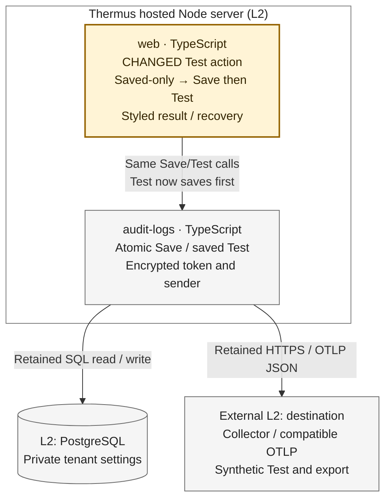

Architecture comparison — hosted Audit Test

The comparison covers the hosted Node server. Amber marks the changed web responsibility. Neutral arrows are retained runtime calls, not new source dependencies. PostgreSQL and the customer OTLP destination are supporting Level 2 peers. The current registry Mermaid views stay unchanged; its prose must state the new browser Test flow.

- Before, **Test saved destination** only tested a matching saved revision. After, **Test** validates and saves the current form, including the export switch, before it sends a synthetic event. The separate Save action keeps its success redirect; its error pages now use the shared styled Audit panel.
- Only a confirmed `saved` or `unchanged` result authorizes the next phase. Web passes that returned destination and revision to the existing saved-Test operation with blank token input. Cancellation after Save stops Test; the committed Save can remain. The service retains its fresh pre-send and post-settlement version checks. No SQL lock spans the network attempt.
- A refused, invalid, conflicting, unavailable, or unconfirmed Save starts no Test. An unconfirmed Save keeps a styled GET-only recovery link, with no immediate retry form or automatic retry. A late Save may still commit after that read. A confirmed invalid/conflict outcome can show a fresh saved-state form.
- A confirmed Save remains committed when Test fails, is busy, or cannot confirm its result. The panel says **Settings saved** and gives a fixed Test outcome; token input stays blank and no receiver text or exception cause is reflected. Results are direct POST responses with no background retry. Suppressed results reread current settings before offering a form; an unavailable read offers GET recovery only.

The existing composition supplies the service and trusted Admin context. Its Admin, origin, CSRF, tenant, revision, encrypted-token, public-address and TLS rules stay. The drawing omits unchanged app composition, WorkOS identity resolution, audit action capture, snapshots, queue dispatch, sender limits and remote Collector work. Normal export still uses that same audit owner and sender.

**L4 omitted.** The strongest changed callable is `POST /logging/test`: it now commits settings before the saved Test. The review question is which phase may commit or send, and what follows a partial or unknown outcome. This L3 view and its phase notes answer that question. No service callable signature, public declaration, component boundary, source dependency, container or deployment changes.

Compared base `74f756562231fb6aafd6a87f4bbd0f02bc0a208e` with candidate `4ae3cc7f950c53cc619c307159643b6771caff5a`: [before Test route](https://github.com/tomer-mayara/Thermus/blob/74f756562231fb6aafd6a87f4bbd0f02bc0a208e/src/interfaces/web/account/logging-routes.ts#L78-L104), [after Save-then-Test](https://github.com/tomer-mayara/Thermus/blob/4ae3cc7f950c53cc619c307159643b6771caff5a/src/interfaces/web/account/logging-routes.ts#L51-L105), [styled result and recovery](https://github.com/tomer-mayara/Thermus/blob/4ae3cc7f950c53cc619c307159643b6771caff5a/src/interfaces/web/account/logging-page.ts#L32-L40).
