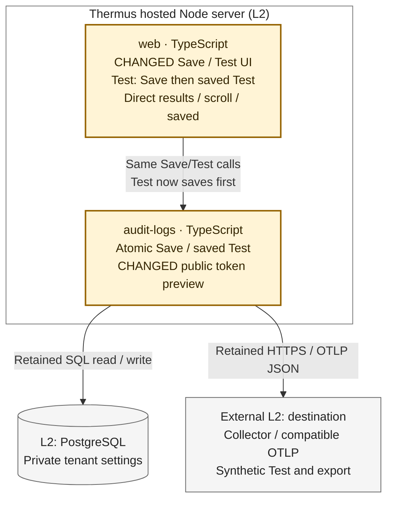

Architecture comparison — hosted Audit Save and Test



Amber marks changed web behavior and the audit owner's public projection. Neutral arrows are retained runtime collaborations. PostgreSQL and the customer OTLP destination remain supporting Level 2 peers; no source dependency, container or deployment is added. Registry drawings stay unchanged; their prose now describes this flow.

- Before, **Test saved destination** only tested matching saved values, and Save redirected. After, **Test** validates and saves the current form, including Enable export, then tests only a confirmed returned revision with blank token input. Both actions return the styled Audit form directly; only confirmed saved/unchanged outcomes set `saved` above the buttons.
- Save failures start no Test. Unconfirmed writes keep styled GET-only recovery, without a write form or automatic retry; a late Save can still commit after that read. Cancellation after Save stops the Test send but can leave its write committed. The unchanged saved-Test service retains fresh pre-send and post-settlement checks. A failed Test never undoes Save. A reread shows the standalone saved marker only when its revision still equals that confirmed Save.
- Read and confirmed Save now return optional `tokenPreview`. A token longer than four characters exposes its first four plus `****`; tokens of four or fewer characters expose only `****`. Web places this escaped hint in an empty password input's placeholder. Test input uses a whitelist that excludes preview and presence fields; storage, audit events, Test/export destination records and HTTPS authentication gain no preview field. Full tokens stay encrypted at rest and never appear in the page or scroll state.
- The hash-pinned Audit script clears saved feedback after 30 seconds or an edit, retaining its line height. Native submission stores only scroll position and time in tab-scoped storage under the canonical Audit URL; the next response consumes valid state within 120 seconds and clamps it to page height. Storage failures do not stop native submission. Recovery pages are null-safe. No fetch, new CSP network permission, server flash state or retry loop is added. Without scripts, native actions and honest feedback remain; timed clearing and exact scroll restoration are progressive features. Deliberate POST resubmission retains the revision guard and may repeat an unchanged explicit Test.

The drawing omits unchanged composition, WorkOS access resolution, trusted actor/tenant capture, SQL lifetime, queue dispatch, sender limits and remote Collector work. Admin, origin, CSRF, revision, encrypted-token retention, public-address and TLS rules remain at their existing owners. No SQL lock spans network work.

**L4 omitted.** The strongest changed shared contract is `PublicDestinationSettings` from service read/Save: one optional bounded preview is added. `POST /logging/test` gains Save-before-Test ordering, and Save returns a direct styled response. L3 plus these payload/phase/recovery notes and the folded declaration diff answer what may commit, send, or become visible. A function-level drawing adds no needed explanation.

<details><summary>Public declaration change: optional masked token preview</summary>

```diff
diff --git a/docs/api-surface/src/logs/audit/destination-settings-service.d.ts b/docs/api-surface/src/logs/audit/destination-settings-service.d.ts
index e97ec242..1c0e69b6 100644
--- a/docs/api-surface/src/logs/audit/destination-settings-service.d.ts
+++ b/docs/api-surface/src/logs/audit/destination-settings-service.d.ts
@@ -9,6 +9,7 @@ export interface PublicDestinationSettings {
     readonly auth: 'none' | 'bearer';
     readonly enabled: boolean;
     readonly tokenPresent: boolean;
+    readonly tokenPreview?: string;
 }
 export interface DestinationSettingsSaveInput {
     readonly expectedRevision: string | null;
```

The field is a display hint, not an authentication input. No service method signature, settings input or sender contract changes.
</details>

Compared base `74f756562231fb6aafd6a87f4bbd0f02bc0a208e` with candidate `e9e2185663f62690809640c5434ad24582843835`: [before saved-only Test](https://github.com/tomer-mayara/Thermus/blob/74f756562231fb6aafd6a87f4bbd0f02bc0a208e/src/interfaces/web/account/logging-routes.ts#L78-L104), [after actions and recovery](https://github.com/tomer-mayara/Thermus/blob/e9e2185663f62690809640c5434ad24582843835/src/interfaces/web/account/logging-routes.ts#L51-L114), [preview projection](https://github.com/tomer-mayara/Thermus/blob/e9e2185663f62690809640c5434ad24582843835/src/logs/audit/destination-settings-service.ts#L92-L118).
