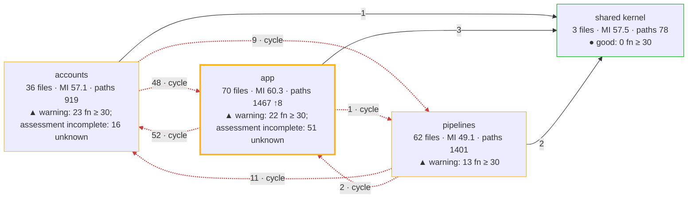
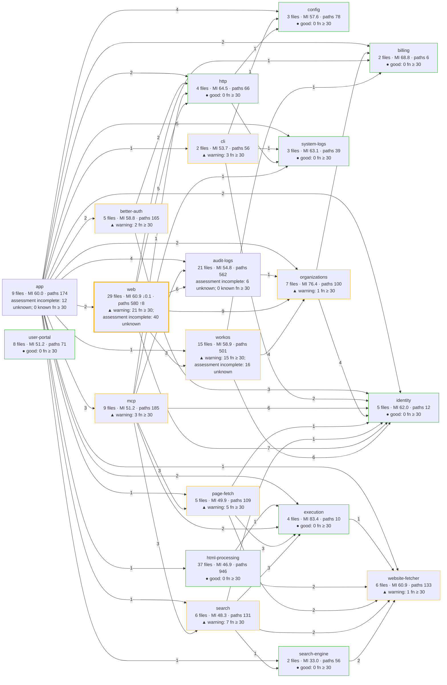
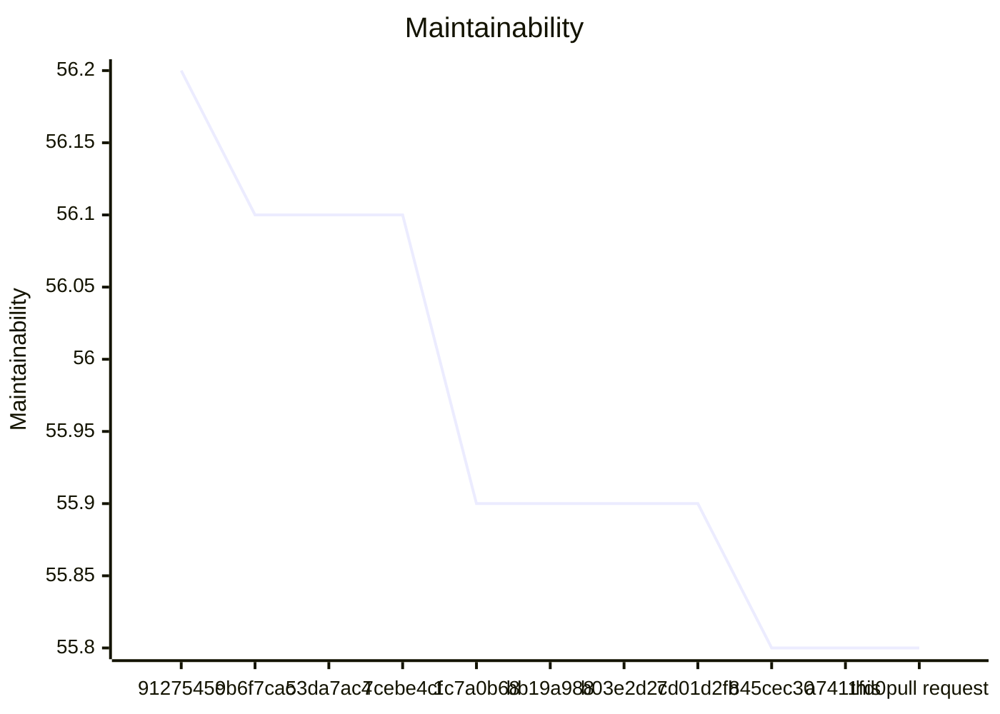
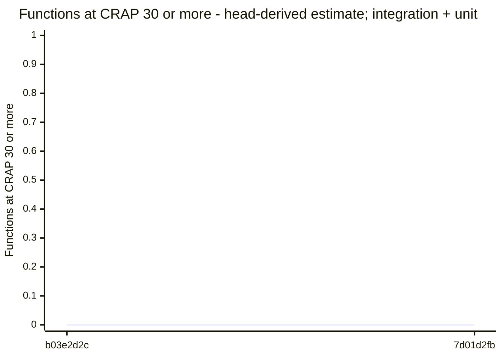
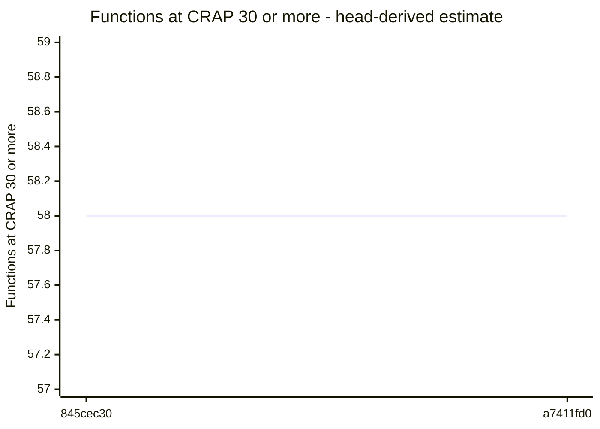

# Code quality process

## Delta

Status: goal miss.

```text
  65.7  src/interfaces/web/account/logging-form.ts  below 85
  69.0  src/interfaces/web/account/logging-page.ts  below 85
  81.0  src/interfaces/web/account/members-page-layout.ts  below 85
  28.2  test/acceptance/logging/hosted-destination-settings.test.ts  no goal
  29.9  test/acceptance/logging/hosted-destination-test.test.ts  no goal
  30.5  test/integration/logging/audit/audit-sender.runtime.ts  no goal
  34.8  test/integration/hosted-admin/account-routes-audit.test.ts  no goal
  36.1  test/unit/html/logging-routes.test.ts  no goal
  36.1  test/unit/html/logging-test-routes.test.ts  no goal
  38.7  test/acceptance/logging/audit/administration-capture.test.ts  no goal
  40.4  test/integration/hosted-admin/account-routes-logging.test.ts  no goal
  42.0  test/support/in-process/hosted-audit-journey-site.ts  no goal
  45.3  test/unit/html/logging-page.test.ts  no goal
  46.5  test/unit/html/logging-form.test.ts  no goal
  53.4  test/support/in-process/logging-destination-test-site.ts  no goal
  58.6  test/support/processes/audit-destination-test-probe.ts  no goal
  not measured  src/interfaces/web/account/members-style.ts
Result: 3 of 3 production files below 85. Goal: 85 or more for each production file. 13 other files without a goal. 1 file not measured.
Comparison with origin/main: ast-report/compare.html
```

## Review

Status: goal miss.

## AST Metrics found blocking regressions

1 new critical issue(s), 1 other regression(s)

### Summary

- ⚠️  **Complexity: +3**
- ⚠️  **Ease of maintenance: -8**
- ➖ **Outgoing dependencies: -**
- ➖ **Probability of bugs: -**

### Regressions

- **test/unit/html/logging-form.test.ts** (`test/unit/html/logging-form.test.ts`, high)
  Maintainability index: 54 -> 46 (below 85 is hard to maintain)
  Suggested action: Refactor long or deeply nested functions and reduce responsibilities in this file
- **loggingForm** (`src/interfaces/web/account/logging-form.ts:6`, medium)
  Cyclomatic complexity: 13 -> 16 (threshold: 10)
  Suggested action: Extract smaller, well-named functions to reduce decision points

## CRAP

Status: passed.

Collected verified compatible unit coverage.

## CRAP goals

Goals: CRAP < 30; new functions also CRAP ≤ 15.

| File | Function | Change | Paths | Coverage | CRAP | To do |
| --- | --- | --- | --- | --- | --- | --- |
| src/interfaces/web/account/logging-form.ts | loggingForm | changed | 16 | 100% | 16.0 | ok; for 15: split |
| src/interfaces/web/account/logging-page.ts | loggingPage | changed | 8 | 98.5% | 8.0 | ok |
| src/interfaces/web/account/members-page-layout.ts | membersPageLayout | changed | 7 | 99.8% | 7.0 | ok |
| src/interfaces/web/account/logging-page.ts | loggingNotice | unchanged | 1 | 100% | 1.0 | ok; unchanged by this PR |

Known limit violations: 0. Measured target misses: 1. Unmeasured functions: 0. Required functions with unknown assessment or identity: 0.

## Architecture

Status: passed.

## Architecture of src/: base a7411fd0 → head

Modularity 0.34 → 0.34 · cross share 0.31 → 0.31 · cycles 1 → 1 · communities 4 → 4 · functions ≥ 30: 58 → 58



Legend: thick border = a community this pull request touched; `· new` and `· gone` = a community or dependency that appeared or disappeared; red dashed edge = part of a cycle; thick edge = a new dependency; border color = the CRAP band of the community (● good: complete assessment, no function at CRAP 30 or more; ▲ warning: some, none added or worse by this pull request; ■ critical: one added or worse); numbers = files · maintainability (LOC-weighted) · decision paths, with the change against the base.

### Community edge evidence

Tool references and deduplicated file pairs have different units. An unchanged import means the same normalized file pair, after proven path moves; evidence kinds can differ.

Dependency evidence incomplete: base has 1 issue; head has 1 issue. A missing pair on an incomplete side does not prove an import change.

- base: <code>src/interfaces/user-portal/main.ts</code> → <code>./style.css</code> — unresolved-local.
- head: <code>src/interfaces/user-portal/main.ts</code> → <code>./style.css</code> — unresolved-local.

No new or gone community edges.

## Components of src/

Component dependency evidence is incomplete: known head dependencies and proven cycles are shown; edge and cycle changes are withheld. Additional dependencies or cycles may exist.



Legend: thick border = a component this pull request touched; `· new` and `· gone` = a component or dependency that appeared or disappeared; red dashed edge = part of a cycle; thick edge = a new dependency; border color = the CRAP band of the component (● good: complete assessment, no function at CRAP 30 or more; ▲ warning: some, none added or worse by this pull request; ■ critical: one added or worse); numbers = files · maintainability (LOC-weighted) · decision paths, with the change against the base. Edges count distinct importing files per target component.

## Complexity of the changed files

| File | Maintainability | Decision paths | CRAP ≥ 30 | Risk rank |
| --- | --- | --- | --- | --- |
| src/interfaces/web/account/logging-form.ts | 69.5 → 65.7 ↓3.8 | 13 → 16 ↑3 | 0 → 0 | |
| src/interfaces/web/account/logging-page.ts | 72.6 → 69.0 ↓3.6 | 6 → 9 ↑3 | 0 → 0 | |
| src/interfaces/web/account/members-page-layout.ts | 83.0 → 81.0 ↓2.0 | 5 → 7 ↑2 | 0 → 0 | |
| src/interfaces/web/account/members-style.ts | not measured | not measured | not measured | |

### Functions at CRAP 30 or more, added or worse

None.

Unmatched functions: 0 (anonymous, duplicate, or not in the coverage).

Base functions without an estimated covered share: 125.

Coverage: unit suite at 17085397.

## Trend of src/ on main

| Commit | PR | Date | Modularity | Cross share | Cycles | Maintainability | Functions ≥ 30 |
| --- | --- | --- | --- | --- | --- | --- | --- |
| 9127545c | #216 | 2026-10-21 | 0.40 | 0.16 | 1 | 56.2 | 40 (estimate) |
| 9b6f7cac | – | 2026-10-22 | 0.40 | 0.16 | 1 | 56.1 | – |
| 53da7ac4 | #232 | 2026-10-23 | 0.40 | 0.16 | 1 | 56.1 | – |
| 7cebe4cf | #233 | 2026-10-23 | 0.40 | 0.16 | 1 | 56.1 | – |
| 1c7a0b68 | – | 2026-10-23 | 0.39 | 0.15 | 1 | 55.9 | 59 (estimate) |
| bb19a988 | – | 2026-10-23 | 0.39 | 0.15 | 1 | 55.9 | 59 (estimate) |
| b03e2d2c | – | 2026-10-23 | 0.39 | 0.15 | 1 | 55.9 | 0 (estimate; integration + unit) |
| 7d01d2fb | – | 2026-10-24 | 0.39 | 0.15 | 1 | 55.9 | 0 (estimate; integration + unit) |
| 845cec30 | – | 2026-10-24 | 0.34 | 0.31 | 1 | 55.8 | 58 (estimate) |
| a7411fd0 | #248 | 2026-10-24 | 0.34 | 0.31 | 1 | 55.8 | 58 (estimate) |
| this pull request | – | | 0.34 | 0.31 | 1 | 55.8 | 58 (measured) |

Historical estimates use head coverage from the first recording pull request. Later estimates for the same base can differ. Counts include known lower-bound violations; other unknown functions are not counted.

Trend tool versions: 9127545c: ast-metrics 0.43.1; 9b6f7cac: ast-metrics 0.43.1-thermus.1; 53da7ac4: ast-metrics 0.43.1-thermus.1; 7cebe4cf: ast-metrics 0.43.1-thermus.1; 1c7a0b68: ast-metrics 0.43.1-thermus.1; bb19a988: ast-metrics 0.43.1-thermus.1; b03e2d2c: ast-metrics 0.43.1-thermus.1; 7d01d2fb: ast-metrics 0.43.1-thermus.1; 845cec30: ast-metrics 0.43.1-thermus.1; a7411fd0: ast-metrics 0.43.1-thermus.1; this pull request: ast-metrics 0.43.1-thermus.1.

### Maintainability trend

Missing values are gaps; lines stop at each gap.

Maintainability (maintainability), 9127545c to this pull request.




### Functions ≥ 30 trend

Missing values are gaps; lines stop at each gap or change of count basis.

9127545c: 40 (head-derived estimate). One point; no line.

Functions ≥ 30 (head-derived estimate), 1c7a0b68 to bb19a988.


Functions ≥ 30 (head-derived estimate; integration + unit), b03e2d2c to 7d01d2fb.



Functions ≥ 30 (head-derived estimate), 845cec30 to a7411fd0.



this pull request: 58 (measured). One point; no line.


### Trend by component

| Component | 9127545c | 9b6f7cac | 53da7ac4 | 7cebe4cf | 1c7a0b68 | bb19a988 | b03e2d2c | 7d01d2fb | 845cec30 | a7411fd0 | this pull request |
| --- | --- | --- | --- | --- | --- | --- | --- | --- | --- | --- | --- |
| app | MI 61.3; functions ≥ 30: 0 (estimate) | MI 61.3; functions ≥ 30: – | MI 61.3; functions ≥ 30: – | MI 61.3; functions ≥ 30: – | MI 60.9; functions ≥ 30: 0 (estimate) | MI 60.9; functions ≥ 30: 0 (estimate) | MI 60.9; functions ≥ 30: 0 (estimate; integration + unit) | MI 60.9; functions ≥ 30: 0 (estimate; integration + unit) | MI 60.0; functions ≥ 30: 0 (estimate) | MI 60.0; functions ≥ 30: 0 (estimate) | MI 60.0; functions ≥ 30: 0 (measured) |
| audit-logs | MI –; functions ≥ 30: – | MI –; functions ≥ 30: – | MI –; functions ≥ 30: – | MI –; functions ≥ 30: – | MI –; functions ≥ 30: – | MI –; functions ≥ 30: – | MI –; functions ≥ 30: – | MI –; functions ≥ 30: – | MI 55.2; functions ≥ 30: 0 (estimate) | MI 54.8; functions ≥ 30: 0 (estimate) | MI 54.8; functions ≥ 30: 0 (measured) |
| better-auth | MI 58.8; functions ≥ 30: 2 (estimate) | MI 58.8; functions ≥ 30: – | MI 58.8; functions ≥ 30: – | MI 58.8; functions ≥ 30: – | MI 58.8; functions ≥ 30: 2 (estimate) | MI 58.8; functions ≥ 30: 2 (estimate) | MI 58.8; functions ≥ 30: 0 (estimate; integration + unit) | MI 58.8; functions ≥ 30: 0 (estimate; integration + unit) | MI 58.8; functions ≥ 30: 2 (estimate) | MI 58.8; functions ≥ 30: 2 (estimate) | MI 58.8; functions ≥ 30: 2 (measured) |
| billing | MI 68.8; functions ≥ 30: 0 (estimate) | MI 68.8; functions ≥ 30: – | MI 68.8; functions ≥ 30: – | MI 68.8; functions ≥ 30: – | MI 68.8; functions ≥ 30: 0 (estimate) | MI 68.8; functions ≥ 30: 0 (estimate) | MI 68.8; functions ≥ 30: 0 (estimate; integration + unit) | MI 68.8; functions ≥ 30: 0 (estimate; integration + unit) | MI 68.8; functions ≥ 30: 0 (estimate) | MI 68.8; functions ≥ 30: 0 (estimate) | MI 68.8; functions ≥ 30: 0 (measured) |
| cli | MI 53.8; functions ≥ 30: 3 (estimate) | MI 53.8; functions ≥ 30: – | MI 53.8; functions ≥ 30: – | MI 53.8; functions ≥ 30: – | MI 53.8; functions ≥ 30: 3 (estimate) | MI 53.8; functions ≥ 30: 3 (estimate) | MI 53.8; functions ≥ 30: 0 (estimate; integration + unit) | MI 53.8; functions ≥ 30: 0 (estimate; integration + unit) | MI 53.7; functions ≥ 30: 3 (estimate) | MI 53.7; functions ≥ 30: 3 (estimate) | MI 53.7; functions ≥ 30: 3 (measured) |
| config | MI 56.8; functions ≥ 30: 0 (estimate) | MI 56.8; functions ≥ 30: – | MI 56.8; functions ≥ 30: – | MI 56.8; functions ≥ 30: – | MI 56.8; functions ≥ 30: 0 (estimate) | MI 56.8; functions ≥ 30: 0 (estimate) | MI 56.8; functions ≥ 30: 0 (estimate; integration + unit) | MI 56.8; functions ≥ 30: 0 (estimate; integration + unit) | MI 57.6; functions ≥ 30: 0 (estimate) | MI 57.6; functions ≥ 30: 0 (estimate) | MI 57.6; functions ≥ 30: 0 (measured) |
| execution | MI 83.4; functions ≥ 30: 0 (estimate) | MI 83.4; functions ≥ 30: – | MI 83.4; functions ≥ 30: – | MI 83.4; functions ≥ 30: – | MI 83.4; functions ≥ 30: 0 (estimate) | MI 83.4; functions ≥ 30: 0 (estimate) | MI 83.4; functions ≥ 30: 0 (estimate; integration + unit) | MI 83.4; functions ≥ 30: 0 (estimate; integration + unit) | MI 83.4; functions ≥ 30: 0 (estimate) | MI 83.4; functions ≥ 30: 0 (estimate) | MI 83.4; functions ≥ 30: 0 (measured) |
| html-processing | MI 46.9; functions ≥ 30: 0 (estimate) | MI 46.9; functions ≥ 30: – | MI 46.9; functions ≥ 30: – | MI 46.9; functions ≥ 30: – | MI 46.9; functions ≥ 30: 0 (estimate) | MI 46.9; functions ≥ 30: 0 (estimate) | MI 46.9; functions ≥ 30: 0 (estimate; integration + unit) | MI 46.9; functions ≥ 30: 0 (estimate; integration + unit) | MI 46.9; functions ≥ 30: 0 (estimate) | MI 46.9; functions ≥ 30: 0 (estimate) | MI 46.9; functions ≥ 30: 0 (measured) |
| http | MI 64.6; functions ≥ 30: 0 (estimate) | MI 64.6; functions ≥ 30: – | MI 64.6; functions ≥ 30: – | MI 64.6; functions ≥ 30: – | MI 64.6; functions ≥ 30: 0 (estimate) | MI 64.6; functions ≥ 30: 0 (estimate) | MI 64.6; functions ≥ 30: 0 (estimate; integration + unit) | MI 64.6; functions ≥ 30: 0 (estimate; integration + unit) | MI 64.5; functions ≥ 30: 0 (estimate) | MI 64.5; functions ≥ 30: 0 (estimate) | MI 64.5; functions ≥ 30: 0 (measured) |
| identity | MI 62.0; functions ≥ 30: 0 (estimate) | MI 62.0; functions ≥ 30: – | MI 62.0; functions ≥ 30: – | MI 62.0; functions ≥ 30: – | MI 62.0; functions ≥ 30: 0 (estimate) | MI 62.0; functions ≥ 30: 0 (estimate) | MI 62.0; functions ≥ 30: 0 (estimate; integration + unit) | MI 62.0; functions ≥ 30: 0 (estimate; integration + unit) | MI 62.0; functions ≥ 30: 0 (estimate) | MI 62.0; functions ≥ 30: 0 (estimate) | MI 62.0; functions ≥ 30: 0 (measured) |
| logging | MI 62.4; functions ≥ 30: 0 (estimate) | MI 62.4; functions ≥ 30: – | MI 62.4; functions ≥ 30: – | MI 62.4; functions ≥ 30: – | MI 62.4; functions ≥ 30: 0 (estimate) | MI 62.4; functions ≥ 30: 0 (estimate) | MI 62.4; functions ≥ 30: 0 (estimate; integration + unit) | MI 62.4; functions ≥ 30: 0 (estimate; integration + unit) | MI –; functions ≥ 30: – | MI –; functions ≥ 30: – | MI –; functions ≥ 30: – |
| mcp | MI 51.1; functions ≥ 30: 5 (estimate) | MI 51.1; functions ≥ 30: – | MI 51.1; functions ≥ 30: – | MI 51.1; functions ≥ 30: – | MI 51.1; functions ≥ 30: 5 (estimate) | MI 51.1; functions ≥ 30: 5 (estimate) | MI 51.1; functions ≥ 30: 0 (estimate; integration + unit) | MI 51.1; functions ≥ 30: 0 (estimate; integration + unit) | MI 51.2; functions ≥ 30: 3 (estimate) | MI 51.2; functions ≥ 30: 3 (estimate) | MI 51.2; functions ≥ 30: 3 (measured) |
| organizations | MI 75.0; functions ≥ 30: 0 (estimate) | MI 75.0; functions ≥ 30: – | MI 75.0; functions ≥ 30: – | MI 75.0; functions ≥ 30: – | MI 76.4; functions ≥ 30: 1 (estimate) | MI 76.4; functions ≥ 30: 1 (estimate) | MI 76.4; functions ≥ 30: 0 (estimate; integration + unit) | MI 76.4; functions ≥ 30: 0 (estimate; integration + unit) | MI 76.4; functions ≥ 30: 1 (estimate) | MI 76.4; functions ≥ 30: 1 (estimate) | MI 76.4; functions ≥ 30: 1 (measured) |
| page-fetch | MI 49.9; functions ≥ 30: 5 (estimate) | MI 49.9; functions ≥ 30: – | MI 49.9; functions ≥ 30: – | MI 49.9; functions ≥ 30: – | MI 49.9; functions ≥ 30: 5 (estimate) | MI 49.9; functions ≥ 30: 5 (estimate) | MI 49.9; functions ≥ 30: 0 (estimate; integration + unit) | MI 49.9; functions ≥ 30: 0 (estimate; integration + unit) | MI 49.9; functions ≥ 30: 5 (estimate) | MI 49.9; functions ≥ 30: 5 (estimate) | MI 49.9; functions ≥ 30: 5 (measured) |
| search | MI 48.3; functions ≥ 30: 7 (estimate) | MI 48.3; functions ≥ 30: – | MI 48.3; functions ≥ 30: – | MI 48.3; functions ≥ 30: – | MI 48.3; functions ≥ 30: 7 (estimate) | MI 48.3; functions ≥ 30: 7 (estimate) | MI 48.3; functions ≥ 30: 0 (estimate; integration + unit) | MI 48.3; functions ≥ 30: 0 (estimate; integration + unit) | MI 48.3; functions ≥ 30: 7 (estimate) | MI 48.3; functions ≥ 30: 7 (estimate) | MI 48.3; functions ≥ 30: 7 (measured) |
| search-engine | MI 34.1; functions ≥ 30: 0 (estimate) | MI 33.0; functions ≥ 30: – | MI 33.0; functions ≥ 30: – | MI 33.0; functions ≥ 30: – | MI 33.0; functions ≥ 30: 0 (estimate) | MI 33.0; functions ≥ 30: 0 (estimate) | MI 33.0; functions ≥ 30: 0 (estimate; integration + unit) | MI 33.0; functions ≥ 30: 0 (estimate; integration + unit) | MI 33.0; functions ≥ 30: 0 (estimate) | MI 33.0; functions ≥ 30: 0 (estimate) | MI 33.0; functions ≥ 30: 0 (measured) |
| system-logs | MI –; functions ≥ 30: – | MI –; functions ≥ 30: – | MI –; functions ≥ 30: – | MI –; functions ≥ 30: – | MI –; functions ≥ 30: – | MI –; functions ≥ 30: – | MI –; functions ≥ 30: – | MI –; functions ≥ 30: – | MI 63.1; functions ≥ 30: 0 (estimate) | MI 63.1; functions ≥ 30: 0 (estimate) | MI 63.1; functions ≥ 30: 0 (measured) |
| user-portal | MI 52.7; functions ≥ 30: 0 (estimate) | MI 52.7; functions ≥ 30: – | MI 52.7; functions ≥ 30: – | MI 52.7; functions ≥ 30: – | MI 51.2; functions ≥ 30: 0 (estimate) | MI 51.2; functions ≥ 30: 0 (estimate) | MI 51.2; functions ≥ 30: 0 (estimate; integration + unit) | MI 51.2; functions ≥ 30: 0 (estimate; integration + unit) | MI 51.2; functions ≥ 30: 0 (estimate) | MI 51.2; functions ≥ 30: 0 (estimate) | MI 51.2; functions ≥ 30: 0 (measured) |
| web | MI 62.7; functions ≥ 30: 14 (estimate) | MI 62.7; functions ≥ 30: – | MI 62.7; functions ≥ 30: – | MI 62.7; functions ≥ 30: – | MI 61.8; functions ≥ 30: 20 (estimate) | MI 61.8; functions ≥ 30: 20 (estimate) | MI 61.8; functions ≥ 30: 0 (estimate; integration + unit) | MI 61.8; functions ≥ 30: 0 (estimate; integration + unit) | MI 61.0; functions ≥ 30: 21 (estimate) | MI 61.0; functions ≥ 30: 21 (estimate) | MI 60.9; functions ≥ 30: 21 (measured) |
| website-fetcher | MI 60.9; functions ≥ 30: 1 (estimate) | MI 60.9; functions ≥ 30: – | MI 60.9; functions ≥ 30: – | MI 60.9; functions ≥ 30: – | MI 60.9; functions ≥ 30: 1 (estimate) | MI 60.9; functions ≥ 30: 1 (estimate) | MI 60.9; functions ≥ 30: 0 (estimate; integration + unit) | MI 60.9; functions ≥ 30: 0 (estimate; integration + unit) | MI 60.9; functions ≥ 30: 1 (estimate) | MI 60.9; functions ≥ 30: 1 (estimate) | MI 60.9; functions ≥ 30: 1 (measured) |
| workos | MI 59.3; functions ≥ 30: 3 (estimate) | MI 59.3; functions ≥ 30: – | MI 59.3; functions ≥ 30: – | MI 59.3; functions ≥ 30: – | MI 58.9; functions ≥ 30: 15 (estimate) | MI 58.9; functions ≥ 30: 15 (estimate) | MI 58.9; functions ≥ 30: 0 (estimate; integration + unit) | MI 58.9; functions ≥ 30: 0 (estimate; integration + unit) | MI 58.9; functions ≥ 30: 15 (estimate) | MI 58.9; functions ≥ 30: 15 (estimate) | MI 58.9; functions ≥ 30: 15 (measured) |

6 commits of main between 9127545c and 9b6f7cac have no record.
1 commits of main between 9b6f7cac and 53da7ac4 have no record.
8 commits of main between 7cebe4cf and 1c7a0b68 have no record.
1 commits of main between b03e2d2c and 7d01d2fb have no record.
