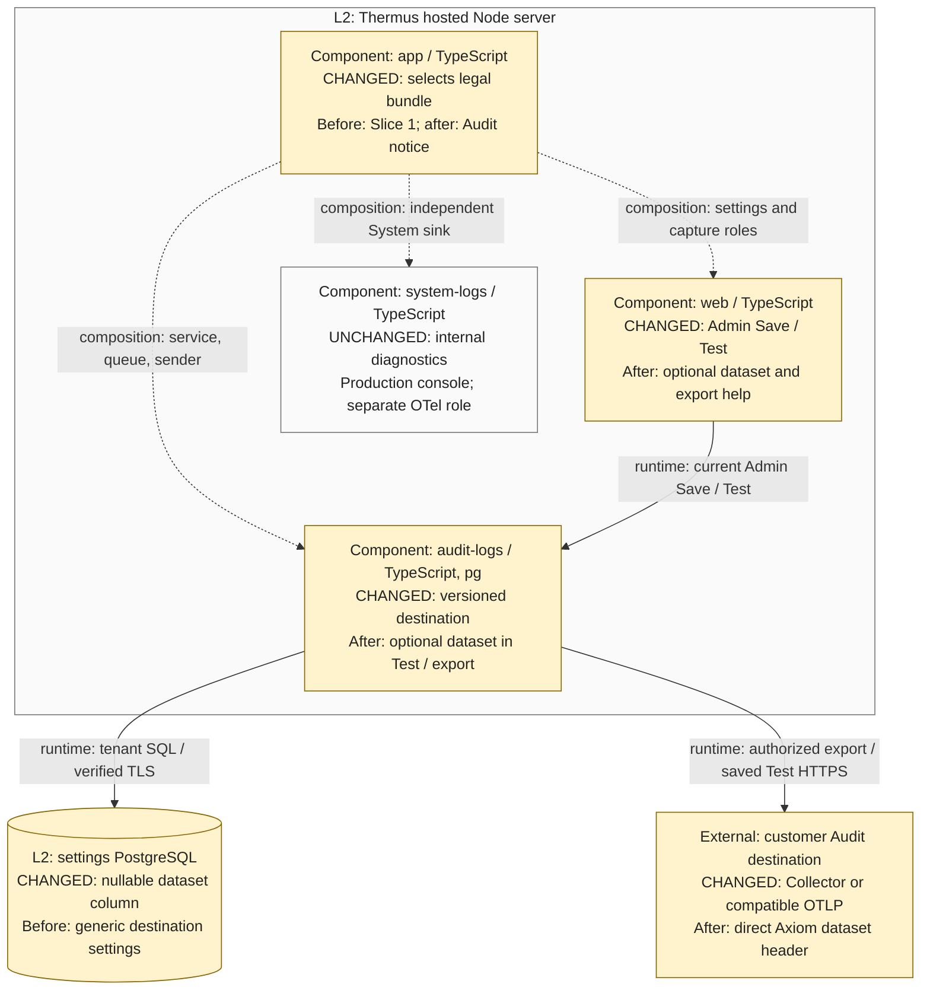

# S2-04 direct Axiom and runtime notice: independent architecture review

Status: agent review of a working candidate, captured 2026-10-25T00:08:08.034516+00:00. This is
not independent human approval or a release decision. No build, suite, metrics,
external write, publication, or deployment was performed by this reviewer.

## Pinned scope

- Trusted base: `845cec3060b0880cd27c36047f1da57a1c3772ba` (`origin/main`).
- Current local HEAD at capture: `a7bdf1f32bb2d67e87d85ea03a701078ec04808b`. Source remains uncommitted. Both source authors reported completion before this refresh.
- Tracked review diff SHA-256: `f14d407f54b5b4661b90cac58df4ba0e50b9b63cd61f501459a8d318d07e349a`.
- Complete review diff, including selected new files, SHA-256:
  `dcdad710e5947be82f457e2391b01d316d6c472831a700641c3a2baecbb396bd`.
- `candidate-manifest.json` pins each selected source, test, SQL, legal-package,
  Docker-context, and registry file. `source-before/` and `source-after/` retain
  the actual compared bytes. `tracked-candidate.diff` and
  `complete-candidate.diff` retain distinct tracked and complete review inputs.
- This scope is the Axiom/notice implementation and architecture, not the full
  operational rollout ledger. The manager must pin the final committed candidate
  and refresh this evidence if the selected bytes change.

## Registry inventory

All 13 existing Mermaid blocks were inventoried. Stable diagram IDs and component
owners remain. Context, hosted containers, Audit settings, System/Audit logging,
and deployment change only existing destination or settings labels. The hosted
authentication view stays accurate; its surrounding source-selection prose now
names the new exact-byte Audit bundle. The collaboration overview and all runtime
sequences remain accurate. No component, component edge, container, worker,
framework, System exporter activation, or durable audit-event store was added.

| View | Title | Disposition |
| --- | --- | --- |
| 1 | Context | Changed |
| 2 | C4 containers: hosted edition | Changed |
| 3 | C4 containers: local edition | Checked; unchanged |
| 4 | Selected C4 components: tool processing in the Node server | Checked; unchanged |
| 5 | Selected C4 components: hosted authentication in the Node server | Checked; unchanged |
| 6 | Selected C4 components: hosted Audit logs settings and delivery in the Node server | Changed |
| 7 | Selected C4 components: system and audit logs in the Node server | Changed |
| 8 | Selected C4 components: local authentication in the Node server | Checked; unchanged |
| 9 | Collaboration overview | Checked; unchanged |
| 10 | Scenario: MCP page fetch and renderer cancellation | Checked; unchanged |
| 11 | Scenario: hosted default sign-in landing | Checked; unchanged |
| 12 | Scenario: hosted member read | Checked; unchanged |
| 13 | Deployment view | Changed |

The source registry is the current map, without historical comparison colors.
`registry-before.md`, `registry-after.md`, `diagram-inventory.json`, and extracted
changed Mermaid sources retain full provenance. Changed views 1, 2, 6, 7, 13 and
the comparison parsed and rendered with cached Mermaid CLI 12.0.0 and existing
Chrome headless 136. `render-validation.json` records dimensions; the `*-800.png`
files were inspected at 800 pixels. Titles, labels, arrow targets, and boundaries
are clear, without labels crossing unrelated boxes. The inherited deployment
view is dense because it retains both editions; the focused L3 comparison is the
primary review drawing. No registry layout or unchanged topology was redesigned.

## Actual before and after behavior

1. **Saved authority and lifetime.** Before, the current Admin saved endpoint,
   auth, enabled state, ciphertext, and revision. After, the same owner also saves
   an optional dataset. Web retains current Admin, Origin, CSRF, trusted tenant,
   and duplicate-field checks. SQL retains parameterized tenant and expected
   revision predicates. Dataset-only changes advance revision; old queued work
   cannot retarget to the new dataset. Each normal attempt reads current enabled
   state and revision again. Already-authorized in-flight work can still finish;
   sent data cannot be recalled. No global Save hold was added.
2. **Header and credential handling.** Before, the Audit sender emitted OTLP JSON
   and optional Bearer authorization. After, it adds `x-axiom-dataset` only for a
   nonblank saved dataset of 1–128 ASCII letters, digits, or hyphens. Validation
   rejects CR/LF, whitespace, Unicode, other punctuation, and excessive length
   before network work. Blank/omitted fields keep generic OTLP behavior. The
   Admin still supplies the full HTTPS logs URL. Public DNS, pinned peer,
   certificate/hostname verification, response limits, retries, deadlines, and
   cancellation remain. The dataset is routing metadata, not an event attribute.
   Dataset-only edits may retain the encrypted token when endpoint/auth stay the
   same. None clears the token. No System credentials or defaults are consulted.
3. **SQL and rollback.** The additive migration adds nullable `axiom_dataset`;
   existing rows remain generic and the trusted role keeps its table grants.
   The new adapter requires that migration before activation. The old adapter
   can read its original columns after migration, but it ignores the dataset
   and cannot perform direct Axiom routing. Old-image writes also do not clear
   this added field. Review destination compatibility before rollback; additive
   schema compatibility alone does not prove equivalent delivery behavior. No
   startup migration or tenant database identity was added.
4. **Notice and stream separation.** App now selects the frozen v3 organization
   Audit Terms/Privacy bundle. Existing creator-record fields store its new
   document versions/hashes; agreement bytes/version stay unchanged. Old form
   versions fail before organization creation; old approved modules and existing
   agreements stay intact. This does not prove owner approval, publication, or
   agreement by existing users. System diagnostics keep their own console/sink
   roles. The System Axiom SDK test composition retains its separate endpoint,
   token, and dataset. Audit uses its existing sender and settings owner, with no
   forwarding path between streams and no production System exporter enabled.

## Review findings and disposition

- **Resolved P1: hosted build context.** The new module contract and signup
  acceptance tests read the v3 legal files, but the Docker allowlist initially
  admitted only the old bundle. The manager/runtime author added exactly the
  new Terms, Privacy, and agreement inputs. The current diff contains those
  three allowlist entries, with no restricted approval records. A subsequent
  complete hosted/image run is manager-owned; this review does not claim it.
- **Resolved coverage gap: queued dataset forwarding.** Initial new cases called
  service authorization and the sender separately. The Axiom author added
  `test/integration/logging/audit/logging-storage-export.test.ts` coverage using
  real composition, service, credential codec, and collector. It holds an old
  in-flight attempt, queues stale old-revision work, changes only the dataset,
  then proves the stale event is dropped and the new event gets the current
  dataset at `sender.start`. The reviewer inspected this oracle and cleanup.
- **Reviewed contracts.** Existing refusal tests remain. New service cases cover
  invalid dataset/no write, blank generic mode, ciphertext retention, semantic
  no-op, clearing, changed revision, and malformed stored data. Browser cases
  cover saved Test, hidden token, unsaved dataset refusal, and duplicate field
  refusal. Real PostgreSQL cases check add/change/clear/no-op/revision/tenant
  behavior. TLS receiver cases inspect exact dataset and Bearer headers and
  exclude configuration secrets/System fields from event bodies. The receiver
  does not establish actual Axiom ingestion or durable storage.
- **Runtime bundle tests.** Exact UTF-8 hashes, versions and freezing are checked
  against the new package; real production composition verifies signed-out
  Privacy, complete signed-in documents, one unchecked checkbox, stale-version
  refusal, persisted metadata, and first Admin. Assertions describe source
  behavior and do not grant legal approval.
- Final browser-pattern review also includes the author's escaped literal hyphen
  and the rendered `v`-mode regex assertion, which accepts valid datasets and
  rejects invalid input. No unresolved production correctness defect was found in this reviewed scope.
  Final local gate results, actual Axiom receipt, rollout configuration, owner
  legal decisions, and required human approval remain separate evidence.

## Proposed main-PR Architecture comparison

Supplementary C4 Level 3 comparison, derived from pinned code and registry, scoped
to the Thermus hosted Node server. Amber boxes describe changed responsibilities
inside existing owners; all surviving relationships stay neutral. No component
or relationship was added or removed. PostgreSQL and the customer destination
are named supporting peers. MCP/tool capture, WorkOS/session/organization calls,
renderer work, internal queue stages, retry/cleanup details, and the separate
System test exporter are retained but omitted for clarity.

Use the four before/after notes above beside this drawing, with the final
committed source links and current approval/release blockers. Keep this single
comparison authoritative in the main PR description, not duplicated across
supporting comments.

## L4 and classification rationale

The strongest changed callable contract is `AuditDestination.axiomDataset`, also
carried by the public settings Save/read/authorization contracts. The concrete
review question is whether only the current saved tenant/revision may select
that header, while old queued work is dropped and generic destinations retain
their previous behavior. The L3 owner map, behavior notes, and forwarding/TLS
oracles answer it. All changed functions remain inside the existing audit owner;
no extra L4 detail is needed. The notice selection introduces content, not a new
production callable contract. No test-helper API requires L4.

Expected T2 Need architect reasons include changed public declaration snapshots
and changed registry Mermaid views (facts d/e). The manager must run the checker,
refresh `.pr-impact.json`, regenerate required public snapshots, and retain the
canonical reasons for the complete committed candidate. This agent review does
not satisfy required independent authorized human architect approval.

## Final source refresh

Version 1 is retained as the earlier draft. Version 2 refreshes source/test hashes
after the Axiom and notice authors finished. The only selected source/test deltas
since v1 are recorded in `refresh-delta.json`. Diagram sources and registry bytes
are unchanged; v2 reuses the inspected v1 renders byte-for-byte. Embedded comparison
Mermaid equals `l3.mmd` byte-for-byte.

The Axiom author reports a final 206/206 focused run, 13/13 real PostgreSQL cases,
and 10/10 TLS/Collector cases. The notice author reports 37 focused cases. These
are author results, not an independent execution by this reviewer; final complete
candidate gates remain manager-owned. The manager has accepted the six diagram images and scope. Final
committed-candidate stamping and approval remain pending.

## Stable-source refresh after final review fixes

Version 3 retains the earlier v1/v2 drafts and refreshes the selected source, test,
SQL, legal, Docker-context and registry inputs after the manager-authorized test
setup guard and shared text-input CSS correction. The new guard stops the malformed
stored-settings test from passing without its seeded row. The CSS selector gives
the optional dataset text input the established full-width form style. Both changes
were read and preserve the owner map, authority, payload, and lifetime described
above. The manager records their focused/manual validation separately.

`refresh-delta.json` lists exact changed files since v2. Registry bytes, all 13
Mermaid sources, and the focused L3 source remain byte-identical. The manager
already inspected and accepted all six images; v3 retains those inspected renders
without a redundant rerender. The source manifest is now current, but final commit
and merge-base stamping, public declaration evidence, final gate/coverage results,
and classification remain manager-owned. No build, test, metric, or source mutation
was performed during this refresh.
