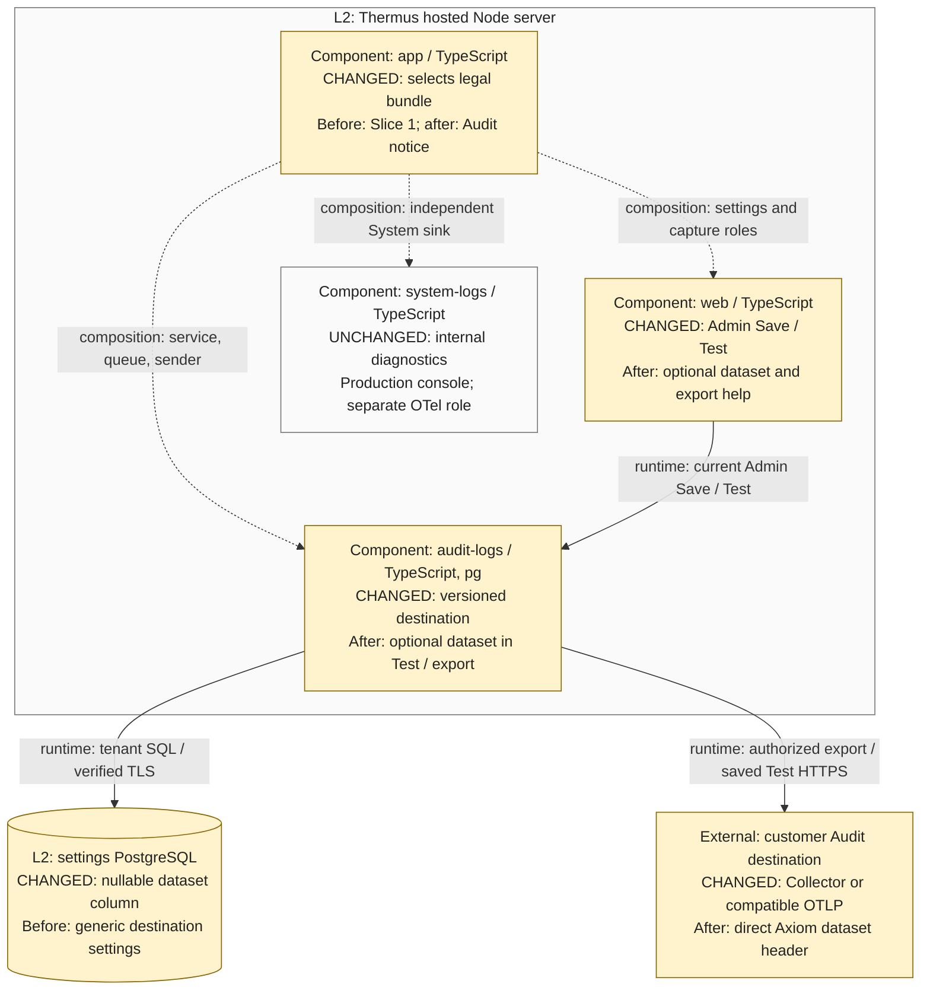

# S2-04 architecture evidence: committed candidate v4

Status: final provenance refresh at 2026-10-25T01:04:41.642105+00:00 for the exact commits
below. This refresh carries forward the independent agent review retained in v3.
The implementation author prepared v4; the manager must review it before
publication. It is not independent human architect approval, exact-byte legal
approval, or permission to deploy.

No source, test, registry, policy, branch, or tracked document was changed. No
build, suite, metrics process, live service write, publication, or deployment was
run. Only this ignored `v4/` evidence directory was written.

## Pinned candidate and limits

- Trusted base and actual merge base: `845cec3060b0880cd27c36047f1da57a1c3772ba`.
- Committed candidate: `85206b1c22dab78e8379d7a10e2f2b9ac31af9c6`.
- Base tree: `0155de6c84782c4b4f1ae78b3a925a093db591bd`.
- Candidate tree: `9e0921b2795f6b8f15a80a3e0f743f26a79e264e`.
- All 60 changed files are bound in
  `candidate-manifest.json`, with before/after SHA-256, Git blob IDs, and pinned
  source URLs. `source-before/` and `source-after/` retain their exact committed
  bytes. Absent files have an explicit absence in the manifest, not empty-file
  evidence.
- Complete candidate diff SHA-256: `0b8871b750bf2e8665ac3d3e76a4822a389017b80c3ac6d8df8e280c07ee0d15`.
  `complete-candidate.diff` and `tracked-candidate.diff` are identical because
  this candidate is committed and clean.
- The full `src/` manifest includes 189 base files and
  190 head files, including unchanged callers. Canonical head
  source manifest SHA-256: `761276e09596527f8a1dfcaa8865eed552ad70750c02aaa5de8c368a421ba290`.
  `source-tree-manifest.json` defines the byte format and retains every file hash.
- Final check, metrics, human approval, and live rollout evidence remain in the
  manager's separate current-candidate report. This architecture record does not
  replace them or infer successful Axiom ingestion from a TLS fixture.

All selected production source, tests, SQL, legal text, static help, build-context
inputs, and registry bytes reviewed in v3 match this commit. Only the legal
package README and data-flow review notes changed after v3: they now describe
prepared source, recorded local checks, and remaining publication/deployment
work. `review-notes-since-v3.patch` and `refresh-delta.json` retain that change.
No new runtime behavior or architecture finding follows from those notes.
Versions v1–v3 remain unchanged; their directory hashes are in
`refresh-delta.json`.

## Registry inventory and render provenance

All 13 Mermaid blocks were compared at both commits. Exactly five existing views
changed: 1, 2, 6, 7, and 13. The same component owners, container boundaries,
composition, and runtime relationships remain. The changed labels now include a
compatible customer OTLP destination and the optional dataset. The hosted auth
view remains accurate; the source-selection prose names the new exact-byte
bundle. No new component, component edge, container, worker, framework, System
exporter activation, or durable audit-event store was added.

| View | Title | Disposition | Pinned registry |
| --- | --- | --- | --- |
| 1 | Context | Changed | [before](https://github.com/tomer-mayara/Thermus/blob/845cec3060b0880cd27c36047f1da57a1c3772ba/architecture/components.md#L30) / [after](https://github.com/tomer-mayara/Thermus/blob/85206b1c22dab78e8379d7a10e2f2b9ac31af9c6/architecture/components.md#L30) |
| 2 | C4 containers: hosted edition | Changed | [before](https://github.com/tomer-mayara/Thermus/blob/845cec3060b0880cd27c36047f1da57a1c3772ba/architecture/components.md#L57) / [after](https://github.com/tomer-mayara/Thermus/blob/85206b1c22dab78e8379d7a10e2f2b9ac31af9c6/architecture/components.md#L57) |
| 3 | C4 containers: local edition | Checked; unchanged | [before](https://github.com/tomer-mayara/Thermus/blob/845cec3060b0880cd27c36047f1da57a1c3772ba/architecture/components.md#L89) / [after](https://github.com/tomer-mayara/Thermus/blob/85206b1c22dab78e8379d7a10e2f2b9ac31af9c6/architecture/components.md#L89) |
| 4 | Selected C4 components: tool processing in the Node server | Checked; unchanged | [before](https://github.com/tomer-mayara/Thermus/blob/845cec3060b0880cd27c36047f1da57a1c3772ba/architecture/components.md#L140) / [after](https://github.com/tomer-mayara/Thermus/blob/85206b1c22dab78e8379d7a10e2f2b9ac31af9c6/architecture/components.md#L140) |
| 5 | Selected C4 components: hosted authentication in the Node server | Checked; unchanged | [before](https://github.com/tomer-mayara/Thermus/blob/845cec3060b0880cd27c36047f1da57a1c3772ba/architecture/components.md#L189) / [after](https://github.com/tomer-mayara/Thermus/blob/85206b1c22dab78e8379d7a10e2f2b9ac31af9c6/architecture/components.md#L189) |
| 6 | Selected C4 components: hosted Audit logs settings and delivery in the Node server | Changed | [before](https://github.com/tomer-mayara/Thermus/blob/845cec3060b0880cd27c36047f1da57a1c3772ba/architecture/components.md#L249) / [after](https://github.com/tomer-mayara/Thermus/blob/85206b1c22dab78e8379d7a10e2f2b9ac31af9c6/architecture/components.md#L250) |
| 7 | Selected C4 components: system and audit logs in the Node server | Changed | [before](https://github.com/tomer-mayara/Thermus/blob/845cec3060b0880cd27c36047f1da57a1c3772ba/architecture/components.md#L309) / [after](https://github.com/tomer-mayara/Thermus/blob/85206b1c22dab78e8379d7a10e2f2b9ac31af9c6/architecture/components.md#L318) |
| 8 | Selected C4 components: local authentication in the Node server | Checked; unchanged | [before](https://github.com/tomer-mayara/Thermus/blob/845cec3060b0880cd27c36047f1da57a1c3772ba/architecture/components.md#L489) / [after](https://github.com/tomer-mayara/Thermus/blob/85206b1c22dab78e8379d7a10e2f2b9ac31af9c6/architecture/components.md#L508) |
| 9 | Collaboration overview | Checked; unchanged | [before](https://github.com/tomer-mayara/Thermus/blob/845cec3060b0880cd27c36047f1da57a1c3772ba/architecture/components.md#L536) / [after](https://github.com/tomer-mayara/Thermus/blob/85206b1c22dab78e8379d7a10e2f2b9ac31af9c6/architecture/components.md#L555) |
| 10 | Scenario: MCP page fetch and renderer cancellation | Checked; unchanged | [before](https://github.com/tomer-mayara/Thermus/blob/845cec3060b0880cd27c36047f1da57a1c3772ba/architecture/components.md#L603) / [after](https://github.com/tomer-mayara/Thermus/blob/85206b1c22dab78e8379d7a10e2f2b9ac31af9c6/architecture/components.md#L622) |
| 11 | Scenario: hosted default sign-in landing | Checked; unchanged | [before](https://github.com/tomer-mayara/Thermus/blob/845cec3060b0880cd27c36047f1da57a1c3772ba/architecture/components.md#L674) / [after](https://github.com/tomer-mayara/Thermus/blob/85206b1c22dab78e8379d7a10e2f2b9ac31af9c6/architecture/components.md#L693) |
| 12 | Scenario: hosted member read | Checked; unchanged | [before](https://github.com/tomer-mayara/Thermus/blob/845cec3060b0880cd27c36047f1da57a1c3772ba/architecture/components.md#L741) / [after](https://github.com/tomer-mayara/Thermus/blob/85206b1c22dab78e8379d7a10e2f2b9ac31af9c6/architecture/components.md#L760) |
| 13 | Deployment view | Changed | [before](https://github.com/tomer-mayara/Thermus/blob/845cec3060b0880cd27c36047f1da57a1c3772ba/architecture/components.md#L850) / [after](https://github.com/tomer-mayara/Thermus/blob/85206b1c22dab78e8379d7a10e2f2b9ac31af9c6/architecture/components.md#L869) |

`diagram-inventory.json` pins each block's bytes and verified line anchor at both
commits. All 13 before/after sources are retained. Registry head SHA-256:
`1bfc16c8128c1e4f6d0a5b7b35d348cd2e477c135bd8779f86ef899e542be9f5`. The complete registry and every diagram
source are byte-identical to v3.

The five changed registry views and focused L3 comparison reuse all six v3 SVG
and 800-pixel PNG renders byte-for-byte. No rerender was needed. Those images were
parsed/rendered with Mermaid CLI 12.0.0 and existing Chrome headless 136; v3 and
the manager record retain the visual review at normal PR width. Titles, labels,
arrow targets, and boundaries were accepted. The inherited deployment view is
dense because it retains both editions, so the focused L3 comparison remains the
primary PR view. `render-validation.json` binds each reused Mermaid, SVG, and PNG
hash to this commit and preserves the rendering configuration. Comparison source
SHA-256: `7c6ecc9513aa3bbdbdf8893a7c5061a8c8233ffea5219adace3fab8cd8cbec72`.

## Declaration changes and caller effects

There are exactly two changed public declaration snapshots, both existing public
modules. No module joins or leaves `public_surface`. These are observable contract
changes, not declaration noise. The optional dataset and the new invalid reason
are declared below; the current saved tenant/revision controls their runtime use.

| Snapshot | Meaning | Pinned declaration |
| --- | --- | --- |
| `docs/api-surface/src/logs/audit/audit-send.d.ts` | Optional axiomDataset on AuditDestination lets a current saved destination supply the narrow x-axiom-dataset header. Omitted values retain generic OTLP behavior. The sender validates it before network work. | [before](https://github.com/tomer-mayara/Thermus/blob/845cec3060b0880cd27c36047f1da57a1c3772ba/docs/api-surface/src/logs/audit/audit-send.d.ts) / [after](https://github.com/tomer-mayara/Thermus/blob/85206b1c22dab78e8379d7a10e2f2b9ac31af9c6/docs/api-surface/src/logs/audit/audit-send.d.ts) |
| `docs/api-surface/src/logs/audit/destination-settings-service.d.ts` | Optional axiomDataset is now in Save input and public read projection; invalid Save reason adds dataset. The service validates, normalizes blank to absent, persists it, checks saved Test equality, and returns it only after current enabled revision authorization. | [before](https://github.com/tomer-mayara/Thermus/blob/845cec3060b0880cd27c36047f1da57a1c3772ba/docs/api-surface/src/logs/audit/destination-settings-service.d.ts) / [after](https://github.com/tomer-mayara/Thermus/blob/85206b1c22dab78e8379d7a10e2f2b9ac31af9c6/docs/api-surface/src/logs/audit/destination-settings-service.d.ts) |

<details>
<summary>Exact declaration diff between the pinned commits</summary>

```diff
diff --git a/docs/api-surface/src/logs/audit/audit-send.d.ts b/docs/api-surface/src/logs/audit/audit-send.d.ts
index a75baa3c..3b4e89aa 100644
--- a/docs/api-surface/src/logs/audit/audit-send.d.ts
+++ b/docs/api-surface/src/logs/audit/audit-send.d.ts
@@ -1,6 +1,7 @@
 import type { AuditEvent } from './audit-log.ts';
 export interface AuditDestination {
     readonly endpoint: string;
+    readonly axiomDataset?: string;
     readonly auth: {
         readonly type: 'none';
     } | {
diff --git a/docs/api-surface/src/logs/audit/destination-settings-service.d.ts b/docs/api-surface/src/logs/audit/destination-settings-service.d.ts
index 4437e8b6..e97ec242 100644
--- a/docs/api-surface/src/logs/audit/destination-settings-service.d.ts
+++ b/docs/api-surface/src/logs/audit/destination-settings-service.d.ts
@@ -5,6 +5,7 @@ export type { DestinationTestResult } from './destination-test.ts';
 export interface PublicDestinationSettings {
     readonly revision: string | null;
     readonly endpoint: string;
+    readonly axiomDataset?: string;
     readonly auth: 'none' | 'bearer';
     readonly enabled: boolean;
     readonly tokenPresent: boolean;
@@ -12,6 +13,7 @@ export interface PublicDestinationSettings {
 export interface DestinationSettingsSaveInput {
     readonly expectedRevision: string | null;
     readonly endpoint: string;
+    readonly axiomDataset?: string;
     readonly auth: 'none' | 'bearer';
     readonly enabled: boolean;
     readonly token: string;
@@ -27,7 +29,7 @@ export type DestinationSettingsSaveResult = {
     readonly settings: PublicDestinationSettings;
 } | {
     readonly status: 'invalid';
-    readonly reason: 'endpoint' | 'token' | 'settings';
+    readonly reason: 'endpoint' | 'dataset' | 'token' | 'settings';
 } | {
     readonly status: 'conflict' | 'unavailable' | 'unconfirmed';
 };
```

</details>

The diff is also retained in `declaration-diffs.patch` and its SHA-256 is
`10678f0519cc169b49293a810693097e3252225f08fcbf32775152b206b66071`. `declaration-review.json` records the
meaning of each module's change.

| Owner or caller | Runtime effect and retained rule | Pinned source |
| --- | --- | --- |
| Web form and routes | The form passes one optional dataset through the existing Save/Test contract. The route still resolves current Admin context, checks Origin/CSRF and tenant, and renders a fixed invalid-settings result. No error switch assumes the old reason union is exhaustive. | [before](https://github.com/tomer-mayara/Thermus/blob/845cec3060b0880cd27c36047f1da57a1c3772ba/src/interfaces/web/account/logging-form.ts#L4) / [after](https://github.com/tomer-mayara/Thermus/blob/85206b1c22dab78e8379d7a10e2f2b9ac31af9c6/src/interfaces/web/account/logging-form.ts#L4) |
| Settings service | Save validates and normalizes the optional field; saved Test compares it with the current saved settings. Export authorization returns it only after an enabled, current revision read and credential validation. | [before](https://github.com/tomer-mayara/Thermus/blob/845cec3060b0880cd27c36047f1da57a1c3772ba/src/logs/audit/destination-settings-service.ts#L36) / [after](https://github.com/tomer-mayara/Thermus/blob/85206b1c22dab78e8379d7a10e2f2b9ac31af9c6/src/logs/audit/destination-settings-service.ts#L38) |
| PostgreSQL adapter | The nullable field joins parameterized reads, writes and semantic no-op comparison. Dataset changes advance revision, while unchanged values retain revision and encrypted token. | [before](https://github.com/tomer-mayara/Thermus/blob/845cec3060b0880cd27c36047f1da57a1c3772ba/src/logs/audit/pg-destination-settings-store.ts#L6) / [after](https://github.com/tomer-mayara/Thermus/blob/85206b1c22dab78e8379d7a10e2f2b9ac31af9c6/src/logs/audit/pg-destination-settings-store.ts#L6) |
| Existing app composition | The same service and sender still supply both saved Test and AuditCollector. No new exporter or provider registry is composed. | [before](https://github.com/tomer-mayara/Thermus/blob/845cec3060b0880cd27c36047f1da57a1c3772ba/src/app/logging-storage.ts#L36) / [after](https://github.com/tomer-mayara/Thermus/blob/85206b1c22dab78e8379d7a10e2f2b9ac31af9c6/src/app/logging-storage.ts#L36) |
| Existing snapshot capture | Capture still stores only bounded tenant/revision/enabled metadata; it never caches an endpoint, token or dataset and never grants network authority. | [before](https://github.com/tomer-mayara/Thermus/blob/845cec3060b0880cd27c36047f1da57a1c3772ba/src/logs/audit/audit-snapshots.ts#L16) / [after](https://github.com/tomer-mayara/Thermus/blob/85206b1c22dab78e8379d7a10e2f2b9ac31af9c6/src/logs/audit/audit-snapshots.ts#L16) |
| Existing collector dispatch | Every attempt calls current authorization and passes the returned destination to sender.start. A dataset-only revision change discards queued stale work rather than redirecting it; already authorized work may complete. | [before](https://github.com/tomer-mayara/Thermus/blob/845cec3060b0880cd27c36047f1da57a1c3772ba/src/logs/audit/audit-collector.ts#L113) / [after](https://github.com/tomer-mayara/Thermus/blob/85206b1c22dab78e8379d7a10e2f2b9ac31af9c6/src/logs/audit/audit-collector.ts#L113) |
| Audit sender and native request | The existing verified socket receives only explicitly prepared auth/dataset headers. The header is absent for a generic destination; URL, DNS, TLS, size, deadline and cancellation behavior remain. | [before](https://github.com/tomer-mayara/Thermus/blob/845cec3060b0880cd27c36047f1da57a1c3772ba/src/logs/audit/otlp-audit-request.ts#L8) / [after](https://github.com/tomer-mayara/Thermus/blob/85206b1c22dab78e8379d7a10e2f2b9ac31af9c6/src/logs/audit/otlp-audit-request.ts#L8) |
| Hosted signup composition | The existing app-to-WorkOS composition selects a new frozen content bundle. Existing creator recording gets its versions/hashes; this does not create a new callable provider role or approve the proposed legal text. | [before](https://github.com/tomer-mayara/Thermus/blob/845cec3060b0880cd27c36047f1da57a1c3772ba/src/app/hosted-workos-application.ts#L1) / [after](https://github.com/tomer-mayara/Thermus/blob/85206b1c22dab78e8379d7a10e2f2b9ac31af9c6/src/app/hosted-workos-application.ts#L1) |
| System logs | System runtime code is byte-identical. Internal diagnostics retain the separate sink role; customer Audit events do not enter the System exporter. | [before](https://github.com/tomer-mayara/Thermus/blob/845cec3060b0880cd27c36047f1da57a1c3772ba/src/logs/system/system-logger.ts#L1) / [after](https://github.com/tomer-mayara/Thermus/blob/85206b1c22dab78e8379d7a10e2f2b9ac31af9c6/src/logs/system/system-logger.ts#L1) |

The registry arrows distinguish runtime calls from app composition. The source
imports and implements roles remain within the existing component map. A changed
DTO alone does not establish new runtime collaboration: the existing service,
collector and sender calls above carry the new value. The unchanged System Axiom
test composition has its own endpoint, token and dataset:
[before](https://github.com/tomer-mayara/Thermus/blob/845cec3060b0880cd27c36047f1da57a1c3772ba/test/support/in-process/axiom-test-export.ts#L1) / [after](https://github.com/tomer-mayara/Thermus/blob/85206b1c22dab78e8379d7a10e2f2b9ac31af9c6/test/support/in-process/axiom-test-export.ts#L1).

## Actual before and after behavior

1. **Saved authority and lifetime.** Before, the current Admin saved endpoint,
   auth, enabled state, ciphertext, and revision. After, the same owner also saves
   an optional dataset. Web retains current Admin, Origin, CSRF, trusted tenant,
   and duplicate-field checks. SQL retains parameterized tenant and expected
   revision predicates. Dataset-only changes advance revision; old queued work
   cannot retarget to the new dataset. Each normal attempt reads current enabled
   state and revision again. Already-authorized in-flight work can still finish;
   sent data cannot be recalled. No global Save hold was added.
2. **Header and credential handling.** Before, the Audit sender emitted OTLP JSON
   and optional Bearer authorization. After, it adds `x-axiom-dataset` only for a
   nonblank saved dataset of 1–128 ASCII letters, digits, or hyphens. Validation
   rejects CR/LF, whitespace, Unicode, other punctuation, and excessive length
   before network work. Blank/omitted fields keep generic OTLP behavior. The
   Admin still supplies the full HTTPS logs URL. Public DNS, pinned peer,
   certificate/hostname verification, response limits, retries, deadlines, and
   cancellation remain. The dataset is routing metadata, not an event attribute.
   Dataset-only edits may retain the encrypted token when endpoint/auth stay the
   same. None clears the token. No System credentials or defaults are consulted.
3. **SQL and rollback.** The additive migration adds nullable `axiom_dataset`;
   existing rows remain generic and the trusted role keeps its table grants.
   The new adapter requires that migration before activation. The old adapter
   can read its original columns after migration, but it ignores the dataset
   and cannot perform direct Axiom routing. Old-image writes also do not clear
   this added field. Review destination compatibility before rollback; additive
   schema compatibility alone does not prove equivalent delivery behavior. No
   startup migration or tenant database identity was added.
4. **Notice and stream separation.** App now selects the frozen v3 organization
   Audit Terms/Privacy bundle. Existing creator-record fields store its new
   document versions/hashes; agreement bytes/version stay unchanged. Old form
   versions fail before organization creation; old approved modules and existing
   agreements stay intact. This does not prove owner approval, publication, or
   agreement by existing users. System diagnostics keep their own console/sink
   roles. The System Axiom SDK test composition retains its separate endpoint,
   token, and dataset. Audit uses its existing sender and settings owner, with no
   forwarding path between streams and no production System exporter enabled.


The migration is an addition at
[the candidate SQL migration](https://github.com/tomer-mayara/Thermus/blob/85206b1c22dab78e8379d7a10e2f2b9ac31af9c6/sql/migrations/20261024231921_add_logging_axiom_dataset.sql#L1).
There is no corresponding base file. The new bundle is at
[the candidate immutable bundle](https://github.com/tomer-mayara/Thermus/blob/85206b1c22dab78e8379d7a10e2f2b9ac31af9c6/src/accounts/providers/workos/workos-organization-audit-documents.ts#L1);
the prior approved bundle remains unchanged:
[before](https://github.com/tomer-mayara/Thermus/blob/845cec3060b0880cd27c36047f1da57a1c3772ba/src/accounts/providers/workos/workos-approved-organization-documents.ts#L1) / [after](https://github.com/tomer-mayara/Thermus/blob/85206b1c22dab78e8379d7a10e2f2b9ac31af9c6/src/accounts/providers/workos/workos-approved-organization-documents.ts#L1).
No Level 2 process, service, or deployment placement changes. The same settings
PostgreSQL peer receives one nullable column. Destination capability/labels
change; enabling direct Axiom is a rollout configuration step. Settings backups
and recovery move to future Slice 4 by user instruction; no backup service or
recovery promise is added by this candidate.

## Findings and retained review evidence

- **Resolved P1: hosted build context.** The new module contract and signup
  acceptance tests read the v3 legal files, but the Docker allowlist initially
  admitted only the old bundle. The manager/runtime author added exactly the
  new Terms, Privacy, and agreement inputs. The current diff contains those
  three allowlist entries, with no restricted approval records. A subsequent
  complete hosted/image run is manager-owned; this review does not claim it.
- **Resolved coverage gap: queued dataset forwarding.** Initial new cases called
  service authorization and the sender separately. The Axiom author added
  `test/integration/logging/audit/logging-storage-export.test.ts` coverage using
  real composition, service, credential codec, and collector. It holds an old
  in-flight attempt, queues stale old-revision work, changes only the dataset,
  then proves the stale event is dropped and the new event gets the current
  dataset at `sender.start`. The reviewer inspected this oracle and cleanup.
- **Reviewed contracts.** Existing refusal tests remain. New service cases cover
  invalid dataset/no write, blank generic mode, ciphertext retention, semantic
  no-op, clearing, changed revision, and malformed stored data. Browser cases
  cover saved Test, hidden token, unsaved dataset refusal, and duplicate field
  refusal. Real PostgreSQL cases check add/change/clear/no-op/revision/tenant
  behavior. TLS receiver cases inspect exact dataset and Bearer headers and
  exclude configuration secrets/System fields from event bodies. The receiver
  does not establish actual Axiom ingestion or durable storage.
- **Runtime bundle tests.** Exact UTF-8 hashes, versions and freezing are checked
  against the new package; real production composition verifies signed-out
  Privacy, complete signed-in documents, one unchecked checkbox, stale-version
  refusal, persisted metadata, and first Admin. Assertions describe source
  behavior and do not grant legal approval.
- Final browser-pattern review also includes the author's escaped literal hyphen
  and the rendered `v`-mode regex assertion, which accepts valid datasets and
  rejects invalid input. No unresolved production correctness defect was found in this reviewed scope.
  Final local gate results, actual Axiom receipt, rollout configuration, owner
  legal decisions, and required human approval remain separate evidence.


No remaining architecture or production correctness finding was found in the
committed scope. The previous findings and their source/test fixes are unchanged
from v3. The commit binding adds no claim that the proposed legal text is approved,
that existing organizations have completed a notice process, or that the deployed
Save/Test/Enable/MCP route has been verified. Those are separate manager/owner
rollout decisions.

## Main PR Architecture comparison

**Deployed setup limit.** The application verifies TLS and hostname for its
connection to the Supabase session pooler. `pg_stat_ssl` reported `ssl: false`
for the pooler's separate database session. The storage arrow's verified TLS
claim therefore ends at the pooler; it does not establish end-to-end database TLS.
This flag alone does not show whether the provider hop crosses a network in
plaintext or uses a local provider connection. See the [pinned setup facts](https://github.com/tomer-mayara/Thermus/blob/85206b1c22dab78e8379d7a10e2f2b9ac31af9c6/docs/implementation/admin-s2-04.md#L120)
and `deployed-setup-limit.json`. The logical diagram is unchanged.

Supplementary C4 Level 3 comparison, derived from the pinned code and registry,
scoped to the Thermus hosted Node server. Amber boxes show changed responsibilities
inside existing owners. Surviving relationships stay neutral. PostgreSQL and the
customer destination are named supporting peers. MCP/tool capture, WorkOS/session
and organization calls, renderer work, internal queue steps, retries/cleanup, and
the separate System test exporter remain but are omitted for clarity.



This embedded block equals `l3.mmd` byte-for-byte. Use the four before/after notes
beside this single authoritative comparison in the main PR description. Keep
source provenance and detailed review history in the supporting Quality review;
do not duplicate the authoritative diagram across comments.

## L4 rationale, classification, and manager handoff

The strongest changed callable contract is `AuditDestination.axiomDataset`, also
carried by the public settings Save/read/authorization contracts. The concrete
review question is whether only the current saved tenant/revision selects that
header, while stale queued work is discarded and generic destinations retain
existing behavior. The L3 owners, caller table, before/after rules, queued-forwarding
integration and TLS header evidence answer it. The altered functions remain
inside the existing audit owner. A separate L4 drawing would repeat those rules,
so it is omitted. The notice selection adds content within an existing role;
no additional production callable contract or test-helper API needs L4.

The architecture evidence establishes fact d (two public declaration changes)
and fact e (five registry Mermaid changes), which require T2 Need architect.
No component set, dependency edge, public-module set, or architecture decision
record changes. The complete checker, canonical reasons, impact declaration,
metrics disposition, and independent authorized human approval remain manager
responsibilities. Source and registry evidence is pinned; no local review alone
makes the candidate eligible to merge.

The manager already accepted the six images in v3. This v4 refresh preserves their
bytes and conclusions and is ready for manager review and publication. Versioned
sources/renders, prior drafts, full candidate hashes, and linked before/after
source references are retained for that review.
