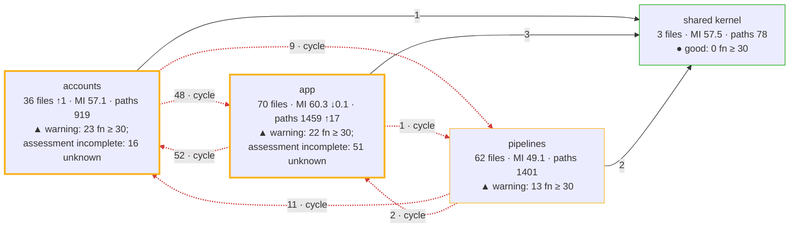
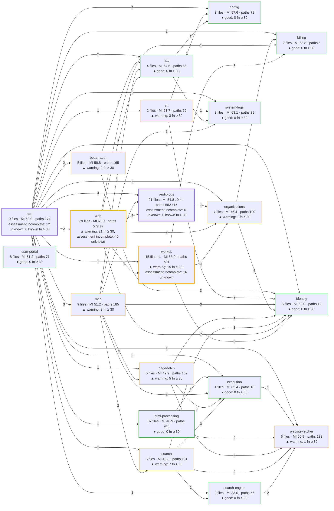
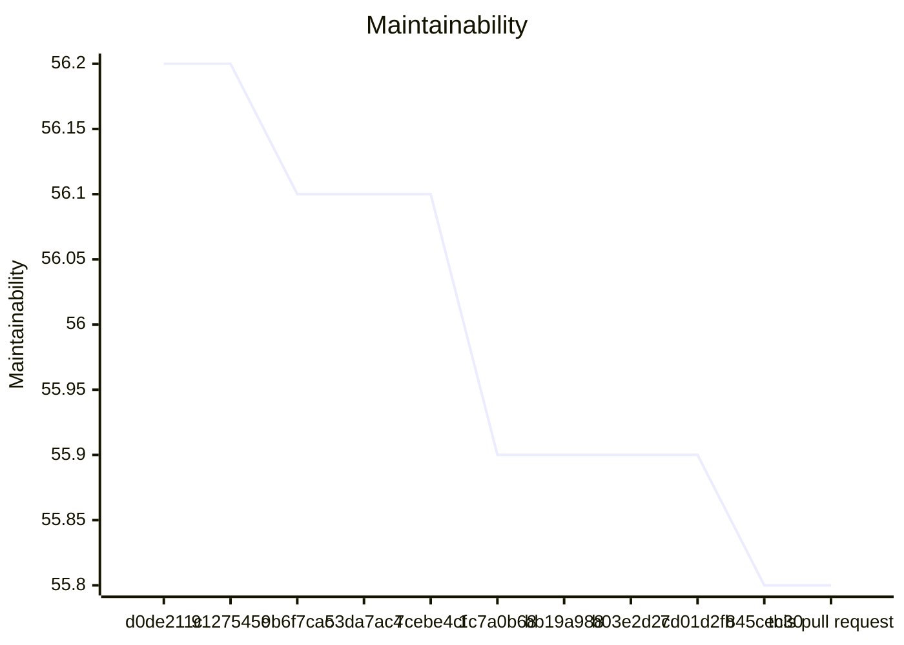
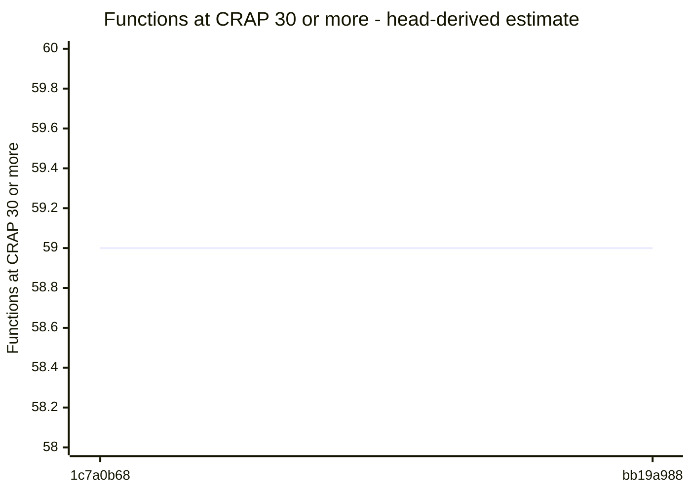
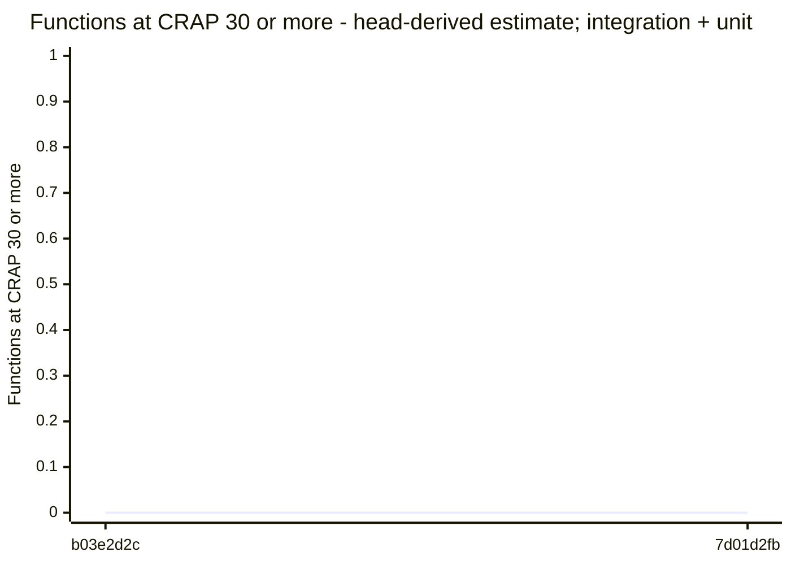

# Code quality process

## Delta

Status: goal miss.

```text
  39.7  src/logs/audit/destination-settings-service.ts  below 85
  47.8  src/interfaces/web/account/logging-routes.ts  below 85
  53.6  src/logs/audit/pg-destination-settings-store.ts  below 85
  56.2  src/app/hosted-workos-application.ts  below 85
  58.1  src/logs/audit/public-audit-destination.ts  below 85
  60.0  src/logs/audit/otlp-audit-request.ts  below 85
  64.4  src/logs/audit/otlp-audit-sender.ts  below 85
  69.5  src/interfaces/web/account/logging-form.ts  below 85
  71.8  src/interfaces/web/account/logging-test-page.ts  below 85
  72.6  src/interfaces/web/account/logging-page.ts  below 85
  111.8  src/logs/audit/audit-send.ts
  10.8  test/acceptance/auth/hosted-workos-signup.test.ts  no goal
  19.9  test/unit/logging/audit/otlp-audit-sender.test.ts  no goal
  27.0  test/unit/logging/destination-settings-service.test.ts  no goal
  30.2  test/acceptance/logging/hosted-destination-settings.test.ts  no goal
  30.5  test/integration/logging/audit/audit-sender.runtime.ts  no goal
  31.5  test/acceptance/logging/hosted-destination-test.test.ts  no goal
  31.8  test/support/container/audit-sender-site.ts  no goal
  33.6  test/integration/logging/audit/destination-settings.runtime.ts  no goal
  34.2  test/acceptance/auth/hosted-image.test.ts  no goal
  35.2  test/unit/html/logging-routes.test.ts  no goal
  36.1  test/unit/html/logging-test-routes.test.ts  no goal
  37.9  test/integration/logging/audit/logging-storage-export.test.ts  no goal
  38.2  test/acceptance/logging/audit/hosted-audit-journey.runtime.ts  no goal
  40.9  test/acceptance/logging/audit/destination-settings.runtime.ts  no goal
  42.7  test/unit/logging/audit/otlp-audit-request.test.ts  no goal
  45.7  test/unit/logging/audit/public-audit-destination.test.ts  no goal
  49.4  test/unit/logging/audit/pg-destination-settings-store.test.ts  no goal
  59.2  test/support/in-process/postgres-settings-site.ts  no goal
  59.3  test/support/processes/audit-destination-test-probe.ts  no goal
  59.4  test/unit/auth-workos/workos-organization-audit-documents.test.ts  no goal
  62.4  test/support/processes/audit-sender-probe.ts  no goal
  72.1  test/support/doubles/logging/destination-settings-fake.ts  no goal
  93.6  test/support/processes/module-paths.ts  no goal
  not measured  docs/api-surface/src/logs/audit/audit-send.d.ts
  not measured  docs/api-surface/src/logs/audit/destination-settings-service.d.ts
  not measured  src/accounts/providers/workos/workos-organization-audit-documents.ts
  not measured  src/interfaces/web/account/members-style.ts
  not measured  src/logs/audit/destination-settings-store.ts
Result: 10 of 11 production files below 85. Goal: 85 or more for each production file. 23 other files without a goal. 5 files not measured.
Comparison with origin/main: ast-report/compare.html
```

## Review

Status: goal miss.

## AST Metrics found blocking regressions

1 new critical issue(s), 8 other regression(s)

### Summary

- ⚠️  **Complexity: +14**
- ⚠️  **Ease of maintenance: -6**
- ➖ **Outgoing dependencies: -**
- ➖ **Probability of bugs: -**

### Regressions

- **test/integration/logging/audit/logging-storage-export.test.ts** (`test/integration/logging/audit/logging-storage-export.test.ts`, high)
  Maintainability index: 44 -> 38 (below 85 is hard to maintain)
  Suggested action: Refactor long or deeply nested functions and reduce responsibilities in this file
- **src/accounts/providers/workos/workos-organization-audit-documents.ts** (`src/accounts/providers/workos/workos-organization-audit-documents.ts`, medium)
  Too many Lines of code (346 > 150)
- **loggingForm** (`src/interfaces/web/account/logging-form.ts:6`, medium)
  Cyclomatic complexity: 11 -> 13 (threshold: 10)
  Suggested action: Extract smaller, well-named functions to reduce decision points
- **DestinationSettingsService::authorizeExport** (`src/logs/audit/destination-settings-service.ts:46`, medium)
  Cyclomatic complexity: 10 -> 11 (threshold: 10)
  Suggested action: Extract smaller, well-named functions to reduce decision points
- **DestinationSettingsService::save** (`src/logs/audit/destination-settings-service.ts:101`, medium)
  Cyclomatic complexity: 13 -> 14 (threshold: 10)
  Suggested action: Extract smaller, well-named functions to reduce decision points
- **DestinationSettingsService::testSaved** (`src/logs/audit/destination-settings-service.ts:67`, medium)
  Cyclomatic complexity: 14 -> 15 (threshold: 10)
  Suggested action: Extract smaller, well-named functions to reduce decision points
- **invalidInput** (`src/logs/audit/destination-settings-service.ts:139`, medium)
  Cyclomatic complexity: 11 -> 15 (threshold: 10)
  Suggested action: Extract smaller, well-named functions to reduce decision points
- **parseAuditDestination** (`src/logs/audit/public-audit-destination.ts:24`, medium)
  Cyclomatic complexity: 13 -> 17 (threshold: 10)
  Suggested action: Extract smaller, well-named functions to reduce decision points
- **DestinationSettingsFake::save** (`test/support/doubles/logging/destination-settings-fake.ts:15`, medium)
  Cyclomatic complexity: 9 -> 10 (threshold: 10)
  Suggested action: Extract smaller, well-named functions to reduce decision points

## CRAP

Status: goal miss.

Reused verified compatible unit coverage.

## CRAP goals

Goals: CRAP < 30; new functions also CRAP ≤ 15.

| File | Function | Change | Paths | Coverage | CRAP | To do |
| --- | --- | --- | --- | --- | --- | --- |
| src/logs/audit/public-audit-destination.ts | parseAuditDestination | changed | 17 | 92.4% | 17.1 | ok; for 15: split |
| src/logs/audit/destination-settings-service.ts | destination-settings-service\DestinationSettingsService.testSaved | changed | 15 | 97.7% | 15.002737575 | ok; for 15: cover ≥ 100% |
| src/logs/audit/destination-settings-service.ts | invalidInput | changed | 15 | 100% | 15.0 | ok |
| src/logs/audit/destination-settings-service.ts | destination-settings-service\DestinationSettingsService.save | changed | 14 | 100% | 14.0 | ok |
| src/interfaces/web/account/logging-routes.ts | logging-routes\LoggingRoutes. | unchanged | 13 | 94% | 13.0 | ok; unchanged by this PR |
| src/interfaces/web/account/logging-form.ts | loggingForm | changed | 13 | 100% | 13.0 | ok |
| src/app/hosted-workos-application.ts | openWorkOSApplication | changed | 3 | 0% | 12.0 | ok |
| src/logs/audit/destination-settings-service.ts | destination-settings-service\DestinationSettingsService.authorizeExport | changed | 11 | 94.2% | 11.0 | ok |
| src/logs/audit/destination-settings-service.ts | destination-settings-service\DestinationSettingsService.token | unchanged | 10 | 97.2% | 10.0 | ok; unchanged by this PR |
| src/app/hosted-workos-application.ts | composeWorkOSApplication | unchanged | 8 | 76% | 8.9 | ok; unchanged by this PR |
| src/interfaces/web/account/logging-routes.ts | logging-routes\LoggingRoutes.saveAnswer | changed | 6 | 60.9% | 8.2 | ok |
| src/interfaces/web/account/logging-routes.ts | logging-routes\LoggingRoutes.save | unchanged | 8 | 86.8% | 8.1 | ok; unchanged by this PR |
| src/interfaces/web/account/logging-routes.ts | logging-routes\LoggingRoutes.test | unchanged | 8 | 100% | 8.0 | ok; unchanged by this PR |
| src/logs/audit/otlp-audit-sender.ts | failureOutcome | unchanged | 6 | 100% | 6.0 | ok; unchanged by this PR |
| src/logs/audit/public-audit-destination.ts | publicAddress | unchanged | 5 | 95% | 5.0 | ok; unchanged by this PR |
| src/logs/audit/otlp-audit-request.ts | (anonymous) | unchanged | 5 | 99.3% | 5.0 | ok; unchanged by this PR |
| src/interfaces/web/account/logging-page.ts | loggingPage | changed | 5 | 99.7% | 5.0 | ok |
| src/logs/audit/destination-settings-service.ts | matchesSavedSettings | changed | 5 | 100% | 5.0 | ok |
| src/logs/audit/destination-settings-service.ts | retainedToken | unchanged | 5 | 100% | 5.0 | ok; unchanged by this PR |
| src/logs/audit/pg-destination-settings-store.ts | pg-destination-settings-store\PgDestinationSettingsStore. | new | 5 | 100% | 5.0 | ok |
| src/logs/audit/public-audit-destination.ts | resolveAuditAddress | unchanged | 5 | 100% | 5.0 | ok; unchanged by this PR |
| src/logs/audit/public-audit-destination.ts | sameAuditAddress | unchanged | 5 | 100% | 5.0 | ok; unchanged by this PR |
| src/interfaces/web/account/logging-routes.ts | logging-routes\LoggingRoutes.handlerFor | unchanged | 4 | 89.9% | 4.0 | ok; unchanged by this PR |
| src/logs/audit/destination-settings-service.ts | destination-settings-service\DestinationSettingsService.read | unchanged | 4 | 100% | 4.0 | ok; unchanged by this PR |
| src/logs/audit/otlp-audit-request.ts | (anonymous) | new | 4 | 100% | 4.0 | ok |
| src/logs/audit/otlp-audit-sender.ts | attempt | changed | 3 | 93.3% | 3.0 | ok |
| src/app/hosted-workos-application.ts | workosProviderParts | unchanged | 3 | 94.3% | 3.0 | ok; unchanged by this PR |
| src/logs/audit/otlp-audit-sender.ts | otlp-audit-sender\OtlpAuditSender.start | unchanged | 3 | 100% | 3.0 | ok; unchanged by this PR |
| src/app/hosted-workos-application.ts | (anonymous) | unchanged | 2 | 55.2% | 2.4 | ok; unchanged by this PR |
| src/interfaces/web/account/logging-routes.ts | logging-routes\LoggingRoutes.keep | unchanged | 2 | 61.9% | 2.2 | ok; unchanged by this PR |
| src/app/hosted-workos-application.ts | (anonymous) | unchanged | 2 | 75.6% | 2.1 | ok; unchanged by this PR |
| src/logs/audit/otlp-audit-request.ts | (anonymous) | unchanged | 2 | 81.1% | 2.0 | ok; unchanged by this PR |
| src/app/hosted-workos-application.ts | (anonymous) | unchanged | 1 | 0% | 2.0 | ok; unchanged by this PR |
| src/app/hosted-workos-application.ts | (anonymous) | new | 1 | 0% | 2.0 | ok |
| src/app/hosted-workos-application.ts | (anonymous) | unchanged | 1 | 0% | 2.0 | ok; unchanged by this PR |
| src/app/hosted-workos-application.ts | (anonymous) | unchanged | 1 | 0% | 2.0 | ok; unchanged by this PR |
| src/app/hosted-workos-application.ts | (anonymous) | unchanged | 1 | 0% | 2.0 | ok; unchanged by this PR |
| src/app/hosted-workos-application.ts | openWorkOSConnection | unchanged | 1 | 0% | 2.0 | ok; unchanged by this PR |
| src/interfaces/web/account/logging-test-page.ts | loggingTestAnswer | unchanged | 2 | 100% | 2.0 | ok; unchanged by this PR |
| src/logs/audit/destination-settings-service.ts | destination-settings-service\DestinationSettingsService.readStored | unchanged | 2 | 100% | 2.0 | ok; unchanged by this PR |
| src/logs/audit/destination-settings-service.ts | project | changed | 2 | 100% | 2.0 | ok |
| src/logs/audit/otlp-audit-request.ts | (anonymous) | unchanged | 2 | 100% | 2.0 | ok; unchanged by this PR |
| src/logs/audit/otlp-audit-request.ts | (anonymous) | new | 1 | 0% | 2.0 | ok |
| src/logs/audit/otlp-audit-sender.ts | beginAttempt | unchanged | 2 | 100% | 2.0 | ok; unchanged by this PR |
| src/logs/audit/pg-destination-settings-store.ts | openDestinationSettingsRuntime | unchanged | 1 | 0% | 2.0 | ok; unchanged by this PR |
| src/logs/audit/pg-destination-settings-store.ts | pg-destination-settings-store\PgDestinationSettingsStore. | unchanged | 2 | 100% | 2.0 | ok; unchanged by this PR |
| src/logs/audit/pg-destination-settings-store.ts | pg-destination-settings-store\PgDestinationSettingsStore.read | unchanged | 2 | 100% | 2.0 | ok; unchanged by this PR |
| src/logs/audit/pg-destination-settings-store.ts | pg-destination-settings-store\PgDestinationSettingsStore.save | changed | 2 | 100% | 2.0 | ok |
| src/logs/audit/pg-destination-settings-store.ts | settings | changed | 2 | 100% | 2.0 | ok |
| src/app/hosted-workos-application.ts | (anonymous) | unchanged | 1 | unknown | ≥ 1 | no coverage data; unchanged by this PR |
| src/interfaces/web/account/logging-page.ts | loggingNotice | unchanged | 1 | 100% | 1.0 | ok; unchanged by this PR |
| src/interfaces/web/account/logging-routes.ts | logging-routes\LoggingRoutes.constructor | unchanged | 1 | 100% | 1.0 | ok; unchanged by this PR |
| src/interfaces/web/account/logging-routes.ts | logging-routes\LoggingRoutes.path | unchanged | 1 | 100% | 1.0 | ok; unchanged by this PR |
| src/interfaces/web/account/logging-routes.ts | logging-routes\LoggingRoutes.unavailable | unchanged | 1 | 100% | 1.0 | ok; unchanged by this PR |
| src/logs/audit/audit-send.ts | audit-send\AuditSendFailure.constructor | unchanged | 1 | 100% | 1.0 | ok; unchanged by this PR |
| src/logs/audit/destination-settings-service.ts | destination-settings-service\DestinationSettingsService. | unchanged | 1 | 100% | 1.0 | ok; unchanged by this PR |
| src/logs/audit/destination-settings-service.ts | destination-settings-service\DestinationSettingsService. | unchanged | 1 | 100% | 1.0 | ok; unchanged by this PR |
| src/logs/audit/destination-settings-service.ts | destination-settings-service\DestinationSettingsService.constructor | unchanged | 1 | 100% | 1.0 | ok; unchanged by this PR |
| src/logs/audit/destination-settings-service.ts | destination-settings-service\DestinationSettingsService.test | unchanged | 1 | 100% | 1.0 | ok; unchanged by this PR |
| src/logs/audit/otlp-audit-request.ts | (anonymous) | unchanged | 1 | 100% | 1.0 | ok; unchanged by this PR |
| src/logs/audit/otlp-audit-request.ts | (anonymous) | unchanged | 1 | 100% | 1.0 | ok; unchanged by this PR |
| src/logs/audit/otlp-audit-request.ts | requestAuditExport | changed | 1 | unknown | ≥ 1 | no coverage data |
| src/logs/audit/otlp-audit-sender.ts | clear | unchanged | 1 | 100% | 1.0 | ok; unchanged by this PR |
| src/logs/audit/otlp-audit-sender.ts | clearPayload | changed | 1 | 100% | 1.0 | ok |
| src/logs/audit/otlp-audit-sender.ts | otlp-audit-sender\OtlpAuditSender. | unchanged | 1 | 100% | 1.0 | ok; unchanged by this PR |
| src/logs/audit/otlp-audit-sender.ts | otlp-audit-sender\OtlpAuditSender. | unchanged | 1 | 100% | 1.0 | ok; unchanged by this PR |
| src/logs/audit/otlp-audit-sender.ts | otlp-audit-sender\OtlpAuditSender. | unchanged | 1 | 100% | 1.0 | ok; unchanged by this PR |
| src/logs/audit/otlp-audit-sender.ts | otlp-audit-sender\OtlpAuditSender. | new | 1 | 100% | 1.0 | ok |
| src/logs/audit/otlp-audit-sender.ts | otlp-audit-sender\OtlpAuditSender. | unchanged | 1 | 100% | 1.0 | ok; unchanged by this PR |
| src/logs/audit/otlp-audit-sender.ts | otlp-audit-sender\OtlpAuditSender. | new | 1 | 100% | 1.0 | ok |
| src/logs/audit/otlp-audit-sender.ts | otlp-audit-sender\OtlpAuditSender.cancel | unchanged | 1 | 100% | 1.0 | ok; unchanged by this PR |
| src/logs/audit/otlp-audit-sender.ts | otlp-audit-sender\OtlpAuditSender.send | unchanged | 1 | 100% | 1.0 | ok; unchanged by this PR |
| src/logs/audit/otlp-audit-sender.ts | prepare | unchanged | 1 | 100% | 1.0 | ok; unchanged by this PR |
| src/logs/audit/pg-destination-settings-store.ts | (anonymous) | new | 1 | unknown | ≥ 1 | no coverage data |
| src/logs/audit/pg-destination-settings-store.ts | pg-destination-settings-store\PgDestinationSettingsStore.constructor | unchanged | 1 | 100% | 1.0 | ok; unchanged by this PR |
| src/logs/audit/public-audit-destination.ts | (anonymous) | unchanged | 1 | 100% | 1.0 | ok; unchanged by this PR |

Known limit violations: 0. Measured target misses: 2. Unmeasured functions: 3. Required functions with unknown assessment or identity: 2.
Unmeasured values are lower bounds; the known violation count is not an exact total.

## Architecture

Status: passed.

## Architecture of src/: base 845cec30 → head

Modularity 0.34 → 0.34 · cross share 0.31 → 0.31 · cycles 1 → 1 · communities 4 → 4 · functions ≥ 30: 58 → 58



Legend: thick border = a community this pull request touched; `· new` and `· gone` = a community or dependency that appeared or disappeared; red dashed edge = part of a cycle; thick edge = a new dependency; border color = the CRAP band of the community (● good: complete assessment, no function at CRAP 30 or more; ▲ warning: some, none added or worse by this pull request; ■ critical: one added or worse); numbers = files · maintainability (LOC-weighted) · decision paths, with the change against the base.

### Community edge evidence

Tool references and deduplicated file pairs have different units. An unchanged import means the same normalized file pair, after proven path moves; evidence kinds can differ.

Dependency evidence incomplete: base has 1 issue; head has 1 issue. A missing pair on an incomplete side does not prove an import change.

- base: <code>src/interfaces/user-portal/main.ts</code> → <code>./style.css</code> — unresolved-local.
- head: <code>src/interfaces/user-portal/main.ts</code> → <code>./style.css</code> — unresolved-local.

No new or gone community edges.

## Components of src/

Component dependency evidence is incomplete: known head dependencies and proven cycles are shown; edge and cycle changes are withheld. Additional dependencies or cycles may exist.



Legend: thick border = a component this pull request touched; `· new` and `· gone` = a component or dependency that appeared or disappeared; red dashed edge = part of a cycle; thick edge = a new dependency; border color = the CRAP band of the component (● good: complete assessment, no function at CRAP 30 or more; ▲ warning: some, none added or worse by this pull request; ■ critical: one added or worse); numbers = files · maintainability (LOC-weighted) · decision paths, with the change against the base. Edges count distinct importing files per target component.

## Complexity of the changed files

| File | Maintainability | Decision paths | CRAP ≥ 30 | Risk rank |
| --- | --- | --- | --- | --- |
| src/accounts/providers/workos/workos-organization-audit-documents.ts | not measured | not measured | not measured | |
| src/app/hosted-workos-application.ts | 56.2 → 56.2 | 25 → 25 | 0 → 0 | |
| src/interfaces/web/account/logging-form.ts | 73.9 → 69.5 ↓4.4 | 11 → 13 ↑2 | 0 → 0 | |
| src/interfaces/web/account/logging-page.ts | 72.9 → 72.6 ↓0.3 | 6 → 6 | 0 → 0 | |
| src/interfaces/web/account/logging-routes.ts | 47.8 → 47.8 | 44 → 44 | 0 → 0 | 5 |
| src/interfaces/web/account/logging-test-page.ts | 71.8 → 71.8 | 2 → 2 | 0 → 0 | |
| src/interfaces/web/account/members-style.ts | not measured | not measured | not measured | |
| src/logs/audit/audit-send.ts | 112.1 → 111.8 ↓0.3 | 1 → 1 | 0 → 0 | |
| src/logs/audit/destination-settings-service.ts | 41.7 → 39.7 ↓2.0 | 78 → 87 ↑9 | 0 → 0 | 1 |
| src/logs/audit/destination-settings-store.ts | not measured | not measured | not measured | |
| src/logs/audit/otlp-audit-request.ts | 60.4 → 60.0 ↓0.4 | 16 → 17 ↑1 | 0 → 0 | |
| src/logs/audit/otlp-audit-sender.ts | 64.7 → 64.4 ↓0.3 | 25 → 25 | 0 → 0 | |
| src/logs/audit/pg-destination-settings-store.ts | 54.2 → 53.6 ↓0.6 | 15 → 16 ↑1 | 0 → 0 | |
| src/logs/audit/public-audit-destination.ts | 60.3 → 58.1 ↓2.2 | 31 → 35 ↑4 | 0 → 0 | |

### Functions at CRAP 30 or more, added or worse

None.

Unmatched functions: 3 (anonymous, duplicate, or not in the coverage).

Base functions without an estimated covered share: 127.

Coverage: unit suite at 185e372a.

## Trend of src/ on main

| Commit | PR | Date | Modularity | Cross share | Cycles | Maintainability | Functions ≥ 30 |
| --- | --- | --- | --- | --- | --- | --- | --- |
| d0de211c | #217 | 2026-10-21 | 0.40 | 0.16 | 1 | 56.2 | – |
| 9127545c | #216 | 2026-10-21 | 0.40 | 0.16 | 1 | 56.2 | 40 (estimate) |
| 9b6f7cac | – | 2026-10-22 | 0.40 | 0.16 | 1 | 56.1 | – |
| 53da7ac4 | #232 | 2026-10-23 | 0.40 | 0.16 | 1 | 56.1 | – |
| 7cebe4cf | #233 | 2026-10-23 | 0.40 | 0.16 | 1 | 56.1 | – |
| 1c7a0b68 | – | 2026-10-23 | 0.39 | 0.15 | 1 | 55.9 | 59 (estimate) |
| bb19a988 | – | 2026-10-23 | 0.39 | 0.15 | 1 | 55.9 | 59 (estimate) |
| b03e2d2c | – | 2026-10-23 | 0.39 | 0.15 | 1 | 55.9 | 0 (estimate; integration + unit) |
| 7d01d2fb | – | 2026-10-24 | 0.39 | 0.15 | 1 | 55.9 | 0 (estimate; integration + unit) |
| 845cec30 | – | 2026-10-24 | 0.34 | 0.31 | 1 | 55.8 | 58 (estimate) |
| this pull request | – | | 0.34 | 0.31 | 1 | 55.8 | 58 (measured) |

Historical estimates use head coverage from the first recording pull request. Later estimates for the same base can differ. Counts include known lower-bound violations; other unknown functions are not counted.

Trend tool versions: d0de211c: ast-metrics 0.43.1; 9127545c: ast-metrics 0.43.1; 9b6f7cac: ast-metrics 0.43.1-thermus.1; 53da7ac4: ast-metrics 0.43.1-thermus.1; 7cebe4cf: ast-metrics 0.43.1-thermus.1; 1c7a0b68: ast-metrics 0.43.1-thermus.1; bb19a988: ast-metrics 0.43.1-thermus.1; b03e2d2c: ast-metrics 0.43.1-thermus.1; 7d01d2fb: ast-metrics 0.43.1-thermus.1; 845cec30: ast-metrics 0.43.1-thermus.1; this pull request: ast-metrics 0.43.1-thermus.1.

### Maintainability trend

Missing values are gaps; lines stop at each gap.

Maintainability (maintainability), d0de211c to this pull request.




### Functions ≥ 30 trend

Missing values are gaps; lines stop at each gap or change of count basis.

9127545c: 40 (head-derived estimate). One point; no line.

Functions ≥ 30 (head-derived estimate), 1c7a0b68 to bb19a988.



Functions ≥ 30 (head-derived estimate; integration + unit), b03e2d2c to 7d01d2fb.



845cec30: 58 (head-derived estimate). One point; no line.

this pull request: 58 (measured). One point; no line.


### Trend by component

| Component | d0de211c | 9127545c | 9b6f7cac | 53da7ac4 | 7cebe4cf | 1c7a0b68 | bb19a988 | b03e2d2c | 7d01d2fb | 845cec30 | this pull request |
| --- | --- | --- | --- | --- | --- | --- | --- | --- | --- | --- | --- |
| app | MI 61.3; functions ≥ 30: – | MI 61.3; functions ≥ 30: 0 (estimate) | MI 61.3; functions ≥ 30: – | MI 61.3; functions ≥ 30: – | MI 61.3; functions ≥ 30: – | MI 60.9; functions ≥ 30: 0 (estimate) | MI 60.9; functions ≥ 30: 0 (estimate) | MI 60.9; functions ≥ 30: 0 (estimate; integration + unit) | MI 60.9; functions ≥ 30: 0 (estimate; integration + unit) | MI 60.0; functions ≥ 30: 0 (estimate) | MI 60.0; functions ≥ 30: 0 (measured) |
| audit-logs | MI –; functions ≥ 30: – | MI –; functions ≥ 30: – | MI –; functions ≥ 30: – | MI –; functions ≥ 30: – | MI –; functions ≥ 30: – | MI –; functions ≥ 30: – | MI –; functions ≥ 30: – | MI –; functions ≥ 30: – | MI –; functions ≥ 30: – | MI 55.2; functions ≥ 30: 0 (estimate) | MI 54.8; functions ≥ 30: 0 (measured) |
| better-auth | MI 58.8; functions ≥ 30: – | MI 58.8; functions ≥ 30: 2 (estimate) | MI 58.8; functions ≥ 30: – | MI 58.8; functions ≥ 30: – | MI 58.8; functions ≥ 30: – | MI 58.8; functions ≥ 30: 2 (estimate) | MI 58.8; functions ≥ 30: 2 (estimate) | MI 58.8; functions ≥ 30: 0 (estimate; integration + unit) | MI 58.8; functions ≥ 30: 0 (estimate; integration + unit) | MI 58.8; functions ≥ 30: 2 (estimate) | MI 58.8; functions ≥ 30: 2 (measured) |
| billing | MI 68.8; functions ≥ 30: – | MI 68.8; functions ≥ 30: 0 (estimate) | MI 68.8; functions ≥ 30: – | MI 68.8; functions ≥ 30: – | MI 68.8; functions ≥ 30: – | MI 68.8; functions ≥ 30: 0 (estimate) | MI 68.8; functions ≥ 30: 0 (estimate) | MI 68.8; functions ≥ 30: 0 (estimate; integration + unit) | MI 68.8; functions ≥ 30: 0 (estimate; integration + unit) | MI 68.8; functions ≥ 30: 0 (estimate) | MI 68.8; functions ≥ 30: 0 (measured) |
| cli | MI 53.8; functions ≥ 30: – | MI 53.8; functions ≥ 30: 3 (estimate) | MI 53.8; functions ≥ 30: – | MI 53.8; functions ≥ 30: – | MI 53.8; functions ≥ 30: – | MI 53.8; functions ≥ 30: 3 (estimate) | MI 53.8; functions ≥ 30: 3 (estimate) | MI 53.8; functions ≥ 30: 0 (estimate; integration + unit) | MI 53.8; functions ≥ 30: 0 (estimate; integration + unit) | MI 53.7; functions ≥ 30: 3 (estimate) | MI 53.7; functions ≥ 30: 3 (measured) |
| config | MI 56.8; functions ≥ 30: – | MI 56.8; functions ≥ 30: 0 (estimate) | MI 56.8; functions ≥ 30: – | MI 56.8; functions ≥ 30: – | MI 56.8; functions ≥ 30: – | MI 56.8; functions ≥ 30: 0 (estimate) | MI 56.8; functions ≥ 30: 0 (estimate) | MI 56.8; functions ≥ 30: 0 (estimate; integration + unit) | MI 56.8; functions ≥ 30: 0 (estimate; integration + unit) | MI 57.6; functions ≥ 30: 0 (estimate) | MI 57.6; functions ≥ 30: 0 (measured) |
| execution | MI 83.4; functions ≥ 30: – | MI 83.4; functions ≥ 30: 0 (estimate) | MI 83.4; functions ≥ 30: – | MI 83.4; functions ≥ 30: – | MI 83.4; functions ≥ 30: – | MI 83.4; functions ≥ 30: 0 (estimate) | MI 83.4; functions ≥ 30: 0 (estimate) | MI 83.4; functions ≥ 30: 0 (estimate; integration + unit) | MI 83.4; functions ≥ 30: 0 (estimate; integration + unit) | MI 83.4; functions ≥ 30: 0 (estimate) | MI 83.4; functions ≥ 30: 0 (measured) |
| html-processing | MI 46.9; functions ≥ 30: – | MI 46.9; functions ≥ 30: 0 (estimate) | MI 46.9; functions ≥ 30: – | MI 46.9; functions ≥ 30: – | MI 46.9; functions ≥ 30: – | MI 46.9; functions ≥ 30: 0 (estimate) | MI 46.9; functions ≥ 30: 0 (estimate) | MI 46.9; functions ≥ 30: 0 (estimate; integration + unit) | MI 46.9; functions ≥ 30: 0 (estimate; integration + unit) | MI 46.9; functions ≥ 30: 0 (estimate) | MI 46.9; functions ≥ 30: 0 (measured) |
| http | MI 64.6; functions ≥ 30: – | MI 64.6; functions ≥ 30: 0 (estimate) | MI 64.6; functions ≥ 30: – | MI 64.6; functions ≥ 30: – | MI 64.6; functions ≥ 30: – | MI 64.6; functions ≥ 30: 0 (estimate) | MI 64.6; functions ≥ 30: 0 (estimate) | MI 64.6; functions ≥ 30: 0 (estimate; integration + unit) | MI 64.6; functions ≥ 30: 0 (estimate; integration + unit) | MI 64.5; functions ≥ 30: 0 (estimate) | MI 64.5; functions ≥ 30: 0 (measured) |
| identity | MI 62.0; functions ≥ 30: – | MI 62.0; functions ≥ 30: 0 (estimate) | MI 62.0; functions ≥ 30: – | MI 62.0; functions ≥ 30: – | MI 62.0; functions ≥ 30: – | MI 62.0; functions ≥ 30: 0 (estimate) | MI 62.0; functions ≥ 30: 0 (estimate) | MI 62.0; functions ≥ 30: 0 (estimate; integration + unit) | MI 62.0; functions ≥ 30: 0 (estimate; integration + unit) | MI 62.0; functions ≥ 30: 0 (estimate) | MI 62.0; functions ≥ 30: 0 (measured) |
| logging | MI 62.4; functions ≥ 30: – | MI 62.4; functions ≥ 30: 0 (estimate) | MI 62.4; functions ≥ 30: – | MI 62.4; functions ≥ 30: – | MI 62.4; functions ≥ 30: – | MI 62.4; functions ≥ 30: 0 (estimate) | MI 62.4; functions ≥ 30: 0 (estimate) | MI 62.4; functions ≥ 30: 0 (estimate; integration + unit) | MI 62.4; functions ≥ 30: 0 (estimate; integration + unit) | MI –; functions ≥ 30: – | MI –; functions ≥ 30: – |
| mcp | MI 51.1; functions ≥ 30: – | MI 51.1; functions ≥ 30: 5 (estimate) | MI 51.1; functions ≥ 30: – | MI 51.1; functions ≥ 30: – | MI 51.1; functions ≥ 30: – | MI 51.1; functions ≥ 30: 5 (estimate) | MI 51.1; functions ≥ 30: 5 (estimate) | MI 51.1; functions ≥ 30: 0 (estimate; integration + unit) | MI 51.1; functions ≥ 30: 0 (estimate; integration + unit) | MI 51.2; functions ≥ 30: 3 (estimate) | MI 51.2; functions ≥ 30: 3 (measured) |
| organizations | MI 75.0; functions ≥ 30: – | MI 75.0; functions ≥ 30: 0 (estimate) | MI 75.0; functions ≥ 30: – | MI 75.0; functions ≥ 30: – | MI 75.0; functions ≥ 30: – | MI 76.4; functions ≥ 30: 1 (estimate) | MI 76.4; functions ≥ 30: 1 (estimate) | MI 76.4; functions ≥ 30: 0 (estimate; integration + unit) | MI 76.4; functions ≥ 30: 0 (estimate; integration + unit) | MI 76.4; functions ≥ 30: 1 (estimate) | MI 76.4; functions ≥ 30: 1 (measured) |
| page-fetch | MI 49.9; functions ≥ 30: – | MI 49.9; functions ≥ 30: 5 (estimate) | MI 49.9; functions ≥ 30: – | MI 49.9; functions ≥ 30: – | MI 49.9; functions ≥ 30: – | MI 49.9; functions ≥ 30: 5 (estimate) | MI 49.9; functions ≥ 30: 5 (estimate) | MI 49.9; functions ≥ 30: 0 (estimate; integration + unit) | MI 49.9; functions ≥ 30: 0 (estimate; integration + unit) | MI 49.9; functions ≥ 30: 5 (estimate) | MI 49.9; functions ≥ 30: 5 (measured) |
| search | MI 48.3; functions ≥ 30: – | MI 48.3; functions ≥ 30: 7 (estimate) | MI 48.3; functions ≥ 30: – | MI 48.3; functions ≥ 30: – | MI 48.3; functions ≥ 30: – | MI 48.3; functions ≥ 30: 7 (estimate) | MI 48.3; functions ≥ 30: 7 (estimate) | MI 48.3; functions ≥ 30: 0 (estimate; integration + unit) | MI 48.3; functions ≥ 30: 0 (estimate; integration + unit) | MI 48.3; functions ≥ 30: 7 (estimate) | MI 48.3; functions ≥ 30: 7 (measured) |
| search-engine | MI 34.1; functions ≥ 30: – | MI 34.1; functions ≥ 30: 0 (estimate) | MI 33.0; functions ≥ 30: – | MI 33.0; functions ≥ 30: – | MI 33.0; functions ≥ 30: – | MI 33.0; functions ≥ 30: 0 (estimate) | MI 33.0; functions ≥ 30: 0 (estimate) | MI 33.0; functions ≥ 30: 0 (estimate; integration + unit) | MI 33.0; functions ≥ 30: 0 (estimate; integration + unit) | MI 33.0; functions ≥ 30: 0 (estimate) | MI 33.0; functions ≥ 30: 0 (measured) |
| system-logs | MI –; functions ≥ 30: – | MI –; functions ≥ 30: – | MI –; functions ≥ 30: – | MI –; functions ≥ 30: – | MI –; functions ≥ 30: – | MI –; functions ≥ 30: – | MI –; functions ≥ 30: – | MI –; functions ≥ 30: – | MI –; functions ≥ 30: – | MI 63.1; functions ≥ 30: 0 (estimate) | MI 63.1; functions ≥ 30: 0 (measured) |
| user-portal | MI 52.7; functions ≥ 30: – | MI 52.7; functions ≥ 30: 0 (estimate) | MI 52.7; functions ≥ 30: – | MI 52.7; functions ≥ 30: – | MI 52.7; functions ≥ 30: – | MI 51.2; functions ≥ 30: 0 (estimate) | MI 51.2; functions ≥ 30: 0 (estimate) | MI 51.2; functions ≥ 30: 0 (estimate; integration + unit) | MI 51.2; functions ≥ 30: 0 (estimate; integration + unit) | MI 51.2; functions ≥ 30: 0 (estimate) | MI 51.2; functions ≥ 30: 0 (measured) |
| web | MI 62.7; functions ≥ 30: – | MI 62.7; functions ≥ 30: 14 (estimate) | MI 62.7; functions ≥ 30: – | MI 62.7; functions ≥ 30: – | MI 62.7; functions ≥ 30: – | MI 61.8; functions ≥ 30: 20 (estimate) | MI 61.8; functions ≥ 30: 20 (estimate) | MI 61.8; functions ≥ 30: 0 (estimate; integration + unit) | MI 61.8; functions ≥ 30: 0 (estimate; integration + unit) | MI 61.0; functions ≥ 30: 21 (estimate) | MI 61.0; functions ≥ 30: 21 (measured) |
| website-fetcher | MI 60.9; functions ≥ 30: – | MI 60.9; functions ≥ 30: 1 (estimate) | MI 60.9; functions ≥ 30: – | MI 60.9; functions ≥ 30: – | MI 60.9; functions ≥ 30: – | MI 60.9; functions ≥ 30: 1 (estimate) | MI 60.9; functions ≥ 30: 1 (estimate) | MI 60.9; functions ≥ 30: 0 (estimate; integration + unit) | MI 60.9; functions ≥ 30: 0 (estimate; integration + unit) | MI 60.9; functions ≥ 30: 1 (estimate) | MI 60.9; functions ≥ 30: 1 (measured) |
| workos | MI 59.3; functions ≥ 30: – | MI 59.3; functions ≥ 30: 3 (estimate) | MI 59.3; functions ≥ 30: – | MI 59.3; functions ≥ 30: – | MI 59.3; functions ≥ 30: – | MI 58.9; functions ≥ 30: 15 (estimate) | MI 58.9; functions ≥ 30: 15 (estimate) | MI 58.9; functions ≥ 30: 0 (estimate; integration + unit) | MI 58.9; functions ≥ 30: 0 (estimate; integration + unit) | MI 58.9; functions ≥ 30: 15 (estimate) | MI 58.9; functions ≥ 30: 15 (measured) |

6 commits of main between 9127545c and 9b6f7cac have no record.
1 commits of main between 9b6f7cac and 53da7ac4 have no record.
8 commits of main between 7cebe4cf and 1c7a0b68 have no record.
1 commits of main between b03e2d2c and 7d01d2fb have no record.
