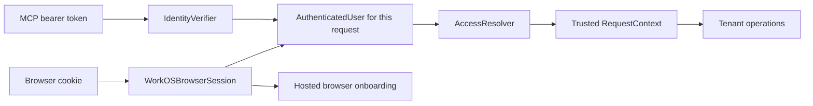

# Authentication implementation plan

Thermus will use Better Auth for the free, self-hosted edition and WorkOS
AuthKit with Connect for the hosted edition. Both implementations will satisfy
the same narrow MCP contracts. Unit tests will use configurable doubles under
`test/unit/`.

The self-hosted edition supports several local accounts for a small evaluation
team in one shared workspace. Each user has an email/password login and separate
sessions. Authentication and account administration require no outbound
connection. The first hosted release includes operator organization setup and
customer membership administration. It collects no payments: until AUTH-11
passes its paid gates, the hosted edition uses `BillingFree`, which bills no
organization. Payment integration remains required work before the paid
product is complete. HTTP is the first end-to-end delivery
target. Slice 1, contracts and request isolation, is implemented. Slice 2, the
complete local flow, is implemented: the local runtime, its persistence, the
installation identity, the data-directory lock, the offline user and client
commands, the bundled sign-in and consent pages, `BetterAuthProvider`, and the
HTTP composition of the provider routes. Slice 5, evaluation packaging, is
implemented: the container image, its Compose service with one data volume, and
the container gate. AUTH-07 and AUTH-08 added the application rules of slice 4
behind the provider contracts, with offline tests that use doubles:
[organization onboarding and selection](#organization-administration)
(AUTH-07), and User and Admin grant management, invitations, basic change
records, and the User seat summary (AUTH-08). AUTH-06 implemented the hosted
slice 3: the WorkOS SDK is pinned, its [offline proofs](#pinned-workos-sdk-proof)
pass, the [live provider proofs](#live-provider-proofs) ran against the WorkOS
staging environment, and the [WorkOS hosted composition](#hosted-composition-with-workos)
replaces the [hosted placeholder](#hosted-placeholder) in production: Connect
verification, current access resolution, the server-owned browser session,
and the portal connection. Three proofs of the saved configuration wait for
dashboard settings of the owner, so the AUTH-06 cases of the
[hosted live gate](../implementation/test-gate-policy.md#hosted-live-gate-auth-06)
have not all passed. The WorkOS side of slice 4 (AUTH-07W and AUTH-08W) with
the operator runbook, and the paid billing of slice 6 are pending. Until
AUTH-07W, the organization page, the organization selection, and the
organization administration use the unavailable organization directory, and
they give no organization access in production. The first hosted release also
needs the live cases of AUTH-07W and AUTH-08W. The pinned Better Auth packages are proven
against the local contracts. The owner resolved the two
[provider blockers](#resolved-provider-blockers) that the proofs found. The role
refinement below records intended rules only; it adds no implementation work
now.

## Requirements and delivery scope

| Requirement | Delivery scope |
| --- | --- |
| One codebase and a small provider boundary | Required in the authentication foundation. |
| Several local accounts, email/password, separate sessions, and offline administration | Required in the self-hosted release; all enabled users share one workspace and the same evaluation permissions. |
| Hosted password/social login and MFA | Required in the hosted foundation through AuthKit. |
| Selected organization, active membership, roles, and permissions | Required in the hosted foundation. |
| Operator organization setup and customer membership administration | Required in the first hosted release, including operator recovery, onboarding, and invitations. |
| Active User seats per organization | Required on the hosted account page; count each active membership with User once. |
| Per-seat payment collection and subscription synchronization | Required paid-product milestone (AUTH-11). The owner has not chosen a payment provider, and the paid billing rules remain open. Until AUTH-11 passes its paid gates, the hosted edition uses `BillingFree` through the `Billing` interface; it bills no organization and collects no payment. See the [paid billing design](billing-design.md). |
| SSO, SCIM, step-up authentication, and full audit logs | Future hosted capabilities. Preserve provider boundaries; add their contracts when implementing them. |
| Paid capabilities in the local edition | Disabled. No organizations, invitations, seat management, billing, or remote entitlement checks. |
| Account or data migration between editions | Separate future work. Changing configuration does not migrate either. |

The external platform operator creates hosted organizations and assigns their
Super Admins. An authenticated user without an authorized organization receives
guidance to contact the operator or accept an invitation. Until membership is
active and grants the required permission, tenant operations remain unavailable.
Onboarding never grants access through a default tenant or role.

## Contracts and request flow

Keep the OAuth access-token contract `IdentityVerifier`, `verifyAccessToken(token)`,
and the canonical `InvalidAccessTokenError` in `src/auth/identity-verifier.ts`.
The SDK adapter stays in `src/mcp/identity-verifier-sdk-adapter.ts`. `VerifiedIdentity`
carries an `AuthenticatedUser`, verified token issuer, OAuth client ID, actual
granted scopes, issue time, expiration, and resource audience. Accepted tokens
must supply the required time and audience claims. A client ID is never a user
or tenant ID. Initially accept human user grants; reject M2M and other tokens.

Put the shared access contracts in one file, `src/auth/access-context.ts`:

- `AuthenticatedUser`: canonical provider authority, user subject, and optional
  `selectedOrganizationId`. This identity is sufficient for onboarding.
- `AccessResolver.resolve(user)`: establish active local user or hosted
  organization access with current role grants.
- `AccessDecision`: allowed with `RequestContext`, or denied with a safe reason
  code. Expected denial is data; unexpected dependency failures throw.
- `RequestContext`: authenticated user, trusted tenant ID, optional
  organization, the full independent organization grant set, and the union of
  effective application permissions. Never reduce grants to a highest role. No
  credential or provider SDK object.

Browser session tokens and Connect tokens have different verification rules and
may have different issuers. After each verifies, map its user into the same
WorkOS authority derived from the fixed configured environment/application ID,
never the requesting OAuth client's ID. Keep the actual token issuer separately.
Never accept a browser token as an MCP access token. Derive hosted tenant
identity from the canonical authority and trusted organization ID, so the same
organization has the same tenant ID in both transports.

`BetterAuthProvider` and `WorkOSAuthProvider` each implement both roles. Callers
depend only on the role they need. These objects own provider integration, not
application policy. Claims and context are records. A small pure
`requirePermission(context, permission)` function is enough for operation checks;
do not create a policy class without state or a lifecycle to protect.

Each MCP HTTP request follows this sequence:

1. Existing MCP middleware checks the bearer header and calls the verifier once.
2. The provider validates token purpose, issuer, signature or authoritative
   token status, audience, and time claims. SDK checks remain in place.
3. The SDK adapter carries verified claims in `AuthInfo.extra`.
4. After authentication succeeds, the access resolver establishes current
   local user or hosted membership access. Expected denial returns HTTP `403`.
5. The MCP factory creates handlers bound to that request's context. Protected
   operations check their required permission before work starts.

The pinned MCP SDK 2.3.1 supports `AuthInfo.extra` and supplies `authInfo` to its
per-request factory. Use that path without a second token verification. Keep
context local to the request; copy mutable collections at boundaries. Headers,
tool arguments, and previous requests cannot replace trusted identity or tenant
values.

Missing, malformed, expired, or rejected credentials produce `401`. Missing
granted OAuth scopes retain the SDK's `403 insufficient_scope` response. Access
denial produces a distinct `403`; provider outages produce a generic `5xx` and
no protected work. MCPServer gives each unexpected verification or access
failure, with the failed step and the cause, to an operator callback that the
composition supplies. Logs must not include passwords, raw tokens, cookies, or
private provider errors in public responses.

Slice 1 settles these details. The SDK adapter rejects an identity without a
user, issuer, client ID, issue time, expiration, or audience, and an identity
whose user subject is the client ID. `AuthInfo.extra` carries frozen copies of
`user`, `issuer`, `clientId`, `scopes`, `issuedAt`, `expiresAt`, and `audience`.
Resolvers return contexts from `createRequestContext()`, which copies only the
contract fields and combines the permissions of every grant. MCPServer binds a
frozen copy of the context to each request through the SDK factory and
`buildServer(context)`, which returns an SDK `Server` or `McpServer`. MCP-P01
replaced the registration hook with this builder and retained the high-level
probe tests. An expected denial returns `403` with the
OAuth error `access_denied` and no Bearer challenge. The safe reason codes are
`account-inactive`, `organization-required`, `membership-inactive`, and
`permission-required`. Permissions are plain strings; slice 1 defines no
permission names. The hosted role mapping in slice 3 names the permissions and
adds the rule that product portal and MCP operations require User.

Hosted browser authentication supplies the same user record. Identity-only
onboarding does not require an organization and can show operator or invitation
guidance. It cannot create an organization or resume operator setup. Tenant
actions require access resolution, and the application service checks the actor
and target again before any mutation.

## Configuration and composition

Require one selector: `DEPLOYMENT=self-hosted` or `DEPLOYMENT=hosted`. Derive the
provider and edition capabilities from it. Do not introduce `AUTH_MODE`, a mock
mode, or independent switches that enable paid features locally. Enforce edition
limits in route composition and protected operations, not only in visible UI.

Use one canonical public base URL to derive the MCP resource and metadata URLs.
Validate its scheme, host, path, and selected provider settings before listening.
Use HTTPS for hosted deployments; permit local HTTP only where the supported
OAuth profile allows loopback development. Do not infer public identity from
untrusted forwarded headers.

Local configuration supplies the data directory and persistent secret. The
hosted provider reads and checks its own settings: the trusted AuthKit issuer,
the required WorkOS credentials, the callback URL, and the cookie-sealing
secret. Load only the selected provider's resources. Invalid hosted
configuration cannot fall back to local or anonymous access.

Slice 1 adds `loadDeploymentConfig(environment, transport)` and `.env.example`.
The settings are `DEPLOYMENT`, `PUBLIC_BASE_URL`, and `DATA_DIR` for the
self-hosted edition. The common loader reads only `DEPLOYMENT` and
`PUBLIC_BASE_URL` for the hosted edition. AUTH-12 removed the WorkOS settings
from the common loader, so a `WORKOS_*` value changes no common record and
appears in no common error. The WorkOS provider reads its own settings:
`loadWorkOSSettings(environment, publicBaseUrl)` in
`src/auth/hosted-auth/workos/workos-settings.ts` reads `WORKOS_API_KEY` (it
starts with `sk_`), `WORKOS_CLIENT_ID` (it starts with `client_`),
`WORKOS_AUTHKIT_ISSUER`, `WORKOS_REDIRECT_URI`, and `WORKOS_COOKIE_PASSWORD`.
It keeps the issuer exactly as written for the exact token issuer check, and
it requires the issuer to be an https origin without a path or a final slash.
It requires the redirect URI to be an https URL on the public origin, inside
the public base path, without a query or a fragment, and written as the URL
parser writes it. It requires a cookie password of at least 32 characters. One
`WorkOSSettingsError` names each missing or refused setting and its rule, but
no value. `createApplication(config, logger, environment)` gives the
environment to the hosted provider only, so the self-hosted edition reads no
WorkOS setting.

`createApplication()` performs the single deployment branch, constructs the
provider, and returns a small runtime record with the HTTP handler and cleanup.
It owns startup failure cleanup and shutdown. The HTTP module adapts Node
requests and routes them; it does not know membership policy.

Shutdown starts listener close to refuse new connections, then passes its drain
promise to `Application.close()`. MCP cancellation starts before that drain is
awaited. Provider resources close after MCP work and listener drain finish.
Repeated close calls share cleanup; cleanup errors remain visible. See the
[MCP lifecycle contract](../reference/mcp-fetch-tool.md#cancellation-and-test-composition).

The server reads its listen address from `LISTEN_HOST` (default `127.0.0.1`)
and `LISTEN_PORT` (default `8080`) through `loadListenAddress(environment)`.
The listen address does not change the public identity from `PUBLIC_BASE_URL`.
For the hosted edition, `createApplication()` starts the
[WorkOS hosted composition](#hosted-composition-with-workos) and loads no
local module. The self-hosted
application routes each request by its path. The MCP resource path goes to
`MCPServer`, which uses `BetterAuthProvider` as its verifier and its access
resolver. Six public provider routes go to the Better Auth handler: both
protected-resource metadata paths, the authorization-server metadata, the
OpenID configuration, `/oauth2/authorize`, and `/oauth2/token`. The bundled
sign-in, consent, and authorization error pages go to `LocalAuthPages`. Every
other path gives `404`, also the provider's own sign-in, sign-up, session,
introspection, and client routes. The application writes each MCPServer
failure report to the operator log as one error line with the failed step and
the cause. Without a resource-server client for the MCP resource of
`PUBLIC_BASE_URL`, the MCP endpoint cannot check a token: a request with a valid
token gets a generic `500`, and its operator report tells the operator to run
`thermus clients register`.

Keep the existing low-level stdio API and its tests. Hosted application startup
rejects stdio. If local stdio is subsequently exposed, bind it explicitly to the
selected local user in the same installation and check current account status.
It is not an anonymous alternative to HTTP.

### Hosted placeholder

On 2026-10-13, the owner deferred WorkOS. AUTH-12 added a replaceable
placeholder, so that application work and its offline tests need no WorkOS
account, credential, SDK, or network call. The placeholder reuses
`AuthenticatedUser`, `AccessResolver`, `AccessDecision`, and `RequestContext`.
It adds only the browser-session role that the account routes need. Provider
records stay outside these contracts. AUTH-07 added cookie effects, a CSRF
token, and organization switching to the browser-session role, and the
`OrganizationDirectory` contract for the organization reads. AUTH-08 added the
MFA evidence of a session to the browser-session role, and the member, grant,
and invitation methods to `OrganizationDirectory`. AUTH-06 replaced the
placeholder parts of the production composition with the
[WorkOS hosted composition](#hosted-composition-with-workos). The
`UnavailableHostedAuthentication` class stays the organization directory of
that composition until AUTH-07W, and the offline tests of the account routes
still use it.

| File | Contract and behavior now |
| --- | --- |
| `src/auth/hosted-auth/browser-session.ts` | `BrowserSession.authenticate(cookieHeader)` gives a `BrowserSessionState`: `signed-in`, `signed-out` with `cookies`, or `unavailable` without cookies. A `SignedInBrowserSession` has the `user`, an `AuthenticatedUser` that carries the organization that the session selected; the `csrfToken`, a secret of the session that each form of the account pages sends back, which stays the same for the whole session, also after a refresh or an organization switch, so that a form shown before still posts; `mfaCompleted`, which is true only when the provider proved that the sign-in of the session completed a multi-factor challenge, because an enrollment alone is no proof; the `cookies`; and `selectOrganization(organizationId)`. `CookieEffects` are `Set-Cookie` values that must reach the browser with the answer, also with a redirect or an error page, so that the browser does not lose a session that the provider refreshed or ended during the request. `selectOrganization()` gives an `OrganizationSwitch`: `switched`, `refused`, or `signed-out`, each with cookies. Only this call changes the organization of a session, and only for that browser. The account routes call it only after `OrganizationAdministration` found an authorized active membership. The provider gets only the `Cookie` header of the request, so no form field, query, or other header can select the user or the organization. A lookup or switch failure, such as an outage, throws. |
| `src/hosted-admin/account-routes.ts` | `HostedAccountRoutes` gets each browser path under the public URL and checks the browser session first. The routes treat the public base URL as a directory: a URL without a final slash works the same, so `/teamevil` is never under `/team`. The deployment configuration always gives the final slash. `unavailable` gives `503` with the authentication-unavailable notice and no cookie, and `signed-out` gives `401` with the cookie effects of the session. For a signed-in session, `<base>/organizations` and `<base>/organizations/select` need the identity only: they run no access resolution (see [organization administration](#organization-administration)). For each other path, the routes call `AccessResolver.resolve(user)` and then require a trusted tenant. Only then do the routes give a member or invitation path to `AdministrationRoutes`, with the session and a frozen copy of the decided context, and each other path to an `AccountOperation(request, context)`, with a frozen copy of the decided context, as MCPServer does. A denial gives `403` without the reason, with a second paragraph that links to `<base>/organizations`: "To select another organization, or to see how to get access, open the organization page." A request without a route or an operation gives `404`. The hosted edition gives one account operation, the protected portal request `<base>portal/access` of AUTH-06. Each operation checks its own permission before work starts. An `AccountOperation` gets no MFA evidence yet, so the billing change operation of AUTH-11 must add it before it can require MFA. Each answer after a sign-in carries the cookie effects of the session, in their order, before the cookies of the answer itself, so that a later cookie, such as the cookie of a switch, replaces an earlier one in the browser. This includes operation answers, also a redirect whose headers cannot change, the `303` of a selection or a change, and each refusal and failure page (`400`, `401`, `403`, `404`, `405`, `409`, `413`, `415`, `500`, and `503`). The routes add the cookie effects inside the failure guard. A failure after a sign-in, in the access resolution, an organization read or change, the organization switch, or the account operation, an allowed decision without a tenant, or an operation answer that cannot carry the cookie effects, such as an error response (`Response.error()`) or an answer whose body was already read, gives a `500` page, "The request failed. Try again later.", with the cookie effects of the session. `reportFailure` gives its path and cause to the operator. AUTH-12 gave the caller an exception for an access lookup failure and for an allowed decision without a tenant ID; AUTH-07 changed both on purpose. A session lookup failure still reaches the caller, so the HTTP server answers a generic `500` without a cookie. This stays distinct from a missing session (`401`) and never erases the session. A request that the client aborted gets no page and no report. `account-form.ts` checks the form input. |
| `src/hosted-admin/administration-routes.ts` | `AdministrationRoutes` gets the member and invitation paths after the session check and the current access resolution with a trusted tenant. The actor is the user of the decided context with the MFA evidence of the session, and the organization is the organization of the decided context. A context without an organization gives the `403` access denial. The [organization administration](#organization-administration) section gives the routes and their checks. |
| `src/hosted-admin/account-pages.ts`, `administration-pages.ts`, and `page-html.ts` | `account-pages.ts` gives the notice pages: fixed HTML text without a form or script, with a Content Security Policy that allows nothing (`form-action 'none'`). `accessDeniedPage()` adds a link to the organization page to the `403` access denial notice; the link path comes from the public URL, not from the request, and the page escapes it. The organization selection page escapes the organization names and IDs that the provider gives, and its policy has `form-action 'self'`. AUTH-08 added the notices of the administration routes: `mfaRequired` (`403`), `changeDenied` (`403`), `changeStale` (`409`, "Page out of date"), `invitationNotPending` (`409`), and `changeUnsupported` (`503`). `administration-pages.ts` gives the members and invitations pages, with the policy of the selection page; they escape each value that the provider gives. `page-html.ts` has the shared HTML parts, the page headers, and the escaping. Each page sends `Cache-Control: no-store`, `nosniff`, and `X-Frame-Options: DENY`, and sets no cookie of its own. |
| `src/organizations/organization-directory.ts` | `OrganizationDirectory`, the provider contract of the organization reads and changes, with its records, requests, and results. `membershipsOf(user)` gives `OrganizationMembership` records: `organizationId`, `organizationName`, `active`, and `grants`, with every current grant. A grant holds only application permissions, so that a default role, which gives none, authorizes nothing. AUTH-08 added the member, grant, and invitation methods. The [organization administration](#organization-administration) section gives the contract. |
| `src/organizations/organization-administration.ts`, `customer-roles.ts`, `change-records.ts`, `administration-overviews.ts`, and `directory-reads.ts` | `OrganizationAdministration` lists and authorizes the organizations of the session user, and it does the administration work of AUTH-08 for an `Actor`. `customer-roles.ts` gives the customer roles that an actor manages, `change-records.ts` runs each change and keeps its record, `administration-overviews.ts` builds the member and invitation overviews, and `directory-reads.ts` reads every page of a paged directory read. The [organization administration](#organization-administration) section gives the rules. |
| `src/auth/hosted-auth/unavailable-hosted-authentication.ts` | `UnavailableHostedAuthentication` implements `BrowserSession`, `AccessResolver`, and `OrganizationDirectory`. Each session is `unavailable`, each access request is denied with `account-inactive`, and no user has a membership. Each member and invitation read gives a frozen empty page, no member or invitation exists for any ID, and each change gives `unsupported`. Its invitation policy is `provider-rules`, so it claims no strict address match. The placeholder reads no setting, calls no service, makes no change, and never gives an identity, a grant, a membership, a cookie, or a tenant. Since AUTH-06, the production composition uses it only as the `OrganizationDirectory`, until AUTH-07W. |
| `src/application.ts` | `composeHostedApplication(config, { session, accessResolver, organizations, mcp, browserRoutes }, { reportFailure, changeRecords, billing, operation })` composes the hosted edition from its provider parts. `HostedProviderParts` names the parts that change with the provider; the MCP endpoint has the `fetch` and `close` methods of `MCPServer`, and the application closes it. The optional `browserRoutes` are the browser routes of the provider that need no signed-in session; they answer before the account routes. AUTH-06 removed the placeholder MCP endpoint, `UnavailableMcpEndpoint`, which answered each MCP request with `503`. The third argument, `HostedAccountParts`, gives `reportFailure`, the required `changeRecords`, and an optional account operation. The composition gives the routes `OrganizationAdministration({ directory: parts.organizations, records: account.changeRecords })`. `accountFailureReporter(logger)` writes each report as one error line: `An account request failed unexpectedly for <path>: <cause>`. `accountChangeRecorder(logger)` writes each change record as one info line, `Account change record: <JSON>`, in the operator log, until hosted storage exists. Other paths give `404`. The shell creates no `Billing`. |

Until AUTH-06, the hosted edition started with a valid `https` public URL and
no WorkOS setting, and each request got an explicit unavailable answer. Since
AUTH-06, the hosted edition needs its WorkOS settings to start. No request gets
anonymous access, a default tenant, a local fallback, or an automatic User
role. No test identity, organization, grant, demonstration mode, or setting
turns on access, also not `NODE_ENV=test` or `AUTH_MODE=mock`. Invalid common
or WorkOS settings and hosted stdio stop startup before the server listens.

AUTH-06 applied these rules to the replacement:

- Slice 3 (AUTH-06) replaces the placeholder parts in `createApplication()`.
  `WorkOSBrowserSession` implements `BrowserSession`, and `WorkOSAuthProvider`
  implements `AccessResolver` and `IdentityVerifier`. An `MCPServer` with that
  verifier and resolver, together with the hosted protected-resource metadata,
  becomes the MCP endpoint. AUTH-07 added the cookie effects, the CSRF token,
  and organization switching to the browser-session role.
  `WorkOSBrowserSession` must implement them: the cookie effects carry the
  refreshed or cleared session cookies, the CSRF token is a secret of the
  session, and `selectOrganization()` is a session refresh with the requested
  organization. The CSRF token must stay the same for the whole session, also
  after a refresh or a switch, so it cannot come from the access token or the
  sealed cookie value. AUTH-08 added `mfaCompleted` to the browser-session
  role: `WorkOSBrowserSession` must give `true` only when the provider proved
  that the sign-in of the session completed a multi-factor challenge; an
  enrollment alone is no proof. AUTH-06 also adds sign-in, callback, and logout.
  The provider reads and checks its own settings. Hosted access starts only
  after the
  [hosted live gate](../implementation/test-gate-policy.md#hosted-live-gate-auth-06)
  passes.
- AUTH-07 added organization onboarding and selection on these roles, with
  `OrganizationAdministration` over the `OrganizationDirectory` contract.
  AUTH-07W, which is deferred with WorkOS, implements `WorkOSOrganizations`,
  the `OrganizationDirectory` reads from WorkOS, and the runbook for operator
  setup and recovery. It must map each provider role to application
  permissions; a permission that only the provider knows is not an
  application permission. AUTH-08 added User and Admin grant management,
  invitations, basic change records, and the User seat summary on these roles,
  with the member, grant, and invitation methods of `OrganizationDirectory`.
  AUTH-08W, which is deferred with WorkOS, implements these methods in
  `WorkOSOrganizations`, with live seat reads, and proves the safe grant and
  invitation effects in WorkOS. It must answer `unsupported` when it cannot
  make a change safely. Their tests use doubles of the roles, like the doubles
  in [files and ownership](#files-and-ownership). No double, mock mode, or
  setting becomes a production sign-in, and `DEPLOYMENT` stays the one edition
  selector.
- A pass of the offline placeholder tests is never reported as WorkOS proof or
  as a hosted live gate pass.

### Hosted composition with WorkOS

AUTH-06 composes the hosted edition with the WorkOS provider.
`createApplication(config, logger, environment)` loads
`src/hosted-workos-application.ts` only for the hosted edition, as it loads the
Better Auth runtime only for the self-hosted edition. `openWorkOSApplication()`
there loads the [WorkOS settings](#configuration-and-composition) and makes one
WorkOS SDK client and one AuthKit key set:

- The SDK client has the API key, the client ID, the browser-session issuer
  `https://api.workos.com/user_management/<client ID>`, no retry, and a
  5-second timeout, because each call runs during a browser or MCP request.
- The AuthKit key set is `createRemoteJWKSet(<issuer>/oauth2/jwks)` of jose,
  with a 5-second timeout. jose reads it at the first Connect token, so the
  start makes no network call.

`composeWorkOSApplication(config, connection, logger)` makes the parts. A test
can give it a connection to a local fake of the WorkOS API:

- `WorkOSAuthProvider` is the MCP verifier and the access resolver of both
  transports. It reads the grants for each request through
  `WorkOSOrganizations`. The
  [hosted access](#hosted-access-of-auth-06) section gives the rules.
- `WorkOSBrowserSession` is the `BrowserSession` of the account routes, and
  `WorkOSSessionRoutes` serves its sign-in, callback, sign-out, and session
  routes. The [hosted browser sessions](#hosted-browser-sessions) section gives
  the rules.
- The MCP endpoint is an `MCPServer` with that verifier and resolver, the
  required permission `product:access`, and the `ProtectedResourceEndpoint`
  in front of it. The endpoint answers `GET` and `HEAD` of both
  protected-resource metadata paths with the MCP resource and the AuthKit
  issuer as its only authorization server, and gives each other request to
  the `MCPServer`.
- The account operation is `portalAccessOperation()`, the protected portal
  request `<base>portal/access`. It needs `product:access` and gives the
  organization and the roles of the grants that give a permission;
  otherwise it answers `403` with `{"access":"denied"}`.
- The organization directory stays `UnavailableHostedAuthentication` until
  AUTH-07W implements the WorkOS organization reads. Until then the
  organization page shows the onboarding guidance to each user, the
  organization selection refuses each organization, and the administration
  pages deny each request. A user selects the organization of a browser
  session at the AuthKit sign-in.
- The billing stays `BillingFree`.

The routes answer in this order: the MCP resource and both protected-resource
metadata paths, the browser routes of the provider, the account routes under
the public base path, and `404` for each other path. The start writes one
operator line that names the client ID and the issuer, but no secret:
`Hosted authentication uses WorkOS: the client <client ID> and the AuthKit issuer <issuer>.`

## Self-hosted authentication

Use Better Auth with email/password and SQLite in a container. Mount one
persistent volume for the database, installation identity, provider keys, and
secrets. The volume survives container and image replacement. Generate migrations
for pinned package versions during development and ship them with the
application; never download a migration tool at container startup. Better Auth
supports SQLite and schema generation for the selected plugins.
[SQLite support](https://better-auth.com/docs/adapters/sqlite),
[Docker volumes](https://docs.docker.com/engine/storage/volumes/)

SQLite normally has no database username/password. Host and volume filesystem
access controls determine who can operate this installation and its offline
CLI. This operational authority does not grant an application admin role. No
local application admin role or administration UI is needed; all enabled local
accounts retain equal evaluation permissions.
[SQLite serverless operation](https://www.sqlite.org/serverless.html)

Local email is an account identifier. Explicitly disable email verification and
email-based password recovery. Each enabled user has the same evaluation
permissions in one shared workspace. Keep each user's subject, credentials,
sessions, consents, and grants separate. Better Auth owns user, account, and
session storage; do not add custom credential tables, local organization tables,
or per-user tenants. No numerical account cap has been selected.
[Better Auth database](https://better-auth.com/docs/concepts/database)

The runtime exposes no public signup, invitation, social-login, or account-create
path. Bundle an offline CLI that wraps supported Better Auth APIs:

| Command | Behavior |
| --- | --- |
| `thermus users add` | Create a local email/password account; reject a duplicate email. |
| `thermus users list` | List local accounts and their enabled/disabled state without credentials. |
| `thermus users reset-password` | Reset the selected user's password and delete that user's sessions, which ends that user's MCP access tokens. Preserve account status and IDs. |
| `thermus users disable` | Disable the selected user and delete that user's sessions, which ends that user's MCP access tokens. Preserve IDs. |

Add and reset-password use a hidden password prompt. Never accept passwords as
command arguments or log them. Select the target user explicitly and report
errors without exposing credentials. Use Better Auth's password hashing and
supported create/list/reset/disable/session operations. Never edit provider
credential or token tables with SQL. If the selected admin plugin supplies
account status, include its generated schema but expose no public local admin
routes. Any private setup configuration must have no HTTP listener.
[User administration](https://better-auth.com/docs/plugins/admin),
[Email/password handling](https://better-auth.com/docs/authentication/email-password)

Runtime, initialization, client registration, and account administration share
one exclusive data-directory lock. To administer a container installation, stop
the server container, run a one-off container from the bundled image with the
same volume mounted, and invoke the required `thermus users` command. Then
restart the server container. A command must reject a live server's lock; running
it inside a live server container does not bypass the lock. The CLI needs no
network or email service. An initialized installation can start with zero
accounts or no enabled accounts; protected requests remain denied. The host
administrator can use the CLI to add an account. The
[container installation guide](../../README.md#container-installation) gives
the exact Compose commands of this workflow and of backup and restore.

The implemented image runs as the `node` user with `NODE_ENV=production`,
`DEPLOYMENT=self-hosted`, and `DATA_DIR=/var/lib/thermus`, which is the one
data volume. It holds `dist/src`, the shipped migrations, and the production
packages of the frozen lockfile, with the pnpm patches and the native adblock-rs
module that the build compiles. The base images of the build are pinned by
digest. The build compiles `dist/src` with the unchanged build command,
because its context has no `test/` directory; no production TypeScript
configuration exists. A start downloads nothing.

On fresh initialization, create an installation UUID once in an app-owned SQLite
singleton installation row. Derive the tenant as `local:<installation-id>`;
every local user resolves to this same tenant with a distinct user subject.
The singleton restricts installation identity only, never the user count.
Password reset, disable, restart, container/image replacement, backup, and restore
preserve the installation and user IDs. An existing data directory without its
installation identity fails closed and requires explicit operator recovery;
never silently mint a new identity and reassign retained data. Backup and restore
preserve the complete database and secrets together. A fresh installation with
new data starts a new tenant. No generic tenant repository is needed.

The implemented runtime keeps four files in `DATA_DIR`. `data-directory.lock`
holds the exclusive lock: an open SQLite write transaction (`BEGIN IMMEDIATE`),
which the operating system releases when the process ends. Only one connection
can hold its RESERVED lock, and the lock does not wait. Thus another process
stops at once with `DataDirectoryInUseError`, and of several processes that
start at the same time, exactly one gets the lock. An exclusive transaction is
not used: it must wait until the other connections release their shared locks,
so two processes that start at the same time could each make the other fail.
`auth.sqlite` holds the provider data and the singleton `thermus_installation`
row. `auth.secret` holds the generated provider secret. Both data files have
mode `0600`. A database without schema objects is fresh: the runtime writes the
secret first, and then applies `0001-better-auth.sql`, `0002-installation.sql`,
the installation row, and `user_version` 2 in one transaction. A database with
schema objects must have a valid installation identity, schema version 2, and a
valid `auth.secret`; otherwise startup stops with `LocalInstallationError`. The
runtime gives `clientReference` the installation ID and reports the tenant
`local:<installation-id>`. `resource-server-client.json`, also with mode `0600`,
holds the ID, the secret, and the MCP resource of the installation's
resource-server client. The provider keeps only a hash of that secret, so the
installation keeps the secret for the MCP verifier. The first `clients register`
writes the file; a fresh installation has no such file.

Use Better Auth's MCP/OAuth handler for local authorization and both discovery
documents. It owns those routes, including protected-resource metadata. The
application supplies bundled sign-in and consent pages. Do not register a second
OAuth provider plugin or an independent competing metadata response.
[Better Auth MCP](https://better-auth.com/docs/plugins/mcp)

`LocalAuthPages` implements the bundled pages: `<base>/sign-in`, which the
`mcp()` `loginPage` names, `<base>/consent`, which `consentPage` names, and
`<base>/authorization-error`, which `onAPIError.errorURL` names. The provider
sends a browser to the sign-in and consent pages with a signed copy of the
authorization request. Before it shows consent, the page asks the provider's
`/oauth2/public-client-prelogin` handler to verify that signed query and return
the client name, and reads the current account through `/get-session`. Both
routes remain private at the application router. The metadata request omits
the session cookie: it is a public data read, and a browser GET navigation has
no origin header for the provider's cookie-bearing POST check. Authentication
posts retain the original browser cookie and origin. The consent page shows
the client, the account email, and the requested scopes.

Each page keeps the signed query in a hidden form field. A form
post goes to the page, and the page sends the provider route a request of its
own: `/sign-in/email` or `/oauth2/consent`, with the signed copy, through the
Better Auth handler. The page copies only the cookie, origin, referer,
user-agent, `Sec-Fetch-*`, and client-address headers. Thus the provider's
origin check, CSRF check, ban check, and rate limits apply to each post. The page
answers a provider redirect with `303` and the provider's cookies, and each
refusal with a page of its own text: it never shows provider text. The pages use
no script, font, image, or external link, and they send a Content Security
Policy that allows only their one inline style. The authorization error page
shows only an error code, for an authorization request that the provider cannot
send back to the client, such as an unknown client ID or an unregistered
redirect URI. Form bodies and authorization queries have a 16 KiB limit. The
pages refuse duplicate required form fields and stop reading an oversized or
aborted body before they call the provider.

The local auth command also registers approved MCP clients and exact redirect URLs.
It signs in one selected enabled account through the server API, with that
account's password from a hidden prompt. It registers the clients with that
session and then deletes the session. The installation, not that account, owns
each client. Support a documented, tested client set. The implemented command
registers one public native client for each call, with the `authorization_code`
grant only, and accepts only `http` redirect URIs on `localhost`, `127.0.0.1`, or
`[::1]`, without user information or a fragment. In the same registration
session, the first call also registers the installation's resource-server
client: a confidential client with `client_secret_basic` and the
`client_credentials` grant, as in the provider proof. The command keeps its
credentials in `resource-server-client.json` and registers a new one only when
the file has none for the MCP resource of `PUBLIC_BASE_URL`. That client has no
`client_credentials` scope, so it cannot get tokens; it only introspects. Disable network
client-metadata discovery and dynamic registration in this edition. Do not
claim arbitrary MCP client compatibility offline. Persist keys, sessions,
clients, consents, and grants on the local volume. Local authentication must
not fetch remote JWKS, email, fonts, scripts, or other assets. Explicitly
disable runtime and CLI telemetry.
[Telemetry controls](https://better-auth.com/docs/reference/telemetry)

The local MCP verifier must introspect each token, so token acceptance also
checks current session activity. Better Auth documents that introspection checks
a bound session; JWT signature validity alone does not provide that check. The
[pinned provider proof](#pinned-provider-proof) shows how the resource server is
authorized to introspect its clients' tokens. After token verification,
`AccessResolver` checks the current local user state for every protected request.
Disabled or missing users have no workspace access. Supported provider
operations and user-state checks must also prevent disabled users from logging
in or receiving tokens. A still-valid signature must not let a disabled user
perform protected work.

`BetterAuthProvider` implements both roles. `verifyAccessToken(token)` first
checks the JWT in the process with `verifyJwsAccessToken()` from
`better-auth/oauth2` and the provider's own key set from `auth.api.getJwks()`:
type `at+jwt`, algorithm EdDSA, the exact issuer, the MCP resource in the
audience, and the time claims. The token must also have `sub`, `sid`,
`client_id`, `scope`, `iat`, and `exp`; a token without `sid` gets no session
check at introspection. Only then does the provider introspect the token
through the Better Auth handler with the resource-server client. The local check
comes first because the pinned introspection answers `500` for a changed
payload, a key of another installation, or `alg: none`, and a forged token must
give `401`, not look like an outage. A failed check gives
`InvalidAccessTokenError` (`401`). A missing resource-server client, a refused
introspection request, or a failed key-set read is unexpected: the client gets
a generic `500`, and the operator gets a `token-verification` report. The
identity has the authority `better-auth:<installation-id>`, so it does not
change with `PUBLIC_BASE_URL`. `resolve(user)` reads the current user with
`internalAdapter.findUserById()` for each request. A missing or banned user, or
an identity of another authority, gets the denial `account-inactive` (`403`).
Each enabled user gets the same context: the tenant `local:<installation-id>`
and one grant, role `user` with the permission `product:access`.

The provider limits `/oauth2/introspect` to 100 requests in 60 seconds for each
client address. The MCP verifier introspects once for each MCP request in the
server process, so `rateLimit.customRules` turns off the limit for that route
only. The HTTP router does not forward the route, so no other client reaches it.

The local edition issues no offline grants and no refresh tokens. Each MCP
access token carries the `sid` of the browser session that authorized it, and
introspection reports the token inactive when that session ends. Sign-out,
disable, and password reset end the session. Disable and password reset delete
only the selected user's sessions. That user's access tokens and pending
authorization codes then fail; peers' sessions, tokens, and access remain usable.
Clients authorize again when an access token expires. Do not implement hashing
or revocation by guessing provider tables, editing tokens, or storing raw
passwords.
[OAuth token validation and revocation](https://better-auth.com/docs/plugins/oauth-provider)

Before building the complete local flow, prove supported private account
creation, listing, password reset, disabling, session revocation, and the end of
the user's OAuth grants against the pinned versions and selected plugins. Also
prove public signup rejection, resource-bound issuance, introspection, current
account-state checks, and duplicate-email handling. Use provider origin/CSRF and
rate-limit protections and test them through authentication routes. Resolve any
unsupported operation before claiming the release meets the account or
revocation contract.

### Pinned provider proof

`test/interface/auth/better-auth.test.ts` runs the pinned packages with a real
SQLite database and proves the contracts in this section. The proofs found two
required contracts that the pinned provider does not support as first planned.
The [resolved provider blockers](#resolved-provider-blockers) record the owner's
decisions; the settings and contracts below apply them.

`package.json` pins `better-auth` and `@better-auth/mcp` at exactly 1.7.7.
`pnpm-lock.yaml` also pins their `@better-auth/oauth-provider` dependency at
1.7.7. The `mcp()` plugin is the only OAuth provider plugin; it wraps
`oauthProvider()`. The `admin()` plugin supplies account status. The `jwt()`
plugin signs access tokens and keeps its keys in the database, encrypted with
the secret. The database is Node 24 `node:sqlite` (`DatabaseSync`), so no
native SQLite package is needed.

| Setting | Proven value and reason |
| --- | --- |
| `baseURL` | `PUBLIC_BASE_URL`. The default `basePath`, `/api/auth`, makes the issuer `<base>/api/auth`. |
| `secret` | The generated secret from `DATA_DIR/auth.secret`. The versioned `secrets` option is not used. |
| `database` | A `node:sqlite` `DatabaseSync`. Run `getMigrations(options)` and `runMigrations()` before `betterAuth(options)`; otherwise the provider logs a false schema error. `compileMigrations()` gives the SQL to ship. |
| `telemetry` | `{ enabled: false }`. The proofs replace `fetch` with a blocker and record no outbound request. |
| `emailAndPassword` | `{ enabled: true, disableSignUp: true }` with no `sendResetPassword`. Signup gives `400 EMAIL_PASSWORD_SIGN_UP_DISABLED` over HTTP and from the server API. Email reset gives `400 RESET_PASSWORD_DISABLED`. |
| `rateLimit` | `{ enabled: true, customRules: { '/oauth2/introspect': false } }`. Without `enabled`, limits apply only when `NODE_ENV=production`. The memory store is shared by the whole process. The custom rule turns off the limit of the introspection route only, which the MCP verifier calls in the process for each MCP request and the HTTP router does not forward. |
| `onAPIError.errorURL` | `<base>/authorization-error`, the bundled authorization error page. Without it, the provider sends an authorization request that it cannot return to the client, such as an unknown client ID, to its own `/error` page, which links to the Better Auth site. |
| `advanced.ipAddress.ipAddressHeaders` | One header that the HTTP bridge sets from the socket address after it removes any copy from the client. Without a client address, all clients share one bucket for each path. |
| `advanced.disableOriginCheck` | `false`. Without it, `NODE_ENV=test`, or `TEST` with a value other than `false`, turns off the origin and CSRF checks. |
| `disabledPaths` | The admin, client-management, client-secret rotation, and session-JWT (`/token`) routes. It refuses exact paths with `404` on HTTP only; server API calls still work. It cannot match routes with parameters, so the HTTP bridge must forward only the provider routes that the local edition uses. |
| `plugins` | `admin()`, `jwt()`, and `mcp()` with the options below. Dynamic registration stays off, and no client-metadata plugin is installed. |
| `mcp()` `resource`, `loginPage`, `consentPage` | `<base>/mcp` and the bundled sign-in and consent pages, `<base>/sign-in` and `<base>/consent`. |
| `mcp()` `allowPublicClientPrelogin` | `true`, so the bundled consent page can verify a signed authorization query before showing the client name. The application router keeps both public-client lookup routes private. |
| `mcp()` `scopes` | `["openid", "profile", "email"]`, without `offline_access`. An authorization request with `offline_access` returns to the client with `invalid_scope`, client registration refuses that scope, and no token response has a refresh token. |
| `mcp()` `grantTypes` | `["authorization_code", "client_credentials"]`, without `refresh_token`. A refresh request gives `400 unsupported_grant_type`, client registration refuses the refresh grant, and the metadata does not list it. The `grant_types` of a client cannot prevent refresh tokens, because the provider lets each `authorization_code` client refresh. |
| `mcp()` `clientReference` | A function that returns the installation ID. Each registered client gets it as `reference_id` and has no `user_id`, so the installation owns the client. |

The provider reads some process environment variables, also when an option sets
the related value. The [provider environment variables](#provider-environment-variables)
tell how the local settings stay independent of them.

The admin plugin's list, set-password, ban, and session endpoints need an admin
session, which the offline CLI does not have. Its create endpoint works from the
server without headers. The other operations use the provider's data API,
`(await auth.$context).internalAdapter`, and its password hasher. The admin
endpoints call the same functions. No operation uses SQL. The owner accepted
these operations.

| Operation | Provider API | Proven result |
| --- | --- | --- |
| Create | `auth.api.createUser({ body })` without headers | Creates an email/password account. An existing email in any letter case gives `400 USER_ALREADY_EXISTS_USE_ANOTHER_EMAIL` and keeps the original account. |
| List | `internalAdapter.listUsers()` | Gives each user ID, email, and `banned` state. User records hold no credentials. |
| Reset password | `password.hash()`, `internalAdapter.updatePassword(userId, hash)`, then `internalAdapter.deleteUserSessions(userId)` | The old password gives `401 INVALID_EMAIL_OR_PASSWORD`. The new password signs in the same user ID. The user's browser sessions end; peer sessions stay. |
| Disable | `internalAdapter.updateUser(userId, { banned: true })`, then `internalAdapter.deleteUserSessions(userId)` | Sign-in gives `403 BANNED_USER`. The user ID stays, and peers can sign in. |
| Revoke sessions | `internalAdapter.deleteUserSessions(userId)` | Ends only that user's sessions. That user's MCP access tokens become inactive at introspection, and that user's pending authorization codes fail at the token endpoint. |
| Register clients | `auth.api.signInEmail({ body, returnHeaders: true })`, `applySetCookies()` from `better-auth/cookies` to make the session headers, `auth.api.adminCreateOAuthClient({ headers, body })` for each client, then `internalAdapter.deleteSession(token)` | Each client has the installation ID as `reference_id` and no `user_id`. No registration session stays. Another user can authorize through the native client, and the resource server can introspect. A disabled account gets `403 BANNED_USER`. |

The create endpoint checks only the maximum password length. The administrator
checks the 8 to 128 character rule first. Two concurrent creates with one email
give a raw SQLite uniqueness error; the exclusive data-directory lock prevents
them.

The offline commands use these operations with three additions. Without a
limit, `listUsers()` gives at most 100 users, the default `findMany` limit of the
database adapter, so `users list` pages by email with
`listUsers(100, offset, { field: 'email', direction: 'asc' })`. Before a reset,
`internalAdapter.findCredentialAccount(userId)` confirms the password login,
because `updatePassword` changes nothing for an account without one. Disable
writes `{ banned: true, banExpires: null }`, because the provider lifts a ban at
the next sign-in when `banExpires` is in the past.

The command depends on the five-operation `LocalUserAdministration` role in
`src/auth/local-auth/local-user-administration.ts`: add, list, reset password,
disable, and register client. This module also owns the consumer records,
`PasswordSource`, and the existing `LocalAuthSettings` shape: data directory,
public base URL, and MCP resource URL. The concrete administrator remains in
`src/auth/local-auth/better-auth/better-auth-user-administration.ts` as
`BetterAuthUserAdministration`, with its provider error
translation and error types.

`runLocalAuthCommand()` requires an `openAdministration` function that returns
only the administration role and `close()`. `index.ts` supplies a closure that
loads the concrete opener only after command syntax, configuration, and edition
checks. The opener owns the runtime until it returns; the command then owns
cleanup through its disposable stack. Each operation decides when to request
its password. Output precedes close, and operation or output failures still
close the resources. The
[completed refactoring record](../archive/auth-refactoring-plan.md) records both
implemented and merged slices: the local role and lazy opener, then the file
relocation and direct import checks.

An authorization code grant with PKCE and `resource=<base>/mcp` gives a JWT
access token with header `typ: at+jwt` and an EdDSA signature. Its claims are
`iss` (`<base>/api/auth`), `sub` (the user ID), `aud` (the MCP resource and, when
the client requests `openid`, `<issuer>/oauth2/userinfo`), `client_id` and `azp`
(the client ID), `scope`, `sid` (the browser session ID), `iat`, `exp` (`iat`
plus 3,600 seconds), and `jti`. There is no `auth_time` or `nbf` claim. A
verifier must select the MCP resource from the `aud` array. An authorization
request without `scope` gets `openid profile email`. The token response has no
refresh token. The code exchange checks that the browser session of the code
still exists. After that session ends, the exchange gives `400 invalid_request`
with `session no longer exists`.

The MCP server introspects tokens at `<issuer>/oauth2/introspect` as a
confidential client with `client_secret_basic`. `mcp()` links each registered
client to the MCP resource, and a client linked to a token's audience may
introspect that token. A public client gets `401 invalid_client`. An active
result has the token claims, `active`, `client_id`, and `token_type`; any other
result is exactly `{ "active": false }`. Introspection makes a token inactive
when the session in its `sid` has ended. A token without `sid` gets no session
check. Send introspection as an HTTP `Request` through `auth.handler`; the
in-process `auth.api.oauth2Introspect` call cannot read Basic credentials. The
confidential client must carry the `client_credentials` grant type, because the
provider requires a grant type and has no redirect URI for it. The MCP
verifier must reject the machine tokens of that grant.

The tested offline client set is the MCP TypeScript SDK 2.3.1 client with a
pre-registered public native client: `token_endpoint_auth_method: none`,
`application_type: native`, `grant_types: ["authorization_code"]`, an exact
loopback redirect URI, PKCE S256, the resource indicator, and the RFC 9207 `iss`
check. It completes discovery, authorization, and code exchange, and it receives
no refresh token. The SDK adds `offline_access` only when the server metadata
lists it, so it asks for no offline grant here. The consent page appears at the
first authorization. When the access token is no longer accepted, the SDK has no
refresh token, so it starts a new authorization. While the browser session
lives, the provider finds the stored consent and returns a new code to the
client at once, without the sign-in or consent page. Registration requests get
`403 access_denied`, and the metadata has no `registration_endpoint`. No other
MCP client is claimed.

The provider serves `/.well-known/oauth-protected-resource` and
`/.well-known/oauth-protected-resource/mcp` at the root path, and the
authorization-server metadata at `/.well-known/oauth-authorization-server/api/auth`
and `/api/auth/.well-known/openid-configuration`. The HTTP bridge must forward
these root paths to `auth.handler`. The metadata does not list `none` in
`token_endpoint_auth_methods_supported`; the tested client still works.

Real authentication routes reject a foreign `Origin` or `Referer` with
`403 INVALID_ORIGIN`, a request with a cookie and a missing or `null` origin
with `403 MISSING_OR_NULL_ORIGIN`, a cross-site sign-in navigation with
`403 CROSS_SITE_NAVIGATION_LOGIN_BLOCKED`, and a foreign callback URL with
`403 INVALID_CALLBACK_URL`. More than three sign-in attempts from one client
address in 10 seconds give `429` and `X-Retry-After`; another address can still
sign in. Native clients must not send cookies to `/oauth2/*`; a cookie without a
trusted origin gives `403`.

These findings apply to the local runtime:

- With an open `/oauth2/create-client` route, any signed-in user can register a
  confidential client. The provider links it to the MCP resource, so it can
  introspect other users' MCP tokens. Keep client-management routes private.
- With `clientReference`, each signed-in session passes the provider's owner
  check for installation clients. Over HTTP, `/oauth2/client/rotate-secret`
  then gives any signed-in user a new secret for the resource-server client.
  That user can then introspect every MCP token, and the secret of the MCP
  server stops working. `/oauth2/get-client` shows the settings of any client.
  Keep both routes private.
- The `jwt()` plugin's `/token` route gives JWTs for the browser session, and
  their verification does not check the session. Keep it private.
- Outside an endpoint, Better Auth gives database hooks no endpoint context.
  The provider's token clean-up hook then does nothing, so session deletion
  through `internalAdapter` leaves token records unchanged. Introspection still
  ends tokens that carry a `sid`.
- Introspection answers `500` and logs a stack for a JWT with a changed payload,
  a key of another installation, or `alg: none`; it answers `{ "active": false }`
  for a value that is not a JWT and for an ID token. The MCP verifier therefore
  checks the JWT itself before it introspects.
- The provider sends an authorization request with an unknown client ID or an
  unregistered redirect URI to `onAPIError.errorURL`, because it cannot send the
  error to the client. A client ID that is a URL is an unknown client: without a
  client-metadata plugin, the provider fetches nothing.

#### Provider environment variables

The pinned provider reads the variables below from the process environment, also
when `localProviderOptions()` sets the related option. The local settings must
not change with the environment. Thus `localProviderOptions()` pins a setting
where an option keeps the value and has no other effect. Otherwise
`localProviderOptions()` throws `ProviderEnvironmentError` when the variable has
a value. The message names the variable and its effect, but not its value. An
empty value is the same as a missing value. The runtime builds the options when
it starts the provider, so startup stops before the server listens. On a fresh
data directory, the installation that the runtime made before this step stays.

| Variable | Provider effect | Local setting |
| --- | --- | --- |
| `NODE_ENV=test`, or `TEST` with a value other than `false` | Turns off the origin and CSRF checks when `advanced.disableOriginCheck` is not set. | `advanced.disableOriginCheck: false` keeps both checks on. |
| `BETTER_AUTH_SECRETS` | Replaces the `secret` option. Then `auth.secret` is no longer the provider secret, and a restore of the database with its `auth.secret` does not keep sessions and keys valid. | Startup stops. The `secrets` option also stops the variable, but it changes the provider to versioned secrets and gives the keys in `auth.sqlite` another encryption format. |
| `BETTER_AUTH_TRUSTED_ORIGINS` | Adds trusted origins to the origin, CSRF, and callback URL checks. The provider reads it again for each request. No option stops it. | Startup stops. |
| `BETTER_AUTH_TELEMETRY` | With `BETTER_AUTH_TELEMETRY_ENDPOINT`, sends telemetry to that endpoint although `telemetry.enabled` is `false`. Either variable alone sends nothing. No option stops it. | Startup stops when `BETTER_AUTH_TELEMETRY` has a value, also `0`. |

The proofs set each variable and block `fetch`. With `NODE_ENV=test` or
`TEST=1`, a sign-in with valid credentials from a foreign origin gives
`403 INVALID_ORIGIN` and adds no session. The provider reads `NODE_ENV` one time,
when its modules load, so the `NODE_ENV` proof runs in a new Node process. The
`TEST` proof uses the same probe. No other variable that the provider reads
changes a security setting of the local runtime: the `secret` option has
priority over `BETTER_AUTH_SECRET` and `AUTH_SECRET`, the `baseURL` option has
priority over `BETTER_AUTH_URL`, and the `rateLimit` option has priority over
the `NODE_ENV=production` default.

#### Resolved provider blockers

The proofs found two required contracts that the pinned provider does not
support as first planned. The owner selected the resolutions below. The owner
also accepted the data-API operations above for list, reset, disable, and
session revocation.

1. **Revocation of offline grants.** The provider keeps `offline_access` refresh
   tokens when sessions end; its documentation names this behavior. A refresh
   checks no session, account status, or consent, and no provider API revokes
   the grants of one user. Thus an old refresh token still gave new access
   tokens after a password reset or disable, and those tokens had no `sid`.
   **Resolution:** issue no offline grants. MCP access tokens stay bound to the
   browser session through `sid`, and the MCP verifier introspects each token.
   The `scopes` and `grantTypes` settings enforce this for every client. The
   cost is that there is no refresh: a client authorizes again when its access
   token expires, at the latest 3,600 seconds after issue. The owner did not
   select revocation of token records through the provider's database adapter,
   refresh only while the browser session lives through `formatRefreshToken`,
   or a wait for a provider release with per-user grant revocation.
2. **Offline client registration.** `adminCreateOAuthClient` is a server-only
   endpoint, but it needs a signed-in session, and the offline CLI has none.
   **Resolution:** the CLI signs in one selected enabled account through
   `auth.api.signInEmail`, registers the clients with that session, and then
   deletes the session. `clientReference` returns the installation ID, so the
   installation owns each client. The owner did not select client records
   written through the provider's database adapter.

## Hosted authentication and access

Configure AuthKit/Connect as the MCP authorization server. It owns MCP consent
and token endpoints. Register the exact MCP URL as the resource indicator and
serve hosted protected-resource metadata through the SDK helpers. The separate
account application uses browser sessions described below. [WorkOS MCP integration](https://workos.com/docs/authkit/mcp)

Verify Connect user tokens against the configured issuer and its JWKS. After
verification, resolve the selected organization and active membership using
verified user and organization claims. Enable WorkOS multi-role memberships.
Read all current grants and their effective permissions through WorkOS and
convert them to plain application values. The default membership role must grant
no application permissions. Missing organization, inactive membership, or absent
required permission denies tenant access. Product portal and MCP operations
require User; Admin and Super Admin alone permit only their authorized
administration portal operations.
[WorkOS role configuration](https://workos.com/docs/rbac/configuration)

Connect tokens do not contain effective permissions. Its `sid` is a consent ID,
not a browser session ID. Dynamically registered clients receive standard OIDC
scopes by default; do not invent or require an unavailable `mcp:read` scope.
Keep client scopes and user permissions separate, and require only scopes that
the configured flow can actually grant.
[Connect token claims](https://workos.com/docs/authkit/connect/token-claims)

Start without a permission cache or local membership projection. Perform fresh
membership and permission reads for each protected request, with bounded
timeouts. A failed lookup fails closed. This keeps revocation of membership
separate from token expiration. The resulting hosted availability depends on
WorkOS, which is acceptable for this initial design.

Enable only the intended hosted password/social login methods, configure
required AuthKit MFA, and verify the completed challenge in the real flow.
Do not enable future SSO methods accidentally. AuthKit's MFA requirement does
not apply to SSO users; that milestone must define its own assurance policy.
Enrollment alone does not prove that authentication completed MFA.
[AuthKit MFA](https://workos.com/docs/authkit/mfa)

JWT verification plus fresh membership reads does not make browser logout or
consent revocation immediately invalidate every issued token. Record and test
the actual maximum token lifetime, refresh behavior, and revocation behavior
before production release. The accepted delay is bounded by verified expiration.
Do not use Connect `sid` to query an unrelated browser session.

### Hosted role mapping

AUTH-06 sets these WorkOS role and permission slugs for the accepted roles of
[organization administration](#organization-administration). The WorkOS
environment must define them exactly. Each role is an independent grant; the
application combines the permissions of all current roles and never selects
one highest role.

| Role | WorkOS role slug | Permission slugs | Authority in the organization |
| --- | --- | --- | --- |
| User | `user` | `product:access` | The product portal and MCP. |
| Admin | `admin` | `user-grants:manage` | Create, grant, and revoke User access, also its own User grant. |
| Super Admin | `super-admin` | `admin-grants:manage`, `billing:manage` | Grant and revoke Admin access, also its own Admin grant, and manage billing. |
| WorkOS default role | `member` | None | No application access. |

`product:access` is also the permission of the local edition. WorkOS gives the
default role to a membership without an explicit role, so the default role must
have no application permission. Each of the three roles must have exactly its
application permissions above, and each other role, such as the default role,
must have none. Any other WorkOS role configuration is a configuration error,
and access stays closed. The external operator grants and revokes
`super-admin` outside the application.

### Hosted access of AUTH-06

`WorkOSAuthProvider`, in `src/auth/hosted-auth/workos/workos-auth-provider.ts`,
implements `IdentityVerifier` and `AccessResolver` for both transports.

`verifyAccessToken(token)` checks a Connect user token with `jwtVerify` of the
pinned jose package and the AuthKit key set: RS256 only, the exact
`WORKOS_AUTHKIT_ISSUER`, the MCP resource in the audience, the time claims with
a 60-second clock tolerance, and the claims `sub`, `sid`, `client_id`,
`scope`, `iat`, and `exp`. A `sub` that equals the `client_id`, an empty
`sid`, an empty `org_id`, and an `iat` in the future are refused too. Thus a
browser token (another issuer, no audience) and an M2M token (another
audience, no `sid`) are refused. The scopes come from `scope`; the verifier
requires no particular scope, because Connect grants only OIDC scopes. A token
fault gives `InvalidAccessTokenError` (`401`). A key-set fault, such as a
timeout or an answer other than 200, is unexpected: the MCP client gets a
generic `500`, and the operator gets a `token-verification` report. The
identity has the authority `workos:<WORKOS_CLIENT_ID>`, the user ID as the
subject, and the `org_id` of the grant as the selected organization. The client
ID of the MCP client is kept apart and never changes the authority.

`resolve(user)` denies another authority with `account-inactive` and a user
without a selected organization with `organization-required`. Otherwise it
reads the current grants through `WorkOSOrganizations`, in
`src/auth/hosted-auth/workos/workos-organizations.ts`, for each request. The
read lists the active membership of exactly that user in exactly that
organization with the explicit status `active`, and the roles of that
organization. Without an active membership, the decision is
`membership-inactive`. A membership without a role list, a membership role
that the organization does not have, a mapped role without its exact
application permissions, and another role with an application permission are
configuration errors: the read throws, and access stays closed. Each role of
the membership is one grant with its application permissions, so the default
role `member` gives a grant without a permission. A permission that only
WorkOS knows is dropped. The context has the tenant
`workos:<WORKOS_CLIENT_ID>:<organization ID>`, so a browser session and an MCP
grant of the same organization have the same tenant. A read failure, such as
an outage, throws, and the request gets a `500` without protected work.

The decided context has every current grant. The MCP endpoint and the
protected portal request need `product:access` (User). Admin or Super Admin
alone allows only the administration operations that check their own
permissions. Each request reads the memberships again, so a removed grant or
membership denies the next request of an existing browser session or MCP
token. An identity stays valid until its access token expires: the
[live proofs](#live-provider-proofs) measured 300 seconds for browser and
Connect access tokens after a logout, a session revocation, or a consent
revocation. This is the accepted revocation limit of the identity.

### Pinned WorkOS SDK proof

`package.json` pins `@workos-inc/node` at exactly 11.0.0 and `jose` at exactly
6.2.12. The SDK has no runtime dependencies: it inlines jose 6.2.12 and
iron-webcrypto 2.0.0. The SDK has no verifier for Connect access tokens, so the
MCP verifier uses `jose` directly, as the WorkOS MCP guide shows. The lockfile
already had jose 6.2.12 through Better Auth.

`test/interface/auth/workos.test.ts` proves the SDK side of each hosted
contract offline. A local fake of the WorkOS API,
`test/support/workos-fake-api.ts`, records each request and gives scripted
answers and key sets. A replaced `fetch` records no request that leaves the
machine. These proofs show what the pinned SDK sends, how it reads answers, and
how it reports failures. They do not show what the WorkOS service does; the
[live provider proofs](#live-provider-proofs) must show that.

| Contract | Proven SDK result | Consequence for the hosted implementation |
| --- | --- | --- |
| Sign-in redirect | `getAuthorizationUrlWithPKCE({ provider: 'authkit', redirectUri })` gives `<api>/user_management/authorize` with the client ID, the exact redirect URI, `response_type=code`, an S256 challenge of the returned verifier, and a new 43-character `state` for each call. `organizationId` adds `organization_id`. | Keep `state` and the verifier in a short-lived sealed cookie. Compare `state` at the callback. |
| Code exchange | `authenticateWithCode({ code, codeVerifier, session })` posts `grant_type=authorization_code` with the client ID, the API key as `client_secret`, the code, and `code_verifier`. With `sealSession`, it returns an iron seal that starts with `Fe26.2*`. A refused code throws `OauthException` with status 400 and `invalid_grant`. | The server is a confidential client that also uses PKCE. |
| Session cookie | The seal holds the user, the access and refresh tokens, the organization, and the authentication method. Only the same cookie password opens it. The seal has no expiry of its own. A measurement outside the proofs gave 2,321 characters for a seal with a 946-character access token. | Give the cookie a `Max-Age`. Keep it below the 4,096-byte cookie limit. |
| Session check | `loadSealedSession().authenticate()` checks the access token against `<api>/sso/jwks/<clientId>` and the `issuer` option. Without that option, it accepts any issuer. It returns the `sid` claim as `sessionId`, and `org_id`, `role`, `roles`, and `permissions`. A wrong cookie password, a changed character in the encrypted part, or a value that is not a seal gives `invalid_session_cookie`; an empty value gives `no_session_cookie_provided`. An expired token, another issuer, and a wrong signature all give `invalid_jwt`. | Always set the `issuer` option. `invalid_jwt` does not tell expiry from other faults. Only the server can make a seal, so the session refreshes, and the refresh result decides. |
| Session check exceptions | A seal whose HMAC part is not valid base64url, by a character or by its length, throws `InvalidCharacterError`. A seal whose expiration part is not a number throws `Error('Invalid expiration')`. A token with an unknown `kid` throws `ERR_JWKS_NO_MATCHING_KEY`. A key-set answer other than 200 throws `ERR_JOSE_GENERIC`, a key set that does not answer throws `ERR_JWKS_TIMEOUT` after 5 seconds, and a refused connection throws `TypeError`. The SDK keeps the browser key set for 10 minutes and reads a new `kid` at most once in 5 minutes. Within the 10 minutes, a key-set outage changes no result; after them, each check throws. The errors come from a copy of jose inside the SDK, so they are not instances of the error classes of the `jose` package. | A client controls its cookie, so the two seal exceptions mean no session, not a server error. An unknown key needs a refresh. A key-set error is an outage that keeps the cookie. Classify jose errors by `code`. |
| Refresh | `refresh()` posts `grant_type=refresh_token` with the stored refresh token and the `org_id` of the current token. `refresh({ organizationId })` sends the requested organization. Success gives a new seal with the rotated refresh token. The old seal still opens: WorkOS, not the seal, ends a used refresh token. | Each refresh and each organization switch sends the new seal in `Set-Cookie`. |
| Refresh failures | `invalid_grant` (400), `mfa_enrollment`, and `sso_required` are terminal: `retryable: false`. A JSON 5xx answer, a 429 answer, a timeout (408), and a dropped or refused connection are `retryable: true`. A 429 gives `retryAfter` from a `Retry-After` in seconds, and `NaN` from one with a date. Other answers throw: a 401 throws `UnauthorizedException`, another 4xx throws `OauthException`, and a 5xx answer that is not JSON throws an `Error` caused by a `ParseError`. With `maxRetries: 0`, each failure comes from one request. The SDK default is 3 retries; each waits for the `Retry-After`, up to 60 seconds. | Use `maxRetries: 0` and a short `timeout` for calls during a request. Clear the cookie only after a terminal failure. A thrown 5xx is an outage, as is a retryable result. A timeout can come after WorkOS used the refresh token. WorkOS documents a 30-second grace period in which the same refresh token gives the same new tokens; the live proofs must show it. |
| Logout | `getLogoutUrl({ returnTo })` gives `<api>/user_management/sessions/logout?session_id=<sid>&return_to=<url>`. It throws when the access token has expired. `revokeSession({ sessionId })` posts the `session_id`. | Logout reads the `sid` from the authentic seal, so it also works after the access token expires. |
| Membership reads | `listOrganizationMemberships({ userId, organizationId, statuses, limit })` sends each filter; several statuses become one comma-separated value. Answers keep `role` and the `roles` array; an answer without `roles` gives no `roles` field. Pages use the `after` cursor. `autoPagination()` returns only the first page when the call has a `limit`; without a limit, it reads the first page two times and waits 350 ms between pages. | Read with explicit status filters, page with `after`, and limit the number of pages. A membership without `roles` is a configuration error, and access stays closed. |
| Role reads | `authorization.listOrganizationRoles(orgId)` reads `/authorization/organizations/<orgId>/roles` without pagination. Each role has `slug`, `permissions`, and `type`. | Effective permissions come from the roles of the current membership. |
| Grant writes | `updateOrganizationMembership(id, { roleSlugs })` replaces the complete role set with `PUT`. Update, create, deactivate, and reactivate send no `If-Match` and no version. With `maxRetries: 0`, they send no `Idempotency-Key`. With retries, the SDK gives each POST one generated `Idempotency-Key` for all of its attempts, and a PUT gets none; the caller cannot give its own key. Of two updates that start from the same read, only the last one stays. `sendInvitation` takes one `roleSlug`. | The SDK has no conditional grant write. The [hosted provider findings](#hosted-provider-findings) give the effect. |
| Connect tokens | `jwtVerify()` with `createRemoteJWKSet(<issuer>/oauth2/jwks)` checks the exact issuer, the MCP resource in the audience, the time claims, and RS256. It accepts a token with the shape of an M2M token, without `sid` and with `sub` equal to `client_id`, when the issuer and the audience match. | The verifier must require `sid` and refuse a `sub` equal to `client_id`, in addition to the jose checks. |
| Key rotation | A token with a new `kid` verifies after the key set adds the key and the cooldown has passed. A removed key verifies from the cache until the cache age has passed. Within the cache age, a key-set outage changes no result. After the cache age, or without keys in the cache, a key-set outage throws a key-set error, not a token rejection. The defaults are a 5-second timeout, a 30-second cooldown, and a 10-minute cache age. | A new WorkOS key is accepted within one cooldown, and a removed key stops within one cache age. A key-set outage gives `500`, not `401`. |

#### Live provider proofs

The offline proofs cannot show the behavior of the WorkOS service.
`test/acceptance/auth/hosted.live.ts` runs against a WorkOS staging environment
through `npm run test:hosted-live`. The
[hosted live gate](../implementation/test-gate-policy.md#hosted-live-gate-auth-06)
gives its settings and its setup error. The first live proofs only read: the
AuthKit authorization-server metadata and key set, the browser-session key set,
and the acceptance of the API key. They passed on 2026-10-13 against the
owner's WorkOS staging environment (`environment_01M4VDKATD5PXZT4H01EHCMR2A`).

AUTH-06 owns these identity, session, and read proofs. They must pass before
the hosted behavior that depends on them. They read only the grants that the
staging environment already has:

- Connect and browser tokens: the actual issuers, audiences, header types, and
  `sid` values; the scopes that a Connect client can get; the rejection of
  browser and M2M tokens by the MCP verifier; the access-token lifetimes; and
  key rotation.
- Browser sessions: sign-in, the callback, refresh-token rotation and its
  30-second grace period, organization switching, logout, and session
  revocation; an outage as distinct from an expired session.
- Revocation limits: the time that an issued access token stays valid after
  logout, session revocation, and consent revocation.
- Membership reads: status filters, pagination, multi-role reads, the effective
  permissions of independent and combined grants, and the default role and its
  permissions.
- Required MFA: completion in the real sign-in flow and for privileged actions.
- Onboarding: a signed-in user without an active membership gets no tenant
  access.

The provider proofs ran on 2026-10-14 (run r4) through `npm run test:hosted-live`
and the staging launcher. Playwright 1.64.0 with headless Chromium completes the
hosted AuthKit pages: the email, the password, the TOTP enrollment or
verification, the organization choice, and the Connect consent. Each run makes
its own staging users, organizations, memberships, and Connect applications,
and deletes them at the end. The callbacks go to `https://localhost:46443/callback`
and, for the MCP client, to `http://127.0.0.1:46480/callback`; the proofs catch
them in the browser. These proofs show the provider contracts only. The hosted
live gate cases of the Thermus server are separate.

| Contract | Live result | Consequence for the hosted implementation |
| --- | --- | --- |
| Saved configuration | Redirect URI `https://localhost:46443/callback` (the default), MCP resource indicator `https://localhost:46443/mcp`, no CORS origin, roles `user`, `admin`, `super-admin`, and `member` exactly as in the [hosted role mapping](#hosted-role-mapping), MFA required, password sign-in on, passkeys off. The run r3 saved the redirect URI and the resource indicator through the WorkOS API. | The local HTTPS test server at `https://localhost:46443/` is the documented deployment of the live gate. |
| Pending configuration | The sign-in page still offers Google, Microsoft, GitHub, and Apple. No default Sign-out URI: the logout lands on `error.workos.com/user_management/app-homepage-url-not-found`. No Initiate login URI: a visit to the AuthKit domain shows the AuthKit sign-in page. The WorkOS API has no endpoint for these three settings. | The owner must change them in the WorkOS dashboard. Until then, these three proofs fail, and the gate does not pass. |
| AuthKit metadata | Exact issuer; `jwks_uri` `<issuer>/oauth2/jwks`; grants `authorization_code`, `refresh_token`, and the device code; client authentication `none`, `client_secret_post`, and `client_secret_basic`; scopes `openid`, `profile`, `email`, and `offline_access`; no `registration_endpoint` and no client ID metadata document support. | Dynamic registration and client ID metadata documents are off. An MCP client must be a Connect application. The live proofs make a third-party OAuth application with PKCE through the API. |
| Key sets | The AuthKit key set and the browser-session key set each hold the same one RS256 key. | The signature of a browser token verifies with the AuthKit key set. The MCP verifier must refuse it by its issuer and its audience. WorkOS did not rotate a key during the proofs; the [offline proofs](#pinned-workos-sdk-proof) show the jose rotation behavior. |
| Browser sign-in and MFA | A new user: email, password, `/mfa/enrollment` (a TOTP enrollment with a code), then the callback. A later sign-in: `/mfa/verification` instead. A user with two memberships also gets `/organization-selection`. No callback comes before the TOTP step. The code exchange gives `authenticationMethod` `Password`. | Required MFA completes in the real flow. WorkOS gives no MFA claim, so a session counts as MFA-completed only when its sign-in method is `Password` in this environment, which requires MFA for password sign-ins. Any other method gives no MFA evidence. |
| Browser access token | RS256; `iss` `https://api.workos.com/user_management/<client ID>`; `sid` `session_…`; `client_id` the environment client; no `aud`; 300-second lifetime; `org_id`, `role`, `roles`, and `permissions` only with an organization. A user without a membership gets no `org_id`. The sealed session has 1,980 characters. | The session check sets the browser issuer. Access never comes from the token claims; the access resolver reads the memberships for each request. |
| Organization switch | A refresh with another organization ID gives that `org_id` in the same session (same `sid`). A refresh for an organization without a membership throws `OauthException` 400 `organization_membership_not_found`, and the session still refreshes after it. | `selectOrganization()` is a refresh with the organization. That refusal changes no cookie. |
| Browser refresh | WorkOS did not rotate the browser refresh token. A replay at once gave the same new refresh token, and the old token still worked after 31 seconds. | Each refresh stores the new seal anyway, so a later rotation also works. |
| Session revocation and logout | After a revocation or after the browser opened the WorkOS logout URL, the refresh gives `invalid_grant` (not retryable), and the session leaves the session list. The access token issued before still verifies for the rest of its 300 seconds. | A terminal refresh failure clears the cookie. A browser session can stay signed in for at most 300 seconds after a logout elsewhere. Access needs a current membership read in each request, so a membership change takes effect at once. |
| Connect authorization | Email, password, the MFA step, `/application-authorization` (the consent), `/application-authorization/success`, then the callback with the code and the state. A user with one membership gets no organization choice. For a user with several memberships, the consent page has an "Organization access" choice, and "Allow access" waits for it. | The MCP client flow completes MFA and consent in the real flow. The user chooses the organization of each MCP grant at the consent. |
| Connect access token | RS256 without a `typ` header; `iss` the AuthKit issuer; `aud` the MCP resource; `sub` the user; `client_id` the MCP client; `sid` `app_consent_…`; `org_id` the organization of the grant; `scope` `email offline_access openid profile`; `auth_time` and `jti`; 300-second lifetime. No role or permission claim. The token answer has a refresh token and an ID token. | The verifier checks the exact issuer, the MCP audience, RS256, the time claims, a `sid`, a `scope`, and a `sub` that is not the `client_id`. It requires no particular scope. The organization of the grant comes from `org_id`; the permissions come from fresh reads. |
| Connect refresh | The refresh rotates the refresh token. The new access token keeps `sub`, `sid`, `org_id`, `client_id`, `aud`, and `iss`. | The organization of an MCP grant stays fixed until the client authorizes again; a browser organization switch does not change it. |
| Consent revocation | `DELETE /user_management/users/<user>/authorized_applications/<application>` ends the consent: the next refresh gives `invalid_grant`. The access token issued before still verifies for the rest of its 300 seconds. | An MCP token can stay valid for at most 300 seconds after consent revocation or browser logout. A membership change takes effect at the next request. |
| Refused token shapes | A browser access token and an M2M `client_credentials` token both fail the audience check of the MCP verifier. The M2M token has `aud` the environment client ID, no `sid`, `sub` equal to `client_id`, and a 3,600-second lifetime. | The verifier refuses both. Its `sid` and `sub` rule also refuses an M2M token that has the MCP audience. |
| Membership reads | Active memberships with the explicit status `active` give each complete `roles` list: User and Admin in one organization, User in another. An Admin-only membership has `admin`. A membership made without a role has only `member`. A deactivated membership appears only with the status `inactive`. Five memberships with the statuses `active` and `inactive` and a limit of 2 give pages of 2, 2, and 1 through the `after` cursor; the last page has no cursor. The roles of an organization are the four environment roles. | The access resolver reads the active membership of the user in the organization with the explicit status and the roles of the organization, and combines the application permissions of every role. A default role gives no permission. A role configuration that differs from the mapping is a configuration error that closes access. |

The AUTH-06 cases of the hosted live gate ran on 2026-10-14 (run r4) against
the real hosted composition behind the local HTTPS test server. Eight of the
ten cases passed: the sign-in with MFA and the sealed session cookie; the
onboarding of a user without a membership; product access only with User,
not with Admin alone or the default role; Connect tokens at the MCP endpoint
and its metadata; the refusal of browser and M2M tokens; the organization of
each credential; MCP denial for Admin alone; and, after the 300-second token
lifetime, the refresh with a new cookie and the same form token, the end of a
revoked session, and the end of an MCP grant whose consent was revoked. The
external sign-in through `/login` and the landing after the sign-out wait for
the Initiate login URI and the default Sign-out URI of the staging
environment.

The proofs of the outage of a key set or of the refresh service stay offline:
the pinned SDK and jose throw or return a retryable result, as the
[offline proofs](#pinned-workos-sdk-proof) show. A live outage cannot be made
safely.

AUTH-07W and AUTH-08W own the later proofs below. AUTH-06 does not mark them
passed. The operations that depend on them stay unavailable until their own
live cases pass:

- AUTH-07W: operator organization setup, and Super Admin grant, revocation,
  replacement, and recovery.
- AUTH-08W: multi-role writes, reactivation through create, reactivate, and the
  result of the removal of the final grant; safe grant updates under retries
  and concurrent changes, and recovery from an unknown outcome without the
  return of a grant that someone revoked later; invitations, with the role of an
  invitation, its states, the identity policy, and their pagination.

#### Hosted provider findings

The offline proofs found these points. Each needs a live proof or an owner
decision before the operation that depends on it.

1. **No conditional grant write.** The pinned SDK changes the organization
   roles of a membership only with a complete replacement, without a
   precondition or an idempotency key. If two administrators change different
   grants of one membership at the same time, one change can be lost. A retry
   with an old role set can return a grant that someone revoked later. The
   resource role assignments of the SDK (`authorization.assignRole()` and
   `removeRole()`) add or remove one role, but they need a resource, and WorkOS
   keeps organization roles on the membership. The live proofs of AUTH-08W must
   recheck this finding against the pinned provider and show if the service has
   a safe alternative. Until they show a safe effect, `WorkOSOrganizations`
   answers `unsupported` to each grant change, so customer grant changes stay
   unavailable. If the service has no safe alternative, the owner must select a
   resolution before AUTH-08W enables grant changes.
2. **Create can reactivate.** The SDK documents that a create for an inactive
   membership activates it with the given roles. A retried create can thus undo
   a later deactivation. A grant operation must read the current state before
   each retry. AUTH-08W owns this proof.
3. **One role for each invitation.** `sendInvitation()` accepts one `roleSlug`.
   This agrees with the planned invitations, which give User or Admin, but not
   both.

## Hosted browser sessions

`WorkOSBrowserSession` owns sign-in redirects, callback verification, session
loading, refresh, organization switching, and logout. Its session loading and
organization switching implement the `BrowserSession` role of the
[hosted placeholder](#hosted-placeholder). That contract exists now, with the
cookie effects and the organization switch that AUTH-07 added. A signed-in
result gives the authenticated user, the CSRF token of the session, the
explicit cookie effects, and `selectOrganization()`. The account routes apply
the cookie effects to each answer after a sign-in, also to redirects and error
pages, before the cookies of the answer itself. WorkOS refresh tokens can
rotate, and `selectOrganization()` must use a refresh with the requested
organization. The CSRF token stays the same for the whole session, also after a
refresh or a switch, so that a form shown before still posts. Thus it cannot
come from the access token or the sealed cookie value, which change at a
refresh. AUTH-08 added `mfaCompleted` to a signed-in result. It is true only
when the provider proved that the sign-in of the session completed a
multi-factor challenge; an enrollment alone is no proof. Each organization
administration operation needs it, so `WorkOSBrowserSession` must read it from
the verified sign-in. Browser `sid` identifies a session, unlike Connect `sid`.
[WorkOS sessions](https://workos.com/docs/authkit/sessions)

Use supported SDK state and PKCE handling, validated return URLs, and sealed
`HttpOnly`, `Secure`, `SameSite` cookies. Browser mutations require CSRF and
origin checks. Validate sessions for each request; distinguish an expired
session from a temporary upstream failure. An outage must not silently become
success or erase a recoverable login.

Organization selection belongs to each credential. Switching the browser's
organization refreshes that browser session only. Existing MCP grants retain
their verified organization until a supported reauthorization or refresh
changes it. Never store a mutable user-wide current organization that retargets
an existing token.

`HostedAccountRoutes` adapts HTTP inputs to application messages. Render small
bundled forms on the server; no React or Next.js layer is needed. Routes cover
sign-in/callback/logout, onboarding, organization selection, and organization
administration. AUTH-07 implemented the onboarding and organization selection
routes, and AUTH-08 the organization administration routes: the member and
invitation pages and their changes. AUTH-06 adds sign-in/callback/logout. Keep
browser credentials separate from MCP bearer handling.

### Browser session of AUTH-06

The owner selected a server-owned session on 2026-10-14: the server signs in,
keeps the session, and signs out, and the portal is on the same origin.

`WorkOSBrowserSession`, in `src/auth/hosted-auth/workos/workos-browser-session.ts`,
keeps each session in one cookie, `__Host-thermus-session`: `HttpOnly`,
`Secure`, `SameSite=Lax`, `Path=/`, and `Max-Age` 30 days. WorkOS decides when
a session ends, and each refresh sends the cookie again. `SameSite=Lax` lets the
cookie reach the server on the top-level navigation from AuthKit to the
callback. The cookie value is a sealed envelope of the server, in
`session-cookies.ts`: AES-256-GCM with a key that HKDF derives from
`WORKOS_COOKIE_PASSWORD`, a new IV for each seal, and the cookie purpose as
additional data. The envelope holds the sealed WorkOS session, the CSRF token
of the session, and the MFA evidence of the sign-in. A refresh replaces only
the WorkOS session, so the CSRF token and the MFA evidence stay the same for
the whole session, also after a refresh or an organization switch. A value
that does not open, for example after a change of the cookie password, is no
session.

- The CSRF token is a random secret of 32 bytes that the sign-in makes. The
  account forms and the sign-out form send it back.
- The MFA evidence is true only when the code exchange of the sign-in reported
  the method `Password`. The live proofs show that the WorkOS environment
  requires MFA for each password sign-in before the callback. WorkOS gives no
  MFA claim, so each other method, such as social sign-in, SSO, a passkey, or
  impersonation, gives no MFA evidence. The environment must keep MFA
  required; the live gate checks it.
- `authenticate(cookieHeader)` checks the WorkOS session with the browser key
  set and the browser issuer. An expired access token, or a token with a new
  key, gives one refresh. A successful refresh sends one new session cookie.
  A refresh that WorkOS refuses for good, such as `invalid_grant` after a
  logout or a revocation, gives `signed-out` with a cleared cookie. A key-set
  or refresh outage throws, so the browser keeps its cookie and the request
  gets a `500`; an outage never erases a recoverable session.
- `selectOrganization(organizationId)` is a refresh with that organization.
  A switch sends the new cookie; a refusal of WorkOS, such as
  `organization_membership_not_found`, changes nothing.

`WorkOSSessionRoutes`, in `workos-session-routes.ts`, serves the browser routes
of the provider. They answer before the account routes, because they need no
signed-in session:

- `GET <base>login` starts a sign-in: an AuthKit URL with PKCE (S256) and a new
  state from the pinned SDK, and a sealed sign-in cookie,
  `__Host-thermus-sign-in`, with the state, the verifier, the return path, and
  a 10-minute life. An optional `return_to` must be a path inside the public
  base path. AuthKit's Initiate login URI opens this route for a sign-in that
  starts at AuthKit.
- `GET` of the path of `WORKOS_REDIRECT_URI` is the callback. It needs the
  sign-in cookie and the same state in a constant-time comparison, and it
  exchanges the code with the verifier. Then it sets the session cookie,
  clears the sign-in cookie, and sends the browser to the return path. A
  missing or expired sign-in cookie, another state, an AuthKit error, or a
  refused code gives `400` and no session.
- `POST <base>logout` needs the public origin and the CSRF token of the
  session. It clears the session cookie and sends the browser to the WorkOS
  logout URL of the session. WorkOS ends the session and sends the browser to
  the default Sign-out URI of the environment.
- `GET <base>session` gives the portal its JSON: `401` when signed out, or the
  profile, the organization, the MFA evidence, and the CSRF token of the
  session. These values are display data; they give no access.

The [user portal](../user-portal.md) uses these routes and the protected portal
request `<base>portal/access`. It keeps no session or token of its own and no
longer uses the AuthKit JavaScript SDK.

## Organization administration

`OrganizationAdministration` owns customer membership operations and their
authorization rules. Its narrow `OrganizationDirectory` contract exposes the
records and operations those use cases need. `WorkOSOrganizations` performs SDK
effects, role and invitation mapping, and pagination. The local edition has no
organization implementation or management routes.

All hosted roles apply to one organization. They are independent grants with no
numeric hierarchy or inherited permissions:

| Role | Authority in this organization |
| --- | --- |
| User | Access the product portal and MCP. Cannot provision users. |
| Admin | Use the administration portal to create, grant, and revoke User access, including its own User grant. |
| Super Admin | Use the administration portal to grant and revoke Admin access, including its own Admin grant, and manage billing. |

The external platform operator creates organizations and creates, revokes,
replaces, and recovers their Super Admin grants. This operational authority is
outside customer roles; it does not require a global admin product. Assigning
Super Admin grants neither Admin nor User automatically. A Super Admin can grant
Admin to itself, then use that Admin authority to grant User to itself. These
explicit self-grants need no approval by another person. Admin authority alone
cannot grant Admin; no customer role grants Super Admin. Super Admin alone
cannot manage User grants. Removing a grant never suppresses authority supplied
by a remaining grant. A retained Super Admin grant permits the user to grant
Admin to itself again after Admin removal.

Better Auth and WorkOS authenticate users. Application permissions determine
what they may do. Okta remains a possible later user provisioning channel; this
plan does not select Okta or SCIM or add a product portal. Map each role to
explicit permission slugs and prove the hosted mapping before use. Do not use
provider defaults as application policy.

The first hosted release includes listing and selecting authorized
organizations, listing memberships for authorized management work, User and
Admin grant management, invitations, and the seat summary. Organization rename
and any other organization settings need a small authority decision before
implementation. Customer create/resume organization routes are excluded.
Organization listing and selection return only the user's authorized active
memberships; each destination checks its own permission.

AUTH-07 implemented the listing and selection of authorized organizations, in
`src/organizations/organization-administration.ts`. It added
`OrganizationDirectory`, now in `src/organizations/organization-directory.ts`,
with one read; AUTH-08 extended it (see below):

- `OrganizationDirectory.membershipsOf(user)` gives `OrganizationMembership`
  records: `organizationId`, `organizationName`, `active`, and `grants`. An
  implementation reads the current provider state for each call, gives only
  the memberships of that user, and throws when a read fails, so that a
  failure never looks like a missing membership. Each membership comes with
  every current grant, and a grant holds only application permissions, so
  that a default role, which gives none, authorizes nothing. Thus AUTH-07W
  must map the provider roles to application permissions; a permission that
  only the provider knows is not an application permission.
- `OrganizationAdministration.listOrganizations(user)` gives
  `AuthorizedOrganization` records: `organizationId`, `organizationName`, and
  `selected`. It lists only active memberships whose grants give at least one
  application permission. A default role gives none, so its organization is
  not listed. `selected` is true only for the organization that the session
  selected, when that organization is authorized.
- `authorizeSelection(user, organizationId)` gives that authorized
  organization from a current read, or `undefined`. The ID must match exactly.
- The service has no operator method and no create, resume, rename, or
  settings operation.

The account routes use the service with the identity of the session only,
without access resolution, so that a user without an organization gets the
guidance:

- A `GET` or `HEAD` request for `<base>/organizations` accepts one optional
  `return_to` query value. It has the rules of the form field below, and an
  invalid value gives `400`; the default is `<base>/organizations`. The page
  lists the authorized organizations, each with a POST form with the hidden
  fields `csrf_token`, `organization_id`, and `return_to`. The button shows
  the organization name, with "(selected)" for the selected organization.
  Without an authorized organization, the answer is the onboarding guidance
  page (`200`): the account has no active access to an organization; accept
  the invitation in the email; with no invitation, contact the operator of
  this Thermus service, because only the operator can set up a new
  organization. This page has no form. Other methods give `405` with
  `Allow: GET, HEAD`.
- `POST <base>/organizations/select` checks the post in this order. The
  `Origin` header must equal the public origin, before the body is read (else
  `403`). The content type must be `application/x-www-form-urlencoded` (else
  `415`). The body limit is 16 KiB, also without `Content-Length`, and the
  reading stops at the limit (else `413`). Exactly one `csrf_token` must equal
  the token of the session in a constant-time comparison, and a session with
  an empty token refuses each post (else `403`). The form must have only the
  three fields, with exactly one `organization_id` of 1 to 256 visible ASCII
  characters and exactly one `return_to` (else `400`). A return destination
  must be a path in the directory of the public base path, with RFC 3986 path
  characters only and at most 1,024 characters, that the URL parser does not
  change (else `400`). Thus a query, a fragment, a backslash, a space, a
  control character, a second slash at the start, dot segments, and a path
  such as `/teamevil/` for the base path `/team` are refused. Then
  `authorizeSelection()` must give the organization; else the answer is `403`,
  "Your account has no access to this organization.", without a switch. Then
  the session switches to the organization ID that the service gave:
  `switched` gives `303` to the destination on the public origin with
  `Cache-Control: no-store`, `refused` gives `403`, and `signed-out` gives
  `401`. Other methods give `405` with `Allow: POST`.

A tenant page that the access resolution denies gives `403` with a link to the
organization page, so that a user without an organization finds the guidance.

AUTH-08 implemented User and Admin grant management, invitations, basic change
records, and the User seat summary behind the provider contracts.
`OrganizationDirectory`, in `src/organizations/organization-directory.ts`, got
these reads and changes. Each page read names its statuses or states, so that
no default filter of the provider decides. A failed read or change throws, so
that a failure never looks like a missing record or a result; after a failed
change, its effect is not known:

- `memberPage({ organizationId, statuses, cursor })` gives a
  `Page<OrganizationMember>`, `{ items, next? }`; the last page has no `next`.
  An `OrganizationMember` has `membershipId`, `organizationId`, `email`,
  `status` (`active`, `inactive`, or `pending`), `grants`, and `revision`. The
  revision changes with each change of the membership. `member(membershipId)`
  gives the membership with this ID in any organization, or `undefined`.
- `changeGrant({ membershipId, role, action, revision })`, with the role
  `user` or `admin` and the action `grant` or `revoke`, changes only that one
  role, and only while the membership still has that revision. It gives
  `{ outcome }`: `applied`, `stale`, or `unsupported`.
- `invitationPage({ organizationId, states, cursor })` and
  `invitation(invitationId)` give `OrganizationInvitation` records:
  `invitationId`, `organizationId`, `email`, `role`, which is the one role that
  the acceptance grants, and `state` (`pending`, `accepted`, `revoked`, or
  `expired`). A record holds no token or link, because they are credentials of
  the invited person. `invitation()` finds the invitation in any organization.
- `sendInvitation({ organizationId, email, role })` gives `{ outcome }`:
  `applied` or `unsupported`. `resendInvitation(invitationId)` and
  `revokeInvitation(invitationId)` give `{ outcome }`: `applied`,
  `not-pending`, or `unsupported`. The directory sends the email and owns the acceptance and the
  activation of the membership. An acceptance activates only the role of the
  accepted invitation: a membership that the acceptance makes active again,
  from `inactive` or `pending`, keeps no other grant. Thus an invitation
  cannot restore a grant outside the authority of its sender.
- `invitationIdentityPolicy` is `invited-address`, when only a sign-in with
  the invited address can accept the invitation, or `provider-rules`, when the
  provider can also accept another identity under its own rules, for example
  another address of the same domain.

`OrganizationAdministration({ directory, records, clock? })` keeps
`listOrganizations()` and `authorizeSelection()` and adds
`memberOverview(actor, organizationId)`, `changeGrant(actor, request)`,
`invitationOverview(actor, organizationId)`, `sendInvitation(actor, request)`,
`resendInvitation(actor, request)`, and `revokeInvitation(actor, request)`. An
`Actor` is `{ user, mfaCompleted }`. The authority rules are:

- Each operation needs completed MFA first. Without it, the result is
  `mfa-required`, before any read.
- Then a current `membershipsOf()` read of the actor must give its active
  membership in the organization of the request. The selected organization of
  a session authorizes nothing. `managedRoles()`, in
  `src/organizations/customer-roles.ts`, gives the roles that the actor
  manages there, only from the permissions of the current grants of that
  membership: User with the permission `user-grants:manage` (Admin), and Admin
  with the permission `admin-grants:manage` (Super Admin). The actor can grant,
  revoke, and invite each role that it manages. No customer role manages Super
  Admin, and Admin and Super Admin give no User. Without one of these
  permissions, the result is `denied`.
- Thus a Super Admin alone can grant Admin to itself and then use that Admin
  authority to grant User to itself, without another person. An Admin alone
  cannot grant Admin. A member with Admin and Super Admin can grant both. After
  a member removes its own Admin grant, its retained Super Admin grant can
  grant Admin to itself again.

`changeGrant()` checks a request in this order:

1. MFA and the authority above.
2. The requested role must be a role that the actor manages, and the action
   must be `grant` or `revoke`; else `denied`. Thus Super Admin, an unknown
   role, and a requested account disable, membership deactivation, or
   credential reset are denied.
3. A current read of the target: it must exist, belong to the organization of
   the request, and be active; else `denied`.
4. The revision of the request must equal the current revision; else `stale`.
5. If the member already has the role for a grant, or lacks it for a revoke,
   the result is `unchanged`, with no directory change.
6. One directory change of that role on that revision. Only an explicit
   directory result counts: `applied`, `stale`, or `unsupported`. Any other
   answer fails and is recorded as `unknown`. The service never repeats a
   directory change.

The removal of the last application grant leaves the membership with the
default role, which gives no permission, and leaves the identity and the other
memberships. It denies only that organization.

The invitation changes have the same authority:

- `sendInvitation()` accepts only a role that the actor manages; else
  `denied`. The invitation names exactly that role, so an Admin invitation
  gives no User. Before it sends, the service reads every page of the pending
  invitations of the organization, with the explicit state `pending`. While an
  invitation to the same address, compared without letter case, for the same
  role is pending, it sends nothing, and the result is `unchanged`. Thus a
  repeated post or a retry after an unknown outcome sends no second
  invitation. A send after another administrator revoked an invitation is a
  new decision of the actor, so it sends a new invitation.
- `resendInvitation()` and `revokeInvitation()` need an invitation that
  exists, belongs to the organization of the request, and has a role that the
  actor manages; else `denied`. It must be pending; else `not-pending`, with no
  directory change. The directory can also answer `not-pending`, for example
  when the invited person accepted at the same time.

The results (`ChangeResult`, in `src/organizations/change-records.ts`) are
`applied`, `unchanged`, `denied`, `mfa-required`, `stale`, `not-pending`, and
`unsupported`. `ChangeRecording` runs each change in two steps: its checks with
current reads, and then its one directory change. `ChangeRecorder.record(entry)`
gets one frozen record for each grant change, invitation, resend, and revoke
request, also a refused one. An overview keeps no record. A record has:

- `time`: the time of the outcome from the clock, in ISO 8601 UTC;
- `actor`: the `authority` and the `subject` of the user;
- `organizationId`: the organization of the request;
- `target`: `{ membershipId }`, `{ invitationId }`, or `{ email }`;
- `action`: `invite`, `resend-invitation`, `revoke-invitation`, or the action
  of a grant change as requested: `grant`, `revoke`, or another text, which
  changes nothing;
- `role`, when it is known. A resend or revoke record has the role of the
  invitation only when the invitation belongs to the organization of the
  request;
- `outcome`: a result above, or `failed` when a check read failed and nothing
  changed, or `unknown` when the directory change failed and its effect is not
  known.

A record holds no credential. The overviews, in
`src/organizations/administration-overviews.ts`, have the same authority. Their
paged reads, in `src/organizations/directory-reads.ts`, read every page and
follow the cursors. A repeated cursor or more than 1,000 pages fails the read,
and a failed page fails the overview, so that no partial result shows. Each
record counts once by its ID, and the later record decides. A record of another
organization is dropped.

- `memberOverview()` reads the members with the explicit statuses `active`,
  `inactive`, and `pending`. `activeUserSeats` counts the active memberships
  with User, each one time, also with Admin or Super Admin. Admin-only,
  Super-Admin-only, default-role, pending, and inactive memberships and
  invitations do not count. Each member has the roles of its grants that give
  an application permission. Each active member lists the changes that the
  actor can make: a grant of a missing role or a revoke of a present role, for
  each role that the actor manages. Inactive and pending members get none. The
  overview is frozen. It is an observed live count, not a billing snapshot;
  AUTH-11 owns billing.
- `invitationOverview()` reads the invitations with the explicit states
  `pending`, `accepted`, `revoked`, and `expired`. It gives each invitation
  with the state that the directory gives, a resend and a revoke only for a
  pending invitation of a role that the actor manages, the `invitableRoles`,
  and the `identityPolicy` of the directory. The overview is frozen.

After the session check and the current access resolution with a trusted
tenant, as for each tenant path, the account routes give the member and
invitation paths to `AdministrationRoutes`. The actor is the user of the
decided context with the MFA evidence of the session. The organization is the
organization of the decided context; query and header values do not count. A
context without an organization gives the `403` access denial.

- A `GET` or `HEAD` request for `<base>/members` or `<base>/invitations` shows
  an overview. Other methods give `405` with `Allow: GET, HEAD`. `denied` gives
  the `403` access denial with the link to the organization page, and
  `mfa-required` gives `403`: "Administration needs a sign-in that completed
  multi-factor authentication. Sign in again, complete the second step, and
  then open this page again."
- The members page shows "Active User seats: N", the seat rule, a help
  paragraph about the roles, and a link to the invitations page. The help
  paragraph says that User gives access to the product and to MCP, Admin
  manages User, Super Admin manages Admin and billing, each role is separate,
  and only the operator manages Super Admin. Each member shows as
  "<email>: <status>. Roles: <roles or none>.", with one form for each change,
  such as "Grant User to <email>" or "Revoke Admin from <email>". Each form has
  the hidden fields `csrf_token`, `organization_id`, `membership_id`,
  `revision`, `role`, and `action`.
- The invitations page shows the identity policy, the one-role rule, and a
  link to the members page. `invited-address` gives "Only a sign-in with the
  invited email address can accept the invitation." Each other policy gives
  "The sign-in service decides who can accept the invitation. It can accept a
  sign-in with another address, for example an address of the same domain."
  Each invitable role has one send form with an email field, "Invite as User"
  or "Invite as Admin". Each invitation shows as
  "<email>: <Role> invitation, <state>.", and a pending invitation of a role
  that the actor manages has "Resend the invitation to <email>" and "Revoke
  the invitation to <email>". Without an invitation, the page says "There are
  no invitations."
- Both pages escape the values that the provider gives and have the headers of
  the selection page, with `form-action 'self'`.
- The change posts are `POST <base>/members/grants` (`csrf_token`,
  `organization_id`, `membership_id`, `revision`, `role`, `action`),
  `POST <base>/invitations/send` (`csrf_token`, `organization_id`, `role`,
  `email`), and `POST <base>/invitations/resend` and
  `POST <base>/invitations/revoke` (`csrf_token`, `organization_id`,
  `invitation_id`). Each is checked in this order: the method (else `405` with
  `Allow: POST`); the `Origin` header, which must equal the public origin,
  before the body is read (else `403`); the content type
  `application/x-www-form-urlencoded` (else `415`); the body limit of 16 KiB
  (else `413`); exactly one `csrf_token` that equals the token of the session,
  checked first in a constant-time comparison (else `403`); exactly the named
  fields, each one time, and no other field (else `400`); an email of at most
  254 characters with no space or control character and one `@` between two
  parts that are not empty, and each other value with 1 to 256 visible ASCII
  characters (else `400`); and an `organization_id` that equals the organization of the
  session (else `409`, "Page out of date"). `account-form.ts` has one field
  check for the selection and for these forms.
- Then the service gets the actor and only the fields of the change, without
  the form token. The routes give the role and action values to the service
  unchanged, so the service decides. `applied` and `unchanged` give `303` to
  the members or invitations page with `Cache-Control: no-store`. `denied`
  gives `403`, "Your account cannot make this change in the selected
  organization. Nothing changed."; `mfa-required` gives `403`; `stale` gives
  `409`, "The organization, the member, or the invitation changed after the
  page was shown. Nothing changed. Open the page again and check the current
  state."; `not-pending` gives `409`, "The invitation is no longer pending: it
  was accepted, revoked, or expired. Nothing changed."; and `unsupported` gives
  `503`, "The account directory cannot make this change safely now. Nothing
  changed." A failure gives the `500` failure page and an operator report.
- Each answer after a sign-in carries the cookie effects of the session, also a
  redirect, a refusal, and a failure.

The hosted edition gives `accountChangeRecorder(logger)`: each record becomes
one `INFO` line in the operator log, `Account change record: <JSON>`, until
hosted storage exists. Thus the change records stay in the operator log, and
AUTH-08 adds no hosted storage.

The WorkOS side stays deferred. AUTH-08W, which is deferred with WorkOS,
implements these directory methods in `WorkOSOrganizations`, with live seat
reads, and the provider proofs of safe grant and invitation effects:
conditional changes on the revision, retries, concurrent changes, the default
role, and an acceptance that activates only the role of the invitation, also
for a membership that becomes active again. It must answer `unsupported` when
it cannot make a change safely. AUTH-07W, which is deferred with WorkOS,
implements `WorkOSOrganizations` for the reads of AUTH-07 and documents the
operator setup and recovery runbook. Hosted storage of the change records,
full audit logs, step-up authentication, SSO, SCIM, Okta, and a customer
lifecycle of Super Admin stay later work. Organization rename and other
organization settings stay deferred until the product owner decides their
authority. The rules below stay the design of the whole slice. AUTH-08
implements their application part and tests it with doubles. AUTH-07W and
AUTH-08W must prove the provider parts against WorkOS, and AUTH-07W writes the
operator runbook.

Before each mutation, load current actor and target state for the requested
organization. The actor needs authority there. Existing target memberships and
invitations must belong there; a new invitation or grant must be bound there.
Check the current and proposed grant sets. Preserve every grant the actor cannot
modify. Revoking Admin removes
only Admin; an independent User grant remains. Revoking User from an Admin
removes only product access. Do not use generic account disable, membership
deactivation, or credential reset to bypass these limits. Customer admins cannot
write a global identity or affect another organization's grants. If the last
application grant is removed, deny this organization only; retain the identity
and other memberships. Prove a provider representation that cannot restore
access through a permissive default role.

Check current permissions for each request, including requests with an existing
browser session or MCP token. Role revocation denies the removed permission on
the next request and preserves independent permissions. A hidden button or a
caller-supplied organization ID is not authorization. Work already authorized
may finish after a later revocation; separate provider calls do not promise
distributed atomic authorization. Supported safe grant updates remain a provider
proof gate: retries and concurrent changes must preserve grants outside the
actor's authority. Do not assume an atomic provider update or add a concurrency
framework before this proof establishes what is needed.

Require completed MFA for privileged customer and operator actions. Keep basic
change records for organization setup/recovery, role and invitation changes, and
billing changes: actor, organization, target, changed grants or action, time,
and outcome. Exclude credentials. Full audit-log features and step-up policy
remain later work. AUTH-08 requires MFA and keeps these records for the role
and invitation changes. An `AccountOperation` gets no MFA evidence yet, so the
billing change operation of AUTH-11 must add it before it can require MFA.

Use WorkOS membership and role APIs with explicit status filters. Prove
multi-role read/write behavior, effective permissions, safe grant removal, and
the final grant removal rule against the pinned provider. Creation can
reactivate an inactive membership; retries must not undo a later revocation.
[Membership API](https://workos.com/docs/reference/authkit/organization-membership)

Send only organization-scoped invitations with grants the actor may assign.
Admin invitations grant User; Super Admin invitations can grant Admin. Never
include automatic User access with Admin or Super Admin. AuthKit handles
acceptance and activation; expose pending/accepted/revoked/expired outcomes
accurately. Follow the configured invitation identity policy: WorkOS can allow
another address on the same corporate domain, so do not claim strict address
equality without enforcing it.
[Invitation behavior](https://workos.com/docs/authkit/invitations)

Document a minimal external operator setup and recovery runbook using external
supported provider tools and operations. Do not add operator write methods or
routes to customer services. Verify the intended organization and identity,
create or locate the organization, add the explicit Super Admin grant, and verify
current access. Preserve existing independent grants; add no other role
automatically. After an unknown outcome, inspect current provider state before
retrying; do not create duplicates or restore a grant removed later. Record
setup and recovery outcomes. Prove the pinned API behavior for these steps and
for Super Admin revocation/replacement/recovery. Customer access has no creator
metadata, signed creator-operation ID, or provisioning-state dependency.

The seat summary counts each unique active membership with User once across all
pages. User plus Admin or Super Admin is still one billable seat. Admin-only and
Super-Admin-only memberships, pending invitations, and inactive memberships do
not count. A failed page fails the summary rather than showing an incomplete
number. This is an observed live count, not a transactional billing snapshot.
Billing authority belongs to Super Admin in that organization.

## Files and ownership

The paths below are planned changes. Split additional files only when behavior
shows a separate role, invariant, or lifecycle.

| File | Objects or changes | Slice |
| --- | --- | --- |
| `src/auth/identity-verifier.ts` | Extend `VerifiedIdentity`; retain `IdentityVerifier` and rejection contract. | 1 |
| `src/auth/access-context.ts` | Add `AuthenticatedUser`, `AccessResolver`, `AccessDecision`, `RequestContext`, and pure permission check. | 1 |
| `src/mcp/identity-verifier-sdk-adapter.ts` | Map additional claims through `AuthInfo.extra`. | 1 |
| `src/mcp/mcp-server.ts` | Resolve access after verification and bind context to request handlers. | 1 |
| `src/config/deployment-config.ts` | Add `DeploymentConfig` and `loadDeploymentConfig()`. | 1 |
| `src/auth/local-auth/better-auth/better-auth-provider.ts` | Implemented: `BetterAuthProvider`, the local verifier and access resolver. It checks the JWT with the provider's own key set, introspects the token with the resource-server client, and reads the current user for each request. | 2 |
| `src/auth/local-auth/better-auth/better-auth-runtime.ts` | Add provider composition and database/lock cleanup functions when distinct from provider behavior. Implemented: `localProviderOptions()`, which stops startup with `ProviderEnvironmentError` for the provider variables that it refuses, and `openBetterAuthRuntime()`. | 2 |
| `src/auth/local-auth/better-auth/data-directory-lock.ts` | Implemented: `lockDataDirectory()`, the exclusive data-directory lock that the runtime and the local commands share. | 2 |
| `src/auth/local-auth/better-auth/local-installation.ts` | Implemented: `openLocalInstallation()`, which owns the database file, the secret file, the shipped migrations, and the singleton installation identity. | 2 |
| `src/auth/local-auth/local-user-administration.ts` | Local command role, consumer records, lazy password source, and neutral settings. The role owns no runtime lifecycle. | Auth refactoring slice 1 |
| `src/auth/local-auth/local-auth-command.ts` | Implemented: `runLocalAuthCommand()` parses the local user and client commands, reads passwords through a hidden-input contract, and owns cleanup of the injected administration result. The opened resources hold the data-directory lock for the whole command. | 2; auth refactoring slice 1 |
| `src/auth/local-auth/local-auth-command-line.ts` | Implemented: `parseLocalAuthCommand()` turns the arguments into one command record or a usage error that repeats no argument. | 2 |
| `src/auth/local-auth/better-auth/better-auth-user-administration.ts` | Implemented: concrete `BetterAuthUserAdministration` owns the account lifecycle, approved client registration, the supported provider operations, and per-user revocation. Its opener supplies the command role and runtime close; argument parsing stays in the CLI. | 2; auth refactoring slice 1 |
| `src/terminal/hidden-line-input.ts` | Implemented: `HiddenLineInput`, the hidden password prompt on a terminal and line input from a pipe. | 2 |
| `src/auth/local-auth/better-auth/local-auth-pages.ts` | Implemented: `LocalAuthPages`, the bundled sign-in, consent, and authorization error pages, which send each form post to the provider route through the Better Auth handler and adapt the answer. | 2 |
| `migrations/auth-local/0001-better-auth.sql` | Generated schema for pinned provider configuration, including the selected admin plugin/account-status storage if used. | 2 |
| `migrations/auth-local/0002-installation.sql` | Singleton installation identity only; no restriction on user count. | 2 |
| `src/auth/hosted-auth/browser-session.ts` | Implemented: `BrowserSession`, the narrow browser-session role of the account routes. AUTH-07 added the cookie effects, the CSRF token, and `selectOrganization()`. AUTH-08 added `mfaCompleted`. | AUTH-12, AUTH-07, AUTH-08 |
| `src/auth/hosted-auth/unavailable-hosted-authentication.ts` | Implemented: `UnavailableHostedAuthentication`, the hosted session, access, and organization placeholder. AUTH-07 added the `OrganizationDirectory` that gives no membership. AUTH-08 added empty member and invitation pages, no member or invitation for any ID, `unsupported` for each change, and the `provider-rules` policy. Slice 3 replaces them in the hosted composition. | AUTH-12, AUTH-07, AUTH-08 |
| `src/mcp/unavailable-mcp-endpoint.ts` | Removed in AUTH-06: the WorkOS MCP endpoint replaced `UnavailableMcpEndpoint`, which answered each hosted MCP and metadata request with 503. | AUTH-12; removed in AUTH-06 |
| `src/mcp/protected-resource-endpoint.ts` | Implemented in AUTH-06: `ProtectedResourceEndpoint`, the hosted MCP endpoint with its RFC 9728 protected-resource metadata, which names the AuthKit issuer. | 3 |
| `src/mcp/mcp-server.ts` | AUTH-06 added the optional `requiredPermission` of the MCP access check: an allowed context without it gets the `403` of a denial. The hosted MCP endpoint requires `product:access`. | 3 |
| `src/http/client-address.ts` | Trusted client-address header contract; the HTTP server replaces client-supplied values with the socket address. | Auth refactoring slice 2 |
| `src/auth/hosted-auth/workos/workos-settings.ts` | Implemented in AUTH-06: `loadWorkOSSettings()`, `WorkOSSettingsError`, the WorkOS authority, and the browser-session issuer. | 3 |
| `src/auth/hosted-auth/workos/workos-auth-provider.ts` | Implemented in AUTH-06: `WorkOSAuthProvider`, the Connect verification and the current access resolution of both transports, and `hostedTenantId()`. | 3 |
| `src/auth/hosted-auth/workos/workos-browser-session.ts` | Implemented in AUTH-06: `WorkOSBrowserSession`: sign-in, callback, logout, and the `BrowserSession` role with its explicit cookie effects, a CSRF token that stays the same for the whole session, `mfaCompleted` from the verified sign-in, and `selectOrganization()` as a refresh with the organization. | 3 |
| `src/auth/hosted-auth/workos/session-cookies.ts` | Implemented in AUTH-06: the sealed session and sign-in cookies of the server. | 3 |
| `src/auth/hosted-auth/workos/workos-sign-in.ts` and `workos-session-client.ts` | Implemented in AUTH-06: `AuthKitSignIn`, the sign-in with PKCE and its callback, which `WorkOSBrowserSession` uses; the narrow SDK part of the browser session and the classification of its errors. | 3 |
| `src/auth/hosted-auth/workos/workos-session-routes.ts`, `workos-session-pages.ts`, and `sign-out-form.ts` | Implemented in AUTH-06: `WorkOSSessionRoutes`, the sign-in, callback, logout, and session routes of the browser; their notice pages and JSON answers; and the reader of the sign-out form. The form reader is a third copy of the readers of `account-form.ts` and `local-auth-page-form.ts`; it stays a copy, because the three readers are in three logical packages. | 3 |
| `src/hosted-admin/portal-access.ts` | Implemented in AUTH-06: `portalAccessOperation()`, the protected portal request that needs `product:access`. | 3 |
| `src/user-portal/` | AUTH-06 connected the portal to the server-owned session: it reads `session` and `portal/access`, starts the sign-in at `login`, and posts the sign-out to `logout`. It no longer uses the AuthKit JavaScript SDK. | 3 |
| `src/organizations/organization-directory.ts` | Implemented: the `OrganizationDirectory` contract with its records, requests, and results. AUTH-07: `membershipsOf(user)`. AUTH-08: the member, grant, and invitation methods and the invitation identity policy. | 4 |
| `src/organizations/organization-administration.ts` | Add `OrganizationAdministration`, with explicit grant rules and current actor/target checks. Implemented in AUTH-07: `listOrganizations(user)` and `authorizeSelection(user, organizationId)` for onboarding and organization selection. Implemented in AUTH-08: `memberOverview()`, `changeGrant()`, `invitationOverview()`, `sendInvitation()`, `resendInvitation()`, and `revokeInvitation()` for an `Actor`, with the MFA check and current actor and target reads. | 4 |
| `src/organizations/customer-roles.ts` | Implemented in AUTH-08: the customer roles that an actor manages, from the permissions of its active membership in the organization of the request (`managedRoles()`), the checks of a requested role and action (`managedChange()` and `managedRole()`), and `hasRole()`. | 4 |
| `src/organizations/change-records.ts` | Implemented in AUTH-08: `ChangeResult`, `ChangeOutcome`, `ChangeRecord`, `ChangeRecorder`, and `ChangeRecording`, which runs each change as its checks and then one directory change, and keeps one frozen record. | 4 |
| `src/organizations/administration-overviews.ts` | Implemented in AUTH-08: the member overview with the User seat count and the invitation overview, each with the changes that the actor can make. | 4 |
| `src/organizations/directory-reads.ts` | Implemented in AUTH-08: the paged directory reads, with explicit statuses or states, the cursor and page limits, each record once, and no record of another organization. | 4 |
| `src/auth/hosted-auth/workos/workos-organizations.ts` | Add `WorkOSOrganizations`, multi-role membership/invitation mapping, safe grant updates, and pagination. Implemented in AUTH-06: `activeGrants(userId, organizationId)`, the current grant read of access resolution, with the check of the hosted role mapping. AUTH-07W adds the reads of AUTH-07. AUTH-08W adds the member, grant, and invitation methods with live seat reads and answers `unsupported` when it cannot make a change safely. | 3–4 |
| `src/hosted-admin/account-routes.ts` | Add `HostedAccountRoutes`, form validation, CSRF checks, and response adaptation. Implemented in AUTH-12: the session, access, and trusted-tenant checks before each account operation. Implemented in AUTH-07: the organization page and the selection, with origin and CSRF checks; the cookie effects of each answer after a sign-in; and the failure page with the operator report, also for an operation answer that cannot carry the cookie effects. Implemented in AUTH-08: the member and invitation paths go to `AdministrationRoutes` after the access checks. | 3–4 |
| `src/hosted-admin/administration-routes.ts` | Implemented in AUTH-08: `AdministrationRoutes`, the member and invitation pages and their changes. The actor and the organization come from the decided context and the session. Each change post gets the method, origin, form, and organization checks, and each result gets its answer. | AUTH-08 |
| `src/hosted-admin/account-form.ts` | Implemented in AUTH-07: the form input boundary of the account routes. It reads a form body of at most 16 KiB, and stops the reading and cancels the body when the client disconnects. It checks the CSRF token first, in a constant-time comparison, then accepts only the named fields of the form, each one time, and checks each return destination. AUTH-08 added the grant change, invitation, and invitation change forms; one field check serves the selection and these forms. An email address has at most 254 characters, one `@` between two parts, and no space or control character; each other value has 1 to 256 visible ASCII characters. | AUTH-07, AUTH-08 |
| `src/hosted-admin/account-pages.ts` | Render operator/invitation guidance, authorized selection, grant, invitation, and seat forms. Implemented in AUTH-12: the notice pages. Implemented in AUTH-07: the operator and invitation guidance, the authorized selection forms with escaped provider values, the refusal and failure notices, and the link from the `403` access denial page to the organization page. Implemented in AUTH-08: the notices of the administration routes. | 3–4 |
| `src/hosted-admin/administration-pages.ts` | Implemented in AUTH-08: the members page, with the User seat count and the grant forms, and the invitations page, with the identity policy and the invitation forms. | AUTH-08 |
| `src/hosted-admin/page-html.ts` | Implemented in AUTH-08: the shared HTML parts, the page headers, and the escaping of the account pages. | AUTH-08 |
| `docs/implementation/hosted-organization-setup.md` | Document external operator setup, Super Admin replacement/recovery, MFA, and change records. | 4 |
| `src/application.ts` | Add `createApplication()` and selected-provider lifecycle. Implemented for the self-hosted edition: the composition and the routing of the MCP path, the public provider routes, and the bundled pages. Implemented for the hosted edition: `composeHostedApplication()`, `accountFailureReporter()`, `accountChangeRecorder()`, and `routeHostedRequests()`; AUTH-06 replaced the placeholder shell with the WorkOS composition and routes the browser routes of the provider before the account routes. | 2–3 |
| `src/hosted-workos-application.ts` | Implemented in AUTH-06: the composition root of the hosted edition with WorkOS, `openWorkOSApplication()` and `composeWorkOSApplication()`, which `createApplication()` loads only for the hosted edition. | 3 |
| `src/http/server.ts` | Node HTTP bridge and shutdown, implemented; hosted metadata in slice 3. | 2–3 |
| `src/index.ts` | Replace hello-world startup; dispatch server and operator commands. | 2–4 |
| `src/billing/billing.ts` | `Billing` interface and `BillingState`. Implemented. | 6 |
| `src/billing/billing-free.ts` | `BillingFree`, which bills no organization, until AUTH-11 replaces it in the hosted composition. Implemented. | 6 |
| Paid billing files | The [AUTH-11 specification](billing-design.md#auth-11-implementation-specification) lists them. | 6 |
| `package.json`, `pnpm-lock.yaml`, `.env.example` | Pinned dependencies, commands, and documented settings. | 1–5 |
| `Dockerfile`, `compose.yaml`, `.dockerignore` | Implemented: the offline evaluation image, its Compose service with one persistent data volume, and the allowlist of the build context. | 5 |

Keep `IdentityVerifierMock` at
`test/unit/mcp/fixtures/identity-verifier-mock.ts`; extend its configurable claims
and failures. Add `access-resolver-mock.ts` beside it with configured decisions,
errors, and call records. Each test creates fresh instances. No production
module imports either mock. Organization and browser unit tests add their own
narrow directory and session doubles under `test/unit/`, importing shared
contracts as types only. `BrowserSessionDouble`, in
`test/unit/hosted-admin/fixtures/browser-session-double.ts`, gives configured
session states. `SignedInSessionDouble`, in the same file, gives a signed-in
session with its MFA evidence and a configured switch answer, and records each
switch. `OrganizationDirectoryDouble`, in
`test/unit/organizations/fixtures/organization-directory-double.ts`, is a
stateful double of the whole `OrganizationDirectory` contract: a change takes
effect in the later reads, each grant change needs the current revision of the
membership, and an acceptance activates only the role of the invitation. A
test can lay out the pages of each read, make a read fail, queue a result or a
failure before or after the effect for the next change, hold the changes to
run them at the same time, and accept or expire an invitation. Its change
answers and records are in `change-answers.ts` and
`directory-double-records.ts` in the same directory.
`OrganizationAdministrationDouble`, in `test/unit/hosted-admin/fixtures/`,
gives configured organizations, overviews, and change results, or a
configured failure, and records each call. The integration tests of the hosted
composition add `MembershipDirectoryDouble`, which extends
`OrganizationDirectoryDouble` with an `AccessResolver` that reads the same
memberships, and `AccountOperationProbe`, a test-only protected operation. The
organization tests also use `BrowserSessionStore`, a stateful browser session
whose cookie key changes at each refresh, as with rotating refresh tokens, and
which keeps the MFA evidence of each session at a refresh and a switch, and
`HostedBrowser`, which keeps the cookies of each answer as a browser does.
`hosted-organization-site.ts` is the shared site of the organization and
administration integration and acceptance tests: the real hosted composition,
routes, `OrganizationAdministration`, access contracts, and MCPServer with
`BrowserSessionStore`, `MembershipDirectoryDouble`, `IdentityVerifierMock`, and
`AccountOperationProbe` destinations, in the test process
(`openOrganizationSite()`) or behind the real HTTP server on a loopback port
(`serveOrganizationSite()`). A setup can give the memberships, more MCP tokens,
and a change recorder; the site keeps each change record, and `browserOf()`
can sign in a session without MFA. `hosted-administration.ts` gives the
memberships, `serveAdministrationSite()`, and the page helpers of the AUTH-08
tests. The site,
`hosted-administration.ts`, `MembershipDirectoryDouble`,
`AccountOperationProbe`, `BrowserSessionStore`, and `HostedBrowser` are in
`test/support/`. The unit tests of the organization routes share
`serveAnn()`, the form helpers, and the session cookies of
`test/unit/hosted-admin/fixtures/organization-routes-fixtures.ts`. The unit
tests of the administration routes share the overviews, the valid change
posts, and `serveAdministration()` of
`test/unit/hosted-admin/fixtures/administration-routes-fixtures.ts`. The unit
tests of `OrganizationAdministration` share the memberships, the actors, and
the record checks of
`test/unit/organizations/fixtures/administration-fixtures.ts`.

## Implementation slices

1. **Contracts and request isolation.** Preserve existing characterization
   tests. Add failing acceptance cases for trusted context and denied access,
   then implement the narrow contracts, SDK mapping, and configuration rules.
   Exercise context through a test-only tool registered at the server factory
   seam. Do not add a public diagnostic tool to production.
2. **Complete local flow.** First prove the provider compatibility points above.
   Implement local user commands, installation identity, pages, OAuth, current
   account-state checks, per-user revocation, persistence, HTTP composition, and
   cleanup. Complete the offline acceptance flow before starting hosted
   variation.
3. **Hosted identity and browser sessions.** Implemented in AUTH-06, except for
   its hosted live gate pass. Replace the
   [hosted placeholder](#hosted-placeholder). Add Connect verification, shared
   identity mapping, current access resolution, browser session lifecycle, and
   MFA. Prove that an authenticated user without an organization can reach
   onboarding while tenant requests remain denied.
4. **Organization access and administration.** Prove external operator setup and
   Super Admin recovery; document the minimal runbook. Complete authorized
   organization selection, explicit User/Admin grant management, invitations,
   basic change records, and the User seat summary. Prove self-grants, selective
   removal, tenant isolation, and role restrictions through forms and service
   calls. Resolve rename/settings authority before those operations. This slice
   is required for the first hosted release.
5. **Evaluation packaging.** Implemented. Ship dependencies, migrations, assets,
   commands, and volume configuration. Verify a fresh container, two-user
   offline login and re-authorization, restart, container/image replacement,
   backup/restore, and stopped-server CLI recovery. Keep the build's `dist/test`
   output for existing test commands; copy only `dist/src` and required runtime
   assets into the production image. No new production TypeScript configuration
   is required.
6. **Paid billing.** The `Billing` interface and `BillingFree` exist;
   `BillingFree` bills no organization. After the owner chooses the payment
   provider and billing rules, AUTH-11 adds the provider implementation of
   `Billing` with Super Admin payment setup, provider-confirmed User-seat
   quantity updates, verified events, reconciliation, and failure recovery.
   Then it replaces `BillingFree` in the hosted composition. This is required
   paid-product work, not an optional consequence of the seat summary.

Update `README.md`, `docs/testing/test-list.md`, and
`docs/design/cache-design.md` in the slices that establish their contracts. Add
`docs/implementation/hosted-organization-setup.md` in slice 4. Document trusted
installation/tenant identity, shared local workspace, user commands, hidden
password entry, the stopped-server volume workflow, recovery, supported clients,
edition limits, and the distinction between configuration changes and migration.

## Verification and release gates

Write a failing Given–When–Then acceptance specification for each new behavior.
Use focused TDD for the required pieces. Structural refactors retain passing
characterization coverage; do not create an artificial failure for unchanged
behavior.

| Planned test file | Main coverage |
| --- | --- |
| `test/integration/mcp/auth.test.ts`, `auth-claims.test.ts`, and `identity-verifier-sdk-adapter.test.ts` | Preserve header, claim, error, and scope behavior with doubles and the real canonical auth rejection class. |
| `test/unit/auth/access-context.test.ts` | Permission rules and valid context records without provider behavior. |
| `test/integration/mcp/access-resolver.test.ts` | Allowed/denied decisions, safe errors, and context binding through doubles. |
| `test/integration/auth/local-auth-command-lifecycle.test.ts` | Command validation, explicit user targets, hidden password input, safe output, and client registration dispatch with lifecycle and provider doubles. Retains the previous unit cases with `local-auth-command-users.test.ts` and `local-auth-command-clients.test.ts`; real config and administrator collaboration makes them integration coverage. |
| `test/integration/auth/local-auth-command-boundary.test.ts` | Narrow opener settings, role dispatch, lazy password reads, output-before-close, and operation/output/cleanup failures with an administration role double and real config. |
| `test/unit/auth-better-auth/local-administration-opener.test.ts` | Concrete opener result and resource ownership with runtime doubles. |
| `test/unit/auth-better-auth/local-user-administration.test.ts` | Account lifecycle and selected-user reset/disable/revocation decisions with provider doubles. Implemented, with `local-user-administration-revocation.test.ts` and `local-user-administration-clients.test.ts`. |
| `test/unit/terminal/hidden-line-input.test.ts` | Implemented: hidden terminal prompts, piped lines, ended input, Ctrl-C and Ctrl-D, input errors, and release of standard input. |
| `test/unit/organizations/organization-administration.test.ts` | Actor/target organization checks, current/proposed grants, self-grants, selective removal, and safe retry decisions with a directory double. Implemented, with `OrganizationDirectoryDouble`. This file covers the AUTH-07 list and selection: only active memberships with an application permission are listed, the selected mark, a current read for each list and selection, exact selection checks, and read failures that reach the caller. For AUTH-08, `organization-administration-grants.test.ts` and `organization-administration-targets.test.ts` add the grant authority, self-grants, selective removal, the last grant, forged roles and actions, the actor and target organization checks, MFA, and the exact directory change and record. `organization-administration-changes.test.ts` adds revisions, concurrent changes, retries after an unknown outcome, and the results and failures of the directory. `organization-administration-members.test.ts` adds the member overview and the seat count, with paging, repeats, limits, and failures. `organization-administration-invitations.test.ts` and `organization-administration-invitation-overview.test.ts` add the invitations: one role for each invitation, duplicate sends, resends and revokes, states, the identity policy, and records. |
| `test/unit/hosted-admin/account-routes.test.ts` | Form validation, CSRF/origin checks, cookie forwarding, and error responses with session/service doubles. Implemented so far: the order of the session, access, and operation steps, each refusal, and the notice pages. `account-routes-effects.test.ts` adds the failure page with the operator report, also for an operation answer that cannot carry the cookie effects, the cookie effects of each answer, and the link from the `403` page to the organization page. `account-routes-organization-page.test.ts`, `account-routes-selection-input.test.ts`, and `account-routes-selection.test.ts` add the organization page, the input checks of a selection post, and the selection decision with `OrganizationAdministrationDouble`: form validation, origin and CSRF checks, return destinations, body limits, a client that disconnects during the body, the order of the cookies, and failures. `account-routes-administration-pages.test.ts`, `account-routes-administration-changes.test.ts`, and `account-routes-administration-input.test.ts` add the member and invitation pages, the answer for each change result, and the input checks of a change post: the actor and organization from the decided context and the session, the MFA evidence, escaped provider values, origin and CSRF checks, exact fields, address checks, the organization of the session, body limits, and failures. |
| `test/unit/auth-unavailable/unavailable-hosted-authentication.test.ts` | Implemented: the placeholder gives no identity, no grant, no membership, no member, and no invitation for any cookie, user, or ID, and answers `unsupported` to each change. |
| `test/unit/mcp/unavailable-mcp-endpoint.test.ts` | Removed in AUTH-06 with `UnavailableMcpEndpoint`. `test/unit/mcp/protected-resource-endpoint.test.ts` covers the hosted MCP endpoint and its metadata. |
| `test/unit/config/deployment-config.test.ts` | One deployment selector, missing settings, URL validation, local limits, and hosted stdio rejection. WorkOS values change no hosted record and appear in no error. |
| `test/interface/auth/better-auth.test.ts`, `workos.test.ts` | Few focused external provider contracts, including claim formats, key rotation, multi-role permissions, default-role denial, final grant removal, and operator setup/recovery. `workos.test.ts` is implemented for the SDK side, offline, with a fake WorkOS API; the [live provider proofs](#live-provider-proofs) show the service side. |
| `test/integration/auth/better-auth-provider-verification.test.ts`, `better-auth-provider-introspection.test.ts`, and `better-auth-provider-access.test.ts` | Provider doubles with the real shared rejection class and context creation; invalid-token/outage distinction and current user access. |
| `test/acceptance/architecture/auth-boundaries.test.ts` | Existing ESLint guards refuse direct provider/transport imports and re-exports at protected paths while allowing contracts, provider-internal adapters, and composition roots. |
| `test/integration/auth/mcp-context.test.ts` | Real MCP context creation and permission checks with verifier and resolver doubles; error mapping and sequential/concurrent isolation. |
| `test/integration/auth/local-auth-command.test.ts` | CLI entry point, configuration, and provider collaboration: add/list/reset/disable, duplicate emails, concurrent initialization, live-lock rejection, zero-account recovery, client registration without a remaining session, and per-user session and MCP token revocation without affecting peers. Implemented, with `local-auth-command-lock.test.ts`, `local-auth-command-grants.test.ts`, and a SQL trace that shows no command SQL on provider tables. |
| `test/acceptance/auth/local-user-commands.test.ts`, `local-client-registration.test.ts` | Implemented: offline add and list with hidden passwords and no network, targeted reset and disable with peers, the live-server lock for each command, zero-account recovery, and approved client registration. |
| `test/acceptance/auth/local-command-provider-loading.test.ts` | Built entry point rejects malformed syntax, invalid config, and hosted commands before loading a local provider module. |
| `test/integration/auth/local-access.test.ts` | Two distinct user subjects in one tenant; equal evaluation permissions, separate sessions, current account-state checks, disabled login and issuance, no refresh grant, and disabled-user denial after token verification. |
| `test/integration/auth/local-installation.test.ts` | Application/provider startup collaboration: one persistent installation UUID; reset/disable preserve IDs; backup/restore preserve database and secrets; existing data without identity fails closed. |
| `test/integration/auth/hosted-account.test.ts` | Browser/session/service collaboration; same-user browser/MCP isolation across organizations, IDOR, forbidden grant changes, self-grants, selective removal, invitations, current-token revocation, safe retries, and User-seat pagination/failures. Implemented so far: the hosted composition with session and membership-directory doubles keeps the organization context of each request and combines only the explicit permissions of independent grants. `hosted-organizations.test.ts` covers same-user browser/MCP isolation and IDOR for organization selection, and `hosted-administration.test.ts` covers forbidden grant changes, self-grants, selective removal, invitations, current-token revocation, safe retries, and User-seat failures. |
| `test/integration/auth/hosted-administration.test.ts` | Implemented, in the test process through `openOrganizationSite()` with the AUTH-08 memberships: direct service calls on the directory of the site follow the rules of the forms, and the next MCP and account requests use the current grants; two changes from the same revision at the same time give one change and one out-of-date answer; a directory change that fails after its effect gives the failure page with the refreshed session cookie, an operator log line, and an `unknown` record, and its retry is out of date; `unsupported` answers change nothing; the change records reach the operator log without a credential; a member page outage gives no partial count; and the production composition gives only the unavailable notice. |
| `test/integration/auth/hosted-organizations.test.ts` | Implemented, in the test process through `openOrganizationSite()`: the real hosted composition, account routes, `OrganizationAdministration`, access contracts, and MCPServer, with doubles only for the browser session, the membership directory, and the MCP token verifier. Onboarding guidance without an authorized membership while each tenant page stays refused; selection decided by a current read; a browser switch that changes no MCP token and no other browser session; no selection of another user's organization, also with forged values; independent permissions of each destination and the MCP tool; the failure page with the refreshed session cookie and an operator log line during an outage; and the production composition, which gives only the unavailable notice. |
| `test/acceptance/auth/hosted-placeholder.test.ts` | Implemented in AUTH-12 and replaced in AUTH-06 by `hosted-startup.test.ts`, because the production composition no longer uses the placeholder. |
| `test/acceptance/auth/hosted-organizations.test.ts` | Implemented, behind the real HTTP server on a loopback port through `serveOrganizationSite()`: the real hosted composition with `BrowserSessionStore`, `MembershipDirectoryDouble`, `HostedBrowser`, `AccountOperationProbe` destinations, and a real MCPServer with `IdentityVerifierMock`. Onboarding guidance without an authorized active organization, and a `403` tenant page that links to the organization page; selection of an authorized organization with a new session cookie; refused selections without a switch; and Super Admin alone without inferred Admin or User grants. These tests prove application policy, not WorkOS behavior. |
| `test/acceptance/auth/hosted-organization-requests.test.ts` | Implemented, with the same site behind the real HTTP server: cross-site, token, destination, and extra-field refusals that still give the refreshed session cookie; an ended session and a session lookup outage; and, after a selection, no route that creates, resumes, renames, or changes the settings of an organization. These tests prove application policy, not WorkOS behavior. |
| `test/acceptance/auth/hosted-grants.test.ts` | Implemented, with the same site behind the real HTTP server through `serveAdministrationSite()` and the AUTH-08 memberships: Super Admin self-grants of Admin and then User without another person; a revoked Admin grant that refuses the next Admin request of an existing session while User and MCP access stay; a revoke of the own User grant; an Admin regrant through a retained Super Admin grant; and the removal of the last application grant, which denies only that organization. These tests prove application policy, not WorkOS behavior. |
| `test/acceptance/auth/hosted-grant-refusals.test.ts` | Implemented, with the same site: forged grant, revoke, disable, deactivate, and reset forms of an Admin; a form that names a member of another organization; a sign-in without MFA; and origin, form token, and organization checks that still give the refreshed session cookie. These tests prove application policy, not WorkOS behavior. |
| `test/acceptance/auth/hosted-invitations.test.ts` | Implemented, with the same site: the invitable role of each sender, also with forged roles, and an accepted Admin invitation without User; each invitation state as the directory gives it, resends and revokes, and no invitation token on a page or in a record; the identity policy text; an acceptance that activates only the role of the invitation; a duplicate send of a pending invitation and a new send after a revoke; and a sign-in without MFA. These tests prove application policy, not WorkOS behavior. |
| `test/acceptance/auth/hosted-seats.test.ts` | Implemented, with the same site: the User seat count of two organizations across pages with repeated members, without Admin-only, Super-Admin-only, default-role, pending, and inactive memberships and invitations; and a failed member or invitation page without a partial count or list. These tests prove application policy, not WorkOS behavior. |
| `test/acceptance/auth/self-hosted.test.ts` | Network-denied two-user add/login/consent/re-authorization in one shared workspace; separate sessions; selected-user reset/disable rejects old credentials and disabled login and issuance while peers retain access; no refresh grant; public signup denial, clients, CSRF/origin/rate limits, and zero-account CLI recovery. |
| `test/acceptance/auth/self-hosted-container.test.ts` | Implemented with `npm run test:container`: offline bundled CLI with stopped-server volume access; commands reject the live lock, also inside the server container; two-user login, consent, and re-authorization after restart and container/image replacement; installation/user IDs, sessions, consents, and tokens survive backup/restore; fresh and identity-less data; targeted reset/disable with peer access; zero-account recovery; refused hosted and paid paths; the hosted placeholder in the image; image contents and the Compose service. |
| `test/acceptance/auth/hosted.live.ts` | Real login/MFA, no-org onboarding, cookie rotation, organization switching, operator setup/recovery, explicit grants, invitations, User seat summary, privileged change records, and revocation limits. Implemented: the setup gate, which `test/acceptance/auth/hosted-live-setup.test.ts` specifies offline; the provider proofs in `test/acceptance/auth/hosted-live/`; and the AUTH-06 cases of the hosted server in `hosted-live/hosted-server.ts`, with the local HTTPS test server of `test/support/hosted-live/`. AUTH-07W and AUTH-08W add their cases. |
| `test/unit/auth-workos/` | Implemented in AUTH-06: the WorkOS settings, the grant reads with an SDK double, the sealed cookies, the browser session, and the session routes with narrow doubles. |
| `test/integration/auth/workos-provider-verification.test.ts`, `workos-provider-access.test.ts`, `workos-provider-directory.test.ts`, and `workos-browser-session.test.ts` | Implemented in AUTH-06: the Connect verification with the real rejection class, the access resolution with real context creation, and the provider and the browser session with the pinned SDK against the local fake WorkOS API. |
| `test/integration/mcp/required-permission.test.ts` and `test/integration/auth/portal-access.test.ts` | Implemented in AUTH-06: the MCP access check with a required permission, and the protected portal request with the real permission check. |
| `test/acceptance/auth/hosted-startup.test.ts` and `hosted-workos.test.ts` | Implemented in AUTH-06. `hosted-startup` replaces the placeholder specification: the built server stops without valid WorkOS settings, and with them it refuses forged credentials without a network call. `hosted-workos` runs the real WorkOS composition behind the real HTTP server with the local fake WorkOS API: sign-in, callback, the session cookie, the portal session, product access of each grant set, refresh, ended sessions, outages, sign-out, Connect tokens at the MCP endpoint, and the organization of each credential. These tests prove the application side, not WorkOS behavior. |
| Existing `test/unit/billing/billing-free.test.ts` and `test/acceptance/billing/free-billing.test.ts` | `BillingFree` through the `Billing` interface: free plan, no billed seat, and refused input. The [AUTH-11 specification](billing-design.md#auth-11-implementation-specification) lists the paid billing tests. |

Include these explicit acceptance specifications:

- Given a Super Admin with no other grants, when it grants Admin to itself and
  then uses Admin to grant User to itself, then both actions succeed without
  another person's approval. Before each grant, only its current permissions
  apply; assigning Super Admin alone gives no product access.
- Given User plus Admin in one organization, when Super Admin revokes Admin,
  then User and product access remain and Admin operations fail on the next
  request with the existing token. If the target retains Super Admin, it can
  grant Admin to itself again through that remaining authority.
- Given User plus Admin, when Admin revokes its own User grant, then Admin
  operations remain available and product portal/MCP requests fail.
- Given Admin without Super Admin, when it attempts to grant Admin or Super
  Admin through a form or direct service call, then the action is denied and all
  grants remain unchanged.
- Given separate grants in two organizations, when an actor changes a grant in
  one, then the other organization's grants and access remain unchanged. A
  target from the other organization is rejected.
- Given a current browser session or MCP token, when the last grant in its
  selected organization is removed, then the next protected request is denied
  there, with no default-role access; other authorized memberships still work.

AUTH-08 implemented these specifications offline with doubles, in
`hosted-grants.test.ts` and `hosted-grant-refusals.test.ts`, and the direct
service calls in `hosted-administration.test.ts`. The hosted live gate must
still prove them with WorkOS.

Unit tests replace other Delamain packages at public boundaries. Real
cross-package execution is integration coverage, including provider execution
of the shared auth rejection contract or another package's pure permission helper. Do
not add a production interface solely to call a test a unit test. Use type-only
imports for shared records in unit doubles. Local acceptance uses the real
provider and database, not a configured authentication mock. Cover invalid
signatures, issuer/audience mismatch, expired/malformed tokens, and dependency
failures at the appropriate boundary. After denial, no tool, fetcher, or cleaner
runs.

Add explicit integration and acceptance scripts. The hosted live file does not
match the existing `**/*.test.js` glob; give it a dedicated command. Running that
command without its required credentials fails with a clear setup error. A
skipped live test is not a successful hosted gate. Automated container checks
must run with normal production telemetry settings and outbound access denied.
`npm run test:container` gives the containers only the image settings and
`PUBLIC_BASE_URL`, puts them on an internal Docker network without a route out,
and records each outbound DNS query that they send. A control lookup proves that
the record works before each case. The
[test gate policy](../implementation/test-gate-policy.md#container-gate) gives
the details and the [self-hosted release](../implementation/test-gate-policy.md#self-hosted-release)
checks.

For implementation PRs, open Draft first. Before Ready, run each changed test,
`npm run check`, `habit-hooks`, and the applicable new suites on the complete
candidate. Resolve enforced smells and keep the snooze file empty. After Ready,
every started Actions job must pass; a fix returns the PR to Draft. The owner
reviews the PR, and a PR adding a decision record requires owner merge. The
[test gate policy](../implementation/test-gate-policy.md) gives the suite
commands, the required runs, the container gate, and the later hosted live gate.

## Paid product decisions and later capabilities

The owner has not chosen a payment provider. Billing is a separate object:
hosted code uses the `Billing` interface in `src/billing/billing.ts`, and only
a `Billing` implementation calls a payment provider or reads billing storage.
Until AUTH-11 replaces it, `BillingFree` in `src/billing/billing-free.ts` is
the implementation. It bills no organization, and billing never changes
access. Billable seats are active memberships with User, counted once; Super
Admin manages billing. The payment
timing, proration and cancellation rules, behavior after payment failure,
recovery, and durable billing storage remain open until the provider decision.
AUTH-11 implements provider-confirmed updates, verified events, duplicate
handling, and reconciliation with authoritative memberships, and it selects the
final billing files and storage after the decisions. Do not prebuild an
event-store or outbox framework. The authentication and membership
administration release collects no payments. The paid product still needs
AUTH-11 until its paid gates pass. The [paid billing design](billing-design.md)
records the owner decision, the free billing examples, the open decisions with
a proposal for each, and the AUTH-11 specification.

SSO, SCIM (including any selected Okta provisioning integration), step-up, full
audit logs, organization deletion, and custom role authoring remain explicit
later milestones. Organization rename and other settings authority remain open.
Basic privileged change records and operator Super Admin lifecycle are required
above. Extend the existing roles when each use case is specified, rather than
adding placeholder methods now.
