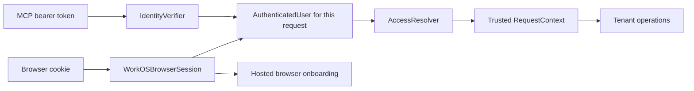

# Authentication implementation plan

Magumagu will use Better Auth for the free, self-hosted edition and WorkOS
AuthKit with Connect for the hosted edition. Both implementations will satisfy
the same narrow MCP contracts. Unit tests will use configurable doubles under
`test/unit/`.

The self-hosted edition supports several local accounts for a small evaluation
team in one shared workspace. Each user has an email/password login and separate
sessions. Authentication and account administration require no outbound
connection. The first hosted release includes operator organization setup and
customer membership administration. It collects no payments: until AUTH-11
passes its paid gates, the hosted edition uses `BillingFree`, which bills no
organization. Payment integration remains required work before the paid
product is complete. HTTP is the first end-to-end delivery
target. Slice 1, contracts and request isolation, is implemented. In slice 2,
the local runtime, its persistence, the installation identity, the data-directory
lock, and the HTTP composition are implemented; the other slice 2 work and all
later work in this plan are pending. The pinned Better Auth packages are
proven against the local contracts. The owner resolved the two
[provider blockers](#resolved-provider-blockers) that the proofs found, so
slice 2 can continue. The role refinement below records intended rules only; it
adds no implementation work now.

## Requirements and delivery scope

| Requirement | Delivery scope |
| --- | --- |
| One codebase and a small provider boundary | Required in the authentication foundation. |
| Several local accounts, email/password, separate sessions, and offline administration | Required in the self-hosted release; all enabled users share one workspace and the same evaluation permissions. |
| Hosted password/social login and MFA | Required in the hosted foundation through AuthKit. |
| Selected organization, active membership, roles, and permissions | Required in the hosted foundation. |
| Operator organization setup and customer membership administration | Required in the first hosted release, including operator recovery, onboarding, and invitations. |
| Active User seats per organization | Required on the hosted account page; count each active membership with User once. |
| Per-seat payment collection and subscription synchronization | Required paid-product milestone (AUTH-11). The owner has not chosen a payment provider, and the paid billing rules remain open. Until AUTH-11 passes its paid gates, the hosted edition uses `BillingFree` through the `Billing` interface; it bills no organization and collects no payment. See the [paid billing design](billing-design.md). |
| SSO, SCIM, step-up authentication, and full audit logs | Future hosted capabilities. Preserve provider boundaries; add their contracts when implementing them. |
| Paid capabilities in the local edition | Disabled. No organizations, invitations, seat management, billing, or remote entitlement checks. |
| Account or data migration between editions | Separate future work. Changing configuration does not migrate either. |

The external platform operator creates hosted organizations and assigns their
Super Admins. An authenticated user without an authorized organization receives
guidance to contact the operator or accept an invitation. Until membership is
active and grants the required permission, tenant operations remain unavailable.
Onboarding never grants access through a default tenant or role.

## Contracts and request flow

Keep the MCP-specific `IdentityVerifier`, `verifyAccessToken(token)`, and
`InvalidAccessTokenError` in `src/mcp/identity-verifier.ts`. `VerifiedIdentity`
carries an `AuthenticatedUser`, verified token issuer, OAuth client ID, actual
granted scopes, issue time, expiration, and resource audience. Accepted tokens
must supply the required time and audience claims. A client ID is never a user
or tenant ID. Initially accept human user grants; reject M2M and other tokens.

Put the shared access contracts in one file, `src/auth/access-context.ts`:

- `AuthenticatedUser`: canonical provider authority, user subject, and optional
  `selectedOrganizationId`. This identity is sufficient for onboarding.
- `AccessResolver.resolve(user)`: establish active local user or hosted
  organization access with current role grants.
- `AccessDecision`: allowed with `RequestContext`, or denied with a safe reason
  code. Expected denial is data; unexpected dependency failures throw.
- `RequestContext`: authenticated user, trusted tenant ID, optional
  organization, the full independent organization grant set, and the union of
  effective application permissions. Never reduce grants to a highest role. No
  credential or provider SDK object.

Browser session tokens and Connect tokens have different verification rules and
may have different issuers. After each verifies, map its user into the same
WorkOS authority derived from the fixed configured environment/application ID,
never the requesting OAuth client's ID. Keep the actual token issuer separately.
Never accept a browser token as an MCP access token. Derive hosted tenant
identity from the canonical authority and trusted organization ID, so the same
organization has the same tenant ID in both transports.

`BetterAuthProvider` and `WorkOSAuthProvider` each implement both roles. Callers
depend only on the role they need. These objects own provider integration, not
application policy. Claims and context are records. A small pure
`requirePermission(context, permission)` function is enough for operation checks;
do not create a policy class without state or a lifecycle to protect.

Each MCP HTTP request follows this sequence:

1. Existing MCP middleware checks the bearer header and calls the verifier once.
2. The provider validates token purpose, issuer, signature or authoritative
   token status, audience, and time claims. SDK checks remain in place.
3. The SDK adapter carries verified claims in `AuthInfo.extra`.
4. After authentication succeeds, the access resolver establishes current
   local user or hosted membership access. Expected denial returns HTTP `403`.
5. The MCP factory creates handlers bound to that request's context. Protected
   operations check their required permission before work starts.

The pinned MCP SDK 2.3.1 supports `AuthInfo.extra` and supplies `authInfo` to its
per-request factory. Use that path without a second token verification. Keep
context local to the request; copy mutable collections at boundaries. Headers,
tool arguments, and previous requests cannot replace trusted identity or tenant
values.

Missing, malformed, expired, or rejected credentials produce `401`. Missing
granted OAuth scopes retain the SDK's `403 insufficient_scope` response. Access
denial produces a distinct `403`; provider outages produce a generic `5xx` and
no protected work. MCPServer gives each unexpected verification or access
failure, with the failed step and the cause, to an operator callback that the
composition supplies. Logs must not include passwords, raw tokens, cookies, or
private provider errors in public responses.

Slice 1 settles these details. The SDK adapter rejects an identity without a
user, issuer, client ID, issue time, expiration, or audience, and an identity
whose user subject is the client ID. `AuthInfo.extra` carries frozen copies of
`user`, `issuer`, `clientId`, `scopes`, `issuedAt`, `expiresAt`, and `audience`.
Resolvers return contexts from `createRequestContext()`, which copies only the
contract fields and combines the permissions of every grant. MCPServer binds a
frozen copy of the context to each request through the SDK factory and
`registerTools(server, context)`. An expected denial returns `403` with the
OAuth error `access_denied` and no Bearer challenge. The safe reason codes are
`account-inactive`, `organization-required`, `membership-inactive`, and
`permission-required`. Permissions are plain strings; slice 1 defines no
permission names. The hosted role mapping in slice 3 names the permissions and
adds the rule that product portal and MCP operations require User.

Hosted browser authentication supplies the same user record. Identity-only
onboarding does not require an organization and can show operator or invitation
guidance. It cannot create an organization or resume operator setup. Tenant
actions require access resolution, and the application service checks the actor
and target again before any mutation.

## Configuration and composition

Require one selector: `DEPLOYMENT=self-hosted` or `DEPLOYMENT=hosted`. Derive the
provider and edition capabilities from it. Do not introduce `AUTH_MODE`, a mock
mode, or independent switches that enable paid features locally. Enforce edition
limits in route composition and protected operations, not only in visible UI.

Use one canonical public base URL to derive the MCP resource and metadata URLs.
Validate its scheme, host, path, and selected provider settings before listening.
Use HTTPS for hosted deployments; permit local HTTP only where the supported
OAuth profile allows loopback development. Do not infer public identity from
untrusted forwarded headers.

Local configuration supplies the data directory and persistent secret. Hosted
configuration supplies the trusted AuthKit issuer and required WorkOS
credentials, callback URL, and cookie-sealing secret. Load only the selected
provider's resources. Invalid hosted configuration cannot fall back to local or
anonymous access.

Slice 1 adds `loadDeploymentConfig(environment, transport)` and `.env.example`.
The settings are `DEPLOYMENT`, `PUBLIC_BASE_URL`, `DATA_DIR` for the
self-hosted edition, and `WORKOS_AUTHKIT_ISSUER`, `WORKOS_CLIENT_ID`,
`WORKOS_API_KEY`, `WORKOS_REDIRECT_URI`, and `WORKOS_COOKIE_PASSWORD` for the
hosted edition. The loader keeps the issuer exactly as written for exact token
issuer checks and requires the redirect URI to have the public origin.

`createApplication()` performs the single deployment branch, constructs the
provider, and returns a small runtime record with the HTTP handler and cleanup.
It owns startup failure cleanup and shutdown. The HTTP module adapts Node
requests and routes them; it does not know membership policy.

The server reads its listen address from `LISTEN_HOST` (default `127.0.0.1`)
and `LISTEN_PORT` (default `8080`) through `loadListenAddress(environment)`.
The listen address does not change the public identity from `PUBLIC_BASE_URL`.
Until slice 3, `createApplication()` stops the hosted edition with
`HostedEditionUnavailableError` and loads no local module. The self-hosted
application serves the MCP resource path through `MCPServer`; until local token
introspection exists, that endpoint accepts no access token, so every MCP request
gets `401` with the Bearer challenge. The application writes each MCPServer
failure report to the operator log as one error line with the failed step and
the cause. It forwards no Better Auth route yet.

Keep the existing low-level stdio API and its tests. Hosted application startup
rejects stdio. If local stdio is subsequently exposed, bind it explicitly to the
selected local user in the same installation and check current account status.
It is not an anonymous alternative to HTTP.

## Self-hosted authentication

Use Better Auth with email/password and SQLite in a container. Mount one
persistent volume for the database, installation identity, provider keys, and
secrets. The volume survives container and image replacement. Generate migrations
for pinned package versions during development and ship them with the
application; never download a migration tool at container startup. Better Auth
supports SQLite and schema generation for the selected plugins.
[SQLite support](https://better-auth.com/docs/adapters/sqlite),
[Docker volumes](https://docs.docker.com/engine/storage/volumes/)

SQLite normally has no database username/password. Host and volume filesystem
access controls determine who can operate this installation and its offline
CLI. This operational authority does not grant an application admin role. No
local application admin role or administration UI is needed; all enabled local
accounts retain equal evaluation permissions.
[SQLite serverless operation](https://www.sqlite.org/serverless.html)

Local email is an account identifier. Explicitly disable email verification and
email-based password recovery. Each enabled user has the same evaluation
permissions in one shared workspace. Keep each user's subject, credentials,
sessions, consents, and grants separate. Better Auth owns user, account, and
session storage; do not add custom credential tables, local organization tables,
or per-user tenants. No numerical account cap has been selected.
[Better Auth database](https://better-auth.com/docs/concepts/database)

The runtime exposes no public signup, invitation, social-login, or account-create
path. Bundle an offline CLI that wraps supported Better Auth APIs:

| Command | Behavior |
| --- | --- |
| `magumagu users add` | Create a local email/password account; reject a duplicate email. |
| `magumagu users list` | List local accounts and their enabled/disabled state without credentials. |
| `magumagu users reset-password` | Reset the selected user's password and delete that user's sessions, which ends that user's MCP access tokens. Preserve account status and IDs. |
| `magumagu users disable` | Disable the selected user and delete that user's sessions, which ends that user's MCP access tokens. Preserve IDs. |

Add and reset-password use a hidden password prompt. Never accept passwords as
command arguments or log them. Select the target user explicitly and report
errors without exposing credentials. Use Better Auth's password hashing and
supported create/list/reset/disable/session operations. Never edit provider
credential or token tables with SQL. If the selected admin plugin supplies
account status, include its generated schema but expose no public local admin
routes. Any private setup configuration must have no HTTP listener.
[User administration](https://better-auth.com/docs/plugins/admin),
[Email/password handling](https://better-auth.com/docs/authentication/email-password)

Runtime, initialization, client registration, and account administration share
one exclusive data-directory lock. To administer a container installation, stop
the server container, run a one-off container from the bundled image with the
same volume mounted, and invoke the required `magumagu users` command. Then
restart the server container. A command must reject a live server's lock; running
it inside a live server container does not bypass the lock. The CLI needs no
network or email service. An initialized installation can start with zero
accounts or no enabled accounts; protected requests remain denied. The host
administrator can use the CLI to add an account.

On fresh initialization, create an installation UUID once in an app-owned SQLite
singleton installation row. Derive the tenant as `local:<installation-id>`;
every local user resolves to this same tenant with a distinct user subject.
The singleton restricts installation identity only, never the user count.
Password reset, disable, restart, container/image replacement, backup, and restore
preserve the installation and user IDs. An existing data directory without its
installation identity fails closed and requires explicit operator recovery;
never silently mint a new identity and reassign retained data. Backup and restore
preserve the complete database and secrets together. A fresh installation with
new data starts a new tenant. No generic tenant repository is needed.

The implemented runtime keeps three files in `DATA_DIR`. `data-directory.lock`
holds the exclusive lock: an open exclusive SQLite transaction, which the
operating system releases when the process ends. `auth.sqlite` holds the
provider data and the singleton `magumagu_installation` row. `auth.secret` holds
the generated provider secret. Both data files have mode `0600`. A database
without schema objects is fresh: the runtime writes the secret first, and then
applies `0001-better-auth.sql`, `0002-installation.sql`, the installation row, and
`user_version` 2 in one transaction. A database with schema objects must have a
valid installation identity, schema version 2, and a valid `auth.secret`;
otherwise startup stops with `LocalInstallationError`. The runtime gives
`clientReference` the installation ID and reports the tenant
`local:<installation-id>`.

Use Better Auth's MCP/OAuth handler for local authorization and both discovery
documents. It owns those routes, including protected-resource metadata. The
application supplies bundled sign-in and consent pages. Do not register a second
OAuth provider plugin or an independent competing metadata response.
[Better Auth MCP](https://better-auth.com/docs/plugins/mcp)

The local auth command also registers approved MCP clients and exact redirect URLs.
It signs in one selected enabled account through the server API, with that
account's password from a hidden prompt. It registers the clients with that
session and then deletes the session. The installation, not that account, owns
each client. Support a documented, tested client set. Disable network
client-metadata discovery and dynamic registration in this edition. Do not
claim arbitrary MCP client compatibility offline. Persist keys, sessions,
clients, consents, and grants on the local volume. Local authentication must
not fetch remote JWKS, email, fonts, scripts, or other assets. Explicitly
disable runtime and CLI telemetry.
[Telemetry controls](https://better-auth.com/docs/reference/telemetry)

The local MCP verifier must introspect each token, so token acceptance also
checks current session activity. Better Auth documents that introspection checks
a bound session; JWT signature validity alone does not provide that check. The
[pinned provider proof](#pinned-provider-proof) shows how the resource server is
authorized to introspect its clients' tokens. After token verification,
`AccessResolver` checks the current local user state for every protected request.
Disabled or missing users have no workspace access. Supported provider
operations and user-state checks must also prevent disabled users from logging
in or receiving tokens. A still-valid signature must not let a disabled user
perform protected work.

The local edition issues no offline grants and no refresh tokens. Each MCP
access token carries the `sid` of the browser session that authorized it, and
introspection reports the token inactive when that session ends. Sign-out,
disable, and password reset end the session. Disable and password reset delete
only the selected user's sessions. That user's access tokens and pending
authorization codes then fail; peers' sessions, tokens, and access remain usable.
Clients authorize again when an access token expires. Do not implement hashing
or revocation by guessing provider tables, editing tokens, or storing raw
passwords.
[OAuth token validation and revocation](https://better-auth.com/docs/plugins/oauth-provider)

Before building the complete local flow, prove supported private account
creation, listing, password reset, disabling, session revocation, and the end of
the user's OAuth grants against the pinned versions and selected plugins. Also
prove public signup rejection, resource-bound issuance, introspection, current
account-state checks, and duplicate-email handling. Use provider origin/CSRF and
rate-limit protections and test them through authentication routes. Resolve any
unsupported operation before claiming the release meets the account or
revocation contract.

### Pinned provider proof

`test/interface/auth/better-auth.test.ts` runs the pinned packages with a real
SQLite database and proves the contracts in this section. The proofs found two
required contracts that the pinned provider does not support as first planned.
The [resolved provider blockers](#resolved-provider-blockers) record the owner's
decisions; the settings and contracts below apply them.

`package.json` pins `better-auth` and `@better-auth/mcp` at exactly 1.7.7.
`pnpm-lock.yaml` also pins their `@better-auth/oauth-provider` dependency at
1.7.7. The `mcp()` plugin is the only OAuth provider plugin; it wraps
`oauthProvider()`. The `admin()` plugin supplies account status. The `jwt()`
plugin signs access tokens and keeps its keys in the database, encrypted with
the secret. The database is Node 24 `node:sqlite` (`DatabaseSync`), so no
native SQLite package is needed.

| Setting | Proven value and reason |
| --- | --- |
| `baseURL` | `PUBLIC_BASE_URL`. The default `basePath`, `/api/auth`, makes the issuer `<base>/api/auth`. |
| `secret` | The generated secret from `DATA_DIR/auth.secret`. The versioned `secrets` option is not used. |
| `database` | A `node:sqlite` `DatabaseSync`. Run `getMigrations(options)` and `runMigrations()` before `betterAuth(options)`; otherwise the provider logs a false schema error. `compileMigrations()` gives the SQL to ship. |
| `telemetry` | `{ enabled: false }`. The proofs replace `fetch` with a blocker and record no outbound request. |
| `emailAndPassword` | `{ enabled: true, disableSignUp: true }` with no `sendResetPassword`. Signup gives `400 EMAIL_PASSWORD_SIGN_UP_DISABLED` over HTTP and from the server API. Email reset gives `400 RESET_PASSWORD_DISABLED`. |
| `rateLimit` | `{ enabled: true }`. Without it, limits apply only when `NODE_ENV=production`. The memory store is shared by the whole process. |
| `advanced.ipAddress.ipAddressHeaders` | One header that the HTTP bridge sets from the socket address after it removes any copy from the client. Without a client address, all clients share one bucket for each path. |
| `advanced.disableOriginCheck` | `false`. Without it, `NODE_ENV=test`, or `TEST` with a value other than `false`, turns off the origin and CSRF checks. |
| `disabledPaths` | The admin, client-management, client-secret rotation, and session-JWT (`/token`) routes. It refuses exact paths with `404` on HTTP only; server API calls still work. It cannot match routes with parameters, so the HTTP bridge must forward only the provider routes that the local edition uses. |
| `plugins` | `admin()`, `jwt()`, and `mcp()` with the options below. Dynamic registration stays off, and no client-metadata plugin is installed. |
| `mcp()` `resource`, `loginPage`, `consentPage` | `<base>/mcp` and the bundled sign-in and consent pages. |
| `mcp()` `scopes` | `["openid", "profile", "email"]`, without `offline_access`. An authorization request with `offline_access` returns to the client with `invalid_scope`, client registration refuses that scope, and no token response has a refresh token. |
| `mcp()` `grantTypes` | `["authorization_code", "client_credentials"]`, without `refresh_token`. A refresh request gives `400 unsupported_grant_type`, client registration refuses the refresh grant, and the metadata does not list it. The `grant_types` of a client cannot prevent refresh tokens, because the provider lets each `authorization_code` client refresh. |
| `mcp()` `clientReference` | A function that returns the installation ID. Each registered client gets it as `reference_id` and has no `user_id`, so the installation owns the client. |

The provider reads some process environment variables, also when an option sets
the related value. The [provider environment variables](#provider-environment-variables)
tell how the local settings stay independent of them.

The admin plugin's list, set-password, ban, and session endpoints need an admin
session, which the offline CLI does not have. Its create endpoint works from the
server without headers. The other operations use the provider's data API,
`(await auth.$context).internalAdapter`, and its password hasher. The admin
endpoints call the same functions. No operation uses SQL. The owner accepted
these operations.

| Operation | Provider API | Proven result |
| --- | --- | --- |
| Create | `auth.api.createUser({ body })` without headers | Creates an email/password account. An existing email in any letter case gives `400 USER_ALREADY_EXISTS_USE_ANOTHER_EMAIL` and keeps the original account. |
| List | `internalAdapter.listUsers()` | Gives each user ID, email, and `banned` state. User records hold no credentials. |
| Reset password | `password.hash()`, `internalAdapter.updatePassword(userId, hash)`, then `internalAdapter.deleteUserSessions(userId)` | The old password gives `401 INVALID_EMAIL_OR_PASSWORD`. The new password signs in the same user ID. The user's browser sessions end; peer sessions stay. |
| Disable | `internalAdapter.updateUser(userId, { banned: true })`, then `internalAdapter.deleteUserSessions(userId)` | Sign-in gives `403 BANNED_USER`. The user ID stays, and peers can sign in. |
| Revoke sessions | `internalAdapter.deleteUserSessions(userId)` | Ends only that user's sessions. That user's MCP access tokens become inactive at introspection, and that user's pending authorization codes fail at the token endpoint. |
| Register clients | `auth.api.signInEmail({ body, returnHeaders: true })`, `applySetCookies()` from `better-auth/cookies` to make the session headers, `auth.api.adminCreateOAuthClient({ headers, body })` for each client, then `internalAdapter.deleteSession(token)` | Each client has the installation ID as `reference_id` and no `user_id`. No registration session stays. Another user can authorize through the native client, and the resource server can introspect. A disabled account gets `403 BANNED_USER`. |

The create endpoint checks only the maximum password length, so the CLI must
check the 8 to 128 character rule first. Two concurrent creates with one email
give a raw SQLite uniqueness error; the exclusive data-directory lock prevents
them.

An authorization code grant with PKCE and `resource=<base>/mcp` gives a JWT
access token with header `typ: at+jwt` and an EdDSA signature. Its claims are
`iss` (`<base>/api/auth`), `sub` (the user ID), `aud` (the MCP resource and, when
the client requests `openid`, `<issuer>/oauth2/userinfo`), `client_id` and `azp`
(the client ID), `scope`, `sid` (the browser session ID), `iat`, `exp` (`iat`
plus 3,600 seconds), and `jti`. There is no `auth_time` or `nbf` claim. A
verifier must select the MCP resource from the `aud` array. An authorization
request without `scope` gets `openid profile email`. The token response has no
refresh token. The code exchange checks that the browser session of the code
still exists. After that session ends, the exchange gives `400 invalid_request`
with `session no longer exists`.

The MCP server introspects tokens at `<issuer>/oauth2/introspect` as a
confidential client with `client_secret_basic`. `mcp()` links each registered
client to the MCP resource, and a client linked to a token's audience may
introspect that token. A public client gets `401 invalid_client`. An active
result has the token claims, `active`, `client_id`, and `token_type`; any other
result is exactly `{ "active": false }`. Introspection makes a token inactive
when the session in its `sid` has ended. A token without `sid` gets no session
check. Send introspection as an HTTP `Request` through `auth.handler`; the
in-process `auth.api.oauth2Introspect` call cannot read Basic credentials. The
confidential client must carry the `client_credentials` grant type, because the
provider requires a grant type and has no redirect URI for it. The MCP
verifier must reject the machine tokens of that grant.

The tested offline client set is the MCP TypeScript SDK 2.3.1 client with a
pre-registered public native client: `token_endpoint_auth_method: none`,
`application_type: native`, `grant_types: ["authorization_code"]`, an exact
loopback redirect URI, PKCE S256, the resource indicator, and the RFC 9207 `iss`
check. It completes discovery, authorization, and code exchange, and it receives
no refresh token. The SDK adds `offline_access` only when the server metadata
lists it, so it asks for no offline grant here. The consent page appears at the
first authorization. When the access token is no longer accepted, the SDK has no
refresh token, so it starts a new authorization. While the browser session
lives, the provider finds the stored consent and returns a new code to the
client at once, without the sign-in or consent page. Registration requests get
`403 access_denied`, and the metadata has no `registration_endpoint`. No other
MCP client is claimed.

The provider serves `/.well-known/oauth-protected-resource` and
`/.well-known/oauth-protected-resource/mcp` at the root path, and the
authorization-server metadata at `/.well-known/oauth-authorization-server/api/auth`
and `/api/auth/.well-known/openid-configuration`. The HTTP bridge must forward
these root paths to `auth.handler`. The metadata does not list `none` in
`token_endpoint_auth_methods_supported`; the tested client still works.

Real authentication routes reject a foreign `Origin` or `Referer` with
`403 INVALID_ORIGIN`, a request with a cookie and a missing or `null` origin
with `403 MISSING_OR_NULL_ORIGIN`, a cross-site sign-in navigation with
`403 CROSS_SITE_NAVIGATION_LOGIN_BLOCKED`, and a foreign callback URL with
`403 INVALID_CALLBACK_URL`. More than three sign-in attempts from one client
address in 10 seconds give `429` and `X-Retry-After`; another address can still
sign in. Native clients must not send cookies to `/oauth2/*`; a cookie without a
trusted origin gives `403`.

These findings apply to the local runtime:

- With an open `/oauth2/create-client` route, any signed-in user can register a
  confidential client. The provider links it to the MCP resource, so it can
  introspect other users' MCP tokens. Keep client-management routes private.
- With `clientReference`, each signed-in session passes the provider's owner
  check for installation clients. Over HTTP, `/oauth2/client/rotate-secret`
  then gives any signed-in user a new secret for the resource-server client.
  That user can then introspect every MCP token, and the secret of the MCP
  server stops working. `/oauth2/get-client` shows the settings of any client.
  Keep both routes private.
- The `jwt()` plugin's `/token` route gives JWTs for the browser session, and
  their verification does not check the session. Keep it private.
- Outside an endpoint, Better Auth gives database hooks no endpoint context.
  The provider's token clean-up hook then does nothing, so session deletion
  through `internalAdapter` leaves token records unchanged. Introspection still
  ends tokens that carry a `sid`.

#### Provider environment variables

The pinned provider reads the variables below from the process environment, also
when `localProviderOptions()` sets the related option. The local settings must
not change with the environment. Thus `localProviderOptions()` pins a setting
where an option keeps the value and has no other effect. Otherwise
`localProviderOptions()` throws `ProviderEnvironmentError` when the variable has
a value. The message names the variable and its effect, but not its value. An
empty value is the same as a missing value. The runtime builds the options when
it starts the provider, so startup stops before the server listens. On a fresh
data directory, the installation that the runtime made before this step stays.

| Variable | Provider effect | Local setting |
| --- | --- | --- |
| `NODE_ENV=test`, or `TEST` with a value other than `false` | Turns off the origin and CSRF checks when `advanced.disableOriginCheck` is not set. | `advanced.disableOriginCheck: false` keeps both checks on. |
| `BETTER_AUTH_SECRETS` | Replaces the `secret` option. Then `auth.secret` is no longer the provider secret, and a restore of the database with its `auth.secret` does not keep sessions and keys valid. | Startup stops. The `secrets` option also stops the variable, but it changes the provider to versioned secrets and gives the keys in `auth.sqlite` another encryption format. |
| `BETTER_AUTH_TRUSTED_ORIGINS` | Adds trusted origins to the origin, CSRF, and callback URL checks. The provider reads it again for each request. No option stops it. | Startup stops. |
| `BETTER_AUTH_TELEMETRY` | With `BETTER_AUTH_TELEMETRY_ENDPOINT`, sends telemetry to that endpoint although `telemetry.enabled` is `false`. Either variable alone sends nothing. No option stops it. | Startup stops when `BETTER_AUTH_TELEMETRY` has a value, also `0`. |

The proofs set each variable and block `fetch`. With `NODE_ENV=test` or
`TEST=1`, a sign-in with valid credentials from a foreign origin gives
`403 INVALID_ORIGIN` and adds no session. The provider reads `NODE_ENV` one time,
when its modules load, so the `NODE_ENV` proof runs in a new Node process. The
`TEST` proof uses the same probe. No other variable that the provider reads
changes a security setting of the local runtime: the `secret` option has
priority over `BETTER_AUTH_SECRET` and `AUTH_SECRET`, the `baseURL` option has
priority over `BETTER_AUTH_URL`, and the `rateLimit` option has priority over
the `NODE_ENV=production` default.

#### Resolved provider blockers

The proofs found two required contracts that the pinned provider does not
support as first planned. The owner selected the resolutions below. The owner
also accepted the data-API operations above for list, reset, disable, and
session revocation.

1. **Revocation of offline grants.** The provider keeps `offline_access` refresh
   tokens when sessions end; its documentation names this behavior. A refresh
   checks no session, account status, or consent, and no provider API revokes
   the grants of one user. Thus an old refresh token still gave new access
   tokens after a password reset or disable, and those tokens had no `sid`.
   **Resolution:** issue no offline grants. MCP access tokens stay bound to the
   browser session through `sid`, and the MCP verifier introspects each token.
   The `scopes` and `grantTypes` settings enforce this for every client. The
   cost is that there is no refresh: a client authorizes again when its access
   token expires, at the latest 3,600 seconds after issue. The owner did not
   select revocation of token records through the provider's database adapter,
   refresh only while the browser session lives through `formatRefreshToken`,
   or a wait for a provider release with per-user grant revocation.
2. **Offline client registration.** `adminCreateOAuthClient` is a server-only
   endpoint, but it needs a signed-in session, and the offline CLI has none.
   **Resolution:** the CLI signs in one selected enabled account through
   `auth.api.signInEmail`, registers the clients with that session, and then
   deletes the session. `clientReference` returns the installation ID, so the
   installation owns each client. The owner did not select client records
   written through the provider's database adapter.

## Hosted authentication and access

Configure AuthKit/Connect as the MCP authorization server. It owns MCP consent
and token endpoints. Register the exact MCP URL as the resource indicator and
serve hosted protected-resource metadata through the SDK helpers. The separate
account application uses browser sessions described below. [WorkOS MCP integration](https://workos.com/docs/authkit/mcp)

Verify Connect user tokens against the configured issuer and its JWKS. After
verification, resolve the selected organization and active membership using
verified user and organization claims. Enable WorkOS multi-role memberships.
Read all current grants and their effective permissions through WorkOS and
convert them to plain application values. The default membership role must grant
no application permissions. Missing organization, inactive membership, or absent
required permission denies tenant access. Product portal and MCP operations
require User; Admin and Super Admin alone permit only their authorized
administration portal operations.
[WorkOS role configuration](https://workos.com/docs/rbac/configuration)

Connect tokens do not contain effective permissions. Its `sid` is a consent ID,
not a browser session ID. Dynamically registered clients receive standard OIDC
scopes by default; do not invent or require an unavailable `mcp:read` scope.
Keep client scopes and user permissions separate, and require only scopes that
the configured flow can actually grant.
[Connect token claims](https://workos.com/docs/authkit/connect/token-claims)

Start without a permission cache or local membership projection. Perform fresh
membership and permission reads for each protected request, with bounded
timeouts. A failed lookup fails closed. This keeps revocation of membership
separate from token expiration. The resulting hosted availability depends on
WorkOS, which is acceptable for this initial design.

Enable only the intended hosted password/social login methods, configure
required AuthKit MFA, and verify the completed challenge in the real flow.
Do not enable future SSO methods accidentally. AuthKit's MFA requirement does
not apply to SSO users; that milestone must define its own assurance policy.
Enrollment alone does not prove that authentication completed MFA.
[AuthKit MFA](https://workos.com/docs/authkit/mfa)

JWT verification plus fresh membership reads does not make browser logout or
consent revocation immediately invalidate every issued token. Record and test
the actual maximum token lifetime, refresh behavior, and revocation behavior
before production release. The accepted delay is bounded by verified expiration.
Do not use Connect `sid` to query an unrelated browser session.

## Hosted browser sessions

`WorkOSBrowserSession` owns sign-in redirects, callback verification, session
loading, refresh, organization switching, and logout. Its result includes
explicit cookie updates as well as the authenticated user. Apply refreshed
`Set-Cookie` values to redirects and error responses too. WorkOS refresh tokens
can rotate, and switching organizations uses a refresh with the requested
organization. Browser `sid` identifies a session, unlike Connect `sid`.
[WorkOS sessions](https://workos.com/docs/authkit/sessions)

Use supported SDK state and PKCE handling, validated return URLs, and sealed
`HttpOnly`, `Secure`, `SameSite` cookies. Browser mutations require CSRF and
origin checks. Validate sessions for each request; distinguish an expired
session from a temporary upstream failure. An outage must not silently become
success or erase a recoverable login.

Organization selection belongs to each credential. Switching the browser's
organization refreshes that browser session only. Existing MCP grants retain
their verified organization until a supported reauthorization or refresh
changes it. Never store a mutable user-wide current organization that retargets
an existing token.

`HostedAccountRoutes` adapts HTTP inputs to application messages. Render small
bundled forms on the server; no React or Next.js layer is needed. Routes cover
sign-in/callback/logout, onboarding, organization selection, and organization
administration. Keep browser credentials separate from MCP bearer handling.

## Organization administration

`OrganizationAdministration` owns customer membership operations and their
authorization rules. Its narrow `OrganizationDirectory` contract exposes the
records and operations those use cases need. `WorkOSOrganizations` performs SDK
effects, role and invitation mapping, and pagination. The local edition has no
organization implementation or management routes.

All hosted roles apply to one organization. They are independent grants with no
numeric hierarchy or inherited permissions:

| Role | Authority in this organization |
| --- | --- |
| User | Access the product portal and MCP. Cannot provision users. |
| Admin | Use the administration portal to create, grant, and revoke User access, including its own User grant. |
| Super Admin | Use the administration portal to grant and revoke Admin access, including its own Admin grant, and manage billing. |

The external platform operator creates organizations and creates, revokes,
replaces, and recovers their Super Admin grants. This operational authority is
outside customer roles; it does not require a global admin product. Assigning
Super Admin grants neither Admin nor User automatically. A Super Admin can grant
Admin to itself, then use that Admin authority to grant User to itself. These
explicit self-grants need no approval by another person. Admin authority alone
cannot grant Admin; no customer role grants Super Admin. Super Admin alone
cannot manage User grants. Removing a grant never suppresses authority supplied
by a remaining grant. A retained Super Admin grant permits the user to grant
Admin to itself again after Admin removal.

Better Auth and WorkOS authenticate users. Application permissions determine
what they may do. Okta remains a possible later user provisioning channel; this
plan does not select Okta or SCIM or add a product portal. Map each role to
explicit permission slugs and prove the hosted mapping before use. Do not use
provider defaults as application policy.

The first hosted release includes listing and selecting authorized
organizations, listing memberships for authorized management work, User and
Admin grant management, invitations, and the seat summary. Organization rename
and any other organization settings need a small authority decision before
implementation. Customer create/resume organization routes are excluded.
Organization listing and selection return only the user's authorized active
memberships; each destination checks its own permission.

Before each mutation, load current actor and target state for the requested
organization. The actor needs authority there. Existing target memberships and
invitations must belong there; a new invitation or grant must be bound there.
Check the current and proposed grant sets. Preserve every grant the actor cannot
modify. Revoking Admin removes
only Admin; an independent User grant remains. Revoking User from an Admin
removes only product access. Do not use generic account disable, membership
deactivation, or credential reset to bypass these limits. Customer admins cannot
write a global identity or affect another organization's grants. If the last
application grant is removed, deny this organization only; retain the identity
and other memberships. Prove a provider representation that cannot restore
access through a permissive default role.

Check current permissions for each request, including requests with an existing
browser session or MCP token. Role revocation denies the removed permission on
the next request and preserves independent permissions. A hidden button or a
caller-supplied organization ID is not authorization. Work already authorized
may finish after a later revocation; separate provider calls do not promise
distributed atomic authorization. Supported safe grant updates remain a provider
proof gate: retries and concurrent changes must preserve grants outside the
actor's authority. Do not assume an atomic provider update or add a concurrency
framework before this proof establishes what is needed.

Require completed MFA for privileged customer and operator actions. Keep basic
change records for organization setup/recovery, role and invitation changes, and
billing changes: actor, organization, target, changed grants or action, time,
and outcome. Exclude credentials. Full audit-log features and step-up policy
remain later work.

Use WorkOS membership and role APIs with explicit status filters. Prove
multi-role read/write behavior, effective permissions, safe grant removal, and
the final grant removal rule against the pinned provider. Creation can
reactivate an inactive membership; retries must not undo a later revocation.
[Membership API](https://workos.com/docs/reference/authkit/organization-membership)

Send only organization-scoped invitations with grants the actor may assign.
Admin invitations grant User; Super Admin invitations can grant Admin. Never
include automatic User access with Admin or Super Admin. AuthKit handles
acceptance and activation; expose pending/accepted/revoked/expired outcomes
accurately. Follow the configured invitation identity policy: WorkOS can allow
another address on the same corporate domain, so do not claim strict address
equality without enforcing it.
[Invitation behavior](https://workos.com/docs/authkit/invitations)

Document a minimal external operator setup and recovery runbook using external
supported provider tools and operations. Do not add operator write methods or
routes to customer services. Verify the intended organization and identity,
create or locate the organization, add the explicit Super Admin grant, and verify
current access. Preserve existing independent grants; add no other role
automatically. After an unknown outcome, inspect current provider state before
retrying; do not create duplicates or restore a grant removed later. Record
setup and recovery outcomes. Prove the pinned API behavior for these steps and
for Super Admin revocation/replacement/recovery. Customer access has no creator
metadata, signed creator-operation ID, or provisioning-state dependency.

The seat summary counts each unique active membership with User once across all
pages. User plus Admin or Super Admin is still one billable seat. Admin-only and
Super-Admin-only memberships, pending invitations, and inactive memberships do
not count. A failed page fails the summary rather than showing an incomplete
number. This is an observed live count, not a transactional billing snapshot.
Billing authority belongs to Super Admin in that organization.

## Files and ownership

The paths below are planned changes. Split additional files only when behavior
shows a separate role, invariant, or lifecycle.

| File | Objects or changes | Slice |
| --- | --- | --- |
| `src/mcp/identity-verifier.ts` | Extend `VerifiedIdentity`; retain `IdentityVerifier` and rejection contract. | 1 |
| `src/auth/access-context.ts` | Add `AuthenticatedUser`, `AccessResolver`, `AccessDecision`, `RequestContext`, and pure permission check. | 1 |
| `src/mcp/identity-verifier-sdk-adapter.ts` | Map additional claims through `AuthInfo.extra`. | 1 |
| `src/mcp/mcp-server.ts` | Resolve access after verification and bind context to request handlers. | 1 |
| `src/config/deployment-config.ts` | Add `DeploymentConfig` and `loadDeploymentConfig()`. | 1 |
| `src/auth-better-auth/better-auth-provider.ts` | Add `BetterAuthProvider`, implementing both MCP roles. | 2 |
| `src/auth-better-auth/better-auth-runtime.ts` | Add provider composition and database/lock cleanup functions when distinct from provider behavior. Implemented: `localProviderOptions()`, which stops startup with `ProviderEnvironmentError` for the provider variables that it refuses, and `openBetterAuthRuntime()`. | 2 |
| `src/auth-better-auth/data-directory-lock.ts` | Implemented: `lockDataDirectory()`, the exclusive data-directory lock that the runtime and the local commands share. | 2 |
| `src/auth-better-auth/local-installation.ts` | Implemented: `openLocalInstallation()`, which owns the database file, the secret file, the shipped migrations, and the singleton installation identity. | 2 |
| `src/auth-better-auth/local-auth-command.ts` | Use `runLocalAuthCommand()` to parse local user commands and register approved local OAuth clients. | 2 |
| `src/auth-better-auth/local-user-administration.ts` | Add `LocalUserAdministration` to own account lifecycle, supported provider operations, and per-user revocation; keep argument parsing in the CLI. | 2 |
| `src/auth-better-auth/local-auth-pages.ts` | Bundled sign-in and consent handlers. | 2 |
| `migrations/auth-local/0001-better-auth.sql` | Generated schema for pinned provider configuration, including the selected admin plugin/account-status storage if used. | 2 |
| `migrations/auth-local/0002-installation.sql` | Singleton installation identity only; no restriction on user count. | 2 |
| `src/auth-workos/workos-auth-provider.ts` | Add `WorkOSAuthProvider`, verification and current access resolution. | 3 |
| `src/auth-workos/workos-browser-session.ts` | Add `WorkOSBrowserSession` and explicit cookie effects. | 3 |
| `src/organizations/organization-administration.ts` | Add `OrganizationAdministration` and its `OrganizationDirectory` contract, with explicit grant rules and current actor/target checks. | 4 |
| `src/auth-workos/workos-organizations.ts` | Add `WorkOSOrganizations`, multi-role membership/invitation mapping, safe grant updates, and pagination. | 3–4 |
| `src/hosted-admin/account-routes.ts` | Add `HostedAccountRoutes`, form validation, CSRF checks, and response adaptation. | 3–4 |
| `src/hosted-admin/account-pages.ts` | Render operator/invitation guidance, authorized selection, grant, invitation, and seat forms. | 3–4 |
| `docs/implementation/hosted-organization-setup.md` | Document external operator setup, Super Admin replacement/recovery, MFA, and change records. | 4 |
| `src/application.ts` | Add `createApplication()` and selected-provider lifecycle. | 2–3 |
| `src/http/server.ts` | Node HTTP bridge, routing, hosted metadata, and shutdown. | 2–3 |
| `src/index.ts` | Replace hello-world startup; dispatch server and operator commands. | 2–4 |
| `src/billing/billing.ts` | `Billing` interface and `BillingState`. Implemented. | 6 |
| `src/billing/billing-free.ts` | `BillingFree`, which bills no organization, until AUTH-11 replaces it in the hosted composition. Implemented. | 6 |
| Paid billing files | The [AUTH-11 specification](billing-design.md#auth-11-implementation-specification) lists them. | 6 |
| `package.json`, `pnpm-lock.yaml`, `.env.example` | Pinned dependencies, commands, and documented settings. | 1–5 |
| `Dockerfile`, `compose.yaml`, `.dockerignore` | Offline evaluation delivery and persistent volume. | 5 |

Keep `IdentityVerifierMock` at
`test/unit/mcp/fixtures/identity-verifier-mock.ts`; extend its configurable claims
and failures. Add `access-resolver-mock.ts` beside it with configured decisions,
errors, and call records. Each test creates fresh instances. No production
module imports either mock. Organization and browser unit tests add their own
narrow directory and session doubles under `test/unit/`, importing shared
contracts as types only.

## Implementation slices

1. **Contracts and request isolation.** Preserve existing characterization
   tests. Add failing acceptance cases for trusted context and denied access,
   then implement the narrow contracts, SDK mapping, and configuration rules.
   Exercise context through a test-only tool registered at the server factory
   seam. Do not add a public diagnostic tool to production.
2. **Complete local flow.** First prove the provider compatibility points above.
   Implement local user commands, installation identity, pages, OAuth, current
   account-state checks, per-user revocation, persistence, HTTP composition, and
   cleanup. Complete the offline acceptance flow before starting hosted
   variation.
3. **Hosted identity and browser sessions.** Add Connect verification, shared
   identity mapping, current access resolution, browser session lifecycle, and
   MFA. Prove that an authenticated user without an organization can reach
   onboarding while tenant requests remain denied.
4. **Organization access and administration.** Prove external operator setup and
   Super Admin recovery; document the minimal runbook. Complete authorized
   organization selection, explicit User/Admin grant management, invitations,
   basic change records, and the User seat summary. Prove self-grants, selective
   removal, tenant isolation, and role restrictions through forms and service
   calls. Resolve rename/settings authority before those operations. This slice
   is required for the first hosted release.
5. **Evaluation packaging.** Ship dependencies, migrations, assets, commands,
   and volume configuration. Verify a fresh container, two-user offline login
   and re-authorization, restart, container/image replacement, backup/restore,
   and stopped-server CLI recovery. Keep the build's `dist/test` output for
   existing test commands; copy only `dist/src` and required runtime assets into
   the production image. No new production TypeScript configuration is required.
6. **Paid billing.** The `Billing` interface and `BillingFree` exist;
   `BillingFree` bills no organization. After the owner chooses the payment
   provider and billing rules, AUTH-11 adds the provider implementation of
   `Billing` with Super Admin payment setup, provider-confirmed User-seat
   quantity updates, verified events, reconciliation, and failure recovery.
   Then it replaces `BillingFree` in the hosted composition. This is required
   paid-product work, not an optional consequence of the seat summary.

Update `README.md`, `docs/testing/test-list.md`, and
`docs/design/cache-design.md` in the slices that establish their contracts. Add
`docs/implementation/hosted-organization-setup.md` in slice 4. Document trusted
installation/tenant identity, shared local workspace, user commands, hidden
password entry, the stopped-server volume workflow, recovery, supported clients,
edition limits, and the distinction between configuration changes and migration.

## Verification and release gates

Write a failing Given–When–Then acceptance specification for each new behavior.
Use focused TDD for the required pieces. Structural refactors retain passing
characterization coverage; do not create an artificial failure for unchanged
behavior.

| Planned test file | Main coverage |
| --- | --- |
| Existing `test/unit/mcp/auth*.test.ts` and `identity-verifier-sdk-adapter.test.ts` | Preserve header, claim, error, and scope behavior with doubles. |
| `test/unit/auth/access-context.test.ts` | Permission rules and valid context records without provider behavior. |
| `test/unit/mcp/access-resolver.test.ts` | Allowed/denied decisions, safe errors, and context binding through doubles. |
| `test/unit/auth-better-auth/local-auth-command.test.ts` | Command validation, explicit user targets, hidden password input, safe output, and client registration dispatch with lifecycle doubles. |
| `test/unit/auth-better-auth/local-user-administration.test.ts` | Account lifecycle and selected-user reset/disable/revocation decisions with provider doubles. |
| `test/unit/organizations/organization-administration.test.ts` | Actor/target organization checks, current/proposed grants, self-grants, selective removal, and safe retry decisions with a directory double. |
| `test/unit/hosted-admin/account-routes.test.ts` | Form validation, CSRF/origin checks, cookie forwarding, and error responses with session/service doubles. |
| `test/unit/config/deployment-config.test.ts` | One deployment selector, missing settings, URL validation, local limits, and hosted stdio rejection. |
| `test/interface/auth/better-auth.test.ts`, `workos.test.ts` | Few focused external provider contracts, including claim formats, key rotation, multi-role permissions, default-role denial, final grant removal, and operator setup/recovery. |
| `test/integration/auth/mcp-context.test.ts` | Real provider/MCP collaboration, error mapping, and sequential/concurrent isolation. |
| `test/integration/auth/local-auth-command.test.ts` | CLI entry point, configuration, and provider collaboration: add/list/reset/disable, duplicate emails, concurrent initialization, live-lock rejection, zero-account recovery, client registration without a remaining session, and per-user session and MCP token revocation without affecting peers. |
| `test/integration/auth/local-access.test.ts` | Two distinct user subjects in one tenant; equal evaluation permissions, separate sessions, current account-state checks, disabled login and issuance, no refresh grant, and disabled-user denial after token verification. |
| `test/integration/auth/local-installation.test.ts` | Application/provider startup collaboration: one persistent installation UUID; reset/disable preserve IDs; backup/restore preserve database and secrets; existing data without identity fails closed. |
| `test/integration/auth/hosted-account.test.ts` | Browser/session/service collaboration; same-user browser/MCP isolation across organizations, IDOR, forbidden grant changes, self-grants, selective removal, invitations, current-token revocation, safe retries, and User-seat pagination/failures. |
| `test/acceptance/auth/self-hosted.test.ts` | Network-denied two-user add/login/consent/re-authorization in one shared workspace; separate sessions; selected-user reset/disable rejects old credentials and disabled login and issuance while peers retain access; no refresh grant; public signup denial, clients, CSRF/origin/rate limits, and zero-account CLI recovery. |
| `test/acceptance/auth/self-hosted-container.test.ts` | Offline bundled CLI with stopped-server volume access; commands reject the live lock; two-user login and authorization after restart and container/image replacement; installation/user IDs survive backup/restore. |
| `test/acceptance/auth/hosted.live.ts` | Real login/MFA, no-org onboarding, cookie rotation, organization switching, operator setup/recovery, explicit grants, invitations, User seat summary, privileged change records, and revocation limits. |
| Existing `test/unit/billing/billing-free.test.ts` and `test/acceptance/billing/free-billing.test.ts` | `BillingFree` through the `Billing` interface: free plan, no billed seat, and refused input. The [AUTH-11 specification](billing-design.md#auth-11-implementation-specification) lists the paid billing tests. |

Include these explicit acceptance specifications:

- Given a Super Admin with no other grants, when it grants Admin to itself and
  then uses Admin to grant User to itself, then both actions succeed without
  another person's approval. Before each grant, only its current permissions
  apply; assigning Super Admin alone gives no product access.
- Given User plus Admin in one organization, when Super Admin revokes Admin,
  then User and product access remain and Admin operations fail on the next
  request with the existing token. If the target retains Super Admin, it can
  grant Admin to itself again through that remaining authority.
- Given User plus Admin, when Admin revokes its own User grant, then Admin
  operations remain available and product portal/MCP requests fail.
- Given Admin without Super Admin, when it attempts to grant Admin or Super
  Admin through a form or direct service call, then the action is denied and all
  grants remain unchanged.
- Given separate grants in two organizations, when an actor changes a grant in
  one, then the other organization's grants and access remain unchanged. A
  target from the other organization is rejected.
- Given a current browser session or MCP token, when the last grant in its
  selected organization is removed, then the next protected request is denied
  there, with no default-role access; other authorized memberships still work.

Unit tests replace other Delamain packages at public boundaries. Real
cross-package execution is integration coverage, including provider execution
of the MCP rejection contract or another package's pure permission helper. Do
not add a production interface solely to call a test a unit test. Use type-only
imports for shared records in unit doubles. Local acceptance uses the real
provider and database, not a configured authentication mock. Cover invalid
signatures, issuer/audience mismatch, expired/malformed tokens, and dependency
failures at the appropriate boundary. After denial, no tool, fetcher, or cleaner
runs.

Add explicit integration and acceptance scripts. The hosted live file does not
match the existing `**/*.test.js` glob; give it a dedicated command. Running that
command without its required credentials fails with a clear setup error. A
skipped live test is not a successful hosted gate. Automated container checks
must run with normal production telemetry settings and outbound access denied.

For implementation PRs, open Draft first. Before Ready, run each changed test,
`npm run check`, `habit-hooks`, and the applicable new suites on the complete
candidate. Resolve enforced smells and keep the snooze file empty. After Ready,
every started Actions job must pass; a fix returns the PR to Draft. The owner
reviews the PR, and a PR adding a decision record requires owner merge. The
[test gate policy](../implementation/test-gate-policy.md) gives the suite
commands, the required runs, and the later container and hosted live gates.

## Paid product decisions and later capabilities

The owner has not chosen a payment provider. Billing is a separate object:
hosted code uses the `Billing` interface in `src/billing/billing.ts`, and only
a `Billing` implementation calls a payment provider or reads billing storage.
Until AUTH-11 replaces it, `BillingFree` in `src/billing/billing-free.ts` is
the implementation. It bills no organization, and billing never changes
access. Billable seats are active memberships with User, counted once; Super
Admin manages billing. The payment
timing, proration and cancellation rules, behavior after payment failure,
recovery, and durable billing storage remain open until the provider decision.
AUTH-11 implements provider-confirmed updates, verified events, duplicate
handling, and reconciliation with authoritative memberships, and it selects the
final billing files and storage after the decisions. Do not prebuild an
event-store or outbox framework. The authentication and membership
administration release collects no payments. The paid product still needs
AUTH-11 until its paid gates pass. The [paid billing design](billing-design.md)
records the owner decision, the free billing examples, the open decisions with
a proposal for each, and the AUTH-11 specification.

SSO, SCIM (including any selected Okta provisioning integration), step-up, full
audit logs, organization deletion, and custom role authoring remain explicit
later milestones. Organization rename and other settings authority remain open.
Basic privileged change records and operator Super Admin lifecycle are required
above. Extend the existing roles when each use case is specified, rather than
adding placeholder methods now.
