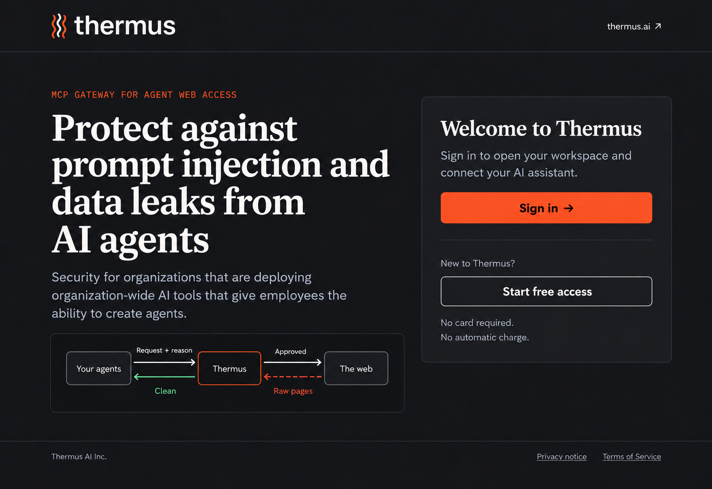
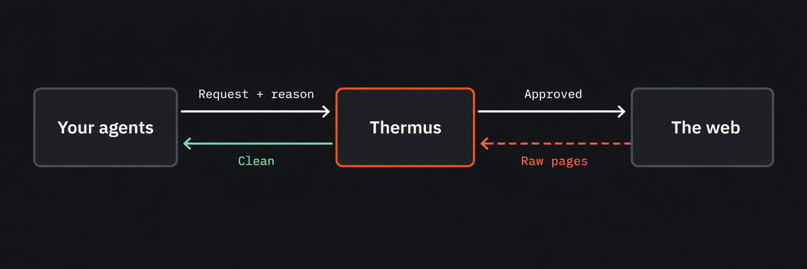
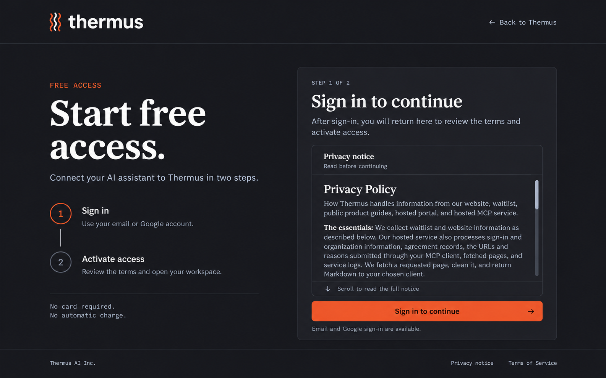
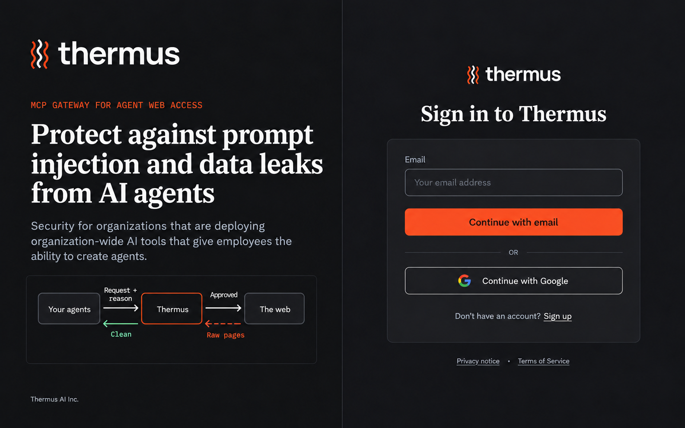
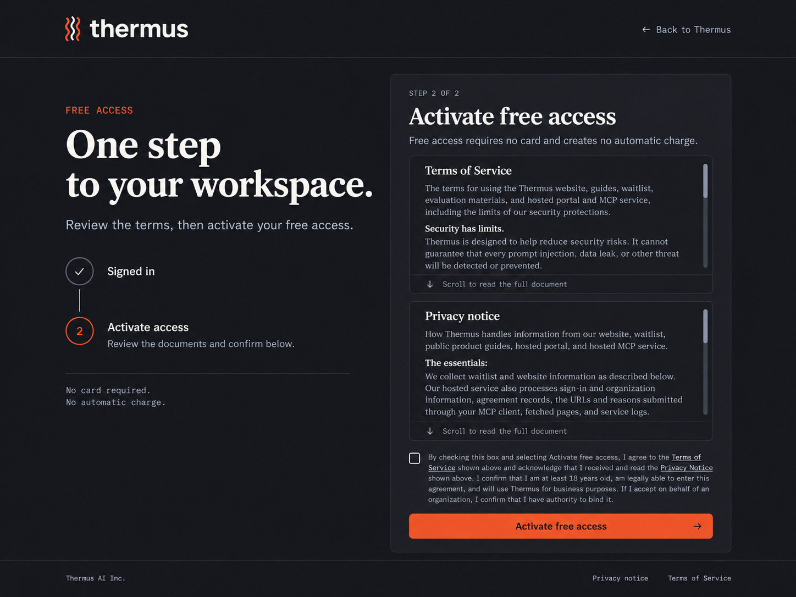
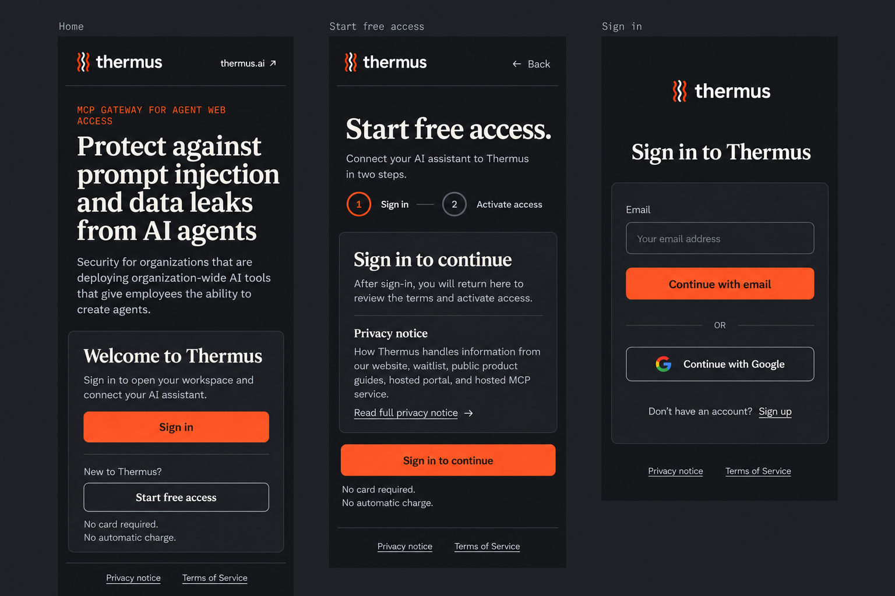

# Thermus portal design plan

**Status: design draft for review. Not implemented.**

**Current revision: simple flow refinement. Website copy is unchanged.**

This plan covers the public app entry at `https://thermus.onrender.com/`, the
signed-out and signed-in states of `/signup`, and WorkOS hosted AuthKit sign-in.
It proposes one calm, dark Thermus experience across those pages. The mockups
show proposed presentation. They do not show a deployed change.

The first release is the public entry and identity-to-activation journey. The
signed-in portal, organization selector, and MCP consent remain necessary parts
of the flow. Their current behavior is described here, but a redesign mockup of
those pages is outside this draft.

## Evidence and design boundaries

The [Thermus brand guide](../../../../Thermus-Marketing/docs/design/Thermus%20Brand%20Guidelines.md)
sets the visual direction. Use its existing dark-background logo asset:
`Thermus-Marketing/docs/design/thermus-logo/svg/thermus-logo-on-dark.svg`.
Place the exact asset; do not redraw the stripes or typeset a substitute wordmark.

The current public entry is a centered welcome card with one Sign In action.
It reads the session before it decides which state to show. See
[portal.ts](../../../src/user-portal/portal.ts#L29) and its
[signed-out view](../../../src/user-portal/portal.ts#L148).

`/signup` is workspace activation after identity sign-in. It has no app-owned
email, password, name, company, or payment fields. Its current
[pages](../../../src/auth/hosted-auth/workos/workos-signup-pages.ts#L13) and
[route decisions](../../../src/auth/hosted-auth/workos/workos-signup-routes.ts#L94)
are the behavior baseline. The added entry CTA, vertical step list, document
readers, and layout are proposals. Do not treat a new layout as authority to
change eligibility, agreement, access, or provider methods.

The signup switch is default-off in
[source](../../../src/auth/hosted-auth/workos/workos-signup-settings.ts#L1).
This does not establish the current production setting. Show the closed state
when the server reports it. Successful identity sign-in alone grants no product
access. The production composition has no automatic Google enrollment policy;
that policy is limited to a separate development slice.

## Canonical website copy

The user-selected website screenshot is the authoritative copy source for this
revision. Use the following text exactly on the home page, the AuthKit desktop
left brand panel, and mobile home. The local marketing source currently differs;
it does not replace the screenshot text for this design.

- Eyebrow: **MCP GATEWAY FOR AGENT WEB ACCESS**
- Headline: **Protect against prompt injection and data leaks from AI agents**
- Supporting copy: **Security for organizations that are deploying organization-wide AI tools that give employees the ability to create agents.**

Keep the app's Sign in, Start free access, and Activate free access actions.
The screenshot's Download free and See pricing actions are marketing actions
and do not replace the app's identity or activation actions. Signup step copy
remains specific to its task. Account and consent behavior stays the same.

## Visual system

Use a 1200px maximum content width with 24px side gutters on desktop. At 1440px,
this leaves 120px outer margins. Keep the header about 88px high and the logo
160–170px wide, always above the 96px lockup minimum. Keep its clear space.
Use a plain `thermus.ai` link at the right edge of the home header. Signup uses
**Back to Thermus**, to `/`. The logo on app-owned pages also links to `/`.

| Token | Value | Use |
| --- | --- | --- |
| Ink | `#17181D` | Page background |
| Ink Deep | `#141519` | Diagram background |
| Surface | `#1C1D23` | Secondary bands and reader background |
| Card | `#212228` | Welcome and activation surfaces |
| Border | `#2C2D34` | Decorative dividers |
| Border Strong | `#43454E` | Secondary outlines; strengthen where contrast requires |
| Control border | `#7B7E88` | Proposed accessibility extension for input boundaries, checkboxes, and focus-visible states |
| Cream | `#F3F2EE` | Headings, body text, labels |
| Gray 300 | `#B4BAC0` | Supporting text |
| Gray 500 | `#9BA1A6` | Short captions and technical metadata |
| Thermus Orange | `#E8552A` | Exact logo, Thermus diagram node, one primary action |

Use IBM Plex Serif 500 for major headings: 52–56px/1.08 for the longer desktop
home and AuthKit brand headline, 44px/1.1 for task page headings, and about 40px
and 30px on mobile. Use IBM Plex Sans
for UI and reading: 17px/1.55 body, 20px lead copy, 18–22px semibold card titles,
and 14–15px helper text. Use IBM Plex Mono at 12–13px for step numbers, protocol
labels, and document versions. Manrope belongs only to the existing wordmark.
Provide sensible system font fallbacks.

The Control border token is a proposed accessibility extension, not part of the
existing brand kit. It provides 3.91:1 contrast on Card. Keep the brand's subtle
dividers for decoration: Border Strong provides only 1.66:1 on Card. Use Control
border for essential control boundaries and required visible focus, or use a
Cream focus ring where appropriate. Ink text on Orange provides 4.86:1; Gray 300
text on Card provides 8.10:1. These values use the exact sRGB colors above.

Cards have a 1px border, 12px corner radius, and 32px padding on desktop. Primary
buttons use Orange with Ink text, 6px corners, semibold Sans, and at least 48px
height. Use outlined Cream secondary actions. Keep one orange primary button
per view. Logo and diagram color do not imply extra actions. Avoid decorative
glows, gradients, badges, emoji, and unsupported trust claims.

## 1. Public app entry: `/`

At 1440px, use roughly 590px for the left column and 430px for the right card,
with a 100px gap. Let the columns flex within the 1200px maximum content width.
Start the main content about 80px below the header. Allow more vertical space
for the longer headline. Aim for a natural four-line wrap at 52–56px; do not
clip the text or reduce the right card's readable width. Let the page grow.

Left column:

- Eyebrow: **MCP GATEWAY FOR AGENT WEB ACCESS**
- Heading: **Protect against prompt injection and data leaks from AI agents**
- Supporting copy: **Security for organizations that are deploying organization-wide AI tools that give employees the ability to create agents.**
- The compact three-node diagram specified below.

Place the diagram below the full supporting copy. Move it farther down the page
if needed to keep the headline, body, and right card readable.

### Compact product flow

Use the user's [marketing flow screenshot](flow-reference.png) as the conceptual
source. Place three simple nodes left to right: **Your agents**, **Thermus**,
**The web**. Only the Thermus node has an orange outline. Draw exactly four
direct arrows:

| From | To | Exact label | Line |
| --- | --- | --- | --- |
| Your agents | Thermus | Request + reason | Solid Cream `#F3F2EE` |
| Thermus | The web | Approved | Solid Cream `#F3F2EE` |
| The web | Thermus | Raw pages | Dashed Red `#FF6B5A` |
| Thermus | Your agents | Clean | Solid Green `#7FD1AE` |

Keep connector gaps wide enough for the labels at a readable size. Labels must
not cross nodes. Use separate outbound and return paths so arrow direction is
clear. The response must enter Thermus from the web before it returns to the
agents; there is no bypass. The four text labels carry the meaning as well as
color and line style.

Do not add inner feature boxes, logging or OTLP, a separate legend, a background
diagram headline, numbered steps, or an MCP pill. Keep Markdown out of the
diagram labels. This is the conceptual product flow selected by the user; the
word **Approved** does not specify a new backend approval gate or claim that
this task implements one. **Clean** describes the conceptual result and does
not promise that all threats are removed. Do not add shield scores, invented
logs, customer logos, or prevention guarantees.

Right column welcome card:

- Title: **Welcome to Thermus**
- Copy: **Sign in to open your workspace and connect your AI assistant.**
- Orange primary: **Sign in**, to `/login`.
- Full-width outline secondary: **Start free access**, to `/signup`.
- Helper: **Free access requires no card and creates no automatic charge.**

The signup action is a new public link to an existing route. The route remains
responsible for closed, eligible, and existing-access decisions. Do not claim
that access is ready before the server confirms it.

## 2. Signup entry: signed-out `/signup`

Use the common header and a two-column layout. The left column holds the page
title **Start free access.**, the copy **Connect your AI assistant to Thermus in
two steps.**, and a vertical two-step list: **1 Sign in**, then **2 Activate
access**. Mark Sign in as current with text and shape. These are app steps;
WorkOS can require additional identity screens.

Use about 540px for the right task card and let the left column flex within the
1200px page width, with a 64–80px gap. Card title: **Sign in to continue**.
Body: **After sign-in, you will return here to review the terms and activate
access.** Follow with **Free access requires no card and creates no automatic
charge.**

Show **Privacy Notice** in the card before the main action. Give its full
approved text a visible desktop reader about 260px high, with a named region,
visible scrollbar,
keyboard focus, and the hint **Scroll to read the full notice.** Render its
Markdown safely so headings, lists, and links are readable. Keep the exact
approved source and version; presentation must not rewrite the document.

Place the orange **Sign in to continue** action after the reader. Its destination
is `/login?return_to=/signup`. Use a quiet **Back to Thermus** link to `/`.
Reading to the end is not a condition of sign-in. Do not add a forced-scroll gate.

## 3. WorkOS hosted sign-in

Use the same Ink background, exact logo, type scale, and spacing. The review
mockup uses a split page: a static Thermus brand panel on the left and the
hosted form on the right. At 1440px, split the page 50/50, with a 400px maximum
form width in the right panel. The left panel uses the exact canonical website
eyebrow, headline, and supporting copy above. Set the longer headline at about
52–56px with a natural four-line wrap. Give the brand panel enough vertical
space and place a small version of the diagram below the body only if it fits.
Keep the hosted form readable and let the page scroll when needed.

The right panel title is **Sign in to Thermus**. Keep the observed email-first
form and Google method. The email field keeps the observed **Email** label,
an empty input with a neutral example, and the orange **Continue with email**
action. The Google action remains outlined. Retain provider-owned account
creation, password, verification, recovery, and other links when WorkOS shows
them. The layout must preserve their current method order and sequence.

Do not move identity fields into Thermus `/signup`, add a second password form,
or imply that Google sign-in accepts the Thermus activation agreement. Subsequent
provider screens need the same usable dark theme, even though the main mockup
shows the first screen. Use fictional examples only, such as `you@example.com`.
Review images and files must contain no session URL, state, code, token, or real
personal data.

### AuthKit feasibility

[WorkOS branding documentation](https://workos.com/docs/authkit/branding),
checked October 16, 2026, supports logos, colors, dark mode, Google Fonts, custom
page titles and links, centered or split layouts, and a static HTML/CSS secondary
panel. The panel strips JavaScript, forms, iframes, and event handlers. Global
custom CSS can style AuthKit pages; test all provider states after changes.
Branding is scoped to an environment. Production theme availability and saved
settings were not inspected. Keep authentication fields and logic hosted.
Use standard branding controls first; use custom CSS only for the remaining
visual fit. A centered form is the fallback if the split panel cannot match.

## 4. Activation: eligible signed-in `/signup`

Use the common two-column layout. The left headline is **One step to your
workspace.** Under it, show the same vertical step list, with **Sign in** complete
and **Activate access** current. Use about 650px for the right task card, a
48–64px column gap, and a flexible left column within the 1200px page width.

The card heading is **Activate free access**. Copy: **Review the documents below
to activate your personal workspace.** Repeat **Free access requires no card
and creates no automatic charge.**

Stack two full-document readers inside the card above the checkbox: **Terms of
Service**, then **Privacy Notice**. Use about 180px reader height, 20–24px internal
padding, at least 16px document text, and a 20–24px gap between document sections.
Each reader has a visible heading, version metadata, scroll hint, and independent
keyboard access. Place the whole exact agreement below both readers. Allow a
taller page and normal page scroll; do not compress the agreement or force the
card into a fixed viewport. Let the layout grow at larger text sizes.

Use one unchecked checkbox with this exact approved wording:

> By checking this box and selecting Activate free access, I agree to the Terms of Service shown above and acknowledge that I received and read the Privacy Notice shown above. I confirm that I am at least 18 years old, am legally able to enter this agreement, and will use Thermus for business purposes. If I accept on behalf of an organization, I confirm that I have authority to bind it.

Keep the whole wording visible, including on mobile. Link the existing Terms
and Privacy Notice references to the named reader headings. Keep the approved
checkbox as one agreement. Do not abbreviate, precheck, or add marketing consent.
Do not require a scroll-completion flag. Use an orange **Activate free access**
button after the agreement. Native required validation can explain a missing
check; server validation remains authoritative.

The exact document source is
[workos-approved-signup-documents.ts](../../../src/auth/hosted-auth/workos/workos-approved-signup-documents.ts).
The current bundle is `fs03-review-2026-10-16-v1`; Terms are
`hosted-terms-review-2026-10-16-v1`; Privacy Notice is
`hosted-privacy-review-2026-10-16-v1`; agreement is
`hosted-agreement-review-2026-10-16-v1`. At implementation time use the selected
approved bundle from the server. Keep exact UTF-8 bytes, versions, and hashes.
Render those bytes as safe Markdown without raw HTML execution or unsafe link
protocols. Reader headings may improve navigation, but must not replace any
approved text. Do not copy a shortened legal document into a component.

On success, keep the existing redirect to `/organizations?return_to=%2F`.
Creating access does not select a browser organization by itself. The selector
then returns the user to the signed-in portal.

## Routes and actions

Paths below assume the current hosted root base path. Generate destinations
from server routing where required; do not copy a transient provider URL.

| View or action | Destination or result | Status |
| --- | --- | --- |
| Header logo on app pages | `/` | Proposed link |
| Home header `thermus.ai` | `https://thermus.ai/` | Proposed external link |
| Signup header Back to Thermus | `/` | Proposed link |
| Entry Sign in | `/login` → hosted AuthKit → configured callback → `/` | Existing sign-in flow |
| Entry Start free access | `/signup` | Proposed entry CTA |
| Signed-out signup Sign in to continue | `/login?return_to=/signup` → hosted AuthKit → callback → `/signup` | Existing return route; proposed label |
| Hosted Continue with email or Google | Existing WorkOS-owned identity flow | Preserve provider behavior |
| Eligible Activate free access | `POST /signup` with current agreement/version/CSRF fields | Existing activation |
| Successful activation | `/organizations?return_to=%2F` | Existing redirect |
| Existing access Continue | `/organizations?return_to=%2F` | Existing link |
| Selector workspace action | Existing selection POST → `/` | Existing flow |
| Support Contact | `mailto:legal@thermus.ai` | Existing contact |
| Support Continue to another workspace, when permitted | `/organizations?return_to=%2F` | Existing conditional link |
| Signup closed Sign in | `/login` | Existing link |
| Failed sign-in Sign in again | `/login` | Existing recovery link |

The hosted callback path is configured by `WORKOS_REDIRECT_URI`; this design
does not propose a new callback. See
[session routes](../../../src/auth/hosted-auth/workos/workos-session-routes.ts#L79).

## Other states to preserve and style

Use the common header and readable notice surface for app-owned states. Keep
the server's status and outcome. A message must not imply that an uncertain
activation completed.

| State | Message and next action |
| --- | --- |
| Initial session load | Quiet `Loading…` status; reveal actions when state is known |
| Session unavailable | Existing `Failed to load your session. Please try again.` message; a page-reload control is a proposed recovery improvement |
| Signup closed | `New account activation is closed.` with Sign in and Contact |
| Existing access | `Your access is ready` and `You already have access to a workspace.` with Continue |
| Unverified email | `Verify your email before you activate access.`; do not invent an app-owned resend action |
| Support required | `Contact support to review this activation.` with Contact; offer another workspace only when the server allows it |
| Activation unavailable | `Activation is temporarily unavailable. Try again later.` |
| Rate limit | `Too many activation requests. Try again later.`; honor the 60-second retry hint without automatic resubmission |
| Invalid or stale form | Preserve the request-refused or invalid-request message; reopen signup to get current form data |
| Sign-in cancelled, expired, or invalid | Existing sign-in-did-not-complete message and Sign in again |
| Activation pending | Proposed `Activating access…` busy state; prevent duplicate local submissions and keep the agreement readable |

The signed-in root currently shows a welcome, profile, product-access status,
and Sign Out form. With access it adds the MCP endpoint and client connection
steps. Without access it offers Start free access and organization selection.
Preserve those branches when changing the public root. A browser workspace
selection affects only that browser; the MCP client chooses its workspace in
separate consent. Do not show a connected-client success state based on browser
sign-in. See [portal.ts](../../../src/user-portal/portal.ts#L49).

## Mobile and accessibility

Below about 960px, stack the common columns and reduce the main gap to 32–40px.
At 390px, use 20px side gutters, a 120px logo, a 64–72px header, and 24px card
padding. Keep the welcome actions full width. Mobile home uses the entire
canonical eyebrow, headline, and supporting copy, followed by the welcome card.
Use a 40px headline and 16px body, natural wrapping, and normal page scroll.
Do not truncate the text or shrink it to fit a fixed screen. Signup prioritizes
its short task heading and action card. Shorten the space used by the step list.
Omit the detailed product diagram on mobile so the primary action remains easy
to find. The existing mobile review image remains current.

Signup uses the full available column. On phones, show each document as a compact
disclosure with its title, version, and an exact opening excerpt from the approved
text. Use **Read full privacy notice** on signup entry; activation has equivalent
**Read full terms of service** and **Read full privacy notice** controls. Keep
the excerpts short enough to leave the task action easy to find. Do not expand
thousands of words by default.

On expansion, show the entire unchanged document inline in normal page flow,
without a nested scrolling box. A **Hide** control restores the compact view and
returns focus to its disclosure control. Use clear expanded state and keyboard
operation. The exact whole legal checkbox remains visible in the activation
card and is never inside a disclosure. Expansion, reading, and scrolling are
not conditions of sign-in or activation and are not proof of acceptance.
AuthKit can hide its static secondary panel on mobile and show the hosted form
with the logo above it.

Use semantic header, main, headings, links, buttons, and form labels. Keep DOM
order aligned with reading order. Give reader regions accessible names and a
visible focus ring; a keyboard user must enter, scroll, and leave them without
a trap. Use a clear focus ring with sufficient contrast on Ink, Card, and Orange.
Do not rely on the brand's subtle divider color for essential control boundaries.

Meet WCAG 2.2 AA contrast: 4.5:1 for normal text, 3:1 for large text and essential
UI graphics. Verify every rendered state, including muted labels, input borders,
checkboxes, hover, focus, and disabled controls. Use at least 44px practical
touch targets and space adjacent links. At 200% text size and 320px CSS width,
avoid clipped agreement text and horizontal page scroll. Announce async errors
and busy states through appropriate status or alert semantics. Do not move focus
on routine loading; after a failed submission, guide focus to its error message.
Honor reduced motion and keep the diagram static.

## Future acceptance criteria

These are acceptance scenarios for implementation. They have not been run.

1. **Public entry.** Given a signed-out visitor, when `/` loads, then the exact
   canonical website eyebrow, headline, supporting copy, and logo appear with
   Sign in and Start free access, and each action opens its listed route. On
   mobile, the full copy wraps without truncation or tiny text.
2. **Identity return.** Given a signed-out signup visitor, when they choose
   Sign in to continue and complete AuthKit, then the existing callback returns
   them to `/signup` and the server selects the correct signup state.
3. **Notice before sign-in.** Given signed-out signup, when the visitor opens
   the page, then the complete approved Privacy Notice is available before the
   sign-in action, with no forced-scroll gate.
4. **Exact agreement.** Given an eligible signed-in visitor, when activation
   loads, then both complete approved documents are available above the exact
   unchecked agreement and Activate free access, with no invented account fields.
5. **Validation.** Given an unchecked agreement or invalid/stale form data,
   when activation is submitted, then access is not granted and a clear error
   is shown. Existing origin, CSRF, and document-version checks still apply.
6. **Verified activation.** Given valid agreement and a currently verified
   eligible identity, when activation succeeds, then the existing personal
   workspace flow reaches the organization selector and returns to the portal.
7. **Existing or uncertain access.** Given existing product access, when signup
   opens, then Continue is offered without a new agreement or workspace. Given
   a retained inconsistent activation, then support guidance replaces activation,
   with another workspace link only when the server permits it.
8. **Provider ownership.** Given any enabled identity method, recovery,
   verification, or MFA screen, when it is used, then WorkOS keeps its fields,
   method sequence, validation, and callback behavior under the shared theme.
9. **Mobile documents.** Given a 390px or 320px viewport, when signup opens, then
   compact exact excerpts and full-document disclosure controls appear, while
   the task action and whole activation agreement remain easy to find. When a
   document expands, then all unchanged text is readable in page flow without
   nested scroll. When Hide is selected, then the compact view and disclosure
   focus return. No document creates a keyboard trap, read gate, or horizontal
   page scroll.
10. **Failure states.** Given closed signup, unverified email, a provider outage,
    or a rate limit, when the page responds, then it shows the matching outcome
    and next step without claiming access or repeating an activation automatically.
11. **Signed-in root.** Given a signed-in visitor with or without product access,
    when `/` loads, then existing portal branches and sign-out still work, and
    browser identity is not presented as an MCP connection.

## Implementation sequence after review

Start with failing BDD acceptance scenarios for the approved behavior changes.
Use focused failing unit, interface, or integration tests for the pieces each
scenario needs; make them pass, then refactor. Follow DRY3 and existing package
boundaries. A Markdown reader test must check unsafe markup and links as well
as complete document rendering. Preserve source bytes and legal versions.

Implement the app-owned entry and signup presentation, then test AuthKit
branding in a suitable environment. Verify all hosted identity states and
existing return paths. Check desktop, mobile, keyboard use, zoom, and contrast
against the review images. Before a future PR is Ready, follow
[AGENTS.md](../../../AGENTS.md) and the
[test gate policy](../../implementation/test-gate-policy.md): run changed tests,
`npm run check`, and `habit-hooks`; resolve enforced smells and keep the snooze
file empty. Keep the normal draft/Ready/Actions/owner-review process.

This task changes only a design document and review artwork. No application
checks, test runs, deployments, provider settings, or PR actions are claimed.

## Visual review notes

The images are generated design concepts. This plan and the existing source
govern exact color tokens, fonts, logo assets, routes, and approved legal copy.
Resolve any image mismatch in favor of those specifications during implementation.
Each diagram must show the raw web response entering Thermus before the cleaned
response returns to the agent. Do not copy an arrow that bypasses processing.

The current home and hosted sign-in images use the `-simple-flow` filenames
linked above; `06-simple-flow.png` provides a standalone preview. The mobile
image keeps its `-website-copy` filename and omits diagrams. Signup entry and
activation images keep their original filenames. The original images and
[original prompts](mockup-prompts.md), plus the prior website-copy images and
[website-copy prompts](mockup-prompts-website-copy.md), remain historical
revisions. [Simple-flow generation prompts](mockup-prompts-simple-flow.md)
record the current diagram refinement; no prior artwork is deleted.

## Choices for design review

- Review the longer canonical website headline's wrap and spacing alongside the
  two welcome actions. The screenshot-selected wording is fixed for this revision.
- Confirm split AuthKit as the preferred layout, with centered as the fallback.
- Confirm the document-reader dimensions and mobile expansion pattern. Exact
  legal wording and full document access are required in either presentation.
- Confirm whether a future change should improve the unverified-email next
  step or add a session-error reload control. Those are separate behavior choices.
- Confirm the production branding target and available settings before a later
  AuthKit configuration change. No target settings have been inspected or saved.
- Confirm that the signed-in portal and organization selector remain outside
  this mockup set; their behavior must still pass regression checks.
