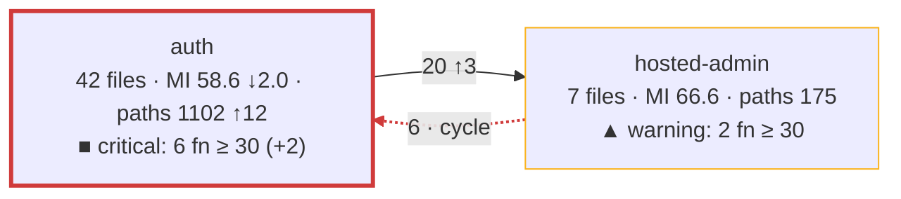

# Architecture and complexity evolution plan

Status: agreed with the owner on 2026-10-17 and reviewed the same day (see
"Review record"). Historical tickets T1 to T7 are done (see the appendix).
PR #175 completed CR-16 and the CR-23 contract-test foundation. PR #176
merged CR-24: always print the architecture drawing and require the
fenced graph and legend in every pull request body. PR #177 merged delivery
group 3, CR-01 and CR-02: include portal unit coverage and measure each
function's own characters. PR #178 merged CR-03 and CR-04: verified capture
provenance, explicit safe recording, and labeled historical estimates under
approved D3. PR #179 merged CR-05: file status, source evidence, and
conservative function correspondence. PR #180 merged CR-06: live
invariants and separate structural and coverage-collecting architecture
files. PR #181 merged CR-07 and CR-08: incomplete risk assessments and
the tool version pin. PR #182 merged CR-22: per-function CRAP goals,
actionable coverage advice, and the approved D1/D2 process. PR #183 merged
CR-09: the composed review process and the baseline wrapper. PR #184 merged
CR-17: share proven command checks, JSON reading, and ordering while preserving
the nine entry points, diagnostics, and report contracts. PR #185 merged
CR-13: source dependency evidence, community import explanations, and a
stable component map. PR #186 implements CR-14: global trend charts, commit
titles and PR numbers, and a stable component trend matrix. Owner review
is pending.
The CRAP delta was already calculated once before CR-17. D9 remains open.
The other changes in the [change request](ast-metrics-change-request.md) remain follow-up work;
completion of T1 to T7 does not complete those CRs. This plan builds on
the process of PR #154 ("Code quality review with
ast-metrics" in [AGENTS.md](../../AGENTS.md) and
[the review guide](ast-metrics-review.md)).

## Objective

For each pull request, show in the pull request itself (1) how the component
structure of `src/` changed and (2) where complexity and maintainability
moved, with the complex code that no test protects marked on top. Keep one
record per `main` commit, so that the owner sees how the architecture evolves
over months and where complexity accumulates.

## What the study says

The published practice, condensed to what applies here:

1. **Judge the change, not the total.** SonarQube's "Clean as You Code" gates
   only the new code of a pull request, with few conditions, because a gate on
   the whole codebase gets ignored
   ([SonarQube docs](https://docs.sonarsource.com/sonarqube-server/10.5/user-guide/clean-as-you-code)).
   The delta gate of PR #154 does this; the bands below do it too.
2. **Weight by where the work happens.** Hotspots rank code by complexity
   times change frequency; CodeScene's main KPI is the code health of the
   hotspots, weighted by lines of code; a study of 39 codebases found that
   work in the worst code takes 124% longer and carries 15 times more defects
   ([Code Red, Tornhill and Borg](https://arxiv.org/pdf/2203.04374);
   [CodeScene code health](https://docs.enterprise.codescene.io/versions/6.0.6/guides/technical/code-health.html)).
   ast-metrics computes a risk score from complexity, maintainability,
   coupling, and change frequency; it is the hotspot score here.
3. **Health is several numbers, not one.** CodeScene aggregates 25+ factors.
   For us: a few numbers side by side, averages weighted by lines of code,
   never a plain average of maintainability over files.
4. **Cyclomatic complexity measures testability; cognitive complexity
   measures understandability**
   ([SonarSource](https://sonarsource.com/blog/cognitive-complexity-because-testability-understandability)).
   ast-metrics gives cyclomatic only. ESLint in habit-hooks already enforces
   `complexity: 10` and `max-depth: 4` per function: the function-level
   fitness function exists.
5. **CRAP** (Change Risk Anti-Patterns, Savoia and Evans 2007):
   `CRAP = CC² × (1 − coverage)³ + CC` per function, with the coverage of the
   function's own code as a fraction. This project uses the strict goal below
   30 and the approved inclusive target of 15 or less for added functions.
   With full coverage it falls to `CC`; at 30 paths no coverage can meet
   the strict goal
   ([crap4py](https://pypi.org/project/crap4py/),
   [cargo-crap](https://docs.rs/cargo-crap/0.4.2/cargo_crap/)). It is a
   safety-net metric: it says how dangerous a change is, not how readable the
   code is. Node writes the coverage it needs without a dependency: with
   `NODE_V8_COVERAGE=<folder>`, each Node process writes a JSON file that
   lists each function with its name, its byte range, and the counts of its
   blocks (verified on this repository on 2026-10-17). lcov is not enough: it
   gives a function's start line and call count, not its end, so the coverage
   inside a function cannot be attributed from it.
6. **Structure metrics**: the design structure matrix work of MacCormack,
   Rusnak, and Baldwin defines propagation cost
   ([paper](https://flosshub.org/184)); later work found the raw form an
   inconsistent health signal. A small, stable set serves better: modularity,
   the share of dependencies that cross communities, the cycles, and the
   members of each community. ast-metrics gives all four and suggests cuts.
7. **Visualization**: polymetric views and CodeCity map metrics to visual
   properties consistently, one metric per channel; the hard part of an
   evolution view is identity across snapshots, because entities that move or
   get renamed break the picture
   ([Lanza](https://scg.unibe.ch/assets/archive/papers/Lanz03dTSEPolymetric.pdf),
   [CodeCity](https://www.inf.unibz.it/~rrobbes/p/ICSE2011-codecity.pdf)).
   GitHub renders Mermaid; a graph stays under about 15 nodes.
8. **History** lives outside the tool: ast-metrics stores nothing and offers
   no trend; Codacy and coderadar show per-commit deltas from their own
   stores. A snapshot per `main` commit is ours to keep.

## What ast-metrics gives today

Verified with 0.43.1 on this repository on 2026-10-17, with later observations
identified below:

- Communities from the dependency graph of the production files
  (`get_communities`): members, hubs, internal, inbound, and outbound
  references, cohesion, bus factor; globally modularity, cross share, cycles,
  typed findings, and ranked cut actions. The 2026-10-17 observation was seven
  communities and one cycle. The 2026-10-18 study at `76b514ac` found nine
  communities including the shared kernel and two cycles. These are dated
  observations; grouping changes as files change.
- Per file: maintainability, decision paths, lines, coupling, risk. Per
  function (`get_file_metrics`, one call per file): name, decision paths,
  maintainability, lines; no line numbers.
- `review --base` for the deltas of the changed files. No per-community
  numbers, no time series, no diagram export.
- Costs on this Mac: the JSON report of the repository about 10 to 20
  seconds; one MCP call about one second, and the calls of one session share
  one analysis, so the per-function data of all `src/` files is one session
  of about 100 calls, not 100 runs.
- Community identities are not stable: when code grows elsewhere,
  ast-metrics regroups and renames them (seen on 2026-10-17).

## Design

### The snapshot

The snapshot of one tree, `snapshot.json`, holds the global numbers
(modularity, cross share, cycles, LOC-weighted maintainability of `src/`,
file and function counts), the `src/` communities with their members and
references, the per-file metrics, per-function decision paths, optional commit
`title` (the first message line), and normalized
source dependency pairs with unresolved-evidence issues. It
holds no coverage or CRAP. `tool` names the actual checked ast-metrics
version. A legacy snapshot without `tool` has an unknown version. One
module makes it from one JSON report and one
MCP session, both of `src/` alone (`ast-metrics analyze src`, `ast-metrics
mcp src`), so that growth of `script/` or `test/` cannot regroup the
communities. The architecture command joins a separate coverage report when
it computes CRAP and bands. Each new snapshot also holds `provenance`: the
source and expected coverage-input fingerprints, runtime, compiler, suite,
and measurement version. Capture checks these inputs before and after
analysis. Offline rendering matches coverage to this identity; it needs no
Git repository. Legacy snapshots can show structure but cannot establish
coverage compatibility. CR-05 adds optional per-file `sourceEvidence` and
per-function `identity`.
Version `typescript-tokens-v1` identifies the token normalization. Source
ranges use zero-based UTF-16 offsets with an exclusive end. Declaration
kind, lexical owner, and name support continuity; body and signature hashes
support change classification and unique unchanged moves. Whitespace and
comments are ignored, while executable syntax and literal spelling remain.
Anonymous functions, duplicate names, and unsupported owners stay unknown.
Legacy snapshots provide no source proof; offline readers do not inspect the
caller's checkout. The wrappers run from the repository root;
keep its configuration authoritative by adding no config under `src/`.
The [review guide](ast-metrics-review.md#the-configuration) records the
controlled 0.43.1 configuration lookup check.

A pull request has two snapshots: the head (the working tree) and the base
(the merge base with `origin/main`, analyzed in a temporary `git worktree`
that the command removes again). The base never comes from the trend store,
so a pull request depends on nothing but the repository. Delta, review,
MCP, snapshot, CRAP, and online architecture pin 0.43.1. CLI checks use
`ast-metrics version`; MCP checks initialization. A composite run checks
the CLI once and requires each MCP session to agree with it. An explicit
`--allow-tool-version` permits another actual version throughout that run.
Help, coverage collection, and offline rendering need no installed tool.
A pin change needs applicable live contracts and fixture review.

### The views

All views appear in the pull request body through the AGENTS.md process:

1. **Architecture delta.** One Mermaid graph of the `src/` communities at the
   head with the base in the labels (encoding below), and one summary line:
   modularity, cross share, cycles, base to head. The graph and legend always
   appear, including when only documents changed or compatible coverage is
   unavailable. If the map did not change, `The map did not change.` appears
   above the graph. Paste both fenced `mermaid` blocks, their legends, and import evidence unchanged
   into the pull request body. Bands require compatible coverage; the graph
   requirement does not expand the selected test scope. Community edge
   evidence explains changed imports separately from unchanged imports
   regrouped by the tool, with at most ten file pairs per changed edge and
   an omitted count. Proven file moves use CR-05 evidence.
   A second graph under `## Components of src/` uses each populated
   top-level source folder, plus `src` for root files. Its names are stable
   across community regrouping. Each cross-component edge counts importing
   files once per target component. Internal imports give no self-edge or
   self-cycle. Both graphs and legends always appear.
2. **Complexity delta.** One table of the `src/` files that the pull
   request changed: maintainability and decision paths, base to head, with
   `new` or `gone` for a file that one side does not have and
   `not measured` for a file without a maintainability index, plus the risk
   rank of the file when it is among the ten riskiest of the head; the line
   `No production file changed.` when no `src/` file changed. T6 adds the
   functions with CRAP at 30 or more, before to after, as a column, and
   then the functions that the pull request added or made worse and that
   have CRAP at 30 or more, with their complexity and coverage.
3. **Trend.** One table of the last ten snapshots of `main` and the head:
   modularity, cross share, cycles, LOC-weighted maintainability, functions
   with CRAP at 30 or more. The store is `docs/metrics/<date>-<commit>.json`, one file per
   `main` commit, holding global, community, and stable component numbers.
   Component counts retain D3 provenance. Legacy absent component data is
   unknown. The table's `PR` column uses a terminal `(#<n>)` in the optional
   commit title; an absent suffix gives `–` without a Git or GitHub lookup.
   Separate maintainability and functions-at-30 chart sections use the same
   window. A missing value splits a run. Risk runs also split when the D3
   basis changes between measured, estimate, and legacy unknown. Runs of at
   least two values use `xychart-beta`; a single value gets a caption, and
   an empty series gets an unavailable message. Constant runs have a
   nonzero y-axis range. `### Trend by component` keeps stable, sorted
   component rows and chronological commit columns. Each cell labels `MI`
   and `functions ≥ 30` independently, with D3 risk labels and a dash for
   each missing measure. No historical component absence is called zero.
   Nobody runs anything at merge time. The complete-candidate review uses
   `--record` to write a missing base record after the full commit and its
   ancestry on `origin/main` are verified. Exploratory runs are read-only.
   Records are immutable; keep the file from `main` in a merge conflict.
   Counts from head coverage are labeled estimates with their origin and
   unknown-function count. New records retain the actual snapshot `tool`
   version when known. Mixed versions in the history and head get an explicit
   notice; absent legacy versions are unknown. The trend lags one pull
   request behind `main`.

### Community identity

Head communities match base communities by the Jaccard overlap of their
members, 0.5 or more; a community without a match is new or gone. A label
uses the largest source namespace by member count, with a lexical namespace
tie-break, and removes `src/`. Without a source namespace, it uses `src`;
the shared community ID gives `shared kernel`. Duplicate labels append the
first hub basename in parentheses, or the community ID when no hub exists.
A community that splits or merges can show as gone and new.

### CRAP per function

The coverage run builds first, verifies the emitted output, then runs the
complete emitted Node unit tests and the complete source portal unit tests
with one `NODE_V8_COVERAGE` folder. It verifies inputs and output throughout
capture and publishes only after both runs succeed. `--no-build` requires
a matching content manifest. Retained raw captures have a manifest;
`--from` validates that original capture and preserves its commit. Explicit
`--allow-unverified` imports are for inspection and cannot enable bands or
historical counts. It
adds no integration or acceptance suite; CR-11 proposes that extension.
For each function, the share measures its own characters: the whole range
minus the union of strictly contained function ranges from all compatible
processes. Grandchildren are subtracted once, equal ranges do not establish
parenthood, and a nested entry missing from one process still affects the
common denominator. Execution is unioned over own characters; calls are
summed. A process runs no character in a zero-count block or a function it
did not call. This is character coverage, not basis-path coverage.

Offsets use UTF-16 code units of the executed representation. The collector
accepts emitted JavaScript under `dist/src/` and source TypeScript under
`src/`, preserves representation and SHA-256 content identity, and rejects
mixed representations for one logical file. On Node 24.20.0, stripped
TypeScript keeps named function offsets aligned with the original UTF-16
source. The anonymous module's whole range also includes Node's exact
`\n\n//# sourceURL=<file URL>` trailer. Identified length includes the
trailer; the SHA-256 identity hashes the original file without it. Whole
ranges are preserved, with no clamping. The collector validates raw ranges
and counts before merging and rejects crossing ranges, conflicting identities,
and unsafe call sums. Helpers and their descendants are subtracted before
they are excluded. Functions with no own characters are recorded as
unmeasured with reason `no-own-characters`; they have no measured share.
New coverage reports use JSON schema version 2; legacy version 1 remains
readable; absent provenance cannot establish assessment. The measurement version stays
`own-characters-1`. Snapshot, build-manifest, capture-manifest, and trend
record schemas remain version 1.

Functions match ast-metrics by file (`dist/src/x.js` is `src/x.ts`) and by
the name that V8 gives: ast-metrics names a method `module\Class.method`,
V8 names it `method`, and V8 names a constructor `Class`. An anonymous
function, a duplicate name in a snapshot or coverage file, a name absent
from coverage, a compiler helper (`__` prefix, with its descendants), or a
function with no own characters stays unmatched and gets no exact CRAP. An
unmeasured entry also blocks a measured same-name entry from supplying a
share. The list under the table gives how many functions of the changed files
stayed unmatched. Directly below it, the report lists unmeasured functions
in changed files with at least five paths, sorted by path and name.
Their CRAP is at least their paths. A function with 30 or more paths counts
as a known violation and displays `≥ <paths>`. A lower bound alone cannot
prove worsening against an unknown base value. A `src/` file absent from
the report currently counts as uncovered. Only a complete verified report can establish that an absent
file was not loaded by the selected unit suite. Coverage is compatible
only when its verified provenance matches the supplied head snapshot's
source and input fingerprints, runtime, compiler, suite, and measurement
version. The original capture commit stays visible. A commit that changes
only unrelated prose can reuse a capture when these inputs match.

The base tree gets no coverage run, so its CRAP is a head-derived estimate.
Only a proven base/head function pair can use the head covered share with
base decision paths. Removed functions and other base functions without a
partner get no exact estimated CRAP, and their unknown count stays visible.
At 30 or more paths, they still count as known lower-bound violations.
Within the same file or a proven file rename, a unique declaration
kind/owner/name pair establishes continuity. Body or signature changes make
that pair changed. Elsewhere, one unique unchanged body/signature pair can
prove a move or rename. A name alone cannot prove a move. Copies, duplicate
bodies, changed extractions, and unresolved move candidates remain unknown.
Complete source evidence must prove absence before a function is called new.

File status retains old and new rename paths. The complexity table has one
rename row at the new path with the old path's base values. Deleted files
have gone head cells and touch their base community. Delta scores only
surviving TypeScript files. Offline `--changes FILE` binds statuses to both
snapshot commits and source fingerprints; `--touched` gives paths only and
cannot prove a rename. Reuse current valid coverage when available. Collect
it only when `src/` changed or both complete parts of the unit suite were
already selected under the test gate policy. Otherwise report without bands.

### Required CRAP goals

CR-22 adds `ast-metrics-crap.ts`. It selects changed production files by
default, resolves an empty selection without coverage or MCP, and shows all
functions of each selected file with its change classification, paths,
coverage, score or bound, and action. Explicit inspection paths do not make
functions new. Source evidence must prove new or changed classification;
unknown identity remains unresolved for the applicable goals.

Added or changed functions aim at CRAP < 30; added functions also aim at
CRAP ≤ 15 under approved D1. Comparisons use unrounded scores. The
[guide's threshold table](ast-metrics-review.md#the-crap-goal) gives the
smallest whole coverage percent for each goal: five paths at zero and 25
paths at 80% equal 30 and fail; 15 paths at full coverage meet target 15.
`split` means no coverage percentage can meet the applicable inequality.
Unknown coverage gives a lower bound, never an invented exact score.

Under approved D2, improve required misses with selected tests or fewer paths
for at most three cycles. Record score or bound, paths, coverage,
classification, and reason for every remaining required miss, including new
functions between 15 and 30 and unknown assessments. Ready can proceed with
these recorded exceptions, while the command still exits 1. Unchanged high
functions remain visible and can retain `unchanged by this PR`. Tool failures
remain errors. Reuse compatible coverage or collect only within the selected
scope; otherwise record the assessment as unavailable and deferred. Keep the
full architecture graph and legend even without bands. The CR-09 process
wrapper reuses valid coverage by default and collects only on an explicit
eligible request. It continues after completed goal misses and saves all
four report sections. An unassessed required selection or failed operation
prevents a history write. Completed goal misses can still record after all
required analyses finish. A document-only empty CRAP selection needs no
coverage or MCP for that step and can record structure without counts.

### Bands

The band of a community or a file follows the change, as rule 1 says:

- **good**: every function is assessed and none has CRAP at 30 or more;
- **warning**: some, and the pull request added none and made none worse;
- **critical**: the pull request added at least one or made one worse.

A function with CRAP at 30 or more is added only when source evidence
proves that it is new, including a known lower-bound violation. A proven
pair is worse when its exact base CRAP was below 30 or its exact head CRAP
is higher. A larger lower bound alone does not prove worsening. Unknown
identity gives neither claim. Unknown assessment withholds good. The
unknown count includes known lower-bound violations and zero-own exclusions.
A known violation can still support warning or critical with an
`assessment incomplete: N unknown` note. Without a justified band, the node
shows the unknown count and has no band color. Missing function metrics
count separately as unmeasured files, without a guessed function count.
There is no fourth band.
The count in the node text is the count of the functions
at 30 or more in the head. A gone community uses its base assessment: good
or warning when justified, or no band when assessment is incomplete. It
cannot be critical because the base has no change to follow.

## Encoding of the architecture delta

One metric per visual channel. The band is a status, so it uses the fixed
status colors and always comes with a symbol and a word, never color alone.

| Channel | Carries | Reason |
| --- | --- | --- |
| Node | One `src/` community, or one stable source component in the component view | The structure. |
| Node text | Label, files, LOC-weighted maintainability with an arrow for the change, decision paths with an arrow, the band symbol and word, the count of functions at CRAP 30 or more with its change | Where complexity lives stays numeric; text reads the same in every theme. |
| Node border color | The band | Unprotected complexity is the one color-coded metric. |
| Border width | Thick when the pull request touched the community or component | The change. |
| Edge | A cross-community tool reference count, or an importing-file count per target component | Coupling and its movement. |
| Edge style | Red dashed when part of a cycle; bold when new in this pull request | The structure problems. |
| Line above the graph | Modularity, cross share, cycles, base to head; `The map did not change.` when applicable | The summary and change status. |
| Legend under the graph | Node and edge encoding, with bands when compatible coverage is available | The meaning of the drawing. |

Colors: good `#0ca30c`, warning `#fab219`, critical `#d03b3b`, from the
validated status palette, as borders and not as fills, so that GitHub's light
and dark themes keep the node text readable. Maintainability gets no second
color scale: two color scales on one drawing do not read; its trend is a
number with an arrow, and the table holds the exact values. The band symbols
are `●` good, `▲` warning, `■` critical.

Two rules keep the picture comparable from pull request to pull request: the
bands and the colors are fixed, and the nodes come in a fixed order, so the
Mermaid text itself gives a meaningful diff.

CR-24 keeps the graph visible when the map did not change. Equal snapshots
with no touched files have every node and dependency without change arrows
or touched borders.
Compatible coverage adds bands; without it, the graph and legend still
appear with the specific coverage-withholding notice. Reuse valid coverage or
collect only within the current test gate policy. CR-03 coverage validity
checks are implemented in PR #178; PR #181 adds CR-07 incomplete
assessments, pending owner review.

The shape of the output, with made-up numbers:

T3 implements everything above except the band line and the band classes,
which T6 adds. A band class sets the border color only: with a width of its
own, it would replace the thick border of a touched community, because the
class that the block defines later wins.

A label text holds no backtick and no double quote, because GitHub's renderer
fails silently on them.

## Steps

Each step groups the tickets of the appendix; each ticket is one pull
request under the AGENTS.md process: the acceptance test first, with doubles
of ast-metrics and of the coverage files, golden Markdown output, and one
live test with the real tool.

- **A1. Architecture and complexity delta** (tickets T1 to T4): the snapshot,
  the base snapshot from the merge base, the graph with the summary line,
  and the complexity table without the CRAP columns, wired into step 5 of
  the process.
- **A2. CRAP** (tickets T5 and T6): the coverage run, the join, CRAP per
  function, the bands, the border colors, and the CRAP columns of the table.
- **A3. Trend** (ticket T7): the write of the base snapshot to
  `docs/metrics/` and the trend table.

Later, outside this plan: cognitive complexity per function from
`eslint-plugin-sonarjs` as one more column; coverage from the acceptance
suite too, since `NODE_V8_COVERAGE` reaches child processes that exit
normally; `dependency-cruiser` layer rules for `src/`.

## Decisions

The owner decided on 2026-10-17:

1. The picture in the pull request is a Mermaid graph in the body: text that
   GitHub renders, diff-able, produced by the command. An image is not part
   of the process.
2. CRAP is computed per pull request from current valid coverage when
   available. The current test gate policy permits collection only for a
   `src/` change or when both complete parts of the unit suite are already
   selected. The pull request shows CRAP before and after for its changed
   functions and files when coverage is available.
3. The trend store is JSON files under `docs/metrics/`, one per `main`
   commit.
4. The community and component maps and the complexity table cover `src/` only, because
   the snapshot holds `src/` alone since T1; the delta command still lists
   the changed `script/` and `test/` files, without a goal.
5. The encoding above.

On 2026-10-18, the owner approved CR-24 as delivery group 2 after PR #175.
PR #176 merged the change to always print the graph and legend and require
their fenced block and legend unchanged in every pull request body. The original decision and ticket records below remain historical.

## Limits known in advance

- The raw ast-metrics 0.43.1 report has file coupling counts and namespace
  relations, but no complete per-file import pairs. CR-13 uses the
  TypeScript parser from the existing `ts-morph` dependency. Local static,
  type, re-export, side-effect, and literal dynamic imports are retained.
  Packages are ignored; unresolved local imports, unsupported aliases,
  non-literal dynamic imports, parse errors, and outside-source targets
  remain explicit issues. See the [snapshot format](ast-metrics-change-request.md#a2-snapshot)
  for resolution rules. These pairs have different units from tool references.
- Legacy snapshots can show their community map and component nodes from
  file metrics, but component edges and import explanations are unavailable
  without dependency evidence. Offline rendering never fills gaps from the
  caller's checkout. Source-folder components do not implement mapping files
  or layer rules. When both snapshots have dependency metadata but either
  has issues, the component view shows known head edges and cycles proven
  in that known subgraph. Edge counts have no change labels or deltas;
  removed base edges and cycle-change or unchanged-map claims are withheld.
  The report states that more dependencies and cycles may exist.
- The documented [Mermaid XY syntax](https://mermaid.js.org/syntax/xyChart.html)
  has numeric line values and no missing-value token. CR-14 uses separate
  contiguous runs to preserve gaps and count provenance. This can produce
  several charts for one measure. A two-point `xychart-beta` probe rendered
  in a real GitHub pull request comment on 2026-10-19. This verifies the
  basic syntax used here, not newer Mermaid features. The
  [GitHub diagram guide](https://docs.github.com/en/get-started/writing-on-github/working-with-advanced-formatting/creating-diagrams)
  explains fenced diagrams and renderer-version checks. The numeric table
  and component matrix preserve all values and gaps.
- Coverage comes only from the unit suite: emitted Node tests and source
  portal tests. PR #177 implements the portal part under CR-01. CR-11
  proposes other suites. Compatible architecture output names the unit
  suite and the original capture commit. Functions tested only
  by integration or acceptance tests can count as uncovered.
- `ast-metrics-architecture.live.ts` is structural only. It uses
  `--no-coverage` and starts no suite. The separate
  `ast-metrics-architecture-coverage.live.ts` and
  `ast-metrics-coverage.live.ts` collect both complete unit parts. Run either
  only when `src/` changed or both complete parts were independently selected.
  Otherwise record it as deferred, not passed. Both collectors use private
  output reports and assert that the default report stays unchanged.
  Architecture files use private trend stores; the structural case checks
  worktree cleanup.
  The coverage live file needs no ast-metrics; MCP, snapshot, and architecture
  live files skip without it. A skip is not a pass. Live contracts check
  dynamic structure and positive counts rather than dated repository counts.
  The [policy mapping](test-gate-policy.md#ast-metrics-focused-and-live-contracts)
  selects affected focused and live contracts; command and double changes do
  not select all live files or a broader nested suite.
- The 2026-10-18 study observed a reported seven-point maintainability drop
  and an unreported 1.3-point drop. It established no exact drop threshold.
- The base uses the covered share of each proven head partner (see "CRAP per
  function"). Removed functions stay unknown. Head-derived estimates do not
  measure the effect of removing unit tests from the base.
- ast-metrics measures TypeScript only; a change to `.mjs` files or to
  configuration does not appear.
- The trend lags one pull request behind `main`, and a `main` commit that no
  pull request records as a base gets no snapshot. Stored counts belong to
  the first recording pull request. They are head-derived estimates, not
  measurements of the base. Missing evidence stays absent; old counts
  without provenance are labeled legacy unknown.

## Review record

The review of 2026-10-17 corrected the first version:

- CRAP from lcov was not computable (no function end); it now uses the V8
  coverage files, verified on this repository.
- The trend had no writer (no CI runs at merge time); the pull request now
  writes the snapshot of its own base commit.
- The base analysis takes well under a minute, not two seconds, and the
  per-function data comes from one MCP session, not one run per file.
- "CRAP load" and "a fixed limit" were undefined; the bands now follow the
  change, and the count of functions at 30 or more is the number shown.
- "Hotspot health" in the trend was undefined; the trend shows the
  LOC-weighted maintainability of `src/` instead.
- Four steps became three: the snapshot is a module of the first command,
  and the trend is the saved base snapshot.
- Function matching by line was not possible (ast-metrics gives no lines);
  unmatched functions are now reported instead of guessed.

## Appendix: tickets

Each ticket is one pull request and one board ticket; the text below is the
ticket body in the shape of the board. The order is the dependency order.
The tickets below record the completed implementation at that time. CR-24
supersedes T3's rule that an unchanged map has no graph. Current PR work
always follows current AGENTS.md and the test gate policy, including the
coverage restrictions above and the two permitted baseline refresh reasons.
Use `ast-metrics-baseline.ts` for an allowed refresh and its ignored entry
counts. The wrapper adds no exception; a third baseline exception remains
owner decision D8.

Every ticket reads this plan, [the review guide](ast-metrics-review.md),
`docs/coding-principles.md`, `docs/testing/test-code-layout.md`, and
`docs/implementation/test-gate-policy.md`, and follows the AGENTS.md process:
the acceptance test first, then TDD, the focused test before each commit,
the checks selected by the changed paths under the
[test gate policy](test-gate-policy.md#required-runs), `habit-hooks`, and the
ast-metrics review process before Ready. Commands under `script/code-quality/`
are TypeScript, run from source, and typed without `any`. Use the configured
gates and explain retained findings; PR #170 retained medium/low findings.
Their doubles live under `test/support/doubles/ast-metrics/`, and their tests use `runScript`
and the fixtures of `test/acceptance/script/`.

### T1. Snapshot of the working tree

Source: step A1 of the plan. Done in PR #157, with two findings: a member
of a community can be a folder (namespace granularity), so each file gets
the community of its nearest member; and ast-metrics groups the whole
graph that it analyzes, so 14 new modules under `script/` regrouped the
communities of `src/` (7 to 6) with no change in `src/`. The snapshot
therefore runs `ast-metrics analyze src` and `ast-metrics mcp src`, and its
numbers describe `src/` alone.

**Outcome and scope.** Add `script/code-quality/ast-metrics-snapshot.ts [--out FILE]`.
It runs `ast-metrics analyze --report-json` and one MCP session
(`get_communities` with members, then `get_file_metrics` for each `src/`
file) and writes the snapshot JSON described in "The snapshot": the commit
and date of HEAD, the global numbers (modularity, cross share, the cycles,
the LOC-weighted maintainability of `src/`, the total decision paths), the
`src/` communities with a largest-namespace label and duplicate hub suffix,
members, hub, references, and edges, and the files with their metrics and functions. The
CRAP fields stay absent. Default output `ast-report/snapshot.json`. Extend
the CLI double to answer `analyze --report-json` from a fixture and the MCP
double to answer the two tools from fixtures.

**Acceptance criteria.**
- Given doubles that answer with the fixtures of a small repository, when
  the command runs, then the snapshot holds only the `src/` communities, each
  labeled by its largest source namespace and duplicate suffix, with members,
  references and edges, the LOC-weighted maintainability (checked against a hand-computed
  value), and each file with its functions, and the exit status is 0.
- Given a `script/` community in the answer, when the command runs, then it
  is not in the snapshot.
- Given a missing executable, a failing analysis, or a server that errors on
  one file, when the command runs, then the exit status is 1 with one
  diagnostic line and no partial snapshot file.
- Given the real ast-metrics (live test), when the command runs on this
  repository, then the snapshot has the shared kernel, unique labels,
  source members, valid community and cycle references, positive file and
  function counts, and HEAD within 60 seconds. The `--base HEAD` case also
  checks its deadline and worktree cleanup. CR-06 in PR #180 replaces the
  dated community, cycle, and file counts with these invariants.

**Unit test list.** The LOC-weighted average; the label rule; the `src/`
filter; the cycle list from the edges; the file-to-function join.

**Development and completion rules.** One MCP session for all calls, never
one run per file. Keep each new file under the rules of `.ast-metrics.yaml`.
Update the review guide and `script/code-quality/README.md` with the command.

### T2. Snapshot of the merge base

Source: step A1 of the plan. Depends on T1. Done in PR #161, with a
follow-up: a run first removes the stale worktrees of interrupted runs
(their names hold the process id), SIGINT and SIGTERM remove the worktree
and give 130 or 143, and no repository hook runs in the worktree. The same
pull request dropped the rule `no_community_cycles` from `.ast-metrics.yaml`
and refreshed the baseline: with the grouping of the whole repository, the
rule reported a cycle between two halves of `script/` that have no import
cycle, and its baseline entry had drifted three times in two days.

**Outcome and scope.** Add `--base REF` to the snapshot command. It finds
the merge base of REF and HEAD, adds a temporary detached `git worktree`
of it under the system temporary folder, runs the snapshot there, and
removes the worktree again, also after a failure. The snapshot records the
base commit.

**Acceptance criteria.**
- Given a repository with `main` and a feature branch that adds one file and
  changes one file, when the command runs with `--base main`, then the
  snapshot shows the files of the merge base (the added file absent, the
  changed file with its base metrics) and names the merge-base commit.
- Given a failure inside the analysis of the base, when the command runs,
  then the exit status is 1 and `git worktree list` shows no temporary
  worktree afterwards.
- Given an unknown ref, when the command runs, then the exit status is 1
  with the diagnostic of the shared `script/code-quality/shared/repository.ts` helper.

**Unit test list.** The merge-base lookup; the temporary folder name; the
removal in a `finally` path.

**Development and completion rules.** Reuse `script/code-quality/shared/repository.ts` for git calls.
Never run `pnpm install` in the worktree; the analysis needs no
`node_modules`.

### T3. Architecture delta

Source: step A1 and "Encoding of the architecture delta". Depends on T2.
Done in PR #163. The map changes when a community is new, gone, or
touched, or when a dependency or a cycle appeared or disappeared; numbers,
reference counts, and labels alone do not change it.

**Outcome and scope.** Add `script/code-quality/ast-metrics-architecture.ts --base REF`.
It makes the head and the base snapshot (or reads them with `--head FILE
--base-snapshot FILE`, for the tests), matches the communities by Jaccard
overlap of members at 0.5 or more, and prints the summary line (modularity,
cross share, cycles, base to head) and, when a community is new, gone, or
touched, or a dependency or a cycle appeared or disappeared, the Mermaid graph of the encoding without the band colors:
nodes in a fixed order with files, maintainability with an arrow, decision
paths with an arrow; thick border for a touched community; edges with
references and change; red dashed for a cycle; bold for a new dependency;
the legend line. No backtick and no double quote in a label text.

**Acceptance criteria.**
- Given two equal snapshots, when the command runs, then it prints the
  summary line and "The map did not change." and no graph, exit 0.
- Given a head snapshot with a new dependency between two communities, when
  the command runs, then the graph has that edge in bold with its reference
  count, and the summary line shows the cross share before and after.
- Given a cycle in the head, when the command runs, then its edges are red
  dashed and the summary counts the cycle.
- Given a community whose members split into two, when the command runs,
  then the output names one community as gone and two as new.
- Given a touched community whose maintainability fell by 2, when the command
  runs, then its node has a thick border and the label shows the arrow and
  the change.
- Given the real ast-metrics (live test) on this repository with `--base
  HEAD`, then the output is the summary line and "The map did not change."

**Unit test list.** The Jaccard match and its 0.5 limit; the fixed node
order; the arrows and rounding; the Mermaid escaping; the change detection.

**Development and completion rules.** Golden output files for the Mermaid
text. The graph stays under 15 nodes by construction (`src/` only).

### T4. Complexity delta and the process

Source: step A1 and "The views". Depends on T3. Done in PR #166. The table
has rows for `src/` files only: since T1, the snapshots hold only `src/`
files, so the `script/` and `test/` files of decision 4 have no numbers
there; the delta command still lists them. A file without a maintainability
index is `not measured` in both columns, because its 0 decision paths come
from the zero values that ast-metrics leaves out. No new command or double
was necessary, so `knip.json` and the paths test did not change. Step 5 of
AGENTS.md also adds a kept finding of severity high to the baseline in the
same pull request.

**Outcome and scope.** The architecture command also prints the complexity
table of the files that the pull request changed (the delta rule of
`ast-metrics-delta.ts`): maintainability and decision paths before to after,
and the risk rank when the file is among the ten riskiest of the head
snapshot; a file that is new or gone says so. Then wire the process: AGENTS.md
step 5 says to run the command and to put its output in the pull request
body; the review guide, `script/code-quality/README.md`, `docs/testing/test-list.md`,
`knip.json`, and the paths test name the new commands and doubles.

**Acceptance criteria.**
- Given a changed file whose maintainability fell from 72 to 60, when the
  command runs, then the table row shows `72 → 60` with the arrow and the
  decision paths before and after.
- Given a new file, when the command runs, then its row says "new" in the
  before columns.
- Given a changed file in the top ten by risk, when the command runs, then
  the row shows its rank.
- Given no changed TypeScript file under `src/`, when the command runs, then
  the table says that no production file changed.

**Unit test list.** The table rows; the rank lookup; the arrows.

**Development and completion rules.** The documents change in the same pull
request. Run the new step on the pull request itself and put the output in
its body.

### T5. Coverage per function

Source: step A2 and "CRAP per function". Depends on T1 (the snapshot gives
the function names); independent of T3 and T4. Done in PR #158: the merge is
per character (V8 gives a block only where its count differs from its
parent's), the helpers are filtered by range, and the live check finds
`createApplication` present in `src/application.ts` and checks calls of other
functions of that file. Unit tests do not call `createApplication`;
integration and acceptance tests do. CR-06 in PR #180 keeps these application
contracts and CR-01's explicit proof that portal unit tests call
`initializePortal`; it adds a check that the default report stays unchanged.

**Outcome and scope.** Add `script/code-quality/ast-metrics-coverage.ts [--from DIR]
[--out FILE]`. By default it runs the unit suite of `dist/` with
`NODE_V8_COVERAGE` set to a temporary folder; with `--from`, it reads an
existing folder. It merges the V8 coverage files, keeps the scripts under
`dist/src/`, maps each to its `src/*.ts` path, computes for each function
the covered share of its characters (the blocks with count zero are uncovered)
and whether it was called, skips compiler helpers (`__` prefix), and writes
`ast-report/coverage.json`: the suite that produced it, the files, and the
functions with name, covered share, and call count. Extend the fixtures
with small V8 coverage files.

**Acceptance criteria.**
- Given a folder with V8 coverage files of two processes for the same
  script, when the command runs with `--from`, then the function counts are
  the sums and the covered share is the share of characters outside zero-count
  blocks, checked against hand-computed values.
- Given a function with a nested function, when the command runs, then each
  has its own entry and share.
- Given a compiler helper, when the command runs, then it is absent.
- Given the real unit suite (live test), when the command runs on this
  repository, then `coverage.json` names the unit suite, has verified
  provenance, holds `createApplication` and calls of other application
  functions, and proves that portal unit tests call `initializePortal`.
  CR-06 checks that the default report stays unchanged.

**Unit test list.** The merge of two files; the character share; the path map;
the helper filter.

**Development and completion rules.** The default run is `node --test` on
the unit globs of `package.json` after `npm run build`; the command says
when `dist/` is missing. One suite at a time on a shared host.

### T6. CRAP, bands, and colors

Source: step A2, "Bands", and "Encoding". Depends on T4 and T5. Done in PR
#167, with the approximation of the base: the base tree gets no coverage
run, so a function of the base has its own decision paths and the covered
share of the head function with the same name (0 when the head file does
not have the name). This was the original T6 rule; CR-05 replaces it with
source evidence and leaves unpaired base functions unknown. CR-07 adds
lower-bound risk and incomplete assessments described above; its unknown
functions get no exact CRAP. Findings:
ast-metrics names a method
`module\Class.method` and V8 names it `method`, so the join uses the names
of V8; on this repository on 2026-10-18, 721 of the 1022 functions of `src/`
matched, against 402 with the names of ast-metrics as they are. The
snapshot files stay without the coverage and CRAP fields: the architecture
command joins the coverage when it makes its report. A band class sets the
border color only, so that the thick border of a touched community stays,
and a kept community whose band changed changes the map, as "The views"
says.

**Outcome and scope.** The architecture command reads `coverage.json` when
present (or `--coverage FILE`), joins each function of the head snapshot
with its coverage by file and name, computes `CRAP = CC² × (1 − share)³ +
CC`, counts the functions at 30 or more per file and per community, derives
the band of each community and file from the change against the base
(good, warning, critical as the plan defines them), and adds: the band
symbol, word, and count to the node text, the border color class, the CRAP
columns to the complexity table, the list of functions that the pull request
added or changed with CRAP at 30 or more (name, complexity, covered share),
and the count of unmatched functions. Snapshots retain their structural
metrics; coverage and CRAP are joined only when the report is made.

**Acceptance criteria.**
- Given a function with 10 decision paths and no coverage, when the command
  runs, then its CRAP is 110; given full coverage, then 10.
- Given a community with no function at 30 or more, when the command runs,
  then its node has the good symbol, word, and class.
- Given a community with two such functions in the base and none added or
  worsened, then the band is warning; given one added by the pull request,
  then critical, and the function is in the list.
- Given an anonymous function and a name that occurs twice in a file, when
  the command runs, then they get no CRAP and the unmatched count is 2.
- Given no `coverage.json` and no `--coverage`, when the command runs, then
  the output says that the bands need the coverage run and shows no colors.

**Unit test list.** The formula; the band rules; the join and its
exclusions; the Mermaid classes.

**Development and completion rules.** The colors are the three fixed hex
values of the plan; no other color. Update AGENTS.md step 5 with the
coverage run and the review guide with the band rules.

### T7. Trend

Historical ticket. CR-04 in PR #178 supersedes its automatic-write rule:
only `--record` writes, after full-commit and `origin/main` ancestry checks.
Offline recording also verifies the snapshot content in a repository.
Full SHAs identify records; prefix collisions and malformed stores fail.
Atomic publication does not overwrite an existing record, including during
concurrent runs. Missing counts stay missing. Approved D3 labels counts
from compatible head coverage as estimates and records their origin and
unknowns. Keep the record on `main` in a merge conflict.

Source: step A3 and "The views". Depends on T6. Done in PR #168. The name of a
file has the day of the committer date in the time zone of the commit and the
first eight characters of the commit, such as `2026-10-18-a50351b5.json`, the
first record. The rows come by the time of the committer date, and two records
of the same time by their file names. The command reads the store before it
writes, so that a store with a wrong file gets no new file. With `--head` and
`--base-snapshot`, only `--trend-store DIR` gives a store; the live test uses
it, so that no test writes under `docs/metrics/`. Offline mode without a
store says `No trend store.` A configured empty store gets the base record
before output and then shows the base and head rows. The formatter says
`No snapshot of main in the trend store yet.` when given an empty record
list for a configured store.

**Outcome and scope.** The architecture command writes the base snapshot's
global numbers and per-community numbers to
`docs/metrics/<date>-<commit>.json` when that file does not exist (the date
is the commit date of the base commit), and prints the trend table of the
last ten files by date: modularity, cross share, cycles, LOC-weighted
maintainability, functions with CRAP at 30 or more. AGENTS.md says that the
file is part of the pull request.

**Acceptance criteria.**
- Given no file for the base commit, when the command runs, then the file
  exists with the global and per-community numbers and nothing per file.
- Given an existing file for the base commit, when the command runs, then
  the file is unchanged.
- Given twelve files, when the command runs, then the table shows the last
  ten by date, oldest first, with the head as the last row marked "this
  pull request".
- Given the real ast-metrics (live test), then the record for the current
  merge base is written in a temporary trend store passed with `--trend-store`;
  the test cleanup removes that temporary folder. It does not write or delete
  a record under the repository's `docs/metrics/`.

**Unit test list.** The file name; the row order; the "unchanged" rule.

**Development and completion rules.** The file holds no per-file data.
Update the review guide with the store and its lag.
