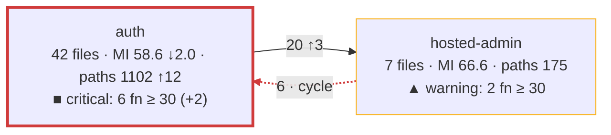

# Architecture and complexity evolution plan

Status: agreed with the owner on 2026-10-17 and reviewed the same day (see
"Review record"). Tickets T1 to T7 are done (see the appendix). It builds on the process of PR #154 ("Code quality review with
ast-metrics" in [AGENTS.md](../../AGENTS.md) and
[the review guide](ast-metrics-review.md)).

## Objective

For each pull request, show in the pull request itself (1) how the component
structure of `src/` changed and (2) where complexity and maintainability
moved, with the complex code that no test protects marked on top. Keep one
record per `main` commit, so that the owner sees how the architecture evolves
over months and where complexity accumulates.

## What the study says

The published practice, condensed to what applies here:

1. **Judge the change, not the total.** SonarQube's "Clean as You Code" gates
   only the new code of a pull request, with few conditions, because a gate on
   the whole codebase gets ignored
   ([SonarQube docs](https://docs.sonarsource.com/sonarqube-server/10.5/user-guide/clean-as-you-code)).
   The delta gate of PR #154 does this; the bands below do it too.
2. **Weight by where the work happens.** Hotspots rank code by complexity
   times change frequency; CodeScene's main KPI is the code health of the
   hotspots, weighted by lines of code; a study of 39 codebases found that
   work in the worst code takes 124% longer and carries 15 times more defects
   ([Code Red, Tornhill and Borg](https://arxiv.org/pdf/2203.04374);
   [CodeScene code health](https://docs.enterprise.codescene.io/versions/6.0.6/guides/technical/code-health.html)).
   ast-metrics computes a risk score from complexity, maintainability,
   coupling, and change frequency; it is the hotspot score here.
3. **Health is several numbers, not one.** CodeScene aggregates 25+ factors.
   For us: a few numbers side by side, averages weighted by lines of code,
   never a plain average of maintainability over files.
4. **Cyclomatic complexity measures testability; cognitive complexity
   measures understandability**
   ([SonarSource](https://sonarsource.com/blog/cognitive-complexity-because-testability-understandability)).
   ast-metrics gives cyclomatic only. ESLint in habit-hooks already enforces
   `complexity: 10` and `max-depth: 4` per function: the function-level
   fitness function exists.
5. **CRAP** (Change Risk Anti-Patterns, Savoia and Evans 2007):
   `CRAP = CC² × (1 − coverage)³ + CC` per function, with the coverage of the
   function's own code as a fraction, and 30 as the limit. With full coverage
   it falls to `CC`; above `CC ≈ 30` no coverage saves it
   ([crap4py](https://pypi.org/project/crap4py/),
   [cargo-crap](https://docs.rs/cargo-crap/0.4.2/cargo_crap/)). It is a
   safety-net metric: it says how dangerous a change is, not how readable the
   code is. Node writes the coverage it needs without a dependency: with
   `NODE_V8_COVERAGE=<folder>`, each Node process writes a JSON file that
   lists each function with its name, its byte range, and the counts of its
   blocks (verified on this repository on 2026-10-17). lcov is not enough: it
   gives a function's start line and call count, not its end, so the coverage
   inside a function cannot be attributed from it.
6. **Structure metrics**: the design structure matrix work of MacCormack,
   Rusnak, and Baldwin defines propagation cost
   ([paper](https://flosshub.org/184)); later work found the raw form an
   inconsistent health signal. A small, stable set serves better: modularity,
   the share of dependencies that cross communities, the cycles, and the
   members of each community. ast-metrics gives all four and suggests cuts.
7. **Visualization**: polymetric views and CodeCity map metrics to visual
   properties consistently, one metric per channel; the hard part of an
   evolution view is identity across snapshots, because entities that move or
   get renamed break the picture
   ([Lanza](https://scg.unibe.ch/assets/archive/papers/Lanz03dTSEPolymetric.pdf),
   [CodeCity](https://www.inf.unibz.it/~rrobbes/p/ICSE2011-codecity.pdf)).
   GitHub renders Mermaid; a graph stays under about 15 nodes.
8. **History** lives outside the tool: ast-metrics stores nothing and offers
   no trend; Codacy and coderadar show per-commit deltas from their own
   stores. A snapshot per `main` commit is ours to keep.

## What ast-metrics gives today

Verified with 0.43.1 on this repository:

- Communities from the dependency graph of the production files
  (`get_communities`): members, hubs, internal, inbound, and outbound
  references, cohesion, bus factor; globally modularity, cross share, cycles,
  typed findings, and ranked cut actions. `src/` has 7 communities and one
  cycle; `script/` is a community of its own.
- Per file: maintainability, decision paths, lines, coupling, risk. Per
  function (`get_file_metrics`, one call per file): name, decision paths,
  maintainability, lines; no line numbers.
- `review --base` for the deltas of the changed files. No per-community
  numbers, no time series, no diagram export.
- Costs on this Mac: the JSON report of the repository about 10 to 20
  seconds; one MCP call about one second, and the calls of one session share
  one analysis, so the per-function data of all `src/` files is one session
  of about 100 calls, not 100 runs.
- Community identities are not stable: when code grows elsewhere,
  ast-metrics regroups and renames them (seen on 2026-10-17).

## Design

### The snapshot

One data model feeds every view: the snapshot of one tree, `snapshot.json`,
with the global numbers (modularity, cross share, cycles, LOC-weighted
maintainability of `src/`, the count of functions with CRAP at 30 or more),
the `src/` communities with their members and references, the per-file
metrics, and the per-function decision paths and, when coverage is present,
coverage and CRAP. One module makes it from one JSON report and one MCP
session, both of `src/` alone (`ast-metrics analyze src`, `ast-metrics mcp
src`), so that growth of `script/` or `test/` cannot regroup the
communities; the commands read snapshots and nothing else.

A pull request has two snapshots: the head (the working tree) and the base
(the merge base with `origin/main`, analyzed in a temporary `git worktree`
that the command removes again). The base never comes from the trend store,
so a pull request depends on nothing but the repository.

### The views

All three appear in the pull request body through step 5 of the process:

1. **Architecture delta.** One Mermaid graph of the `src/` communities at the
   head with the base in the labels (encoding below), and one summary line:
   modularity, cross share, cycles, base to head. The graph appears when a
   community, a dependency, or a band changed; otherwise the summary line
   says that the map did not change.
2. **Complexity delta.** One table of the `src/` files that the pull
   request changed: maintainability and decision paths, base to head, with
   `new` or `gone` for a file that one side does not have and
   `not measured` for a file without a maintainability index, plus the risk
   rank of the file when it is among the ten riskiest of the head; the line
   `No production file changed.` when no `src/` file changed. T6 adds the
   functions with CRAP at 30 or more, before to after, as a column, and
   then the functions that the pull request added or made worse and that
   have CRAP at 30 or more, with their complexity and coverage.
3. **Trend.** One table of the last ten snapshots of `main`: modularity, cross
   share, cycles, LOC-weighted maintainability, functions with CRAP at 30 or
   more. The store is `docs/metrics/<date>-<commit>.json`, one file per
   `main` commit, holding the global numbers and the numbers per community
   only. Nobody runs anything at merge time, so the pull request writes the
   file of its own base commit when that file does not exist yet: the base
   snapshot is a by-product of the delta, and the trend lags one pull request
   behind `main`, which is fine.

### Community identity

Head communities match base communities by the Jaccard overlap of their
members, 0.5 or more; a community without a match is new or gone. The label
is the hub and the largest namespace of the community, never the generated
name. A community that splits or merges shows as one gone and one or two new
ones; the output says so instead of hiding it.

### CRAP per function

The coverage run is the unit suite once more, under `NODE_V8_COVERAGE`
(about 85 seconds on this Mac, 274 processes). For each function in a
`src/` file, coverage is the covered share of its own characters in the
build: the share that at least one process ran, where a process runs no
character of a block with count zero and no character of a function that it
did not call. V8 gives a block only where its count differs from the count
around it, so the blocks differ from process to process and the merge is per
character, with the function's own range as the key. The range of a function
includes its nested functions; each nested function has its own entry.
Functions match ast-metrics by file (`dist/src/x.js` is `src/x.ts`) and by
the name that V8 gives: ast-metrics names a method `module\Class.method`,
V8 names it `method`, and V8 names a constructor `Class`. An anonymous
function, a name that occurs twice in a file of the snapshot or of the
coverage, a name that the coverage does not have, and a compiler helper
(`__` prefix, with the functions inside it) stay unmatched and get no CRAP;
the list under the table gives how many functions of the changed files
stayed unmatched. A `src/` file that no unit test loads is absent from the
coverage and counts as uncovered.

The base tree gets no coverage run, so the CRAP of the base is an
approximation: a function of the base has its own decision paths and the
covered share of the head function with the same name in the same file, and
the share 0 when the head file does not have the name, such as a removed
function. The pull request thus needs one coverage run, not two.

### Bands

The band of a community or a file follows the change, as rule 1 says:

- **good**: no function with CRAP at 30 or more;
- **warning**: some, and the pull request added none and made none worse;
- **critical**: the pull request added at least one or made one worse.

A function with CRAP at 30 or more is added when the base file does not
have its name, and worse when its CRAP was below 30 in the base or is higher
than in the base. The count in the node text is the count of the functions
at 30 or more in the head. A gone community has the count and the band of
its base, good or warning, because the base has no change to follow.

## Encoding of the architecture delta

One metric per visual channel. The band is a status, so it uses the fixed
status colors and always comes with a symbol and a word, never color alone.

| Channel | Carries | Reason |
| --- | --- | --- |
| Node | One `src/` community (about seven) | The structure. |
| Node text | Label, files, LOC-weighted maintainability with an arrow for the change, decision paths with an arrow, the band symbol and word, the count of functions at CRAP 30 or more with its change | Where complexity lives stays numeric; text reads the same in every theme. |
| Node border color | The band | Unprotected complexity is the one color-coded metric. |
| Border width | Thick when the pull request touched the community | The change. |
| Edge | A dependency between communities, labeled with its references and their change | Coupling and its movement. |
| Edge style | Red dashed when part of a cycle; bold when new in this pull request | The structure problems. |
| Line under the graph | Modularity, cross share, cycles, base to head; the legend of the bands | The summary. |

Colors: good `#0ca30c`, warning `#fab219`, critical `#d03b3b`, from the
validated status palette, as borders and not as fills, so that GitHub's light
and dark themes keep the node text readable. Maintainability gets no second
color scale: two color scales on one drawing do not read; its trend is a
number with an arrow, and the table holds the exact values. The band symbols
are `●` good, `▲` warning, `■` critical.

Two rules keep the picture comparable from pull request to pull request: the
bands and the colors are fixed, and the nodes come in a fixed order, so the
Mermaid text itself gives a meaningful diff.

The shape of the output, with made-up numbers:

T3 implements everything above except the band line and the band classes,
which T6 adds. A band class sets the border color only: with a width of its
own, it would replace the thick border of a touched community, because the
class that the block defines later wins.

A label text holds no backtick and no double quote, because GitHub's renderer
fails silently on them.

## Steps

Each step groups the tickets of the appendix; each ticket is one pull
request under the AGENTS.md process: the acceptance test first, with doubles
of ast-metrics and of the coverage files, golden Markdown output, and one
live test with the real tool.

- **A1. Architecture and complexity delta** (tickets T1 to T4): the snapshot,
  the base snapshot from the merge base, the graph with the summary line,
  and the complexity table without the CRAP columns, wired into step 5 of
  the process.
- **A2. CRAP** (tickets T5 and T6): the coverage run, the join, CRAP per
  function, the bands, the border colors, and the CRAP columns of the table.
- **A3. Trend** (ticket T7): the write of the base snapshot to
  `docs/metrics/` and the trend table.

Later, outside this plan: cognitive complexity per function from
`eslint-plugin-sonarjs` as one more column; coverage from the acceptance
suite too, since `NODE_V8_COVERAGE` reaches child processes that exit
normally; `dependency-cruiser` layer rules for `src/`.

## Decisions

The owner decided on 2026-10-17:

1. The picture in the pull request is a Mermaid graph in the body: text that
   GitHub renders, diff-able, produced by the command. An image is not part
   of the process.
2. CRAP is computed per pull request: each review adds one coverage run of
   the unit suite, and the pull request shows CRAP before and after for its
   changed functions and files.
3. The trend store is JSON files under `docs/metrics/`, one per `main`
   commit.
4. The architecture map and the complexity table cover `src/` only, because
   the snapshot holds `src/` alone since T1; the delta command still lists
   the changed `script/` and `test/` files, without a goal.
5. The encoding above.

## Limits known in advance

- Coverage comes from the unit suite; code that only the acceptance tests
  exercise counts as uncovered until A2 adds that suite. CRAP overstates the
  risk of such code, and the table names the suite that produced the
  coverage.
- The base gets the coverage of the head (see "CRAP per function"), so a
  pull request that only removes unit tests makes no function worse, and a
  function that the pull request removed counts as uncovered in the base.
- ast-metrics measures TypeScript only; a change to `.mjs` files or to
  configuration does not appear.
- The trend lags one pull request behind `main`, and a `main` commit that no
  pull request used as a base gets no snapshot.

## Review record

The review of 2026-10-17 corrected the first version:

- CRAP from lcov was not computable (no function end); it now uses the V8
  coverage files, verified on this repository.
- The trend had no writer (no CI runs at merge time); the pull request now
  writes the snapshot of its own base commit.
- The base analysis takes well under a minute, not two seconds, and the
  per-function data comes from one MCP session, not one run per file.
- "CRAP load" and "a fixed limit" were undefined; the bands now follow the
  change, and the count of functions at 30 or more is the number shown.
- "Hotspot health" in the trend was undefined; the trend shows the
  LOC-weighted maintainability of `src/` instead.
- Four steps became three: the snapshot is a module of the first command,
  and the trend is the saved base snapshot.
- Function matching by line was not possible (ast-metrics gives no lines);
  unmatched functions are now reported instead of guessed.

## Appendix: tickets

Each ticket is one pull request and one board ticket; the text below is the
ticket body in the shape of the board. The order is the dependency order.
Every ticket reads this plan, [the review guide](ast-metrics-review.md),
`docs/coding-principles.md`, `docs/testing/test-code-layout.md`, and
`docs/implementation/test-gate-policy.md`, and follows the AGENTS.md process:
the acceptance test first, then TDD, the focused test before each commit,
`npm run check`, `habit-hooks`, and the ast-metrics review process before
Ready. Commands under `script/` are TypeScript, run from source, typed
without `any`, and pass the rules of `.ast-metrics.yaml`; their doubles live
under `test/support/doubles/ast-metrics/`, and their tests use `runScript`
and the fixtures of `test/acceptance/script/`.

### T1. Snapshot of the working tree

Source: step A1 of the plan. Done in PR #157, with two findings: a member
of a community can be a folder (namespace granularity), so each file gets
the community of its nearest member; and ast-metrics groups the whole
graph that it analyzes, so 14 new modules under `script/` regrouped the
communities of `src/` (7 to 6) with no change in `src/`. The snapshot
therefore runs `ast-metrics analyze src` and `ast-metrics mcp src`, and its
numbers describe `src/` alone.

**Outcome and scope.** Add `script/ast-metrics-snapshot.ts [--out FILE]`.
It runs `ast-metrics analyze --report-json` and one MCP session
(`get_communities` with members, then `get_file_metrics` for each `src/`
file) and writes the snapshot JSON described in "The snapshot": the commit
and date of HEAD, the global numbers (modularity, cross share, the cycles,
the LOC-weighted maintainability of `src/`, the total decision paths), the
`src/` communities with label (hub and largest namespace), members, hubs,
references, and edges, and the files with their metrics and functions. The
CRAP fields stay absent. Default output `ast-report/snapshot.json`. Extend
the CLI double to answer `analyze --report-json` from a fixture and the MCP
double to answer the two tools from fixtures.

**Acceptance criteria.**
- Given doubles that answer with the fixtures of a small repository, when
  the command runs, then the snapshot holds only the `src/` communities, each
  labeled by its hub and largest namespace, with members, references, and
  edges, the LOC-weighted maintainability (checked against a hand-computed
  value), and each file with its functions, and the exit status is 0.
- Given a `script/` community in the answer, when the command runs, then it
  is not in the snapshot.
- Given a missing executable, a failing analysis, or a server that errors on
  one file, when the command runs, then the exit status is 1 with one
  diagnostic line and no partial snapshot file.
- Given the real ast-metrics (live test), when the command runs on this
  repository, then the snapshot has 7 communities and one cycle, within 60
  seconds.

**Unit test list.** The LOC-weighted average; the label rule; the `src/`
filter; the cycle list from the edges; the file-to-function join.

**Development and completion rules.** One MCP session for all calls, never
one run per file. Keep each new file under the rules of `.ast-metrics.yaml`.
Update the review guide and `script/README.md` with the command.

### T2. Snapshot of the merge base

Source: step A1 of the plan. Depends on T1. Done in PR #161, with a
follow-up: a run first removes the stale worktrees of interrupted runs
(their names hold the process id), SIGINT and SIGTERM remove the worktree
and give 130 or 143, and no repository hook runs in the worktree. The same
pull request dropped the rule `no_community_cycles` from `.ast-metrics.yaml`
and refreshed the baseline: with the grouping of the whole repository, the
rule reported a cycle between two halves of `script/` that have no import
cycle, and its baseline entry had drifted three times in two days.

**Outcome and scope.** Add `--base REF` to the snapshot command. It finds
the merge base of REF and HEAD, adds a temporary detached `git worktree`
of it under the system temporary folder, runs the snapshot there, and
removes the worktree again, also after a failure. The snapshot records the
base commit.

**Acceptance criteria.**
- Given a repository with `main` and a feature branch that adds one file and
  changes one file, when the command runs with `--base main`, then the
  snapshot shows the files of the merge base (the added file absent, the
  changed file with its base metrics) and names the merge-base commit.
- Given a failure inside the analysis of the base, when the command runs,
  then the exit status is 1 and `git worktree list` shows no temporary
  worktree afterwards.
- Given an unknown ref, when the command runs, then the exit status is 1
  with the diagnostic of the shared `repository.ts` helper.

**Unit test list.** The merge-base lookup; the temporary folder name; the
removal in a `finally` path.

**Development and completion rules.** Reuse `repository.ts` for git calls.
Never run `pnpm install` in the worktree; the analysis needs no
`node_modules`.

### T3. Architecture delta

Source: step A1 and "Encoding of the architecture delta". Depends on T2.
Done in PR #163. The map changes when a community is new, gone, or
touched, or when a dependency or a cycle appeared or disappeared; numbers,
reference counts, and labels alone do not change it.

**Outcome and scope.** Add `script/ast-metrics-architecture.ts --base REF`.
It makes the head and the base snapshot (or reads them with `--head FILE
--base-snapshot FILE`, for the tests), matches the communities by Jaccard
overlap of members at 0.5 or more, and prints the summary line (modularity,
cross share, cycles, base to head) and, when a community is new, gone, or
touched, or a dependency or a cycle appeared or disappeared, the Mermaid graph of the encoding without the band colors:
nodes in a fixed order with files, maintainability with an arrow, decision
paths with an arrow; thick border for a touched community; edges with
references and change; red dashed for a cycle; bold for a new dependency;
the legend line. No backtick and no double quote in a label text.

**Acceptance criteria.**
- Given two equal snapshots, when the command runs, then it prints the
  summary line and "The map did not change." and no graph, exit 0.
- Given a head snapshot with a new dependency between two communities, when
  the command runs, then the graph has that edge in bold with its reference
  count, and the summary line shows the cross share before and after.
- Given a cycle in the head, when the command runs, then its edges are red
  dashed and the summary counts the cycle.
- Given a community whose members split into two, when the command runs,
  then the output names one community as gone and two as new.
- Given a touched community whose maintainability fell by 2, when the command
  runs, then its node has a thick border and the label shows the arrow and
  the change.
- Given the real ast-metrics (live test) on this repository with `--base
  HEAD`, then the output is the summary line and "The map did not change."

**Unit test list.** The Jaccard match and its 0.5 limit; the fixed node
order; the arrows and rounding; the Mermaid escaping; the change detection.

**Development and completion rules.** Golden output files for the Mermaid
text. The graph stays under 15 nodes by construction (`src/` only).

### T4. Complexity delta and the process

Source: step A1 and "The views". Depends on T3. Done in PR #166. The table
has rows for `src/` files only: since T1, the snapshots hold only `src/`
files, so the `script/` and `test/` files of decision 4 have no numbers
there; the delta command still lists them. A file without a maintainability
index is `not measured` in both columns, because its 0 decision paths come
from the zero values that ast-metrics leaves out. No new command or double
was necessary, so `knip.json` and the paths test did not change. Step 5 of
AGENTS.md also adds a kept finding of severity high to the baseline in the
same pull request.

**Outcome and scope.** The architecture command also prints the complexity
table of the files that the pull request changed (the delta rule of
`ast-metrics-delta.ts`): maintainability and decision paths before to after,
and the risk rank when the file is among the ten riskiest of the head
snapshot; a file that is new or gone says so. Then wire the process: AGENTS.md
step 5 says to run the command and to put its output in the pull request
body; the review guide, `script/README.md`, `docs/testing/test-list.md`,
`knip.json`, and the paths test name the new commands and doubles.

**Acceptance criteria.**
- Given a changed file whose maintainability fell from 72 to 60, when the
  command runs, then the table row shows `72 → 60` with the arrow and the
  decision paths before and after.
- Given a new file, when the command runs, then its row says "new" in the
  before columns.
- Given a changed file in the top ten by risk, when the command runs, then
  the row shows its rank.
- Given no changed TypeScript file under `src/`, when the command runs, then
  the table says that no production file changed.

**Unit test list.** The table rows; the rank lookup; the arrows.

**Development and completion rules.** The documents change in the same pull
request. Run the new step on the pull request itself and put the output in
its body.

### T5. Coverage per function

Source: step A2 and "CRAP per function". Depends on T1 (the snapshot gives
the function names); independent of T3 and T4. Done in PR #158: the merge is
per character (V8 gives a block only where its count differs from its
parent's), the helpers are filtered by range, and the live check names a
called function of `src/application.ts` instead of `createApplication`,
which only the integration and acceptance tests call.

**Outcome and scope.** Add `script/ast-metrics-coverage.ts [--from DIR]
[--out FILE]`. By default it runs the unit suite of `dist/` with
`NODE_V8_COVERAGE` set to a temporary folder; with `--from`, it reads an
existing folder. It merges the V8 coverage files, keeps the scripts under
`dist/src/`, maps each to its `src/*.ts` path, computes for each function
the covered share of its bytes (the blocks with count zero are uncovered)
and whether it was called, skips compiler helpers (`__` prefix), and writes
`ast-report/coverage.json`: the suite that produced it, the files, and the
functions with name, covered share, and call count. Extend the fixtures
with small V8 coverage files.

**Acceptance criteria.**
- Given a folder with V8 coverage files of two processes for the same
  script, when the command runs with `--from`, then the function counts are
  the sums and the covered share is the share of bytes outside zero-count
  blocks, checked against hand-computed values.
- Given a function with a nested function, when the command runs, then each
  has its own entry and share.
- Given a compiler helper, when the command runs, then it is absent.
- Given the real unit suite (live test), when the command runs on this
  repository, then `coverage.json` names the unit suite and holds
  `createApplication` of `src/application.ts` with a count of at least 1.

**Unit test list.** The merge of two files; the byte share; the path map;
the helper filter.

**Development and completion rules.** The default run is `node --test` on
the unit globs of `package.json` after `npm run build`; the command says
when `dist/` is missing. One suite at a time on a shared host.

### T6. CRAP, bands, and colors

Source: step A2, "Bands", and "Encoding". Depends on T4 and T5. Done in PR
#167, with the approximation of the base: the base tree gets no coverage
run, so a function of the base has its own decision paths and the covered
share of the head function with the same name (0 when the head file does
not have the name). Findings: ast-metrics names a method
`module\Class.method` and V8 names it `method`, so the join uses the names
of V8; on this repository on 2026-10-18, 721 of the 1022 functions of `src/`
matched, against 402 with the names of ast-metrics as they are. The
snapshot files stay without the coverage and CRAP fields: the architecture
command joins the coverage when it makes its report. A band class sets the
border color only, so that the thick border of a touched community stays,
and a kept community whose band changed changes the map, as "The views"
says.

**Outcome and scope.** The architecture command reads `coverage.json` when
present (or `--coverage FILE`), joins each function of the head snapshot
with its coverage by file and name, computes `CRAP = CC² × (1 − share)³ +
CC`, counts the functions at 30 or more per file and per community, derives
the band of each community and file from the change against the base
(good, warning, critical as the plan defines them), and adds: the band
symbol, word, and count to the node text, the border color class, the CRAP
columns to the complexity table, the list of functions that the pull request
added or changed with CRAP at 30 or more (name, complexity, covered share),
and the count of unmatched functions. The snapshot gains the coverage and
CRAP fields.

**Acceptance criteria.**
- Given a function with 10 decision paths and no coverage, when the command
  runs, then its CRAP is 110; given full coverage, then 10.
- Given a community with no function at 30 or more, when the command runs,
  then its node has the good symbol, word, and class.
- Given a community with two such functions in the base and none added or
  worsened, then the band is warning; given one added by the pull request,
  then critical, and the function is in the list.
- Given an anonymous function and a name that occurs twice in a file, when
  the command runs, then they get no CRAP and the unmatched count is 2.
- Given no `coverage.json` and no `--coverage`, when the command runs, then
  the output says that the bands need the coverage run and shows no colors.

**Unit test list.** The formula; the band rules; the join and its
exclusions; the Mermaid classes.

**Development and completion rules.** The colors are the three fixed hex
values of the plan; no other color. Update AGENTS.md step 5 with the
coverage run and the review guide with the band rules.

### T7. Trend

Source: step A3 and "The views". Depends on T6. Done in PR #TBD. The name of a
file has the day of the committer date in the time zone of the commit and the
first eight characters of the commit, such as `2026-10-18-a50351b5.json`, the
first record. The rows come by the time of the committer date, and two records
of the same time by their file names. The command reads the store before it
writes, so that a store with a wrong file gets no new file. With `--head` and
`--base-snapshot`, only `--trend-store DIR` gives a store; the live test uses
it, so that no test writes under `docs/metrics/`.

**Outcome and scope.** The architecture command writes the base snapshot's
global numbers and per-community numbers to
`docs/metrics/<date>-<commit>.json` when that file does not exist (the date
is the commit date of the base commit), and prints the trend table of the
last ten files by date: modularity, cross share, cycles, LOC-weighted
maintainability, functions with CRAP at 30 or more. AGENTS.md says that the
file is part of the pull request.

**Acceptance criteria.**
- Given no file for the base commit, when the command runs, then the file
  exists with the global and per-community numbers and nothing per file.
- Given an existing file for the base commit, when the command runs, then
  the file is unchanged.
- Given twelve files, when the command runs, then the table shows the last
  ten by date, oldest first, with the head as the last row marked "this
  pull request".
- Given the real ast-metrics (live test), then the file for the current
  merge base is written under `docs/metrics/` and removed again by the test.

**Unit test list.** The file name; the row order; the "unchanged" rule.

**Development and completion rules.** The file holds no per-file data.
Update the review guide with the store and its lag.
