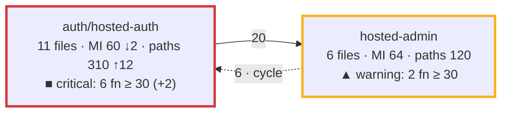

# Architecture and complexity evolution plan

Status: agreed with the owner on 2026-10-17 and reviewed the same day (see
"Review record"). Nothing is implemented yet. It builds on the process of
PR #154 ("Code quality review with ast-metrics" in [AGENTS.md](../../AGENTS.md)
and [the review guide](ast-metrics-review.md)).

## Objective

For each pull request, show in the pull request itself (1) how the component
structure of `src/` changed and (2) where complexity and maintainability
moved, with the complex code that no test protects marked on top. Keep one
record per `main` commit, so that the owner sees how the architecture evolves
over months and where complexity accumulates.

## What the study says

The published practice, condensed to what applies here:

1. **Judge the change, not the total.** SonarQube's "Clean as You Code" gates
   only the new code of a pull request, with few conditions, because a gate on
   the whole codebase gets ignored
   ([SonarQube docs](https://docs.sonarsource.com/sonarqube-server/10.5/user-guide/clean-as-you-code)).
   The delta gate of PR #154 does this; the bands below do it too.
2. **Weight by where the work happens.** Hotspots rank code by complexity
   times change frequency; CodeScene's main KPI is the code health of the
   hotspots, weighted by lines of code; a study of 39 codebases found that
   work in the worst code takes 124% longer and carries 15 times more defects
   ([Code Red, Tornhill and Borg](https://arxiv.org/pdf/2203.04374);
   [CodeScene code health](https://docs.enterprise.codescene.io/versions/6.0.6/guides/technical/code-health.html)).
   ast-metrics computes a risk score from complexity, maintainability,
   coupling, and change frequency; it is the hotspot score here.
3. **Health is several numbers, not one.** CodeScene aggregates 25+ factors.
   For us: a few numbers side by side, averages weighted by lines of code,
   never a plain average of maintainability over files.
4. **Cyclomatic complexity measures testability; cognitive complexity
   measures understandability**
   ([SonarSource](https://sonarsource.com/blog/cognitive-complexity-because-testability-understandability)).
   ast-metrics gives cyclomatic only. ESLint in habit-hooks already enforces
   `complexity: 10` and `max-depth: 4` per function: the function-level
   fitness function exists.
5. **CRAP** (Change Risk Anti-Patterns, Savoia and Evans 2007):
   `CRAP = CC² × (1 − coverage)³ + CC` per function, with the coverage of the
   function's own code as a fraction, and 30 as the limit. With full coverage
   it falls to `CC`; above `CC ≈ 30` no coverage saves it
   ([crap4py](https://pypi.org/project/crap4py/),
   [cargo-crap](https://docs.rs/cargo-crap/0.4.2/cargo_crap/)). It is a
   safety-net metric: it says how dangerous a change is, not how readable the
   code is. Node writes the coverage it needs without a dependency: with
   `NODE_V8_COVERAGE=<folder>`, each Node process writes a JSON file that
   lists each function with its name, its byte range, and the counts of its
   blocks (verified on this repository on 2026-10-17). lcov is not enough: it
   gives a function's start line and call count, not its end, so the coverage
   inside a function cannot be attributed from it.
6. **Structure metrics**: the design structure matrix work of MacCormack,
   Rusnak, and Baldwin defines propagation cost
   ([paper](https://flosshub.org/184)); later work found the raw form an
   inconsistent health signal. A small, stable set serves better: modularity,
   the share of dependencies that cross communities, the cycles, and the
   members of each community. ast-metrics gives all four and suggests cuts.
7. **Visualization**: polymetric views and CodeCity map metrics to visual
   properties consistently, one metric per channel; the hard part of an
   evolution view is identity across snapshots, because entities that move or
   get renamed break the picture
   ([Lanza](https://scg.unibe.ch/assets/archive/papers/Lanz03dTSEPolymetric.pdf),
   [CodeCity](https://www.inf.unibz.it/~rrobbes/p/ICSE2011-codecity.pdf)).
   GitHub renders Mermaid; a graph stays under about 15 nodes.
8. **History** lives outside the tool: ast-metrics stores nothing and offers
   no trend; Codacy and coderadar show per-commit deltas from their own
   stores. A snapshot per `main` commit is ours to keep.

## What ast-metrics gives today

Verified with 0.43.1 on this repository:

- Communities from the dependency graph of the production files
  (`get_communities`): members, hubs, internal, inbound, and outbound
  references, cohesion, bus factor; globally modularity, cross share, cycles,
  typed findings, and ranked cut actions. `src/` has 7 communities and one
  cycle; `script/` is a community of its own.
- Per file: maintainability, decision paths, lines, coupling, risk. Per
  function (`get_file_metrics`, one call per file): name, decision paths,
  maintainability, lines; no line numbers.
- `review --base` for the deltas of the changed files. No per-community
  numbers, no time series, no diagram export.
- Costs on this Mac: the JSON report of the repository about 10 to 20
  seconds; one MCP call about one second, and the calls of one session share
  one analysis, so the per-function data of all `src/` files is one session
  of about 100 calls, not 100 runs.
- Community identities are not stable: when code grows elsewhere,
  ast-metrics regroups and renames them (seen on 2026-10-17).

## Design

### The snapshot

One data model feeds every view: the snapshot of one tree, `snapshot.json`,
with the global numbers (modularity, cross share, cycles, LOC-weighted
maintainability of `src/`, the count of functions with CRAP at 30 or more),
the `src/` communities with their members and references, the per-file
metrics, and the per-function decision paths and, when coverage is present,
coverage and CRAP. One module makes it from one JSON report and one MCP
session; the commands read snapshots and nothing else.

A pull request has two snapshots: the head (the working tree) and the base
(the merge base with `origin/main`, analyzed in a temporary `git worktree`
that the command removes again). The base never comes from the trend store,
so a pull request depends on nothing but the repository.

### The views

All three appear in the pull request body through step 5 of the process:

1. **Architecture delta.** One Mermaid graph of the `src/` communities at the
   head with the base in the labels (encoding below), and one summary line:
   modularity, cross share, cycles, base to head. The graph appears when a
   community, a dependency, or a band changed; otherwise the summary line
   says that the map did not change.
2. **Complexity delta.** One table of the files the pull request changed:
   maintainability, decision paths, and functions with CRAP at 30 or more,
   before to after, plus the risk rank of the file when it is among the ten
   riskiest; then the functions that the pull request added or changed and
   that have CRAP at 30 or more, with their complexity and coverage.
3. **Trend.** One table of the last ten snapshots of `main`: modularity, cross
   share, cycles, LOC-weighted maintainability, functions with CRAP at 30 or
   more. The store is `docs/metrics/<date>-<commit>.json`, one file per
   `main` commit, holding the global numbers and the numbers per community
   only. Nobody runs anything at merge time, so the pull request writes the
   file of its own base commit when that file does not exist yet: the base
   snapshot is a by-product of the delta, and the trend lags one pull request
   behind `main`, which is fine.

### Community identity

Head communities match base communities by the Jaccard overlap of their
members, 0.5 or more; a community without a match is new or gone. The label
is the hub and the largest namespace of the community, never the generated
name. A community that splits or merges shows as one gone and one or two new
ones; the output says so instead of hiding it.

### CRAP per function

The coverage run is the unit suite once more, under `NODE_V8_COVERAGE`
(about two to three minutes on this Mac). For each function in a `src/`
file, coverage is the covered share of its own bytes: the blocks with count
zero inside its range count as uncovered. Functions match ast-metrics by file
(`dist/src/x.js` is `src/x.ts`) and by name; an anonymous function, a name
that occurs twice in a file, and a compiler helper (`__` prefix) stay
unmatched and get no CRAP; the table lists how many stayed unmatched.

### Bands

The band of a community or a file follows the change, as rule 1 says:

- **good**: no function with CRAP at 30 or more;
- **warning**: some, and the pull request added none and made none worse;
- **critical**: the pull request added at least one or made one worse.

## Encoding of the architecture delta

One metric per visual channel. The band is a status, so it uses the fixed
status colors and always comes with a symbol and a word, never color alone.

| Channel | Carries | Reason |
| --- | --- | --- |
| Node | One `src/` community (about seven) | The structure. |
| Node text | Label, files, LOC-weighted maintainability with an arrow for the change, decision paths with an arrow, the band symbol and word, the count of functions at CRAP 30 or more with its change | Where complexity lives stays numeric; text reads the same in every theme. |
| Node border color | The band | Unprotected complexity is the one color-coded metric. |
| Border width | Thick when the pull request touched the community | The change. |
| Edge | A dependency between communities, labeled with its references and their change | Coupling and its movement. |
| Edge style | Red dashed when part of a cycle; bold when new in this pull request | The structure problems. |
| Line under the graph | Modularity, cross share, cycles, base to head; the legend of the bands | The summary. |

Colors: good `#0ca30c`, warning `#fab219`, critical `#d03b3b`, from the
validated status palette, as borders and not as fills, so that GitHub's light
and dark themes keep the node text readable. Maintainability gets no second
color scale: two color scales on one drawing do not read; its trend is a
number with an arrow, and the table holds the exact values. The band symbols
are `●` good, `▲` warning, `■` critical.

Two rules keep the picture comparable from pull request to pull request: the
bands and the colors are fixed, and the nodes come in a fixed order, so the
Mermaid text itself gives a meaningful diff.

The shape of the output, with made-up numbers:

A label text holds no backtick and no double quote, because GitHub's renderer
fails silently on them.

## Steps

Each step is one pull request under the AGENTS.md process: the acceptance
test first, with doubles of ast-metrics and of the coverage files, golden
Markdown output, and one live test with the real tool.

- **A1. Architecture and complexity delta.** The snapshot module and the
  command `script/ast-metrics-architecture.ts --base REF`: head and base
  snapshots, community matching, the graph, the summary line, and the
  complexity table without the CRAP columns. AGENTS.md step 5 adds its
  output to the pull request body.
- **A2. CRAP.** The coverage run, the join, CRAP per function, the bands, the
  border colors, and the CRAP columns of the table.
- **A3. Trend.** The write of the base snapshot to `docs/metrics/` and the
  trend table.

Later, outside this plan: cognitive complexity per function from
`eslint-plugin-sonarjs` as one more column; coverage from the acceptance
suite too, since `NODE_V8_COVERAGE` reaches child processes that exit
normally; `dependency-cruiser` layer rules for `src/`.

## Decisions

The owner decided on 2026-10-17:

1. The picture in the pull request is a Mermaid graph in the body: text that
   GitHub renders, diff-able, produced by the command. An image is not part
   of the process.
2. CRAP is computed per pull request: each review adds one coverage run of
   the unit suite, and the pull request shows CRAP before and after for its
   changed functions and files.
3. The trend store is JSON files under `docs/metrics/`, one per `main`
   commit.
4. The architecture map covers `src/` only; `script/` and `test/` appear in
   the complexity delta, not on the map.
5. The encoding above.

## Limits known in advance

- Coverage comes from the unit suite; code that only the acceptance tests
  exercise counts as uncovered until A2 adds that suite. CRAP overstates the
  risk of such code, and the table names the suite that produced the
  coverage.
- ast-metrics measures TypeScript only; a change to `.mjs` files or to
  configuration does not appear.
- The trend lags one pull request behind `main`, and a `main` commit that no
  pull request used as a base gets no snapshot.

## Review record

The review of 2026-10-17 corrected the first version:

- CRAP from lcov was not computable (no function end); it now uses the V8
  coverage files, verified on this repository.
- The trend had no writer (no CI runs at merge time); the pull request now
  writes the snapshot of its own base commit.
- The base analysis takes well under a minute, not two seconds, and the
  per-function data comes from one MCP session, not one run per file.
- "CRAP load" and "a fixed limit" were undefined; the bands now follow the
  change, and the count of functions at 30 or more is the number shown.
- "Hotspot health" in the trend was undefined; the trend shows the
  LOC-weighted maintainability of `src/` instead.
- Four steps became three: the snapshot is a module of the first command,
  and the trend is the saved base snapshot.
- Function matching by line was not possible (ast-metrics gives no lines);
  unmatched functions are now reported instead of guessed.
