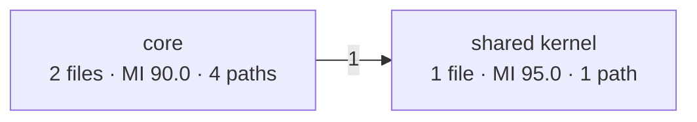

# Change request: the ast-metrics review process and architecture evolution views

| Field | Value |
| --- | --- |
| Repository | `tomer-mayara/Thermus` |
| Baseline | `main` at `7c302fa5`, after the reorganization in PR #170 (`94adf2d2`) and scoped test gates in PR #172 |
| Owner | Tomer Mayara; decides the open items and merges implementation pull requests |
| Status | Revision 4, 2026-10-18. Staged implementation and D1–D3 are approved; the delivery status below records progress. D4–D9 remain open. |
| Audience | An engineering team that has not worked in this repository |

This proposal is standalone. Read sections 1 to 3 and Appendix D before
implementing a CR. Current [AGENTS.md](../../AGENTS.md) and the
[test gate policy](test-gate-policy.md) apply until an approved implementation
changes them. Appendix D is proposed text, not an instruction to replace
AGENTS.md now.

Revision 3 used `76b514ac` as its baseline. PR #170 subsequently reorganized
the scripts without changing their behavior. PR #172 limited test runs to
changed paths. This revision preserves both changes and all 24 CR identifiers.

The owner approved staged implementation after merging revision 4 in
PR #174. Delivery group 1 covers CR-16 and the CR-23 contract-test foundation.
On 2026-10-18, the owner approved the recommendations for D1, D2, and D3
with “Use those recommendations”: CRAP ≤ 15 for new functions, goals with
documented exceptions after at most three improvement cycles, and clearly
labeled head-derived trend estimates. Section 3.2 records these decisions.
D4 to D9 remain open. This approval changes no runtime behavior or current
AGENTS.md rule and authorizes no base-coverage storage or merge workflow.

Delivery status:

- PR #175 merged CR-16 and the CR-23 contract-test foundation. CR-23's later
  content consolidation remains.
- PR #176 merged delivery group 2, CR-24: always print the architecture
  drawing and require its fenced block and legend in the pull request body.
- Delivery group 3, CR-01 and CR-02, is in progress: collect portal unit
  coverage and measure each function's own characters.
- PR #173 already converted and organized the fetch-url scripts as
  TypeScript. CR-19's removal of the four exported test seams remains;
  that PR retained them to preserve its characterization tests.
- The other CRs have not been implemented.

Contents:

1. Summary
2. Background and verified state
3. Repository rules and decisions
4. Change requests CR-01 to CR-24
5. Delivery order
6. Definition of done
7. Out of scope
8. Appendix A: data contracts
9. Appendix B: glossary
10. Appendix C: example output
11. Appendix D: proposed process text
12. Appendix E: review record

## 1. Summary

Every pull request runs the code quality review in AGENTS.md. Six TypeScript
commands wrap ast-metrics. They report changed files, review findings, and
three architecture views: the dependency communities of `src/`, the
complexity of changed files, and a trend from `docs/metrics/` records.

The review found these problems:

1. Coverage omits portal unit tests, counts nested function text as part of
   its parent, and lacks reliable input identity. CR-01 to CR-03 correct
   collection, measurement, and validation.
2. Historical CRAP counts use head coverage to estimate the base. Valid
   head coverage does not make that a base measurement. CR-04 makes writes
   explicit and implements approved D3: clearly label head-derived counts
   as estimates and record their provenance.
3. Moves and deletions distort comparisons. CR-05 adds file status and
   source evidence for function identity. A matching name alone is not
   proof of a function move.
4. Live tests fix incidental architecture counts and can start broader
   suites. CR-06 uses invariants and preserves the selected test scope.
5. The process has no per-function CRAP goal. CR-22 will add a strict
   goal below 30 and the approved inclusive target of 15 or less for new
   functions. Under D2, use at most three improvement cycles and document
   exceptions for unresolved goals before Ready. Commands still report goal
   misses with exit 1; the approval does not implement the goals in current
   commands or activate the future AGENTS.md process.
6. The graph shows clusters, not designed components. CR-13 adds the
   component view. CR-14 adds charts and component trends.
7. At the proposal baseline, an unchanged map had no drawing. CR-24 in
   PR #176 always prints it, with bands when compatible coverage exists.
   Missing bands do not authorize a broader test run.

Other CRs align documentation, check command contracts, pin the tool,
reduce repetition, and address separate cleanup. Four proposed commands
would increase the inventory from six to ten: `crap`, `process`, `baseline`,
and `backfill`. The earlier instruction to keep six commands applied to
the completed reorganization. It did not approve these additions; their
CRs remain proposals.

## 2. Background and verified state

### 2.1 Current process

The current process updates the branch from `origin/main`, measures changed
TypeScript files, inspects low-scoring production files, and allows up to
three improvement passes. Changed files under `src/` have a maintainability
goal of 85 or more; other files have no score goal. The review reports
regressions and rule violations. High findings must be corrected or
explained and baselined under the current rules.

The process reuses valid unit coverage. It collects coverage only when the
selected scope permits the complete nested suite. It then reports the
architecture and commits any new base record. Existing records are
immutable. Baseline changes have two permitted reasons: a retained high
finding or a rule change.

A document-only commit does not invalidate coverage when its measurement
inputs are unchanged. Without valid coverage, the current policy permits
architecture output without bands. The commands do not yet enforce that
validity; CR-03 supplies the mechanism.

CR-24 in PR #176 adds the graph and legend to every architecture report.
Current step 5 requires their fenced `mermaid` block and legend unchanged
in every pull request body, including unchanged maps and document-only
changes. `The map did not change.` stays above the graph. Bands require
compatible coverage; this requirement does not expand the selected test scope.

### 2.2 Commands, layout, and documents

There are six entry points and 50 helpers: 56 TypeScript modules under
`script/code-quality/`. Node 24 runs them from source. Relative imports end
in `.ts`; the main build excludes `script/`.

| Entry point | Purpose | Helper folder |
| --- | --- | --- |
| `ast-metrics-delta.ts` | List changed files and maintainability; enforce the production-file goal. | `delta/` |
| `ast-metrics-review.ts` | Pass the selected base ref to the tool's review; the guide describes comparison with that ref's tip. | Shared repository support |
| `ast-metrics-mcp.ts` | Make one MCP call and stop the server. | `mcp/` |
| `ast-metrics-coverage.ts` | Collect and merge V8 coverage from emitted Node unit tests. | `coverage/` |
| `ast-metrics-snapshot.ts` | Capture metrics and communities of `src/`, optionally at a merge base. | `snapshot/` |
| `ast-metrics-architecture.ts` | Compare snapshots and print the map, complexity table, and trend. | `architecture/` |

`shared/` contains repository operations, JSON readers, and numeric helpers.
The architecture entry point already calculates `crapDeltaOf(sources)`
once and passes it to the report and trend. CR-17 excludes that completed
work.

The detailed command README is
[`script/code-quality/README.md`](../../script/code-quality/README.md).
[`script/README.md`](../../script/README.md) is the script index. Other
documents used by every CR are:

- [Review guide](ast-metrics-review.md): commands, configuration, goals,
  and limits; called “the guide” below.
- [Architecture evolution plan](architecture-evolution-plan.md): original
  study, design, decisions, and completed T1 to T7; called “the plan”.
- [Test inventory](../testing/test-list.md): cases and focused commands.
- [Test code layout](../testing/test-code-layout.md): support placement and
  dependency rules.
- [Test gate policy](test-gate-policy.md): selected runs before Ready.

### 2.3 Current algorithms

The supported tool is ast-metrics 0.43.1, not yet enforced by the commands.
The installed CLI reports it with `ast-metrics version`; `--version` is
not supported. The tool's maintainability index goes from 0 to 128. Current
rules set class maintainability 85, efferent coupling 10, file LOC 150,
function LOC 30, function logical LOC 20, and file cyclomatic complexity
20. The separate delta command enforces the file maintainability goal.
The baseline has 175 entries. Tests are excluded from the tool's rules.

The tool omits numeric fields with zero values; readers use `numberOrZero`.
An upstream renamed field can therefore appear to be zero until a version
check or contract test detects it. Configuration comments and the guide
disagree on lookup location; the controlled check remains part of CR-16.

- `delta/files.ts` uses `--name-only -z --no-renames --diff-filter=AM`
  against the merge base, plus untracked `.ts`, `.tsx`, `.mts`, and `.cts`
  paths. A rename appears at its new path. Deletions are absent.
- Review passes `--base REF` directly to ast-metrics. Do not describe its
  ref-tip comparison as the delta and snapshot commands' merge-base rule.
- A snapshot runs one CLI analysis and one MCP session of `src/`. It
  contains no coverage or CRAP. The architecture command joins coverage.
- Labels use the largest source namespace by member count, with a lexical
  namespace tie-break. The `src/` prefix is removed. No source namespace
  gives `src`; shared ID gives `shared kernel`. Duplicate labels append
  the first hub's basename, or the community ID when no hub exists. The
  hub is not the primary label rule. See `snapshot/communities.ts`.
- Community matching is greedy by member-file Jaccard overlap at 0.5,
  with each base community matched once. A split or merge can appear as
  gone plus new.
- CR-24 in PR #176 always prints the graph and legend. The existing map
  change rules still decide whether `The map did not change.` appears above
  the graph: a community is new, gone, or touched, an edge or cycle changes,
  or a kept community's band changes.
- CRAP is `paths² × (1 − coveredShare)³ + paths`. Current code rounds it
  to one decimal before comparing it with 30. CR-22 changes that contract
  explicitly to compare before display rounding.
- Function coverage joins by file and a unique V8 name. The tool's
  `module\Class.method` becomes `method`, and a constructor becomes the
  class name. Anonymous and duplicate names are unmeasured. An absent
  file is treated as uncovered.
- Base functions use the head share at the same file and name. Missing
  head functions get zero. This is an estimate, not a base coverage run.
- Bands are good when no counted function reaches 30, warning when some
  do but none is added or worse, and critical when one is added or worse.
  Unknown functions currently do not prevent a good band.
- A repository architecture run writes a record the first time it sees
  a base. CRAP counts depend on head coverage. Filenames and current
  duplicate lookup use the eight-character commit prefix. Existing
  records are kept. CR-04 strengthens identity and write safety.

### 2.4 Historical evidence and tests

The study at `76b514ac` on 2026-10-18 reported 125 source files and 1,022
functions: 721 coverage matches, 233 unmatched functions, and 68 functions
in files absent from the unit report. Of the unmatched functions, 227 were
anonymous. It reported nine communities including the shared kernel, two
cycles, and 22 functions at CRAP 30 or more under the old approximation,
five of them in the portal community. These are dated observations, not
fresh measurements or future test assertions.

The study observed a reported maintainability drop of seven points and an
unreported drop of 1.3 points. These examples do not establish an exact
general threshold. Remove the assertion that a drop of about ten counts.

PR #170 corrected the snapshot live test's fixed counts from seven to
eight non-shared communities and from one to two cycles. It still fixes
those counts. The architecture live file still has a complete unit coverage
case. Both coverage live paths write and remove the repository's default
report. The README's claim that the architecture live file does not run the
unit suite is false.

Ordinary acceptance tests run commands through
`test/support/processes/script-command.ts` and compare complete Markdown
fixtures. CLI and MCP doubles live under `test/support/doubles/ast-metrics/`.
Repository cases use temporary Git repositories. Pure tests are under
`test/unit/script/`; V8 fixtures are in
`test/support/fixtures/v8-coverage.ts`. Entry metadata is in `knip.json`;
path constants and their test are in `test/support/processes/module-paths.ts`
and `test/unit/test-support-paths.test.ts`.

The MCP, snapshot, and architecture live suites need the real tool and
skip when it is absent. The coverage live test needs no ast-metrics; it
runs the real unit suite. These are dedicated tests, not ordinary globs.
Use the README and inventory for applicable focused commands. An emitted
test needs a build first; a build prepares output and selects no extra
test group. Do not run the full inventory merely because it is listed.

## 3. Repository rules and decisions

### 3.1 Rules for every implementation

1. Use TypeScript and erasable syntax under `script/`, with `import type`
   and `.ts` imports. CR-19 covers the existing fetch-url exception.
2. Keep current caps until CR-18 is approved. Explain retained findings
   under the review process. Do not split only to hit a count. Follow the
   [coding principles](../coding-principles.md) and use simple language.
3. Write a failing acceptance specification for new behavior, then use
   focused TDD where needed. For a preserving refactor, establish passing
   characterization tests first. Apply DRY3 to shared meaning, not merely
   similar syntax. Keep effects and failures explicit.
4. Select from the complete candidate, including deletions and both sides
   of moves. A `src/` change selects `npm test`, `npm run typecheck`,
   `npm run test:build`, `npm run build:user-portal`, and applicable
   production gates. Do not add `npm run check`.
5. Without a `src/` change, changed tests select their actual groups.
   Ordinary unit changes select the unit group; ordinary acceptance
   changes select the acceptance group. Dedicated live tests select their
   own group. Shared support selects its real consuming groups. Other
   changed paths select existing focused tests only. A script change alone
   selects no integration, interface, hosted, or container gate.
6. Keep that scope through child commands. Do not turn a focused run into
   a whole suite. Record unavoidable broader work as deferred, not passed.
   This includes coverage live and architecture's coverage-collecting case.
   After CR-01, both parts of the unit suite must be within scope before
   collection. Reuse valid coverage otherwise, or report without bands.
7. A documentation-only change needs no executable test added for prose.
   A command reference does not select that command. Missing metric data
   does not authorize a broader suite.
8. Run `habit-hooks` on the complete candidate. Correct enforced findings
   or give reasons. Keep `.habit-hooks/snooze.json` empty. Do not export
   code only for tests.
9. Open a draft first. Update affected documents and inventory in the same
   implementation PR. Run selected new or changed tests before commit,
   subject to the nested-run limit. Run the quality process before Ready
   and include its Markdown and any new valid record.
10. Every Actions job started for the Ready head must pass. A fix returns
    the PR to Draft. The manager reviews subagent work, the owner reviews
    the PR, and the owner merges each implementation PR once. Owner merge
    for all these CRs is this proposal's task-specific requirement, not a
    claim that AGENTS.md requires owner merge for every repository change.
11. Keep real-tool checks in dedicated live tests. Skipped and deferred
    runs are not passes. Each command owns a bounded MCP session for its
    required requests and stops it on success or failure. The MCP entry
    point makes one tool call; snapshot and CRAP operations can make
    several requests in one session. Never register a persistent server.

### 3.2 Owner decisions

The owner approved D1 to D3 on 2026-10-18 with “Use those recommendations.”
The approval sets the contracts for future implementation; it changes no
current command or AGENTS.md rule.

| ID | CR | Approved decision | Consequence |
| --- | --- | --- | --- |
| D1 | CR-22 | New functions have an inclusive CRAP target of 15 or less. | This is a repository target, not a universal standard. |
| D2 | CR-22 | Use goals with documented exceptions after at most three improvement cycles, as for maintainability. | Commands still exit 1 for unresolved or unknown required goals. Once the future process is implemented, Ready may proceed after at most three cycles with recorded scores, paths, coverage, classification, and reasons. The exception does not change the command result or excuse tool failures. |
| D3 | CR-04 | Preserve clearly labeled head-derived historical estimates. | Record coverage origin, fingerprints, measurement version, and unknown-function count. Missing or incompatible evidence remains absent, not zero. This approves no base-coverage store or merge workflow. |

D4 to D9 remain open. Their recommendations are proposals, not approval.
Proceed with independent work while a decision is open, but do not invent
its answer.

| ID | CR | Open decision | Recommendation and consequence |
| --- | --- | --- | --- |
| D4 | CR-10 | Store and use coverage of merged trees beyond option A. | Land the warning first. Decide capture, identity, retention, and size before option B. D3 does not approve this storage. |
| D5 | CR-12 | Workflow to record every merge on `main`. | Keep manual backfill until workflow behavior is approved. |
| D6 | CR-15 | Forbidden component dependencies. | Choose explicit path rules; do not freeze communities. |
| D7 | CR-18 | File complexity cap and new-function warning threshold. | Consider 40 per file, LOC 150 unchanged; separately decide the warning above ten function paths. |
| D8 | CR-16 / Appendix D | Third baseline exception for violations already on `main`. | Keep the current two exceptions until approved. Historical practice does not grant permission. |
| D9 | CR-17 | Normalize unexpected errors to one line or preserve stack output. | Preserve command contracts during deduplication. A diagnostic behavior change needs approval and tests. |

## 4. Change requests

P1 means first, P2 next, P3 later. S is roughly under a day, M one to three
days, and L longer; these estimates are not commitments. Every test below
uses section 3's selection rules. “README” means the detailed code-quality
README, not the script index.

### CR-01. Cover the user-portal unit tests

P1 · S–M · mistake. No prerequisite; deliver with CR-02.

**Evidence.** `coverage/run.ts` selects emitted Node tests only. The unit
package command also runs `test/unit/user-portal/**/*.test.ts`. The build
excludes portal source and tests, and `coverage/input.ts` accepts only
`dist/src/*.js` URLs. Tested portal functions can therefore look uncovered.

**Required behavior.** Run emitted tests with current concurrency, then
portal source tests under the same capture directory, only when both are
within the selected scope. Keep `suite: "unit"`. Accept source `.ts` URLs
under the repository's `src/` as well as mapped emitted `.js` URLs. Ignore
test URLs and outside paths. Preserve the representation and content
identity of each script; offsets are UTF-16 code units, not bytes.

Validate V8 offsets and counts before merging. Each is a finite,
nonnegative safe integer. A whole range must satisfy
`0 ≤ start < end ≤ identified script UTF-16 length`; each nonempty block
range must be contained within that whole range. Reject malformed,
inverted, out-of-bounds, or zero-length raw ranges with a diagnostic.
Counts must remain safe integers when calls are summed; reject overflow
rather than publish an inaccurate count.

Do not union emitted-JavaScript ranges with source-TypeScript ranges just
because they map to the same path or have equal length. Until explicit
source-map conversion exists, reject overlapping logical files from
incompatible representations. The normal portal and emitted sets are
disjoint. Prove stripping offsets with a real typed fixture, including
non-ASCII text; synthetic ranges do not establish Node's behavior.

**Acceptance criteria and tests.** A fake runner observes both calls and
one capture directory. Reader fixtures accept `src/a.ts`, ignore test
URLs, and reject incompatible representations. A small real Node fixture
proves the range and share against typed source text without running the
application suite. Focused malformed-input cases reject non-finite,
fractional, negative, unsafe, inverted, empty, or out-of-bounds offsets,
blocks outside their whole range, invalid counts, and summed-call overflow.
When the full unit group is selected, the coverage live
test finds `src/user-portal/portal.ts` and a named function called by its
actual unit test, with `called ≥ 1`.

**Documents.** Guide coverage and absent-file statements, plan suite limit,
README, inventory, and collection scope. Only a complete verified report
can establish that an absent file was not loaded by the selected suite.

### CR-02. Count only a function's own characters

P1 · S–M · mistake. No prerequisite; deliver with CR-01.

**Evidence.** `coverage/merge.ts` marks a called function's full range as
run and clears its own zero-count blocks. Separate nested entries do not
remove their text from the parent's numerator or denominator. The study
observed this in an uncalled handler returned by a called factory.

**Required behavior.** Own characters are the whole range minus the union
of strictly contained function ranges. Subtract grandchildren only once;
equal ranges do not establish parenthood. Build ownership from all
compatible processes before calculating shares, so process order and a
nested entry absent from one process do not change the denominator. Reject
conflicting source identities or invalid crossing ranges. Union execution
per own character, sum calls, and preserve whole `start`/`end` ranges.

Exclude compiler helpers and their descendants from reported functions,
but remove their strictly contained ranges from a containing source
function's mask before filtering. A function with zero own characters
gets neither zero nor full coverage: omit it from measured functions and
add its identity to `unmeasuredFunctions` with `no-own-characters` as the
reason. Consumers treat it as unmeasured. This preserves the version-1
requirement for numeric `coveredShare` in each measured entry; omitting
that required field would require a schema change. Increase the separate
measurement semantic version for the new calculation.

Apply CR-01's range and count validation before ownership or execution
union. A zero-length raw function or block is invalid input. It is distinct
from a valid nonempty function whose own characters become empty after
nested-range subtraction; only the latter receives `no-own-characters`.

**Acceptance criteria and tests.** With A `[0,100)` called once and B
`[40,90)` not called, A has share 1 over 50 own characters and B has 0.
If B runs except `[50,60)`, A stays 1 and B is 0.8. Test grandchildren,
equal ranges, helper exclusions, zero own characters, cross-process union,
reversed order, and nested entries missing from one process. Update the
coverage goldens for this specified change. Unit and command cases prove
that invalid raw ranges and unsafe summed counts fail before a report is
published, while valid empty-own functions remain unmeasured.

**Documents.** Guide and README “How the share is counted”, formats, plan,
and inventory. State the UTF-16 unit and character-coverage approximation.

### CR-03. Give coverage and snapshots verifiable provenance

P1 · M · mistake. Coordinate with CR-01 and CR-02.

**Evidence.** Coverage checks only that `dist/` exists and records HEAD
when writing. Architecture checks neither commit nor suite nor input
identity. Old reports and builds can survive edits and checkouts.

**Required behavior.**

- Build before collection. `--no-build` requires a manifest proving that
  emitted output matches current build inputs; timestamps and lengths
  are insufficient. A build prepares outputs but starts no tests.
- Define a deterministic SHA-256 input fingerprint covering sources,
  selected unit tests, transitive helpers, non-TypeScript fixtures, build
  configuration, package manifests and lockfiles, compiler/runtime
  identity, and collector inputs or its enforced semantic version. Include
  other files the tests actually read; exclude generated reports and
  unrelated prose. Track additions, deletions, and untracked inputs.
- Use normalized paths, defined path order, and unambiguous framing such
  as length-prefixed path/content entries. Specify symlink treatment and
  include targets that are read. This is not a Git commit or tree ID.
- Capture provenance at the start. Verify inputs before and after build
  and suite execution, record emitted content identities, and refuse
  publication if inputs or output change during capture. Publish atomically
  only after every selected run succeeds.
- `--from DIR` validates the original capture manifest. Never restamp
  arbitrary V8 data with today's HEAD or fingerprint. Missing provenance
  fails unless explicit `--allow-unverified` is used for inspection. Such
  reports retain original information, state why they are unverified, and
  enable neither bands nor historical CRAP counts.
- Snapshots gain source and expected coverage-input fingerprints, checked
  around their own capture. Offline mode matches coverage to the supplied
  head snapshot, not the caller's checkout. Rendering two files requires
  no Git. Legacy snapshots can show structure but cannot establish coverage
  compatibility.
- Read legacy version-1 data, but treat absent provenance as unverified.
  Validate suite, measurement version, and input identity together. A
  document-only commit can reuse a report from an older commit if inputs
  match. Schema version, semantic version, and tool version are distinct.
- Add architecture `--no-coverage`, mutually exclusive with `--coverage`,
  to ignore default coverage explicitly without moving a user's file.

For a stale report, print on stderr and after the Markdown summary:

```text
The coverage report is of another tree (<commit8>): the bands are withheld. Run the coverage command again when the test selection permits it.
```

Use distinct reasons for missing provenance, missing data, a legacy head
snapshot, and explicit skip. Withheld output has no bands, CRAP column, or
assessed function list; structural success still exits 0. Compatible output
says `Coverage: unit suite at <commit8>.` after the complexity section,
including the no-production-file case. Name the original capture commit.

**Acceptance criteria and tests.** Test ordering and framing; changed
fixtures, helpers, lockfile, and configuration; unchanged identity after
a prose-only commit; mutation during capture; stale `--no-build`; valid
and unverified imports; and build-before-suite with a fake runner. Goldens
cover repository and offline matches, mismatches, missing and legacy data.
A report matching the caller's tree but not the supplied head is withheld.

**Documents.** Guide, README, plan limits and formats, inventory, and the
AGENTS.md reuse wording when the mechanism lands. Hashing only TypeScript,
as revision 3 proposed, is insufficient.

### CR-04. Make trend writes deliberate and identify historical estimates

P1 · M · limit. Implements approved D3. Depends on CR-03; coordinate CR-05
identity.

**Evidence.** Exploratory architecture runs write permanent base records.
Two heads can produce different counts for one base, and first write wins.
Current lookup uses the short commit prefix. Valid head coverage still
does not establish base coverage.

**Required behavior.** Architecture writes only with `--record`; move that
opt-in here rather than waiting for CR-09. Before writing, verify the full
base commit and its ancestry on `origin/main`. For a verified non-ancestor,
print `No record: <base8> is not on origin/main.`, render existing history,
and write nothing. Missing refs or unverifiable identity are errors.
Custom refs are allowed when their resolved base passes the same check.

Offline rendering stays repository-free. Offline `--record` requires a
repository that can verify the snapshot's full commit and content. Refuse
unverifiable writes. Match existing records by full SHA, detect filename
prefix collisions, validate the store first, and publish atomically with
no overwrite, including concurrent writers. Never truncate the winner.
On a merge conflict, keep the file on `main` and drop the candidate's
conflicting file. Never fill an existing missing count by rewriting it.

**Count policy: approved D3, 2026-10-18.** Preserve CRAP in the trend
without calling an estimate a measurement. Store head-derived base
estimates with their coverage origin, fingerprints, measurement semantic
version, and unknown-function count. Tables and charts clearly label them
as estimates. A later PR can show another estimate for the same base;
explain that the stored value belongs to the first recording PR.

Stale, missing, or unverified data gives absent fields, not zero. Existing
records remain immutable and readers label missing provenance as legacy
unknown. Common structural write safety can land independently of the
count implementation. D3 approves neither a base-coverage store nor a
merge workflow; D4 and D5 remain open. It does not authorize broader suites.

**Acceptance criteria and tests.** Cover ancestors, non-ancestors, missing
refs, offline verification, no write without the flag, repeated/concurrent
writes, full SHA and prefix collisions, malformed stores, and immutable
existing records. Goldens distinguish measured, estimated, unavailable,
and legacy counts under approved D3. No count uses stale data.

**Documents.** AGENTS.md recording/conflict rules, guide trend section,
README, plan T7 note, formats, and inventory.

### CR-05. Handle file renames, function moves, and deletions

P1 · M–L · mistake. Uses CR-03 identity; coordinate CR-04 and CR-07.

**Evidence.** Deletions disappear from the delta. New paths or names are
called new functions, and removed functions get zero base share, inflating
estimated risk during the refactoring the process itself requests.

**Required behavior.** Parse `git diff --name-status -z -M --merge-base`
for supported TypeScript extensions, plus untracked files. Keep status
and old/new paths. Delta scores renamed files at their new path and omits
deleted files. Architecture includes deleted rows and uses old paths for
rename comparisons. Deletions touch their base community and have `gone`
head cells. Unknown base CRAP stays unmeasured, not artificially uncovered.

Separate stable declaration identity from body equality and Git file
status. Snapshots need source ranges where available, declaration kind,
lexical owner, name, and normalized body/signature fingerprints with a
normalization version. Current MCP metrics and snapshots do not supply
source positions; help's “lines” means LOC. Use source analysis to establish
these facts.

Within the same file or a proven mapped file, a unique declaration-kind,
lexical-owner, and name correspondence can establish continuity. Compare
its body and signature to classify an ordinary edit as changed; a changed
body does not erase that declaration's identity. Proven absence of a base
declaration, with no evidenced move or unresolved move candidate,
establishes a new function. Duplicate
declarations and anonymous functions without stable source evidence stay
ambiguous rather than receiving a name-only match.

Use the unchanged normalized body/signature rule only to infer moves or
renames where declaration continuity is unavailable. Require a unique
base/head pair. Whitespace and comments may be ignored; executable token
changes may not. Excluding the declaration binding name can cover simple
renames, but recursive or changed bodies need stronger evidence or remain
unknown. Different same-name bodies in unrelated files never match.
Duplicate bodies, copies, and changed extractions remain unknown without
other proof. Untracked destinations need the same evidence; Git may not
detect them.

A base function without a proven head partner gets no estimated CRAP.
Count and explain those unknowns separately. Add optional `--changes FILE`
for offline status and rename metadata tied to both snapshot identities.
Reject conflicting mappings. `--touched` remains path-only and conveys no
rename proof. Legacy data limits matching without consulting the caller's
checkout. Unknown identity is visible, not silently called new or worse.

**Acceptance criteria and tests.** A pure file rename has one new-path row
with equal measured values and no false new functions. A deletion-only PR
has a gone row and touched community. A unique unchanged body moved between
files, including an untracked destination, is recognized. An ordinary body
or signature edit to a unique declaration is changed, and a genuinely
added declaration is new. Different same-name bodies in unrelated files
never match; duplicate and anonymous ambiguities stay unknown. Test NUL
paths, similarity statuses, offline mapping, legacy inputs, and removed
base counts.

**Documents.** Guide delta and comparison rules, README options, plan
identity limits, snapshot/change formats, and inventory.

### CR-06. Keep live tests valid and within scope

P1 · S–M · mistake. Independent; coordinate CR-03 and CR-24.

**Required behavior.** Replace fixed community, cycle, and file counts
with invariants: shared kernel exists; labels are unique; members are in
`src/`; non-null community IDs exist; commit is correct; file and function
counts are positive; cycle labels exist; deadline and cleanup hold. Review
other live cases for incidental literals while retaining actual contracts.

Give each coverage live case a temporary `--out` and pass it explicitly
with `--coverage`; never overwrite or delete the default report. Structural
cases use `--no-coverage` after CR-03. Make structural and coverage-collecting
architecture cases separately selectable, or split their live files.

For command/double changes, select affected focused and live contracts.
Do not require all four live files unconditionally. Coverage-collecting
cases run only when their complete nested suite is selected or `src/`
changed. Otherwise record them as deferred and use permitted structural
checks and doubles. The current architecture live case has this restriction
just as coverage.live does.

**Acceptance criteria and tests.** Community-count changes do not break
invariants. Structural cases start no suite and leave no worktree. Coverage
cases preserve a pre-existing default report byte-for-byte. Full collection
proofs pass when eligible; absent tools and deferred runs are not passes.

**Documents.** Policy examples, README live descriptions, guide, inventory.
Preserve the nested-run limit when documenting the selected live checks.

### CR-07. Show what is known about unmatched functions

P2 · S–M · gap. Coordinate CR-05 and CR-22.

**Required behavior.** An unmatched function with paths ≥ 30 is a known
violation because CRAP cannot be below paths. Count it and show `≥ <paths>`.
Include it as added risk only when identity proves it is new. A larger
lower bound does not prove worsening against an unknown base value.
Below the unmatched summary, list unmeasured functions in changed files
with at least five paths, sorted by path and name.

Unknown coverage below 30 is not evidence of a passing function. Withhold
an unqualified good band for a community whose unknown functions prevent
that assessment, and show the unknown count. Known violations can still
support warning or critical bands, with an incomplete-assessment note.
This creates no fourth band and does not match anonymous functions by name.

**Acceptance criteria and tests.** The unmatched fixture `refresh` at
30 paths counts as over and displays `≥ 30`. An anonymous five-path
function appears in the list. Unknown functions do not establish good
assessment. Test known violations, unknown worsening, incomplete communities,
and CR-02's excluded zero-own functions with units and goldens.

**Documents.** Guide, README, plan bands and limits, inventory.

### CR-08. Pin the tool version

P2 · S–M · limit. No prerequisite.

**Required behavior.** A shared constant pins ast-metrics. Every operation
that invokes it checks once before consuming results. CLI uses the verified
`ast-metrics version` subcommand, not `--version`; MCP uses initialization's
`serverInfo.version`. Reuse the checked value within a composite operation.
Coverage itself does not invoke ast-metrics and needs no artificial tool
dependency.

A mismatch fails with `ast-metrics <v> is not the pinned <p>; run with
--allow-tool-version to continue.` Explicit overrides propagate to child
operations. Snapshots and new records name the actual `tool` version.
Offline rendering requires no installed tool; legacy absent version is
unknown. A pin change includes applicable live contracts and fixture review.

**Acceptance criteria and tests.** Configurable fake versions prove refusal
and override for each tool-calling command before analysis or record writes.
Mixed-version comparisons identify their versions. `--help` starts no tool
and performs no version check. Coverage-only work works without ast-metrics.

**Documents.** Guide installation and upgrade rules, README options,
snapshot/record formats, doubles, and inventory.

### CR-09. Run the process with one command

P2 · M · limit. Depends on CR-03, CR-04, and CR-22; approved D1 to D3 apply.

**Purpose.** Compose the review stages and wrap baseline refresh. The
original always-collect rule conflicts with current test scope and is
withdrawn. Proposed commands are:

```sh
pnpm exec node script/code-quality/ast-metrics-process.ts [--base REF] [--coverage FILE] [--collect-coverage | --skip-coverage] [--out FILE] [--allow-tool-version]
pnpm exec node script/code-quality/ast-metrics-baseline.ts [--allow-tool-version]
```

Defaults are `origin/main`, reuse of `ast-report/coverage.json`, and output
`ast-report/process.md`. Propagate the base to every comparison, including
CR-22, and tool-version overrides to every tool operation.

**Required behavior.**

- Run delta, review, coverage resolution, CRAP, and architecture in order.
  Print and save four sections: delta, review, CRAP, and architecture,
  including its tables, full drawings, and legends.
- Reuse matching coverage by default. Missing or stale data never starts
  a suite automatically. Explain the missing assessment and still render
  structure without bands. An empty default production-file selection has
  no CRAP goal to assess: print the no-production-files result, require no
  coverage or MCP call for that step, and continue successfully. Document-
  only work needs no collection.
- `--collect-coverage` requests the build and collection explicitly. Use
  it only when the collector's complete unit suite was already selected
  or `src/` changed. The option does not override test policy. Record that
  selection in PR evidence. A script path or missing band is not eligibility.
- `--skip-coverage` ignores available reports, states the skip, and uses
  architecture's `--no-coverage`. Reject conflicting coverage options.
  A skip cannot make an unassessed required function pass.
- Pass `--record` only for this complete-candidate process after required
  analysis stages succeed. Follow CR-04 ancestry and count provenance.
  Exploratory architecture remains read-only. No coverage means no
  coverage-derived count.
- Distinguish completed goal misses from operational failures. Continue
  after delta or CRAP goal misses to provide all review evidence. On a
  failed prerequisite, mark dependent sections unavailable and write no
  partial historical record. Save partial Markdown with clear failure
  status; do not fabricate completed results.
- Exit 0 for completed passing required assessments; exit 1 for a goal
  miss, required assessment without sufficient data, or tool failure.
  Use structured internal outcomes or equivalent reliable classification,
  not an ambiguous child exit code. Approved D2 permits Ready with recorded
  reasons for unresolved goals after at most three cycles; it does not
  change the command's exit 1 or excuse tool failures.
- Baseline runs from the repository root and reports entry counts before
  and after. The wrapper adds no new permission to change the baseline.

**Acceptance criteria and tests.** Doubles prove section order, continuation
after a goal miss, and no record on failed analysis. A document-only run
without coverage succeeds with the no-production-files CRAP result, no
CRAP MCP call or suite call, and a verified eligible structural record
without coverage-derived counts. Other stages must still succeed. A
document-only run can also reuse compatible coverage. Skip ignores a present
report. Eligible explicit collection builds and runs the unit suite once.
Custom base reaches all comparisons. Ordinary architecture writes nothing.
Process tests use fake runners and never collect application coverage
implicitly. CR-06 owns live output isolation; do not postpone that fix.

**Documents.** AGENTS.md when these contracts are implemented, guide, README
and index, inventory, knip entries, module paths, and paths test.

### CR-10. Explain and, after a decision, judge test changes

P2 · D4 + M · limit. Depends on CR-03 and CR-04.

**Evidence.** Using head coverage on both sides hides changes in test
protection. A test-only PR cannot measure the change against the base.

**Option A, required.** When tests, helpers, or fixtures change without
source changes, print `Test changes are not judged: the base uses the
coverage of the head.` after the complexity section. Without coverage,
say that no coverage comparison was made. Use actual changed inputs, not
only the TypeScript delta filter.

**Option B, pending D4.** Store coverage captured for merged input identities
and use it for compatible bases. Before approval, define capture time,
build/fixture identity, measurement version, size, retention, and merge
mapping. Revision 3 proposed a Git tree key under `docs/metrics/coverage/`.
A Git tree is not the CR-03 fingerprint; committing its own report changes
that tree, so avoid a self-referential key. Verify final squash-merge inputs
rather than assuming every candidate and merge have the same tree. Do not
broaden test selection to fill the store.

**Acceptance criteria and tests.** Option A has test-only, fixture-only,
source-plus-test, and unavailable-coverage goldens. Option B needs separate
approved scenarios for measured base compatibility, stale/missing data,
and merge identity before implementation.

**Documents.** Guide, plan limits, README, inventory; formats and process
only if option B is approved.

### CR-11. Allow coverage from selected integration and acceptance suites

P3 · M · limit. Depends on CR-01 to CR-03; coordinate CR-09.

**Evidence.** Unit coverage describes one suite. The historical study found
`createApplication` called by integration/acceptance tests, while unit tests
call other application functions. That is a measurement limit, not proof
of no tests.

**Required behavior.** Add repeatable `--suite unit|integration|acceptance`,
default `unit`. Each explicitly selected suite gets a capture directory
and provenance. Use its package-defined selection and prerequisites while
preserving the PR's test scope through child commands. Defer a collection
that would add an unselected suite.

Union compatible own-character coverage with CR-01 representation checks.
Name all suites and capture identities. New multi-suite reports use a
suite array; readers explicitly support the old single string. This type
extension requires contract tests, not an assumed additive change. Child
servers contribute only if they inherit capture settings and flush on normal
shutdown; incomplete captures are unverified.

**Acceptance criteria and tests.** Fake unit and acceptance runs where a
function runs only in the second produce a positive share and
`["unit", "acceptance"]`. Test deduplication, order, failed suites,
representation conflicts, child shutdown, and incomplete capture. Default
process runs never start extra suites. A real proof runs only when those
complete groups are selected.

**Documents.** Guide, README options and cost, plan limits, inventory,
formats, and proposed process text if it uses these suites.

### CR-12. Backfill the trend and report gaps

P3 · M + D5 · limit. Depends on CR-04; compatible with CR-08.

**Required behavior.** Propose
`pnpm exec node script/code-quality/ast-metrics-backfill.ts [--count N] [--allow-tool-version]`.
Define a positive-integer default in help before implementation. Walk
first-parent `origin/main` and snapshot missing selected commits exactly.
`snapshotOfBase` resolves a merge base, so do not reuse it blindly: reuse
the temporary-worktree lifecycle with an exact-commit analysis operation.
The recorded commit and analyzed content must agree.

Use the verified no-overwrite store. Backfill structural data without CRAP
unless separately available compatible coverage meets D3. Never run extra
suites or rewrite a record to fill a count. Show one line per gap:
`k commits of main between <a8> and <b8> have no record.` Use full identities
and first-parent history. With unavailable or shallow history, state what
could not be checked. Offline dates cannot prove omitted commits.

**Acceptance criteria and tests.** A temporary history writes only missing
exact-commit records and shows correct gaps. Test count validation, existing
records, cleanup on failure, unavailable history, and offline rendering.
Ordinary cases use doubles. A merge-time workflow is still pending D5.

**Documents.** Guide, README and index, plan limits, inventory, knip,
module paths, and paths test.

### CR-13. Add a component view of the designed architecture

P2 · M–L · gap. Coordinate CR-03/CR-05 metadata and CR-24 output.

**Evidence.** Dependency communities mix source folders and can regroup.
Historical `page-fetch` included cleaner, fetcher, and MCP files. Community
labels are not stable designed-component identities.

**Required behavior.**

- First inspect a real raw analysis report for per-file dependencies.
  That inspection is not completed in this proposal review. Use tool
  data if it is complete and reliable; otherwise use a source parser,
  not line regular expressions. The repository declares `ts-morph`;
  inspect available parsing support rather than assume a compiler API.
- Persist normalized file dependency pairs in snapshots for offline and
  repository consistency. Include local static imports, type imports,
  re-exports, side-effect imports, and literal dynamic imports already
  used in `src/application.ts`. Define extension/directory resolution,
  normalization, and `src/` containment.
- Ignore package imports for the internal graph; report unresolved local
  specifiers and non-literal dynamic imports. Unknown dependencies are
  not an empty set. Do not guess alias or runtime targets. Deduplicate
  normalized file pairs and retain evidence kinds when needed.
- Add `## Components of src/`: nodes are top-level folders and `src` for
  root files. Include populated source components without edges. Aggregate
  files, LOC-weighted maintainability, paths, and eligible CRAP values.
- Count an edge once per importing file and target component, even if
  several target files are imported there. Emit only cross-component
  edges. Retain internal file pairs as evidence, but do not turn them into
  component self-loops or component cycles. Apply the existing
  new/gone/touched/cycle encoding and CR-24's always-print rule.
- Under the community graph, explain new/gone edges with at most ten
  file → file pairs and an omitted count. List files whose matched
  community changed, `path: old → new`. Separate actual import changes
  from unchanged imports regrouped into other communities. Name the
  units: tool reference counts need not equal deduplicated file pairs.
- Distinguish proven path moves from community regrouping using CR-05
  evidence. Basename equality is not a move. Add record `components`,
  sorted by stable name, with files, LOC, maintainability, paths, and
  count provenance under D3. Do not join community labels over history.
- Legacy snapshots without dependency data can show their community map
  but must say component edges/import explanations are unavailable.
  Offline mode reads only its supplied data, never the caller's sources.

**Acceptance criteria and tests.** Fixture snapshots yield stable populated
folder nodes and correctly deduplicated edges. Tool-data/parser contracts
cover all import forms, multiline syntax, comments/strings that are not
imports, resolution failures, and packages. Pure regrouping never claims
an import change. A proven path move changes its component. Legacy offline
data explains missing edges. A selected structural live case checks nodes
for each populated source folder without collecting coverage. An internal-
imports-only fixture has component nodes and no component edges or cycles.

**Documents.** Guide, README, plan decisions/limits, inventory, snapshot and
record formats, and process body sections. Mapping files remain out of scope.

### CR-14. Show charts and component trends

P3 · S–M · gap. Depends on CR-13 and CR-04's implementation of approved D3.

**Required behavior.** During implementation, verify GitHub `xychart-beta`
rendering with a disposable two-point test comment under the owner's
authorization. Rendering has not been verified in this review. If supported,
show separate maintainability and functions-at-30 charts. Otherwise use
`▁▂▃▄▅▆▇█` sparklines with an explained scale. Keep numeric tables.

Use the same last ten records. Missing data is a gap, never zero; do not
draw a measured continuous line through it. Distinguish measured, estimated,
and legacy unknown provenance per D3. Define empty, one-point, and constant
series behavior. Add `### Trend by component` with stable component rows
and the same commits. Separate measures or label cells clearly rather than
mixing units. An absent legacy component field is unknown, not zero.

New repository snapshots and records carry optional commit `title`, its
first message line. Extract a terminal `(#<n>)` for a PR column. Legacy and
offline inputs may omit it; show absence without Git or GitHub calls.
There is no PR-number flag and no `gh` call in the command.

**Acceptance criteria and tests.** Three-record goldens cover PR titles,
component changes, gaps, estimates, legacy values, and chart edge cases.
Check syntax with the chosen renderer/parser and escape labels. Syntax
validation is separate from proof of GitHub rendering; record both honestly.

**Documents.** Guide, README, plan trend view, inventory, record format.

### CR-15. Add approved layer rules native to ast-metrics

P3 · S + D6 · gap. Depends on owner-approved forbidden dependencies.

**Required behavior.** Verify supported `coupling.forbidden` syntax with
the pinned tool. Add the owner's selected `from`/`to` path rules, refresh
the baseline in the same rule-change PR, and explain each rule. Cleaner →
MCP and fetcher → auth were examples, not approved restrictions. Do not
enable `no_cross_community_dependencies`; clusters can drift.

**Acceptance criteria and tests.** Temporary source fixtures show a new
forbidden import as a high finding and an allowed import as permitted.
Use doubles for ordinary command behavior and a selected real-tool contract
for rule syntax. Do not change product imports only to prove the rule.

**Documents.** Guide configuration and rationale, plan limits, inventory,
and baseline-refresh evidence.

### CR-16. Align documents and small runtime descriptions

P2 · S–M · mistake. Land early; maintain alignment through all CRs.

| Topic | Required correction |
| --- | --- |
| MCP help | Index 0 to 128, not 0 to 100. LOC is not a source position. This is runtime help, with a focused test. |
| Snapshot description | Coverage/CRAP are joined at architecture report time, not stored in current snapshots. |
| Labels | State the largest-source-namespace rule, tie-break, and duplicate suffix from section 2.3. |
| Plan T5 | The live check finds `createApplication` present, not called by unit tests; it checks calls of other functions. |
| Plan T7 | Live checks use a temporary trend store, not writes/deletes under the repository's `docs/metrics/`. |
| Suite limits | Unit-only remains a limit until CR-11; portal omission is a bug until CR-01. Historical tickets did not add another suite. |
| Direct tool calls | Baseline remains a direct-call exception until CR-09 supplies its wrapper. |
| Live commands | Architecture's current coverage case runs the complete unit suite; CR-06 isolates it. Coverage.live needs no ast-metrics. |
| Empty trend text | Offline mode without a store says `No trend store.` A configured empty store gets a different message. This changes runtime output. |
| Config lookup | Verify root versus analyzed-folder behavior in a controlled fixture during implementation, then align comment and guide. This review did not run that check. |
| Drop threshold | Use the dated seven-point and 1.3-point observations, not an invented ten-point rule. |
| Baseline exceptions | Keep current two reasons; a third remains D8. |
| Paths and status | Use the reorganized layout and distinguish historical completed tickets from proposed CRs. |

**Acceptance criteria and tests.** Documents match inspected behavior.
Runtime help and empty-store output have focused tests and goldens. Prose
alone needs no executable test. The first group may include these code
changes and CR-23's contract test; do not call it code-free.

**Documents.** Guide, README/index, plan, inventory, and approved process
changes only. Never replace scoped test rules with revision 3's blanket text.

### CR-17. Remove remaining duplication without changing behavior

P3 · S–M · smell. Land after related command changes.

**Scope.** PR #170 already organized helpers, consolidated small modules,
and computes the CRAP delta once. Confirm remaining copies before extracting
argument parsing, timeout/base checks, output limits, checked JSON readers,
and comparators. Similar code with different contracts stays separate.

**Required behavior.** Apply DRY3 to shared command behavior and a checked
JSON reader with file-kind diagnostics only where meaning matches. Preserve
help, output, cleanup, and failures. Comparators return zero for ties.
Tests import real production types with `import type`, not duplicated
types behind casts. The `tools` case tests the documented contract rather
than the fake's private list. No export exists only for tests.

Unexpected error handling differs today. A shared handler can preserve
that difference; converting stacks to one-line messages changes behavior
and waits for D9 and a separate test. It cannot be called unchanged output.

**Acceptance criteria and tests.** Existing characterization and goldens
pass except the deliberately improved tool assertion or separately approved
diagnostic change. Test meaningful tie ordering. Select affected focused
consumers; actual test changes select their groups. No new unexplained
habit-hooks finding, and future modules follow approved gate/exception rules.

**Documents.** Layout and inventory as needed. Keep six entry points unless
separate command CRs have been approved and implemented.

### CR-18. Revisit rule caps

P3 · S + D7 · limit.

**Evidence.** File-level complexity limits contributed to the earlier tiny
modules. PR #170 consolidated them and retained documented medium/low
findings. Do not claim all existing modules satisfy every configured cap.
The tool's maintainability rule is class-level; delta handles the file goal.

**Required behavior.** After D7, change the approved cap and baseline in
one PR. The proposal remains 40 paths per file and 150 LOC unchanged.
Verify whether the pinned tool permits changing the new-function warning
threshold before promising that change. Until then use current gates and
their explicit retained-finding rules, not a silent configuration change.

**Acceptance criteria and tests.** Focused tool fixtures show the approved
boundaries and actual review capability. Explain retained findings and
baseline changes. Update guide configuration and plan limits.

### CR-19. Convert fetch-url scripts to TypeScript

P3 · M · smell. Separate from metrics correctness.

**Required behavior.** Convert `script/fetch-url.mjs` and its helper files
to erasable TypeScript with unchanged observable behavior. Confirm and
remove unused exports in OAuth/browser helpers. Preserve errors and browser
and OAuth behavior. Update imports, knip, module paths, paths test, script
README, and inventory. Do not add a feature during conversion.

**Acceptance criteria and tests.** Establish characterization first. Run
affected existing fetch-url tests and groups selected by actual test edits.
The script conversion alone selects no product integration, interface, or
hosted gate. Habit-hooks no longer reports the removed unused exports.

### CR-20. Split the MCP request-isolation acceptance file

P3 · S · smell. Separate from metrics behavior.

**Evidence.** `test/acceptance/mcp/http-request-isolation.test.ts` is 247
lines at this baseline. It covers concurrency, cancellation, and refusals
after success, exceeding the 200-line habit-hooks limit.

**Required behavior.** Split into two or three files by concern, preserving
every case and name. Put truly shared site setup in the correct support
layer; do not invent an abstraction merely for similar lines.

**Acceptance criteria and tests.** The same cases pass under focused runs
and the acceptance group selected by the test change. No source change
means no automatic ordinary full suite or hosted build. Update inventory
and affected support-layout references.

### CR-21. Archive the completed architecture plan

P3 · S. Depends on completion or explicit disposition of all CRs still
using the plan as a living specification.

**Required behavior.** Move applicable decisions and limits into the guide,
then move the plan to `docs/archive/`. Update the documentation index and
all affected links, including this proposal's disposition. Preserve ticket
evidence as history. Do not call pending work complete to permit archiving.

**Acceptance criteria and review.** Live contracts remain in the guide,
historical links resolve to the archive, and no executable test is added
for prose. CR-21 is last, not an item that can land at any time.

### CR-22. Add a per-function CRAP goal and actionable report

P1 · M–L · gap. Implements approved D1 and D2. Depends on CR-01 to CR-03,
CR-05 classification, and CR-07 unknown-data handling.

**Purpose and basis.** Add the CRAP < 30 goal for added or changed
functions and the approved D1 target of CRAP ≤ 15 for added functions. D2
approves goals with documented exceptions after at most three cycles,
while commands continue to report missed goals. Savoia and Evans gave
`CRAP = p² × (1 − c)³ + p` and described 30 as an initial threshold, using
basis-path coverage. This repository's V8 character share is an approximation,
not the same coverage measure. See their
[Artima article](https://www.artima.com/weblogs/viewpost.jsp?thread=215899)
and the [GMetrics metric](https://dx42.github.io/gmetrics/metrics/CrapMetric.html).
Neither establishes 15 as a universal target.

The original study also cited the [crap4j FAQ](http://www.crap4j.org/faq.html),
[crapkit grading](https://github.com/JeanFrancoisGagne/crapkit), and a
[Jenkins discussion](https://issues.jenkins.io/browse/JENKINS-1983) of a
lower new-code threshold. These are background, not adopted project grades.
The FAQ was unavailable in this revision's source check. Do not claim that
every tool uses an identical threshold.

**Exact boundaries.** For `p > 0` and `p < L`, equality occurs at
`c = 1 − ((L − p) / p²)^(1/3)`. Strictly below L needs coverage above that
crossing; an inclusive target permits equality. Recommend the smallest
whole percentage `k` in 0 to 100 satisfying the actual inequality, with
boundary-safe arithmetic. Floating-point error must not turn equality
into a pass.

| Paths | Minimum whole percent for CRAP < 30 | Minimum whole percent for CRAP ≤ 15 |
| --- | --- | --- |
| 0 | 0% | 0% |
| 4 | 0% | 12% |
| 5 | 1% | 27% |
| 10 | 42% | 64% |
| 15 | 60% | 100% |
| 20 | 71% | split |
| 25 | 81% | split |
| 30 | split | split |
| 35 | split | split |

For strict comparison use `floor(100c) + 1` at a positive crossing, then
verify the candidate; for inclusive comparison use `ceil(100c)` and verify.
Already-passing zero coverage and `p = 0` need no division. At `p = L`,
full coverage cannot get below L. At `p = T`, full coverage meets target T.
Say `split` only when no percentage can satisfy that inequality. Five
paths with zero coverage and 25 paths with 80% both equal 30; fifteen paths
with full coverage equal 15.

**Proposed command.**

```sh
pnpm exec node script/code-quality/ast-metrics-crap.ts [--base REF] [--coverage FILE] [--limit N] [--target N] [--allow-tool-version] [PATH...]
```

Defaults are `origin/main`, `ast-report/coverage.json`, 30, 15, and changed
source files. Validate finite positive thresholds, `target < limit`, and
source paths. State accepted numeric precision in help. Defaults become
the approved D1/D2 process goals when CR-22 is implemented. Explicit paths
select inspection files; they do not classify every function as newly added.

**Required behavior.**

- Resolve the default production-file selection before requiring coverage
  or opening MCP. If it is empty, print `No production files to assess.`
  and exit 0 without either dependency. Nonempty required selections
  without sufficient data remain unresolved, not passing.
- Use one MCP session across selected files. Reuse CR-05 source evidence
  to classify functions as new, changed, unchanged, or identity unknown
  against the selected base. No full architecture snapshot is needed,
  but revision 3's claim that no base is needed was wrong.
- Print `File`, `Function`, `Change`, `Paths`, `Coverage`, `CRAP`, and
  `To do`. Show all functions of selected files so the applicable scope
  and retained unchanged-function reasons are visible.
- Compare unrounded CRAP consistently across this command, bands,
  regressions, and counts. Display more precision near thresholds or an
  explicit inequality so rounding cannot hide the reason for the result.
- Below the limit, say `ok`. If above the inclusive target, append
  `for 15: cover ≥ k%` or `for 15: split`. At/above the limit, show the
  strict-limit coverage or split. Identify required new-target misses
  even when their score is below 30.
- Unmeasured functions show `≥ <paths>` and `no coverage data`, or `split`
  when paths alone make the applicable goal impossible. Unknown identity
  states which goal cannot be classified. Unknown coverage is not a pass.
- Sort measured values and lower bounds by their numeric value descending,
  then file/name and stable source identity. Mark bounds explicitly; this
  ordering is not a claim that unknown exact risks are ranked correctly.
- End with counts of known limit violations, measured target misses,
  unmeasured functions, and required functions with unknown assessment or
  identity. Do not present a lower-bound count as an exact total.
- Missing, stale, or unverified reports give a specific error, exit 1,
  and no misleading measured table. The wrapper can explain that section
  and continue structural output. A valid report with individual unknowns
  prints their bounds.
- Exit 1 for known limit violations in inspected files or insufficient
  data for a required goal. Under approved D1, required new-target misses
  also fail the goal result. Unchanged functions at 30 remain visible and
  can retain the explicit reason “unchanged by this PR” under D2. Exit 0
  represents completed passing applicable assessments, not missing data.
- Improve in at most three cycles with selected unit tests or fewer paths.
  Remeasure within scope. Record score, paths, coverage, classification,
  and reason for all unresolved required goals, including new functions
  above the target but below 30. Unknown data also requires a reason. Under
  D2, Ready may then proceed with these recorded reasons; the command still
  exits 1 for unresolved or unknown required goals. This is a goal with
  exceptions, not a blocking gate, and does not excuse tool failures.

**Acceptance criteria and tests.** Twenty paths at share 0.5 gives 70,
`cover ≥ 71%`, and exit 1. Thirty-five at full coverage says split. Four
at zero gives 20 and `ok; for 15: cover ≥ 12%`; the target goal result
depends on whether it is new. Fifteen at full coverage meets the target.
Five at zero fails the limit. Twenty-five at 80% fails and at 81% passes.
Unmatched eight-path functions are unknown. Test zero paths, input
validation, equality, 29.96/15.04 display boundaries, ordering, duplicate
names, custom base, identity, unchanged-high reasons, and stale reports.
An empty default selection succeeds with the explicit message, no coverage
read, and no MCP request; a nonempty required selection without coverage
fails as unresolved.
Use MCP doubles and goldens. Real-file checks reuse compatible coverage
or run only when collection is eligible.

**Documents.** AGENTS.md when CR-22 is implemented, guide “The CRAP goal”,
README, plan bands/limits, inventory, knip, module paths, and paths test.

### CR-23. Keep the detailed README complete and checked

P2 · S–M · mistake. Contract-test foundation can land early; content follows
each command CR. Target `script/code-quality/README.md`.

**Required content.** A CRAP section before command sections explains
formula, approved strict limit/inclusive target, corrected coverage table,
join and unknowns, provenance, base estimate, bands, columns, lists, and
trend basis. Do not document proposed commands as available. Order existing
commands by process: delta, MCP, review, coverage, CRAP when present,
architecture, snapshot, process/baseline when present, backfill when present.
Each section has synopsis, output, options/defaults, exits, and applicable
focused tests. Describe helper folders and doubles; keep the index linked
and the direct-baseline exception accurate until its wrapper lands.

**Required contract test.** Add an ordinary command documentation test,
such as `test/acceptance/script/script-readme.test.ts`. Derive commands
from knip entries under `script/code-quality/ast-metrics-*.ts`. Run real
`--help` without a tool, Git, build, or suite call. Compare normalized
synopses, including `pnpm exec node` versus `node` and multi-synopsis
commands. Check every option/default against a defined help contract.
All six current commands have `Usage:` and `Options:` blocks. Treat missing
blocks in a future command as a clear contract failure. Compare defaults
declared in help; where a default is delegated to ast-metrics, require that
delegation to be identified rather than inventing a wrapper-owned default.

Check complete available ordinary and live test inventories. Generate or
discover the list deterministically rather than copy stale long lines.
README and inventory expose the same set and identify coverage collectors.
Include this new contract test in its own applicable selection. The full
list is an inventory, not a requirement to run every file. The check reads
command text; it never executes those listed test commands.

**Acceptance criteria and tests.** Missing options/synopses, omitted new
tests, stale extra tests, and unlisted live collectors fail with the exact
name and discrepancy. Fixture documents prove failures without mutating
the real README. Matching help/docs pass without external tool calls.
Adding the contract test selects its actual group; later prose alone does
not authorize broader runs through command references.

**Documents.** Detailed README, script index, inventory, and the policy's
focused-command reference. Every command CR updates its own section;
the final content pass consolidates explanations, not missing contracts.

### CR-24. Print the architecture drawing on every pull request

P1 · S · gap. Independent for the graph; use CR-03 validity once present.

**Evidence.** At the proposal baseline, `architecture/report.ts` omitted
unchanged maps. The study found no drawing in PRs #166 to #169. This is
historical evidence, not a claim about every later PR.

**Required behavior.** Always print the community graph and legend. Keep
`The map did not change.` above it when appropriate. Unchanged elements
have no change arrows or touched borders. Valid coverage gives eligible
head bands; absent/invalid coverage still gives the graph and its specific
withholding reason. Preserve CR-07 incomplete assessments. Components
follow the same rule after CR-13.

Require fenced `mermaid` blocks and legends unchanged in the PR body;
prose does not replace them. This does not authorize collection outside
test scope. A graph without bands is required when compatible coverage is
unavailable.

**Acceptance criteria and tests.** Equal covered snapshots print the
unchanged line, every node, assessable bands, and legend. Equal uncovered
snapshots still print nodes and the reason. A document-only repository
fixture prints the graph with no suite call. A selected structural live
case with `--base HEAD` checks the graph without collecting coverage for
that assertion. Update full goldens; retain map-change unit tests because
the unchanged line still depends on them.

**Documents.** AGENTS.md drawing requirement, guide, README, plan encoding,
inventory. Scope remains unchanged before and after this CR.

**Delivery.** Implemented in PR #176 after PR #175 merged; owner review is
pending. This delivery
changes graph output and the current step 5 drawing requirement. It does
not implement CR-03 coverage validation, CR-07 incomplete assessments,
the CR-09 process wrapper, or the CR-13 component view. Invalid coverage
that the current parser rejects still stops the command; callers must move
aside stale default coverage under the current policy.

## 5. Delivery order

Each row is a proposed PR unless a smaller split is approved. Select checks
from final changed paths; this table selects no suite. Every added command
or option updates its own README and contract in the same PR.

| Order | Content | Reason and dependency |
| --- | --- | --- |
| 1 | CR-16 and CR-23 contract-test foundation | Correct current claims and establish help/documentation contracts. Runtime text and tests can change; this is not automatically prose-only. |
| 2 | CR-24 | Show drawings early, before later report changes. |
| 3 | CR-01 + CR-02 | Correct coverage collection and counting together. |
| 4 | CR-03 | Establish capture, reuse, and offline identity. |
| 5 | CR-04 | Make recording explicit and safe under approved D3; common write safety can be split out. |
| 6 | CR-05 | Add statuses and function identity after provenance. |
| 7 | CR-06 | Independent invariants and isolation; may move earlier or run alongside 3 to 6. |
| 8 | CR-07 + CR-08 | Make unknown results explicit and pin tool contracts. |
| 9 | CR-22 | Needs corrected coverage and function identity; D1 and D2 are approved. |
| 10 | CR-09 | Compose stable commands with coverage reuse as the default. |
| 11 | CR-17 | Remove remaining proven duplication after command changes. |
| 12 | CR-13 | Add component/dependency metadata and output. |
| 13 | CR-14 | Add charts and component history after CR-13 and CR-04 implement approved D3. |
| 14 | CR-23 content consolidation | Consolidate explanation; earlier command PRs already update their own sections. |
| Later | CR-10 option A, CR-11, CR-12, CR-15, CR-18 | Follow their dependencies and decisions. Option A does not await option B. |
| Independent | CR-19 and CR-20 | Separate cleanup and its selected checks. |
| Last | CR-21 | Archive only when dependent work is complete or explicitly disposed of in a living specification. |

CR-04 depends on CR-03. CR-05 uses CR-03 identity. CR-22 depends on
CR-01 to CR-03, CR-05, and CR-07; D1 and D2 are approved. CR-09 depends
on CR-03, CR-04, and CR-22, using approved D1 to D3. CR-13 coordinates
snapshot formats with CR-03 and CR-05. CR-14 needs CR-13 and the approved
D3 count provenance implemented in CR-04. CR-06 and CR-24 need not wait for
the full coverage project.

## 6. Definition of done for each implementation PR

1. New behavior has its acceptance specification and tests; preserving
   refactors have characterization coverage. New/changed cases and commands
   appear in the inventory. Prose alone adds no unrelated executable test.
2. Record complete-candidate test selection and reasons. Selected checks
   pass. Broader nested runs are deferred, not claimed as passes. Script
   changes alone select no full integration, interface, acceptance, hosted,
   or coverage run; actual test edits can select their groups.
3. Habit-hooks has no unexplained enforced finding and snooze stays empty.
4. Run the applicable quality process on the complete candidate. Include
   review Markdown, complexity and trend, and after CR-22 the CRAP table
   or unavailable-assessment reason. After CR-24, always include fenced
   community Mermaid and legend; after CR-13 include components too.
5. Bands/counts use compatible coverage or are explicitly withheld.
   Collection is within scope. State historical count provenance and
   clearly label head-derived estimates under approved D3. Never call an
   estimated base value measured.
6. Explain maintainability still below 85 after at most three passes and
   unresolved applicable CRAP goals after at most three cycles, under D2.
   Record unknown assessments. Ready may proceed with these documented
   exceptions even when the command still reports exit 1 for required goal
   misses or unknowns. Tool failures remain errors. These rules take effect
   only when the prerequisite CRs implement the future process. Baseline
   retained high findings only under current approved exceptions.
7. Commit a new verified record when the approved process requires it.
   Preserve existing records; keep the main version in a conflict. Missing
   historical counts do not authorize broader runs or rewriting history.
8. Affected guide, README/index, plan, formats, and inventory describe the
   code. The help contract is current once introduced. New/changed modules
   follow agreed caps and explicit exception rules.
9. Manager sign-off, owner review, every started Actions job passing for
   the head, and one owner merge complete an implementation PR. An open
   decision is never treated as approved.

## 7. Out of scope

- Product changes under `src/`; CR-13 reads imports. Tests use temporary
  source fixtures for analysis behavior.
- A component mapping file or cognitive-complexity tooling.
- A project-wide CRAP percentage grade.
- A merge workflow until D5 or a base-coverage store until D4.
- Rewriting existing records or silently extending baseline exceptions.
- Blanket suites for script/document changes.
- Implementing CRs merely because this proposal is updated.

## 8. Appendix A: data contracts

Examples distinguish existing version-1 envelopes from proposed fields.
Adding an optional field can preserve compatibility; removing a required
field or changing its type is not silently additive. Measurement semantic
version and JSON schema version have different purposes. Keep legacy
fixtures and checked readers for each implemented extension.

### A.1 Coverage

Current shape, abbreviated; counts are illustrative historical values:

```json
{
  "version": 1,
  "suite": "unit",
  "commit": "<40 hex>",
  "processes": 364,
  "scripts": 101,
  "files": [{
    "path": "src/application.ts",
    "functions": [{
      "name": "createApplication", "start": 1234, "end": 2345,
      "called": 0, "coveredShare": 0
    }]
  }]
}
```

Offsets belong to the executed representation and use UTF-16 code units.
Emitted JavaScript ranges are not source-TypeScript ranges. Calls sum over
processes. A measured share is in [0,1]. Compiler helpers are excluded.

Every raw V8 offset and count must be a finite nonnegative safe integer.
Whole ranges satisfy `0 ≤ start < end ≤ identified script UTF-16 length`.
Each block has `start < end` and lies within its whole range. Summed calls
must remain safe integers. Reject malformed, inverted, empty, out-of-bounds,
or overflowing data with a diagnostic; do not invent a share or clamp an
invalid range. An empty raw range is invalid. A valid nonempty function
whose own range becomes empty after nested subtraction is instead the
unmeasured case specified by CR-02.

CR-01 adds representation and content identity per file. CR-02 changes
the measurement to own characters and records excluded zero-own functions
as unmeasured, without removing required shares from measured entries.
CR-03 adds original capture provenance, for example:

```json
{
  "provenance": {
    "status": "verified",
    "measurementVersion": "own-characters-1",
    "sourceFingerprint": "<sha256>",
    "inputsFingerprint": "<sha256>",
    "buildFingerprint": "<sha256>",
    "runtime": "node-24.20.0",
    "capturedCommit": "<40 hex>",
    "captureManifestFingerprint": "<sha256>"
  },
  "unmeasuredFunctions": [{
    "path": "src/example.ts", "name": "wrapper", "start": 0, "end": 10,
    "reason": "no-own-characters"
  }]
}
```

Finalize field names with checked format fixtures. Required invariants are
original identity, stable inputs/output through capture, representation
identity, semantic version, and explicit unverified status. Legacy data
cannot enable bands. Revision 3 called the input hash `tree`; explicit
fingerprint names prevent confusion with a Git tree. CR-11 adds a suite
array with readers for the old string; test that type-contract extension.

### A.2 Snapshot

Current abbreviated shape; this is not an internally complete fixture:

```json
{
  "version": 1,
  "commit": "<40 hex>",
  "date": "2026-10-18T14:05:31-06:00",
  "global": {
    "modularity": 0.55, "crossShare": 0.25,
    "cycles": [["auth", "hosted-admin", "organizations"]],
    "maintainability": 57.4, "paths": 2736, "files": 125, "functions": 1022
  },
  "communities": [{
    "id": "3", "label": "auth", "hub": "src/auth/access-context.ts",
    "members": ["src/auth/access-context.ts"],
    "files": 42, "loc": 4810, "maintainability": 58.6, "paths": 1102,
    "references": { "internal": 100, "inbound": 10, "outbound": 10 },
    "edges": [{ "to": "5", "references": 10, "inCycle": true }]
  }],
  "files": [{
    "path": "src/application.ts", "community": null,
    "maintainability": 56, "paths": 2, "loc": 95, "risk": 0.1,
    "functions": [{ "name": "createApplication", "paths": 2, "maintainability": 79.3, "loc": 4 }]
  }]
}
```

Real snapshots include all referenced communities/files. IDs are unstable;
labels follow section 2.3. A file's community can be null. HEAD's commit
does not identify uncommitted captured content.

Proposed extensions are source and expected coverage-input fingerprints
(CR-03), source function identity evidence and normalization version
(CR-05), actual `tool` (CR-08), dependencies with unresolved diagnostics
(CR-13), and optional commit `title` (CR-14), for example:

```json
{
  "tool": "0.43.1",
  "sourceFingerprint": "<sha256>",
  "coverageInputsFingerprint": "<sha256>",
  "dependencies": {
    "version": 1, "complete": true,
    "pairs": [{ "from": "src/application.ts", "to": "src/fetch-tool.ts", "kind": "dynamic-literal" }],
    "unresolved": []
  },
  "title": "Example change (#123)"
}
```

Absent dependency metadata means unknown, not zero edges. Source evidence
states coordinate space and normalization version. Missing identity limits
matching; readers must not guess it from names or the caller's checkout.

### A.3 Trend record

Current abbreviated shape:

```json
{
  "version": 1,
  "commit": "<40 hex>",
  "date": "2026-10-18T14:05:31-06:00",
  "modularity": 0.55, "crossShare": 0.25, "cycles": 2,
  "maintainability": 57.4, "paths": 2736, "files": 125, "functions": 1022,
  "functionsOver30": 22,
  "communities": [{
    "label": "auth", "files": 42, "loc": 4810,
    "maintainability": 58.6, "paths": 1102, "functionsOver30": 12
  }]
}
```

Use two-space JSON and a final newline, communities sorted by label.
Filename `<date>-<commit8>.json` stays readable; embedded full SHA is
authoritative. Old files, including those without provenance, stay immutable.
CR-04 adds D3's provenance; CR-08 adds tool; CR-13 adds components sorted
by name; CR-14 adds optional title. Counts without compatible evidence
are absent, not zero. The proposed fields below implement the approved D3
head-estimate policy:

```json
{
  "crapBasis": {
    "kind": "head-estimate",
    "coverageCommit": "<capture commit>",
    "inputsFingerprint": "<sha256>",
    "measurementVersion": "own-characters-1",
    "unmeasuredFunctions": 12
  }
}
```

D3 is approved; this example specifies future fields, not an implemented
format. Apply the same head-estimate basis to global and component/community
counts and clearly label it in output. Readers label legacy missing
provenance; they never fill it retrospectively. D3 authorizes no storage or
capture of base coverage and no merge workflow; D4 and D5 remain open.

### A.4 Offline change metadata

CR-05's `--changes` file identifies both snapshot fingerprints and lists
status with old/new paths. Renames have both; deletions have old; additions
have new. Validate uniqueness, source boundaries, and snapshot consistency.
Two destinations cannot claim one unique predecessor. File mapping is not
proof of arbitrary function identity.

## 9. Appendix B: glossary

- **Decision paths:** cyclomatic complexity reported per function or file.
- **Maintainability index:** tool score 0–128; the changed production-file
  goal is 85. Aggregates are LOC-weighted.
- **Community:** tool-derived dependency cluster with unstable identity.
- **Component:** top-level source folder, or `src` for root files.
- **Modularity / cross share:** clustering strength and share of references
  crossing communities, as the tool defines them.
- **Cycle:** a loop in the relevant dependency graph.
- **Shared kernel:** the tool's special community used by many other groups.
- **CRAP:** `p²(1−c)³+p`. Full coverage gives p, no coverage gives p²+p.
  V8 character share approximates the original coverage input.
- **Limit / target:** strict <30 for added or changed functions and the
  approved D1 inclusive target ≤15 for new functions. Approved D2 uses goals
  with documented exceptions after at most three cycles; commands still
  report misses. Implementation remains CR-22 work.
- **Lower bound:** unmatched CRAP cannot be below paths. A bound below a
  threshold does not prove compliance.
- **Band:** good, warning, or critical based on known risk and its change;
  unknown data remains visible and cannot establish unqualified good.
- **Input fingerprint:** SHA-256 of defined measurement inputs, not a Git
  commit or tree ID.
- **Measurement version:** collector semantics, separate from schema/tool.
- **Base estimate:** base complexity combined with matched head coverage,
  not a measured base run. Approved D3 preserves these estimates with clear
  labels and provenance; it approves no base-coverage store or workflow.
- **Merge base:** common ancestor of the selected base ref and HEAD.
- **Record:** immutable entry for a verified commit on `main`.
- **Golden:** complete expected output, such as Markdown.
- **Live test:** a dedicated real-tool/collector check; nested work still
  obeys selected scope.

## 10. Appendix C: example output

This is illustrative proposed CR-24 output with fixture values, not a new
Thermus measurement. Coverage is unavailable and collection is outside the
selected scope. The graph still appears. Valid coverage adds assessable
bands and its capture-origin line. Components follow after CR-13.

````markdown
## Architecture of src/: base 12345678 → head

Modularity 0.50 → 0.50 · cross share 0.20 → 0.20 · cycles 0 → 0 · communities 2 → 2

Coverage is unavailable; the bands are withheld. The selected test scope does not permit collection.

The map did not change.



Legend: thick border marks a touched community; new and gone mark changed communities or dependencies; red dashed edges mark cycles. Numbers show files, LOC-weighted maintainability, and decision paths. Bands are withheld because coverage is unavailable.

## Complexity of the changed files

No production file changed.

## Trend of src/ on main

| Commit | Date | Modularity | Cross share | Cycles | Maintainability | Functions ≥ 30 | Coverage basis |
| --- | --- | --- | --- | --- | --- | --- | --- |
| 12345678 | 2026-10-18 | 0.50 | 0.20 | 0 | 91.0 | – | unavailable |
| this pull request | | 0.50 | 0.20 | 0 | 91.0 | – | unavailable |
````

Implementation goldens fix the exact legend/table text. The provenance
column illustrates CR-04's distinction under approved D3. Head-derived
values must say `head-estimate`; missing evidence stays unavailable. This
example does not require a record write during an exploratory run.

## 11. Appendix D: proposed process text

This replaces only the process section after CR-03, CR-04, CR-09, CR-22,
and CR-24 land. It reflects D1 to D3, approved on 2026-10-18: an inclusive
new-function target of 15, goals with documented exceptions after at most
three cycles, and clearly labeled head-derived historical estimates.
D4 to D9 remain open; this text grants no approval for their proposals.
Current AGENTS.md remains authoritative. CR-24 adds the drawing requirement
to current step 5; that change does not activate the other proposed steps.
Until CR-09 exists, run individual available commands with the same scope;
do not prescribe an unavailable wrapper.

> Run this process on the complete candidate after documents are updated
> and before Ready. Use commands under `script/code-quality/`; the
> [guide](ast-metrics-review.md) gives syntax and limits. Select tests first.
> Neither a process command nor a live test may add a broader suite through
> nested coverage collection.
>
> 1. Update from `origin/main`. Use the same base for every comparison.
> 2. Run `pnpm exec node script/code-quality/ast-metrics-process.ts` and
>    read `ast-report/process.md`. It runs delta/review, reuses compatible
>    coverage, and reports CRAP and architecture. If coverage is missing
>    or stale, use `--collect-coverage` only when `src/` changed or the
>    collector's complete unit suite was already selected. It builds first.
>    Otherwise retain the unavailable assessment and drawing without bands.
>    Explicit skip does not make an unassessed goal pass. A document-only
>    commit can reuse coverage when its inputs are unchanged.
>    An empty production-file selection has no CRAP goal to assess and
>    succeeds without coverage or an MCP call for that step.
> 3. Maintainability goal: 85 or more for changed production files under
>    `src/`; other files have no goal. Inspect low files with
>    `pnpm exec node script/code-quality/ast-metrics-mcp.ts file <path>`.
>    Simplify functions with low scores or many paths and keep selected
>    tests green. Remeasure with delta for at most three passes. Record
>    every remaining low score and reason.
> 4. Correct high review findings or record the reason. For a retained
>    high finding under the approved policy, run
>    `pnpm exec node script/code-quality/ast-metrics-baseline.ts` and
>    commit the baseline. Include review Markdown. A missing band does
>    not expand test selection.
> 5. CRAP goal: added/changed functions below 30, added functions also
>    at 15 or less. The table includes unchanged and unknown functions
>    and identifies their scope. Improve missed required goals with
>    selected unit tests or fewer paths, following the report's advice.
>    Remeasure with compatible coverage and CRAP using the same base,
>    for at most three cycles. Record score, paths, coverage,
>    classification, and reason for unresolved goals, including new
>    functions above 15 but below 30. Unknown data is unresolved, not
>    passing. An unchanged function above 30 may retain that explicit
>    reason. Ready may proceed with the recorded reasons after at most
>    three cycles; the command still exits 1 for unresolved or unknown
>    required goals. Tool failures remain errors. Re-select from the actual
>    candidate when test changes make the unit group eligible for collection.
> 6. Run the process on the complete candidate after fixes. Reuse still-
>    valid coverage; a final report does not require another collection.
>    Put the full Markdown in the PR body, including fenced `mermaid`
>    drawings and legends unchanged, even after `The map did not change.`
>    Keep complexity, CRAP or unavailable reason, and trend sections.
>    Clearly label historical counts from head coverage as estimates and
>    state their coverage origin, fingerprints, measurement version, and
>    unknown-function count under D3. The process requests
>    `--record`; only a verified eligible base gets a new record. Commit
>    it, never rewrite an existing record, and keep the main file in a
>    metrics conflict. Missing historical values remain absent. Nothing
>    runs at merge time without a separate approved workflow.
> 7. Change `.ast-metrics-baseline.yaml` only for a retained high finding
>    in step 4 or changes to `.ast-metrics.yaml` rules. Run the wrapper
>    and commit it. A third exception for a violation already on main
>    requires a separate owner decision and policy update.
>
> Each command owns a bounded MCP session for its required requests and
> stops it on success or failure. The MCP entry point makes one tool call;
> snapshot and CRAP commands can make several requests in one session.
> Do not start or register a persistent server yourself.

## 12. Appendix E: review record

### Owner approval — 2026-10-18

After the revision 4 review below, the owner answered “Use those
recommendations” for D1 to D3. The approved contracts are CRAP ≤ 15 for
new functions, goals with documented exceptions after at most three
improvement cycles, and clearly labeled head-derived historical estimates
with provenance. D4 to D9 remain open. This approval implements no runtime
behavior or AGENTS.md rule and authorizes no base-coverage store or merge
workflow. The revision 4 review below records the earlier proposal state.

### Revision 4 — 2026-10-18

This revision updates the proposal only. It runs no application tests or
coverage and implements no CR.

- Updated baseline, paths, 56-module layout, and remaining CR-17 scope;
  duplicate risk calculation is already removed.
- Preserved scoped gates throughout, including live nested suites and
  default coverage reuse. Changed tests can still select their real groups.
- Distinguished inspected current code, historical numbers, proposals,
  and pending decisions. Fixed live literals remain brittle.
- Added compatible coordinates, nested-range unions, zero-own exclusions,
  original capture identity, actual fixture/dependency/build inputs, and
  offline snapshot identity. Document-only commits can reuse valid data.
- Moved explicit recording into CR-04, added full-SHA/concurrency safety,
  and exposed D3: valid head coverage is not measured base coverage.
- Separated file moves from function identity. Name equality and ambiguous
  bodies do not prove a move or a worsening.
- Corrected CRAP strict/inclusive boundaries: five paths at 0% and 25 at
  80% equal 30 and fail; fifteen at 100% equals 15 and meets the target.
  Correct whole-percent minima are 1%, 81%, and 100%, respectively.
- Used primary formula sources without adopting rounded boundary tables
  or claiming a universal target. Separated character and basis-path coverage.
- Added goal classification, unknown semantics, custom-base propagation,
  target misses below 30, and goal-miss versus tool-failure handling.
- Required offline dependency evidence including literal dynamic imports.
  GitHub chart rendering remains a future check, not a verified fact.
- Preserved two baseline exceptions and current failure contracts pending
  D8/D9. Runtime help edits are code changes; CR-21 archives last.
- Kept all CR identifiers and owner decisions open. The proposed new
  commands are not part of the completed six-command refactor.

### Revision 3 — historical proposal

Added CR-24 and the fenced drawing/legend requirement. Its wording that
the command “now prints” the graph described intent, not implementation.
CR-24 is still proposed at this baseline.

### Revision 2 — historical proposal

Corrected the observed review threshold, proposed build-before-coverage,
kept CRAP in the trend intent, replaced heuristic checks with a version
pin, added CR-22 goals and CR-23 documentation contracts, and consolidated
process text. Revision 4 retains these purposes while correcting scope,
provenance, boundary, and decision problems.
