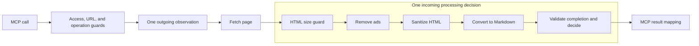

# MCP pipelines: proposed improvement plan

Status: reviewed proposal, not implemented. Both review perspectives and the
manager agree on the selected scope. Date: 2026-10-18. Review baseline:
`27fa96c2bc47d890787a35be81ff6a2ebff42d61`.

Keep one outgoing observation and one incoming processing decision. Retain the
small inner transformation loop. Make separate, small changes to names, unused
collaborator identity, and static result precision. Keep the current completion
contract. A fixed HTML processor is conditional work; no inspected defect or
measured change cost requires it now.

This consolidates two AI design perspectives. Robert C. Martin and Sandi Metz
did not participate in or endorse the reviews. The frozen independent plans are
[Martin-inspired review](mcp-pipelines-review-martin.md) and
[Metz-inspired review](mcp-pipelines-review-metz.md). Their design sources and
evidence are linked there. This document records the actual discussion and the
selected scope, not an implementation result.

## Current architecture and scope

Only traffic through Thermus MCP is in scope. HTML cleaning and conversion are
incoming work. Outgoing observation sees the supplied top-level URL once. It
does not inspect each redirect or renderer subrequest.

The diagram shows the normal control and ownership path; early returns are
omitted. It does not show a generic runner around all boxes. The outer decision
protocol and the inner transformation protocol have different jobs.

| File or area | Current responsibility |
| --- | --- |
| [fetch-tool.ts](../../src/fetch-tool.ts#L21) | Compose shared renderer, cleaners, records, and operation. |
| [fetch-page.ts](../../src/page-fetch/fetch-page.ts#L22) | Check access/input, observe URL, fetch, and process. |
| [pipeline-step.ts](../../src/page-fetch/pipeline-step.ts#L4) | Outer allow/block result and executable role contract. |
| [execute-outgoing-step.ts](../../src/page-fetch/execute-outgoing-step.ts#L5) | Enforce exact URL and outgoing codes; bind its record. |
| [execute-incoming-step.ts](../../src/page-fetch/execute-incoming-step.ts#L7) | Enforce Markdown/withholding result; bind its record. |
| [HTML runner](../../src/html-cleaner-pipeline/html-to-markdown-pipeline.ts#L21) | Create per-call context; invoke transformations with cancellation checks. |
| [ProcessHtmlStep](../../src/html-cleaner-pipeline/process-html-step.ts#L11) | Check early size limit and complete result; adapt to outer decision. |
| [Sanitizer](../../src/html-cleaner-pipeline/prompt-injection-remover/prompt-injection-remover-sanitizer.ts#L17) | Clean HTML and accumulate typed findings and withholding. |
| [Removal session](../../src/html-cleaner-pipeline/prompt-injection-remover/hidden-html-removal-session.ts#L30) | Bound repeated scans and withhold unchecked content. |
| [Converter](../../src/html-cleaner-pipeline/html-to-markdown/clean-html-to-markdown-defuddle.ts#L9) | Convert content and combine text reports. |
| [MCP adapter](../../src/mcp/get-url-as-markdown.ts#L7) | Map released Markdown or recognized withholding to tool text. |
| [Tool server](../../src/mcp/fetch-tool-server.ts#L24) | Parse tool arguments, bind request lifetime, format completion. |
| [Single slot](../../src/mcp/single-fetch-operation.ts#L3) | Hold hosted capacity until operation settlement. |

## Findings and severity

No proven MCP correctness defect was found by this inspection. The findings
below concern contract precision and change cost. Severity is planning priority,
not a claim of an exploitable issue or a failed runtime test.

| Finding | Severity | Evidence and implication |
| --- | --- | --- |
| Inner and outer “steps” mean different things. | Low: readability | Inner `invoke(Ctx)` returns context; outer `execute` returns allow/block. Clarify names. |
| Outer supplied `id` is required but deliberately ignored. | Low: contract accuracy | Executors bind fixed IDs; [tests](../../test/unit/page-fetch/execute-outgoing-step.test.ts#L92) use throwing ID getters. Remove misleading authority. |
| Static outgoing result permits scan codes that runtime refuses. | Low: compiler precision | Shared BlockCode includes all codes; [outgoing validation](../../src/page-fetch/execute-outgoing-step.ts#L35) accepts only `blocked`. Tighten types within a small budget. |
| Ctx gives leaves authority over unrelated metadata/reports. | Medium: potential change cost | [Ctx](../../src/html-cleaner-pipeline/html-to-markdown-pipeline.ts#L4) combines URLs, HTML, output, counters, and reports. Actual leaves preserve fields; no observed corruption justifies urgent rewrite. |
| Array order and completion are not enforced by its type. | Low: deliberate flexibility | Partial and repeated arrays are real internal consumers. Do not claim all arrays produce Markdown. |

The current boundaries have useful strengths. Access/input guards precede
effects. Network work and processing have separate safe errors. Executors
capture decision values once, reject malformed results, and avoid trusting
collaborator metadata. Best-effort record failures cannot repeat work. The
hosted slot stays occupied through cleanup. Preserve these properties.

The same-package type import of ScanWithholdingCode is not a runtime boundary
violation. Directory moves or new contract packages would not solve ownership.
The two outer executors have different code, output, and error rules. Do not
merge them merely because their control flow looks similar.

Pipeline step records exclude HTML, Markdown, URLs, warnings, and raw errors.
The existing MCP completion record is a different contract: it includes identity,
URL origin/path, and the supplied reason. See
[tool-completion-record.ts](../../src/mcp/tool-completion-record.ts#L7).
Potential path/reason privacy policy changes need their own requirement and
review. This plan does not silently select one or claim all logs are payload-free.

## Flattening choices

| Choice | Benefit | Cost and decision |
| --- | --- | --- |
| Keep the small inner loop; clarify contracts. | Preserve simple sequence and useful subset callers. | Selected. Names and static roles improve without a new orchestration layer. |
| Replace inner loop with fixed processor and narrow leaf inputs/results. | Could give source identity and report accumulation one owner. | Conditional. Require an independently justified invariant or demonstrated cheaper change, including test migration cost. |
| Promote every transformation to an outer decision. | Could support independent stage policy or operational records. | Rejected for current scope. No current caller requires these decisions; grouping is still needed to preserve existing records. |

One production constructor occurs in fetch-tool.ts. No separate source CLI
constructor was found. package.json is private and declares no library exports.
That does not prove no external source-path imports exist. Internal tests are
important consumers: [redirects](../../test/interface/website-fetcher-redirects.test.ts#L23)
use conversion alone, [ad policy](../../test/acceptance/hosted-ad-policy.test.ts#L10)
uses ads alone, and [counters](../../test/acceptance/pipeline-counters.test.ts#L11)
uses repeated sanitizer/converter passes.

## Discussion and revisions

Both initial reviews distinguished transformation from policy and rejected full
outer flattening without a user or operational need. Both considered explicit
fixed orchestration as an alternative to the broad context.

The manager challenged that alternative: the loop is about 12 lines and the
composition already shows ads → sanitizer → converter. The reviewers agreed
that spelling out the calls without removing preservation knowledge would be
cosmetic. Narrow contracts, mappings, and migration of subset tests can cost
more than retaining the loop. Fixed orchestration therefore became conditional.

The phrase “give completed processing a useful result contract” was challenged
because ProcessHtmlStep already returns strict StepResult<string>. Partial
arrays cannot honestly promise required Markdown. The final agreement selects
documentation of existing ownership, with no second completion union, producer,
wrapper, cast, or duplicate mapping boundary.

The reviewers also challenged broad cleanup. Inner naming, outer supplied-ID
removal, and compiler precision affect different contracts. They became separate
reviewable slices. The static-type slice has a bounded implementation budget and
can finish with a documented deferral if simple types do not suffice.

Both reviews preserve converter continuation after typed withholding. The blank
HTML branch already avoids Defuddle parsing. Early exit has no demonstrated
performance benefit here. A future proposal must specify desired terminal and
diagnostic semantics rather than claim an unmeasured parsing saving.

These exchanges resolved the architecture differences. They do not establish
that implementation or verification is complete.

## Target and acceptance criteria

The mandatory target is clearer inner names, no supplied executable-role ID,
and a bounded assessment/change of direction-correct static results. Keep one
incoming decision and the current loop. ProcessHtmlStep remains the owner that
checks completion and returns StepResult<string>. Document that partial contexts
may lack Markdown. Retaining the loop is a successful final outcome.

All selected changes preserve these contracts:

- Guard precedence, permission checks, URL bounds, and the early HTML size limit
  remain unchanged. Depth and scan limits remain with their current owners.
- Outgoing success preserves exact requested URL spelling. Final URL still drives
  ad rules and relative-link resolution. Supplied source input remains unchanged.
- Counters retain their meanings; title, first-seen findings, warning order and
  deduplication remain available to direct processing consumers.
- Typed scan codes control withholding independently of warning words. Conversion
  continues after withholding; released empty content and recognized withholding
  remain exact empty MCP success. No partial payload escapes on failure.
- Each entered outer step attempts one terminal record after settlement, up to
  two attempts per operation. Earlier guard/fetch failures can leave fewer.
  Trusted bindings choose IDs and safe codes. These are best-effort attempts,
  not durable delivery guarantees. Sink failure changes neither result nor work.
- Cancellation prevents later transformations and release after observation.
  Pending work and cleanup settle before capacity returns. No early signal race
  releases the hosted slot. Concurrent calls retain isolated operation state.
- Runtime checks preserve required-field own-property rules and reject wrong
  codes, absent/nonstring allowed output, contradictory allow/block fields,
  and arrays. Unrelated extra fields can be ignored. Executors capture
  decision/output/code once and use that snapshot for the result and record,
  including when getters change on later reads. ProcessHtmlStep preserves its
  own-property checks for recognized withholding and string Markdown. It reads
  withholding once before Markdown and does not read Markdown when withholding.

## Ticket appendix

These local planning IDs do not imply external tickets were created. Each code
slice is independently reviewable. It may share a PR only if its commits and
verification remain clear. Do not mix unrelated behavior changes into a slice.

### MCP-REFINE-01: characterization gap audit

Scope: inventory existing public-boundary coverage against the criteria above.
Dependencies: none. Reuse passing tests; add only missing material cases before
refactoring. Do not manufacture a red acceptance test for unchanged behavior.

Start with executor tests, ProcessHtmlStep tests, pipeline cancellation and
redirect tests, real MCP pipeline integration tests, and single-slot tests.
Acceptance: identify covered criteria and close material gaps with passing
characterization checks. Verification: focused runs of each changed/new test.
Stop: no extra test merely restates a private helper or freezes cosmetic order.

### MCP-REFINE-02: clarify inner names and completion ownership

Scope: rename Step/Ctx to descriptive transformation/context names, consistently
across leaves and tests. Document partial context versus ProcessHtmlStep's strict
completion decision. Dependencies: 01 for affected behavior.

Acceptance: array composition, report access, cancellation, and runtime checks
are unchanged. No new completion wrapper/union or permanent compatibility alias.
Verification: typecheck, affected focused tests, and applicable full gates.
Stop: if work starts redesigning leaf inputs or orchestration, return it to the
conditional proposal rather than expand this naming slice.

### MCP-REFINE-03: remove unused supplied identity

Scope: remove required executable collaborator id and concrete declarations;
keep IDs at trusted record bindings. Dependencies: 01; independent of 02.

Acceptance: collaborator data still cannot select record identity or code rules.
Adapt trusted-binding tests without replacing their privacy/authority assertions
with checks of a removed field. No registry or ID-validation framework.
Verification: typecheck, executor and fetch-operation focused tests, full gates.
Stop: do not redesign record schema or durable delivery.

### MCP-REFINE-04: bound static result precision

Scope: simple role aliases or one bounded code parameter. Dependencies: 01;
reconcile signatures with 03 if both change the executable contract.

Acceptance: compiler rejects outgoing scan codes and accepts incoming scan
codes. Add a compile-time negative proof through repository typecheck inputs;
it must fail before narrowing and pass once outgoing scan codes are rejected.
No production casts. Runtime acceptance behavior and malformed-result/code checks
remain unchanged.
Verification: negative/positive type proofs, focused executors, and full gates.
Stop: if aliases/one parameter do not suffice, defer implementation and record
why. A new concrete producer that makes the mismatch costly is a revisit trigger.

### MCP-REFINE-05: conditional processor assessment

Not mandatory implementation. Start only with a separately stated order,
identity, or report invariant, or a concrete leaf change whose cost is reduced
by central report ownership. Compare migration cost with the current loop.

Potential inputs: ads/conversion get HTML and final URL; sanitizer gets HTML.
Leaves return their changed content and own reports; one processor retains
source identity and accumulates reports. Require exact report and metadata
compatibility, relevant leaf contract tests, and full-chain integration tests.

If selected, remove the old universal runner in the same coherent migration.
Move subset tests to their relevant public contracts without adding unrelated
stages. Preserve repeated-report invariants. Stop if adapters, a second permanent
runner, generic reducers, branded states, or a metadata framework merely move
today's spreads elsewhere. No present evidence requires this ticket to start.

## Deferred work

Early withholding exit requires a separate failing BDD acceptance specification
and TDD for the changed failure, cancellation, and diagnostic semantics. Stronger
cancellation needs a measured latency requirement and interruptible execution;
passing a signal alone cannot interrupt synchronous work. More outer decisions
or stage records need explicit policy/diagnostic requirements and safe schemas.
Fetch-port relocation needs a concrete dependency problem, not directory taste.
None is included in the mandatory target.

## Verification and sign-off

This review used source/test inspection only. No fresh runtime, gate, or metric
pass is claimed. [MCP-PIPE-04](mcp-pipe-04.md#quality-review-and-retained-findings)
records historical functional results and retained nonzero quality findings.
Those retained scores do not require metric-only helpers or prove a new candidate.

For future implementation, follow [AGENTS.md](../../AGENTS.md),
[coding principles](../coding-principles.md), [test layout](../testing/test-code-layout.md),
and [test gate policy](test-gate-policy.md). Run every changed test locally before
commit. Use real collaboration to determine test type. New behavior needs BDD
red then TDD; structural refactoring starts from passing characterization.

Before Ready, run check, habit-hooks, applicable integration/acceptance suites,
renderer and container/hosted gates required by changed paths, and the full
candidate ast-metrics delta/review after documents are current. Record actual
results, counts, retained reasons, and missing prerequisites. Keep snooze empty.
Update from origin/main as the metrics process requires; do not alter its baseline
unless its rules change. Follow draft/Ready/Actions and owner-review rules.

Sign-off: the Metz-inspired author and Martin-inspired peer agree on this plan.
The manager reviewed both independent plans, their discussion, the source, and
the corrected consolidated document. The manager signs off the proposed scope.
Document checks passed for 49 local links, heading anchors, code fences,
whitespace, and the index entry. Runtime tests were not rerun.

Implementation completion requires selected slices, preserved criteria, required
passing evidence, and owner review. No code, runtime settings, external tickets,
commits, PRs, or decision records were created by this review work.
