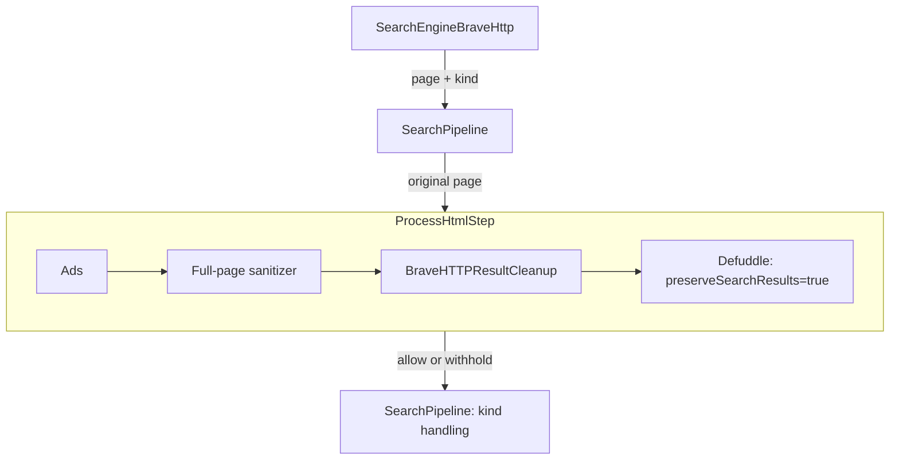

# Search results cleanup plan

Date: 2026-10-20 (America/Denver).
Status: local implementation and validation complete; PR 208 owns the current review and merge status.

## Decision

Fix the search output as a P2 defect. The tool promises cleaned results as
Markdown. Its current output keeps useful results together with navigation,
images, widgets, and footer links. Controlled replay confirms the defect even
though existing preservation tests pass.

Add one `BraveHTTPResultCleanup` object to the incoming search pipeline, after
full-page ad and prompt/hidden-content cleaning and before Markdown conversion.
It selects supported organic cards and builds small result-only HTML for the
existing converter. Keep the engine, public tool schema, and generic pipeline
contracts unchanged. Keep fetch conversion unchanged.

Deliver this as one test-first implementation change with its documentation
and required checks. Improved failure diagnosis is a separate, deferred
follow-up. It does not block this fix. The user authorized implementation after
plan review. Draft
[PR 208](https://github.com/tomer-mayara/Thermus/pull/208) tracks this change.
SR-02 remains deferred and does not block SR-01.

## Evidence and reproduction limits

The source report, **Bug: Thermus `search` returns full Brave SERP chrome
instead of cleaned results**, is dated October 20, 2026. Its proposed fixes and
acceptance criteria are recommendations assessed here. They are not an
instruction to migrate providers or add controls.

The report describes two Paris searches that succeeded with page chrome and
four calls that returned `Search failed`. It compares a successful Paris
search with a later fetch for a Python query, using a URL that also includes
`source=web`. That is not a controlled comparison of the same response. The
original raw responses and server logs were not accessed. Its chrome shares,
size estimates, and token estimates remain unverified.

The review used commit `6ac961ae2865fbe6ebdbd586869c30a1b0ae52f2`.
Because this task worktree had no installed dependencies, replay used the clean
checkout at `/Users/tomermayara/git/Thermus`, at the same commit, with identical
relevant source hashes, Node 24.20.0, and Defuddle 0.19.4. No source edits or
builds were needed. The following existing test selection passed all 101 tests,
with no failures, cancellations, skips, or todos:

```sh
node_modules/.bin/tsx --test test/integration/search-pipeline/brave-markdown.test.ts test/unit/search-engine/search-engine-brave-http.test.ts
```

A diagnostic replay used both existing complete captured pages. Each pair ran
identical HTML through the real engine, ad cleaner with empty rules,
prompt/hidden-content sanitizer, and converter. Search used
`preserveSearchResults: true`; fetch used the default converter mode. Byte
counts use `Buffer.byteLength` with UTF-8. Image markers count `![`
occurrences. Result-link checks used micromark and a parsed DOM.

| Fixture | HTML bytes | Search Markdown bytes | Fetch Markdown bytes | Search / fetch image markers | Valid primary title/destination pairs, search / fetch |
| --- | ---: | ---: | ---: | --- | --- |
| `brave-results.html` | 244,841 | 27,970 | 8,997 | 50 / 0 | 18/18 / 0/18 |
| `brave-results-video.html` | 241,431 | 27,332 | 8,923 | 48 / 0 | 18/18 / 0/18 |

Search contains 46 and 45 occurrences of Brave image proxy URLs, and 67 and
66 total links. Each fetch output contains four links. Both modes retain the
18 expected title and snippet texts, but only search retains all expected
primary title/destination link pairs. Search also keeps `Goggles`, `Find
elsewhere`, `Brave Search Premium`, and `Privacy Policy`; fetch excludes them.
The roughly 68% byte difference is not a measured chrome share or token saving:
fetch also loses useful link structure. Simply using fetch defaults is not a
valid fix.

Supplemental replay files are under `/tmp/thermus-search-review/`; durable
capture provenance is in the [fixture README](../../test/support/fixtures/search-engine/README.md).

One production search for `top 10 coffee shops in Paris` ran at
2026-10-21T05:29:48.976Z, or October 20 at 23:29:48 MDT. It returned
`Search failed: HTTP 429`. No further production calls were made, and the
deployed commit was not inspected. This proves a rate-limit response for that
call. It does not explain the four historical generic failures or reproduce
production chrome today. The report's other queries were not rerun after the
rate limit:

- `python requests library timeout`
- `python requests timeout parameter`
- `best hiking boots 2026`
- `python requests`

The plan review used source and fixture inspection only. The dated evidence
above predates implementation and is not delivery evidence for PR 208.

## Findings and review corrections

The composition in [src/fetch-tool.ts](../../src/fetch-tool.ts), lines 36–45,
uses the same renderer instance and the same cleaner types for both tools.
Search alone enables result preservation. In
[PreparedHtmlDocument](../../src/html-cleaner-pipeline/html-to-markdown/prepare-html-document.ts),
lines 29–53, that option selects the body and disables content-removal options.
It preserves result links and also preserves page chrome. Search does run
Defuddle; it uses different settings. [SEARCH-02](search-02.md) records that
generic extraction lost results, which explains the preservation setting.

The engine classifies the full DOM and returns the original page plus `kind`.
It rejects unsupported required card structures. Existing integration tests
check expected results remain in order, but do not exclude unrelated content.
The saved video fixture records a previously rejected description variant that
current code already supports. None of this proves the cause of the report's
four failures. Current safe renderer diagnostics already expose HTTP 429 and
selected timeout information.

The earlier plan required correction, not just shorter wording:

| Earlier problem | Correction |
| --- | --- |
| It required usable final result fields without assigning that guarantee to a component. | `SearchPipeline` checks nonblank output only. Cleanup owns input eligibility; real-converter tests verify supported-case preservation. No final-row runtime parser is planned. |
| It called snippets optional but also required every description to survive safety processing. | Retain supplied descriptions when safe; safety can remove them. A missing optional description does not invalidate an otherwise eligible card. |
| Diagnostics were called separate but became a mandatory delivery dependency. | Defer them as an independent follow-up with its own contract decision and evidence. |
| It suggested existing decoded-field helpers could simply be imported. | The converter's callback is private. Reuse public library primitives where needed; do not claim a shared helper already exists. |
| Separate red-test and release tickets split one feature into artificial stages. | Use one implementation ticket with BDD, TDD, documentation, review, and gates. |
| Header, hostname, date formatting, a later chosen byte budget, and a manual live matrix expanded the fix. | Use numbered result links and optional description text. Record bytes as evidence. Use the existing bounded live proof. |

## Required behavior

Keep all eligible, safe organic cards from the supported first-page response in
source order. Each row has one numbered title link and optional surviving
description text. Preserve dates already included in that selected text
literally. Do not add a generated header, domain field, count limit,
deduplication, separate date extraction, or date conversion.

Exclude navigation, local-business/map widgets, image and video carousels,
related searches, alternate-engine links, paging, footer content, and images.
Do this by selecting result fields, not by blacklisting words in Markdown.
A legitimate description that says `Privacy Policy` must remain. An organic web
card with a video description is still a result; it is not the video carousel.

Keep meaningful safe inline links inside descriptions. Construct ordinary text
as DOM text nodes and title links as plain inline anchors. Retain only the
selected description's approved inline content. Do not turn script, style,
template, or non-display subtree text into visible result text. Do not refill
removed content from raw HTML, embedded page state, another request, or an
unsafe fallback.

Cleanup decides whether a card is eligible from its sanitized decoded title
and normalized destination. A blank title or invalid primary HTTP(S) URL drops
the whole card, including its description and date text.
A removed optional description does not. The existing provider classifier is
unchanged: an optional presentation field is not permission to accept an
unsupported required provider structure. Final safety processing remains
authoritative even if it removes further content.

## Architecture and ownership

Use one class named `BraveHTTPResultCleanup`, proposed at
`src/html-cleaner-pipeline/search-results/brave-http-result-cleanup.ts`.
It implements the existing `HtmlTransformation` contract:
`invoke(ctx: HtmlProcessingContext): Promise<HtmlProcessingContext>`.
The class owns Brave presentation selectors and result-only HTML construction.
`SearchEngineBraveHttp` retains network and classification work. The composition
root wires the new object only into search.



`ProcessHtmlStep` wraps these transformations. Full-page cleaning must run before
projection because styles and ancestors affect safety decisions. Cleanup reads
the latest `ctx.html` and returns a new context whose `html` contains a minimal
semantic ordered list. It does not write `ctx.markdown`. Do not copy the raw
head, scripts, styles, images, or removed fields into the normalized document.

Sanitize decoded required titles, destination attributes, and the base attribute
before URL resolution or eligibility checks. Use existing library primitives
with the converter's DOM text boundary semantics. The earlier HTML sanitizer
does not normalize every decoded DOM field. A missing or blank primary href
after sanitation drops the card; never resolve it as a link to the base page.
Do not decode entities twice: escaped entity examples remain text. Preserve
genuine sanitation reports.

Before discarding the head, compute the effective base using the current
missing-base, relative-base, and invalid-base fallback rules in
`PreparedHtmlDocument`, lines 139–151. Resolve permitted primary and snippet
destinations once, during projection, then pass absolute HTTP(S) URLs to the
converter. An invalid optional snippet link loses its anchor, while its safe
visible text remains. The existing base helper and decoded sanitation callback
are private. Use narrow local operations with public library primitives;
do not add a generic URL service or shared-helper project. Follow DRY3.

The existing converter keeps its decoded-DOM and final-Markdown sanitation.
Cleanup's checks protect its own selection and URL decisions; they do not
replace those later checks. The converter sanitizes an internal DOM and leaves
the earlier `ctx.html` in the context, so a later object cannot treat that HTML
as trusted post-conversion output.
Optional inline text retains the converter's run-based sanitation: controls can
span adjacent inline nodes. Cleaning each node independently is not equivalent.

Keep `preserveSearchResults: true`. It will preserve deliberately normalized
result HTML rather than a complete SERP, avoiding generic article scoring that
can discard results. A post-Markdown cleanup cannot reliably recover source
roles from flattened links and cannot restore information already lost. A
second object adds a pass without an identified separate responsibility.
No `BraveHTTPResultPostMarkdownCleanup` is planned.

Create one reusable instance per application. Keep DOM and other request data
local to `invoke`; do not mutate the input context. Preserve URLs, counters,
existing `found` and `warnings` entries, and other context metadata. Append real
decoded sanitation reports, but do not count discarded chrome as an ad or unsafe
removal. Retain the existing input/depth limits and before/after transformation
abort checks. Do not add a parser-limit API or promise a new signal contract.

On recognized `scanWithholding`, attempt no cleanup and return empty HTML with
the flag and metadata intact. Conversion produces blank Markdown, and
[ProcessHtmlStep](../../src/html-cleaner-pipeline/process-html-step.ts), lines
13–24, preserves the withholding decision. Malformed withholding must fail
closed. Empty input or zero eligible rows produces `html: ''`, without a header.
[SearchPipeline](../../src/search-pipeline/search-pipeline.ts), lines 41–45,
then returns exact `No search results.` only for allowed provider-classified
`no_results`; empty `results` fails processing. No classification enters cleanup,
and no-results handling stays after full incoming safety work.

`SearchPipeline` does not validate final row links. Eligibility checks and
real-converter integration tests must establish the supported normalized
representation's behavior. A new runtime parser of final Markdown is outside
this fix. No tool schema, `SearchDocument`, `HtmlProcessingContext`,
`IncomingStep`, registry, or generic framework change is needed.

## Verification and delivery

Write a failing public Given/When/Then acceptance case first. Then use focused
TDD for cleanup's selection, URL, and context behavior. Run both unchanged full
captures through the real cleaners and converter. Require all 18 known primary
title/destination pairs in order and all expected safe snippet excerpts, plus
structural exclusion of unrelated cards, images, and footer/navigation links.
Check title/description association within each result row, adapting existing
paragraph-based test helpers only where needed. Words alone cannot identify
chrome. Record output bytes after implementation; do not invent a universal
size cap or choose a passing budget after the fact.

Use a small derived-case matrix for behavior introduced by projection:

| Boundary | Required proof |
| --- | --- |
| Field selection | Organic generic/video descriptions survive; carousel and image content do not. Safe descriptions containing chrome-like words remain. |
| URL and text handling | Missing/relative/invalid base behavior, primary and inline links, invalid schemes, Markdown punctuation, decoded controls, and escaped entities remain correct through real conversion. A title or primary href made blank by sanitation drops the card before URL resolution. |
| Safety | Hidden/ad targets stay removed; removed titles/destinations drop cards; removed descriptions stay optional; no raw fallback restores content. |
| Context and absence | Metadata/reports and input immutability remain correct; withholding and blank/zero-row behavior keep their existing public outcomes. |

Keep authentic captures unchanged and keep provenance. Clearly label controlled
variants as derived. Use package unit tests for focused behavior and integration
coverage for real cross-package collaboration, following the
[test code layout](../testing/test-code-layout.md). Retain existing permissions,
cancellation, capacity, lifecycle, and log-privacy coverage; add a new public
case only where the inserted step changes behavior that coverage cannot prove.

Select final checks from the complete candidate under [AGENTS.md](../../AGENTS.md)
and the [test gate policy](test-gate-policy.md). The planned source changes
require `npm test`, `npm run typecheck`, `npm run test:build`, and
`npm run build:user-portal`, plus `npm run test:mcp:renderer`. Composition changes
also select the self-hosted and hosted gates: `npm run test:container`,
`npm run build:hosted`, and `npm run test:container:hosted`; the hosted image gate
requires Linux AMD64. Follow the policy for the final changed file set. Do not
add `npm run check` to repeat ordinary checks.

Use only the existing `npm run test:mcp:search:live` for a bounded live proof
when access permits. Stop on a rate limit or challenge; record the result and
any missing proof as unverified, not passed. Do not add a manual five-query
campaign or retries to force success. Offline fixtures establish the cleanup
contract; a live call establishes access only within its observed scope.

The implementation change includes affected current guidance, habit-hooks,
ast-metrics evidence, manager review, and the draft-to-Ready/owner review
workflow required by repository policy. Keep historical records unchanged.
The plan review required no implementation checks, code-quality runs, or live
calls. Implementation must complete the selected delivery gates above.

## Appendix: Tickets

These are local plan IDs, not created tracker issues. Estimates are relative
effort, not deadlines.

### SR-01 — Add clean Brave result projection

Priority: P2. Estimate: medium. Dependencies: none.

Scope: implement `BraveHTTPResultCleanup` and search-only composition as one
coherent change. Start with the failing acceptance case, use focused TDD for
its pieces, preserve existing safety/conversion owners, update affected current
documents, then run the selected complete-candidate checks. Do not split red
and green phases into separately shippable tickets.

Given a supported full Brave response with organic cards and unrelated widgets,
when an authorized client searches, then numbered title links and safe selected
descriptions remain in source order and unrelated content is absent. Given
safety removes a required title or destination, when cleanup selects rows,
then that card is excluded without restoring raw content. Given supported
absence or scan withholding, when the incoming step completes, then the existing
public absence or withholding outcome remains.

Tests: focused cleanup unit cases, both full-fixture real-converter integration,
and the public acceptance/regressions described above. Reuse existing unchanged
lifecycle coverage. Done: acceptance is green, all approved known fixture fields
remain, output-byte evidence is recorded, no generic fetch regression occurs,
current guidance matches behavior, and required checks and reviews pass. There
is no dependency on SR-02.

### SR-02 — Deferred: investigate unsupported search responses

Priority: follow-up, to be reassessed from evidence. Estimate: small to medium.
Dependencies: none; not required for SR-01 delivery.

Scope: first decide a separate safe diagnostic contract and obtain evidence of
a real unsupported or failed response through a bounded diagnostic run. Current
HTTP 429 detail already works. The four historical generic failures remain
unknown. Add a failure category or layout variant only if the evidence and
caller need justify it; do not broaden the classifier as a cleanup shortcut.

Given an observed unsupported response and an agreed diagnostic contract, when
the relevant public error path runs, then it provides the agreed safe detail
without raw provider content or query leakage. Given no supporting capture,
when assessing a layout change, then the lack of proof remains explicit.

Tests and done conditions must be set with that contract: use authentic captured
provenance, focused engine/error tests, and the applicable public regression.
Done: the independently agreed behavior is tested and reviewed. No API migration,
new controls, retry policy, or release obligation is implied by this placeholder.

## Review and delivery status

The manager signed off the plan, implementation, and current guidance.
The change is tracked in [PR 208](https://github.com/tomer-mayara/Thermus/pull/208).
The [SR-01 delivery record](sr-01.md) owns candidate revisions, focused test
results, fixture measurements, retained quality findings, and final gate/live
proof. All eight selected local gates and the bounded live proof passed.
PR 208 owns current Ready, Actions, owner-review, and merge status; owner review
is still required. Quality goal misses and unknown assessments are recorded as
exceptions, not passes. The final prose-only ast-metrics process must reuse
compatible coverage after the final documentation commit, and its complete report
must be attached to the PR unchanged.

The implementation retains one public transformation and two private helpers
created per invocation. No pipeline contract changed. The latest focused built
run passed 63/63 tests. Both captured fixtures retain 18 verified result pairs
and their expected snippets, with no images or image proxies. See the delivery
record for exact measurements and their empty-ad-rule qualification.

The inherited converter can emit a literal escaped control entity in Markdown
that a downstream renderer interprets as a control character. The delivery
record preserves this limitation; cleanup does not decode twice, and generic
converter/fetch behavior is unchanged. Do not infer final-render literal-entity
fidelity from the focused passes.

SR-02 remains an independent deferred follow-up. Local completion and manager
signoff do not replace owner review or the required PR workflow.
