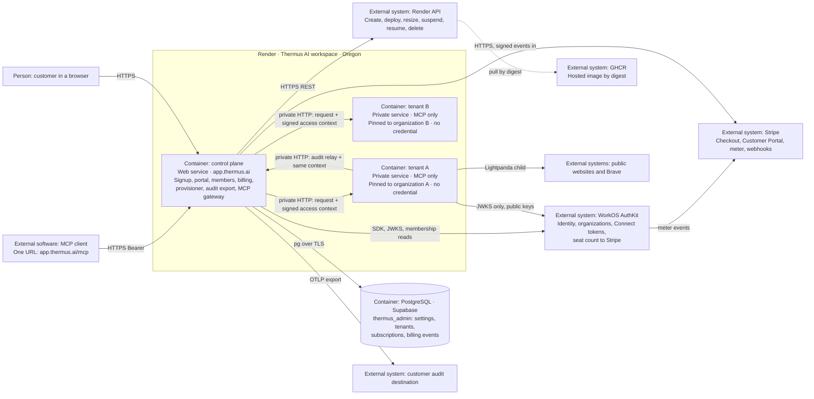

# Self on-boarding plan: free tier, one container for each tenant, paid upgrade

Date: 26 October 2026. Status: revision 4. The owner answered the decisions
D-1 to D-14 on 26 October 2026. Section 5 records the answers, and the rest of
the plan follows them. The plan is based on `main` after the Slice 2.5
member-removal merges of the same day, PRs #251 to #257. This plan changes no code, no Render setting, no WorkOS
setting, and no legal text.

## 1. Goal

The owner wants three things:

1. A visitor chooses the free tier on `thermus.ai`, creates an organization
   with the existing signup flow, and gets a separate Render deployment on
   the smallest paid instance. Each tenant runs in its own Render container.
   The free tier allows 5 members in total: Users and Admins together.
2. An Admin chooses **Upgrade**, enters a credit card, and the organization
   moves to the paid tier. The paid tier has no member limit.
3. One global switch opens or closes free self on-boarding. This switch
   exists: `SELF_SERVE_SIGNUP_ENABLED`.

## 2. The design in short

Keep `https://app.thermus.ai` as the only public origin. It becomes the
**control plane**: marketing handoff, signup, organization creation, member
administration, billing, tenant provisioning, the audit export, and an **MCP
gateway**. After the rollout, the control plane does no page fetching.

Run the fetch and search work of each organization in its own Render
**private service**. It runs the same hosted image as the control plane, in a
**tenant role**. A free tenant runs on the smallest paid instance,
`0.5c-512mb`; a paying tenant runs on `1c-2g`. A tenant has no public address
and holds no credential: no WorkOS API key, no database password, no Stripe or
Render key. Only the control plane reaches it, over the Render private network. Each
container serves up to 10 tool calls at a time.

MCP clients keep the one URL `https://app.thermus.ai/mcp`. The gateway
verifies the Connect token and reads the current membership, as the single
service does today. Then it forwards the request to the container of the
organization with a signed access context. The tenant checks the signature
and the token, runs the tool, and relays its audit events back to the control
plane, which exports them.

Tiers are `free` and `team`. A free organization can have 5 members; at 5, it
cannot add more. A team organization has no limit and pays for each active
member: WorkOS sends the member count to a Stripe meter, and Stripe bills the
count at the end of each month. Stripe Checkout, the Stripe Customer Portal,
and signed Stripe webhooks implement the upgrade. Tenant and subscription
state live in the existing Supabase PostgreSQL project. Stripe stays the
authority for the subscription status. WorkOS stays the authority for
identities, organizations, memberships, roles, and the billed member count.

The existing switch stays the global switch. A new cap, `FREE_TENANT_LIMIT`,
bounds the number of free containers. Idle free containers are suspended.

Why one public origin and not one hostname for each tenant:

- WorkOS has one initiate-login URI for each environment. Invitation emails
  and sign-ins that start at AuthKit must land on one front door anyway.
- One origin needs no DNS record, TLS certificate, custom domain, redirect
  URI, or OAuth resource for each tenant. Provisioning is one Render API call
  and a wait for the deploy.
- Existing MCP clients and the published connection guides keep working.
- All credentials stay in one process. A tenant renders untrusted pages, so
  it must hold nothing that reaches another organization.

Section 9 keeps the per-tenant hostname design as a later option.

## 3. Current state, reviewed on 26 October 2026

### 3.1 Code

| Area | Fact | Where |
| --- | --- | --- |
| Editions | `DEPLOYMENT=hosted` runs WorkOS sign-in, Connect token checks, account routes, signup, and the MCP tools in one Node process. `PUBLIC_BASE_URL` gives the MCP URL and the metadata URL. The hosted edition needs five `WORKOS_*` settings and a root base path. | [deployment-config.ts](../../src/runtime/config/deployment-config.ts), [workos-settings.ts](../../src/accounts/providers/workos/workos-settings.ts), [hosted-workos-application.ts](../../src/app/hosted-workos-application.ts) |
| Signup | `GET /signup` shows the notice, the sign-in, then a form with the organization name and one agreement. `POST /signup` creates the WorkOS organization with external ID `thermus-signup:<hash>` and a ten-field acceptance record in its metadata, creates the first Admin membership, selects the organization, and opens the portal. Eligibility needs a verified email only. Local admission: 8 concurrent POSTs and 3 attempts for each subject in a minute. | [workos-signup-routes.ts](../../src/interfaces/web/auth/workos/workos-signup-routes.ts), [workos-signup.ts](../../src/accounts/providers/workos/workos-signup.ts) |
| Switch and bundle | `SELF_SERVE_SIGNUP_ENABLED` is read at startup. `true` needs a document bundle with purpose `organization-creation`. Production selects the v3 organization Audit bundle, `s204-organization-audit-proposal-2026-10-24-v3`. Its repository README still calls it an unapproved review candidate, while PR #248 records a notice approval. Confirm the approval status before signup opens. | [workos-signup-settings.ts](../../src/accounts/providers/workos/workos-signup-settings.ts), [bundle](../../src/accounts/providers/workos/workos-organization-audit-documents.ts), [v3 README](../legal/organization-audit-2026-10-24-proposal-v3/README.md) |
| Roles | `user` gives `product:access`. `admin` gives product access, `user-grants:manage`, `admin-grants:manage`, and `billing:manage`. Other roles give nothing. | [hosted-role-mapping.ts](../../src/accounts/providers/workos/hosted-role-mapping.ts) |
| Members | The members page counts active memberships with product access, Admin alone included. Invitations are native WorkOS invitations. Acceptance happens in AuthKit, outside the application. Since the Slice 2.5 merges of 26 October 2026 (PRs #251, #253, and #254), an Admin can remove an ordinary member on the Members page through a removal coordinator with a durable per-organization operation record in PostgreSQL. Its verification, release controls, and safety-scan repair merged in PRs #255 and #257 on the same day; the [S2.5-02 ledger](admin-s2-5-02.md) says that the removal release is still pending. No code changes a role. | [administration-overviews.ts](../../src/accounts/organizations/administration-overviews.ts), [organization-directory.ts](../../src/accounts/organizations/organization-directory.ts), [removal-operation-store.ts](../../src/accounts/organizations/removal-operation-store.ts) |
| Billing | `Billing` has `stateOf()` and `updateSeats()`. `BillingFree` is the only implementation. `BillingState.plan` is the literal `'free'`. The billing page needs `billing:manage` and has no form. The portal JSON gives `plan: 'free'`, and the browser code refuses any other value. | [billing.ts](../../src/accounts/billing/billing.ts), [billing-page.ts](../../src/interfaces/web/account/billing-page.ts), [portal-access.ts](../../src/interfaces/web/account/portal-access.ts), [portal.ts](../../src/interfaces/user-portal/portal.ts) |
| Access | `verifyAccessToken()` checks the issuer, the audience `https://app.thermus.ai/mcp`, and the Connect claims, and takes the organization from `org_id`. It checks no membership. `resolve()` then reads the current membership from WorkOS. A token without `org_id` gets a `403` denial. The tenant ID is `authority:organizationId`. | [workos-auth-provider.ts](../../src/accounts/providers/workos/workos-auth-provider.ts), [mcp-server.ts](../../src/interfaces/mcp/mcp-server.ts) |
| MCP server | The SDK handler serves each HTTP request with a fresh server instance and keeps no session between requests. GET and DELETE get `405`. A tool call can stream its answer as SSE inside that one request. The bearer challenge and the access check are private steps of `MCPServer`; `ProtectedResourceEndpoint` wraps it for the metadata. | [mcp-server.ts](../../src/interfaces/mcp/mcp-server.ts), [protected-resource-endpoint.ts](../../src/interfaces/mcp/protected-resource-endpoint.ts) |
| Capacity | One `OperationCapacity` slot for each process: one fetch or search at a time for every organization together. A second call gets `Server busy`, which is also an audit event. D-15 changes the default to 10 calls at a time. | [operation-capacity.ts](../../src/app/operation-capacity.ts), [fetch-tool-server.ts](../../src/interfaces/mcp/fetch-tool-server.ts) |
| Audit events | The tool server writes `toolCompleted` events. The audit snapshot reads the destination settings of the tenant from PostgreSQL on activity and sends the events to the customer collector. Pending events live in bounded memory. | [audit-snapshots.ts](../../src/logs/audit/audit-snapshots.ts), [audit-collector.ts](../../src/logs/audit/audit-collector.ts) |
| Storage | Two tables in the `thermus_admin` schema of Supabase project `rnqktgtgrvvqptbaosth`, `logging_destination_settings` and `membership_removal_operations`, through the session pooler with a CA secret file. Role `thermus_logging` has SELECT, INSERT, and UPDATE on both, with `USING (true)` on the settings table: **it reads and writes every organization's row.** The stores scope queries by tenant in code. `pg` is allowed only in the `audit-logs` owner, and the bounded SQL runtime is not a public module. | [settings migration](../../sql/migrations/20261023211956_logging_destination_settings.sql), [removal migration](../../sql/migrations/20261025082850_membership_removal_operations.sql), [bounded-sql-runtime.ts](../../src/logs/audit/bounded-sql-runtime.ts), [review rules](pr-review-rules.yaml) |
| Routing | `/mcp` gets an Origin check, then the MCP server. Browser routes without a session come next. Every other path under the base needs a signed-in session. | [application.ts](../../src/app/application.ts) |

The [billing design](../design/billing-design.md) records the owner answer of
12 October 2026: billing is a separate object, `BillingFree` for now, Stripe
as the likely replacement, and the open decisions D1 to D11. It names AUTH-11
as the only paid billing ticket and requires Super Admin with MFA for billing
actions. Section 5 maps the decisions to this plan; SO-13 is AUTH-11.

### 3.2 Render

| Item | Observed on 26 October 2026 |
| --- | --- |
| Workspace | Thermus AI, `tea-db8i6ceq1p3s73dev9og`, Hobby plan: 7 days of logs, failure emails. A second workspace, My Workspace, exists and is empty. |
| Service | `srv-db8mnqg473hc739d529g`, web service, Docker from `main` with `Dockerfile.hosted`, Oregon, plan `1c-2g` (1 CPU, 2 GB, about 25 USD a month), one instance, health check `/healthz`, auto-deploy on commit, Render subdomain disabled, custom domain `app.thermus.ai`. |
| Deploys | A Git-backed deploy takes 3 to 4 minutes from commit to Live. |
| Memory, 7 days | Hourly samples: median about 100 MB, 95th percentile about 150 MB, maximum about 185 MB. CPU use is near zero. |
| Memory under load | The RHD-05 capacity run reached about 631 MiB on a 9 MiB page, against a 2 GiB limit. See [rhd-05.md](rhd-05.md). |
| Data services | None on Render. |

Render API facts that the plan uses, from the Render documentation:

- `POST /v1/services` creates a service. An image-backed service gives
  `image.ownerId`, `image.imagePath`, and `image.registryCredentialId` with
  `runtime: image`. The type `private_service` has no public URL and needs a
  paid plan. Plans include `0.5c-512mb` (0.5 CPU, 512 MB, about 7 USD a
  month) and `1c-2g`. Creation starts the first deploy at once, so every
  variable must be in the create call. The answer gives the service and its
  first deploy ID. A service update changes the plan.
- `POST /v1/services/{id}/deploys` with `imageUrl` deploys another tag or
  digest of the configured image. An image-backed service never redeploys on
  its own when a tag moves. Images must be `linux/amd64`. Render pulls the
  image at each deploy.
- Services in one workspace and one region share a private network. A
  private service has an internal address such as `name-2j3e:8080`. Traffic
  on that network is plain HTTP.
- Rate limits: service create, modify, suspend, and resume share one bucket
  of 20 an hour for each Render user. Deploys are 20 an hour for each
  service. Other writes are 30 a minute. Reads are 400 a minute. Render
  raises limits on request.

### 3.3 WorkOS

| Item | Fact |
| --- | --- |
| Environments | Production `environment_01M4VDKBVH3BKNY1F64VSWJ9ZD`, client `client_01M4VDKC291XX3CDEFP5ZKY5KP`, AuthKit issuer `https://spontaneous-mountain-26.authkit.app`. Staging `environment_01M4VDKATD5PXZT4H01EHCMR2A`. |
| Inventory | On 23 October 2026, production had seven organizations, zero users, and zero pending invitations. SSO, Directory Sync, and Google sign-in were disabled. A fresh read is needed before the rollout. |
| API key | One environment-wide API key. It can change every organization. WorkOS has no key scoped to one organization. |
| Metadata | An organization holds at most 10 metadata keys. The signup record uses all 10. **No tier or tenant fact can go into organization metadata.** |
| Stripe field | An organization has a dedicated `stripe_customer_id` field. Seat Sync needs it. |
| Redirect URIs | Managed in the dashboard. Wildcards such as `https://*.app.thermus.ai/callback` are allowed in production, with one `*` in the left-most label, and never on a public-suffix domain such as `onrender.com`. No public API adds a redirect URI. |
| Initiate login URI | One value for each environment. Invitation links go through it to `GET /login`. |
| OAuth resources | `GET`, `POST`, and `DELETE /user_management/authkit_oauth_resources` exist. Wildcards are allowed when the environment enables them. A literal match wins. Deleting a resource removes its consents. |
| Stripe add-on | The dashboard links WorkOS to Stripe through Stripe Connect, for each environment. Seat Sync creates a Stripe billing meter, "User Seat Count", with the event name `workos_seat_count`, and sends the current active member count at each membership change, with the "last" aggregation. The count includes every active membership, also a membership with only the default role. WorkOS does not support a Stripe Sandbox account; use the standard account in test mode. |

### 3.4 Legal and marketing

- The approved Terms of Service version 2, section 3, say: the hosted early
  access is free, no payment card is required, and the terms authorize no
  fees, automatic charges, or automatic renewal. A paid tier needs new Terms
  with fees, renewal, cancellation, refunds, and taxes, and a new Privacy
  Policy that names Stripe as a processor. They get the next unused version
  label, because `v3` labels already exist for the Audit proposal. Both need
  new hashes, owner approval, publication on `thermus.ai`, and a new runtime
  bundle, under the existing document process.
- The marketing pricing section shows **Free, $0, self-hosted download** and
  **Hosted, $10 /month/user, early access by invitation**. The hosted
  **Start subscription** button opens the waitlist dialog. It does not link
  to `https://app.thermus.ai/signup`. The header **Sign in** link goes to the
  app. The [free subscription guide](../free-subscription-guide.md) says that
  the link opens signup; that sentence is stale.
- The [release verification](admin-s1-staging-release-verification.md) of
  23 October is now a historical record. It keeps the native-flow holds, the
  failed alternate-address join and the native generic error after a
  concurrent revoke, and the deferred mailbox checks. Current holds live in
  the [S2-04 ledger](admin-s2-04.md) and, for removal, in the
  [S2.5-02 ledger](admin-s2-5-02.md). The owner decides their disposition
  before signup opens.

### 3.5 Delivery process

Each ticket follows [AGENTS.md](../../AGENTS.md): acceptance test first,
TDD, draft pull request, the selected gates, habit-hooks, ast-metrics, the
component registry, and the review tier. This work adds components,
dependencies, and public declarations, so its code pull requests are T2 Need
architect. The owner merges the decision records. The repository has no CI
today. The hosted image gate needs a native AMD64 host; the Render build is
that host today. The [organization administration plan](../design/organization-admin-plan.md)
has a free-only rule for new infrastructure; this initiative supersedes it
for the containers and the paid tier, and SO-00 records that.

## 4. Target architecture

The dashed line is a Render action, not a Thermus call. Tenant B has the same
links as tenant A.

### 4.1 One image, two roles

One new setting, `THERMUS_ROLE`, selects the role of the hosted image.

| Setting | Control plane | Tenant |
| --- | --- | --- |
| `THERMUS_ROLE` | `control-plane` (the default) | `tenant` |
| `TENANT_ORGANIZATION_ID` | not set | the one organization that this container serves |
| `PUBLIC_BASE_URL` | `https://app.thermus.ai/` | the same value, so the token audience and the metadata URLs stay public |
| `WORKOS_AUTHKIT_ISSUER` | required | required: the public key set that checks the bearer token |
| `WORKOS_API_KEY`, `WORKOS_CLIENT_ID`, `WORKOS_REDIRECT_URI`, `WORKOS_COOKIE_PASSWORD` | required | not set |
| `GATEWAY_SIGNING_KEY` (private key) | new, required | not set |
| `GATEWAY_PUBLIC_KEY`, `CONTROL_PLANE_INTERNAL_URL` | not set | new, required |
| `MCP_TENANTS_ENABLED` | new rollout switch, default `false` | not read |
| `SELF_SERVE_SIGNUP_ENABLED`, `FREE_TENANT_LIMIT`, `FREE_TENANT_IDLE_DAYS` | the switch and the caps | not read |
| `DATABASE_URL`, `LOGGING_DESTINATION_ENCRYPTION_KEY`, `DATABASE_CA_CERT_PATH` | required | not set |
| `RENDER_API_KEY`, `RENDER_OWNER_ID`, `RENDER_REGISTRY_CREDENTIAL_ID`, `TENANT_IMAGE`, `TENANT_PLAN_FREE`, `TENANT_PLAN_TEAM` | new, required | not set |
| `STRIPE_SECRET_KEY`, `STRIPE_WEBHOOK_SECRET`, `STRIPE_PRICE_TEAM` | new, required | not set |
| `LIGHTPANDA_BIN`, `AD_RULES_FILE` | set by the image; read until SO-16 removes the tools | read, as today |
| Routes | today's routes, plus `/billing/*`, `/billing/events`, `/workspace/status`, and `/internal/audit`; `/mcp` is the gateway when the switch is on | `/healthz` and `/mcp` only |
| `OPERATION_CAPACITY` | new, default 10; applies while the control plane still serves tools | new, default 10: the calls that run at the same time (D-15) |
| Tools and renderer | until SO-16: the tools of today, used when the switch is off | the fetch and search tools with the capacity above and today's page limits |

The signed access context is one request header. The control plane signs it
with an Ed25519 private key; tenants hold only the public key. It carries the
organization ID, the user, the grants, a hash of the bearer token, and an
expiry of a few minutes. A tenant accepts a request only when the signature
is valid, the context names its pinned organization, the bearer token has
that hash and a valid AuthKit signature, and the context has not expired. A
context for organization A is useless at tenant B, and no tenant can forge
one. The control plane accepts an audit relay only with such a context for
the same organization, and drops a repeated operation ID.

A tenant therefore holds no secret. A compromised tenant can reach only its
own organization's work. Traffic on the private network is plain HTTP; the
plan accepts this, as every service on that network belongs to Thermus and the
forwarded items are the bearer token, which is short-lived, and page content.

### 4.2 Flows

**Tenant on first need.** The control plane requests a tenant the first time
it sees an organization that needs one: after a successful signup, when the
portal asks for the workspace status for an organization with product
access, and when an MCP call with `product:access` arrives. The request is
one idempotent insert of a `tenants` row in state `requested`. A lost insert
after signup, and every organization that exists today, get a tenant on first
use; no migration script is needed. The gateway resolves access before it
requests a tenant, so a token without a current product grant starts no
container. The free-tenant cap is checked at the insert. At a full cap, signup
shows the closed notice, and an organization without a tenant gets a `503`
with a capacity message until the operator raises the cap.

**Provisioning.** The provisioner is a bounded loop in the control plane. It
claims one `requested` row at a time and moves it through `creating`,
`deploying`, and `live`. It names the Render service from the organization ID
and searches by that name before it creates, so a restart never creates a
second service; two services with that name stop the row as `failed`. The
create call carries every tenant variable, because creation starts the first
deploy at once. It creates an image-backed private service on the plan of the
tier with the `TENANT_IMAGE` digest, polls the deploy, and records the
internal address and the digest. A failed deploy gives `failed` with the
reason and an operator report. Retries are bounded. The Render limit of 20
creates an hour makes the loop a queue. The control plane uses a dedicated
Render user and API key, so the fleet script, staging, and the owner's own
dashboard use do not share its rate-limit bucket.

**Tier change.** When the tier of an organization changes, the control plane
sets the plan of the row: `TENANT_PLAN_TEAM` for `team`, `TENANT_PLAN_FREE`
for `free`. The provisioner applies a plan that differs from the applied one
through the Render service update, which restarts the container once. A tool
call during that restart gets a `503` with `Retry-After`.

**Signup.** The marketing page links to
`https://app.thermus.ai/signup?tier=free`. Only `free` exists today, so the
route ignores other values. The switch and the cap are checked before the
notice. Sign-in, agreement, and organization creation stay as today. After
the confirmed first Admin membership, the control plane requests the tenant
and opens the portal. The portal reads `GET /workspace/status` and shows
**Setting up your workspace** with a refresh until the state is `live`. The
connection guide appears when the tenant is live.

**MCP call.** The gateway is a step inside the existing `MCPServer` request
path, after the bearer check and the access check, in place of the local
dispatch. The Origin check, the bearer challenge, the metadata endpoint, and
every denial of today stay unchanged.

1. The client calls `https://app.thermus.ai/mcp` with a Connect token.
2. The control plane verifies the token and reads the current membership, as
   today. A missing `org_id`, an inactive membership, or a missing
   `product:access` gets today's denial.
3. The gateway reads the tenant row from its in-memory copy of the registry.
   State `live`: it forwards the request with the signed access context, with
   method, headers, body, and cancellation, and streams the answer back. The
   MCP server is per request, so no session affinity is needed. States
   `requested`, `creating`, and `deploying`: `503` with `Retry-After` and a
   safe message. State `suspended`: it asks Render to resume, once, then
   `503` with `Retry-After: 60`. State `failed`: `503` and an operator report.
   No row: it requests the tenant and answers `503`.
4. The tenant checks the context and the token, runs the tool within its
   capacity, relays its audit events to `POST /internal/audit` of the
   control plane with the same context, and answers.
5. The control plane captures the relayed events through its existing audit
   pipeline and updates `last_active_at` of the tenant at most once a minute.
   A gateway refusal writes a system log line and no audit event, because no
   tool ran. Today's `busy` audit event stays, because the tenant produces it.

**Upgrade.**

1. The billing page shows the plan, the member count against the limit, and
   an **Upgrade** button for an Admin with `billing:manage`.
2. `POST /billing/upgrade` keeps the origin, form, and CSRF checks of the
   other account forms. The control plane refuses the upgrade while the
   organization has a subscription that has not ended, in the registry or at
   Stripe. Else it creates or reuses the Stripe customer, stores its ID in
   `subscriptions` and in the WorkOS `stripe_customer_id` field, creates a
   Checkout Session in subscription mode with the metered price
   `STRIPE_PRICE_TEAM`, with `client_reference_id` and metadata set to the
   organization ID, with required acceptance of the paid terms, and with
   Stripe Tax, billing address, and tax ID collection, and answers `303` to
   Stripe. Card data never reaches Thermus.
3. Stripe returns the browser to `GET /billing?checkout=<session>`. The page
   reads the session from Stripe, checks that `client_reference_id` is the
   organization of the request, records the terms acceptance time, and
   applies the subscription status at once. The result does not wait for the
   webhook. The organization is `team` from this moment; the first invoice
   comes at the end of the first month.
4. WorkOS sends the active member count to the Stripe meter at each
   membership change. Stripe bills the last count of each monthly period. No
   Thermus code counts seats or sets a quantity; `updateSeats()` stays
   unused.
5. `POST /billing/events` has no session, so it is registered before the
   account routes. It verifies the Stripe signature on the raw body, records
   the event ID, reads the subscription from Stripe, applies its status, and
   then marks the event applied. A failed apply leaves the event unapplied, so
   the Stripe retry applies it. `active` and `trialing` give `team`.
   `past_due` keeps `team` during the Stripe retry window. `canceled`,
   `unpaid`, and `incomplete_expired` give `free`. The payload order is never
   trusted. The route answers `2xx` quickly and treats an applied duplicate as
   done. The Stripe dunning setting ends a failed subscription with
   cancellation, never with "leave past due".
6. A daily reconciliation reads every subscription from Stripe and applies
   its status, so a missed webhook corrects itself within a day.
7. **Manage billing** opens a Stripe Customer Portal session for the payment
   method, invoices, and cancellation at the period end. The portal
   configuration allows no quantity change; the meter decides the quantity.

**Downgrade.** A `team` organization returns to `free` at the end of its paid
period or at the end of the Stripe retries. Members keep their access. At the
downgrade, the control plane revokes pending invitations above the limit, and
the organization is resized to the free plan. While the member count is at or
above 5, new invitations are refused. The organization can invite again after
an Admin removes members on the Members page, or after a new upgrade. Accepted
consequence of D-5: an organization keeps the members that it added while it
paid, and it paid for each of them for at least one month.

**Idle suspension.** A free tenant with no MCP call for `FREE_TENANT_IDLE_DAYS`
is suspended through the Render API. A tenant that never served a call counts
from its creation. A suspended service costs nothing. The first call after
that resumes it; the client sees `503` with `Retry-After` for about a minute.
Team tenants are never suspended. A weekly sweep compares the registry with
the WorkOS organization list; the tenant of an organization that no longer
exists is deleted, and its row becomes `deleted`.

**Release.** A GitHub Actions workflow builds `Dockerfile.hosted` for
`linux/amd64`, runs the offline gate that the Dockerfile already contains,
and pushes the image to GHCR by commit and digest. The control plane runs
that image too. The workflow deploys the control plane through its deploy
hook with the new digest. The fleet script then deploys the digest to each
tenant in batches with `POST /services/{id}/deploys` and `imageUrl`, checks
each `/healthz` over the private network, and records the digest. New
tenants use `TENANT_IMAGE`. One image, one release path.

### 4.3 Data model

New tables in the existing `thermus_admin` schema, applied with the
migration process of S2-01a, with a new runtime role for the control plane.
Tenant containers have no database access. The membership removal store of
Slice 2.5 shows the pattern to follow: one private SQL runtime, narrow store
operations, and a committed intent before a provider effect.

| Table | Columns | Notes |
| --- | --- | --- |
| `tenants` | `organization_id` (key), `render_service_id`, `service_name`, `internal_url`, `state`, `plan`, `applied_plan`, `image_digest`, `last_active_at`, `failure_reason`, `created_at`, `updated_at` | One row for each organization. `state` is `requested`, `creating`, `deploying`, `live`, `suspended`, `failed`, or `deleted`. `plan` is the wanted Render plan; `applied_plan` is the current one. |
| `subscriptions` | `organization_id` (key), `stripe_customer_id`, `stripe_subscription_id`, `status`, `current_period_end`, `cancel_at_period_end`, `terms_accepted_at`, `updated_at` | The last Stripe-confirmed state. No row means `free`. |
| `billing_events` | `stripe_event_id` (key), `type`, `received_at`, `applied_at` | Duplicate protection; `applied_at` is set after a successful apply. |

The tier is derived: `team` when the subscription status is `active`,
`trialing`, or `past_due`; `free` otherwise. Provisioning and billing changes
are written to the system log as one line each, like today's account change
records. No separate log table.

The bounded SQL runtime moves from `audit-logs` to a shared `sql` owner, so
that the registry and the billing store can use it and `pg` is declared once.

### 4.4 Tier rules

| Rule | `free` | `team` |
| --- | --- | --- |
| Members | Active memberships with product access plus pending invitations stay at or under 5. The creator counts as 1. An invitation beyond the limit gets the refusal `limit-reached` with an Upgrade link. | No limit. Each active member is billed. |
| Enforcement | `OrganizationAdministration.sendInvitation()` on the control plane, from the complete member and invitation reads, serialized for each organization so that two concurrent invitations cannot both pass at 4 of 5. A failed page fails the check. | none |
| Invariant | An invitation from the control plane is the only way to add a member. SSO, Directory Sync, domain joining, and dashboard-created memberships stay off, as the production readback shows. | the same |
| Inviting again after a downgrade | Needs member removal on the Members page, or an upgrade. | not applicable |
| Container | `0.5c-512mb` with today's page limits; suspended when idle. | `1c-2g`; never suspended. |
| Capacity | Up to 10 fetches or searches at a time in its own container (D-15); the next call gets `Server busy`. | The same capacity, with more memory for large pages. |
| Portal | `plan: 'free'`, `memberLimit: 5`. | `plan: 'team'`. |

Native invitation acceptance happens in AuthKit, so the application cannot
refuse it. Counting pending invitations as reserved seats at send time is the
only reliable gate. Expired invitations do not count.

### 4.5 Components

Proposed owners for the registry and the rules file. Roots must not nest, as
the ownership check refuses an ambiguous owner. The decision record and the
first code ticket make them final; the checker reports each new owner, edge,
and declaration as a T2 fact.

| Owner | Source root | Responsibility |
| --- | --- | --- |
| `tenants` (new) | `src/tenancy/tenants/` | Registry store, tenant request with the cap, provisioning state machine with the plan change, tenant lookup, idle and organization sweeps. |
| `render` (new) | `src/tenancy/providers/render/` | Render API adapter: create, deploy, update plan, suspend, resume, delete, find by name. |
| `sql` (new) | `src/runtime/sql/` | The bounded SQL runtime, moved from `audit-logs`; the only owner that imports `pg`. |
| `stripe` (new) | `src/accounts/providers/stripe/` | Stripe API and webhook signature adapter. |
| `billing` | `billing-stripe.ts`, `billing-store.ts` | `BillingStripe`, subscription and event storage, tier derivation. |
| `mcp` | `mcp-gateway.ts` | Forward a resolved request with the signed context; the `503` states. |
| `identity` | `signed-access-context.ts` | Sign and verify the access context. |
| `audit-logs` | `audit-relay-sink.ts` | The tenant-side sink that relays events to the control plane. |
| `web` | `account/billing-routes.ts`, `internal/audit-relay-route.ts`, workspace status | Upgrade, portal, return, webhook, relay, and status routes. |
| `app` | role selection, both compositions, the provisioner and sweep lifetimes | |

New edges, at least: `app` to `tenants`, `render`, `stripe`, and `sql`;
`tenants` and `billing` to `sql`; `billing` to `stripe`; `mcp`, `web`, and
`audit-logs` to `identity` for the context. Declarations change in
`deployment-config.ts`, `billing.ts`, and the change-record outcome that gains
`limit-reached`, which also reaches the audit event contract.

## 5. Owner decisions, answered on 26 October 2026

| ID | Decision | Answer | Effect on the plan |
| --- | --- | --- | --- |
| D-1 | Tenant reachability | One public origin, gateway, private tenant services. | Sections 2 and 4. Section 9 keeps per-tenant hostnames as a later option. |
| D-2 | Free tenant instance | `0.5c-512mb` as is, with today's page limits. A very large page can be killed; Render restarts the container, and the client gets a failure for that call. | SO-01 measures how often that happens on the recorded protocol and sets the alert threshold. No page-limit setting is added. |
| D-3 | Team price model | A price for each active member through the WorkOS Stripe Seat Sync meter. | The upgrade sets the WorkOS `stripe_customer_id` field and uses a metered Stripe price. No seat code in Thermus. The count includes every active membership. |
| D-4 | Price, currency, trial, tax | The amount is set later in Stripe. USD, no trial, Stripe Tax on with address and tax ID collection. The code reads a price ID. | `STRIPE_PRICE_TEAM`. The published price on `thermus.ai` must match the Stripe price before signup opens. |
| D-5 | A free organization at 5 members | Do not allow more members at 5. Members keep access after a downgrade; new invitations are refused. | No access denial for an over-limit organization. Pending invitations above the limit are revoked at a downgrade. An organization keeps the members that it added while it paid. |
| D-6 | Cost caps | `FREE_TENANT_LIMIT` 25, `FREE_TENANT_IDLE_DAYS` 14. | At most about 175 USD a month of live free containers. |
| D-7 | Tenant image source | A prebuilt image in GHCR from a GitHub Actions build. | SO-02; one image and one release path. |
| D-8 | PostgreSQL plan | Supabase Free for now. | The daily reconciliation touches the database every day, so the 7-day pause is unlikely while the control plane runs. A pause stops provisioning, billing, and the audit export until the operator resumes the project. Revisit at the first paying customer. |
| D-9 | Render workspace plan | Hobby for now. | 7 days of logs and failure emails only. Alerts come from the failure emails and the daily fleet summary. Revisit when the fleet grows. |
| D-10 | Existing organizations | Fresh inventory; delete the unused test organizations. The rest get a tenant on first use. | SO-12. |
| D-11 | Legal and marketing | Proceed under the existing document process. | SO-12 for the free tier, SO-14 for the paid tier. No customer reaches Checkout before approval and publication. |
| D-12 | Team container | A larger instance, `1c-2g`, with the same capacity. | The tier change resizes the container. Costs about 25 USD a month for each team tenant. |
| D-13 | Payment provider | Stripe. | Closes D1 of the billing design. |
| D-14 | Tenant credentials | No credential in a tenant: signed access context and audit relay. | Sections 4.1 and 4.2. |
| D-15 | Calls at the same time in a container | 10, instead of today's 1. | `OperationCapacity` takes a limit from the new setting `OPERATION_CAPACITY`, default 10. The 11th call gets `Server busy`. One render reached 631 MiB, so 10 renders at once can exceed 512 MB and also 2 GB; SO-01 measures the real concurrent peak on both instances, and the owner then confirms the free and team values or lowers the free one. |

Mapping to the billing design: D1 Stripe; D2 monthly, billed at the end of
each period from the meter; D3 automatic charge; D4 no proration, because the
meter bills the last count of the period; D5 zero members bill zero; D6 cancel
at the period end through the Customer Portal; D7 keep access during Stripe
retries; D8 becomes "no subscription means the free tier"; D9 start again
with a new Checkout; D10 every existing organization starts as `free`; D11
PostgreSQL. The AUTH-11 precondition "Super Admin with completed MFA" is
superseded by the S1-02 model: Admin with `billing:manage` and no MFA. The
`updateSeats()` operation stays unused; WorkOS counts the seats. SO-13
records all of this in the billing design.

## 6. Tickets, in four slices

Each ticket writes its Given-When-Then acceptance specification first, then
uses TDD, and runs the gates of the test gate policy. Sizes: S is a day or
two, M is about a week, L is more. Each slice ends with something the owner
can use. The longest chain is SO-01, SO-04, SO-06, SO-07, SO-12 for the free
tier, then SO-13, SO-14, SO-15 for the paid tier.

### Slice 1: decisions and spike

**SO-00 Decision records.** Two records under `architecture/decisions/`:
one for the container design (one public origin, gateway inside `MCPServer`,
private tenant services without credentials, signed access context, audit
relay, one image with two roles, tenant on first need, the instance and the
capacity of each tier) and one for tiers and billing (tiers, the per-member
price through the WorkOS meter, Stripe, PostgreSQL state, the behavior at 5
members). Context, Decision, Consequences, with the answers of section 5. The
same pull request records in the organization administration plan that the
free-only rule no longer applies to the containers and the paid tier. The
owner merges. Size S.

**SO-01 Spike.** Evidence only, in the My Workspace workspace, the WorkOS
Staging environment, and Stripe test mode, with every resource deleted at
the end. Size M.

- Render and image: build the hosted image for `linux/amd64` on a native
  AMD64 runner, push it to GHCR, create a registry credential, create an
  image-backed private service on `0.5c-512mb` with every variable in the
  create call, read its internal address from the API answer, deploy a second
  digest with `imageUrl`, change its plan to `1c-2g` and back, suspend,
  resume, and delete it. Record each duration and each API field that the
  provisioner needs. Proxy one streamed MCP call from a Node process to the
  private service with a signed header, and relay one event back; confirm
  that SSE and cancellation pass through.
- Capacity: run the RHD-05 protocol against that service on `0.5c-512mb` and
  on `1c-2g`, with 1, 5, and 10 parallel calls: the 9 MiB page, the
  JavaScript page, Brave search, overlap, and shutdown. Record memory, kills,
  restart time, and what the client sees. The result confirms or lowers the
  capacity of each tier (D-15) and sets the alert threshold and the words of
  the failure message.
- Stripe and WorkOS, needed before Slice 3: connect the WorkOS Stripe add-on
  in Staging to the standard Stripe account in test mode, create a product
  with a metered price on the "User Seat Count" meter, set
  `stripe_customer_id` on a disposable organization, add and remove a
  membership, and confirm the meter events. Run Checkout with required terms
  acceptance and Stripe Tax, the Customer Portal, the webhook signature check
  with the Stripe CLI, the dunning setting, and a test clock through a period
  end, a failed payment, and a cancellation. Confirm a restricted API key
  with only the needed permissions.

### Slice 2: free tier end to end

At the end of this slice, a visitor creates a free organization on
`thermus.ai`, its container is provisioned, the organization uses Thermus
through the gateway with 10 calls at a time, the 5-member limit holds, idle
containers are suspended, and the owner can remove an organization and its
container.

**SO-02 Release pipeline.** A GitHub Actions workflow on `main` builds
`Dockerfile.hosted` for `linux/amd64`, pushes `thermus-hosted:<sha>` to GHCR,
and records the digest. Given a merge to `main`, when the workflow ends, then
the image exists by digest, and a failed offline gate pushes nothing. The
control plane service switches to that image, and the workflow deploys it
through the deploy hook. Document the GHCR quota and the retention of old
images. The workflow also gives the hosted image gate a native AMD64 runner.
Size M. Depends on SO-01.

**SO-03 Tenant role, signed context, and capacity.** The `identity` module
that signs and verifies the access context. `THERMUS_ROLE=tenant` composes
`/healthz` and `/mcp` only, pinned to `TENANT_ORGANIZATION_ID`, with the
settings of section 4.1 and an access resolver that takes the grants from
the verified context. The audit relay sink. `OperationCapacity` takes a limit
from `OPERATION_CAPACITY`, default 10, in both roles. Given a request with a
valid context and token for the pinned organization, when the client calls a
tool, then it gets the cleaned Markdown and the relay receives one event; a
context for another organization, an expired context, a bad signature, or a
token with another hash gets `403`; given 10 running calls, when an 11th
arrives, then it gets `Server busy`; the start needs no WorkOS API key and no
database. Size L.

**SO-04 Tenant registry and SQL owner.** The `sql` owner with the moved
runtime, the three tables of section 4.3, the migration, the control-plane
role and grants, the registry store, the idempotent tenant request with the
cap check, and an in-memory lookup with a refresh bound. Given a row, when the
gateway asks for the organization, then it gets the state and the internal
address; a stale copy never outlives its bound. Size M. Depends on SO-01.

**SO-05 MCP gateway.** Inside `MCPServer`, after the bearer and access checks,
a supplied forward step replaces the local dispatch when `MCP_TENANTS_ENABLED`
is on: the signed context, the forward with streaming and cancellation, the
`503` states with `Retry-After`, the tenant request for a missing row, and
the `last_active_at` update. The `/internal/audit` route captures relayed
events through the existing audit pipeline. With the switch off, the control
plane behaves as today. Given a live tenant, when the client calls a tool,
then the tenant answers through the gateway, the control plane exports the
audit event, and the audience and metadata URLs stay public; given a
suspended tenant, then the client gets `503` and Render gets one resume
request. Acceptance tests use a fake tenant upstream; one integration test
runs both roles as two local processes. Size L. Depends on SO-03, SO-04.

**SO-06 Provisioner.** The state machine of section 4.2 behind a small
`TenantPlatform` interface with a Render adapter: idempotent creation by
name, the duplicate-name stop, deletion, bounded retries, failure reports,
and the claim of one row at a time. The plan change comes with Slice 3.
Given a `requested` row, when the loop runs with a fake Render API, then the
row reaches `live` with the service ID and the internal address; given a
Render `429`, then the loop waits for `Retry-After` and creates no second
service; given a restart after `creating`, then it finds the service by name
and continues; given a row marked for deletion, then the service is deleted
and the row becomes `deleted`. A live interface test in the My Workspace
workspace creates and deletes one disposable tenant. Size L. Depends on
SO-04.

**SO-07 Signup handoff and workspace status.** `?tier=free` on `/signup`, the
cap check with the closed notice, the tenant request after the first Admin is
confirmed, `GET /workspace/status`, and the portal setup page that shows the
connection guide only when the tenant is live. Given an eligible visitor,
when the agreement is accepted, then the organization exists, the row is
`requested`, and the portal shows the setup state until `live`. The hosted
live gate gains this scenario. Size M. Depends on SO-05, SO-06.

**SO-08 Free member limit.** `BillingState` gains `plan: 'free' | 'team'`
and `memberLimit`. `BillingFree` answers `free` with the limit 5. The members
page shows "N of 5 members" on `free`; `sendInvitation()` refuses beyond the
limit with `limit-reached` and an Upgrade link, serialized for each
organization; the portal accepts both plans. Given a free organization with
4 members and 1 pending invitation, when two Admins invite at the same time,
then one invitation is sent and the other is refused. Size M. Depends on
SO-04.

**SO-09 Fleet script and organization removal.** `script/fleet/*.ts` over
the Render adapter and the registry: list, status, request a tenant for an
organization, upgrade one or all tenants to a digest in batches with health
checks, suspend, resume, repair a `failed` row, rotate the gateway key pair,
delete a tenant with its Render service, and the daily cost and state
summary. Each command prints what it will do and asks before a write. The
owner's removal of an organization: the deletion runbook gains the order
(remove the WorkOS organization under the existing procedure, then delete
the tenant with the fleet script) and the registry rows, and a weekly sweep
deletes the tenant of an organization that WorkOS no longer lists. Given an
organization that WorkOS no longer lists, when the sweep runs, then its
Render service is deleted and its row is `deleted`. Size M. Depends on SO-06.

**SO-10 Idle suspension and resume.** The idle sweep, the resume path of the
gateway, and the portal notice. Given a free tenant idle for the period, when
the sweep runs, then Render suspends it; given a call after that, then the
gateway resumes it once and answers `503` with `Retry-After` until it is
live. Size M. Depends on SO-05, SO-09.

**SO-11 Runbooks, alerts, and secrets.** Runbooks for a failed provision, an
orphaned Render service, a paused Supabase project, the deletion of a tenant,
and the rotation of the Render API key, the gateway key pair, and the
settings encryption key. Within the Hobby plan: Render failure emails for
memory kills, and the daily summary of SO-09 as the fleet alert. Size S.

**SO-12 Free-tier release.** Confirmation of the v3 Audit bundle status; the
marketing **Start free** link to `https://app.thermus.ai/signup?tier=free`
and the free-tier guides; rehearsal with the WorkOS Staging environment, a
staging control plane and database, a dedicated Render user, and the My
Workspace workspace: signup, provisioning, an MCP call, suspend, resume, a
fleet upgrade, and an organization removal. Then production, in this order:
fresh WorkOS inventory and the D-10 cleanup; the owner's disposition of the
open release holds; the database migration; the registry credential; the
control plane deploy with the gateway switch off; the switch on; one real
MCP call for each kept organization, which provisions its tenant; a canary
signup with an owner account; marketing publication; then the signup switch.
Rollback: turn the gateway switch off, close signup, keep the tenants
running, and redeploy the previous control plane release if needed. Size M.
Depends on SO-02 to SO-11.

### Slice 3: upgrade to team

At the end of this slice, an Admin upgrades with a card, the organization has
no member limit, is billed for each active member, and runs on `1c-2g`; a
cancellation returns it to the free tier.

**SO-13 Stripe billing (AUTH-11).** `BillingStripe` behind the `Billing`
interface with the operations that the flow needs: start Checkout, open the
Customer Portal, apply a verified event, reconcile a subscription. Routes
`POST /billing/upgrade`, `POST /billing/portal`, the return handling of
`GET /billing`, and the public `POST /billing/events` before the account
routes. The `stripe_customer_id` write to WorkOS, the metered price, the
no-second-subscription rule, the applied mark, the daily reconciliation, the
tier change that resizes the tenant through the provisioner plan change,
team tenants excluded from suspension, the downgrade with the revoked
invitations, and the dunning setting. Settings and an exact pin of the
`stripe` package. The billing design records the decisions and the
superseded MFA precondition. Given an Admin on `free`, when Upgrade
completes, then the organization is `team` before the webhook arrives, the
WorkOS organization has the customer ID, the tenant row wants `1c-2g`, and a
duplicate event changes nothing; given a second Upgrade while the
subscription runs, then it is refused; given
`customer.subscription.deleted` with 8 members, then the tier is `free`, the
pending invitations above the limit are revoked, the members keep access,
the tenant row wants `0.5c-512mb`, and a new invitation is refused. Offline
tests use a local double of the Stripe API and the Stripe signature helper.
The paid billing gate runs the scenarios in Stripe test mode with test
clocks and the Staging Seat Sync. Size L. Depends on SO-08, SO-01.

**SO-14 Paid legal and marketing.** Paid Terms and Privacy with the next
unused version, new hashes, and owner approval; the runtime bundle update;
the marketing pricing section with two hosted tiers and a price that matches
the Stripe price; the subscription guide. Given the published pages, when
the publication verification runs, then versions and hashes match the
approved bundle. Size M in two repositories. Depends on the SO-13 wording.
No customer reaches Checkout before this ticket is done.

**SO-15 Team release.** The WorkOS Stripe add-on in production with the live
Stripe product and metered price; runbooks for a Stripe webhook failure, a
downgrade dispute, the deletion of a subscription with its organization, and
the rotation of the Stripe keys and the webhook secret; rehearsal in Stripe
test mode with test clocks and the Staging seat sync: upgrade with a meter
event, downgrade with the resize, and cancellation; then production rollout
and the marketing publication. Rollback: hide the Upgrade button with a
setting and keep existing subscriptions; Stripe replays webhooks for three
days. Size M. Depends on SO-13, SO-14.

### Slice 4: cleanup

**SO-16 Cleanup.** After the rollouts, remove the in-process tools, the
renderer check, and the gateway switch from the control plane role, and
consider a smaller instance for it. Size S. Depends on SO-12.

## 7. Risks and limits

| Risk | Fact | Mitigation |
| --- | --- | --- |
| Memory on the free instance | 631 MiB peak recorded for one render against 512 MB. D-15 allows 10 renders at a time, which multiplies the peak. A kill ends every active call with a failure. | Accepted in D-2 and D-15 for the defaults. SO-01 measures the concurrent peak on both instances; if the free instance cannot hold 10, the owner lowers `OPERATION_CAPACITY` for free tenants or chooses a larger instance. Render restarts the container. SO-11 watches the failure emails. |
| Render API rate limits | 20 creates, resizes, suspends, resumes, and modifies an hour for each Render user. | A dedicated user for the control plane. The provisioner is a queue. Suspend only after 14 idle days, so resumes are rare. Ask Render for a higher limit before a launch campaign. |
| PostgreSQL on Supabase Free | Pauses after 7 idle days; a pause stops provisioning, billing, and the audit export. | Accepted in D-8. The daily reconciliation keeps the project active. A runbook resumes it. Revisit at the first paying customer. |
| Cost of free tenants | 7 USD a month for each live free tenant. Signup needs only a verified email. | `FREE_TENANT_LIMIT`, idle suspension from creation, deletion of dead organizations, the admission limits, the global switch. |
| Gateway on the request path | Every MCP call crosses one more hop. The control plane is one instance with process-local state: the signup counters, the registry copy, the provisioner, the sweeps. | The proxy is light. A second instance needs a shared claim for the loops; not planned. Keep `1c-2g` until SO-16. |
| Member limit | Native acceptance cannot be refused. An organization keeps the members it added while it paid. Member removal and its verification merged on 26 October 2026 (PRs #251 to #257); the removal release itself is still pending in the S2.5-02 ledger. | The limit counts pending invitations. Pending invitations above the limit are revoked at a downgrade. The invariant on joining paths holds. The kept members are accepted in D-5. |
| Billed count | WorkOS counts every active membership, also a membership with only the default role, which gives no product access. | Default-role memberships do not exist in normal use; the fleet summary reports one. |
| Image pull at each deploy | Render pulls the large hosted image at every tenant deploy. | Measure in SO-01. Keep old digests for rollback. Prune GHCR under its quota. |
| Legal | Paid fees are outside the approved Terms. The runtime bundle status needs confirmation. The published price must match Stripe. | SO-14 before any customer reaches Checkout. |
| WorkOS metadata is full | 10 of 10 keys used. | All tier and tenant facts live in PostgreSQL. |
| Credentials in the control plane | The Render API key can change every service of the workspace. The Stripe key can create charges. | Render secret variables, a dedicated Render user, a Stripe restricted key, rotation runbooks, and no credential in any tenant. |
| Webhook order and duplicates | Stripe can deliver an event twice and out of order. | Event ID table with the applied mark; read the subscription from Stripe on each event; daily reconciliation. |
| Private network is plain HTTP | Render does not encrypt traffic between services. | Accepted: every service on that network is Thermus; the forwarded bearer token is short-lived, and the context is signed. |
| Audit relay | Relayed events add one private call for each tool call; a failed relay loses the event. | Bounded best effort, as today's capture; the control plane keeps the queue across tenant deploys and suspensions. |
| Logs on Hobby | 7 days of logs, no log forwarding. | Accepted in D-9. The daily summary and the runbooks record what matters. |
| Owner-only steps | WorkOS dashboard settings including the Stripe add-on, Render plan changes, legal approval, the open release holds, and decision records need the owner. | Section 5 and the runbooks name each step. |

## 8. Cost model

Monthly, approximate, before taxes. Verify prices at purchase.

| Item | Cost |
| --- | --- |
| Control plane, `1c-2g` | about 25 USD, as today |
| Each live free tenant on `0.5c-512mb` | about 7 USD; 0 USD while suspended |
| Each team tenant on `1c-2g` | about 25 USD, covered by its subscription |
| Render workspace Hobby | 0 USD |
| Supabase Free | 0 USD |
| GitHub Actions and GHCR | within the free allowance at first; GHCR storage beyond the quota costs by the gigabyte |
| Stripe | about 2.9 percent plus 0.30 USD for each card payment, 0.7 percent for Billing, 0.5 percent for Tax |
| Example | 25 free tenants, 10 live and 15 suspended, and 5 team tenants: about 25 + 70 + 125 = 220 USD a month plus Stripe fees, against the subscriptions of the 5 team organizations |

## 9. Later option: one hostname for each tenant

The facts allow it. WorkOS accepts the wildcard redirect URI
`https://*.app.thermus.ai/callback` and the wildcard OAuth resource
`https://*.app.thermus.ai/mcp` in production, with one `*` in the left-most
label and never on `onrender.com`. Render adds a custom domain with one API
call and issues its certificate, or one wildcard domain can point at the
control plane, which then routes by host. A tenant then needs a browser
session on its host, and so a cookie password, a redirect URI, and the WorkOS
API key, which conflicts with D-14. Invitations and AuthKit-started sign-ins
still land on the one initiate-login URI, so the control plane keeps the
organization chooser and redirects. This is a separate plan. Nothing in
sections 4 to 6 blocks it.

## Sources

Render API and documentation pages read on 26 October 2026: create service,
create deploy, create custom domain, link service to environment group, rate
limiting, deploy an image, private network, custom domains, environment
variables. WorkOS documentation read on the same day: MCP, OAuth resource
reference, organization reference, metadata, redirect URI wildcards, Stripe
add-on. Repository documents: [billing design](../design/billing-design.md),
[organization administration plan](../design/organization-admin-plan.md),
[Render hosted Docker plan](render-hosted-docker-plan.md), [RHD-05](rhd-05.md),
[FS-01](fs-01.md) to [FS-05](fs-05.md), [S2-01a](admin-s2-01a-database-setup.md),
[approval record](organization-signup-approval-2026-10-23.md),
[release verification](admin-s1-staging-release-verification.md),
[deletion runbook](hosted-account-deletion.md),
[test gate policy](test-gate-policy.md), [component registry](../../architecture/components.md).
