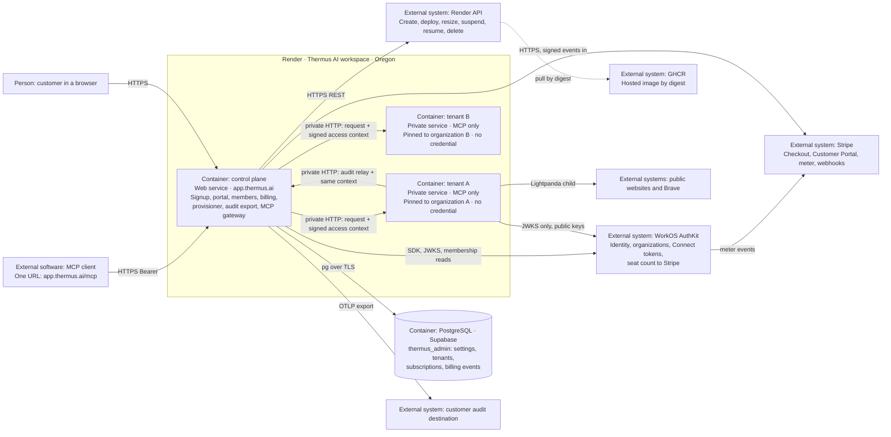

# Self on-boarding plan: free tier, one container for each tenant, paid upgrade

Date: 26 October 2026. Status: revision 4. The owner answered the decisions D-1
to D-14 on 26 October 2026. Section 5 records the answers, and the rest of the
plan follows them. The design answers of Slice 2 of 27 October 2026 are in
sections 4 to 7, each with its date. The plan is based on `main` after the
Slice 2.5 member-removal merges of the same day, PRs #251 to #257. This plan
changes no code, no Render setting, no WorkOS setting, and no legal text.

## 1. Goal

The owner wants three things:

1. A visitor chooses the free tier on `thermus.ai`, creates an organization
   with the existing signup flow, and gets a separate Render deployment on
   the smallest paid instance. Each tenant runs in its own Render container.
   The free tier allows 5 members in total: Users and Admins together.
2. An Admin chooses **Upgrade**, enters a credit card, and the organization
   moves to the paid tier. The paid tier has no member limit.
3. One global switch opens or closes free self on-boarding. This switch
   exists: `SELF_SERVE_SIGNUP_ENABLED`.

## 2. The design in short

Keep `https://app.thermus.ai` as the only public origin. It becomes the
**control plane**: marketing handoff, signup, organization creation, member
administration, billing, tenant provisioning, the audit export, and an **MCP
gateway**. After the rollout, the control plane does no page fetching.

Run the fetch and search work of each organization in its own Render
**private service**. It runs the same hosted image as the control plane, in a
**tenant role**. A free tenant runs on the smallest paid instance,
`0.5c-512mb`; a paying tenant runs on `1c-2g`. A tenant has no public address
and holds no credential: no WorkOS API key, no database password, no Stripe or
Render key. Only the control plane reaches it, over the Render private network. A
free container serves up to 5 tool calls at a time, and a team container up
to 10 (D-15).

MCP clients keep the one URL `https://app.thermus.ai/mcp`. The gateway
verifies the Connect token and reads the current membership, as the single
service does today. Then it forwards the request to the container of the
organization with a signed access context. The tenant checks the signature
and the token, runs the tool, and relays its audit events back to the control
plane, which exports them.

Tiers are `free` and `team`. A free organization can have 5 members; at 5, it
cannot add more. A team organization has no limit and pays for each active
member: WorkOS sends the member count to a Stripe meter, and Stripe bills the
count at the end of each month. Stripe Checkout, the Stripe Customer Portal,
and signed Stripe webhooks implement the upgrade. Tenant and subscription
state live in the existing Supabase PostgreSQL project. Stripe stays the
authority for the subscription status. WorkOS stays the authority for
identities, organizations, memberships, roles, and the billed member count.

The existing switch stays the global switch. A new cap, `FREE_TENANT_LIMIT`,
bounds the number of free containers. Idle free containers are suspended.

Why one public origin and not one hostname for each tenant:

- WorkOS has one initiate-login URI for each environment. Invitation emails
  and sign-ins that start at AuthKit must land on one front door anyway.
- One origin needs no DNS record, TLS certificate, custom domain, redirect
  URI, or OAuth resource for each tenant. Provisioning is one Render API call
  and a wait for the deploy.
- Existing MCP clients and the published connection guides keep working.
- All credentials stay in one process. A tenant renders untrusted pages, so
  it must hold nothing that reaches another organization.

Section 9 keeps the per-tenant hostname design as a later option.

## 3. Current state, reviewed on 26 October 2026

### 3.1 Code

| Area | Fact | Where |
| --- | --- | --- |
| Editions | `DEPLOYMENT=hosted` runs WorkOS sign-in, Connect token checks, account routes, signup, and the MCP tools in one Node process. `PUBLIC_BASE_URL` gives the MCP URL and the metadata URL. The hosted edition needs five `WORKOS_*` settings and a root base path. | [deployment-config.ts](../../src/runtime/config/deployment-config.ts), [workos-settings.ts](../../src/accounts/providers/workos/workos-settings.ts), [hosted-workos-application.ts](../../src/app/hosted-workos-application.ts) |
| Signup | `GET /signup` shows the notice, the sign-in, then a form with the organization name and one agreement. `POST /signup` creates the WorkOS organization with external ID `thermus-signup:<hash>` and a ten-field acceptance record in its metadata, creates the first Admin membership, selects the organization, and opens the portal. Eligibility needs a verified email only. Local admission: 8 concurrent POSTs and 3 attempts for each subject in a minute. | [workos-signup-routes.ts](../../src/interfaces/web/auth/workos/workos-signup-routes.ts), [workos-signup.ts](../../src/accounts/providers/workos/workos-signup.ts) |
| Switch and bundle | `SELF_SERVE_SIGNUP_ENABLED` is read at startup. `true` needs a document bundle with purpose `organization-creation`. Since PR #260, production selects the organization removal bundle, `s2502-organization-removal-proposal-2026-10-26-v1`, which the owner approved on 26 October 2026; its notices are published, and the deployment proof is pending in the Slice 2.5 release checkpoint. | [workos-signup-settings.ts](../../src/accounts/providers/workos/workos-signup-settings.ts), [bundle](../../src/accounts/providers/workos/workos-organization-removal-documents.ts), [approval](../legal/organization-removal-2026-10-26-proposal-v1/owner-approval.json), [release checkpoint](admin-s2-5-production-release.md) |
| Roles | `user` gives `product:access`. `admin` gives product access, `user-grants:manage`, `admin-grants:manage`, and `billing:manage`. Other roles give nothing. | [hosted-role-mapping.ts](../../src/accounts/providers/workos/hosted-role-mapping.ts) |
| Members | The members page counts active memberships with product access, Admin alone included. Invitations are native WorkOS invitations. Acceptance happens in AuthKit, outside the application. Since the Slice 2.5 merges of 26 October 2026 (PRs #251, #253, and #254), an Admin can remove an ordinary member on the Members page through a removal coordinator with a durable per-organization operation record in PostgreSQL. Its verification, release controls, and safety-scan repair merged in PRs #255 and #257 on the same day; the [S2.5-02 ledger](admin-s2-5-02.md) says that the removal release is still pending. No code changes a role. | [administration-overviews.ts](../../src/accounts/organizations/administration-overviews.ts), [organization-directory.ts](../../src/accounts/organizations/organization-directory.ts), [removal-operation-store.ts](../../src/accounts/organizations/removal-operation-store.ts) |
| Billing | `Billing` has `stateOf()` and `updateSeats()`. `BillingFree` is the only implementation. `BillingState.plan` is the literal `'free'`. The billing page needs `billing:manage` and has no form. The portal JSON gives `plan: 'free'`, and the browser code refuses any other value. | [billing.ts](../../src/accounts/billing/billing.ts), [billing-page.ts](../../src/interfaces/web/account/billing-page.ts), [portal-access.ts](../../src/interfaces/web/account/portal-access.ts), [portal.ts](../../src/interfaces/user-portal/portal.ts) |
| Access | `verifyAccessToken()` checks the issuer, the audience `https://app.thermus.ai/mcp`, and the Connect claims, and takes the organization from `org_id`. It checks no membership. `resolve()` then reads the current membership from WorkOS. A token without `org_id` gets a `403` denial. The tenant ID is `authority:organizationId`. | [workos-auth-provider.ts](../../src/accounts/providers/workos/workos-auth-provider.ts), [mcp-server.ts](../../src/interfaces/mcp/mcp-server.ts) |
| MCP server | The SDK handler serves each HTTP request with a fresh server instance and keeps no session between requests. GET and DELETE get `405`. A tool call can stream its answer as SSE inside that one request. The bearer challenge and the access check are private steps of `MCPServer`; `ProtectedResourceEndpoint` wraps it for the metadata. | [mcp-server.ts](../../src/interfaces/mcp/mcp-server.ts), [protected-resource-endpoint.ts](../../src/interfaces/mcp/protected-resource-endpoint.ts) |
| Capacity | One `OperationCapacity` slot for each process: one fetch or search at a time for every organization together. A second call gets `Server busy`, which is also an audit event. D-15 changes the default to 10 calls at a time. | [operation-capacity.ts](../../src/app/operation-capacity.ts), [fetch-tool-server.ts](../../src/interfaces/mcp/fetch-tool-server.ts) |
| Audit events | The tool server writes `toolCompleted` events. The audit snapshot reads the destination settings of the tenant from PostgreSQL on activity and sends the events to the customer collector. Pending events live in bounded memory. | [audit-snapshots.ts](../../src/logs/audit/audit-snapshots.ts), [audit-collector.ts](../../src/logs/audit/audit-collector.ts) |
| Storage | Two tables in the `thermus_admin` schema of Supabase project `rnqktgtgrvvqptbaosth`, `logging_destination_settings` and `membership_removal_operations`, through the session pooler with a CA secret file. Role `thermus_logging` has SELECT, INSERT, and UPDATE on both, with `USING (true)` on the settings table: **it reads and writes every organization's row.** The stores scope queries by tenant in code. Since SO-04, `pg` is allowed only in the `sql` owner, and the bounded SQL runtime is its public module. SO-04 adds the migration for `tenants`, `subscriptions`, and `billing_events`, which SO-12 applies; the two tables above remain the Supabase state today. | [settings migration](../../sql/migrations/20261023211956_logging_destination_settings.sql), [removal migration](../../sql/migrations/20261025082850_membership_removal_operations.sql), [tenant registry migration](../../sql/migrations/20261027175430_tenant_registry_and_billing.sql), [bounded-sql-runtime.ts](../../src/runtime/sql/bounded-sql-runtime.ts), [review rules](pr-review-rules.yaml) |
| Routing | `/mcp` gets an Origin check, then the MCP server. Browser routes without a session come next. Every other path under the base needs a signed-in session. | [application.ts](../../src/app/application.ts) |

The [billing design](../design/billing-design.md) records the owner answer of
12 October 2026: billing is a separate object, `BillingFree` for now, Stripe
as the likely replacement, and the open decisions D1 to D11. It names AUTH-11
as the only paid billing ticket and requires Super Admin with MFA for billing
actions. Section 5 maps the decisions to this plan; SO-13 is AUTH-11.

### 3.2 Render

| Item | Observed on 26 October 2026 |
| --- | --- |
| Workspace | Thermus AI, `tea-db8i6ceq1p3s73dev9og`, Hobby plan: 7 days of logs, failure emails. A second workspace, My Workspace, is not used: Render probes and disposable services run in Thermus AI, never on the production service ([SO-01c](self-onboarding-s1.md#so-01c-render-private-service-lifecycle)). |
| Service | `srv-db8mnqg473hc739d529g`, web service, Docker from `main` with `Dockerfile.hosted`, Oregon, plan `1c-2g` (1 CPU, 2 GB, about 25 USD a month), one instance, health check `/healthz`, auto-deploy on commit, Render subdomain disabled, custom domain `app.thermus.ai`. |
| Deploys | A Git-backed deploy takes 3 to 4 minutes from commit to Live. |
| Memory, 7 days | Hourly samples: median about 100 MB, 95th percentile about 150 MB, maximum about 185 MB. CPU use is near zero. |
| Memory under load | The RHD-05 capacity run reached about 631 MiB on a 9 MiB page, against a 2 GiB limit. See [rhd-05.md](rhd-05.md). |
| Data services | None on Render. |

Render API facts that the plan uses, from the Render documentation:

- `POST /v1/services` creates a service. An image-backed service gives
  `image.ownerId`, `image.imagePath`, and `image.registryCredentialId` with
  `runtime: image`. The type `private_service` has no public URL and needs a
  paid plan. Plans include `0.5c-512mb` (0.5 CPU, 512 MB, about 7 USD a
  month) and `1c-2g`. Creation starts the first deploy at once, so every
  variable must be in the create call. The answer gives the service and its
  first deploy ID. A service update changes the plan.
- `POST /v1/services/{id}/deploys` with `imageUrl` deploys another tag or
  digest of the configured image. An image-backed service never redeploys on
  its own when a tag moves. Images must be `linux/amd64`. Render pulls the
  image at each deploy.
- Services in one workspace and one region share a private network. A
  private service has an internal address such as `name-2j3e:8080`. Traffic
  on that network is plain HTTP.
- Rate limits, as the response headers showed on 27 October 2026
  ([SO-01c](self-onboarding-s1.md#so-01c-render-private-service-lifecycle)):
  `POST /services` 20 an hour for each Render user; `PATCH /services`,
  deploys, suspend, and resume 10 a minute for each service; `DELETE` a
  bucket of 100; `GET` 400 a minute. `Ratelimit-Reset` gives the seconds
  until the window resets. The provisioner must count its writes against
  these limits, and Render raises limits on request.

### 3.3 WorkOS

| Item | Fact |
| --- | --- |
| Environments | Production `environment_01M4VDKBVH3BKNY1F64VSWJ9ZD`, client `client_01M4VDKC291XX3CDEFP5ZKY5KP`, AuthKit issuer `https://spontaneous-mountain-26.authkit.app`. Staging `environment_01M4VDKATD5PXZT4H01EHCMR2A`. |
| Inventory | On 23 October 2026, production had seven organizations, zero users, and zero pending invitations. SSO, Directory Sync, and Google sign-in were disabled. A fresh read is needed before the rollout. |
| API key | One environment-wide API key. It can change every organization. WorkOS has no key scoped to one organization. |
| Metadata | An organization holds at most 10 metadata keys. The signup record uses all 10. **No tier or tenant fact can go into organization metadata.** |
| Stripe field | An organization has a dedicated `stripe_customer_id` field. Seat Sync needs it. |
| Redirect URIs | Managed in the dashboard. Wildcards such as `https://*.app.thermus.ai/callback` are allowed in production, with one `*` in the left-most label, and never on a public-suffix domain such as `onrender.com`. No public API adds a redirect URI. |
| Initiate login URI | One value for each environment. Invitation links go through it to `GET /login`. |
| OAuth resources | `GET`, `POST`, and `DELETE /user_management/authkit_oauth_resources` exist. Wildcards are allowed when the environment enables them. A literal match wins. Deleting a resource removes its consents. |
| Stripe add-on | The dashboard links WorkOS to Stripe through Stripe Connect, for each environment. Seat Sync creates a Stripe billing meter, "User Seat Count", with the event name `workos_seat_count`, and sends the current active member count at each membership change, with the "last" aggregation. The count includes every active membership, also a membership with only the default role. WorkOS does not support a Stripe Sandbox account; use the standard account in test mode. |

### 3.4 Legal and marketing

- The approved Terms of Service, version
  `hosted-terms-organization-removal-proposal-2026-10-26-v1`, still say: the hosted early
  access is free, no payment card is required, and the terms authorize no
  fees, automatic charges, or automatic renewal. A paid tier needs new Terms
  with fees, renewal, cancellation, refunds, and taxes, and a new Privacy
  Policy that names Stripe as a processor. They get the next unused version
  label after the removal proposal of 26 October. Both need
  new hashes, owner approval, publication on `thermus.ai`, and a new runtime
  bundle, under the existing document process.
- The marketing pricing section shows **Free, $0, self-hosted download** and
  **Hosted, $10 /month/user, early access by invitation**. The hosted
  **Start subscription** button opens the waitlist dialog. It does not link
  to `https://app.thermus.ai/signup`. The header **Sign in** link goes to the
  app. The [free subscription guide](../free-subscription-guide.md) says that
  the link opens signup; that sentence is stale.
- The [release verification](admin-s1-staging-release-verification.md) of
  23 October is now a historical record. It keeps the native-flow holds, the
  failed alternate-address join and the native generic error after a
  concurrent revoke, and the deferred mailbox checks. Current holds live in
  the [S2-04 ledger](admin-s2-04.md) and, for removal, in the
  [S2.5-02 ledger](admin-s2-5-02.md). The owner decides their disposition
  before signup opens.

### 3.5 Delivery process

Each ticket follows [AGENTS.md](../../AGENTS.md): acceptance test first,
TDD, draft pull request, the selected gates, habit-hooks, ast-metrics, the
component registry, and the review tier. This work adds components,
dependencies, and public declarations, so its code pull requests are T2 Need
architect. The owner merges the decision records. The repository has no CI
today. The hosted image gate needs a native AMD64 host; the Render build is
that host today. The [organization administration plan](../design/organization-admin-plan.md)
has a free-only rule for new infrastructure; this initiative supersedes it
for the containers and the paid tier, and SO-00 records that.

## 4. Target architecture

The dashed line is a Render action, not a Thermus call. Tenant B has the same
links as tenant A.

### 4.1 One image, two roles

One new setting, `THERMUS_ROLE`, selects the role of the hosted image.

| Setting | Control plane | Tenant |
| --- | --- | --- |
| `THERMUS_ROLE` | `control-plane` (the default) | `tenant` |
| `TENANT_ORGANIZATION_ID` | not set | the one organization that this container serves |
| `PUBLIC_BASE_URL` | `https://app.thermus.ai/` | the same value, so the token audience and the metadata URLs stay public |
| `WORKOS_AUTHKIT_ISSUER` | required | required: the public key set that checks the bearer token |
| `WORKOS_API_KEY`, `WORKOS_CLIENT_ID`, `WORKOS_REDIRECT_URI`, `WORKOS_COOKIE_PASSWORD` | required | not set |
| `GATEWAY_SIGNING_KEY` (private key) | new, required when the switch is on | not set |
| `GATEWAY_PUBLIC_KEY`, `CONTROL_PLANE_INTERNAL_URL` | not set | new, required. `GATEWAY_PUBLIC_KEY` holds one or more PEM public keys, separated by commas, and the tenant tries each, for the key rotation of SO-09 (27 October 2026). |
| `MCP_TENANTS_ENABLED` | new rollout switch, default `false`; the new settings of Slice 2 are read only when it is on (27 October 2026) | not read |
| `SELF_SERVE_SIGNUP_ENABLED`, `FREE_TENANT_LIMIT`, `FREE_TENANT_IDLE_DAYS` | the switch and the caps. `FREE_TENANT_LIMIT` is a whole number from 0 to 1000, default 25; 0 closes free signup through the cap; an invalid value stops the start with a message that names the rule, as for `OPERATION_CAPACITY` (27 October 2026). | not read |
| `DATABASE_URL`, `LOGGING_DESTINATION_ENCRYPTION_KEY`, `DATABASE_CA_CERT_PATH` | required | not set |
| `RENDER_API_KEY`, `RENDER_OWNER_ID`, `RENDER_REGISTRY_CREDENTIAL_ID`, `TENANT_IMAGE`, `TENANT_PLAN_FREE`, `TENANT_PLAN_TEAM` | new, required when the switch is on | not set |
| `TENANT_NAME_PREFIX` | new, default `thermus-tenant-`: the name of a tenant service is the prefix and the organization ID in lower case; the staging control plane uses `thermus-spike-tenant-` (27 October 2026). Since 27 October 2026 (SO-06), the organization id in the service name is lower case with each character outside a-z, 0-9, and hyphen replaced by a hyphen; Render shortens a long name into its hostname at a separator and keeps hostnames unique, so the gateway uses the address that the provisioner reads from Render, never one computed from the name. | not read |
| `STRIPE_SECRET_KEY`, `STRIPE_WEBHOOK_SECRET`, `STRIPE_PRICE_TEAM` | new, required | not set |
| `SYSTEM_LOG_OTLP_ENDPOINT`, `SYSTEM_LOG_OTLP_TOKEN` (secret), `SYSTEM_LOG_AXIOM_DATASET` | new in SO-11a (28 October 2026), read at each start, also with the switch off: all three empty keep the system log on standard error only; the endpoint, an `https` URL, and the token come together, and one without the other stops the start with a message that names the setting and the rule. Production: `https://us-east-1.aws.edge.axiom.co/v1/logs`, the dataset `system-log` (owner decision of 28 October 2026), and an Axiom API token with ingest permission for that dataset only. | not read; the tenant refuses `SYSTEM_LOG_OTLP_TOKEN` |
| `LIGHTPANDA_BIN`, `AD_RULES_FILE` | set by the image; read until SO-16 removes the tools | read, as today |
| Routes | today's routes, plus `/billing/*`, `/billing/events`, `/workspace/status`, and `/internal/audit`; `/mcp` is the gateway when the switch is on | `/healthz` and `/mcp` only |
| `OPERATION_CAPACITY` | new in SO-01a, default 10; applies while the control plane still serves tools | the same setting: the calls that run at the same time. The default stays 10 in the source; the provisioner sets 5 for a free tenant and 10 for a team tenant (D-15). |
| Tools and renderer | until SO-16: the tools of today, used when the switch is off | the fetch and search tools with the capacity above and today's page limits |

Since 27 October 2026, the control plane reads the new settings of Slice 2
only when `MCP_TENANTS_ENABLED` is on. With the switch off, nothing new is
required, the provisioner loop does not run, and signup only inserts the
`requested` row. So a deploy with the switch off cannot fail at the start.
The tenant role refuses to start when `WORKOS_API_KEY`,
`WORKOS_CLIENT_SECRET`, `DATABASE_URL`, `RENDER_API_KEY`, or a `STRIPE_*`
setting is present; the message names the setting. Since 28 October 2026
(SO-11a), it also refuses `SYSTEM_LOG_OTLP_TOKEN`.

The signed access context is one request header, `Thermus-Access`. Since
27 October 2026, it is an EdDSA JWT that the control plane makes and the tenant
verifies with `jose`, the library that already verifies the AuthKit tokens. The
control plane signs it with an Ed25519 private key; tenants hold only public
keys. Its claims are `aud`, the organization ID; `sub`, the user; `grants`;
`tokenHash`, the SHA-256 of the bearer token in base64url; and `exp`, 2 minutes
after the signature. A tenant accepts a request only when the signature is
valid, the context names its pinned organization, the bearer token has that
hash and a valid AuthKit signature, and the context has not expired. A context
for organization A is useless at tenant B, and no tenant can forge one. The
control plane accepts an audit relay only with such a context for the same
organization, and drops a repeated operation ID.

A tenant therefore holds no secret. A compromised tenant can reach only its
own organization's work. Traffic on the private network is plain HTTP; the
plan accepts this, as every service on that network belongs to Thermus and the
forwarded items are the bearer token, which is short-lived, and page content.

### 4.2 Flows

**Tenant on first need.** The control plane requests a tenant the first time
it sees an organization that needs one: after a successful signup, when the
portal asks for the workspace status for an organization with product
access, and when an MCP call with `product:access` arrives. The request is
one idempotent insert of a `tenants` row in state `requested`. A lost insert
after signup, and every organization that exists today, get a tenant on first
use; no migration script is needed. The gateway resolves access before it
requests a tenant, so a token without a current product grant starts no
container. The free-tenant cap is checked at the insert. At a full cap, signup
shows the closed notice, and an organization without a tenant gets a `503`
with a capacity message until the operator raises the cap.

**Provisioning.** The provisioner is a bounded loop in the control plane. It
claims one `requested` row at a time and moves it through `creating`,
`deploying`, and `live`. It names the Render service from the organization ID
and searches by that name before it creates, so a restart never creates a
second service; two services with that name stop the row as `failed`. Since
27 October 2026, the name is `TENANT_NAME_PREFIX` and the organization ID in
lower case. The provisioner reads the slug from the API answer and never
computes it. It moves rows only from `requested` to `live` and, after a resume,
from `deploying` to `live`. The create call carries every tenant variable,
because creation starts the first deploy at once. It creates an image-backed
private service on the plan of the tier with the `TENANT_IMAGE` digest, polls
the deploy, and records the internal address and the digest. Measured as
orientation
([SO-01c](self-onboarding-s1.md#so-01c-render-private-service-lifecycle)): the
first deploy of a new service was `live` about 70 to 80 s after the create
call, an image deploy about 35 s after its call, and a resume deploy 17 to 29 s
after the resume call. The suspend state changed after 0.7 to 0.8 s, and the
resume state after 0.9 to 2.2 s. A failed deploy gives `failed` with the reason
and an operator report. Retries are bounded (27 October 2026): reads and
deletes have up to 3 attempts after a `429`, a `5xx`, or a network failure; a
create or a deploy is sent once; a deploy is polled every 5 s for at most 15
minutes. The adapter refuses a write for a service ID that the registry does
not own, and always for the production service (27 October 2026). The Render
limit of 20 creates an hour makes the loop a queue. The control plane uses a
dedicated Render user and API key, so the fleet script, staging, and the
owner's own dashboard use do not share its rate-limit bucket.

**Tier change.** When the tier of an organization changes, the control plane
sets the plan of the row: `TENANT_PLAN_TEAM` for `team`, `TENANT_PLAN_FREE`
for `free`. The provisioner applies a plan that differs from the applied one
with a Render service update and then a deploy
([SO-01c](self-onboarding-s1.md#so-01c-render-private-service-lifecycle)).
The capacity follows the plan: before the deploy, the provisioner also sets
`OPERATION_CAPACITY` to 5 for `TENANT_PLAN_FREE` and to 10 for
`TENANT_PLAN_TEAM` (D-15), so the same deploy applies both. The values come
from a constant map in the provisioner, with no new setting (27 October 2026).
The update alone does not restart the container; the deploy replaces the
instance with zero downtime: the new instance goes live, and the old one gets
`SIGTERM` 60 s later. A tool call during that deploy gets a `503` with
`Retry-After`. Open point for Slice 3: SO-01c showed that the old instance
serves calls until the new one is live, so the tier change ticket decides
whether this `503` window is still needed.

**Signup.** The marketing page links to
`https://app.thermus.ai/signup?tier=free`. Only `free` exists today, so the
route ignores other values. The switch and the cap are checked before the
notice. Sign-in, agreement, and organization creation stay as today. After the
confirmed first Admin membership, the control plane requests the tenant and
opens the portal. The portal reads `GET /workspace/status`. The words of
27 October 2026: while the tenant is set up, "Setting up your workspace. This
takes about two minutes.", with a meta refresh every 5 s and no JavaScript; for
`failed`, "Workspace setup failed. We have been notified and will fix it.",
with an operator report; at a full cap without a tenant, "All free workspaces
are in use. Try again later.". The connection guide appears only when the
tenant is live. The cap race is accepted (27 October 2026): signup checks the
cap before the agreement, so an organization created after the cap filled has
no tenant. It sees the full-cap notice, and the status route requests the
tenant again at each read until a place frees. There is no reservation.

**MCP call.** The gateway is a step inside the existing `MCPServer` request
path, after the bearer check and the access check, in place of the local
dispatch. The Origin check, the bearer challenge, the metadata endpoint, and
every denial of today stay unchanged.

1. The client calls `https://app.thermus.ai/mcp` with a Connect token.
2. The control plane verifies the token and reads the current membership, as
   today. A missing `org_id`, an inactive membership, or a missing
   `product:access` gets today's denial.
3. The gateway reads the tenant row from its in-memory copy of the registry.
   The copy refreshes every 10 s. After a failed refresh, the gateway serves
   the stale copy up to 60 s, then answers `503` with `Retry-After: 15`
   (27 October 2026). State `live`: it forwards the request with the signed
   access context, with method, headers, body, and cancellation, and streams
   the answer back. The MCP server is per request, so no session affinity is
   needed. States `requested`, `creating`, and `deploying`: `503` with
   `Retry-After: 15` and a safe message (27 October 2026). State `suspended`:
   the gateway sets the row to `deploying`, sends one resume call, and answers
   `503` with `Retry-After: 60`; the provisioner watches the newest deploy of a
   `deploying` row and sets `live` (27 October 2026). State `failed`: `503` and
   an operator report. No row: it requests the tenant and answers `503`.
4. The tenant checks the context and the token, runs the tool within its
   capacity, relays its audit events to `POST /internal/audit` of the
   control plane with the same context, and answers.
5. The control plane captures the relayed events through its existing audit
   pipeline. The `/internal/audit` route accepts a request only with a valid
   context for the same organization, and only when the `Host` header is the
   internal service host; a public request to `/internal/*` gets `404`
   (27 October 2026). After a successful forward, the gateway updates
   `last_active_at` at most once a minute for each organization, with an
   in-memory time of the last write (27 October 2026). A gateway refusal writes
   a system log line and no audit event, because no tool ran. Today's `busy`
   audit event stays, because the tenant produces it.

Two more answers of 27 October 2026 for a forwarded call:

- The gateway reads the JSON-RPC ID from the request body that it forwards.
  When the tenant fails before the first answer byte, the client gets one tool
  error with `isError: true` and the words "Server restarted. Try again in a
  minute.". When the answer stream has started, the gateway ends the stream.
  Both cases log one line and report to the operator.
- The gateway allows 5 searches at a time across all tenants. The sixth gets
  the search busy message. A Brave API key or a dedicated outbound IP stays an
  option for later.

**Upgrade.**

1. The billing page shows the plan, the member count against the limit, and
   an **Upgrade** button for an Admin with `billing:manage`.
2. `POST /billing/upgrade` keeps the origin, form, and CSRF checks of the
   other account forms. The control plane refuses the upgrade while the
   organization has a subscription that has not ended, in the registry or at
   Stripe. Else it creates or reuses the Stripe customer, stores its ID in
   `subscriptions` and in the WorkOS `stripe_customer_id` field, creates a
   Checkout Session in subscription mode with the metered price
   `STRIPE_PRICE_TEAM`, with `client_reference_id` and metadata set to the
   organization ID, with required acceptance of the paid terms, and with
   Stripe Tax, billing address, and tax ID collection, and answers `303` to
   Stripe. Card data never reaches Thermus.
3. Stripe returns the browser to `GET /billing?checkout=<session>`. The page
   reads the session from Stripe, checks that `client_reference_id` is the
   organization of the request, records the terms acceptance time, and
   applies the subscription status at once. The result does not wait for the
   webhook. The organization is `team` from this moment; the first invoice
   comes at the end of the first month.
4. WorkOS sends the active member count to the Stripe meter at each
   membership change. Stripe bills the last count of each monthly period. No
   Thermus code counts seats or sets a quantity; `updateSeats()` stays
   unused.
5. `POST /billing/events` has no session, so it is registered before the
   account routes. It verifies the Stripe signature on the raw body, records
   the event ID, reads the subscription from Stripe, applies its status, and
   then marks the event applied. A failed apply leaves the event unapplied, so
   the Stripe retry applies it. `active` and `trialing` give `team`.
   `past_due` keeps `team` during the Stripe retry window. `canceled`,
   `unpaid`, and `incomplete_expired` give `free`. The payload order is never
   trusted. The route answers `2xx` quickly and treats an applied duplicate as
   done. The Stripe dunning setting ends a failed subscription with
   cancellation, never with "leave past due".
6. A daily reconciliation reads every subscription from Stripe and applies
   its status, so a missed webhook corrects itself within a day.
7. **Manage billing** opens a Stripe Customer Portal session for the payment
   method, invoices, and cancellation at the period end. The portal
   configuration allows no quantity change; the meter decides the quantity.

**Downgrade.** A `team` organization returns to `free` at the end of its paid
period or at the end of the Stripe retries. Members keep their access. At the
downgrade, the control plane revokes pending invitations above the limit, and
the organization is resized to the free plan. While the member count is at or
above 5, new invitations are refused. The organization can invite again after
an Admin removes members on the Members page, or after a new upgrade. Accepted
consequence of D-5: an organization keeps the members that it added while it
paid, and it paid for each of them for at least one month.

**Idle suspension.** A free tenant with no MCP call for `FREE_TENANT_IDLE_DAYS`
is suspended through the Render API. A tenant that never served a call counts
from its creation. A suspended service costs nothing. The first call after that
resumes it; the client sees `503` with `Retry-After: 60` for about a minute.
Team tenants are never suspended. Since 27 October 2026, the idle sweep runs
once a day inside the control plane, with its lifetime in `app`. A failed
suspend or resume, also a `429`, logs one line and is tried again at the next
sweep or the next call; there is no new state. The portal notice of a suspended
tenant says "Your workspace was paused after 14 days without use. It restarts
on the next request, which can take about a minute.". The daily sweep also
writes the fleet summary line of SO-09. A weekly sweep compares the registry
with the WorkOS organization list; the tenant of an organization that no longer
exists is deleted, and its row becomes `deleted`. Before a delete, the sweep
reads the organization by ID and deletes only on a `404`, because the lists lag
for seconds (27 October 2026).

**Release.** A GitHub Actions workflow builds `Dockerfile.hosted` for
`linux/amd64`, runs the offline gate that the Dockerfile already contains, and
pushes the image to GHCR by commit and digest, on each merge to `main`. The
control plane runs that image too. Since 27 October 2026, the workflow deploys
the control plane only on a manual dispatch with a digest input, through the
Render API deploy with `imageUrl`, which keeps `imagePath` current. It uses the
Render API key of a dedicated user from the GitHub secret store. The fleet
script then deploys the digest to each tenant with
`POST /services/{id}/deploys` and `imageUrl`, in batches of three, and records
the digest. A deploy that reaches `live` counts as healthy; there is no health
probe over the private network, and a batch stops at the first deploy that does
not reach `live` (27 October 2026). The fleet script has six commands: list and
status, request, upgrade, suspend and resume, delete, and summary
(27 October 2026). New tenants use `TENANT_IMAGE`. One image, one release path.
GHCR keeps every digest that the control plane or a tenant runs, and the last
ten release digests; a monthly
[runbook step](tenant-fleet-runbooks.md#55-monthly-ghcr-pruning) deletes the
older ones (27 October 2026).

### 4.3 Data model

New tables in the existing `thermus_admin` schema, applied with the migration
process of S2-01a. Since 27 October 2026, the control plane reuses the runtime
role `thermus_logging`, with grants on the three new tables: one role and one
connection, in place of a new role. A rename can come with the Slice 4 cleanup.
Tenant containers have no database access. The membership removal store of
Slice 2.5 shows the pattern to follow: one private SQL runtime, narrow store
operations, and a committed intent before a provider effect.

| Table | Columns | Notes |
| --- | --- | --- |
| `tenants` | `organization_id` (key), `render_service_id`, `service_name`, `internal_url`, `state`, `plan`, `applied_plan`, `image_digest`, `last_active_at`, `failure_reason`, `created_at`, `updated_at` | One row for each organization. `state` is `requested`, `creating`, `deploying`, `live`, `suspended`, `failed`, or `deleted`. `plan` is the wanted Render plan; `applied_plan` is the current one. |
| `subscriptions` | `organization_id` (key), `stripe_customer_id`, `stripe_subscription_id`, `status`, `current_period_end`, `cancel_at_period_end`, `terms_accepted_at`, `updated_at` | The last Stripe-confirmed state. No row means `free`. |
| `billing_events` | `stripe_event_id` (key), `type`, `received_at`, `applied_at` | Duplicate protection; `applied_at` is set after a successful apply. |

Since 27 October 2026, `FREE_TENANT_LIMIT` counts every row except
`deleted` and `failed`: `requested`, `creating`, `deploying`, `live`,
and `suspended`. No state marks a row for deletion: the fleet script and the
weekly sweep delete the Render service through the adapter and set the row
`deleted` themselves.

The tier is derived: `team` when the subscription status is `active`,
`trialing`, or `past_due`; `free` otherwise. Provisioning and billing changes
are written to the system log as one line each, like today's account change
records. No separate log table.

The bounded SQL runtime moves from `audit-logs` to a shared `sql` owner, so
that the registry and the billing store can use it and `pg` is declared once.

### 4.4 Tier rules

| Rule | `free` | `team` |
| --- | --- | --- |
| Members | Active memberships with product access plus pending invitations stay at or under 5. The creator counts as 1. A pending invitation reserves a seat. An invitation beyond the limit gets the refusal `limit-reached` with the words "This free workspace has 5 of 5 seats. Upgrade to Team to add more members.", without a link; the Upgrade button comes with SO-13 (27 October 2026). | No limit. Each active member is billed. |
| Enforcement | `OrganizationAdministration.sendInvitation()` on the control plane, from the complete member and invitation reads, serialized for each organization so that two concurrent invitations cannot both pass at 4 of 5. A failed page fails the check. | none |
| Invariant | An invitation from the control plane is the only way to add a member. SSO, Directory Sync, domain joining, and dashboard-created memberships stay off, as the production readback shows. | the same |
| Inviting again after a downgrade | Needs member removal on the Members page, or an upgrade. | not applicable |
| Container | `0.5c-512mb` with today's page limits; suspended when idle. | `1c-2g`; never suspended. |
| Capacity | Up to 5 fetches or searches at a time in its own container (D-15); the next call gets `Server busy`. | Up to 10 at a time, with more memory for large pages (D-15). |
| Portal | `plan: 'free'`, `memberLimit: 5`. Members shows "N of 5 seats used", where N counts the active members with product access and the pending invitations (27 October 2026). | `plan: 'team'`. |

Native invitation acceptance happens in AuthKit, so the application cannot
refuse it. Counting pending invitations as reserved seats at send time is the
only reliable gate. Expired invitations do not count.

### 4.5 Components

Proposed owners for the registry and the rules file. Roots must not nest, as
the ownership check refuses an ambiguous owner. The decision record and the
first code ticket make them final; the checker reports each new owner, edge,
and declaration as a T2 fact.

| Owner | Source root | Responsibility |
| --- | --- | --- |
| `tenants` (new) | `src/tenancy/tenants/` | Registry store, tenant request with the cap, provisioning state machine with the plan change, tenant lookup, idle and organization sweeps. |
| `render` (new) | `src/tenancy/providers/render/` | Render API adapter: create, deploy, update plan, suspend, resume, delete, find by name. |
| `sql` (new) | `src/runtime/sql/` | The bounded SQL runtime, moved from `audit-logs`; the only owner that imports `pg`. It connects with the existing role `thermus_logging` (27 October 2026). |
| `stripe` (new) | `src/accounts/providers/stripe/` | Stripe API and webhook signature adapter. |
| `billing` | `billing-stripe.ts`, `billing-store.ts` | `BillingStripe`, subscription and event storage, tier derivation. |
| `mcp` | `mcp-gateway.ts` | Forward a resolved request with the signed context; the `503` states, the restart answer, and the limit of 5 searches (27 October 2026). |
| `identity` | `signed-access-context.ts` | Sign and verify the access context, an EdDSA JWT made with `jose` (27 October 2026). |
| `audit-logs` | `audit-relay-sink.ts` | The tenant-side sink that relays events to the control plane, with the bounds of the audit collector: 32 tenants, 2 active sends, 30 s age, and 3 attempts with backoff from 250 ms to 2 s (27 October 2026). |
| `web` | `account/billing-routes.ts`, `internal/audit-relay-route.ts`, workspace status | Upgrade, portal, return, webhook, relay, and status routes. |
| `app` | role selection, both compositions, the provisioner and sweep lifetimes, and the system log export with its lifetime (SO-11a) | |

New edges, at least: `app` to `tenants`, `render`, `stripe`, and `sql`;
`tenants` and `billing` to `sql`; `billing` to `stripe`; `mcp`, `web`, and
`audit-logs` to `identity` for the context. The `identity` owner uses `jose`,
which the code already uses for the AuthKit tokens (27 October 2026).
Declarations change in `deployment-config.ts`, `billing.ts`, and the
change-record outcome that gains `limit-reached`, which also reaches the audit
event contract.

## 5. Owner decisions, answered on 26 October 2026

| ID | Decision | Answer | Effect on the plan |
| --- | --- | --- | --- |
| D-1 | Tenant reachability | One public origin, gateway, private tenant services. | Sections 2 and 4. Section 9 keeps per-tenant hostnames as a later option. |
| D-2 | Free tenant instance | `0.5c-512mb` as is, with today's page limits. A very large page can be killed; Render restarts the container, and the client gets a failure for that call. | SO-01e measures how often that happens on the recorded protocol and sets the alert threshold. No page-limit setting is added. |
| D-3 | Team price model | A price for each active member through the WorkOS Stripe Seat Sync meter. | The upgrade sets the WorkOS `stripe_customer_id` field and uses a metered Stripe price. No seat code in Thermus. The count includes every active membership. |
| D-4 | Price, currency, trial, tax | The amount is set later in Stripe. USD, no trial, Stripe Tax on with address and tax ID collection. The code reads a price ID. | `STRIPE_PRICE_TEAM`. The published price on `thermus.ai` must match the Stripe price before any customer reaches Checkout (SO-14). |
| D-5 | A free organization at 5 members | Do not allow more members at 5. Members keep access after a downgrade; new invitations are refused. | No access denial for an over-limit organization. Pending invitations above the limit are revoked at a downgrade. An organization keeps the members that it added while it paid. |
| D-6 | Cost caps | `FREE_TENANT_LIMIT` 25, `FREE_TENANT_IDLE_DAYS` 14. | At most about 175 USD a month of live free containers. |
| D-7 | Tenant image source | A prebuilt image in GHCR from a GitHub Actions build. | SO-02; one image and one release path. |
| D-8 | PostgreSQL plan | Supabase Free for now. | The daily reconciliation touches the database every day, so the 7-day pause is unlikely while the control plane runs. A pause stops provisioning, billing, and the audit export until the operator resumes the project. Revisit at the first paying customer. |
| D-9 | Render workspace plan | Hobby for now. | 7 days of logs and failure emails only. Alerts come from the failure emails and the daily fleet summary. Amended on 27 October 2026: Axiom monitors on the production logging destination give the alerts (SO-11). On 28 October 2026, the owner chose the log path: the control plane exports its system log through `OtelSystemLogSink` to the existing Axiom dataset `system-log` (SO-11a), not through a Render log stream. Revisit when the fleet grows. |
| D-10 | Existing organizations | Fresh inventory; delete the unused test organizations. The rest get a tenant on first use. | SO-12. |
| D-11 | Legal and marketing | Proceed under the existing document process. | SO-12 for the free tier, SO-14 for the paid tier. No customer reaches Checkout before approval and publication. |
| D-12 | Team container | A larger instance, `1c-2g`, with the same capacity. Amended by D-15 on 27 October 2026: 10 calls at a time, against 5 on the free instance. | The tier change resizes the container and sets its capacity. Costs about 25 USD a month for each team tenant. |
| D-13 | Payment provider | Stripe. | Closes D1 of the billing design. |
| D-14 | Tenant credentials | No credential in a tenant: signed access context and audit relay. | Sections 4.1 and 4.2. |
| D-15 | Calls at the same time in a container | 10, instead of today's 1. Final answer on 27 October 2026, after SO-01e: 5 for a free tenant and 10 for a team tenant. | Measured basis ([SO-01e](self-onboarding-s1.md#recommendation-for-d-15)): on `0.5c-512mb`, five calls of the 9 MiB page peaked at 379 MiB with no restart and ten restarted the container, and on `1c-2g` ten needed 709 MiB. Consequence: `OperationCapacity` takes its limit from the setting `OPERATION_CAPACITY`, whose default stays 10. The provisioner sets 5 for a free tenant and 10 for a team tenant, and a tier change sets the value of the new tier. The next call gets `Server busy`. |

Mapping to the billing design: D1 Stripe; D2 monthly, billed at the end of
each period from the meter; D3 automatic charge; D4 no proration, because the
meter bills the last count of the period; D5 zero members bill zero; D6 cancel
at the period end through the Customer Portal; D7 keep access during Stripe
retries; D8 becomes "no subscription means the free tier"; D9 start again
with a new Checkout; D10 every existing organization starts as `free`; D11
PostgreSQL. The AUTH-11 precondition "Super Admin with completed MFA" is
superseded by the S1-02 model: Admin with `billing:manage` and no MFA. The
`updateSeats()` operation stays unused; WorkOS counts the seats. SO-13
records all of this in the billing design.

## 6. Tickets, in four slices

Each ticket writes its Given-When-Then acceptance specification first, then
uses TDD, and runs the gates of the test gate policy. Sizes: S is a day or
two, M is about a week, L is more. Each slice ends with something the owner
can use. The longest chain is SO-01b, SO-01c, SO-01e, SO-04, SO-06, SO-07, SO-12
for the free tier, then SO-13, SO-14, SO-15 for the paid tier.

### Slice 1: decisions and spike

Slice 1 has one document ticket, one small source ticket, and five probes.
The source ticket, the capacity setting, moves here from Slice 2 because the
memory probe needs 10 calls at a time and today's code allows one. The
tickets below are expanded: each names its acceptance specification first,
then the small test-first steps that reach it.

A probe is a TypeScript script under `script/spike/` with assertions. The
script is the executable specification: it fails until the probe exists, and
it records evidence. No test under `test/` covers a script; the rules of
[AGENTS.md](../../AGENTS.md) keep tests for behavior under `src/`. Each probe
writes its evidence into one record, `docs/implementation/self-onboarding-s1.md`,
with one section for each probe: durations, limits, and what the client saw,
and never a secret. Owner decision of 27 October 2026: Render probes run in the
Thermus AI workspace in a service named `thermus-spike-<time>`, never on the
production service. Every probe runs in the WorkOS Staging environment and
Stripe test mode, and deletes what it creates, also after a failure.

Order: SO-00, SO-01a, SO-01b, and SO-01f can start at once. SO-01c needs the
image of SO-01b. SO-01d needs the private service of SO-01c. SO-01e needs
SO-01a, SO-01b, and SO-01c.

**SO-00 Decision records.** Size S. Documents only; the owner merges.

- Outcome: two records under `architecture/decisions/`, with Context,
  Decision, and Consequences, that carry the answers of section 5. One
  record covers the container design: one public origin, the gateway inside
  `MCPServer`, private tenant services without credentials, the signed
  access context, the audit relay, one image with two roles, tenant on first
  need, the instance and the capacity of each tier, and the rejected
  alternative of one hostname for each tenant with the WorkOS facts. The
  other covers tiers and billing: the two tiers, the per-member price through
  the WorkOS meter, Stripe, PostgreSQL state on Supabase Free for now, and
  the 5-member rule with kept access after a downgrade and its accepted
  consequence. The same pull request adds one dated sentence to the
  [organization administration plan](../design/organization-admin-plan.md):
  the free-only rule no longer applies to the containers and the paid tier.
- Acceptance, checked by reading and by the pull request checker:
  - Given the two records, when the checker runs, then it reports the fact
    "decision record added" and the tier T2 Need architect, and the owner
    merges.
  - Given a reader of the container record, when they look for a design
    choice of section 4, then the record names it and the reason, and names
    the alternative that lost.
  - Given a reader of the tiers record, when they look for a rule of
    section 4.4 or an answer of section 5, then the record names it with
    its date.
  - Given the organization administration plan, when a reader finds the
    free-only rule, then the next sentence says that this plan supersedes it
    for the containers and the paid tier, with the date.
- Test-first steps: none; the subject is a document. Checks: the link check,
  habit-hooks, and the checker. No metrics.

**SO-01a Capacity setting.** Size M. Source change under `src/`.

- Outcome: the hosted edition reads `OPERATION_CAPACITY` at startup: a whole
  number from 1 to 100, default 10 when the setting is missing or empty. It
  is the number of fetch or search calls that run at the same time in one
  process; the next call gets today's `Server busy` answer and `busy`
  completion. An invalid value stops startup before the server listens, with
  a message that names the setting and the rule, never the value. The
  self-hosted edition keeps no capacity wrapper, as today.
- Acceptance test first, in `test/acceptance/mcp/hosted-capacity-setting.test.ts`,
  with the renderer double and the gate pattern of the existing
  [capacity test](../../test/acceptance/mcp/hosted-search-capacity.test.ts).
  It fails before the change because the setting is not read and the third
  call of the first case runs:
  - Given `OPERATION_CAPACITY=2` and a renderer that holds each call, when
    three calls arrive, then two run and the third gets `Server busy` with
    completion `busy`; when one held call settles with success, failure, or
    abort, then a new call runs.
  - Given no `OPERATION_CAPACITY`, when ten held calls arrive, then all ten
    run and the eleventh gets `Server busy`.
  - Given `OPERATION_CAPACITY` is `0`, `101`, `1.5`, `abc`, or ` 5`, when the
    hosted application starts, then it stops before it listens, and the
    message says "OPERATION_CAPACITY must be a whole number from 1 to 100."
    without the value. This case goes into the existing
    [hosted startup test](../../test/acceptance/auth/hosted-startup.test.ts).
  - Given a hosted server with the default, when a call is refused as busy,
    then the audit event and the completion record are the same as today.
- Test-first steps:
  1. Unit, `test/unit/app/operation-capacity.test.ts`: `new OperationCapacity(3)`
     runs three calls at once, refuses the fourth with `Server busy`, and
     runs the next call after one settles with success, failure, or abort;
     `new OperationCapacity(1)` keeps today's behavior. Make it pass: the
     class takes a limit and counts the active calls.
  2. Unit, `test/unit/config/operation-capacity-config.test.ts`:
     `loadOperationCapacity(environment)` gives 10 for a missing or empty
     value, the number for `1` to `100`, and throws for each invalid value
     with the rule and without the value. Make it pass with a new module
     `src/runtime/config/operation-capacity-config.ts`, read by app only, so
     that no public declaration changes.
  3. Integration, `test/integration/mcp/fetch-tool-server.test.ts`: the
     hosted tool operations of `createHostedToolOperations(environment, logger)`
     use the configured limit. Make it pass in
     [fetch-tool.ts](../../src/app/fetch-tool.ts).
  4. Run the acceptance test: green. Refactor the three places; keep the
     `busy` audit event.
  5. Documents in the same pull request: `.env.example` after the renderer
     setting, the hosted edition section of the README, the capacity sentence
     of the registry prose (no Mermaid view changes), and the test inventory.
- Pull request: metrics process on the changed files, `npm test`, typecheck,
  the portal build, habit-hooks, and the checker. Expected tier: T0 or T1,
  because no public declaration changes; the checker decides.

**SO-01b Hosted image on a native AMD64 runner.** Size M. Tooling; no test
under `test/` is added, and the existing hosted image gate is the executable
check.

- Outcome: a GitHub Actions workflow, `.github/workflows/hosted-image.yml`,
  with manual dispatch only in this slice. It checks out the repository with
  its submodule, runs the hosted image gate, `npm run test:container:hosted`,
  on the AMD64 runner, builds `Dockerfile.hosted` for `linux/amd64`, and
  pushes `ghcr.io/tomer-mayara/thermus-hosted:<sha>`, recording the digest.
  A Render registry credential with a read-only token is created in the
  Thermus AI workspace, where Render probes and disposable services run,
  never on the production service: `ghcr-thermus-hosted-read`
  (`rgc-dbg1h0142hec73da9ra0`) exists there
  ([SO-01c](self-onboarding-s1.md#so-01c-render-private-service-lifecycle)).
  SO-02 later makes the workflow the release path.
- Acceptance:
  - Given the workflow on the branch, when it is dispatched, then the hosted
    image gate passes on the runner, the GHCR package has the image by
    digest, and the record has the build time, the compressed size, and the
    digest.
  - Given a throwaway branch with one failing offline test, when the
    workflow is dispatched, then no image is pushed.
  - Given the registry credential, when a Render service in the Thermus AI
    workspace pulls the digest, then it starts and `/healthz` answers `200`
    (SO-01c shows the start with the `live` deploy state; SO-01d part two
    shows the `/healthz` answer from inside the private network).
- Steps: 1. the workflow builds only; 2. it runs the gate and stops the
  build on a failure; 3. it pushes by digest; 4. record the GHCR quota, the
  retention of old images, and the visibility of the package.

**SO-01c Render private service lifecycle probe.** Size M. Depends on
SO-01b.

- Outcome: `script/spike/render-tenant-lifecycle.ts`, run in the Thermus AI
  workspace, never on the production service, with a Render API key, the
  owner ID, the registry credential `ghcr-thermus-hosted-read`, and two
  image digests
  ([SO-01c](self-onboarding-s1.md#so-01c-render-private-service-lifecycle)).
  It records every API field that the provisioner of Slice 2 needs, each
  duration, and the rate-limit headers of each write.
- Acceptance, each step an assertion of the script:
  - Given the inputs, when the probe runs, then it creates an image-backed
    private service named `thermus-spike-<time>` on `0.5c-512mb` with every
    variable in the create call, with placeholder WorkOS values that pass the
    startup checks, and the first deploy reaches `live` within a recorded
    time.
  - Given the live service, when the probe reads it, then the API answer
    holds the internal address, and the record names the field.
  - Given the second digest, when the probe deploys it with `imageUrl`, then
    the deploy reaches `live` and the service reports the new image.
  - Given the live service, when the probe updates its plan to `1c-2g` and
    back, then each answer shows the new plan, and the record says whether
    the container restarted.
  - Given the live service, when the probe suspends and resumes it, then the
    state changes each time and resume reaches `live` within a recorded time.
  - Given any step, when the probe fails or ends, then it deletes the service
    and reports the step; after the run, no service of the probe exists.
- Steps: one assertion at a time, in the order above; a `--dry-run` option
  prints the calls without a write; the calls become the Render adapter of
  SO-06.

**SO-01d Gateway proxy and private network probe.** Size M. Depends on
SO-01c for its second part.

- Outcome, part one: `script/spike/gateway-proxy-probe.ts` runs three local
  parts. A stand-in MCP upstream, built with the SDK handler, has one tool,
  `slow`, that sends a progress notification every 200 ms for 3 seconds and
  then answers, and it refuses a request whose `Thermus-Access` header is
  missing or has a bad Ed25519 signature with `403`. A proxy forwards
  `POST /mcp` with a streamed body, adds the signed header, removes
  hop-by-hop headers, and streams the answer back. An MCP client calls the
  upstream through the proxy.
- Acceptance, part one:
  - Given the three parts, when the client lists the tools and calls `slow`,
    then it receives the progress notifications before the result, and the
    record shows their arrival times.
  - Given a second `slow` call, when the client aborts it after 500 ms, then
    the upstream handler sees its signal within 100 ms.
  - Given a request without the header, or with a header signed by another
    key, when it reaches the upstream, then the answer is `403`.
- Acceptance, part two, manual with a transcript in the record:
  - Given the private service of SO-01c live and a disposable web service
    from the same image in the same workspace and region, when the operator
    opens a Render shell on the web service and requests the internal
    address of the private service with `/healthz`, then the answer is `200`
    with `ok`; and from the public internet, the internal address does not
    resolve.
  - Part two ran as a one-off job on the web service, started through the
    Render API, instead of the shell of the operator, so that the check
    repeats without a person at a keyboard
    ([SO-01d](self-onboarding-s1.md#part-two-render-private-network)).
- Steps: 1. the upstream and the client without a proxy; 2. the proxy with
  streaming; 3. the abort; 4. the signed header; 5. the Render shell check.

**SO-01e Capacity and memory probe.** Size M. Depends on SO-01a, SO-01b,
and SO-01c. Its result lowered the free value of D-15 to 5 and kept the team
value at 10, and it sets the alert threshold and the words of the failure
message. The owner accepted this
[recommendation for D-15](self-onboarding-s1.md#recommendation-for-d-15) on
27 October 2026. The probe and its runs are in the record section
[SO-01e: capacity and memory](self-onboarding-s1.md#so-01e-capacity-and-memory).

- Setup: a disposable web service in the Thermus AI workspace, never on the
  production service
  ([SO-01c](self-onboarding-s1.md#so-01c-render-private-service-lifecycle)),
  on `0.5c-512mb` from the image of SO-01b with the setting of SO-01a at 10,
  the WorkOS Staging settings, and `PUBLIC_BASE_URL` set to its Render
  address. The probe adds
  the service's `/mcp` as a Staging OAuth resource through the WorkOS API,
  creates a disposable organization and a User with the hosted-live
  fixtures, and gets a Connect token with the hosted-live Connect client.
  The controlled pages of the RHD-05 protocol are served again from a
  disposable static site.
- Outcome: `script/spike/capacity-probe.ts` sends 1, 5, and 10 parallel
  `getURLAsMarkdown` calls for the 9 MiB page and for the JavaScript page,
  and 1, 5, and 10 parallel searches, waits for every answer, and reads the
  Render memory and CPU metrics and the `server_failed` and
  `server_restarted` events of the window. Then it changes the plan to
  `1c-2g` and repeats.
- Acceptance:
  - Given the setup, when the probe runs, then the record has one row for
    each instance, parallelism, and workload with the peak memory, the kill
    count, the restart time, and the client outcomes and durations.
  - Given a run with kills, when the probe ends, then the record names the
    first parallelism that was killed on each instance.
  - Given the end of the probe, when it cleans up, then the service, the
    Staging resource, the organization, and the user are deleted, and the
    static site is removed.
- Steps: 1. one call on `0.5c-512mb` with the metrics read; 2. five and ten
  calls; 3. the second workload and the searches; 4. the plan change and the
  repeat; 5. the cleanup, also after a failure.

**SO-01f Stripe and WorkOS seat sync probe.** Size M. Needed before Slice 3;
it can run later than the other probes. The probe, the owner steps, the
variables, and the permissions of the restricted key are in the record section
[SO-01f: Stripe Checkout, webhooks, test clocks, and WorkOS seat sync](self-onboarding-s1.md#so-01f-stripe-checkout-webhooks-test-clocks-and-workos-seat-sync).
On 27 October 2026, the owner moved the real run to Slice 3 (item SO-01f
real run); Slice 1 delivered the probe and its WorkOS-only check in the
WorkOS Staging environment.

- Owner steps in the dashboards, recorded without secrets: connect the
  WorkOS Stripe add-on of the Staging environment to the Stripe account in
  test mode, with Seat Sync and Entitlements on; create the Stripe product
  with a metered monthly price in USD on the "User Seat Count" meter; set the
  Customer Portal to allow cancellation at the period end and no quantity
  change; set the dunning rule to cancel after the last retry; sign in the
  Stripe CLI.
- Outcome: `script/spike/stripe-seat-sync-probe.ts`, run with a restricted
  Stripe test key, the price ID, and the WorkOS Staging key.
- Acceptance, each step an assertion of the script:
  - Given a new Stripe customer and a disposable WorkOS organization with
    that `stripe_customer_id`, when the probe adds one membership, then a
    second, and then removes one, then the meter shows the counts 1, 2, and
    1, and the record has the delay of each event.
  - Given the price, when the probe creates a Checkout Session in
    subscription mode with required terms acceptance and Stripe Tax, and the
    operator completes it with a Stripe test card, then the session shows the
    accepted terms and an active subscription without a quantity.
  - Given the Stripe CLI forwarding to the probe's local listener, when the
    CLI triggers a subscription event, then the listener accepts the signed
    event and refuses a changed payload.
  - Given a test clock customer with the metered price and three reported
    seats, when the clock passes the period end, then the invoice is three
    times the price; when the payment method fails and the clock passes the
    retries, then the subscription is `past_due` and then `canceled`.
  - Given the end of the probe, when it cleans up, then the subscriptions,
    the customers, the test clock, and the WorkOS organization and users are
    deleted.
- The record lists the permissions of the restricted key that the probe
  needed, which SO-13 reuses.

### Slice 2: free tier end to end

At the end of this slice, a visitor creates a free organization on
`thermus.ai`, its container is provisioned, the organization uses Thermus
through the gateway with 5 calls at a time, the 5-member limit holds, idle
containers are suspended, and the owner can remove an organization and its
container.

**SO-02 Release pipeline.** A GitHub Actions workflow on `main` builds
`Dockerfile.hosted` for `linux/amd64`, pushes `thermus-hosted:<sha>` to GHCR,
and records the digest. Given a merge to `main`, when the workflow ends, then
the image exists by digest, and a failed offline gate pushes nothing. The
answers of 27 October 2026: production deploys only on a manual dispatch with
a digest input, through the Render API deploy with `imageUrl`, so
`autoDeploy: no` keeps its meaning; a run from another branch deploys
nothing. The Render API key of a dedicated user lives in the GitHub secret
store, an owner step. The control plane service switches to the image at
step 5 of the SO-12 order. GHCR keeps every digest that the control plane or
a tenant runs, as the registry shows, and the last ten release digests; a
monthly [runbook step](tenant-fleet-runbooks.md#55-monthly-ghcr-pruning)
deletes the older ones. The workflow of SO-01b becomes this path. Size M.
Depends on SO-01b.

**SO-03 Tenant role, signed context, and capacity.** The `identity` module that
signs and verifies the access context. `THERMUS_ROLE=tenant` composes
`/healthz` and `/mcp` only, pinned to `TENANT_ORGANIZATION_ID`, with the
settings of section 4.1 and an access resolver that takes the grants from the
verified context. The context is the EdDSA JWT of section 4.1, and
`GATEWAY_PUBLIC_KEY` accepts several keys (27 October 2026). The audit relay
sink, with the bounds of the audit collector (27 October 2026). The capacity
setting of SO-01a applies in both roles; a tenant reads the value that the
provisioner sets, 5 or 10 (D-15). This ticket measures the private address of
the control plane with a one-off job from a disposable tenant to
`http://<control-plane-slug>:8080/healthz`, and it fixes
`CONTROL_PLANE_INTERNAL_URL` from the result; the disabled public subdomain of
the production service does not change the private name (27 October 2026).
Given a request with a valid context and token for the pinned organization,
when the client calls a tool, then it gets the cleaned Markdown and the relay
receives one event; a context for another organization, an expired context, a
bad signature, or a token with another hash gets `403`; given
`OPERATION_CAPACITY=5` and 5 running calls, when a 6th arrives, then it gets
`Server busy`; the start needs no WorkOS API key and no database; given
`WORKOS_API_KEY`, `WORKOS_CLIENT_SECRET`, `DATABASE_URL`, `RENDER_API_KEY`, or
a `STRIPE_*` setting in the tenant environment, then the start stops with a
message that names it (27 October 2026). Size L.

**SO-04 Tenant registry and SQL owner.** The `sql` owner with the moved
runtime, the three tables of section 4.3, the migration, the grants of the role
`thermus_logging` on the new tables (27 October 2026), the registry store, the
idempotent tenant request with the cap check, and an in-memory lookup with a
refresh bound. The answers of 27 October 2026: the cap counts every row except
`deleted` and `failed`; `FREE_TENANT_LIMIT` is a whole number from 0 to 1000,
default 25, and 0 closes free signup through the cap; the copy refreshes every
10 s, and after a failed refresh the stale copy serves up to 60 s. Given a row,
when the gateway asks for the organization, then it gets the state and the
internal address; a stale copy never outlives 60 s; given an invalid
`FREE_TENANT_LIMIT`, then the start stops with a message that names the rule.
Size M. Depends on SO-01c.

**SO-05 MCP gateway.** Inside `MCPServer`, after the bearer and access checks,
a supplied forward step replaces the local dispatch when `MCP_TENANTS_ENABLED`
is on: the signed context, the forward with streaming and cancellation, the
`503` states with `Retry-After`, the tenant request for a missing row, and the
`last_active_at` update. The `/internal/audit` route captures relayed events
through the existing audit pipeline. With the switch off, the control plane
behaves as today and reads none of the new settings. The answers of
27 October 2026, as section 4.2 states them: the restart answer,
`Retry-After: 15` and `Retry-After: 60`, the resume path through `deploying`
with a supplied resume operation, the limit of 5 searches across all tenants,
the `Host` check of `/internal/audit` with `404` for a public `/internal/*`
request, and the `last_active_at` update once a minute. Given a live tenant,
when the client calls a tool, then the tenant answers through the gateway, the
control plane exports the audit event, and the audience and metadata URLs stay
public; given a suspended tenant, then the client gets `503` with
`Retry-After: 60`, the row is `deploying`, and the resume operation gets one
call; given a tenant that fails before the first answer byte, then the client
gets the tool error "Server restarted. Try again in a minute."; given 5 running
searches, then a sixth gets the search busy message. For a 2025-era client, the
gateway forwards the `notifications/cancelled` POST and the GET stream to the
same tenant like each other request; the record
[Cancellation by notifications/cancelled (2025-era clients)](self-onboarding-s1.md#cancellation-by-notificationscancelled-2025-era-clients)
shows that this alone does not stop the running call and names the change in
the tenant. Acceptance tests use a fake tenant upstream; one integration test
runs both roles as two local processes. Size L. Depends on SO-03, SO-04.

**SO-06 Provisioner.** The state machine of section 4.2 behind a small
`TenantPlatform` interface with a Render adapter: idempotent creation by name,
the duplicate-name stop, deletion, bounded retries, failure reports, and the
claim of one row at a time. The create call sets `OPERATION_CAPACITY=5`, the
value of a free tenant (D-15), from a constant map in the provisioner
(27 October 2026). The plan change comes with Slice 3. The answers of
27 October 2026: the service name is `TENANT_NAME_PREFIX` and the organization
ID in lower case; with the switch off, the loop does not run and reads no
Render setting; the retry bounds and the write guard of section 4.2 apply; the
provisioner moves rows only from `requested` to `live` and, after a resume,
from `deploying` to `live`; the deletion is the work of SO-09. Given a
`requested` row, when the loop runs with a fake Render API, then the row
reaches `live` with the service ID and the internal address, and the create
call has `OPERATION_CAPACITY=5`; given a Render `429`, then the loop waits for
`Retry-After` and creates no second service; given a restart after `creating`,
then it finds the service by name and continues; given a `deploying` row after
a resume, then the loop sets `live` when the newest deploy is live; given a
write for a service ID that the registry does not own, or for the production
service, then the adapter refuses it (27 October 2026). The API gives the
internal address in `serviceDetails.url` as `<slug>:10000`, while
`serviceDetails.openPorts` holds 8080. SO-01d part two confirmed
`http://<slug>:8080`: port 8080 answered `/healthz` from inside the private
network, and port 10000 refused the connection. So the provisioner stores
`http://<slug>:8080` in `internal_url`, the host of `serviceDetails.url` with
the port of `serviceDetails.openPorts`, and not the field as it is
([SO-01d](self-onboarding-s1.md#part-two-findings-for-slice-2)). A deploy with
`imageUrl` also changes the image setting `imagePath` of the service
([SO-01c](self-onboarding-s1.md#so-01c-render-private-service-lifecycle)). A
live interface test in the Thermus AI workspace, never on the production
service, creates and deletes one disposable tenant. Size L. Depends on SO-04.

**SO-07 Signup handoff and workspace status.** `?tier=free` on `/signup`, the
cap check with the closed notice, the tenant request after the first Admin is
confirmed, `GET /workspace/status`, and the portal setup page that shows the
connection guide only when the tenant is live. The portal words, the meta
refresh every 5 s, and the accepted cap race are those of section 4.2
(27 October 2026). Given an eligible visitor, when the agreement is accepted,
then the organization exists, the row is `requested`, and the portal shows the
setup state until `live`; given a full cap, then the status route requests the
tenant again at each read. The hosted live gate gains this scenario. It runs
the control plane with an in-process fake of the Render platform and the
registry on the disposable PostgreSQL of the removal proof, with no Render
call; the SO-06 live interface test and the SO-12 rehearsal prove the real path
(27 October 2026). Size M. Depends on SO-05, SO-06.

**SO-08 Free member limit.** `BillingState` gains `plan: 'free' | 'team'` and
`memberLimit`. `BillingFree` answers `free` with the limit 5. The members page
shows "N of 5 seats used" on `free`, where N counts the active members with
product access and the pending invitations. `sendInvitation()` refuses beyond
the limit with `limit-reached` and the words "This free workspace has 5 of 5
seats. Upgrade to Team to add more members.", without a link, serialized for
each organization; the portal accepts both plans (27 October 2026). Given a
free organization with 3 members and 1 pending invitation, when two Admins
invite at the same time, then one invitation is sent and the other is refused.
Until 27 October 2026, the example had 4 members, which is already 5 of 5 with
the pending invitation. Size M. Depends on SO-04.

**SO-09 Fleet script and organization removal.** `script/fleet/*.ts` over the
Render adapter and the registry, with six commands since 27 October 2026: list
and status, request, upgrade, suspend and resume, delete, and summary. An
upgrade runs in batches of three and stops at the first deploy that does not
reach `live`; a deploy that reaches `live` counts as healthy. The delete
command deletes the Render service through the adapter and sets the row
`deleted`. Repair is a [runbook step](tenant-fleet-runbooks.md#1-failed-provision):
delete, then request. The key rotation is a
[runbook](tenant-fleet-runbooks.md#52-gateway-key-pair) over settings updates:
add the new public key to each tenant and deploy in batches, switch the control
plane to the new private key, then remove the old key. The script and the
[orphan runbook](tenant-fleet-runbooks.md#2-orphaned-render-service) filter by
`TENANT_NAME_PREFIX`.
Each command prints what it will do and asks before a write. The daily summary
is one log line of the daily sweep inside the control plane: the counts and the
cost by state and plan, the restarts outside a deploy, and the memory values
from the Render metrics API. The owner's removal of an organization: the
deletion runbook gains the order (remove the WorkOS organization under the
existing procedure, then delete the tenant with the fleet script) and the
registry rows, and a weekly sweep deletes the tenant of an organization that
WorkOS no longer lists. Before a delete, the sweep reads the organization by ID
and deletes only on a `404` (27 October 2026). Given an organization that
WorkOS no longer lists, when the sweep runs and the read by ID answers `404`,
then its Render service is deleted and its row is `deleted`. Size M. Depends on
SO-06.

**SO-10 Idle suspension and resume.** The idle sweep, the Render side of the
resume operation of SO-05, and the portal notice (27 October 2026). The sweep
runs once a day inside the control plane, with its lifetime in `app`. A failed
suspend or resume, also a `429`, logs one line and is tried again at the next
sweep or the next call. Team tenants are never touched. Given a free tenant
idle for the period, when the sweep runs, then Render suspends it, and the
portal shows "Your workspace was paused after 14 days without use. It restarts
on the next request, which can take about a minute."; given a call after that,
then the gateway resumes it once and answers `503` with `Retry-After: 60` until
it is live. Size M. Depends on SO-05, SO-09.

**SO-11 Runbooks, alerts, and secrets.** Runbooks for a failed provision, an
orphaned Render service, a paused Supabase project, the deletion of a tenant,
and the rotation of the Render API key, the gateway key pair, and the
settings encryption key. Since 27 October 2026, the alerts are Axiom monitors
on the production logging destination, and they email the owner: the restart
line of the gateway, the memory line at or above 80 % of the limit, and the
daily summary line of the control plane. The Render failure emails of the
Hobby plan stay, but they did not report the restarts of SO-01e. The GitHub
token of the registry credential `ghcr-thermus-hosted-read` gets a rotation
entry with its expiry date. The gateway key rotation adds, switches, and
removes public keys (SO-09). The search limit is a runbook entry, not an
alert: a Brave API key or a dedicated outbound IP is the later option.
Since 28 October 2026, the runbooks and the alerts are in
[Tenant fleet runbooks](tenant-fleet-runbooks.md). Size S.

**SO-11a System log export of the control plane.** The owner decision of
28 October 2026 on the log path of the Axiom monitors of SO-11: a source
export through `OtelSystemLogSink`, not a Render log stream. The control plane
exports each record of its system log to an OTLP/HTTP logs endpoint, in
addition to standard error, with the OpenTelemetry SDK, which moves to the
production dependencies. The settings are the three of section 4.1; the
dataset is the existing `system-log` (owner decision of 28 October 2026). The
export is bounded: a queue of 2,048 records that drops the newest, a batch
every 2 s, each export with its retries within 4 s, a failed batch dropped
with one standard error line at most once a minute that does not go through
the export, and a wait of at most 5 s for the last records at the stop. The
audit sender stays separate. A tenant exports nothing: it refuses the token,
and the provisioner gives it none of the three settings. Given the three
settings and a local OTLP/HTTP double, when the control plane writes an INFO
and an ERROR record, then the double gets both with the bearer token, the
dataset, the severity, and the message with the caller file and line, and
standard error has the same lines; given a double that answers `500` or
refuses the connection, then the control plane keeps serving and writes at
most one export failure line a minute; given the endpoint without the token,
or the token without the endpoint, then the start stops with a message that
names the setting. Size M. Depends on SO-11. The production service gets the
three settings at step 6 of the SO-12 order at the latest.

**SO-12 Free-tier release.** The deployment proof of the approved removal
bundle from the Slice 2.5 release checkpoint; the marketing **Start free** link
to `https://app.thermus.ai/signup?tier=free` and the free-tier guides;
rehearsal with the WorkOS Staging environment, a staging control plane and
database, a dedicated Render user, and the Thermus AI workspace, never on the
production service: signup, provisioning, an MCP call, suspend, resume, a fleet
upgrade, an organization removal, and then the rollback steps before the
cleanup (27 October 2026). The rehearsal setup of 27 October 2026: the staging
database is a second free Supabase project with the same migration process and
connection pattern; the staging control plane is `thermus-spike-control`, and
its `TENANT_NAME_PREFIX` is `thermus-spike-tenant-`; in WorkOS Staging, the
rehearsal adds its redirect URI and resource indicator beside those of the
gate, and the initiate-login URI stays with the gate, so rehearsal sign-ins
start from the application. Then production, in this order: 1. fresh WorkOS
inventory and the D-10 cleanup; 2. the owner's disposition of the open release
holds; 3. the database migration; 4. the registry credential, which reuses
`ghcr-thermus-hosted-read`; 5. an API deploy of the release candidate digest to
the production service with the gateway switch off, where the Git build ends
(27 October 2026); 6. the new settings with the switch on, with the three settings of the system
log export of SO-11a: `SYSTEM_LOG_OTLP_ENDPOINT=https://us-east-1.aws.edge.axiom.co/v1/logs`,
`SYSTEM_LOG_AXIOM_DATASET=system-log`, and the secret variable
`SYSTEM_LOG_OTLP_TOKEN` (28 October 2026); 7. one real MCP call
for each kept organization, which provisions its tenant; 8. a canary signup
with an owner account; 9. marketing publication; 10. the signup switch. A
manual dispatch stays the deploy trigger. The search limit of 5 is part of
SO-05, so the release does not wait for it. Rollback: turn the gateway switch
off, close signup, keep the tenants running, and redeploy the previous control
plane release if needed. Size M. Depends on SO-02 to SO-11, and SO-11a.

### Slice 3: upgrade to team

At the end of this slice, an Admin upgrades with a card, the organization has
no member limit, is billed for each active member, and runs on `1c-2g`; a
cancellation returns it to the free tier.

**SO-01f real run.** The real run of the SO-01f probe in Stripe test mode and
the WorkOS Staging environment: the seat sync, Checkout, webhook, and test
clock steps. The owner moved it here from Slice 1 on 27 October 2026. The
prerequisites are owner steps 1 to 9 of the record section
[SO-01f: Stripe Checkout, webhooks, test clocks, and WorkOS seat sync](self-onboarding-s1.md#so-01f-stripe-checkout-webhooks-test-clocks-and-workos-seat-sync):
the WorkOS Stripe add-on with Seat Sync and Entitlements, the metered price,
the Tax settings, a terms of service URL, the Customer Portal, the retry
rule, the restricted key and its two variables, and the Stripe CLI login.
That section is the guide of the run, and the run adds its results there.
SO-13 depends on SO-01f, so this run comes before SO-13.

**SO-13 Stripe billing (AUTH-11).** `BillingStripe` behind the `Billing`
interface with the operations that the flow needs: start Checkout, open the
Customer Portal, apply a verified event, reconcile a subscription. Routes
`POST /billing/upgrade`, `POST /billing/portal`, the return handling of
`GET /billing`, and the public `POST /billing/events` before the account
routes. The `stripe_customer_id` write to WorkOS, the metered price, the
no-second-subscription rule, the applied mark, the daily reconciliation, the
tier change that resizes the tenant and sets its capacity through the
provisioner plan change, team tenants excluded from suspension, the downgrade
with the revoked invitations, and the dunning setting. Settings and an exact
pin of the `stripe` package. The billing design records the decisions and the
superseded MFA precondition. Given an Admin on `free`, when Upgrade
completes, then the organization is `team` before the webhook arrives, the
WorkOS organization has the customer ID, the tenant row wants `1c-2g`, with
a capacity of 10, and a duplicate event changes nothing; given a second
Upgrade while the subscription runs, then it is refused; given
`customer.subscription.deleted` with 8 members, then the tier is `free`, the
pending invitations above the limit are revoked, the members keep access,
the tenant row wants `0.5c-512mb`, with a capacity of 5, and a new invitation
is refused. Offline
tests use a local double of the Stripe API and the Stripe signature helper.
The paid billing gate runs the scenarios in Stripe test mode with test
clocks and the Staging Seat Sync. Size L. Depends on SO-08, SO-01f.

**SO-14 Paid legal and marketing.** Paid Terms and Privacy with the next
unused version, new hashes, and owner approval; the runtime bundle update;
the marketing pricing section with two hosted tiers and a price that matches
the Stripe price; the subscription guide. Given the published pages, when
the publication verification runs, then versions and hashes match the
approved bundle. Size M in two repositories. Depends on the SO-13 wording.
No customer reaches Checkout before this ticket is done.

**SO-15 Team release.** The WorkOS Stripe add-on in production with the live
Stripe product and metered price; runbooks for a Stripe webhook failure, a
downgrade dispute, the deletion of a subscription with its organization, and
the rotation of the Stripe keys and the webhook secret; rehearsal in Stripe
test mode with test clocks and the Staging seat sync: upgrade with a meter
event, downgrade with the resize, and cancellation; then production rollout
and the marketing publication. Rollback: hide the Upgrade button with a
setting and keep existing subscriptions; Stripe replays webhooks for three
days. Size M. Depends on SO-13, SO-14.

### Slice 4: cleanup

**SO-16 Cleanup.** After the rollouts, remove the in-process tools, the
renderer check, and the gateway switch from the control plane role, and
consider a smaller instance for it. Size S. Depends on SO-12.

## 7. Risks and limits

| Risk | Fact | Mitigation |
| --- | --- | --- |
| Memory on the free instance | 631 MiB peak recorded for one render against 512 MB. SO-01e measured the 9 MiB page: on `0.5c-512mb`, five calls at a time peaked at 379 MiB with no restart, and ten restarted the container; on `1c-2g`, ten needed 709 MiB. A restart ends every active call with a failure. | Accepted in D-2. D-15 sets 5 calls at a time for a free tenant and 10 for a team tenant (27 October 2026). Render restarts the container, but it reported no event for these restarts ([SO-01e](self-onboarding-s1.md#recommendation-for-d-15)). So the alerts are Axiom monitors on the restart line of the gateway and on the memory line at or above 80 % of the limit (27 October 2026). |
| Render API rate limits | 20 creates an hour for each Render user, and 10 updates, deploys, suspends, and resumes a minute for each service ([SO-01c](self-onboarding-s1.md#so-01c-render-private-service-lifecycle)). | A dedicated user for the control plane. The provisioner is a queue. Suspend only after 14 idle days, so resumes are rare. Ask Render for a higher limit before a launch campaign. |
| PostgreSQL on Supabase Free | Pauses after 7 idle days; a pause stops provisioning, billing, and the audit export. | Accepted in D-8. The daily reconciliation keeps the project active. A [runbook](tenant-fleet-runbooks.md#3-paused-supabase-project) resumes it. Revisit at the first paying customer. |
| Cost of free tenants | 7 USD a month for each live free tenant. Signup needs only a verified email. | `FREE_TENANT_LIMIT`, idle suspension from creation, deletion of dead organizations, the admission limits, the global switch. |
| Gateway on the request path | Every MCP call crosses one more hop. The control plane is one instance with process-local state: the signup counters, the registry copy, the provisioner, the sweeps. | The proxy is light. A second instance needs a shared claim for the loops; not planned. Keep `1c-2g` until SO-16. |
| Shared search limit | The public Brave website answered `HTTP 429` to 10 searches at the same time from the shared outbound addresses of a region ([SO-01e](self-onboarding-s1.md#findings)). | The gateway allows 5 searches at a time across all tenants (27 October 2026). A Brave API key or a dedicated outbound IP is a later option. |
| Member limit | Native acceptance cannot be refused. An organization keeps the members it added while it paid. Member removal and its verification merged on 26 October 2026 (PRs #251 to #257); the removal release itself is still pending in the S2.5-02 ledger. | The limit counts pending invitations. Pending invitations above the limit are revoked at a downgrade. The invariant on joining paths holds. The kept members are accepted in D-5. |
| Billed count | WorkOS counts every active membership, also a membership with only the default role, which gives no product access. | Default-role memberships do not exist in normal use; the fleet summary reports one. |
| Image pull at each deploy | Render pulls the large hosted image at every tenant deploy. | Measure in SO-01c. GHCR keeps every digest that runs and the last ten release digests for a rollback; a monthly [runbook step](tenant-fleet-runbooks.md#55-monthly-ghcr-pruning) deletes the older ones (27 October 2026). |
| Legal | Paid fees are outside the approved Terms. The published price must match Stripe. | SO-14 before any customer reaches Checkout. |
| WorkOS metadata is full | 10 of 10 keys used. | All tier and tenant facts live in PostgreSQL. |
| Credentials in the control plane | The Render API key can change every service of the workspace. The Stripe key can create charges. | Render secret variables, a dedicated Render user, a Stripe restricted key, [rotation runbooks](tenant-fleet-runbooks.md#5-rotations-and-the-monthly-pruning), and no credential in any tenant. The adapter refuses a write for a service that the registry does not own, and always for the production service; the GitHub token of the registry credential has a [rotation entry](tenant-fleet-runbooks.md#54-github-token-of-the-registry-credential) with its expiry date (27 October 2026). |
| Webhook order and duplicates | Stripe can deliver an event twice and out of order. | Event ID table with the applied mark; read the subscription from Stripe on each event; daily reconciliation. |
| Private network is plain HTTP | Render does not encrypt traffic between services. | Accepted: every service on that network is Thermus; the forwarded bearer token is short-lived, and the context is signed. |
| Audit relay | Relayed events add one private call for each tool call; a failed relay loses the event. | Bounded best effort, as today's capture; the control plane keeps the queue across tenant deploys and suspensions. |
| Logs on Hobby | 7 days of logs on Render, no log forwarding. | Accepted in D-9. The daily summary and the [runbooks](tenant-fleet-runbooks.md) record what matters. Since SO-11a (28 October 2026), the control plane exports each line of its system log, also the restart, memory, and daily summary lines, through `OtelSystemLogSink` to the Axiom dataset `system-log`, where [monitors](tenant-fleet-runbooks.md#73-axiom-monitors) email the owner. The export is best effort: a failed batch is dropped, and standard error on Render keeps the line for 7 days. The lines of a tenant stay on Render only, because a tenant holds no token (D-14). |
| Owner-only steps | WorkOS dashboard settings including the Stripe add-on, Render plan changes, legal approval, the open release holds, and decision records need the owner. | Section 5 and the [runbooks](tenant-fleet-runbooks.md) name each step. |

## 8. Cost model

Monthly, approximate, before taxes. Verify prices at purchase.

| Item | Cost |
| --- | --- |
| Control plane, `1c-2g` | about 25 USD, as today |
| Each live free tenant on `0.5c-512mb` | about 7 USD; 0 USD while suspended |
| Each team tenant on `1c-2g` | about 25 USD, covered by its subscription |
| Render workspace Hobby | 0 USD |
| Supabase Free | 0 USD |
| GitHub Actions and GHCR | within the free allowance at first; GHCR storage beyond the quota costs by the gigabyte |
| Stripe | about 2.9 percent plus 0.30 USD for each card payment, 0.7 percent for Billing, 0.5 percent for Tax |
| Example | 25 free tenants, 10 live and 15 suspended, and 5 team tenants: about 25 + 70 + 125 = 220 USD a month plus Stripe fees, against the subscriptions of the 5 team organizations |

## 9. Later option: one hostname for each tenant

The facts allow it. WorkOS accepts the wildcard redirect URI
`https://*.app.thermus.ai/callback` and the wildcard OAuth resource
`https://*.app.thermus.ai/mcp` in production, with one `*` in the left-most
label and never on `onrender.com`. Render adds a custom domain with one API
call and issues its certificate, or one wildcard domain can point at the
control plane, which then routes by host. A tenant then needs a browser
session on its host, and so a cookie password, a redirect URI, and the WorkOS
API key, which conflicts with D-14. Invitations and AuthKit-started sign-ins
still land on the one initiate-login URI, so the control plane keeps the
organization chooser and redirects. This is a separate plan. Nothing in
sections 4 to 6 blocks it.

## Sources

Render API and documentation pages read on 26 October 2026: create service,
create deploy, create custom domain, link service to environment group, rate
limiting, deploy an image, private network, custom domains, environment
variables. WorkOS documentation read on the same day: MCP, OAuth resource
reference, organization reference, metadata, redirect URI wildcards, Stripe
add-on. Repository documents: [billing design](../design/billing-design.md),
[organization administration plan](../design/organization-admin-plan.md),
[Render hosted Docker plan](render-hosted-docker-plan.md), [RHD-05](rhd-05.md),
[FS-01](fs-01.md) to [FS-05](fs-05.md), [S2-01a](admin-s2-01a-database-setup.md),
[approval record](organization-signup-approval-2026-10-23.md),
[release verification](admin-s1-staging-release-verification.md),
[deletion runbook](hosted-account-deletion.md),
[test gate policy](test-gate-policy.md), [component registry](../../architecture/components.md).
