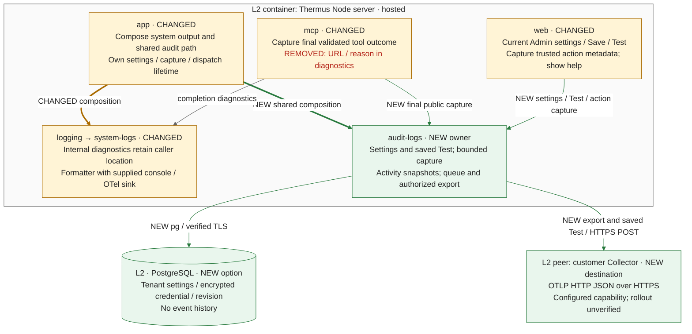

### Architecture comparison — complete Slice 2 stack against main

Final head: `785d2076e2db23b40b338c0e3e83b3e1ce857c6e`. Actual merge base: `b03e2d2c1ae55eed1d31e808e9a2dd65a6483220` (main).

Main has internal diagnostics and no customer audit export. This stack adds the audit-logs owner, optional PostgreSQL settings, and a customer Collector destination. Amber labels mark changed responsibilities, green labels mark additions, and red text marks removed diagnostic fields. This supplementary L3 is derived from code and prose; it does not assert a deployed integration.

Thick arrows show composition; solid arrows show runtime calls. The existing completion-diagnostic call stays neutral. Source-only contracts are not runtime calls: audit-logs' type-only ChangeOutcome dependency on organizations is omitted. Retained WorkOS, tool pipeline, renderer, browser-session and identity collaborations are omitted.

1. **Settings and Test:** Before, web had no destination settings. Current Admin access and trusted tenant now gate Read/Save/Test; Origin/CSRF protect Save/Test. The service encrypts tenant-bound credentials and uses atomic expected revisions; a semantic no-op keeps its revision, and an unconfirmed write gets no automatic replay. Test uses one fresh saved version, even when export is disabled, without enabling or saving it. A post-send read suppresses stale outcomes. SQL stores settings only; its failure leaves product access independent. [Service](https://github.com/tomer-mayara/Thermus/blob/785d2076e2db23b40b338c0e3e83b3e1ce857c6e/src/logs/audit/destination-settings-service.ts#L43-L115).
2. **Capture and diagnostics:** Before, fetch diagnostics included URL path and reason. Those fields are removed; final validated tool input/result and trusted Admin action metadata now enter the separate audit owner. Audit capture failure cannot change public results or replay completed writes; organizations also isolate a failed post-write recorder. Exported results have a 64 KiB bound and complete events a 128 KiB bound; the client result stays complete. The repair preserves recognized quoted enclosures, ordinary Markdown destinations with one inner parenthesis level, and autolinks. Unsupported/incomplete markup can still lose public syntax, even with `truncated: false`; arbitrary-secret detection is not promised. The escaped-quote slow scan is fixed, with finite performance evidence rather than a latency guarantee. Internal diagnostics retain caller location and synchronous sink failures; production composes a console sink, with no production OTel activation. [Before diagnostics](https://github.com/tomer-mayara/Thermus/blob/b03e2d2c1ae55eed1d31e808e9a2dd65a6483220/src/interfaces/mcp/tool-completion-record.ts#L7-L28) · [Capture](https://github.com/tomer-mayara/Thermus/blob/785d2076e2db23b40b338c0e3e83b3e1ce857c6e/src/interfaces/mcp/fetch-tool-server.ts#L66-L90) · [Console composition](https://github.com/tomer-mayara/Thermus/blob/785d2076e2db23b40b338c0e3e83b3e1ce857c6e/src/index.ts#L23-L25) · [Repair cases](https://github.com/tomer-mayara/Thermus/blob/785d2076e2db23b40b338c0e3e83b3e1ce857c6e/test/acceptance/logging/audit/audit-log.test.ts#L65-L80).
3. **Admission and authority:** Activity snapshots affect future capture only: unknown/disabled/expired snapshots drop the current event and never authorize sending. The bounded memory queue freshly checks enabled state and the captured revision before every attempt, then recovers that version's credential. Changed settings discard old work without retargeting it; failed reads start no send. Tenant FIFO includes backoff. At most three authorization cycles fit one 30-second age; only read-unavailable, busy or transient outcomes retry, with Retry-After as a minimum. Observed revisions can cancel conservatively, not establish a global order or recall a send already authorized. [Snapshots](https://github.com/tomer-mayara/Thermus/blob/785d2076e2db23b40b338c0e3e83b3e1ce857c6e/src/logs/audit/audit-snapshots.ts#L31-L46) · [Dispatch](https://github.com/tomer-mayara/Thermus/blob/785d2076e2db23b40b338c0e3e83b3e1ce857c6e/src/logs/audit/audit-collector.ts#L92-L152).
4. **Security and lifetime:** Saved Test and export share one sender with four native slots; Test's four outer operations and dispatch's two active exports, one per tenant, are separate bounds. The sender checks all DNS answers, pins the selected address and verifies TLS before payload/auth; redirects are refused. Its five-second caller outcome can precede physical settlement. Abort clears owned payload/auth, while read/native reservations remain charged until settlement. Close stops snapshots, clears/aborts dispatch, then closes SQL. Memory-only queues can lose events, and retries can duplicate receipt; no durable receipt/storage promise is added. [Shared composition](https://github.com/tomer-mayara/Thermus/blob/785d2076e2db23b40b338c0e3e83b3e1ce857c6e/src/app/logging-storage.ts#L35-L40) · [Outcome versus settlement](https://github.com/tomer-mayara/Thermus/blob/785d2076e2db23b40b338c0e3e83b3e1ce857c6e/src/logs/audit/audit-send.ts#L18-L29).

The registry has 11 blocks before and 13 after: context, hosted containers, overview and deployment change; settings/delivery and logs component views are added. Seven retained views are unchanged. [Before registry](https://github.com/tomer-mayara/Thermus/blob/b03e2d2c1ae55eed1d31e808e9a2dd65a6483220/architecture/components.md) · [After registry](https://github.com/tomer-mayara/Thermus/blob/785d2076e2db23b40b338c0e3e83b3e1ce857c6e/architecture/components.md). The local datastore and renderer placement stay unchanged. L4 is omitted: the added tracked-send contract and its authority/lifetime question are covered by this L3 and notes. The 800 px focused comparison is readable; inherited broad overview/deployment labels remain small. Full pins, all-view inventory, renders, contract analysis and limits are retained in `ast-report/merge-stack-architecture/v4/`. The bounded repair is complete. Complete-candidate gate results, manager review and current-head architect approval remain separate. Owner activation/release holds remain open.

The final follow-up changes only the existing audit-event-projection MI exception bound from 37 to 36.9, recording the exact score 36.99712939607105 behind the displayed 37.0. Production, test and registry bytes are unchanged; this records the exception accurately and supplies no new gate or approval claim.
