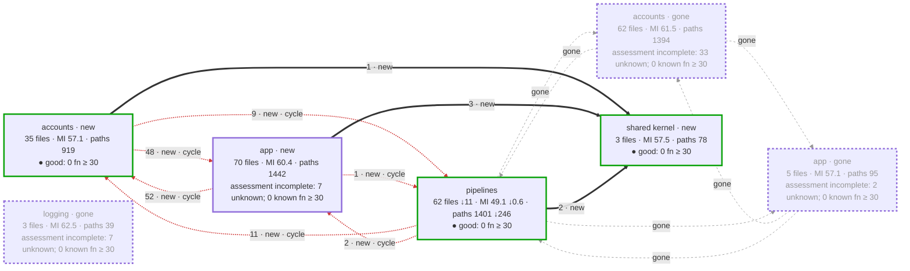
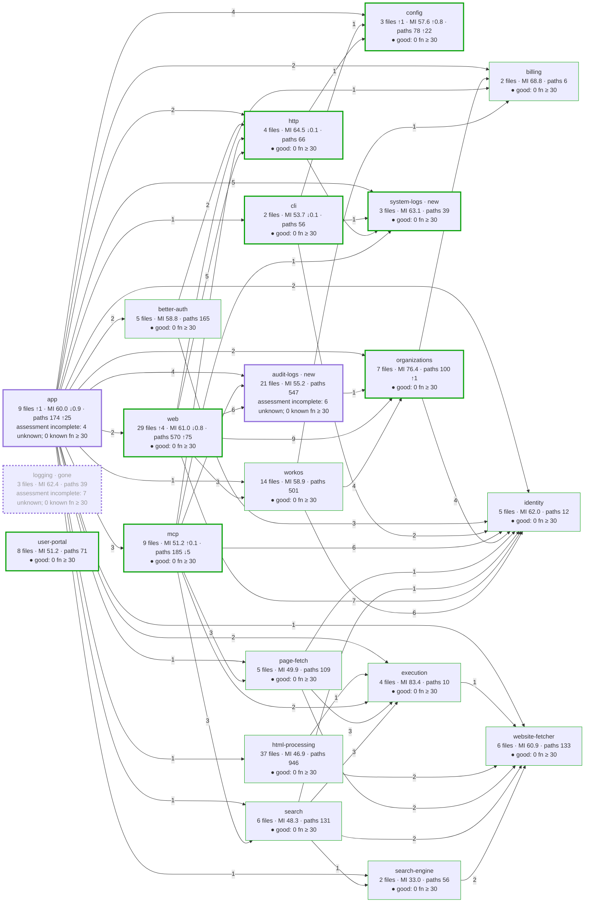
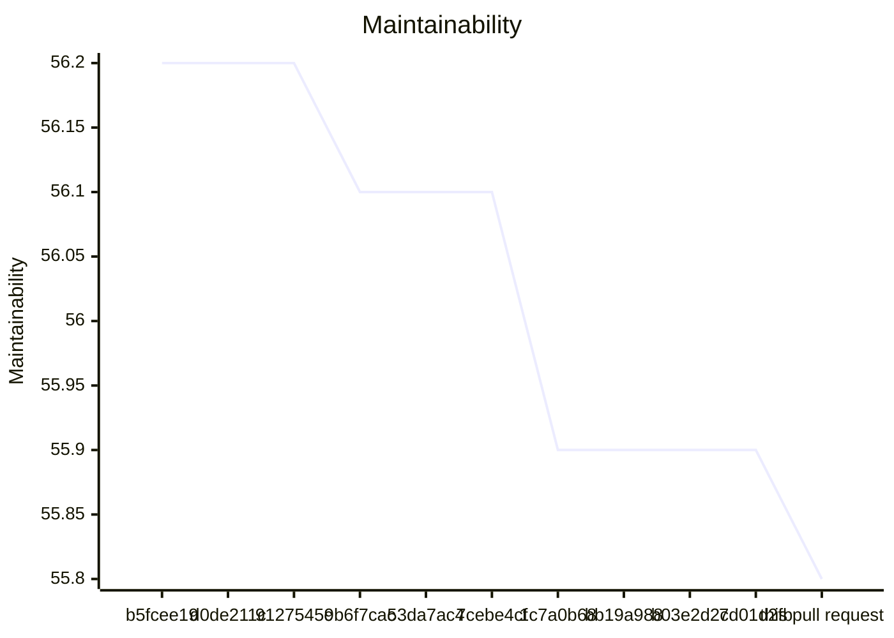
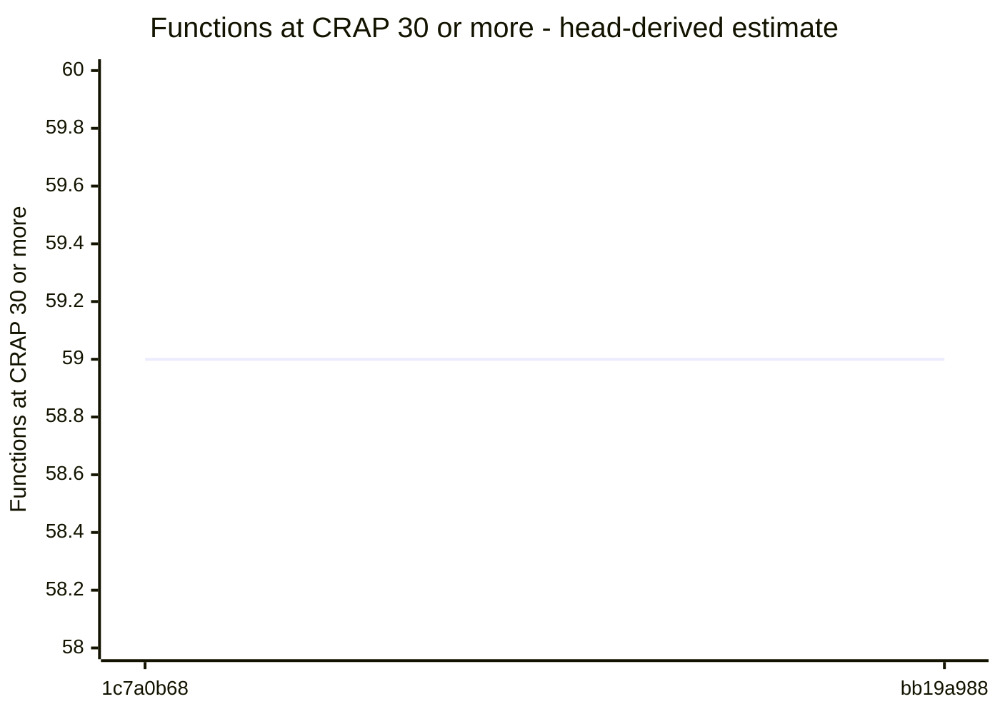
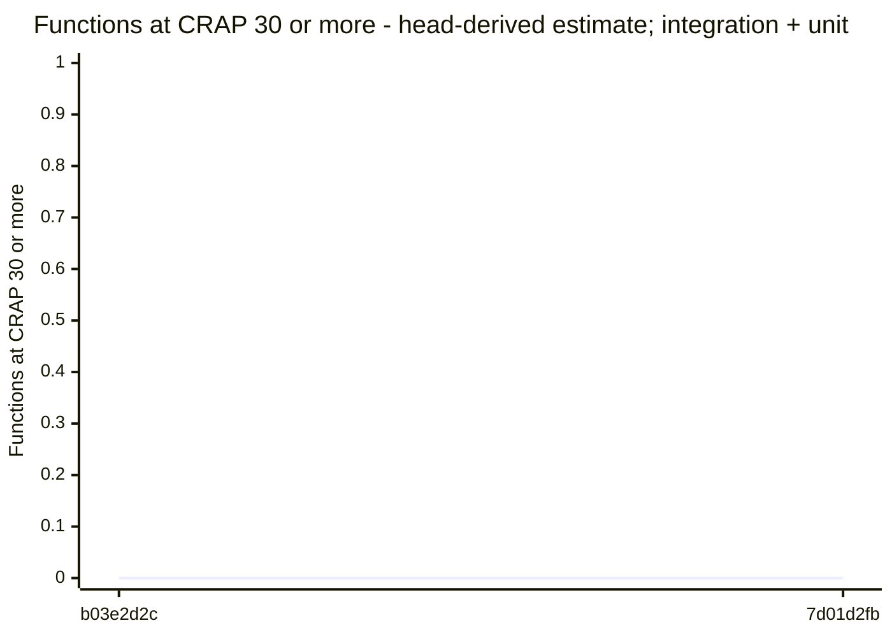

# Code quality process

## Delta

Status: goal miss.

```text
  37.0  src/logs/audit/audit-event-projection.ts  below 85
  40.5  src/logs/audit/audit-collector.ts  below 85
  41.7  src/logs/audit/destination-settings-service.ts  below 85
  41.9  src/logs/audit/bounded-sql-runtime.ts  below 85
  44.7  src/interfaces/mcp/fetch-tool-server.ts  below 85
  47.0  src/interfaces/user-portal/portal.ts  below 85
  47.8  src/interfaces/web/account/logging-routes.ts  below 85
  47.9  src/logs/audit/otlp-audit-response.ts  below 85
  49.3  src/logs/audit/audit-https-connection.ts  below 85
  50.0  src/interfaces/cli/local-auth-command.ts  below 85
  51.6  src/logs/audit/audit-snapshots.ts  below 85
  54.2  src/logs/audit/pg-destination-settings-store.ts  below 85
  54.6  src/logs/audit/otlp-audit-encoding.ts  below 85
  54.8  src/app/application.ts  below 85
  56.1  src/interfaces/web/account/administration-routes.ts  below 85
  56.2  src/app/hosted-workos-application.ts  below 85
  56.2  src/logs/system/system-logger.ts  below 85
  57.2  src/logs/audit/destination-credential-codec.ts  below 85
  59.5  src/runtime/http/fetch-exchange.ts  below 85
  59.5  src/logs/audit/audit-collector-state.ts  below 85
  60.0  src/runtime/config/logging-storage-config.ts  below 85
  60.1  src/interfaces/web/account/account-routes.ts  below 85
  60.3  src/index.ts  below 85
  60.3  src/logs/audit/public-audit-destination.ts  below 85
  60.4  src/logs/audit/otlp-audit-request.ts  below 85
  61.6  src/interfaces/web/account/account-form.ts  below 85
  64.7  src/logs/audit/otlp-audit-sender.ts  below 85
  64.9  src/interfaces/web/account/administration-pages.ts  below 85
  66.0  src/logs/audit/audit-content.ts  below 85
  67.6  src/logs/audit/audit-snapshot-state.ts  below 85
  67.7  src/app/fetch-tool.ts  below 85
  68.5  src/runtime/http/server.ts  below 85
  69.9  src/logs/audit/destination-endpoint.ts  below 85
  70.2  src/interfaces/mcp/fetch-tool-schema.ts  below 85
  71.8  src/interfaces/web/account/logging-test-page.ts  below 85
  72.9  src/interfaces/web/account/logging-page.ts  below 85
  73.8  src/logs/audit/destination-test.ts  below 85
  73.9  src/interfaces/web/account/logging-form.ts  below 85
  75.9  src/app/logging-storage.ts  below 85
  82.0  src/logs/system/otel-system-log-sink.ts  below 85
  83.0  src/logs/system/console-system-log-sink.ts  below 85
  83.0  src/interfaces/web/account/members-page-layout.ts  below 85
  83.1  src/interfaces/mcp/tool-completion-record.ts  below 85
  88.1  src/logs/audit/audit-log.ts
  89.2  src/accounts/organizations/change-records.ts
  112.1  src/logs/audit/audit-send.ts
  10.0  test/integration/mcp/fetch-tool-server.test.ts  no goal
  19.7  test/unit/logging/audit/audit-snapshots.test.ts  no goal
  19.8  test/acceptance/auth/self-hosted-container.test.ts  no goal
  20.5  test/unit/logging/audit/otlp-audit-sender.test.ts  no goal
  21.2  test/unit/logging/audit/audit-collector.test.ts  no goal
  22.6  test/acceptance/mcp/hosted-fetch-tool.test.ts  no goal
  22.7  test/unit/logging/audit/destination-test.test.ts  no goal
  24.1  test/integration/hosted-admin/account-routes-administration-pages.test.ts  no goal
  26.3  test/acceptance/logging/audit/hosted-storage-failure.runtime.ts  no goal
  26.5  test/unit/logging/audit/audit-capture.test.ts  no goal
  28.4  test/acceptance/mcp/self-hosted-fetch-tool.test.ts  no goal
  28.4  test/acceptance/user-portal/portal.test.ts  no goal
  29.2  test/integration/auth/hosted-organizations.test.ts  no goal
  29.6  test/integration/mcp/renderer-setup-report.test.ts  no goal
  30.0  test/integration/auth/local-installation.test.ts  no goal
  30.6  test/unit/logging/destination-settings-service.test.ts  no goal
  30.9  test/integration/server-stop-signals.test.ts  no goal
  31.1  test/acceptance/logging/hosted-destination-settings.test.ts  no goal
  31.5  test/acceptance/mcp/http-renderer-shutdown.test.ts  no goal
  31.8  test/support/container/audit-sender-site.ts  no goal
  32.2  test/acceptance/mcp/http-fetch.test.ts  no goal
  32.4  test/integration/logging/audit/audit-sender.runtime.ts  no goal
  33.0  test/acceptance/mcp/http-dns-cancellation.test.ts  no goal
  33.7  test/unit/http/server-responses.test.ts  no goal
  33.8  test/unit/logging/audit/bounded-sql-runtime.test.ts  no goal
  34.2  test/integration/auth/hosted-live-site/mcp.ts  no goal
  34.4  test/acceptance/mcp/http-shutdown.test.ts  no goal
  34.4  test/acceptance/logging/hosted-destination-test.test.ts  no goal
  34.7  test/unit/http/server-requests.test.ts  no goal
  34.8  test/integration/hosted-admin/account-routes-audit.test.ts  no goal
  34.8  test/integration/auth/hosted-administration.test.ts  no goal
  35.2  test/acceptance/logging/audit/hosted-customer-export.test.ts  no goal
  35.6  test/unit/user-portal/portal.test.ts  no goal
  35.8  test/integration/mcp/get-url-as-markdown-mcp.test.ts  no goal
  36.1  test/unit/html/logging-test-routes.test.ts  no goal
  36.3  test/acceptance/mcp/get-url-as-markdown.runtime.ts  no goal
  36.7  test/integration/logging/audit/destination-settings.runtime.ts  no goal
  36.8  test/acceptance/logging/audit/hosted-snapshot-composition.test.ts  no goal
  37.0  test/acceptance/auth/hosted-members.test.ts  no goal
  38.2  test/acceptance/logging/audit/hosted-audit-journey.runtime.ts  no goal
  38.2  test/unit/html/logging-routes.test.ts  no goal
  38.7  test/acceptance/logging/audit/administration-capture.test.ts  no goal
  39.4  test/unit/logging/audit/otlp-audit-encoding.test.ts  no goal
  39.5  test/integration/auth/local-auth-command-boundary.test.ts  no goal
  40.5  test/integration/hosted-admin/account-routes-logging.test.ts  no goal
  40.8  test/unit/logging/system/console-logger.test.ts  no goal
  41.0  test/support/in-process/mcp-audit-site.ts  no goal
  41.4  test/acceptance/logging/audit/destination-settings.runtime.ts  no goal
  41.6  test/acceptance/logging/audit/audit-log.test.ts  no goal
  41.7  test/acceptance/logging/audit/export-destination.test.ts  no goal
  41.7  test/unit/logging/audit/audit-collector-observation.test.ts  no goal
  42.5  test/support/in-process/hosted-audit-journey-site.ts  no goal
  42.7  test/unit/logging/audit/otlp-audit-request.test.ts  no goal
  43.1  test/acceptance/logging/audit/destination-test.test.ts  no goal
  43.1  test/acceptance/logging/audit/activity-snapshots.test.ts  no goal
  43.2  test/unit/logging/system/otel-logger.test.ts  no goal
  43.4  test/interface/logging/system/otel-logger.test.ts  no goal
  43.6  test/acceptance/mcp/customer-tool-capture.test.ts  no goal
  43.6  test/integration/auth/hosted-audit-snapshot-lifecycle.test.ts  no goal
  43.8  test/integration/logging/audit/logging-storage-export.test.ts  no goal
  45.1  test/unit/logging/audit/export-authorization.test.ts  no goal
  45.8  test/interface/logging/system/otel-logger-axiom.live.ts  no goal
  45.9  test/acceptance/work-slice/auth-workos-mcp-url-fetch/auth-workos-mcp-url-fetch.test.ts  no goal
  47.2  test/acceptance/mcp/renderer-setup-report.test.ts  no goal
  48.2  test/support/in-process/hosted-audit-snapshot-site.ts  no goal
  48.3  test/unit/logging/audit/public-audit-destination.test.ts  no goal
  48.5  test/interface/logging/system/axiom-logging.test.ts  no goal
  48.6  test/unit/logging/audit/audit-https-connection.test.ts  no goal
  48.8  test/integration/auth/hosted-storage-lifecycle.test.ts  no goal
  48.9  test/unit/config/logging-storage-config.test.ts  no goal
  49.6  test/acceptance/logging/audit/collector-dispatch.test.ts  no goal
  49.8  test/acceptance/logging/audit/hosted-storage-startup.test.ts  no goal
  50.2  test/integration/hosted-admin/fixtures/account-routes-fixtures.ts  no goal
  50.6  test/unit/logging/audit/pg-destination-settings-store.test.ts  no goal
  50.9  test/support/processes/audit-capture-export-probe.ts  no goal
  52.2  test/integration/auth/fixtures/local-auth-command-harness.ts  no goal
  53.4  test/support/in-process/logging-destination-test-site.ts  no goal
  53.6  test/acceptance/work-slice/basic-mcp-url-fetch/basic-mcp-url-fetch.test.ts  no goal
  54.4  test/unit/html/logging-form.test.ts  no goal
  54.6  test/unit/logging/audit/otlp-audit-response.test.ts  no goal
  54.8  test/support/in-process/audit-collector-site.ts  no goal
  55.8  test/support/doubles/logging/audit-export-sender-spy.ts  no goal
  55.9  test/support/in-process/axiom-test-export.ts  no goal
  56.2  test/unit/organizations/change-records.test.ts  no goal
  56.4  test/unit/logging/destination-credential-codec.test.ts  no goal
  56.7  test/unit/logging/audit/fixtures/audit-collector-fixtures.ts  no goal
  58.2  test/acceptance/logging/system/otel-logger.test.ts  no goal
  58.4  test/unit/mcp/tool-completion-record.test.ts  no goal
  58.6  test/support/container/audit-tls-receiver.ts  no goal
  59.2  test/integration/mcp/tool-completion-record.test.ts  no goal
  59.3  test/support/in-process/hosted-audit-export-site.ts  no goal
  59.3  test/support/processes/audit-destination-test-probe.ts  no goal
  59.4  test/support/in-process/audit-administration-site.ts  no goal
  60.2  test/support/in-process/postgres-settings-site.ts  no goal
  61.2  test/support/dsl/mcp-request-isolation.ts  no goal
  61.5  test/support/drivers/browser/hosted-browser.ts  no goal
  62.4  test/support/processes/audit-sender-probe.ts  no goal
  63.0  test/acceptance/logging/audit/audit-sender.test.ts  no goal
  63.5  test/unit/logging/audit/audit-log.test.ts  no goal
  63.7  test/acceptance/work-slice/auth-workos-mcp-url-fetch/auth-workos-mcp-url-fetch.ts  no goal
  64.1  test/acceptance/logging/system/system-log-sink.test.ts  no goal
  64.5  test/support/hosted-live/local-https-site.ts  no goal
  65.6  test/interface/logging/audit/destination-settings-store.test.ts  no goal
  65.8  test/unit/logging/audit/fixtures/audit-snapshot-fixtures.ts  no goal
  66.7  test/unit/logging/system/system-logger.test.ts  no goal
  67.4  test/acceptance/work-slice/basic-mcp-url-fetch/basic-mcp-url-fetch.ts  no goal
  72.2  test/support/processes/hosted-audit-journey-probe.ts  no goal
  72.3  test/support/in-process/audit-snapshot-site.ts  no goal
  72.5  test/support/doubles/logging/destination-settings-fake.ts  no goal
  72.9  test/support/doubles/logging/snapshot-settings-store-spy.ts  no goal
  72.9  test/support/doubles/mcp/fetch-operation-spy.ts  no goal
  84.4  test/support/in-process/workos-site.ts  no goal
  93.1  test/support/processes/module-paths.ts  no goal
  97.6  test/support/fixtures/hosted-placeholder.ts  no goal
  120.9  test/support/doubles/application/operator-log-spy.ts  no goal
  not measured  docs/api-surface/src/app/fetch-tool.d.ts
  not measured  docs/api-surface/src/index.d.ts
  not measured  docs/api-surface/src/interfaces/mcp/fetch-tool-schema.d.ts
  not measured  docs/api-surface/src/interfaces/web/account/account-form.d.ts
  not measured  docs/api-surface/src/logs/audit/audit-log.d.ts
  not measured  docs/api-surface/src/logs/audit/audit-send.d.ts
  not measured  docs/api-surface/src/logs/audit/destination-settings-service.d.ts
  not measured  docs/api-surface/src/logs/audit/otlp-audit-sender.d.ts
  not measured  docs/api-surface/src/logs/system/system-logger.d.ts
  not measured  src/interfaces/web/account/members-style.ts
  not measured  src/logs/audit/destination-settings-store.ts
Result: 43 of 46 production files below 85. Goal: 85 or more for each production file. 115 other files without a goal. 11 files not measured.
Comparison with origin/main: ast-report/compare.html
```

## Review

Status: goal miss.

## AST Metrics review

Thermus review policy: new-function warnings require >10 paths; high starts at 25. Approved layer rules use CR-13 resolved imports.

Regressions: 13 high, 28 medium, 5 low. Improvements: 3. Gate: failed.

### Regressions

- **high**: Maintainability index: 62 -&gt; 56 (below 85 is hard to maintain) (`src/app/hosted-workos-application.ts`, rule `maintainability-regression`)
  Refactor long or deeply nested functions and reduce responsibilities in this file
- **high**: Maintainability too low: got 46 (min: 85) (`src/interfaces/web/account/logging-routes.ts:19`, rule `new-violation:maintainability`)
- **high**: Maintainability too low: got 40 (min: 85) (`src/logs/audit/audit-collector.ts:11`, rule `new-violation:maintainability`)
- **high**: Maintainability too low: got 50 (min: 85) (`src/logs/audit/audit-snapshots.ts:16`, rule `new-violation:maintainability`)
- **high**: Maintainability too low: got 42 (min: 85) (`src/logs/audit/bounded-sql-runtime.ts:48`, rule `new-violation:maintainability`)
- **high**: Maintainability too low: got 57 (min: 85) (`src/logs/audit/destination-credential-codec.ts:3`, rule `new-violation:maintainability`)
- **high**: Maintainability too low: got 46 (min: 85) (`src/logs/audit/destination-settings-service.ts:36`, rule `new-violation:maintainability`)
- **high**: Maintainability too low: got 55 (min: 85) (`src/logs/audit/destination-test.ts:16`, rule `new-violation:maintainability`)
- **high**: Maintainability too low: got 71 (min: 85) (`src/logs/audit/otlp-audit-sender.ts:60`, rule `new-violation:maintainability`)
- **high**: Maintainability too low: got 56 (min: 85) (`src/logs/audit/pg-destination-settings-store.ts:15`, rule `new-violation:maintainability`)
- **high**: Maintainability too low: got 81 (min: 85) (`src/logs/system/console-system-log-sink.ts:22`, rule `new-violation:maintainability`)
- **high**: Maintainability too low: got 55 (min: 85) (`src/logs/system/system-logger.ts:26`, rule `new-violation:maintainability`)
- **high**: Maintainability index: 68 -&gt; 58 (below 85 is hard to maintain) (`test/unit/mcp/tool-completion-record.test.ts`, rule `maintainability-regression`)
  Refactor long or deeply nested functions and reduce responsibilities in this file
- **medium**: Cyclomatic complexity too high: got 48 (max: 40) (`src/app/application.ts`, rule `new-violation:cyclomatic_complexity`)
- **medium**: Too many Lines of code (176 &gt; 150) (`src/app/hosted-workos-application.ts`, rule `new-violation:max_loc`)
- **medium**: Cyclomatic complexity too high: got 46 (max: 40) (`src/interfaces/mcp/fetch-tool-server.ts`, rule `new-violation:cyclomatic_complexity`)
- **medium**: Too many Lines of code (167 &gt; 150) (`src/interfaces/mcp/fetch-tool-server.ts`, rule `new-violation:max_loc`)
- **medium**: Cyclomatic complexity: 10 -&gt; 15 (threshold: 10) (`src/interfaces/mcp/fetch-tool-server.ts:35`, rule `complexity-regression`, `callTool`)
  Extract smaller, well-named functions to reduce decision points
- **medium**: Cyclomatic complexity: 8 -&gt; 11 (threshold: 10) (`src/interfaces/mcp/fetch-tool-server.ts:96`, rule `complexity-regression`, `safeFailure`)
  Extract smaller, well-named functions to reduce decision points
- **medium**: Cyclomatic complexity: 10 -&gt; 11 (threshold: 10) (`src/interfaces/web/account/administration-routes.ts:157`, rule `complexity-regression`, `AdministrationRoutes::changeOnPost`)
  Extract smaller, well-named functions to reduce decision points
- **medium**: New function with cyclomatic complexity 11 (threshold: 10) (`src/interfaces/web/account/logging-form.ts:6`, rule `new-complex-function`, `loggingForm`)
  Extract smaller, well-named functions to reduce decision points
- **medium**: Cyclomatic complexity too high: got 44 (max: 40) (`src/interfaces/web/account/logging-routes.ts`, rule `new-violation:cyclomatic_complexity`)
- **medium**: New function with cyclomatic complexity 13 (threshold: 10) (`src/interfaces/web/account/logging-routes.ts:30`, rule `new-complex-function`, `logging-routes\LoggingRoutes.`)
  Extract smaller, well-named functions to reduce decision points
- **medium**: Cyclomatic complexity too high: got 70 (max: 40) (`src/logs/audit/audit-collector.ts`, rule `new-violation:cyclomatic_complexity`)
- **medium**: Too many Lines of code (153 &gt; 150) (`src/logs/audit/audit-collector.ts`, rule `new-violation:max_loc`)
- **medium**: New function with cyclomatic complexity 11 (threshold: 10) (`src/logs/audit/audit-collector.ts:29`, rule `new-complex-function`, `AuditCollector::admit`)
  Extract smaller, well-named functions to reduce decision points
- **medium**: Cyclomatic complexity too high: got 54 (max: 40) (`src/logs/audit/audit-event-projection.ts`, rule `new-violation:cyclomatic_complexity`)
- **medium**: New function with cyclomatic complexity 13 (threshold: 10) (`src/logs/audit/audit-event-projection.ts:30`, rule `new-complex-function`, `inputOf`)
  Extract smaller, well-named functions to reduce decision points
- **medium**: New function with cyclomatic complexity 11 (threshold: 10) (`src/logs/audit/audit-event-projection.ts:62`, rule `new-complex-function`, `projectAdministrationChange`)
  Extract smaller, well-named functions to reduce decision points
- **medium**: Cyclomatic complexity too high: got 49 (max: 40) (`src/logs/audit/audit-snapshots.ts`, rule `new-violation:cyclomatic_complexity`)
- **medium**: Cyclomatic complexity too high: got 46 (max: 40) (`src/logs/audit/bounded-sql-runtime.ts`, rule `new-violation:cyclomatic_complexity`)
- **medium**: Too many Lines of code (173 &gt; 150) (`src/logs/audit/bounded-sql-runtime.ts`, rule `new-violation:max_loc`)
- **medium**: New function with cyclomatic complexity 14 (threshold: 10) (`src/logs/audit/destination-endpoint.ts:3`, rule `new-complex-function`, `validDestinationEndpoint`)
  Extract smaller, well-named functions to reduce decision points
- **medium**: Cyclomatic complexity too high: got 78 (max: 40) (`src/logs/audit/destination-settings-service.ts`, rule `new-violation:cyclomatic_complexity`)
- **medium**: Too many Lines of code (153 &gt; 150) (`src/logs/audit/destination-settings-service.ts`, rule `new-violation:max_loc`)
- **medium**: New function with cyclomatic complexity 13 (threshold: 10) (`src/logs/audit/destination-settings-service.ts:99`, rule `new-complex-function`, `DestinationSettingsService::save`)
  Extract smaller, well-named functions to reduce decision points
- **medium**: New function with cyclomatic complexity 14 (threshold: 10) (`src/logs/audit/destination-settings-service.ts:65`, rule `new-complex-function`, `DestinationSettingsService::testSaved`)
  Extract smaller, well-named functions to reduce decision points
- **medium**: New function with cyclomatic complexity 11 (threshold: 10) (`src/logs/audit/destination-settings-service.ts:137`, rule `new-complex-function`, `invalidInput`)
  Extract smaller, well-named functions to reduce decision points
- **medium**: New function with cyclomatic complexity 15 (threshold: 10) (`src/logs/audit/otlp-audit-encoding.ts:22`, rule `new-complex-function`, `eventAttributes`)
  Extract smaller, well-named functions to reduce decision points
- **medium**: LLOC too high in method requestAuditExport(): got 21 (max: 20) (`src/logs/audit/otlp-audit-request.ts:8`, rule `new-violation:lloc_by_method`)
- **medium**: New function with cyclomatic complexity 13 (threshold: 10) (`src/logs/audit/public-audit-destination.ts:24`, rule `new-complex-function`, `parseAuditDestination`)
  Extract smaller, well-named functions to reduce decision points
- **low**: Efferent coupling too high: got 11 (max: 10) (`src/index.ts`, rule `new-violation:efferent_coupling`)
- **low**: Efferent coupling too high: got 15 (max: 10) (`src/interfaces/web/account/logging-routes.ts`, rule `new-violation:efferent_coupling`)
- **low**: Efferent coupling too high: got 12 (max: 10) (`src/logs/audit/audit-collector.ts`, rule `new-violation:efferent_coupling`)
- **low**: Efferent coupling too high: got 12 (max: 10) (`src/logs/audit/otlp-audit-sender.ts`, rule `new-violation:efferent_coupling`)
- **low**: Efferent coupling too high: got 11 (max: 10) (`src/runtime/http/server.ts`, rule `new-violation:efferent_coupling`)

### Improvements

- **low**: Maintainability index: 61 -&gt; 70 (`src/interfaces/mcp/fetch-tool-schema.ts`, rule `maintainability-improvement`)
- **low**: Maintainability index: 55 -&gt; 83 (`src/interfaces/mcp/tool-completion-record.ts`, rule `maintainability-improvement`)
- **low**: Maintainability index: 49 -&gt; 59 (`test/integration/mcp/tool-completion-record.test.ts`, rule `maintainability-improvement`)

## CRAP

Status: goal miss.

Reused verified compatible unit + integration coverage.

## CRAP goals

Goals: CRAP < 30; new functions also CRAP ≤ 15.

| File | Function | Change | Paths | Coverage | CRAP | To do |
| --- | --- | --- | --- | --- | --- | --- |
| src/interfaces/mcp/fetch-tool-server.ts | callTool | changed | 15 | 99.7% | 15.000006075 | ok; for 15: cover ≥ 100% |
| src/logs/audit/otlp-audit-encoding.ts | eventAttributes | new | 15 | 100% | 15.0 | ok |
| src/logs/audit/destination-endpoint.ts | validDestinationEndpoint | new | 14 | 98.2% | 14.0 | ok |
| src/logs/audit/destination-settings-service.ts | destination-settings-service\DestinationSettingsService.testSaved | new | 14 | 100% | 14.0 | ok |
| src/logs/audit/public-audit-destination.ts | parseAuditDestination | new | 13 | 89.9% | 13.2 | ok |
| src/logs/audit/audit-event-projection.ts | inputOf | new | 13 | 91.5% | 13.1 | ok |
| src/interfaces/web/account/logging-routes.ts | logging-routes\LoggingRoutes. | new | 13 | 95.9% | 13.0 | ok |
| src/logs/audit/destination-settings-service.ts | destination-settings-service\DestinationSettingsService.save | new | 13 | 100% | 13.0 | ok |
| src/logs/audit/audit-event-projection.ts | projectAdministrationChange | new | 11 | 95.7% | 11.0 | ok |
| src/logs/audit/audit-collector.ts | audit-collector\AuditCollector.admit | new | 11 | 96.3% | 11.0 | ok |
| src/interfaces/mcp/fetch-tool-server.ts | safeFailure | changed | 11 | 99.2% | 11.0 | ok |
| src/interfaces/web/account/administration-routes.ts | administration-routes\AdministrationRoutes.changeOnPost | changed | 11 | 100% | 11.0 | ok |
| src/interfaces/web/account/logging-form.ts | loggingForm | new | 11 | 100% | 11.0 | ok |
| src/logs/audit/destination-settings-service.ts | invalidInput | new | 11 | 100% | 11.0 | ok |
| src/logs/audit/destination-settings-service.ts | destination-settings-service\DestinationSettingsService.authorizeExport | new | 10 | 93.7% | 10.0 | ok |
| src/logs/audit/destination-settings-service.ts | destination-settings-service\DestinationSettingsService.token | new | 10 | 97.2% | 10.0 | ok |
| src/interfaces/mcp/fetch-tool-server.ts | safeSearchFailure | unchanged | 10 | 99.1% | 10.0 | ok; unchanged by this PR |
| src/interfaces/user-portal/portal.ts | productAccess | unchanged | 10 | 99.3% | 10.0 | ok; unchanged by this PR |
| src/logs/audit/audit-snapshots.ts | audit-snapshots\AuditSnapshots.read | new | 10 | 99.4% | 10.0 | ok |
| src/logs/audit/audit-event-projection.ts | projectToolCompletion | new | 9 | 98.9% | 9.0 | ok |
| src/logs/audit/otlp-audit-response.ts | interpretAuditResponse | new | 9 | 99.5% | 9.0 | ok |
| src/logs/audit/otlp-audit-response.ts | accepted | new | 9 | 100% | 9.0 | ok |
| src/interfaces/web/account/logging-routes.ts | logging-routes\LoggingRoutes.save | new | 8 | 86.8% | 8.1 | ok |
| src/logs/audit/audit-collector.ts | audit-collector\AuditCollector.dispatch | new | 8 | 89.7% | 8.1 | ok |
| src/logs/audit/audit-event-projection.ts | contextOf | new | 8 | 97.6% | 8.0 | ok |
| src/logs/audit/audit-collector.ts | audit-collector\AuditCollector.pump | new | 8 | 98.1% | 8.0 | ok |
| src/logs/audit/audit-collector-state.ts | retryDelay | new | 8 | 98.2% | 8.0 | ok |
| src/app/hosted-workos-application.ts | composeWorkOSApplication | changed | 8 | 100% | 8.0 | ok |
| src/interfaces/web/account/logging-routes.ts | logging-routes\LoggingRoutes.test | new | 8 | 100% | 8.0 | ok |
| src/logs/audit/audit-snapshots.ts | audit-snapshots\AuditSnapshots.writeAuditEvent | new | 8 | 100% | 8.0 | ok |
| src/runtime/config/logging-storage-config.ts | loadLoggingStorageConfig | new | 8 | 100% | 8.0 | ok |
| src/interfaces/web/account/logging-routes.ts | logging-routes\LoggingRoutes.saveAnswer | new | 6 | 62.1% | 8.0 | ok |
| src/logs/audit/bounded-sql-runtime.ts | connectionOptions | new | 7 | 84.4% | 7.2 | ok |
| src/logs/audit/audit-collector.ts | audit-collector\AuditCollector.startAttempt | new | 7 | 97% | 7.0 | ok |
| src/app/application.ts | (anonymous) | unchanged | 7 | 100% | 7.0 | ok; unchanged by this PR |
| src/logs/audit/bounded-sql-runtime.ts | bounded-sql-runtime\BoundedSqlRuntime.execute | new | 7 | 100% | 7.0 | ok |
| src/runtime/config/logging-storage-config.ts | validDatabaseUri | new | 7 | 100% | 7.0 | ok |
| src/interfaces/web/account/administration-routes.ts | administration-routes\AdministrationRoutes.keep | new | 6 | 95.8% | 6.0 | ok |
| src/logs/audit/audit-content.ts | redactTextMatch | new | 6 | 97.1% | 6.0 | ok |
| src/logs/system/system-logger.ts | system-logger\SystemLogger.siteOfFrame | unchanged | 6 | 98.1% | 6.0 | ok; unchanged by this PR |
| src/interfaces/cli/local-auth-command.ts | perform | unchanged | 6 | 100% | 6.0 | ok; unchanged by this PR |
| src/interfaces/web/account/account-form.ts | account-form\ReturnDestinations.check | unchanged | 6 | 100% | 6.0 | ok; unchanged by this PR |
| src/interfaces/web/account/account-form.ts | invitationIn | unchanged | 6 | 100% | 6.0 | ok; unchanged by this PR |
| src/interfaces/web/account/account-routes.ts | account-routes\HostedAccountRoutes.organizationPage | unchanged | 6 | 100% | 6.0 | ok; unchanged by this PR |
| src/interfaces/web/account/account-routes.ts | account-routes\HostedAccountRoutes.selectOrganization | unchanged | 6 | 100% | 6.0 | ok; unchanged by this PR |
| src/logs/audit/audit-collector.ts | audit-collector\AuditCollector.capacity | new | 6 | 100% | 6.0 | ok |
| src/logs/audit/otlp-audit-sender.ts | failureOutcome | new | 6 | 100% | 6.0 | ok |
| src/logs/audit/bounded-sql-runtime.ts | validateBounds | new | 5 | 80.8% | 5.2 | ok |
| src/app/logging-storage.ts | openLoggingStorage | new | 3 | 38.5% | 5.1 | ok |
| src/interfaces/web/account/account-form.ts | readForm | unchanged | 5 | 94.6% | 5.0 | ok; unchanged by this PR |
| src/logs/audit/public-audit-destination.ts | publicAddress | new | 5 | 95% | 5.0 | ok |
| src/logs/audit/otlp-audit-response.ts | retryDelay | new | 5 | 97.1% | 5.0 | ok |
| src/interfaces/user-portal/portal.ts | sessionView | unchanged | 5 | 97.5% | 5.0 | ok; unchanged by this PR |
| src/interfaces/user-portal/portal.ts | renderSignedIn | unchanged | 5 | 98.5% | 5.0 | ok; unchanged by this PR |
| src/logs/audit/otlp-audit-request.ts | (anonymous) | new | 5 | 99.3% | 5.0 | ok |
| src/interfaces/user-portal/portal.ts | showProductAccess | unchanged | 5 | 99.6% | 5.0 | ok; unchanged by this PR |
| src/interfaces/web/account/members-page-layout.ts | membersPageLayout | changed | 5 | 99.7% | 5.0 | ok |
| src/interfaces/user-portal/portal.ts | initializePortal | unchanged | 5 | 100% | 5.0 | ok; unchanged by this PR |
| src/interfaces/web/account/account-routes.ts | account-routes\HostedAccountRoutes.tenantOperation | changed | 5 | 100% | 5.0 | ok |
| src/interfaces/web/account/logging-page.ts | loggingPage | new | 5 | 100% | 5.0 | ok |
| src/logs/audit/audit-collector.ts | audit-collector\AuditCollector.settingsObserved | new | 5 | 100% | 5.0 | ok |
| src/logs/audit/audit-event-projection.ts | inputText | new | 5 | 100% | 5.0 | ok |
| src/logs/audit/audit-snapshot-state.ts | snapshotFrom | new | 5 | 100% | 5.0 | ok |
| src/logs/audit/audit-snapshots.ts | audit-snapshots\AuditSnapshots.loadLater | new | 5 | 100% | 5.0 | ok |
| src/logs/audit/destination-settings-service.ts | retainedToken | new | 5 | 100% | 5.0 | ok |
| src/logs/audit/otlp-audit-encoding.ts | timestampNanos | new | 5 | 100% | 5.0 | ok |
| src/logs/audit/pg-destination-settings-store.ts | pg-destination-settings-store\PgDestinationSettingsStore. | new | 5 | 100% | 5.0 | ok |
| src/logs/audit/public-audit-destination.ts | resolveAuditAddress | new | 5 | 100% | 5.0 | ok |
| src/logs/audit/public-audit-destination.ts | sameAuditAddress | new | 5 | 100% | 5.0 | ok |
| src/runtime/http/fetch-exchange.ts | sendResponse | unchanged | 5 | 100% | 5.0 | ok; unchanged by this PR |
| src/index.ts | run | changed | 4 | 77.8% | 4.2 | ok |
| src/logs/audit/audit-collector-state.ts | collectorBounds | new | 4 | 80.5% | 4.1 | ok |
| src/logs/system/system-logger.ts | system-logger\SystemLogger.callSite | unchanged | 4 | 81.8% | 4.1 | ok; unchanged by this PR |
| src/logs/audit/audit-snapshot-state.ts | snapshotBounds | new | 4 | 82.1% | 4.1 | ok |
| src/logs/system/system-logger.ts | system-logger\SystemLogger.placeOfFrame | unchanged | 4 | 96.6% | 4.0 | ok; unchanged by this PR |
| src/logs/audit/audit-collector.ts | audit-collector\AuditCollector.release | new | 4 | 96.9% | 4.0 | ok |
| src/logs/audit/audit-https-connection.ts | connectAuditTls | new | 4 | 99.3% | 4.0 | ok |
| src/runtime/http/fetch-exchange.ts | serve | unchanged | 4 | 99.4% | 4.0 | ok; unchanged by this PR |
| src/app/application.ts | (anonymous) | unchanged | 4 | 100% | 4.0 | ok; unchanged by this PR |
| src/interfaces/web/account/account-form.ts | formFields | changed | 4 | 100% | 4.0 | ok |
| src/interfaces/web/account/account-form.ts | invitationChangeIn | unchanged | 4 | 100% | 4.0 | ok; unchanged by this PR |
| src/interfaces/web/account/account-form.ts | isSessionToken | unchanged | 4 | 100% | 4.0 | ok; unchanged by this PR |
| src/interfaces/web/account/account-form.ts | selectionIn | unchanged | 4 | 100% | 4.0 | ok; unchanged by this PR |
| src/interfaces/web/account/account-routes.ts | deepFreeze | unchanged | 4 | 100% | 4.0 | ok; unchanged by this PR |
| src/interfaces/web/account/administration-routes.ts | administration-routes\AdministrationRoutes.page | unchanged | 4 | 100% | 4.0 | ok; unchanged by this PR |
| src/interfaces/web/account/logging-routes.ts | logging-routes\LoggingRoutes.handlerFor | new | 4 | 100% | 4.0 | ok |
| src/logs/audit/audit-collector.ts | audit-collector\AuditCollector.backoff | new | 4 | 100% | 4.0 | ok |
| src/logs/audit/audit-content.ts | prefixWithin | new | 4 | 100% | 4.0 | ok |
| src/logs/audit/audit-event-projection.ts | metadata | new | 4 | 100% | 4.0 | ok |
| src/logs/audit/audit-event-projection.ts | projectDestinationChange | new | 4 | 100% | 4.0 | ok |
| src/logs/audit/audit-snapshot-state.ts | boundedSnapshotText | new | 4 | 100% | 4.0 | ok |
| src/logs/audit/audit-snapshots.ts | audit-snapshots\AuditSnapshots.close | new | 4 | 100% | 4.0 | ok |
| src/logs/audit/audit-snapshots.ts | audit-snapshots\AuditSnapshots.makeRoom | new | 4 | 100% | 4.0 | ok |
| src/logs/audit/destination-credential-codec.ts | destination-credential-codec\DestinationCredentialCodec.decrypt | new | 4 | 100% | 4.0 | ok |
| src/logs/audit/destination-settings-service.ts | destination-settings-service\DestinationSettingsService.read | new | 4 | 100% | 4.0 | ok |
| src/logs/audit/destination-settings-service.ts | matchesSavedSettings | new | 4 | 100% | 4.0 | ok |
| src/logs/audit/otlp-audit-encoding.ts | encodeAuditEvent | new | 4 | unknown | ≥ 4 | no coverage data |
| src/runtime/config/logging-storage-config.ts | validateCertificates | new | 4 | 100% | 4.0 | ok |
| src/logs/audit/otlp-audit-encoding.ts | stringAttribute | new | 3 | 78.2% | 3.1 | ok |
| src/logs/audit/audit-content.ts | redactParameter | new | 3 | 78.3% | 3.1 | ok |
| src/logs/system/system-logger.ts | system-logger\SystemLogger.toPath | unchanged | 3 | 79.1% | 3.1 | ok; unchanged by this PR |
| src/runtime/config/logging-storage-config.ts | explicitCredentials | new | 3 | 83% | 3.0 | ok |
| src/logs/audit/audit-snapshot-state.ts | detachedAuditEvent | new | 3 | 93.4% | 3.0 | ok |
| src/logs/audit/otlp-audit-sender.ts | attempt | new | 3 | 93.4% | 3.0 | ok |
| src/app/hosted-workos-application.ts | workosProviderParts | unchanged | 3 | 94.3% | 3.0 | ok; unchanged by this PR |
| src/app/hosted-workos-application.ts | openWorkOSApplication | changed | 3 | 94.9% | 3.0 | ok |
| src/interfaces/cli/local-auth-command.ts | parsedCommand | unchanged | 3 | 95.6% | 3.0 | ok; unchanged by this PR |
| src/interfaces/web/account/administration-routes.ts | administration-routes\AdministrationRoutes. | unchanged | 3 | 96.8% | 3.0 | ok; unchanged by this PR |
| src/runtime/http/fetch-exchange.ts | fetchRequest | unchanged | 3 | 97.3% | 3.0 | ok; unchanged by this PR |
| src/logs/audit/audit-collector.ts | audit-collector\AuditCollector.discardRevision | new | 3 | 97.5% | 3.0 | ok |
| src/interfaces/web/account/administration-pages.ts | membersPage | unchanged | 3 | 97.9% | 3.0 | ok; unchanged by this PR |
| src/accounts/organizations/change-records.ts | change-records\ChangeRecording.keep | changed | 3 | 100% | 3.0 | ok |
| src/accounts/organizations/change-records.ts | change-records\ChangeRecording.recordingFailure | unchanged | 3 | 100% | 3.0 | ok; unchanged by this PR |
| src/app/fetch-tool.ts | (anonymous) | unchanged | 3 | 100% | 3.0 | ok; unchanged by this PR |
| src/interfaces/cli/local-auth-command.ts | runLocalAuthCommand | unchanged | 3 | 100% | 3.0 | ok; unchanged by this PR |
| src/interfaces/mcp/fetch-tool-schema.ts | parseFetchToolArguments | unchanged | 3 | 100% | 3.0 | ok; unchanged by this PR |
| src/interfaces/mcp/fetch-tool-server.ts | emitCompletion | changed | 3 | 100% | 3.0 | ok |
| src/interfaces/mcp/tool-completion-record.ts | formatToolCompletion | changed | 3 | 100% | 3.0 | ok |
| src/interfaces/user-portal/portal.ts | renderError | unchanged | 3 | 100% | 3.0 | ok; unchanged by this PR |
| src/interfaces/web/account/account-form.ts | readBody | unchanged | 3 | 100% | 3.0 | ok; unchanged by this PR |
| src/interfaces/web/account/account-routes.ts | account-routes\HostedAccountRoutes.answerSignedIn | unchanged | 3 | 100% | 3.0 | ok; unchanged by this PR |
| src/interfaces/web/account/account-routes.ts | account-routes\HostedAccountRoutes.route | unchanged | 3 | 100% | 3.0 | ok; unchanged by this PR |
| src/interfaces/web/account/account-routes.ts | account-routes\HostedAccountRoutes.switchAnswer | unchanged | 3 | 100% | 3.0 | ok; unchanged by this PR |
| src/interfaces/web/account/account-routes.ts | requireTrustedTenant | unchanged | 3 | 100% | 3.0 | ok; unchanged by this PR |
| src/interfaces/web/account/account-routes.ts | withCookies | unchanged | 3 | 100% | 3.0 | ok; unchanged by this PR |
| src/logs/audit/audit-collector.ts | audit-collector\AuditCollector.schedule | new | 3 | 100% | 3.0 | ok |
| src/logs/audit/audit-content.ts | captureAuditResult | new | 3 | unknown | ≥ 3 | no coverage data |
| src/logs/audit/audit-https-connection.ts | (anonymous) | new | 3 | 100% | 3.0 | ok |
| src/logs/audit/audit-log.ts | audit-log\AuditLog.administrationChanged | new | 3 | 100% | 3.0 | ok |
| src/logs/audit/audit-log.ts | audit-log\AuditLog.destinationChanged | new | 3 | 100% | 3.0 | ok |
| src/logs/audit/audit-log.ts | audit-log\AuditLog.toolCompleted | new | 3 | 100% | 3.0 | ok |
| src/logs/audit/audit-snapshots.ts | audit-snapshots\AuditSnapshots. | new | 3 | 100% | 3.0 | ok |
| src/logs/audit/audit-snapshots.ts | audit-snapshots\AuditSnapshots.current | new | 3 | 100% | 3.0 | ok |
| src/logs/audit/audit-snapshots.ts | audit-snapshots\AuditSnapshots.expire | new | 3 | 100% | 3.0 | ok |
| src/logs/audit/audit-snapshots.ts | audit-snapshots\AuditSnapshots.residentFor | new | 3 | 100% | 3.0 | ok |
| src/logs/audit/bounded-sql-runtime.ts | bounded-sql-runtime\BoundedSqlRuntime.run | new | 3 | 100% | 3.0 | ok |
| src/logs/audit/destination-test.ts | destination-test\DestinationTestLifetime.run | new | 3 | 100% | 3.0 | ok |
| src/logs/audit/otlp-audit-request.ts | (anonymous) | new | 3 | 100% | 3.0 | ok |
| src/logs/audit/otlp-audit-response.ts | record | new | 3 | 100% | 3.0 | ok |
| src/logs/audit/otlp-audit-sender.ts | otlp-audit-sender\OtlpAuditSender.start | new | 3 | 100% | 3.0 | ok |
| src/logs/system/system-logger.ts | system-logger\SystemLogger.messageOf | new | 3 | 100% | 3.0 | ok |
| src/runtime/http/fetch-exchange.ts | sendBody | unchanged | 3 | 100% | 3.0 | ok; unchanged by this PR |
| src/runtime/http/server.ts | closeServer | unchanged | 3 | 100% | 3.0 | ok; unchanged by this PR |
| src/logs/audit/otlp-audit-request.ts | (anonymous) | new | 2 | 81.1% | 2.0 | ok |
| src/runtime/http/fetch-exchange.ts | errorName | unchanged | 2 | 82.1% | 2.0 | ok; unchanged by this PR |
| src/logs/audit/bounded-sql-runtime.ts | bounded-sql-runtime\BoundedSqlRuntime. | new | 2 | 83.1% | 2.0 | ok |
| src/logs/audit/destination-endpoint.ts | publicIpv6 | new | 2 | 83.4% | 2.0 | ok |
| src/logs/system/system-logger.ts | system-logger\SystemLogger.withCallSite | unchanged | 2 | 90.6% | 2.0 | ok; unchanged by this PR |
| src/logs/system/console-system-log-sink.ts | paint | unchanged | 2 | 91.9% | 2.0 | ok; unchanged by this PR |
| src/logs/audit/bounded-sql-runtime.ts | createPgSettingsRuntime | new | 2 | 96.3% | 2.0 | ok |
| src/logs/audit/audit-https-connection.ts | (anonymous) | new | 2 | 96.8% | 2.0 | ok |
| src/interfaces/web/account/administration-pages.ts | sendForm | unchanged | 2 | 98.3% | 2.0 | ok; unchanged by this PR |
| src/runtime/http/fetch-exchange.ts | requestHeaders | unchanged | 2 | 98.4% | 2.0 | ok; unchanged by this PR |
| src/accounts/organizations/change-records.ts | change-records\ChangeRecording.run | unchanged | 2 | 100% | 2.0 | ok; unchanged by this PR |
| src/app/application.ts | (anonymous) | unchanged | 2 | 100% | 2.0 | ok; unchanged by this PR |
| src/app/application.ts | (anonymous) | unchanged | 2 | 100% | 2.0 | ok; unchanged by this PR |
| src/app/application.ts | (anonymous) | new | 2 | 100% | 2.0 | ok |
| src/app/application.ts | (anonymous) | new | 1 | 0% | 2.0 | ok |
| src/app/application.ts | createApplication | changed | 2 | 100% | 2.0 | ok |
| src/app/fetch-tool.ts | adCleaner | unchanged | 2 | 100% | 2.0 | ok; unchanged by this PR |
| src/app/hosted-workos-application.ts | (anonymous) | new | 1 | 0% | 2.0 | ok |
| src/app/hosted-workos-application.ts | (anonymous) | unchanged | 1 | 0% | 2.0 | ok; unchanged by this PR |
| src/app/hosted-workos-application.ts | (anonymous) | new | 1 | 0% | 2.0 | ok |
| src/app/hosted-workos-application.ts | (anonymous) | unchanged | 1 | 0% | 2.0 | ok; unchanged by this PR |
| src/app/hosted-workos-application.ts | (anonymous) | unchanged | 2 | 100% | 2.0 | ok; unchanged by this PR |
| src/app/hosted-workos-application.ts | (anonymous) | unchanged | 2 | 100% | 2.0 | ok; unchanged by this PR |
| src/index.ts | arm | unchanged | 2 | unknown | ≥ 2 | no coverage data; unchanged by this PR |
| src/index.ts | dispose | unchanged | 2 | 100% | 2.0 | ok; unchanged by this PR |
| src/index.ts | hostedShutdownDeadline | changed | 1 | 0% | 2.0 | ok |
| src/interfaces/cli/local-auth-command.ts | (anonymous) | unchanged | 2 | 100% | 2.0 | ok; unchanged by this PR |
| src/interfaces/cli/local-auth-command.ts | (anonymous) | unchanged | 2 | 100% | 2.0 | ok; unchanged by this PR |
| src/interfaces/cli/local-auth-command.ts | accountTable | unchanged | 2 | 100% | 2.0 | ok; unchanged by this PR |
| src/interfaces/cli/local-auth-command.ts | enteredLine | unchanged | 2 | 100% | 2.0 | ok; unchanged by this PR |
| src/interfaces/cli/local-auth-command.ts | registeredMessage | unchanged | 2 | 100% | 2.0 | ok; unchanged by this PR |
| src/interfaces/cli/local-auth-command.ts | resetMessage | unchanged | 2 | 100% | 2.0 | ok; unchanged by this PR |
| src/interfaces/cli/local-auth-command.ts | runWithAdministration | unchanged | 2 | 100% | 2.0 | ok; unchanged by this PR |
| src/interfaces/mcp/fetch-tool-server.ts | captureCompletion | new | 2 | 100% | 2.0 | ok |
| src/interfaces/user-portal/portal.ts | showWorkspaceNavigation | changed | 2 | 100% | 2.0 | ok |
| src/interfaces/web/account/account-form.ts | (anonymous) | new | 1 | 0% | 2.0 | ok |
| src/interfaces/web/account/account-form.ts | single | unchanged | 2 | 100% | 2.0 | ok; unchanged by this PR |
| src/interfaces/web/account/account-routes.ts | account-routes\HostedAccountRoutes.handle | unchanged | 2 | 100% | 2.0 | ok; unchanged by this PR |
| src/interfaces/web/account/account-routes.ts | directoryUrl | unchanged | 2 | 100% | 2.0 | ok; unchanged by this PR |
| src/interfaces/web/account/administration-pages.ts | (anonymous) | unchanged | 2 | 100% | 2.0 | ok; unchanged by this PR |
| src/interfaces/web/account/administration-pages.ts | (anonymous) | unchanged | 2 | 100% | 2.0 | ok; unchanged by this PR |
| src/interfaces/web/account/administration-pages.ts | (anonymous) | unchanged | 2 | 100% | 2.0 | ok; unchanged by this PR |
| src/interfaces/web/account/administration-pages.ts | identityPolicyText | unchanged | 2 | 100% | 2.0 | ok; unchanged by this PR |
| src/interfaces/web/account/administration-pages.ts | rolesText | unchanged | 2 | 100% | 2.0 | ok; unchanged by this PR |
| src/interfaces/web/account/administration-routes.ts | administration-routes\AdministrationRoutes.handlerFor | unchanged | 2 | 100% | 2.0 | ok; unchanged by this PR |
| src/interfaces/web/account/administration-routes.ts | administration-routes\AdministrationRoutes.withScope | changed | 2 | 100% | 2.0 | ok |
| src/interfaces/web/account/logging-routes.ts | logging-routes\LoggingRoutes.keep | new | 2 | 100% | 2.0 | ok |
| src/interfaces/web/account/logging-test-page.ts | loggingTestAnswer | new | 2 | 100% | 2.0 | ok |
| src/logs/audit/audit-collector.ts | audit-collector\AuditCollector. | new | 1 | 0% | 2.0 | ok |
| src/logs/audit/audit-collector.ts | audit-collector\AuditCollector.close | new | 2 | 100% | 2.0 | ok |
| src/logs/audit/audit-collector.ts | audit-collector\AuditCollector.dispose | new | 2 | 100% | 2.0 | ok |
| src/logs/audit/audit-https-connection.ts | closeAuditSocket | new | 2 | 100% | 2.0 | ok |
| src/logs/audit/audit-snapshots.ts | audit-snapshots\AuditSnapshots.finish | new | 2 | 100% | 2.0 | ok |
| src/logs/audit/bounded-sql-runtime.ts | bounded-sql-runtime\BoundedSqlRuntime. | new | 1 | 0% | 2.0 | ok |
| src/logs/audit/bounded-sql-runtime.ts | bounded-sql-runtime\BoundedSqlRuntime. | new | 2 | 100% | 2.0 | ok |
| src/logs/audit/bounded-sql-runtime.ts | bounded-sql-runtime\BoundedSqlRuntime. | new | 2 | 100% | 2.0 | ok |
| src/logs/audit/bounded-sql-runtime.ts | bounded-sql-runtime\BoundedSqlRuntime. | new | 1 | 0% | 2.0 | ok |
| src/logs/audit/bounded-sql-runtime.ts | bounded-sql-runtime\BoundedSqlRuntime. | new | 1 | 0% | 2.0 | ok |
| src/logs/audit/bounded-sql-runtime.ts | bounded-sql-runtime\BoundedSqlRuntime.destroy | new | 2 | 100% | 2.0 | ok |
| src/logs/audit/bounded-sql-runtime.ts | bounded-sql-runtime\BoundedSqlRuntime.dispose | new | 2 | 100% | 2.0 | ok |
| src/logs/audit/destination-credential-codec.ts | destination-credential-codec\DestinationCredentialCodec.constructor | new | 2 | 100% | 2.0 | ok |
| src/logs/audit/destination-endpoint.ts | (anonymous) | new | 2 | 100% | 2.0 | ok |
| src/logs/audit/destination-settings-service.ts | destination-settings-service\DestinationSettingsService.readStored | new | 2 | 100% | 2.0 | ok |
| src/logs/audit/destination-test.ts | destination-test\DestinationTestLifetime. | new | 1 | 0% | 2.0 | ok |
| src/logs/audit/otlp-audit-request.ts | (anonymous) | new | 2 | 100% | 2.0 | ok |
| src/logs/audit/otlp-audit-request.ts | (anonymous) | new | 1 | 0% | 2.0 | ok |
| src/logs/audit/otlp-audit-sender.ts | beginAttempt | new | 2 | 100% | 2.0 | ok |
| src/logs/audit/pg-destination-settings-store.ts | openDestinationSettingsRuntime | new | 1 | 0% | 2.0 | ok |
| src/logs/audit/pg-destination-settings-store.ts | pg-destination-settings-store\PgDestinationSettingsStore. | new | 2 | 100% | 2.0 | ok |
| src/logs/audit/pg-destination-settings-store.ts | pg-destination-settings-store\PgDestinationSettingsStore.read | new | 2 | 100% | 2.0 | ok |
| src/logs/audit/pg-destination-settings-store.ts | pg-destination-settings-store\PgDestinationSettingsStore.save | new | 2 | 100% | 2.0 | ok |
| src/logs/system/system-logger.ts | system-logger\SystemLogger.emit | new | 2 | 100% | 2.0 | ok |
| src/runtime/http/fetch-exchange.ts | (anonymous) | new | 1 | 0% | 2.0 | ok |
| src/runtime/http/fetch-exchange.ts | (anonymous) | unchanged | 2 | 100% | 2.0 | ok; unchanged by this PR |
| src/runtime/http/fetch-exchange.ts | close | unchanged | 1 | 0% | 2.0 | ok; unchanged by this PR |
| src/runtime/http/fetch-exchange.ts | sendFailure | unchanged | 2 | 100% | 2.0 | ok; unchanged by this PR |
| src/runtime/http/server.ts | (anonymous) | unchanged | 2 | 100% | 2.0 | ok; unchanged by this PR |
| src/runtime/http/server.ts | (anonymous) | unchanged | 2 | 100% | 2.0 | ok; unchanged by this PR |
| src/runtime/http/server.ts | afterRequestEnds | unchanged | 2 | 100% | 2.0 | ok; unchanged by this PR |
| src/runtime/http/server.ts | listenUrl | unchanged | 2 | 100% | 2.0 | ok; unchanged by this PR |
| src/runtime/http/fetch-exchange.ts | sendStatus | unchanged | 1 | 97.9% | 1.0 | ok; unchanged by this PR |
| src/accounts/organizations/change-records.ts | change-records\ChangeRecording.constructor | unchanged | 1 | 100% | 1.0 | ok; unchanged by this PR |
| src/accounts/organizations/change-records.ts | change-records\UnconfirmedChangeError.constructor | unchanged | 1 | 100% | 1.0 | ok; unchanged by this PR |
| src/app/application.ts | (anonymous) | unchanged | 1 | 100% | 1.0 | ok; unchanged by this PR |
| src/app/application.ts | (anonymous) | unchanged | 1 | 100% | 1.0 | ok; unchanged by this PR |
| src/app/application.ts | (anonymous) | unchanged | 1 | 100% | 1.0 | ok; unchanged by this PR |
| src/app/application.ts | (anonymous) | unchanged | 1 | 100% | 1.0 | ok; unchanged by this PR |
| src/app/application.ts | (anonymous) | unchanged | 1 | 100% | 1.0 | ok; unchanged by this PR |
| src/app/application.ts | (anonymous) | unchanged | 1 | 100% | 1.0 | ok; unchanged by this PR |
| src/app/application.ts | (anonymous) | unchanged | 1 | 100% | 1.0 | ok; unchanged by this PR |
| src/app/application.ts | (anonymous) | unchanged | 1 | 100% | 1.0 | ok; unchanged by this PR |
| src/app/application.ts | (anonymous) | new | 1 | 100% | 1.0 | ok |
| src/app/application.ts | (anonymous) | new | 1 | 100% | 1.0 | ok |
| src/app/application.ts | (anonymous) | new | 1 | 100% | 1.0 | ok |
| src/app/application.ts | (anonymous) | new | 1 | 100% | 1.0 | ok |
| src/app/application.ts | (anonymous) | new | 1 | 100% | 1.0 | ok |
| src/app/application.ts | (anonymous) | new | 1 | 100% | 1.0 | ok |
| src/app/application.ts | (anonymous) | unchanged | 1 | 100% | 1.0 | ok; unchanged by this PR |
| src/app/application.ts | (anonymous) | unchanged | 1 | 100% | 1.0 | ok; unchanged by this PR |
| src/app/application.ts | (anonymous) | unchanged | 1 | 100% | 1.0 | ok; unchanged by this PR |
| src/app/application.ts | (anonymous) | unchanged | 1 | 100% | 1.0 | ok; unchanged by this PR |
| src/app/application.ts | accountChangeRecorder | changed | 1 | 100% | 1.0 | ok |
| src/app/application.ts | accountFailureReporter | changed | 1 | 100% | 1.0 | ok |
| src/app/application.ts | composeApplication | unchanged | 1 | 100% | 1.0 | ok; unchanged by this PR |
| src/app/application.ts | composeHostedApplication | changed | 1 | 100% | 1.0 | ok |
| src/app/application.ts | createHostedApplication | changed | 1 | 100% | 1.0 | ok |
| src/app/application.ts | createSelfHostedApplication | changed | 1 | 100% | 1.0 | ok |
| src/app/application.ts | discardAuditLog | new | 1 | 100% | 1.0 | ok |
| src/app/application.ts | operatorFailureReporter | changed | 1 | 100% | 1.0 | ok |
| src/app/application.ts | routeHostedRequests | unchanged | 1 | 100% | 1.0 | ok; unchanged by this PR |
| src/app/application.ts | routeLocalRequests | unchanged | 1 | 100% | 1.0 | ok; unchanged by this PR |
| src/app/fetch-tool.ts | (anonymous) | unchanged | 1 | 100% | 1.0 | ok; unchanged by this PR |
| src/app/fetch-tool.ts | (anonymous) | unchanged | 1 | 100% | 1.0 | ok; unchanged by this PR |
| src/app/fetch-tool.ts | (anonymous) | unchanged | 1 | 100% | 1.0 | ok; unchanged by this PR |
| src/app/fetch-tool.ts | (anonymous) | new | 1 | 100% | 1.0 | ok |
| src/app/fetch-tool.ts | createHostedToolOperations | changed | 1 | 100% | 1.0 | ok |
| src/app/fetch-tool.ts | createToolOperations | changed | 1 | 100% | 1.0 | ok |
| src/app/fetch-tool.ts | fetchToolServers | changed | 1 | 100% | 1.0 | ok |
| src/app/fetch-tool.ts | rendererSetupReporter | changed | 1 | 100% | 1.0 | ok |
| src/app/hosted-workos-application.ts | (anonymous) | new | 1 | 100% | 1.0 | ok |
| src/app/hosted-workos-application.ts | (anonymous) | new | 1 | 100% | 1.0 | ok |
| src/app/hosted-workos-application.ts | openWorkOSConnection | changed | 1 | 100% | 1.0 | ok |
| src/app/logging-storage.ts | (anonymous) | new | 1 | 100% | 1.0 | ok |
| src/app/logging-storage.ts | composeLoggingStorage | new | 1 | unknown | ≥ 1 | no coverage data |
| src/index.ts | (anonymous) | unchanged | 1 | unknown | ≥ 1 | no coverage data; unchanged by this PR |
| src/index.ts | (anonymous) | unchanged | 1 | unknown | ≥ 1 | no coverage data; unchanged by this PR |
| src/index.ts | (anonymous) | unchanged | 1 | 100% | 1.0 | ok; unchanged by this PR |
| src/index.ts | (anonymous) | unchanged | 1 | 100% | 1.0 | ok; unchanged by this PR |
| src/index.ts | (anonymous) | unchanged | 1 | 100% | 1.0 | ok; unchanged by this PR |
| src/index.ts | (anonymous) | unchanged | 1 | 100% | 1.0 | ok; unchanged by this PR |
| src/index.ts | runOperatorCommand | changed | 1 | 100% | 1.0 | ok |
| src/index.ts | serve | changed | 1 | 100% | 1.0 | ok |
| src/index.ts | serveApplication | unchanged | 1 | 100% | 1.0 | ok; unchanged by this PR |
| src/index.ts | stop | unchanged | 1 | 100% | 1.0 | ok; unchanged by this PR |
| src/index.ts | stopSignal | unchanged | 1 | 100% | 1.0 | ok; unchanged by this PR |
| src/interfaces/cli/local-auth-command.ts | (anonymous) | unchanged | 1 | 100% | 1.0 | ok; unchanged by this PR |
| src/interfaces/cli/local-auth-command.ts | (anonymous) | unchanged | 1 | 100% | 1.0 | ok; unchanged by this PR |
| src/interfaces/cli/local-auth-command.ts | (anonymous) | unchanged | 1 | 100% | 1.0 | ok; unchanged by this PR |
| src/interfaces/cli/local-auth-command.ts | (anonymous) | unchanged | 1 | 100% | 1.0 | ok; unchanged by this PR |
| src/interfaces/cli/local-auth-command.ts | (anonymous) | unchanged | 1 | 100% | 1.0 | ok; unchanged by this PR |
| src/interfaces/cli/local-auth-command.ts | addedMessage | unchanged | 1 | 100% | 1.0 | ok; unchanged by this PR |
| src/interfaces/cli/local-auth-command.ts | local-auth-command\LocalCommandUnavailableError.constructor | unchanged | 1 | 100% | 1.0 | ok; unchanged by this PR |
| src/interfaces/cli/local-auth-command.ts | local-auth-command\PasswordEntryError.constructor | unchanged | 1 | 100% | 1.0 | ok; unchanged by this PR |
| src/interfaces/cli/local-auth-command.ts | newPassword | unchanged | 1 | 100% | 1.0 | ok; unchanged by this PR |
| src/interfaces/mcp/fetch-tool-server.ts | (anonymous) | unchanged | 1 | 100% | 1.0 | ok; unchanged by this PR |
| src/interfaces/mcp/fetch-tool-server.ts | (anonymous) | unchanged | 1 | 100% | 1.0 | ok; unchanged by this PR |
| src/interfaces/mcp/fetch-tool-server.ts | (anonymous) | new | 1 | 100% | 1.0 | ok |
| src/interfaces/mcp/fetch-tool-server.ts | (anonymous) | new | 1 | 100% | 1.0 | ok |
| src/interfaces/mcp/fetch-tool-server.ts | createFetchToolServer | changed | 1 | 100% | 1.0 | ok |
| src/interfaces/user-portal/portal.ts | appendProfileField | unchanged | 1 | 100% | 1.0 | ok; unchanged by this PR |
| src/interfaces/user-portal/portal.ts | renderPage | unchanged | 1 | 100% | 1.0 | ok; unchanged by this PR |
| src/interfaces/user-portal/portal.ts | renderSignedOut | unchanged | 1 | 100% | 1.0 | ok; unchanged by this PR |
| src/interfaces/user-portal/portal.ts | showConnection | unchanged | 1 | 100% | 1.0 | ok; unchanged by this PR |
| src/interfaces/web/account/account-form.ts | (anonymous) | unchanged | 1 | 100% | 1.0 | ok; unchanged by this PR |
| src/interfaces/web/account/account-form.ts | (anonymous) | unchanged | 1 | 100% | 1.0 | ok; unchanged by this PR |
| src/interfaces/web/account/account-form.ts | (anonymous) | unchanged | 1 | 100% | 1.0 | ok; unchanged by this PR |
| src/interfaces/web/account/account-form.ts | account-form\ReturnDestinations.constructor | unchanged | 1 | 100% | 1.0 | ok; unchanged by this PR |
| src/interfaces/web/account/account-form.ts | account-form\ReturnDestinations.urlOf | unchanged | 1 | 100% | 1.0 | ok; unchanged by this PR |
| src/interfaces/web/account/account-form.ts | cancelOnAbort | unchanged | 1 | 100% | 1.0 | ok; unchanged by this PR |
| src/interfaces/web/account/account-routes.ts | (anonymous) | new | 1 | 100% | 1.0 | ok |
| src/interfaces/web/account/account-routes.ts | account-routes\HostedAccountRoutes. | unchanged | 1 | 100% | 1.0 | ok; unchanged by this PR |
| src/interfaces/web/account/account-routes.ts | account-routes\HostedAccountRoutes. | unchanged | 1 | 100% | 1.0 | ok; unchanged by this PR |
| src/interfaces/web/account/account-routes.ts | account-routes\HostedAccountRoutes. | unchanged | 1 | 100% | 1.0 | ok; unchanged by this PR |
| src/interfaces/web/account/account-routes.ts | account-routes\HostedAccountRoutes. | unchanged | 1 | 100% | 1.0 | ok; unchanged by this PR |
| src/interfaces/web/account/account-routes.ts | account-routes\HostedAccountRoutes.constructor | changed | 1 | 100% | 1.0 | ok |
| src/interfaces/web/account/account-routes.ts | frozenCopy | unchanged | 1 | 100% | 1.0 | ok; unchanged by this PR |
| src/interfaces/web/account/administration-pages.ts | (anonymous) | unchanged | 1 | 100% | 1.0 | ok; unchanged by this PR |
| src/interfaces/web/account/administration-pages.ts | (anonymous) | unchanged | 1 | 100% | 1.0 | ok; unchanged by this PR |
| src/interfaces/web/account/administration-pages.ts | (anonymous) | unchanged | 1 | 100% | 1.0 | ok; unchanged by this PR |
| src/interfaces/web/account/administration-pages.ts | (anonymous) | unchanged | 1 | 100% | 1.0 | ok; unchanged by this PR |
| src/interfaces/web/account/administration-pages.ts | invitationRow | unchanged | 1 | 100% | 1.0 | ok; unchanged by this PR |
| src/interfaces/web/account/administration-pages.ts | roleLabel | unchanged | 1 | 100% | 1.0 | ok; unchanged by this PR |
| src/interfaces/web/account/administration-routes.ts | administration-routes\AdministrationRoutes. | unchanged | 1 | 100% | 1.0 | ok; unchanged by this PR |
| src/interfaces/web/account/administration-routes.ts | administration-routes\AdministrationRoutes. | unchanged | 1 | 100% | 1.0 | ok; unchanged by this PR |
| src/interfaces/web/account/administration-routes.ts | administration-routes\AdministrationRoutes. | unchanged | 1 | 100% | 1.0 | ok; unchanged by this PR |
| src/interfaces/web/account/administration-routes.ts | administration-routes\AdministrationRoutes. | unchanged | 1 | 100% | 1.0 | ok; unchanged by this PR |
| src/interfaces/web/account/administration-routes.ts | administration-routes\AdministrationRoutes. | unchanged | 1 | 100% | 1.0 | ok; unchanged by this PR |
| src/interfaces/web/account/administration-routes.ts | administration-routes\AdministrationRoutes. | unchanged | 1 | 100% | 1.0 | ok; unchanged by this PR |
| src/interfaces/web/account/administration-routes.ts | administration-routes\AdministrationRoutes. | unchanged | 1 | 100% | 1.0 | ok; unchanged by this PR |
| src/interfaces/web/account/administration-routes.ts | administration-routes\AdministrationRoutes. | unchanged | 1 | 100% | 1.0 | ok; unchanged by this PR |
| src/interfaces/web/account/administration-routes.ts | administration-routes\AdministrationRoutes. | unchanged | 1 | 100% | 1.0 | ok; unchanged by this PR |
| src/interfaces/web/account/administration-routes.ts | administration-routes\AdministrationRoutes. | unchanged | 1 | 100% | 1.0 | ok; unchanged by this PR |
| src/interfaces/web/account/administration-routes.ts | administration-routes\AdministrationRoutes. | unchanged | 1 | 100% | 1.0 | ok; unchanged by this PR |
| src/interfaces/web/account/administration-routes.ts | administration-routes\AdministrationRoutes. | new | 1 | 100% | 1.0 | ok |
| src/interfaces/web/account/administration-routes.ts | administration-routes\AdministrationRoutes. | unchanged | 1 | 100% | 1.0 | ok; unchanged by this PR |
| src/interfaces/web/account/administration-routes.ts | administration-routes\AdministrationRoutes. | unchanged | 1 | 100% | 1.0 | ok; unchanged by this PR |
| src/interfaces/web/account/administration-routes.ts | administration-routes\AdministrationRoutes. | unchanged | 1 | 100% | 1.0 | ok; unchanged by this PR |
| src/interfaces/web/account/administration-routes.ts | administration-routes\AdministrationRoutes.billingPage | unchanged | 1 | 100% | 1.0 | ok; unchanged by this PR |
| src/interfaces/web/account/administration-routes.ts | administration-routes\AdministrationRoutes.constructor | changed | 1 | 100% | 1.0 | ok |
| src/interfaces/web/account/administration-routes.ts | administration-routes\AdministrationRoutes.invitationsPage | unchanged | 1 | 100% | 1.0 | ok; unchanged by this PR |
| src/interfaces/web/account/administration-routes.ts | administration-routes\AdministrationRoutes.membersPage | changed | 1 | 100% | 1.0 | ok |
| src/interfaces/web/account/administration-routes.ts | administration-routes\AdministrationRoutes.pathOf | unchanged | 1 | 100% | 1.0 | ok; unchanged by this PR |
| src/interfaces/web/account/administration-routes.ts | administration-routes\AdministrationRoutes.resendInvitation | changed | 1 | 100% | 1.0 | ok |
| src/interfaces/web/account/administration-routes.ts | administration-routes\AdministrationRoutes.revokeInvitation | changed | 1 | 100% | 1.0 | ok |
| src/interfaces/web/account/administration-routes.ts | administration-routes\AdministrationRoutes.sendInvitation | changed | 1 | 100% | 1.0 | ok |
| src/interfaces/web/account/logging-page.ts | loggingNotice | new | 1 | 100% | 1.0 | ok |
| src/interfaces/web/account/logging-routes.ts | logging-routes\LoggingRoutes.constructor | new | 1 | 100% | 1.0 | ok |
| src/interfaces/web/account/logging-routes.ts | logging-routes\LoggingRoutes.path | new | 1 | 100% | 1.0 | ok |
| src/interfaces/web/account/logging-routes.ts | logging-routes\LoggingRoutes.unavailable | new | 1 | 100% | 1.0 | ok |
| src/logs/audit/audit-collector.ts | audit-collector\AuditCollector. | new | 1 | 100% | 1.0 | ok |
| src/logs/audit/audit-collector.ts | audit-collector\AuditCollector. | new | 1 | 100% | 1.0 | ok |
| src/logs/audit/audit-collector.ts | audit-collector\AuditCollector. | new | 1 | 100% | 1.0 | ok |
| src/logs/audit/audit-collector.ts | audit-collector\AuditCollector. | new | 1 | 100% | 1.0 | ok |
| src/logs/audit/audit-collector.ts | audit-collector\AuditCollector. | new | 1 | 100% | 1.0 | ok |
| src/logs/audit/audit-collector.ts | audit-collector\AuditCollector.constructor | new | 1 | 100% | 1.0 | ok |
| src/logs/audit/audit-content.ts | redactAuditText | new | 1 | unknown | ≥ 1 | no coverage data |
| src/logs/audit/audit-content.ts | redactAuditUrl | new | 1 | unknown | ≥ 1 | no coverage data |
| src/logs/audit/audit-https-connection.ts | (anonymous) | new | 1 | 100% | 1.0 | ok |
| src/logs/audit/audit-https-connection.ts | (anonymous) | new | 1 | 100% | 1.0 | ok |
| src/logs/audit/audit-https-connection.ts | (anonymous) | new | 1 | 100% | 1.0 | ok |
| src/logs/audit/audit-https-connection.ts | cancel | new | 1 | 100% | 1.0 | ok |
| src/logs/audit/audit-log.ts | audit-log\AuditLog.constructor | new | 1 | 100% | 1.0 | ok |
| src/logs/audit/audit-send.ts | audit-send\AuditSendFailure.constructor | new | 1 | 100% | 1.0 | ok |
| src/logs/audit/audit-snapshots.ts | audit-snapshots\AuditSnapshots. | new | 1 | 100% | 1.0 | ok |
| src/logs/audit/audit-snapshots.ts | audit-snapshots\AuditSnapshots. | new | 1 | 100% | 1.0 | ok |
| src/logs/audit/audit-snapshots.ts | audit-snapshots\AuditSnapshots. | new | 1 | 100% | 1.0 | ok |
| src/logs/audit/audit-snapshots.ts | audit-snapshots\AuditSnapshots.constructor | new | 1 | 100% | 1.0 | ok |
| src/logs/audit/bounded-sql-runtime.ts | (anonymous) | new | 1 | 100% | 1.0 | ok |
| src/logs/audit/bounded-sql-runtime.ts | bounded-sql-runtime\BoundedSqlRuntime. | new | 1 | 100% | 1.0 | ok |
| src/logs/audit/bounded-sql-runtime.ts | bounded-sql-runtime\BoundedSqlRuntime. | new | 1 | 100% | 1.0 | ok |
| src/logs/audit/bounded-sql-runtime.ts | bounded-sql-runtime\BoundedSqlRuntime. | new | 1 | 100% | 1.0 | ok |
| src/logs/audit/bounded-sql-runtime.ts | bounded-sql-runtime\BoundedSqlRuntime. | new | 1 | 100% | 1.0 | ok |
| src/logs/audit/bounded-sql-runtime.ts | bounded-sql-runtime\BoundedSqlRuntime.close | new | 1 | 100% | 1.0 | ok |
| src/logs/audit/bounded-sql-runtime.ts | bounded-sql-runtime\BoundedSqlRuntime.constructor | new | 1 | 100% | 1.0 | ok |
| src/logs/audit/bounded-sql-runtime.ts | bounded-sql-runtime\BoundedSqlRuntime.session | new | 1 | 100% | 1.0 | ok |
| src/logs/audit/bounded-sql-runtime.ts | bounded-sql-runtime\BoundedSqlRuntime.start | new | 1 | 100% | 1.0 | ok |
| src/logs/audit/destination-credential-codec.ts | destination-credential-codec\DestinationCredentialCodec.encrypt | new | 1 | 100% | 1.0 | ok |
| src/logs/audit/destination-endpoint.ts | (anonymous) | new | 1 | 100% | 1.0 | ok |
| src/logs/audit/destination-endpoint.ts | (anonymous) | new | 1 | 100% | 1.0 | ok |
| src/logs/audit/destination-endpoint.ts | ipv4Value | new | 1 | 100% | 1.0 | ok |
| src/logs/audit/destination-endpoint.ts | publicIpv4 | new | 1 | 100% | 1.0 | ok |
| src/logs/audit/destination-settings-service.ts | destination-settings-service\DestinationSettingsService. | new | 1 | 100% | 1.0 | ok |
| src/logs/audit/destination-settings-service.ts | destination-settings-service\DestinationSettingsService. | new | 1 | 100% | 1.0 | ok |
| src/logs/audit/destination-settings-service.ts | destination-settings-service\DestinationSettingsService.constructor | new | 1 | 100% | 1.0 | ok |
| src/logs/audit/destination-settings-service.ts | destination-settings-service\DestinationSettingsService.test | new | 1 | 100% | 1.0 | ok |
| src/logs/audit/destination-settings-service.ts | project | new | 1 | 100% | 1.0 | ok |
| src/logs/audit/destination-test.ts | destination-test\DestinationTestLifetime. | new | 1 | 100% | 1.0 | ok |
| src/logs/audit/destination-test.ts | destination-test\DestinationTestLifetime. | new | 1 | 100% | 1.0 | ok |
| src/logs/audit/destination-test.ts | destination-test\DestinationTestLifetime. | new | 1 | 100% | 1.0 | ok |
| src/logs/audit/destination-test.ts | destination-test\DestinationTestLifetime. | new | 1 | 100% | 1.0 | ok |
| src/logs/audit/destination-test.ts | destination-test\DestinationTestLifetime.cancel | new | 1 | 100% | 1.0 | ok |
| src/logs/audit/otlp-audit-request.ts | (anonymous) | new | 1 | 100% | 1.0 | ok |
| src/logs/audit/otlp-audit-request.ts | (anonymous) | new | 1 | 100% | 1.0 | ok |
| src/logs/audit/otlp-audit-request.ts | requestAuditExport | new | 1 | unknown | ≥ 1 | no coverage data |
| src/logs/audit/otlp-audit-sender.ts | clear | new | 1 | 100% | 1.0 | ok |
| src/logs/audit/otlp-audit-sender.ts | clearPayload | new | 1 | 100% | 1.0 | ok |
| src/logs/audit/otlp-audit-sender.ts | otlp-audit-sender\OtlpAuditSender. | new | 1 | 100% | 1.0 | ok |
| src/logs/audit/otlp-audit-sender.ts | otlp-audit-sender\OtlpAuditSender. | new | 1 | 100% | 1.0 | ok |
| src/logs/audit/otlp-audit-sender.ts | otlp-audit-sender\OtlpAuditSender. | new | 1 | 100% | 1.0 | ok |
| src/logs/audit/otlp-audit-sender.ts | otlp-audit-sender\OtlpAuditSender. | new | 1 | 100% | 1.0 | ok |
| src/logs/audit/otlp-audit-sender.ts | otlp-audit-sender\OtlpAuditSender. | new | 1 | 100% | 1.0 | ok |
| src/logs/audit/otlp-audit-sender.ts | otlp-audit-sender\OtlpAuditSender. | new | 1 | 100% | 1.0 | ok |
| src/logs/audit/otlp-audit-sender.ts | otlp-audit-sender\OtlpAuditSender.cancel | new | 1 | 100% | 1.0 | ok |
| src/logs/audit/otlp-audit-sender.ts | otlp-audit-sender\OtlpAuditSender.send | new | 1 | 100% | 1.0 | ok |
| src/logs/audit/otlp-audit-sender.ts | prepare | new | 1 | 100% | 1.0 | ok |
| src/logs/audit/pg-destination-settings-store.ts | (anonymous) | new | 1 | unknown | ≥ 1 | no coverage data |
| src/logs/audit/pg-destination-settings-store.ts | pg-destination-settings-store\PgDestinationSettingsStore.constructor | new | 1 | 100% | 1.0 | ok |
| src/logs/audit/pg-destination-settings-store.ts | settings | new | 1 | 100% | 1.0 | ok |
| src/logs/audit/public-audit-destination.ts | (anonymous) | new | 1 | 100% | 1.0 | ok |
| src/logs/system/console-system-log-sink.ts | console-system-log-sink\ConsoleSystemLogSink.constructor | new | 1 | 100% | 1.0 | ok |
| src/logs/system/console-system-log-sink.ts | console-system-log-sink\ConsoleSystemLogSink.writeSystemLog | new | 1 | 100% | 1.0 | ok |
| src/logs/system/otel-system-log-sink.ts | otel-system-log-sink\OtelSystemLogSink.constructor | new | 1 | 100% | 1.0 | ok |
| src/logs/system/otel-system-log-sink.ts | otel-system-log-sink\OtelSystemLogSink.writeSystemLog | new | 1 | 100% | 1.0 | ok |
| src/logs/system/system-logger.ts | system-logger\SystemLogger.constructor | new | 1 | 100% | 1.0 | ok |
| src/logs/system/system-logger.ts | system-logger\SystemLogger.debug | unchanged | 1 | 100% | 1.0 | ok; unchanged by this PR |
| src/logs/system/system-logger.ts | system-logger\SystemLogger.error | unchanged | 1 | 100% | 1.0 | ok; unchanged by this PR |
| src/logs/system/system-logger.ts | system-logger\SystemLogger.fatal | unchanged | 1 | 100% | 1.0 | ok; unchanged by this PR |
| src/logs/system/system-logger.ts | system-logger\SystemLogger.formatTimestamp | unchanged | 1 | 100% | 1.0 | ok; unchanged by this PR |
| src/logs/system/system-logger.ts | system-logger\SystemLogger.info | unchanged | 1 | 100% | 1.0 | ok; unchanged by this PR |
| src/logs/system/system-logger.ts | system-logger\SystemLogger.pad | unchanged | 1 | 100% | 1.0 | ok; unchanged by this PR |
| src/logs/system/system-logger.ts | system-logger\SystemLogger.setLevel | unchanged | 1 | 100% | 1.0 | ok; unchanged by this PR |
| src/logs/system/system-logger.ts | system-logger\SystemLogger.warning | unchanged | 1 | 100% | 1.0 | ok; unchanged by this PR |
| src/runtime/http/fetch-exchange.ts | (anonymous) | unchanged | 1 | 100% | 1.0 | ok; unchanged by this PR |
| src/runtime/http/fetch-exchange.ts | cancel | unchanged | 1 | 100% | 1.0 | ok; unchanged by this PR |
| src/runtime/http/fetch-exchange.ts | cancel | unchanged | 1 | 100% | 1.0 | ok; unchanged by this PR |
| src/runtime/http/fetch-exchange.ts | data | unchanged | 1 | 100% | 1.0 | ok; unchanged by this PR |
| src/runtime/http/fetch-exchange.ts | detach | unchanged | 1 | 100% | 1.0 | ok; unchanged by this PR |
| src/runtime/http/fetch-exchange.ts | drainedOrClosed | unchanged | 1 | 100% | 1.0 | ok; unchanged by this PR |
| src/runtime/http/fetch-exchange.ts | end | unchanged | 1 | 100% | 1.0 | ok; unchanged by this PR |
| src/runtime/http/fetch-exchange.ts | error | unchanged | 1 | 100% | 1.0 | ok; unchanged by this PR |
| src/runtime/http/fetch-exchange.ts | pull | unchanged | 1 | 100% | 1.0 | ok; unchanged by this PR |
| src/runtime/http/fetch-exchange.ts | requestBody | unchanged | 1 | 100% | 1.0 | ok; unchanged by this PR |
| src/runtime/http/fetch-exchange.ts | settle | unchanged | 1 | 100% | 1.0 | ok; unchanged by this PR |
| src/runtime/http/fetch-exchange.ts | start | unchanged | 1 | 100% | 1.0 | ok; unchanged by this PR |
| src/runtime/http/server.ts | (anonymous) | unchanged | 1 | 100% | 1.0 | ok; unchanged by this PR |
| src/runtime/http/server.ts | (anonymous) | unchanged | 1 | 100% | 1.0 | ok; unchanged by this PR |
| src/runtime/http/server.ts | (anonymous) | unchanged | 1 | 100% | 1.0 | ok; unchanged by this PR |
| src/runtime/http/server.ts | (anonymous) | unchanged | 1 | 100% | 1.0 | ok; unchanged by this PR |
| src/runtime/http/server.ts | (anonymous) | unchanged | 1 | 100% | 1.0 | ok; unchanged by this PR |
| src/runtime/http/server.ts | (anonymous) | unchanged | 1 | 100% | 1.0 | ok; unchanged by this PR |
| src/runtime/http/server.ts | (anonymous) | unchanged | 1 | 100% | 1.0 | ok; unchanged by this PR |
| src/runtime/http/server.ts | (anonymous) | unchanged | 1 | 100% | 1.0 | ok; unchanged by this PR |
| src/runtime/http/server.ts | startHttpServer | unchanged | 1 | 100% | 1.0 | ok; unchanged by this PR |
| src/runtime/http/server.ts | trackConnections | unchanged | 1 | 100% | 1.0 | ok; unchanged by this PR |

Known limit violations: 0. Measured target misses: 1. Unmeasured functions: 10. Required functions with unknown assessment or identity: 7.
Unmeasured values are lower bounds; the known violation count is not an exact total.

## Architecture

Status: passed.

## Architecture of src/: base 7d01d2fb → head

Modularity 0.39 → 0.34 · cross share 0.15 → 0.31 · cycles 1 → 1 · communities 4 → 4 (3 new, 3 gone) · functions ≥ 30: 0 → 0



Legend: thick border = a community this pull request touched; `· new` and `· gone` = a community or dependency that appeared or disappeared; red dashed edge = part of a cycle; thick edge = a new dependency; border color = the CRAP band of the community (● good: complete assessment, no function at CRAP 30 or more; ▲ warning: some, none added or worse by this pull request; ■ critical: one added or worse); numbers = files · maintainability (LOC-weighted) · decision paths, with the change against the base.

### Community edge evidence

Tool references and deduplicated file pairs have different units. An unchanged import means the same normalized file pair, after proven path moves; evidence kinds can differ.

Dependency evidence incomplete: base has 1 issue; head has 1 issue. A missing pair on an incomplete side does not prove an import change.

- base: <code>src/interfaces/user-portal/main.ts</code> → <code>./style.css</code> — unresolved-local.
- head: <code>src/interfaces/user-portal/main.ts</code> → <code>./style.css</code> — unresolved-local.

- accounts → app · new: 48 tool references; 14 deduplicated file pairs.
  - `src/accounts/providers/better-auth/better-auth-provider.ts` → `src/runtime/http/client-address.ts` — unchanged import; community identity unmatched.
  - `src/accounts/providers/better-auth/better-auth-runtime.ts` → `src/runtime/http/client-address.ts` — unchanged import; community identity unmatched.
  - `src/accounts/providers/workos/workos-google-onboarding.ts` → `src/accounts/billing/billing.ts` — unchanged import; community identity unmatched.
  - `src/accounts/providers/workos/workos-google-onboarding.ts` → `src/accounts/organizations/administration-overviews.ts` — unchanged import; community identity unmatched.
  - `src/accounts/providers/workos/workos-google-onboarding.ts` → `src/accounts/organizations/change-records.ts` — unchanged import; community identity unmatched.
  - `src/accounts/providers/workos/workos-google-onboarding.ts` → `src/accounts/organizations/organization-directory.ts` — unchanged import; community identity unmatched.
  - `src/accounts/providers/workos/workos-organizations.ts` → `src/accounts/organizations/organization-directory.ts` — unchanged import; community identity unmatched.
  - `src/accounts/providers/workos/workos-signup-documents.ts` → `src/accounts/organizations/signup-activation.ts` — unchanged import; community identity unmatched.
  - `src/accounts/providers/workos/workos-signup.ts` → `src/accounts/organizations/organization-directory.ts` — unchanged import; community identity unmatched.
  - `src/accounts/providers/workos/workos-signup.ts` → `src/accounts/organizations/signup-activation.ts` — unchanged import; community identity unmatched.
  - 4 file pairs omitted.

- accounts → app · gone: 6 tool references; 3 deduplicated file pairs.
  - `src/accounts/organizations/organization-administration.ts` → `src/accounts/billing/billing.ts` — unchanged import; community identity unmatched.
  - `src/accounts/providers/workos/workos-google-onboarding.ts` → `src/accounts/billing/billing.ts` — unchanged import; community identity unmatched.
  - `src/interfaces/web/account/billing-page.ts` → `src/accounts/billing/billing.ts` — unchanged import; community identity unmatched.

- accounts → pipelines · new: 9 tool references; 8 deduplicated file pairs.
  - `src/interfaces/mcp/fetch-tool-schema.ts` → `src/pipelines/page-fetch/fetch-url.ts` — unchanged import; community identity unmatched.
  - `src/interfaces/mcp/fetch-tool-server.ts` → `src/pipelines/page-fetch/fetch-failure.ts` — unchanged import; community identity unmatched.
  - `src/interfaces/mcp/fetch-tool-server.ts` → `src/pipelines/search/search-failure.ts` — unchanged import; community identity unmatched.
  - `src/interfaces/mcp/get-url-as-markdown.ts` → `src/pipelines/execution/execution-context.ts` — unchanged import; community identity unmatched.
  - `src/interfaces/mcp/get-url-as-markdown.ts` → `src/pipelines/page-fetch/fetch-page.ts` — unchanged import; community identity unmatched.
  - `src/interfaces/mcp/search-tool-schema.ts` → `src/pipelines/search/search-query.ts` — unchanged import; community identity unmatched.
  - `src/interfaces/mcp/search.ts` → `src/pipelines/execution/execution-context.ts` — unchanged import; community identity unmatched.
  - `src/interfaces/mcp/search.ts` → `src/pipelines/search/search-pipeline.ts` — unchanged import; community identity unmatched.

- accounts → pipelines · gone: 2 tool references; 2 deduplicated file pairs.
  - `src/interfaces/cli/local-auth-command.ts` → `src/runtime/config/deployment-config.ts` — unchanged import; community identity unmatched.
  - `src/runtime/http/server.ts` → `src/runtime/config/deployment-config.ts` — unchanged import; community identity unmatched.

- accounts → shared kernel · new: 1 tool references; 1 deduplicated file pair.
  - `src/interfaces/cli/local-auth-command.ts` → `src/runtime/config/deployment-config.ts` — unchanged import; community identity unmatched.

- app → accounts · new: 52 tool references; 32 deduplicated file pairs.
  - `src/accounts/organizations/change-records.ts` → `src/accounts/identity/access-context.ts` — unchanged import; community identity unmatched.
  - `src/accounts/organizations/organization-administration.ts` → `src/accounts/identity/access-context.ts` — unchanged import; community identity unmatched.
  - `src/accounts/organizations/organization-directory.ts` → `src/accounts/identity/access-context.ts` — unchanged import; community identity unmatched.
  - `src/accounts/organizations/signup-activation.ts` → `src/accounts/identity/access-context.ts` — unchanged import; community identity unmatched.
  - `src/app/application.ts` → `src/accounts/identity/access-context.ts` — unchanged import; community identity unmatched.
  - `src/app/application.ts` → `src/accounts/identity/browser-session.ts` — unchanged import; community identity unmatched.
  - `src/app/application.ts` → `src/accounts/providers/better-auth/better-auth-provider.ts` — unchanged import; community identity unmatched.
  - `src/app/application.ts` → `src/accounts/providers/better-auth/better-auth-runtime.ts` — unchanged import; community identity unmatched.
  - `src/app/application.ts` → `src/interfaces/mcp/mcp-server.ts` — unchanged import; community identity unmatched.
  - `src/app/hosted-workos-application.ts` → `src/accounts/providers/workos/workos-approved-organization-documents.ts` — unchanged import; community identity unmatched.
  - 22 file pairs omitted.

- app → accounts · gone: 16 tool references; 22 deduplicated file pairs.
  - `src/app/application.ts` → `src/accounts/identity/access-context.ts` — unchanged import; community identity unmatched.
  - `src/app/application.ts` → `src/accounts/identity/browser-session.ts` — unchanged import; community identity unmatched.
  - `src/app/application.ts` → `src/accounts/organizations/change-records.ts` — unchanged import; community identity unmatched.
  - `src/app/application.ts` → `src/accounts/organizations/organization-administration.ts` — unchanged import; community identity unmatched.
  - `src/app/application.ts` → `src/accounts/organizations/organization-directory.ts` — unchanged import; community identity unmatched.
  - `src/app/application.ts` → `src/accounts/providers/better-auth/better-auth-provider.ts` — unchanged import; community identity unmatched.
  - `src/app/application.ts` → `src/accounts/providers/better-auth/better-auth-runtime.ts` — unchanged import; community identity unmatched.
  - `src/app/application.ts` → `src/interfaces/web/account/account-routes.ts` — unchanged import; community identity unmatched.
  - `src/app/application.ts` → `src/interfaces/web/auth/better-auth/local-auth-pages.ts` — unchanged import; community identity unmatched.
  - `src/app/application.ts` → `src/runtime/http/server.ts` — unchanged import; community identity unmatched.
  - 12 file pairs omitted.

- app → pipelines · new: 1 tool references; 2 deduplicated file pairs.
  - `src/app/application.ts` → `src/app/fetch-tool.ts` — unchanged import; community identity unmatched.
  - `src/app/hosted-workos-application.ts` → `src/app/fetch-tool.ts` — unchanged import; community identity unmatched.

- app → pipelines · gone: 5 tool references; 6 deduplicated file pairs.
  - `src/app/application.ts` → `src/app/fetch-tool.ts` — unchanged import; community identity unmatched.
  - `src/app/application.ts` → `src/interfaces/mcp/mcp-server.ts` — unchanged import; community identity unmatched.
  - `src/app/application.ts` → `src/runtime/config/deployment-config.ts` — unchanged import; community identity unmatched.
  - `src/app/hosted-workos-application.ts` → `src/app/fetch-tool.ts` — unchanged import; community identity unmatched.
  - `src/app/hosted-workos-application.ts` → `src/interfaces/mcp/mcp-server.ts` — unchanged import; community identity unmatched.
  - `src/app/hosted-workos-application.ts` → `src/interfaces/mcp/protected-resource-endpoint.ts` — unchanged import; community identity unmatched.

- app → shared kernel · new: 3 tool references; 3 deduplicated file pairs.
  - `src/app/application.ts` → `src/runtime/config/deployment-config.ts` — unchanged import; community identity unmatched.
  - `src/app/logging-storage.ts` → `src/runtime/config/logging-storage-config.ts` — comparison incomplete; import change unknown.
  - `src/runtime/http/server.ts` → `src/runtime/config/deployment-config.ts` — unchanged import; community identity unmatched.

- pipelines → accounts · new: 11 tool references; 6 deduplicated file pairs.
  - `src/app/fetch-tool.ts` → `src/interfaces/mcp/fetch-tool-server.ts` — unchanged import; community identity unmatched.
  - `src/app/fetch-tool.ts` → `src/interfaces/mcp/get-url-as-markdown.ts` — unchanged import; community identity unmatched.
  - `src/app/fetch-tool.ts` → `src/interfaces/mcp/mcp-server.ts` — unchanged import; community identity unmatched.
  - `src/app/operation-capacity.ts` → `src/accounts/identity/access-context.ts` — unchanged import; community identity unmatched.
  - `src/pipelines/page-fetch/fetch-page.ts` → `src/accounts/identity/access-context.ts` — unchanged import; community identity unmatched.
  - `src/pipelines/search/search-pipeline.ts` → `src/accounts/identity/access-context.ts` — unchanged import; community identity unmatched.

- pipelines → accounts · gone: 24 tool references; 12 deduplicated file pairs.
  - `src/app/operation-capacity.ts` → `src/accounts/identity/access-context.ts` — unchanged import; community identity unmatched.
  - `src/interfaces/mcp/fetch-tool-server.ts` → `src/accounts/identity/access-context.ts` — unchanged import; community identity unmatched.
  - `src/interfaces/mcp/get-url-as-markdown.ts` → `src/accounts/identity/access-context.ts` — unchanged import; community identity unmatched.
  - `src/interfaces/mcp/identity-verifier-sdk-adapter.ts` → `src/accounts/identity/access-context.ts` — unchanged import; community identity unmatched.
  - `src/interfaces/mcp/identity-verifier-sdk-adapter.ts` → `src/accounts/identity/identity-verifier.ts` — unchanged import; community identity unmatched.
  - `src/interfaces/mcp/mcp-server.ts` → `src/accounts/identity/access-context.ts` — unchanged import; community identity unmatched.
  - `src/interfaces/mcp/mcp-server.ts` → `src/accounts/identity/identity-verifier.ts` — unchanged import; community identity unmatched.
  - `src/interfaces/mcp/mcp-server.ts` → `src/runtime/http/request-cancellation.ts` — unchanged import; community identity unmatched.
  - `src/interfaces/mcp/search.ts` → `src/accounts/identity/access-context.ts` — unchanged import; community identity unmatched.
  - `src/interfaces/mcp/tool-completion-record.ts` → `src/accounts/identity/access-context.ts` — unchanged import; community identity unmatched.
  - 2 file pairs omitted.

- pipelines → app · new: 2 tool references; 2 deduplicated file pairs.
  - `src/app/fetch-tool.ts` → `src/logs/audit/audit-log.ts` — comparison incomplete; import change unknown.
  - `src/app/fetch-tool.ts` → `src/logs/system/system-logger.ts` — comparison incomplete; import change unknown.

- pipelines → app · gone: 1 tool references; 1 deduplicated file pair.
  - `src/app/fetch-tool.ts` → `src/app/application.ts` — comparison incomplete; import change unknown.

- pipelines → shared kernel · new: 2 tool references; 1 deduplicated file pair.
  - `src/app/fetch-tool.ts` → `src/runtime/config/ad-rules-file.ts` — unchanged import; community identity unmatched.

### Proven path moves

- `src/logging/base-logger.ts` → `src/logs/system/system-logger.ts`.
- `src/logging/console-logger.ts` → `src/logs/system/console-system-log-sink.ts`.
- `src/logging/otel-logger.ts` → `src/logs/system/otel-system-log-sink.ts`.

### Unmatched community identity

- `src/accounts/billing/billing-free.ts`: app → app.
- `src/accounts/billing/billing.ts`: app → app.
- `src/accounts/identity/access-context.ts`: accounts → accounts.
- `src/accounts/identity/browser-session-controls.ts`: accounts → accounts.
- `src/accounts/identity/browser-session.ts`: accounts → accounts.
- `src/accounts/identity/identity-verifier.ts`: accounts → accounts.
- `src/accounts/identity/local-user-administration.ts`: accounts → accounts.
- `src/accounts/organizations/administration-overviews.ts`: accounts → app.
- `src/accounts/organizations/change-records.ts`: accounts → app.
- `src/accounts/organizations/customer-roles.ts`: accounts → app.
- `src/accounts/organizations/directory-reads.ts`: accounts → app.
- `src/accounts/organizations/organization-administration.ts`: accounts → app.
- `src/accounts/organizations/organization-directory.ts`: accounts → app.
- `src/accounts/organizations/signup-activation.ts`: accounts → app.
- `src/accounts/providers/better-auth/better-auth-provider.ts`: accounts → accounts.
- `src/accounts/providers/better-auth/better-auth-runtime.ts`: accounts → accounts.
- `src/accounts/providers/better-auth/better-auth-user-administration.ts`: accounts → accounts.
- `src/accounts/providers/better-auth/data-directory-lock.ts`: accounts → accounts.
- `src/accounts/providers/better-auth/local-installation.ts`: accounts → accounts.
- `src/accounts/providers/workos/hosted-role-mapping.ts`: accounts → accounts.
- `src/accounts/providers/workos/session-cookies.ts`: accounts → accounts.
- `src/accounts/providers/workos/workos-approved-organization-documents.ts`: accounts → accounts.
- `src/accounts/providers/workos/workos-approved-signup-documents.ts`: accounts → accounts.
- `src/accounts/providers/workos/workos-auth-provider.ts`: accounts → accounts.
- `src/accounts/providers/workos/workos-browser-session.ts`: accounts → accounts.
- `src/accounts/providers/workos/workos-google-onboarding.ts`: accounts → accounts.
- `src/accounts/providers/workos/workos-organizations.ts`: accounts → accounts.
- `src/accounts/providers/workos/workos-session-client.ts`: accounts → accounts.
- `src/accounts/providers/workos/workos-settings.ts`: accounts → accounts.
- `src/accounts/providers/workos/workos-sign-in.ts`: accounts → accounts.
- `src/accounts/providers/workos/workos-signup-documents.ts`: accounts → accounts.
- `src/accounts/providers/workos/workos-signup-settings.ts`: accounts → accounts.
- `src/accounts/providers/workos/workos-signup.ts`: accounts → accounts.
- `src/app/application.ts`: app → app.
- `src/app/hosted-portal.ts`: app → app.
- `src/app/hosted-workos-application.ts`: app → app.
- `src/interfaces/cli/local-auth-command-line.ts`: accounts → accounts.
- `src/interfaces/cli/local-auth-command.ts`: accounts → accounts.
- `src/interfaces/mcp/fetch-tool-schema.ts`: pipelines → accounts.
- `src/interfaces/mcp/fetch-tool-server.ts`: pipelines → accounts.
- `src/interfaces/mcp/get-url-as-markdown.ts`: pipelines → accounts.
- `src/interfaces/mcp/identity-verifier-sdk-adapter.ts`: pipelines → accounts.
- `src/interfaces/mcp/mcp-server.ts`: pipelines → accounts.
- `src/interfaces/mcp/protected-resource-endpoint.ts`: pipelines → accounts.
- `src/interfaces/mcp/search-tool-schema.ts`: pipelines → accounts.
- `src/interfaces/mcp/search.ts`: pipelines → accounts.
- `src/interfaces/mcp/tool-completion-record.ts`: pipelines → accounts.
- `src/interfaces/web/account/account-form.ts`: accounts → app.
- `src/interfaces/web/account/account-pages.ts`: accounts → app.
- `src/interfaces/web/account/account-routes.ts`: accounts → app.
- `src/interfaces/web/account/administration-pages.ts`: accounts → app.
- `src/interfaces/web/account/administration-routes.ts`: accounts → app.
- `src/interfaces/web/account/billing-page.ts`: accounts → app.
- `src/interfaces/web/account/members-page-layout.ts`: accounts → app.
- `src/interfaces/web/account/members-style.ts`: accounts → app.
- `src/interfaces/web/account/organization-selection-page.ts`: accounts → app.
- `src/interfaces/web/account/organization-selection-style.ts`: accounts → app.
- `src/interfaces/web/account/portal-access.ts`: accounts → app.
- `src/interfaces/web/auth/better-auth/local-auth-page-form.ts`: accounts → app.
- `src/interfaces/web/auth/better-auth/local-auth-page-html.ts`: accounts → app.
- `src/interfaces/web/auth/better-auth/local-auth-pages.ts`: accounts → app.
- `src/interfaces/web/auth/better-auth/local-auth-provider-routes.ts`: accounts → app.
- `src/interfaces/web/auth/workos/sign-out-form.ts`: accounts → app.
- `src/interfaces/web/auth/workos/workos-session-pages.ts`: accounts → app.
- `src/interfaces/web/auth/workos/workos-session-routes.ts`: accounts → app.
- `src/interfaces/web/auth/workos/workos-signup-document-reader.ts`: accounts → app.
- `src/interfaces/web/auth/workos/workos-signup-form.ts`: accounts → app.
- `src/interfaces/web/auth/workos/workos-signup-pages.ts`: accounts → app.
- `src/interfaces/web/auth/workos/workos-signup-routes.ts`: accounts → app.
- `src/interfaces/web/auth/workos/workos-signup-style.ts`: accounts → app.
- `src/interfaces/web/html-escape.ts`: accounts → app.
- `src/interfaces/web/page-html.ts`: accounts → app.
- `src/logs/system/system-logger.ts`: logging → app.
- `src/logs/system/console-system-log-sink.ts`: logging → app.
- `src/logs/system/otel-system-log-sink.ts`: logging → app.
- `src/runtime/config/ad-rules-file.ts`: pipelines → shared kernel.
- `src/runtime/config/deployment-config.ts`: pipelines → shared kernel.
- `src/runtime/http/client-address.ts`: accounts → app.
- `src/runtime/http/fetch-exchange.ts`: accounts → app.
- `src/runtime/http/request-cancellation.ts`: accounts → app.
- `src/runtime/http/server.ts`: accounts → app.

## Components of src/

Component dependency evidence is incomplete: known head dependencies and proven cycles are shown; edge and cycle changes are withheld. Additional dependencies or cycles may exist.



Legend: thick border = a component this pull request touched; `· new` and `· gone` = a component or dependency that appeared or disappeared; red dashed edge = part of a cycle; thick edge = a new dependency; border color = the CRAP band of the component (● good: complete assessment, no function at CRAP 30 or more; ▲ warning: some, none added or worse by this pull request; ■ critical: one added or worse); numbers = files · maintainability (LOC-weighted) · decision paths, with the change against the base. Edges count distinct importing files per target component.

## Complexity of the changed files

| File | Maintainability | Decision paths | CRAP ≥ 30 | Risk rank |
| --- | --- | --- | --- | --- |
| src/accounts/organizations/change-records.ts | 89.8 → 89.2 ↓0.6 | 9 → 10 ↑1 | 0 → 0 | 9 |
| src/app/application.ts | 56.2 → 54.8 ↓1.4 | 40 → 48 ↑8 | 0 → 0 | |
| src/app/fetch-tool.ts | 67.9 → 67.7 ↓0.2 | 13 → 13 | 0 → 0 | |
| src/app/hosted-workos-application.ts | 62.2 → 56.2 ↓6.0 | 13 → 25 ↑12 | 0 → 0 | |
| src/app/logging-storage.ts | new → 75.9 | new → 5 | new → 0 | |
| src/index.ts | 60.3 → 60.3 | 22 → 22 | 0 → 0 | |
| src/interfaces/cli/local-auth-command.ts | 50.0 → 50.0 | 35 → 35 | 0 → 0 | |
| src/interfaces/mcp/fetch-tool-schema.ts | 60.6 → 70.2 ↑9.6 | 9 → 3 ↓6 | 0 → 0 | |
| src/interfaces/mcp/fetch-tool-server.ts | 45.7 → 44.7 ↓1.0 | 34 → 46 ↑12 | 0 → 0 | |
| src/interfaces/mcp/tool-completion-record.ts | 55.0 → 83.1 ↑28.1 | 14 → 3 ↓11 | 0 → 0 | |
| src/interfaces/user-portal/portal.ts | 47.0 → 47.0 | 39 → 39 | 0 → 0 | |
| src/interfaces/web/account/account-form.ts | 61.6 → 61.6 | 45 → 45 | 0 → 0 | |
| src/interfaces/web/account/account-routes.ts | 61.2 → 60.1 ↓1.1 | 46 → 47 ↑1 | 0 → 0 | 8 |
| src/interfaces/web/account/administration-pages.ts | 64.9 → 64.9 | 21 → 21 | 0 → 0 | |
| src/interfaces/web/account/administration-routes.ts | 59.3 → 56.1 ↓3.2 | 44 → 51 ↑7 | 0 → 0 | 1 |
| src/interfaces/web/account/logging-form.ts | new → 73.9 | new → 11 | new → 0 | |
| src/interfaces/web/account/logging-page.ts | new → 72.9 | new → 6 | new → 0 | |
| src/interfaces/web/account/logging-routes.ts | new → 47.8 | new → 44 | new → 0 | 5 |
| src/interfaces/web/account/logging-test-page.ts | new → 71.8 | new → 2 | new → 0 | |
| src/interfaces/web/account/members-page-layout.ts | 86.1 → 83.0 ↓3.1 | 1 → 5 ↑4 | 0 → 0 | |
| src/interfaces/web/account/members-style.ts | not measured | not measured | not measured | |
| src/logs/audit/audit-collector-state.ts | new → 59.5 | new → 12 | new → 0 | |
| src/logs/audit/audit-collector.ts | new → 40.5 | new → 70 | new → 0 | |
| src/logs/audit/audit-content.ts | new → 66.0 | new → 18 | new → 0 | |
| src/logs/audit/audit-event-projection.ts | new → 37.0 | new → 54 | new → 0 | |
| src/logs/audit/audit-https-connection.ts | new → 49.3 | new → 15 | new → 0 | |
| src/logs/audit/audit-log.ts | new → 88.1 | new → 10 | new → 0 | |
| src/logs/audit/audit-send.ts | new → 112.1 | new → 1 | new → 0 | |
| src/logs/audit/audit-snapshot-state.ts | new → 67.6 | new → 16 | new → 0 | |
| src/logs/audit/audit-snapshots.ts | new → 51.6 | new → 49 | new → 0 | |
| src/logs/audit/bounded-sql-runtime.ts | new → 41.9 | new → 46 | new → 0 | |
| src/logs/audit/destination-credential-codec.ts | new → 57.2 | new → 7 | new → 0 | |
| src/logs/audit/destination-endpoint.ts | new → 69.9 | new → 22 | new → 0 | |
| src/logs/audit/destination-settings-service.ts | new → 41.7 | new → 78 | new → 0 | 3 |
| src/logs/audit/destination-settings-store.ts | not measured | not measured | not measured | |
| src/logs/audit/destination-test.ts | new → 73.8 | new → 9 | new → 0 | |
| src/logs/audit/otlp-audit-encoding.ts | new → 54.6 | new → 27 | new → 0 | |
| src/logs/audit/otlp-audit-request.ts | new → 60.4 | new → 16 | new → 0 | |
| src/logs/audit/otlp-audit-response.ts | new → 47.9 | new → 26 | new → 0 | |
| src/logs/audit/otlp-audit-sender.ts | new → 64.7 | new → 25 | new → 0 | |
| src/logs/audit/pg-destination-settings-store.ts | new → 54.2 | new → 15 | new → 0 | |
| src/logs/audit/public-audit-destination.ts | new → 60.3 | new → 31 | new → 0 | |
| src/logs/system/console-system-log-sink.ts (renamed from src/logging/console-logger.ts) | 79.6 → 83.0 ↑3.4 | 4 → 4 | 0 → 0 | |
| src/logs/system/otel-system-log-sink.ts (renamed from src/logging/otel-logger.ts) | 76.8 → 82.0 ↑5.2 | 2 → 2 | not measured → 0 | |
| src/logs/system/system-logger.ts (renamed from src/logging/base-logger.ts) | 54.5 → 56.2 ↑1.7 | 33 → 33 | 0 → 0 | |
| src/runtime/config/logging-storage-config.ts | new → 60.0 | new → 22 | new → 0 | |
| src/runtime/http/fetch-exchange.ts | 59.5 → 59.5 | 38 → 38 | 0 → 0 | |
| src/runtime/http/server.ts | 68.6 → 68.5 ↓0.1 | 21 → 21 | 0 → 0 | |

### Functions at CRAP 30 or more, added or worse

None.

Unmatched functions: 10 (anonymous, duplicate, or not in the coverage).

Base functions without an estimated covered share: 64.

Coverage: unit + integration suites at 1e6077ce.

## Trend of src/ on main

| Commit | PR | Date | Modularity | Cross share | Cycles | Maintainability | Functions ≥ 30 |
| --- | --- | --- | --- | --- | --- | --- | --- |
| b5fcee19 | #215 | 2026-10-21 | 0.40 | 0.16 | 1 | 56.2 | – |
| d0de211c | #217 | 2026-10-21 | 0.40 | 0.16 | 1 | 56.2 | – |
| 9127545c | #216 | 2026-10-21 | 0.40 | 0.16 | 1 | 56.2 | 40 (estimate) |
| 9b6f7cac | – | 2026-10-22 | 0.40 | 0.16 | 1 | 56.1 | – |
| 53da7ac4 | #232 | 2026-10-23 | 0.40 | 0.16 | 1 | 56.1 | – |
| 7cebe4cf | #233 | 2026-10-23 | 0.40 | 0.16 | 1 | 56.1 | – |
| 1c7a0b68 | – | 2026-10-23 | 0.39 | 0.15 | 1 | 55.9 | 59 (estimate) |
| bb19a988 | – | 2026-10-23 | 0.39 | 0.15 | 1 | 55.9 | 59 (estimate) |
| b03e2d2c | – | 2026-10-23 | 0.39 | 0.15 | 1 | 55.9 | 0 (estimate; integration + unit) |
| 7d01d2fb | – | 2026-10-24 | 0.39 | 0.15 | 1 | 55.9 | 0 (estimate; integration + unit) |
| this pull request | – | | 0.34 | 0.31 | 1 | 55.8 | 0 (measured; integration + unit) |

Historical estimates use head coverage from the first recording pull request. Later estimates for the same base can differ. Counts include known lower-bound violations; other unknown functions are not counted.

Trend tool versions: b5fcee19: ast-metrics 0.43.1; d0de211c: ast-metrics 0.43.1; 9127545c: ast-metrics 0.43.1; 9b6f7cac: ast-metrics 0.43.1-thermus.1; 53da7ac4: ast-metrics 0.43.1-thermus.1; 7cebe4cf: ast-metrics 0.43.1-thermus.1; 1c7a0b68: ast-metrics 0.43.1-thermus.1; bb19a988: ast-metrics 0.43.1-thermus.1; b03e2d2c: ast-metrics 0.43.1-thermus.1; 7d01d2fb: ast-metrics 0.43.1-thermus.1; this pull request: ast-metrics 0.43.1-thermus.1.

### Maintainability trend

Missing values are gaps; lines stop at each gap.

Maintainability (maintainability), b5fcee19 to this pull request.




### Functions ≥ 30 trend

Missing values are gaps; lines stop at each gap or change of count basis.

9127545c: 40 (head-derived estimate). One point; no line.

Functions ≥ 30 (head-derived estimate), 1c7a0b68 to bb19a988.



Functions ≥ 30 (head-derived estimate; integration + unit), b03e2d2c to 7d01d2fb.



this pull request: 0 (measured; integration + unit). One point; no line.


### Trend by component

| Component | b5fcee19 | d0de211c | 9127545c | 9b6f7cac | 53da7ac4 | 7cebe4cf | 1c7a0b68 | bb19a988 | b03e2d2c | 7d01d2fb | this pull request |
| --- | --- | --- | --- | --- | --- | --- | --- | --- | --- | --- | --- |
| app | MI 61.3; functions ≥ 30: – | MI 61.3; functions ≥ 30: – | MI 61.3; functions ≥ 30: 0 (estimate) | MI 61.3; functions ≥ 30: – | MI 61.3; functions ≥ 30: – | MI 61.3; functions ≥ 30: – | MI 60.9; functions ≥ 30: 0 (estimate) | MI 60.9; functions ≥ 30: 0 (estimate) | MI 60.9; functions ≥ 30: 0 (estimate; integration + unit) | MI 60.9; functions ≥ 30: 0 (estimate; integration + unit) | MI 60.0; functions ≥ 30: 0 (measured; integration + unit) |
| audit-logs | MI –; functions ≥ 30: – | MI –; functions ≥ 30: – | MI –; functions ≥ 30: – | MI –; functions ≥ 30: – | MI –; functions ≥ 30: – | MI –; functions ≥ 30: – | MI –; functions ≥ 30: – | MI –; functions ≥ 30: – | MI –; functions ≥ 30: – | MI –; functions ≥ 30: – | MI 55.2; functions ≥ 30: 0 (measured; integration + unit) |
| better-auth | MI 58.8; functions ≥ 30: – | MI 58.8; functions ≥ 30: – | MI 58.8; functions ≥ 30: 2 (estimate) | MI 58.8; functions ≥ 30: – | MI 58.8; functions ≥ 30: – | MI 58.8; functions ≥ 30: – | MI 58.8; functions ≥ 30: 2 (estimate) | MI 58.8; functions ≥ 30: 2 (estimate) | MI 58.8; functions ≥ 30: 0 (estimate; integration + unit) | MI 58.8; functions ≥ 30: 0 (estimate; integration + unit) | MI 58.8; functions ≥ 30: 0 (measured; integration + unit) |
| billing | MI 68.8; functions ≥ 30: – | MI 68.8; functions ≥ 30: – | MI 68.8; functions ≥ 30: 0 (estimate) | MI 68.8; functions ≥ 30: – | MI 68.8; functions ≥ 30: – | MI 68.8; functions ≥ 30: – | MI 68.8; functions ≥ 30: 0 (estimate) | MI 68.8; functions ≥ 30: 0 (estimate) | MI 68.8; functions ≥ 30: 0 (estimate; integration + unit) | MI 68.8; functions ≥ 30: 0 (estimate; integration + unit) | MI 68.8; functions ≥ 30: 0 (measured; integration + unit) |
| cli | MI 53.8; functions ≥ 30: – | MI 53.8; functions ≥ 30: – | MI 53.8; functions ≥ 30: 3 (estimate) | MI 53.8; functions ≥ 30: – | MI 53.8; functions ≥ 30: – | MI 53.8; functions ≥ 30: – | MI 53.8; functions ≥ 30: 3 (estimate) | MI 53.8; functions ≥ 30: 3 (estimate) | MI 53.8; functions ≥ 30: 0 (estimate; integration + unit) | MI 53.8; functions ≥ 30: 0 (estimate; integration + unit) | MI 53.7; functions ≥ 30: 0 (measured; integration + unit) |
| config | MI 56.8; functions ≥ 30: – | MI 56.8; functions ≥ 30: – | MI 56.8; functions ≥ 30: 0 (estimate) | MI 56.8; functions ≥ 30: – | MI 56.8; functions ≥ 30: – | MI 56.8; functions ≥ 30: – | MI 56.8; functions ≥ 30: 0 (estimate) | MI 56.8; functions ≥ 30: 0 (estimate) | MI 56.8; functions ≥ 30: 0 (estimate; integration + unit) | MI 56.8; functions ≥ 30: 0 (estimate; integration + unit) | MI 57.6; functions ≥ 30: 0 (measured; integration + unit) |
| execution | MI 83.4; functions ≥ 30: – | MI 83.4; functions ≥ 30: – | MI 83.4; functions ≥ 30: 0 (estimate) | MI 83.4; functions ≥ 30: – | MI 83.4; functions ≥ 30: – | MI 83.4; functions ≥ 30: – | MI 83.4; functions ≥ 30: 0 (estimate) | MI 83.4; functions ≥ 30: 0 (estimate) | MI 83.4; functions ≥ 30: 0 (estimate; integration + unit) | MI 83.4; functions ≥ 30: 0 (estimate; integration + unit) | MI 83.4; functions ≥ 30: 0 (measured; integration + unit) |
| html-processing | MI 46.9; functions ≥ 30: – | MI 46.9; functions ≥ 30: – | MI 46.9; functions ≥ 30: 0 (estimate) | MI 46.9; functions ≥ 30: – | MI 46.9; functions ≥ 30: – | MI 46.9; functions ≥ 30: – | MI 46.9; functions ≥ 30: 0 (estimate) | MI 46.9; functions ≥ 30: 0 (estimate) | MI 46.9; functions ≥ 30: 0 (estimate; integration + unit) | MI 46.9; functions ≥ 30: 0 (estimate; integration + unit) | MI 46.9; functions ≥ 30: 0 (measured; integration + unit) |
| http | MI 64.6; functions ≥ 30: – | MI 64.6; functions ≥ 30: – | MI 64.6; functions ≥ 30: 0 (estimate) | MI 64.6; functions ≥ 30: – | MI 64.6; functions ≥ 30: – | MI 64.6; functions ≥ 30: – | MI 64.6; functions ≥ 30: 0 (estimate) | MI 64.6; functions ≥ 30: 0 (estimate) | MI 64.6; functions ≥ 30: 0 (estimate; integration + unit) | MI 64.6; functions ≥ 30: 0 (estimate; integration + unit) | MI 64.5; functions ≥ 30: 0 (measured; integration + unit) |
| identity | MI 62.0; functions ≥ 30: – | MI 62.0; functions ≥ 30: – | MI 62.0; functions ≥ 30: 0 (estimate) | MI 62.0; functions ≥ 30: – | MI 62.0; functions ≥ 30: – | MI 62.0; functions ≥ 30: – | MI 62.0; functions ≥ 30: 0 (estimate) | MI 62.0; functions ≥ 30: 0 (estimate) | MI 62.0; functions ≥ 30: 0 (estimate; integration + unit) | MI 62.0; functions ≥ 30: 0 (estimate; integration + unit) | MI 62.0; functions ≥ 30: 0 (measured; integration + unit) |
| logging | MI 62.4; functions ≥ 30: – | MI 62.4; functions ≥ 30: – | MI 62.4; functions ≥ 30: 0 (estimate) | MI 62.4; functions ≥ 30: – | MI 62.4; functions ≥ 30: – | MI 62.4; functions ≥ 30: – | MI 62.4; functions ≥ 30: 0 (estimate) | MI 62.4; functions ≥ 30: 0 (estimate) | MI 62.4; functions ≥ 30: 0 (estimate; integration + unit) | MI 62.4; functions ≥ 30: 0 (estimate; integration + unit) | MI –; functions ≥ 30: – |
| mcp | MI 51.1; functions ≥ 30: – | MI 51.1; functions ≥ 30: – | MI 51.1; functions ≥ 30: 5 (estimate) | MI 51.1; functions ≥ 30: – | MI 51.1; functions ≥ 30: – | MI 51.1; functions ≥ 30: – | MI 51.1; functions ≥ 30: 5 (estimate) | MI 51.1; functions ≥ 30: 5 (estimate) | MI 51.1; functions ≥ 30: 0 (estimate; integration + unit) | MI 51.1; functions ≥ 30: 0 (estimate; integration + unit) | MI 51.2; functions ≥ 30: 0 (measured; integration + unit) |
| organizations | MI 75.0; functions ≥ 30: – | MI 75.0; functions ≥ 30: – | MI 75.0; functions ≥ 30: 0 (estimate) | MI 75.0; functions ≥ 30: – | MI 75.0; functions ≥ 30: – | MI 75.0; functions ≥ 30: – | MI 76.4; functions ≥ 30: 1 (estimate) | MI 76.4; functions ≥ 30: 1 (estimate) | MI 76.4; functions ≥ 30: 0 (estimate; integration + unit) | MI 76.4; functions ≥ 30: 0 (estimate; integration + unit) | MI 76.4; functions ≥ 30: 0 (measured; integration + unit) |
| page-fetch | MI 49.9; functions ≥ 30: – | MI 49.9; functions ≥ 30: – | MI 49.9; functions ≥ 30: 5 (estimate) | MI 49.9; functions ≥ 30: – | MI 49.9; functions ≥ 30: – | MI 49.9; functions ≥ 30: – | MI 49.9; functions ≥ 30: 5 (estimate) | MI 49.9; functions ≥ 30: 5 (estimate) | MI 49.9; functions ≥ 30: 0 (estimate; integration + unit) | MI 49.9; functions ≥ 30: 0 (estimate; integration + unit) | MI 49.9; functions ≥ 30: 0 (measured; integration + unit) |
| search | MI 48.3; functions ≥ 30: – | MI 48.3; functions ≥ 30: – | MI 48.3; functions ≥ 30: 7 (estimate) | MI 48.3; functions ≥ 30: – | MI 48.3; functions ≥ 30: – | MI 48.3; functions ≥ 30: – | MI 48.3; functions ≥ 30: 7 (estimate) | MI 48.3; functions ≥ 30: 7 (estimate) | MI 48.3; functions ≥ 30: 0 (estimate; integration + unit) | MI 48.3; functions ≥ 30: 0 (estimate; integration + unit) | MI 48.3; functions ≥ 30: 0 (measured; integration + unit) |
| search-engine | MI 34.1; functions ≥ 30: – | MI 34.1; functions ≥ 30: – | MI 34.1; functions ≥ 30: 0 (estimate) | MI 33.0; functions ≥ 30: – | MI 33.0; functions ≥ 30: – | MI 33.0; functions ≥ 30: – | MI 33.0; functions ≥ 30: 0 (estimate) | MI 33.0; functions ≥ 30: 0 (estimate) | MI 33.0; functions ≥ 30: 0 (estimate; integration + unit) | MI 33.0; functions ≥ 30: 0 (estimate; integration + unit) | MI 33.0; functions ≥ 30: 0 (measured; integration + unit) |
| system-logs | MI –; functions ≥ 30: – | MI –; functions ≥ 30: – | MI –; functions ≥ 30: – | MI –; functions ≥ 30: – | MI –; functions ≥ 30: – | MI –; functions ≥ 30: – | MI –; functions ≥ 30: – | MI –; functions ≥ 30: – | MI –; functions ≥ 30: – | MI –; functions ≥ 30: – | MI 63.1; functions ≥ 30: 0 (measured; integration + unit) |
| user-portal | MI 52.7; functions ≥ 30: – | MI 52.7; functions ≥ 30: – | MI 52.7; functions ≥ 30: 0 (estimate) | MI 52.7; functions ≥ 30: – | MI 52.7; functions ≥ 30: – | MI 52.7; functions ≥ 30: – | MI 51.2; functions ≥ 30: 0 (estimate) | MI 51.2; functions ≥ 30: 0 (estimate) | MI 51.2; functions ≥ 30: 0 (estimate; integration + unit) | MI 51.2; functions ≥ 30: 0 (estimate; integration + unit) | MI 51.2; functions ≥ 30: 0 (measured; integration + unit) |
| web | MI 62.7; functions ≥ 30: – | MI 62.7; functions ≥ 30: – | MI 62.7; functions ≥ 30: 14 (estimate) | MI 62.7; functions ≥ 30: – | MI 62.7; functions ≥ 30: – | MI 62.7; functions ≥ 30: – | MI 61.8; functions ≥ 30: 20 (estimate) | MI 61.8; functions ≥ 30: 20 (estimate) | MI 61.8; functions ≥ 30: 0 (estimate; integration + unit) | MI 61.8; functions ≥ 30: 0 (estimate; integration + unit) | MI 61.0; functions ≥ 30: 0 (measured; integration + unit) |
| website-fetcher | MI 60.9; functions ≥ 30: – | MI 60.9; functions ≥ 30: – | MI 60.9; functions ≥ 30: 1 (estimate) | MI 60.9; functions ≥ 30: – | MI 60.9; functions ≥ 30: – | MI 60.9; functions ≥ 30: – | MI 60.9; functions ≥ 30: 1 (estimate) | MI 60.9; functions ≥ 30: 1 (estimate) | MI 60.9; functions ≥ 30: 0 (estimate; integration + unit) | MI 60.9; functions ≥ 30: 0 (estimate; integration + unit) | MI 60.9; functions ≥ 30: 0 (measured; integration + unit) |
| workos | MI 59.3; functions ≥ 30: – | MI 59.3; functions ≥ 30: – | MI 59.3; functions ≥ 30: 3 (estimate) | MI 59.3; functions ≥ 30: – | MI 59.3; functions ≥ 30: – | MI 59.3; functions ≥ 30: – | MI 58.9; functions ≥ 30: 15 (estimate) | MI 58.9; functions ≥ 30: 15 (estimate) | MI 58.9; functions ≥ 30: 0 (estimate; integration + unit) | MI 58.9; functions ≥ 30: 0 (estimate; integration + unit) | MI 58.9; functions ≥ 30: 0 (measured; integration + unit) |

6 commits of main between 9127545c and 9b6f7cac have no record.
1 commits of main between 9b6f7cac and 53da7ac4 have no record.
8 commits of main between 7cebe4cf and 1c7a0b68 have no record.
1 commits of main between b03e2d2c and 7d01d2fb have no record.
