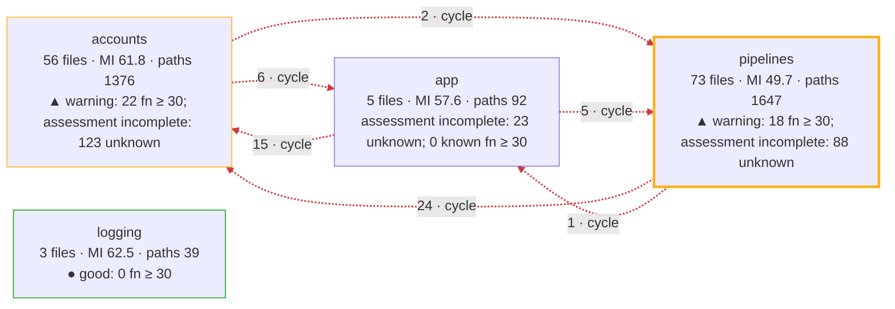
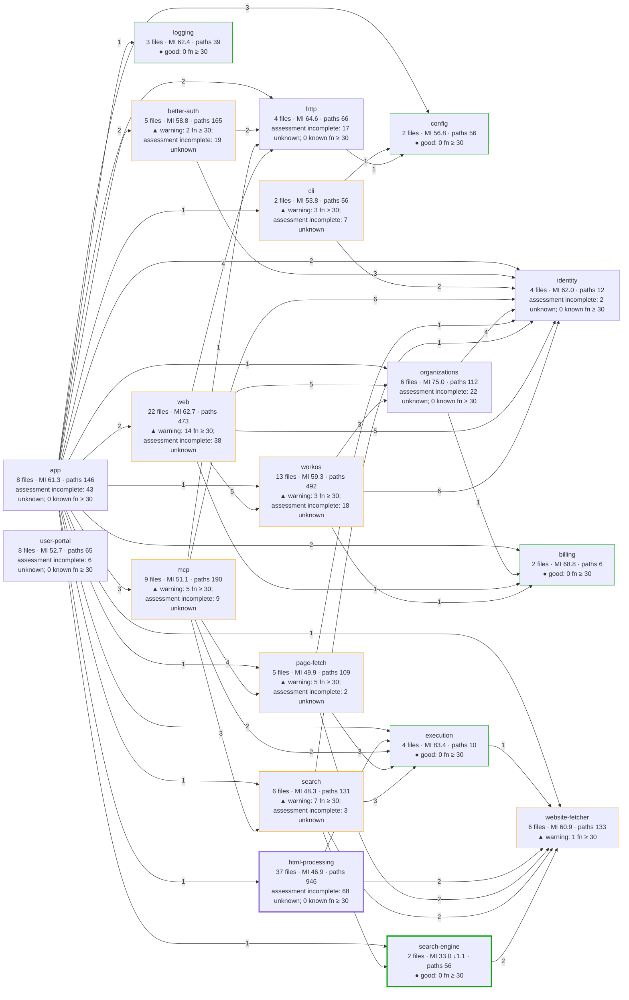
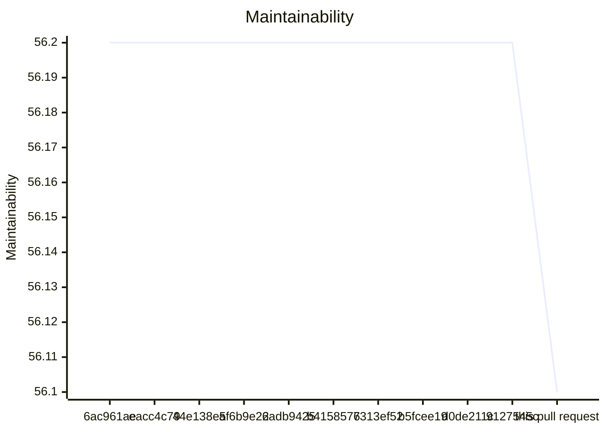

# Code quality process

## Delta

Status: goal miss.

```text
  33.0  src/pipelines/providers/search-engine/search-engine-brave-http.ts  below 85
  42.6  src/pipelines/html-processing/search-results/brave-result-document.ts  below 85
  23.6  test/unit/search-engine/search-engine-brave-http.test.ts  no goal
  25.0  test/acceptance/mcp/search-pipeline.test.ts  no goal
  28.3  test/acceptance/mcp/self-hosted-fetch-tool.test.ts  no goal
  32.2  test/unit/html-cleaner-pipeline/search-results/brave-http-result-cleanup.test.ts  no goal
  35.0  test/integration/search-pipeline/brave-markdown.test.ts  no goal
Result: 2 of 2 production files below 85. Goal: 85 or more for each production file. 5 other files without a goal.
Comparison with origin/main: ast-report/compare.html
```

## Review

Status: goal miss.

## AST Metrics found blocking regressions

62 new critical issue(s), 122 other regression(s)

### Summary

- ⚠️  **Complexity: +7**
- ➖ **Ease of maintenance: -**
- ➖ **Outgoing dependencies: -**
- ➖ **Probability of bugs: -**

### Regressions

- **src/accounts/billing/billing-free.ts** (`src/accounts/billing/billing-free.ts:3`, high)
  Maintainability too low: got 68 (min: 85)
- **src/accounts/identity/access-context.ts** (`src/accounts/identity/access-context.ts:34`, high)
  Maintainability too low: got 79 (min: 85)
- **src/accounts/organizations/change-records.ts** (`src/accounts/organizations/change-records.ts:46`, high)
  Maintainability too low: got 73 (min: 85)
- **src/accounts/organizations/organization-administration.ts** (`src/accounts/organizations/organization-administration.ts:63`, high)
  Maintainability too low: got 65 (min: 85)
- **src/accounts/providers/better-auth/better-auth-provider.ts** (`src/accounts/providers/better-auth/better-auth-provider.ts:49`, high)
  Maintainability too low: got 73 (min: 85)
- **src/accounts/providers/better-auth/better-auth-runtime.ts** (`src/accounts/providers/better-auth/better-auth-runtime.ts:55`, high)
  Maintainability too low: got 82 (min: 85)
- **src/accounts/providers/better-auth/better-auth-user-administration.ts** (`src/accounts/providers/better-auth/better-auth-user-administration.ts:34`, high)
  Maintainability too low: got 76 (min: 85)
- **src/accounts/providers/better-auth/local-installation.ts** (`src/accounts/providers/better-auth/local-installation.ts:32`, high)
  Maintainability too low: got 84 (min: 85)
- **src/accounts/providers/workos/hosted-role-mapping.ts** (`src/accounts/providers/workos/hosted-role-mapping.ts:9`, high)
  Maintainability too low: got 84 (min: 85)
- **src/accounts/providers/workos/workos-auth-provider.ts** (`src/accounts/providers/workos/workos-auth-provider.ts:58`, high)
  Maintainability too low: got 72 (min: 85)
- **src/accounts/providers/workos/workos-browser-session.ts** (`src/accounts/providers/workos/workos-browser-session.ts:46`, high)
  Maintainability too low: got 62 (min: 85)
- **src/accounts/providers/workos/workos-google-onboarding.ts** (`src/accounts/providers/workos/workos-google-onboarding.ts:32`, high)
  Maintainability too low: got 48 (min: 85)
- **src/accounts/providers/workos/workos-organizations.ts** (`src/accounts/providers/workos/workos-organizations.ts:107`, high)
  Maintainability too low: got 60 (min: 85)
- **src/accounts/providers/workos/workos-settings.ts** (`src/accounts/providers/workos/workos-settings.ts:16`, high)
  Maintainability too low: got 80 (min: 85)
- **src/accounts/providers/workos/workos-sign-in.ts** (`src/accounts/providers/workos/workos-sign-in.ts:49`, high)
  Maintainability too low: got 65 (min: 85)
- **src/accounts/providers/workos/workos-signup.ts** (`src/accounts/providers/workos/workos-signup.ts:73`, high)
  Maintainability too low: got 38 (min: 85)
- **src/app/hidden-line-input.ts** (`src/app/hidden-line-input.ts:11`, high)
  Maintainability too low: got 80 (min: 85)
- **src/app/hosted-portal.ts** (`src/app/hosted-portal.ts:26`, high)
  Maintainability too low: got 47 (min: 85)
- **src/app/operation-capacity.ts** (`src/app/operation-capacity.ts:6`, high)
  Maintainability too low: got 65 (min: 85)
- **src/interfaces/cli/local-auth-command-line.ts** (`src/interfaces/cli/local-auth-command-line.ts:10`, high)
  Maintainability too low: got 84 (min: 85)
- **src/interfaces/cli/local-auth-command.ts** (`src/interfaces/cli/local-auth-command.ts:29`, high)
  Maintainability too low: got 84 (min: 85)
- **src/interfaces/mcp/identity-verifier-sdk-adapter.ts** (`src/interfaces/mcp/identity-verifier-sdk-adapter.ts:20`, high)
  Maintainability too low: got 62 (min: 85)
- **src/interfaces/mcp/mcp-server.ts** (`src/interfaces/mcp/mcp-server.ts:49`, high)
  Maintainability too low: got 43 (min: 85)
- **src/interfaces/mcp/protected-resource-endpoint.ts** (`src/interfaces/mcp/protected-resource-endpoint.ts:18`, high)
  Maintainability too low: got 64 (min: 85)
- **src/interfaces/user-portal/connection-guide.ts** (`src/interfaces/user-portal/connection-guide.ts:19`, high)
  Maintainability too low: got 42 (min: 85)
- **src/interfaces/web/account/account-routes.ts** (`src/interfaces/web/account/account-routes.ts:32`, high)
  Maintainability too low: got 61 (min: 85)
- **src/interfaces/web/account/administration-routes.ts** (`src/interfaces/web/account/administration-routes.ts:63`, high)
  Maintainability too low: got 59 (min: 85)
- **src/interfaces/web/auth/better-auth/local-auth-pages.ts** (`src/interfaces/web/auth/better-auth/local-auth-pages.ts:41`, high)
  Maintainability too low: got 41 (min: 85)
- **src/interfaces/web/auth/better-auth/local-auth-provider-routes.ts** (`src/interfaces/web/auth/better-auth/local-auth-provider-routes.ts:16`, high)
  Maintainability too low: got 67 (min: 85)
- **src/interfaces/web/auth/workos/workos-session-routes.ts** (`src/interfaces/web/auth/workos/workos-session-routes.ts:39`, high)
  Maintainability too low: got 62 (min: 85)
- **src/interfaces/web/auth/workos/workos-signup-routes.ts** (`src/interfaces/web/auth/workos/workos-signup-routes.ts:29`, high)
  Maintainability too low: got 39 (min: 85)
- **src/pipelines/html-processing/ad-cleaner/adb/clean-html-ads-adblock-rs.ts** (`src/pipelines/html-processing/ad-cleaner/adb/clean-html-ads-adblock-rs.ts:17`, high)
  Maintainability too low: got 37 (min: 85)
- **src/pipelines/html-processing/ad-cleaner/adb/source-range-parser.ts** (`src/pipelines/html-processing/ad-cleaner/adb/source-range-parser.ts:15`, high)
  Maintainability too low: got 51 (min: 85)
- **src/pipelines/html-processing/ad-cleaner/html-depth-limit-error.ts** (`src/pipelines/html-processing/ad-cleaner/html-depth-limit-error.ts:3`, high)
  Maintainability too low: got 84 (min: 85)
- **src/pipelines/html-processing/html-to-markdown-pipeline.ts** (`src/pipelines/html-processing/html-to-markdown-pipeline.ts:21`, high)
  Maintainability too low: got 69 (min: 85)
- **src/pipelines/html-processing/html-to-markdown/clean-html-to-markdown-defuddle.ts** (`src/pipelines/html-processing/html-to-markdown/clean-html-to-markdown-defuddle.ts:8`, high)
  Maintainability too low: got 63 (min: 85)
- **src/pipelines/html-processing/html-to-markdown/prepare-html-document.ts** (`src/pipelines/html-processing/html-to-markdown/prepare-html-document.ts:9`, high)
  Maintainability too low: got 59 (min: 85)
- **src/pipelines/html-processing/process-html-step.ts** (`src/pipelines/html-processing/process-html-step.ts:6`, high)
  Maintainability too low: got 59 (min: 85)
- **src/pipelines/html-processing/prompt-injection-remover/css-opacity-animations.ts** (`src/pipelines/html-processing/prompt-injection-remover/css-opacity-animations.ts:51`, high)
  Maintainability too low: got 68 (min: 85)
- **src/pipelines/html-processing/prompt-injection-remover/css-selector-index.ts** (`src/pipelines/html-processing/prompt-injection-remover/css-selector-index.ts:10`, high)
  Maintainability too low: got 33 (min: 85)
- **src/pipelines/html-processing/prompt-injection-remover/css-visibility-provenance.ts** (`src/pipelines/html-processing/prompt-injection-remover/css-visibility-provenance.ts:86`, high)
  Maintainability too low: got 53 (min: 85)
- **src/pipelines/html-processing/prompt-injection-remover/css-visibility-tree.ts** (`src/pipelines/html-processing/prompt-injection-remover/css-visibility-tree.ts:10`, high)
  Maintainability too low: got 55 (min: 85)
- **src/pipelines/html-processing/prompt-injection-remover/hidden-html-removal-counts.ts** (`src/pipelines/html-processing/prompt-injection-remover/hidden-html-removal-counts.ts:7`, high)
  Maintainability too low: got 61 (min: 85)
- **src/pipelines/html-processing/prompt-injection-remover/hidden-html-removal-session.ts** (`src/pipelines/html-processing/prompt-injection-remover/hidden-html-removal-session.ts:19`, high)
  Maintainability too low: got 63 (min: 85)
- **src/pipelines/html-processing/prompt-injection-remover/hidden-html-scanner.ts** (`src/pipelines/html-processing/prompt-injection-remover/hidden-html-scanner.ts:15`, high)
  Maintainability too low: got 34 (min: 85)
- **src/pipelines/html-processing/prompt-injection-remover/html-text-source-ranges.ts** (`src/pipelines/html-processing/prompt-injection-remover/html-text-source-ranges.ts:6`, high)
  Maintainability too low: got 67 (min: 85)
- **src/pipelines/html-processing/prompt-injection-remover/prompt-injection-remover-sanitizer.ts** (`src/pipelines/html-processing/prompt-injection-remover/prompt-injection-remover-sanitizer.ts:10`, high)
  Maintainability too low: got 50 (min: 85)
- **src/pipelines/html-processing/prompt-injection-remover/small-text-policy.ts** (`src/pipelines/html-processing/prompt-injection-remover/small-text-policy.ts:7`, high)
  Maintainability too low: got 66 (min: 85)
- **src/pipelines/html-processing/search-results/brave-http-result-cleanup.ts** (`src/pipelines/html-processing/search-results/brave-http-result-cleanup.ts:4`, high)
  Maintainability too low: got 74 (min: 85)
- **src/pipelines/html-processing/search-results/brave-result-document.ts** (`src/pipelines/html-processing/search-results/brave-result-document.ts:11`, high)
  Maintainability too low: got 43 (min: 85)

_... and 134 more. Download the full report for details._

## CRAP

Status: passed.

Reused verified compatible unit coverage.

## CRAP goals

Goals: CRAP < 30; new functions also CRAP ≤ 15.

| File | Function | Change | Paths | Coverage | CRAP | To do |
| --- | --- | --- | --- | --- | --- | --- |
| src/pipelines/providers/search-engine/search-engine-brave-http.ts | search-engine-brave-http\SearchEngineBraveHttp.isNoResults | changed | 21 | 99.4% | 21.0 | ok; for 15: split |
| src/pipelines/providers/search-engine/search-engine-brave-http.ts | search-engine-brave-http\SearchEngineBraveHttp.classify | changed | 10 | 100% | 10.0 | ok |
| src/pipelines/providers/search-engine/search-engine-brave-http.ts | search-engine-brave-http\SearchEngineBraveHttp.assertDepth | unchanged | 8 | 100% | 8.0 | ok; unchanged by this PR |
| src/pipelines/providers/search-engine/search-engine-brave-http.ts | search-engine-brave-http\SearchEngineBraveHttp.isWebResult | changed | 7 | 100% | 7.0 | ok |
| src/pipelines/html-processing/search-results/brave-result-document.ts | brave-result-document\BraveResultDocument.inlineElement | unchanged | 6 | 98.7% | 6.0 | ok; unchanged by this PR |
| src/pipelines/html-processing/search-results/brave-result-document.ts | brave-result-document\BraveResultDocument.copyElement | unchanged | 6 | 100% | 6.0 | ok; unchanged by this PR |
| src/pipelines/html-processing/search-results/brave-result-document.ts | brave-result-document\BraveResultDocument.resultRow | changed | 5 | 97.7% | 5.0 | ok |
| src/pipelines/html-processing/search-results/brave-result-document.ts | brave-result-document\BraveResultDocument.copyInline | unchanged | 5 | 98.8% | 5.0 | ok; unchanged by this PR |
| src/pipelines/html-processing/search-results/brave-result-document.ts | brave-result-document\BraveResultDocument.project | unchanged | 5 | 100% | 5.0 | ok; unchanged by this PR |
| src/pipelines/providers/search-engine/search-engine-brave-http.ts | search-engine-brave-http\SearchEngineBraveHttp.assertFinalUrl | unchanged | 5 | 100% | 5.0 | ok; unchanged by this PR |
| src/pipelines/providers/search-engine/search-engine-brave-http.ts | search-engine-brave-http\SearchEngineBraveHttp.search | unchanged | 4 | 100% | 4.0 | ok; unchanged by this PR |
| src/pipelines/html-processing/search-results/brave-result-document.ts | brave-result-document\BraveResultDocument.appendDescription | unchanged | 2 | 100% | 2.0 | ok; unchanged by this PR |
| src/pipelines/html-processing/search-results/brave-result-document.ts | brave-result-document\BraveResultDocument.constructor | unchanged | 1 | 100% | 1.0 | ok; unchanged by this PR |
| src/pipelines/providers/search-engine/search-engine-brave-http.ts | search-engine-brave-http\SearchEngineBraveHttp.constructor | unchanged | 1 | 100% | 1.0 | ok; unchanged by this PR |

Known limit violations: 0. Measured target misses: 1. Unmeasured functions: 0. Required functions with unknown assessment or identity: 0.

## Architecture

Status: passed.

## Architecture of src/: base 9127545c → head

Modularity 0.40 → 0.40 · cross share 0.16 → 0.16 · cycles 1 → 1 · communities 4 → 4 · functions ≥ 30: 40 → 40



Legend: thick border = a community this pull request touched; `· new` and `· gone` = a community or dependency that appeared or disappeared; red dashed edge = part of a cycle; thick edge = a new dependency; border color = the CRAP band of the community (● good: complete assessment, no function at CRAP 30 or more; ▲ warning: some, none added or worse by this pull request; ■ critical: one added or worse); numbers = files · maintainability (LOC-weighted) · decision paths, with the change against the base.

### Community edge evidence

Tool references and deduplicated file pairs have different units. An unchanged import means the same normalized file pair, after proven path moves; evidence kinds can differ.

Dependency evidence incomplete: base has 1 issue; head has 1 issue. A missing pair on an incomplete side does not prove an import change.

- base: <code>src/interfaces/user-portal/main.ts</code> → <code>./style.css</code> — unresolved-local.
- head: <code>src/interfaces/user-portal/main.ts</code> → <code>./style.css</code> — unresolved-local.

No new or gone community edges.

## Components of src/

Component dependency evidence is incomplete: known head dependencies and proven cycles are shown; edge and cycle changes are withheld. Additional dependencies or cycles may exist.



Legend: thick border = a component this pull request touched; `· new` and `· gone` = a component or dependency that appeared or disappeared; red dashed edge = part of a cycle; thick edge = a new dependency; border color = the CRAP band of the component (● good: complete assessment, no function at CRAP 30 or more; ▲ warning: some, none added or worse by this pull request; ■ critical: one added or worse); numbers = files · maintainability (LOC-weighted) · decision paths, with the change against the base. Edges count distinct importing files per target component.

## Complexity of the changed files

| File | Maintainability | Decision paths | CRAP ≥ 30 | Risk rank |
| --- | --- | --- | --- | --- |
| src/pipelines/html-processing/search-results/brave-result-document.ts | 42.6 → 42.6 | 30 → 30 | 0 → 0 | 4 |
| src/pipelines/providers/search-engine/search-engine-brave-http.ts | 34.1 → 33.0 ↓1.1 | 56 → 56 | 0 → 0 | 1 |

### Functions at CRAP 30 or more, added or worse

None.

Unmatched functions: 0 (anonymous, duplicate, or not in the coverage).

Unknown function identity: 263 (no proven declaration or unique unchanged body/signature correspondence).

Base functions without an estimated covered share: 277.

Coverage: unit suite at 4cb6bd0a.

## Trend of src/ on main

| Commit | PR | Date | Modularity | Cross share | Cycles | Maintainability | Functions ≥ 30 |
| --- | --- | --- | --- | --- | --- | --- | --- |
| 6ac961ae | #202 | 2026-10-20 | 0.58 | 0.26 | 2 | 56.2 | – |
| eacc4c79 | #203 | 2026-10-21 | 0.58 | 0.27 | 2 | 56.2 | – |
| 44e138e5 | #210 | 2026-10-21 | 0.58 | 0.27 | 2 | 56.2 | – |
| af6b9e22 | #211 | 2026-10-21 | 0.58 | 0.27 | 2 | 56.2 | – |
| 6adb9425 | #212 | 2026-10-21 | 0.58 | 0.27 | 2 | 56.2 | 26 (estimate) |
| b4158576 | #214 | 2026-10-21 | 0.40 | 0.16 | 1 | 56.2 | – |
| 7313ef52 | – | 2026-10-21 | 0.40 | 0.16 | 1 | 56.2 | – |
| b5fcee19 | #215 | 2026-10-21 | 0.40 | 0.16 | 1 | 56.2 | – |
| d0de211c | #217 | 2026-10-21 | 0.40 | 0.16 | 1 | 56.2 | – |
| 9127545c | #216 | 2026-10-21 | 0.40 | 0.16 | 1 | 56.2 | 40 (estimate) |
| this pull request | – | | 0.40 | 0.16 | 1 | 56.1 | 40 (measured) |

Historical estimates use head coverage from the first recording pull request. Later estimates for the same base can differ. Counts include known lower-bound violations; other unknown functions are not counted.

### Maintainability trend

Missing values are gaps; lines stop at each gap.

Maintainability (maintainability), 6ac961ae to this pull request.




### Functions ≥ 30 trend

Missing values are gaps; lines stop at each gap or change of count basis.

6adb9425: 26 (head-derived estimate). One point; no line.

9127545c: 40 (head-derived estimate). One point; no line.

this pull request: 40 (measured). One point; no line.


### Trend by component

| Component | 6ac961ae | eacc4c79 | 44e138e5 | af6b9e22 | 6adb9425 | b4158576 | 7313ef52 | b5fcee19 | d0de211c | 9127545c | this pull request |
| --- | --- | --- | --- | --- | --- | --- | --- | --- | --- | --- | --- |
| app | MI –; functions ≥ 30: – | MI –; functions ≥ 30: – | MI –; functions ≥ 30: – | MI –; functions ≥ 30: – | MI –; functions ≥ 30: – | MI 61.3; functions ≥ 30: – | MI 61.3; functions ≥ 30: – | MI 61.3; functions ≥ 30: – | MI 61.3; functions ≥ 30: – | MI 61.3; functions ≥ 30: 0 (estimate) | MI 61.3; functions ≥ 30: 0 (measured) |
| auth | MI 58.8; functions ≥ 30: – | MI 58.8; functions ≥ 30: – | MI 58.8; functions ≥ 30: – | MI 58.8; functions ≥ 30: – | MI 58.8; functions ≥ 30: 12 (estimate) | MI –; functions ≥ 30: – | MI –; functions ≥ 30: – | MI –; functions ≥ 30: – | MI –; functions ≥ 30: – | MI –; functions ≥ 30: – | MI –; functions ≥ 30: – |
| better-auth | MI –; functions ≥ 30: – | MI –; functions ≥ 30: – | MI –; functions ≥ 30: – | MI –; functions ≥ 30: – | MI –; functions ≥ 30: – | MI 58.8; functions ≥ 30: – | MI 58.8; functions ≥ 30: – | MI 58.8; functions ≥ 30: – | MI 58.8; functions ≥ 30: – | MI 58.8; functions ≥ 30: 2 (estimate) | MI 58.8; functions ≥ 30: 2 (measured) |
| billing | MI 68.8; functions ≥ 30: – | MI 68.8; functions ≥ 30: – | MI 68.8; functions ≥ 30: – | MI 68.8; functions ≥ 30: – | MI 68.8; functions ≥ 30: 0 (estimate) | MI 68.8; functions ≥ 30: – | MI 68.8; functions ≥ 30: – | MI 68.8; functions ≥ 30: – | MI 68.8; functions ≥ 30: – | MI 68.8; functions ≥ 30: 0 (estimate) | MI 68.8; functions ≥ 30: 0 (measured) |
| cli | MI –; functions ≥ 30: – | MI –; functions ≥ 30: – | MI –; functions ≥ 30: – | MI –; functions ≥ 30: – | MI –; functions ≥ 30: – | MI 53.8; functions ≥ 30: – | MI 53.8; functions ≥ 30: – | MI 53.8; functions ≥ 30: – | MI 53.8; functions ≥ 30: – | MI 53.8; functions ≥ 30: 3 (estimate) | MI 53.8; functions ≥ 30: 3 (measured) |
| config | MI 56.8; functions ≥ 30: – | MI 56.8; functions ≥ 30: – | MI 56.8; functions ≥ 30: – | MI 56.8; functions ≥ 30: – | MI 56.8; functions ≥ 30: 0 (estimate) | MI 56.8; functions ≥ 30: – | MI 56.8; functions ≥ 30: – | MI 56.8; functions ≥ 30: – | MI 56.8; functions ≥ 30: – | MI 56.8; functions ≥ 30: 0 (estimate) | MI 56.8; functions ≥ 30: 0 (measured) |
| execution | MI –; functions ≥ 30: – | MI –; functions ≥ 30: – | MI –; functions ≥ 30: – | MI –; functions ≥ 30: – | MI –; functions ≥ 30: – | MI 83.4; functions ≥ 30: – | MI 83.4; functions ≥ 30: – | MI 83.4; functions ≥ 30: – | MI 83.4; functions ≥ 30: – | MI 83.4; functions ≥ 30: 0 (estimate) | MI 83.4; functions ≥ 30: 0 (measured) |
| hosted-admin | MI 66.8; functions ≥ 30: – | MI 66.8; functions ≥ 30: – | MI 66.8; functions ≥ 30: – | MI 66.8; functions ≥ 30: – | MI 66.8; functions ≥ 30: 0 (estimate) | MI –; functions ≥ 30: – | MI –; functions ≥ 30: – | MI –; functions ≥ 30: – | MI –; functions ≥ 30: – | MI –; functions ≥ 30: – | MI –; functions ≥ 30: – |
| html | MI 121.4; functions ≥ 30: – | MI 121.4; functions ≥ 30: – | MI 121.4; functions ≥ 30: – | MI 121.4; functions ≥ 30: – | MI 121.4; functions ≥ 30: 0 (estimate) | MI –; functions ≥ 30: – | MI –; functions ≥ 30: – | MI –; functions ≥ 30: – | MI –; functions ≥ 30: – | MI –; functions ≥ 30: – | MI –; functions ≥ 30: – |
| html-cleaner-pipeline | MI 46.8; functions ≥ 30: – | MI 46.9; functions ≥ 30: – | MI 46.9; functions ≥ 30: – | MI 46.9; functions ≥ 30: – | MI 46.9; functions ≥ 30: 0 (estimate) | MI –; functions ≥ 30: – | MI –; functions ≥ 30: – | MI –; functions ≥ 30: – | MI –; functions ≥ 30: – | MI –; functions ≥ 30: – | MI –; functions ≥ 30: – |
| html-processing | MI –; functions ≥ 30: – | MI –; functions ≥ 30: – | MI –; functions ≥ 30: – | MI –; functions ≥ 30: – | MI –; functions ≥ 30: – | MI 46.9; functions ≥ 30: – | MI 46.9; functions ≥ 30: – | MI 46.9; functions ≥ 30: – | MI 46.9; functions ≥ 30: – | MI 46.9; functions ≥ 30: 0 (estimate) | MI 46.9; functions ≥ 30: 0 (measured) |
| http | MI 64.6; functions ≥ 30: – | MI 64.6; functions ≥ 30: – | MI 64.6; functions ≥ 30: – | MI 64.6; functions ≥ 30: – | MI 64.6; functions ≥ 30: 0 (estimate) | MI 64.6; functions ≥ 30: – | MI 64.6; functions ≥ 30: – | MI 64.6; functions ≥ 30: – | MI 64.6; functions ≥ 30: – | MI 64.6; functions ≥ 30: 0 (estimate) | MI 64.6; functions ≥ 30: 0 (measured) |
| identity | MI –; functions ≥ 30: – | MI –; functions ≥ 30: – | MI –; functions ≥ 30: – | MI –; functions ≥ 30: – | MI –; functions ≥ 30: – | MI 62.0; functions ≥ 30: – | MI 62.0; functions ≥ 30: – | MI 62.0; functions ≥ 30: – | MI 62.0; functions ≥ 30: – | MI 62.0; functions ≥ 30: 0 (estimate) | MI 62.0; functions ≥ 30: 0 (measured) |
| logging | MI 62.4; functions ≥ 30: – | MI 62.4; functions ≥ 30: – | MI 62.4; functions ≥ 30: – | MI 62.4; functions ≥ 30: – | MI 62.4; functions ≥ 30: 0 (estimate) | MI 62.4; functions ≥ 30: – | MI 62.4; functions ≥ 30: – | MI 62.4; functions ≥ 30: – | MI 62.4; functions ≥ 30: – | MI 62.4; functions ≥ 30: 0 (estimate) | MI 62.4; functions ≥ 30: 0 (measured) |
| mcp | MI 51.5; functions ≥ 30: – | MI 51.5; functions ≥ 30: – | MI 51.5; functions ≥ 30: – | MI 51.5; functions ≥ 30: – | MI 51.5; functions ≥ 30: 5 (estimate) | MI 51.1; functions ≥ 30: – | MI 51.1; functions ≥ 30: – | MI 51.1; functions ≥ 30: – | MI 51.1; functions ≥ 30: – | MI 51.1; functions ≥ 30: 5 (estimate) | MI 51.1; functions ≥ 30: 5 (measured) |
| organizations | MI 75.0; functions ≥ 30: – | MI 75.0; functions ≥ 30: – | MI 75.0; functions ≥ 30: – | MI 75.0; functions ≥ 30: – | MI 75.0; functions ≥ 30: 0 (estimate) | MI 75.0; functions ≥ 30: – | MI 75.0; functions ≥ 30: – | MI 75.0; functions ≥ 30: – | MI 75.0; functions ≥ 30: – | MI 75.0; functions ≥ 30: 0 (estimate) | MI 75.0; functions ≥ 30: 0 (measured) |
| page-fetch | MI 57.8; functions ≥ 30: – | MI 57.8; functions ≥ 30: – | MI 57.8; functions ≥ 30: – | MI 57.8; functions ≥ 30: – | MI 57.8; functions ≥ 30: 2 (estimate) | MI 49.9; functions ≥ 30: – | MI 49.9; functions ≥ 30: – | MI 49.9; functions ≥ 30: – | MI 49.9; functions ≥ 30: – | MI 49.9; functions ≥ 30: 5 (estimate) | MI 49.9; functions ≥ 30: 5 (measured) |
| search | MI –; functions ≥ 30: – | MI –; functions ≥ 30: – | MI –; functions ≥ 30: – | MI –; functions ≥ 30: – | MI –; functions ≥ 30: – | MI 48.3; functions ≥ 30: – | MI 48.3; functions ≥ 30: – | MI 48.3; functions ≥ 30: – | MI 48.3; functions ≥ 30: – | MI 48.3; functions ≥ 30: 7 (estimate) | MI 48.3; functions ≥ 30: 7 (measured) |
| search-engine | MI 34.1; functions ≥ 30: – | MI 34.1; functions ≥ 30: – | MI 34.1; functions ≥ 30: – | MI 34.1; functions ≥ 30: – | MI 34.1; functions ≥ 30: 0 (estimate) | MI 34.1; functions ≥ 30: – | MI 34.1; functions ≥ 30: – | MI 34.1; functions ≥ 30: – | MI 34.1; functions ≥ 30: – | MI 34.1; functions ≥ 30: 0 (estimate) | MI 33.0; functions ≥ 30: 0 (measured) |
| search-pipeline | MI 48.3; functions ≥ 30: – | MI 48.3; functions ≥ 30: – | MI 48.3; functions ≥ 30: – | MI 48.3; functions ≥ 30: – | MI 48.3; functions ≥ 30: 7 (estimate) | MI –; functions ≥ 30: – | MI –; functions ≥ 30: – | MI –; functions ≥ 30: – | MI –; functions ≥ 30: – | MI –; functions ≥ 30: – | MI –; functions ≥ 30: – |
| src | MI 59.6; functions ≥ 30: – | MI 59.6; functions ≥ 30: – | MI 59.6; functions ≥ 30: – | MI 59.6; functions ≥ 30: – | MI 59.6; functions ≥ 30: 0 (estimate) | MI –; functions ≥ 30: – | MI –; functions ≥ 30: – | MI –; functions ≥ 30: – | MI –; functions ≥ 30: – | MI –; functions ≥ 30: – | MI –; functions ≥ 30: – |
| terminal | MI 77.2; functions ≥ 30: – | MI 77.2; functions ≥ 30: – | MI 77.2; functions ≥ 30: – | MI 77.2; functions ≥ 30: – | MI 77.2; functions ≥ 30: 0 (estimate) | MI –; functions ≥ 30: – | MI –; functions ≥ 30: – | MI –; functions ≥ 30: – | MI –; functions ≥ 30: – | MI –; functions ≥ 30: – | MI –; functions ≥ 30: – |
| user-portal | MI 52.7; functions ≥ 30: – | MI 52.7; functions ≥ 30: – | MI 52.7; functions ≥ 30: – | MI 52.7; functions ≥ 30: – | MI 52.7; functions ≥ 30: 0 (estimate) | MI 52.7; functions ≥ 30: – | MI 52.7; functions ≥ 30: – | MI 52.7; functions ≥ 30: – | MI 52.7; functions ≥ 30: – | MI 52.7; functions ≥ 30: 0 (estimate) | MI 52.7; functions ≥ 30: 0 (measured) |
| web | MI –; functions ≥ 30: – | MI –; functions ≥ 30: – | MI –; functions ≥ 30: – | MI –; functions ≥ 30: – | MI –; functions ≥ 30: – | MI 62.7; functions ≥ 30: – | MI 62.7; functions ≥ 30: – | MI 62.7; functions ≥ 30: – | MI 62.7; functions ≥ 30: – | MI 62.7; functions ≥ 30: 14 (estimate) | MI 62.7; functions ≥ 30: 14 (measured) |
| website-fetcher | MI 59.0; functions ≥ 30: – | MI 59.0; functions ≥ 30: – | MI 59.0; functions ≥ 30: – | MI 59.0; functions ≥ 30: – | MI 59.0; functions ≥ 30: 0 (estimate) | MI 60.9; functions ≥ 30: – | MI 60.9; functions ≥ 30: – | MI 60.9; functions ≥ 30: – | MI 60.9; functions ≥ 30: – | MI 60.9; functions ≥ 30: 1 (estimate) | MI 60.9; functions ≥ 30: 1 (measured) |
| workos | MI –; functions ≥ 30: – | MI –; functions ≥ 30: – | MI –; functions ≥ 30: – | MI –; functions ≥ 30: – | MI –; functions ≥ 30: – | MI 59.3; functions ≥ 30: – | MI 59.3; functions ≥ 30: – | MI 59.3; functions ≥ 30: – | MI 59.3; functions ≥ 30: – | MI 59.3; functions ≥ 30: 3 (estimate) | MI 59.3; functions ≥ 30: 3 (measured) |

2 commits of main between 6ac961ae and eacc4c79 have no record.
