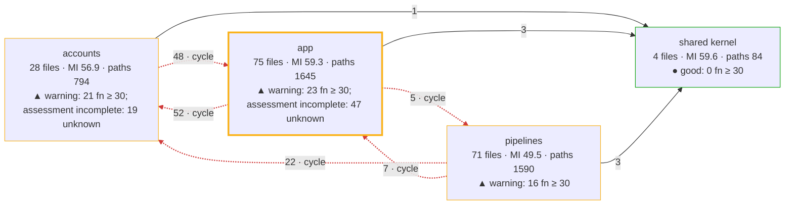
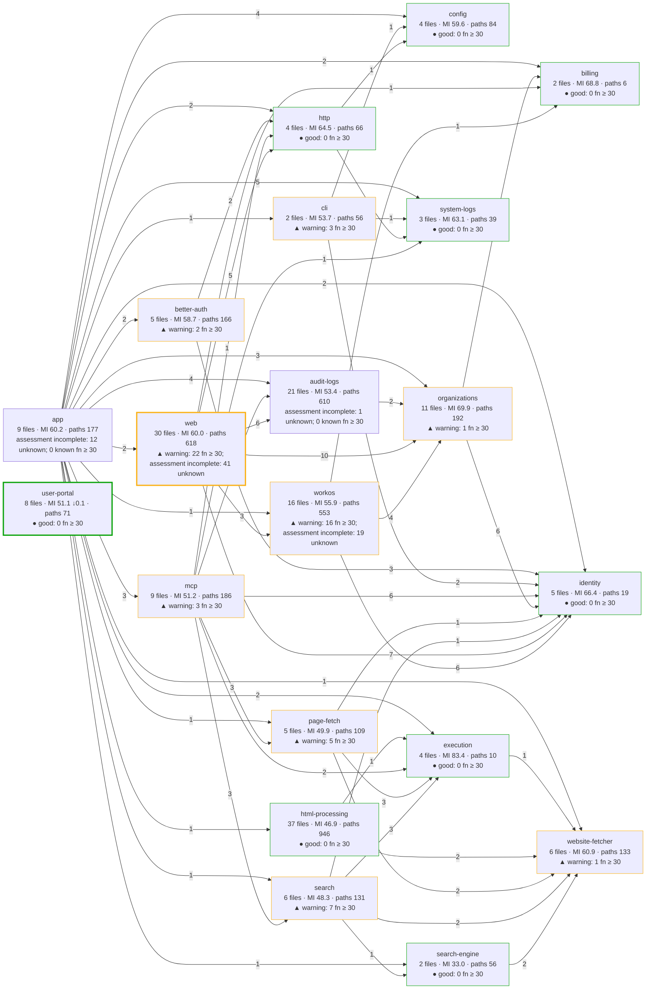
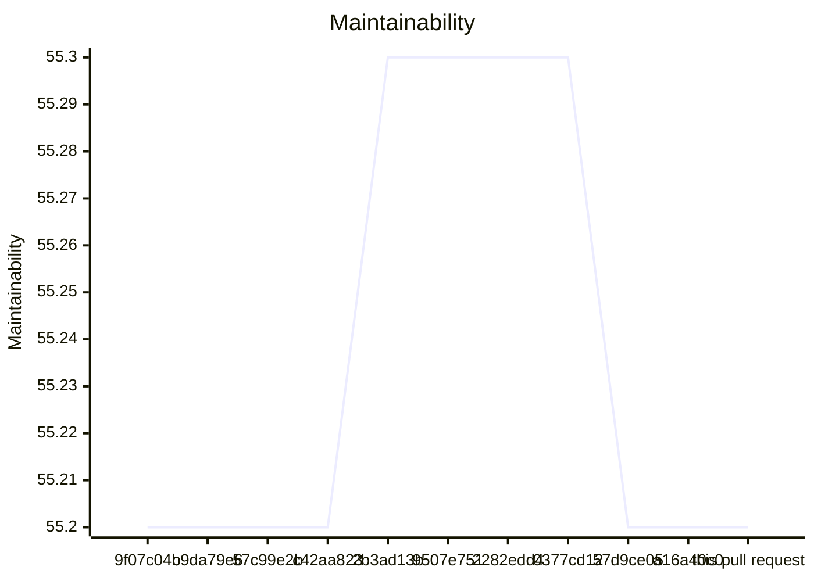
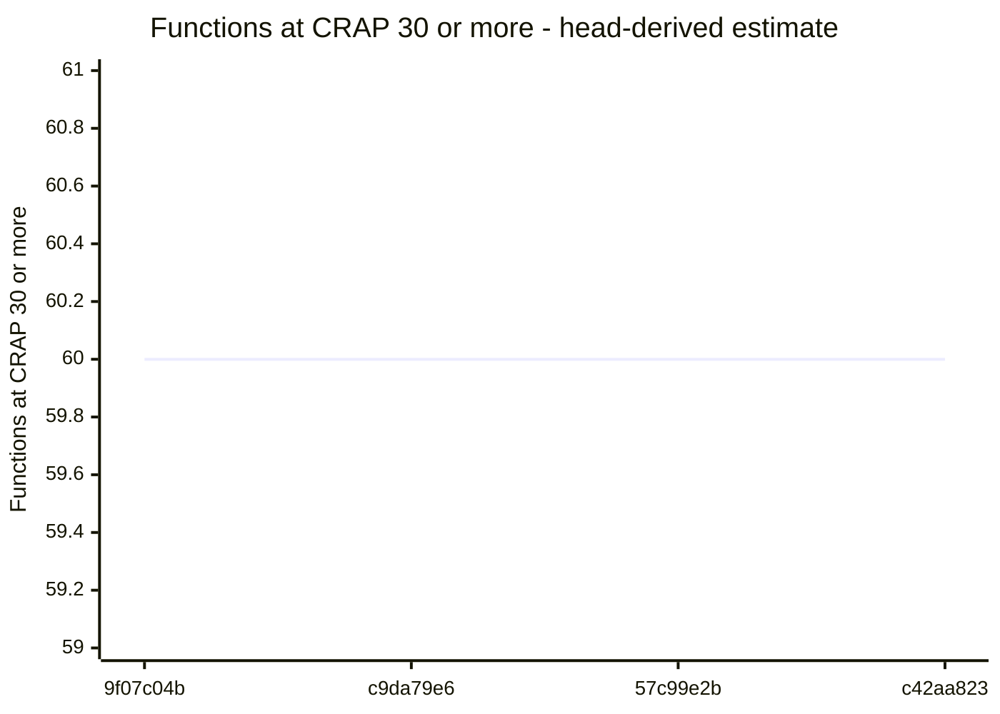
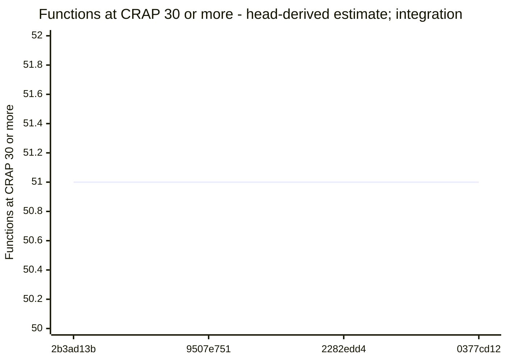
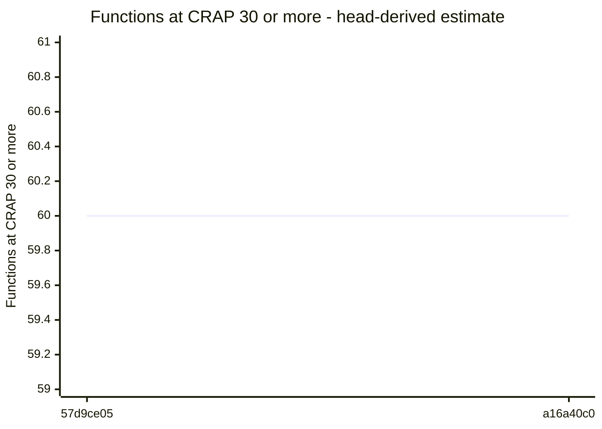

# Code quality process

## Delta

Status: goal miss.

```text
  46.7  src/interfaces/user-portal/portal.ts  below 85
  80.4  src/interfaces/web/account/members-page-layout.ts  below 85
  2.0  test/acceptance/auth/hosted-member-removal-browser.runtime.ts  no goal
  11.9  test/integration/hosted-admin/account-routes-administration-pages.test.ts  no goal
  22.5  test/acceptance/auth/hosted-members.test.ts  no goal
  27.2  test/acceptance/logging/hosted-destination-settings.test.ts  no goal
  27.9  test/acceptance/user-portal/portal.test.ts  no goal
  29.4  test/support/drivers/browser/admin-shell-browser.ts  no goal
  35.0  test/unit/user-portal/portal.test.ts  no goal
  40.1  test/unit/html/logging-page.test.ts  no goal
  55.7  test/support/in-process/hosted-member-removal-site.ts  no goal
  not measured  src/interfaces/web/account/members-style.ts
Result: 2 of 2 production files below 85. Goal: 85 or more for each production file. 9 other files without a goal. 1 file not measured.
Comparison with origin/main: ast-report/compare.html
```

## Review

Status: passed.

## AST Metrics found no regression

0 new critical issue(s), 0 other regression(s)

### Summary

- ➖ **Complexity: -**
- ➖ **Ease of maintenance: -**
- ➖ **Outgoing dependencies: -**
- ➖ **Probability of bugs: -**

No architectural change detected on modified code.

## CRAP

Status: passed.

Reused verified compatible unit coverage.

## CRAP goals

Goals: CRAP < 30; new functions also CRAP ≤ 15.

| File | Function | Change | Paths | Coverage | CRAP | To do |
| --- | --- | --- | --- | --- | --- | --- |
| src/interfaces/user-portal/portal.ts | productAccess | unchanged | 10 | 99.3% | 10.0 | ok; unchanged by this PR |
| src/interfaces/web/account/members-page-layout.ts | membersPageLayout | changed | 8 | 99.8% | 8.0 | ok |
| src/interfaces/user-portal/portal.ts | sessionView | unchanged | 5 | 97.5% | 5.0 | ok; unchanged by this PR |
| src/interfaces/user-portal/portal.ts | renderSignedIn | unchanged | 5 | 98.5% | 5.0 | ok; unchanged by this PR |
| src/interfaces/user-portal/portal.ts | showProductAccess | unchanged | 5 | 99.6% | 5.0 | ok; unchanged by this PR |
| src/interfaces/user-portal/portal.ts | initializePortal | unchanged | 5 | 100% | 5.0 | ok; unchanged by this PR |
| src/interfaces/user-portal/portal.ts | renderError | unchanged | 3 | 100% | 3.0 | ok; unchanged by this PR |
| src/interfaces/user-portal/portal.ts | showWorkspaceNavigation | changed | 2 | 100% | 2.0 | ok |
| src/interfaces/user-portal/portal.ts | appendProfileField | unchanged | 1 | 100% | 1.0 | ok; unchanged by this PR |
| src/interfaces/user-portal/portal.ts | renderPage | unchanged | 1 | 100% | 1.0 | ok; unchanged by this PR |
| src/interfaces/user-portal/portal.ts | renderSignedOut | unchanged | 1 | 100% | 1.0 | ok; unchanged by this PR |
| src/interfaces/user-portal/portal.ts | showConnection | unchanged | 1 | 100% | 1.0 | ok; unchanged by this PR |

Known limit violations: 0. Measured target misses: 0. Unmeasured functions: 0. Required functions with unknown assessment or identity: 0.

## Architecture

Status: passed.

## Architecture of src/: base a16a40c0 → head

Modularity 0.33 → 0.33 · cross share 0.31 → 0.31 · cycles 1 → 1 · communities 4 → 4 · functions ≥ 30: 60 → 60



Legend: thick border = a community this pull request touched; `· new` and `· gone` = a community or dependency that appeared or disappeared; red dashed edge = part of a cycle; thick edge = a new dependency; border color = the CRAP band of the community (● good: complete assessment, no function at CRAP 30 or more; ▲ warning: some, none added or worse by this pull request; ■ critical: one added or worse); numbers = files · maintainability (LOC-weighted) · decision paths, with the change against the base.

### Community edge evidence

Tool references and deduplicated file pairs have different units. An unchanged import means the same normalized file pair, after proven path moves; evidence kinds can differ.

Dependency evidence incomplete: base has 1 issue; head has 1 issue. A missing pair on an incomplete side does not prove an import change.

- base: <code>src/interfaces/user-portal/main.ts</code> → <code>./style.css</code> — unresolved-local.
- head: <code>src/interfaces/user-portal/main.ts</code> → <code>./style.css</code> — unresolved-local.

No new or gone community edges.

## Components of src/

Component dependency evidence is incomplete: known head dependencies and proven cycles are shown; edge and cycle changes are withheld. Additional dependencies or cycles may exist.



Legend: thick border = a component this pull request touched; `· new` and `· gone` = a component or dependency that appeared or disappeared; red dashed edge = part of a cycle; thick edge = a new dependency; border color = the CRAP band of the component (● good: complete assessment, no function at CRAP 30 or more; ▲ warning: some, none added or worse by this pull request; ■ critical: one added or worse); numbers = files · maintainability (LOC-weighted) · decision paths, with the change against the base. Edges count distinct importing files per target component.

## Complexity of the changed files

| File | Maintainability | Decision paths | CRAP ≥ 30 | Risk rank |
| --- | --- | --- | --- | --- |
| src/interfaces/user-portal/portal.ts | 47.0 → 46.7 ↓0.3 | 39 → 39 | 0 → 0 | |
| src/interfaces/web/account/members-page-layout.ts | 80.4 → 80.4 | 8 → 8 | 0 → 0 | |
| src/interfaces/web/account/members-style.ts | not measured | not measured | not measured | |

### Functions at CRAP 30 or more, added or worse

None.

Unmatched functions: 0 (anonymous, duplicate, or not in the coverage).

Base functions without an estimated covered share: 132.

Coverage: unit suite at 73cd02f2.

## Trend of src/ on main

| Commit | PR | Date | Modularity | Cross share | Cycles | Maintainability | Functions ≥ 30 |
| --- | --- | --- | --- | --- | --- | --- | --- |
| 9f07c04b | – | 2026-10-26 | 0.33 | 0.31 | 1 | 55.2 | 60 (estimate) |
| c9da79e6 | #260 | 2026-10-26 | 0.33 | 0.31 | 1 | 55.2 | 60 (estimate) |
| 57c99e2b | #261 | 2026-10-26 | 0.33 | 0.31 | 1 | 55.2 | 60 (estimate) |
| c42aa823 | #262 | 2026-10-26 | 0.33 | 0.31 | 1 | 55.2 | 60 (estimate) |
| 2b3ad13b | #269 | 2026-10-26 | 0.33 | 0.31 | 1 | 55.3 | 51 (estimate; integration) |
| 9507e751 | #270 | 2026-10-26 | 0.33 | 0.31 | 1 | 55.3 | 51 (estimate; integration) |
| 2282edd4 | #264 | 2026-10-27 | 0.33 | 0.31 | 1 | 55.3 | 51 (estimate; integration) |
| 0377cd12 | #266 | 2026-10-27 | 0.33 | 0.31 | 1 | 55.3 | 51 (estimate; integration) |
| 57d9ce05 | #276 | 2026-10-27 | 0.33 | 0.31 | 1 | 55.2 | 60 (estimate) |
| a16a40c0 | #278 | 2026-10-27 | 0.33 | 0.31 | 1 | 55.2 | 60 (estimate) |
| this pull request | – | | 0.33 | 0.31 | 1 | 55.2 | 60 (measured) |

Historical estimates use head coverage from the first recording pull request. Later estimates for the same base can differ. Counts include known lower-bound violations; other unknown functions are not counted.

### Maintainability trend

Missing values are gaps; lines stop at each gap.

Maintainability (maintainability), 9f07c04b to this pull request.




### Functions ≥ 30 trend

Missing values are gaps; lines stop at each gap or change of count basis.

Functions ≥ 30 (head-derived estimate), 9f07c04b to c42aa823.



Functions ≥ 30 (head-derived estimate; integration), 2b3ad13b to 0377cd12.



Functions ≥ 30 (head-derived estimate), 57d9ce05 to a16a40c0.



this pull request: 60 (measured). One point; no line.


### Trend by component

| Component | 9f07c04b | c9da79e6 | 57c99e2b | c42aa823 | 2b3ad13b | 9507e751 | 2282edd4 | 0377cd12 | 57d9ce05 | a16a40c0 | this pull request |
| --- | --- | --- | --- | --- | --- | --- | --- | --- | --- | --- | --- |
| app | MI 60.0; functions ≥ 30: 0 (estimate) | MI 60.0; functions ≥ 30: 0 (estimate) | MI 60.0; functions ≥ 30: 0 (estimate) | MI 60.0; functions ≥ 30: 0 (estimate) | MI 60.2; functions ≥ 30: 0 (estimate; integration) | MI 60.2; functions ≥ 30: 0 (estimate; integration) | MI 60.2; functions ≥ 30: 0 (estimate; integration) | MI 60.2; functions ≥ 30: 0 (estimate; integration) | MI 60.2; functions ≥ 30: 0 (estimate) | MI 60.2; functions ≥ 30: 0 (estimate) | MI 60.2; functions ≥ 30: 0 (measured) |
| audit-logs | MI 53.4; functions ≥ 30: 0 (estimate) | MI 53.4; functions ≥ 30: 0 (estimate) | MI 53.4; functions ≥ 30: 0 (estimate) | MI 53.4; functions ≥ 30: 0 (estimate) | MI 53.4; functions ≥ 30: 15 (estimate; integration) | MI 53.4; functions ≥ 30: 15 (estimate; integration) | MI 53.4; functions ≥ 30: 15 (estimate; integration) | MI 53.4; functions ≥ 30: 15 (estimate; integration) | MI 53.4; functions ≥ 30: 0 (estimate) | MI 53.4; functions ≥ 30: 0 (estimate) | MI 53.4; functions ≥ 30: 0 (measured) |
| better-auth | MI 58.7; functions ≥ 30: 2 (estimate) | MI 58.7; functions ≥ 30: 2 (estimate) | MI 58.7; functions ≥ 30: 2 (estimate) | MI 58.7; functions ≥ 30: 2 (estimate) | MI 58.7; functions ≥ 30: 0 (estimate; integration) | MI 58.7; functions ≥ 30: 0 (estimate; integration) | MI 58.7; functions ≥ 30: 0 (estimate; integration) | MI 58.7; functions ≥ 30: 0 (estimate; integration) | MI 58.7; functions ≥ 30: 2 (estimate) | MI 58.7; functions ≥ 30: 2 (estimate) | MI 58.7; functions ≥ 30: 2 (measured) |
| billing | MI 68.8; functions ≥ 30: 0 (estimate) | MI 68.8; functions ≥ 30: 0 (estimate) | MI 68.8; functions ≥ 30: 0 (estimate) | MI 68.8; functions ≥ 30: 0 (estimate) | MI 68.8; functions ≥ 30: 0 (estimate; integration) | MI 68.8; functions ≥ 30: 0 (estimate; integration) | MI 68.8; functions ≥ 30: 0 (estimate; integration) | MI 68.8; functions ≥ 30: 0 (estimate; integration) | MI 68.8; functions ≥ 30: 0 (estimate) | MI 68.8; functions ≥ 30: 0 (estimate) | MI 68.8; functions ≥ 30: 0 (measured) |
| cli | MI 53.7; functions ≥ 30: 3 (estimate) | MI 53.7; functions ≥ 30: 3 (estimate) | MI 53.7; functions ≥ 30: 3 (estimate) | MI 53.7; functions ≥ 30: 3 (estimate) | MI 53.7; functions ≥ 30: 0 (estimate; integration) | MI 53.7; functions ≥ 30: 0 (estimate; integration) | MI 53.7; functions ≥ 30: 0 (estimate; integration) | MI 53.7; functions ≥ 30: 0 (estimate; integration) | MI 53.7; functions ≥ 30: 3 (estimate) | MI 53.7; functions ≥ 30: 3 (estimate) | MI 53.7; functions ≥ 30: 3 (measured) |
| config | MI 57.6; functions ≥ 30: 0 (estimate) | MI 57.6; functions ≥ 30: 0 (estimate) | MI 57.6; functions ≥ 30: 0 (estimate) | MI 57.6; functions ≥ 30: 0 (estimate) | MI 59.6; functions ≥ 30: 0 (estimate; integration) | MI 59.6; functions ≥ 30: 0 (estimate; integration) | MI 59.6; functions ≥ 30: 0 (estimate; integration) | MI 59.6; functions ≥ 30: 0 (estimate; integration) | MI 59.6; functions ≥ 30: 0 (estimate) | MI 59.6; functions ≥ 30: 0 (estimate) | MI 59.6; functions ≥ 30: 0 (measured) |
| execution | MI 83.4; functions ≥ 30: 0 (estimate) | MI 83.4; functions ≥ 30: 0 (estimate) | MI 83.4; functions ≥ 30: 0 (estimate) | MI 83.4; functions ≥ 30: 0 (estimate) | MI 83.4; functions ≥ 30: 0 (estimate; integration) | MI 83.4; functions ≥ 30: 0 (estimate; integration) | MI 83.4; functions ≥ 30: 0 (estimate; integration) | MI 83.4; functions ≥ 30: 0 (estimate; integration) | MI 83.4; functions ≥ 30: 0 (estimate) | MI 83.4; functions ≥ 30: 0 (estimate) | MI 83.4; functions ≥ 30: 0 (measured) |
| html-processing | MI 46.9; functions ≥ 30: 0 (estimate) | MI 46.9; functions ≥ 30: 0 (estimate) | MI 46.9; functions ≥ 30: 0 (estimate) | MI 46.9; functions ≥ 30: 0 (estimate) | MI 46.9; functions ≥ 30: 17 (estimate; integration) | MI 46.9; functions ≥ 30: 17 (estimate; integration) | MI 46.9; functions ≥ 30: 17 (estimate; integration) | MI 46.9; functions ≥ 30: 17 (estimate; integration) | MI 46.9; functions ≥ 30: 0 (estimate) | MI 46.9; functions ≥ 30: 0 (estimate) | MI 46.9; functions ≥ 30: 0 (measured) |
| http | MI 64.5; functions ≥ 30: 0 (estimate) | MI 64.5; functions ≥ 30: 0 (estimate) | MI 64.5; functions ≥ 30: 0 (estimate) | MI 64.5; functions ≥ 30: 0 (estimate) | MI 64.5; functions ≥ 30: 0 (estimate; integration) | MI 64.5; functions ≥ 30: 0 (estimate; integration) | MI 64.5; functions ≥ 30: 0 (estimate; integration) | MI 64.5; functions ≥ 30: 0 (estimate; integration) | MI 64.5; functions ≥ 30: 0 (estimate) | MI 64.5; functions ≥ 30: 0 (estimate) | MI 64.5; functions ≥ 30: 0 (measured) |
| identity | MI 66.4; functions ≥ 30: 0 (estimate) | MI 66.4; functions ≥ 30: 0 (estimate) | MI 66.4; functions ≥ 30: 0 (estimate) | MI 66.4; functions ≥ 30: 0 (estimate) | MI 66.4; functions ≥ 30: 0 (estimate; integration) | MI 66.4; functions ≥ 30: 0 (estimate; integration) | MI 66.4; functions ≥ 30: 0 (estimate; integration) | MI 66.4; functions ≥ 30: 0 (estimate; integration) | MI 66.4; functions ≥ 30: 0 (estimate) | MI 66.4; functions ≥ 30: 0 (estimate) | MI 66.4; functions ≥ 30: 0 (measured) |
| mcp | MI 51.2; functions ≥ 30: 3 (estimate) | MI 51.2; functions ≥ 30: 3 (estimate) | MI 51.2; functions ≥ 30: 3 (estimate) | MI 51.2; functions ≥ 30: 3 (estimate) | MI 51.2; functions ≥ 30: 0 (estimate; integration) | MI 51.2; functions ≥ 30: 0 (estimate; integration) | MI 51.2; functions ≥ 30: 0 (estimate; integration) | MI 51.2; functions ≥ 30: 0 (estimate; integration) | MI 51.2; functions ≥ 30: 3 (estimate) | MI 51.2; functions ≥ 30: 3 (estimate) | MI 51.2; functions ≥ 30: 3 (measured) |
| organizations | MI 69.9; functions ≥ 30: 1 (estimate) | MI 69.9; functions ≥ 30: 1 (estimate) | MI 69.9; functions ≥ 30: 1 (estimate) | MI 69.9; functions ≥ 30: 1 (estimate) | MI 69.9; functions ≥ 30: 0 (estimate; integration) | MI 69.9; functions ≥ 30: 0 (estimate; integration) | MI 69.9; functions ≥ 30: 0 (estimate; integration) | MI 69.9; functions ≥ 30: 0 (estimate; integration) | MI 69.9; functions ≥ 30: 1 (estimate) | MI 69.9; functions ≥ 30: 1 (estimate) | MI 69.9; functions ≥ 30: 1 (measured) |
| page-fetch | MI 49.9; functions ≥ 30: 5 (estimate) | MI 49.9; functions ≥ 30: 5 (estimate) | MI 49.9; functions ≥ 30: 5 (estimate) | MI 49.9; functions ≥ 30: 5 (estimate) | MI 49.9; functions ≥ 30: 0 (estimate; integration) | MI 49.9; functions ≥ 30: 0 (estimate; integration) | MI 49.9; functions ≥ 30: 0 (estimate; integration) | MI 49.9; functions ≥ 30: 0 (estimate; integration) | MI 49.9; functions ≥ 30: 5 (estimate) | MI 49.9; functions ≥ 30: 5 (estimate) | MI 49.9; functions ≥ 30: 5 (measured) |
| search | MI 48.3; functions ≥ 30: 7 (estimate) | MI 48.3; functions ≥ 30: 7 (estimate) | MI 48.3; functions ≥ 30: 7 (estimate) | MI 48.3; functions ≥ 30: 7 (estimate) | MI 48.3; functions ≥ 30: 1 (estimate; integration) | MI 48.3; functions ≥ 30: 1 (estimate; integration) | MI 48.3; functions ≥ 30: 1 (estimate; integration) | MI 48.3; functions ≥ 30: 1 (estimate; integration) | MI 48.3; functions ≥ 30: 7 (estimate) | MI 48.3; functions ≥ 30: 7 (estimate) | MI 48.3; functions ≥ 30: 7 (measured) |
| search-engine | MI 33.0; functions ≥ 30: 0 (estimate) | MI 33.0; functions ≥ 30: 0 (estimate) | MI 33.0; functions ≥ 30: 0 (estimate) | MI 33.0; functions ≥ 30: 0 (estimate) | MI 33.0; functions ≥ 30: 0 (estimate; integration) | MI 33.0; functions ≥ 30: 0 (estimate; integration) | MI 33.0; functions ≥ 30: 0 (estimate; integration) | MI 33.0; functions ≥ 30: 0 (estimate; integration) | MI 33.0; functions ≥ 30: 0 (estimate) | MI 33.0; functions ≥ 30: 0 (estimate) | MI 33.0; functions ≥ 30: 0 (measured) |
| system-logs | MI 63.1; functions ≥ 30: 0 (estimate) | MI 63.1; functions ≥ 30: 0 (estimate) | MI 63.1; functions ≥ 30: 0 (estimate) | MI 63.1; functions ≥ 30: 0 (estimate) | MI 63.1; functions ≥ 30: 0 (estimate; integration) | MI 63.1; functions ≥ 30: 0 (estimate; integration) | MI 63.1; functions ≥ 30: 0 (estimate; integration) | MI 63.1; functions ≥ 30: 0 (estimate; integration) | MI 63.1; functions ≥ 30: 0 (estimate) | MI 63.1; functions ≥ 30: 0 (estimate) | MI 63.1; functions ≥ 30: 0 (measured) |
| user-portal | MI 51.2; functions ≥ 30: 0 (estimate) | MI 51.2; functions ≥ 30: 0 (estimate) | MI 51.2; functions ≥ 30: 0 (estimate) | MI 51.2; functions ≥ 30: 0 (estimate) | MI 51.2; functions ≥ 30: 6 (estimate; integration) | MI 51.2; functions ≥ 30: 6 (estimate; integration) | MI 51.2; functions ≥ 30: 6 (estimate; integration) | MI 51.2; functions ≥ 30: 6 (estimate; integration) | MI 51.2; functions ≥ 30: 0 (estimate) | MI 51.2; functions ≥ 30: 0 (estimate) | MI 51.1; functions ≥ 30: 0 (measured) |
| web | MI 60.2; functions ≥ 30: 22 (estimate) | MI 60.2; functions ≥ 30: 22 (estimate) | MI 60.2; functions ≥ 30: 22 (estimate) | MI 60.2; functions ≥ 30: 22 (estimate) | MI 60.2; functions ≥ 30: 9 (estimate; integration) | MI 60.2; functions ≥ 30: 9 (estimate; integration) | MI 60.1; functions ≥ 30: 9 (estimate; integration) | MI 60.1; functions ≥ 30: 9 (estimate; integration) | MI 60.0; functions ≥ 30: 22 (estimate) | MI 60.0; functions ≥ 30: 22 (estimate) | MI 60.0; functions ≥ 30: 22 (measured) |
| website-fetcher | MI 60.9; functions ≥ 30: 1 (estimate) | MI 60.9; functions ≥ 30: 1 (estimate) | MI 60.9; functions ≥ 30: 1 (estimate) | MI 60.9; functions ≥ 30: 1 (estimate) | MI 60.9; functions ≥ 30: 3 (estimate; integration) | MI 60.9; functions ≥ 30: 3 (estimate; integration) | MI 60.9; functions ≥ 30: 3 (estimate; integration) | MI 60.9; functions ≥ 30: 3 (estimate; integration) | MI 60.9; functions ≥ 30: 1 (estimate) | MI 60.9; functions ≥ 30: 1 (estimate) | MI 60.9; functions ≥ 30: 1 (measured) |
| workos | MI 56.0; functions ≥ 30: 16 (estimate) | MI 56.0; functions ≥ 30: 16 (estimate) | MI 55.9; functions ≥ 30: 16 (estimate) | MI 55.9; functions ≥ 30: 16 (estimate) | MI 55.9; functions ≥ 30: 0 (estimate; integration) | MI 55.9; functions ≥ 30: 0 (estimate; integration) | MI 55.9; functions ≥ 30: 0 (estimate; integration) | MI 55.9; functions ≥ 30: 0 (estimate; integration) | MI 55.9; functions ≥ 30: 16 (estimate) | MI 55.9; functions ≥ 30: 16 (estimate) | MI 55.9; functions ≥ 30: 16 (measured) |

3 commits of main between c42aa823 and 2b3ad13b have no record.
1 commits of main between 9507e751 and 2282edd4 have no record.
5 commits of main between 0377cd12 and 57d9ce05 have no record.
