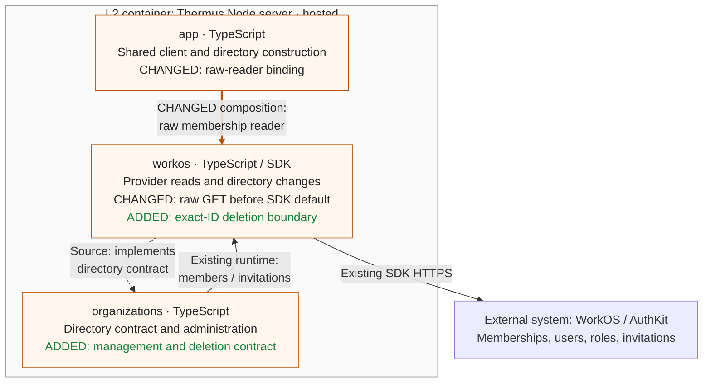

## Description

Adds portable membership-management evidence and one exact-membership deletion boundary. The SQL outage fixture now waits for its controlled warm export before testing blocked authorization; production behavior is unchanged by that correction.

## Review

**T2 Need architect**

Architecture: T2: declarations changed in 1 public module.
`internalInterface` also requires T2; `sensitiveBehavior` requires T1.

**Architecture facts**

- src/accounts/organizations/organization-directory.ts (+6 -0 lines)

<details><summary>Declaration diff</summary>

```diff
diff --git a/docs/api-surface/src/accounts/organizations/organization-directory.d.ts b/docs/api-surface/src/accounts/organizations/organization-directory.d.ts
index 59fd7de3..d1f5e593 100644
--- a/docs/api-surface/src/accounts/organizations/organization-directory.d.ts
+++ b/docs/api-surface/src/accounts/organizations/organization-directory.d.ts
@@ -6,12 +6,14 @@ export interface OrganizationMembership {
     readonly grants: readonly RoleGrant[];
 }
 export type MembershipStatus = 'active' | 'inactive' | 'pending';
+export type MembershipManagement = 'ordinary' | 'external' | 'unknown';
 export interface OrganizationMember {
     readonly membershipId: string;
     readonly subject: string;
     readonly organizationId: string;
     readonly email: string;
     readonly status: MembershipStatus;
+    readonly management: MembershipManagement;
     readonly grants: readonly RoleGrant[];
     readonly revision: string;
 }
@@ -51,10 +53,14 @@ export interface InvitationSendResult {
 export interface InvitationUpdateResult {
     readonly outcome: 'applied' | 'not-pending' | 'unsupported';
 }
+export interface MembershipDeletionResult {
+    readonly outcome: 'applied' | 'unsupported';
+}
 export interface OrganizationDirectory {
     membershipsOf(user: AuthenticatedUser): Promise<readonly OrganizationMembership[]>;
     memberPage(request: MemberPageRequest): Promise<Page<OrganizationMember>>;
     member(membershipId: string): Promise<OrganizationMember | undefined>;
+    deleteMembership(membershipId: string): Promise<MembershipDeletionResult>;
     invitationPage(request: InvitationPageRequest): Promise<Page<OrganizationInvitation>>;
     invitation(invitationId: string): Promise<OrganizationInvitation | undefined>;
     sendInvitation(request: InvitationRequest): Promise<InvitationSendResult>;
```

</details>

`.pr-impact.json` declares the shared directory contract/provider binding and deletion sensitivity. Components, source edges, all 13 registry diagrams and deployment topology remain unchanged.

Merge status: **blocked**. Selected product gates passed and the static checker is eligible. Owner-attested architect approval still needs reviewer identity/qualification and current-candidate scope reconciliation. Render workspace/target confirmation and verified deployment preflight remain pending. No merge or release is claimed.

### Architecture comparison — hosted Node server

Candidate `d0dd8fc8e519eb8a008ae0fe78ceb4e1199bc60d` against actual main merge base `8c6d204e8588a664438ba8934ab36670b802525f`. This supplementary L3 view derives from code and registry prose.



- Raw shared-client reads preserve missing/null management as unknown. Revisions include normalized management; all grants and existing query rules remain.
- One exact-ID deletion reports applied on normal completion. Only the documented 422/code proves unsupported without effect; other errors throw unchanged. Retries stay zero and timeout five seconds.
- Existing administration reads and authority stay at their owners. The upstream actor-profile binding remains; browser/MCP operations do not call deletion.
- No admission, last-Admin, serialization, storage or recovery rule is added here. Later slices own them. Controlled-wire proof does not establish live deletion or release.

---
Candidate: [d0dd8fc8](https://github.com/tomer-mayara/Thermus/commit/d0dd8fc8e519eb8a008ae0fe78ceb4e1199bc60d) · [Validation](https://github.com/tomer-mayara/Thermus/pull/251#issuecomment-6394917607) · [Quality review](https://github.com/tomer-mayara/Thermus/pull/251#issuecomment-6394917737) · [Complete evidence](%%EVIDENCE_ROOT%%/README.md)
