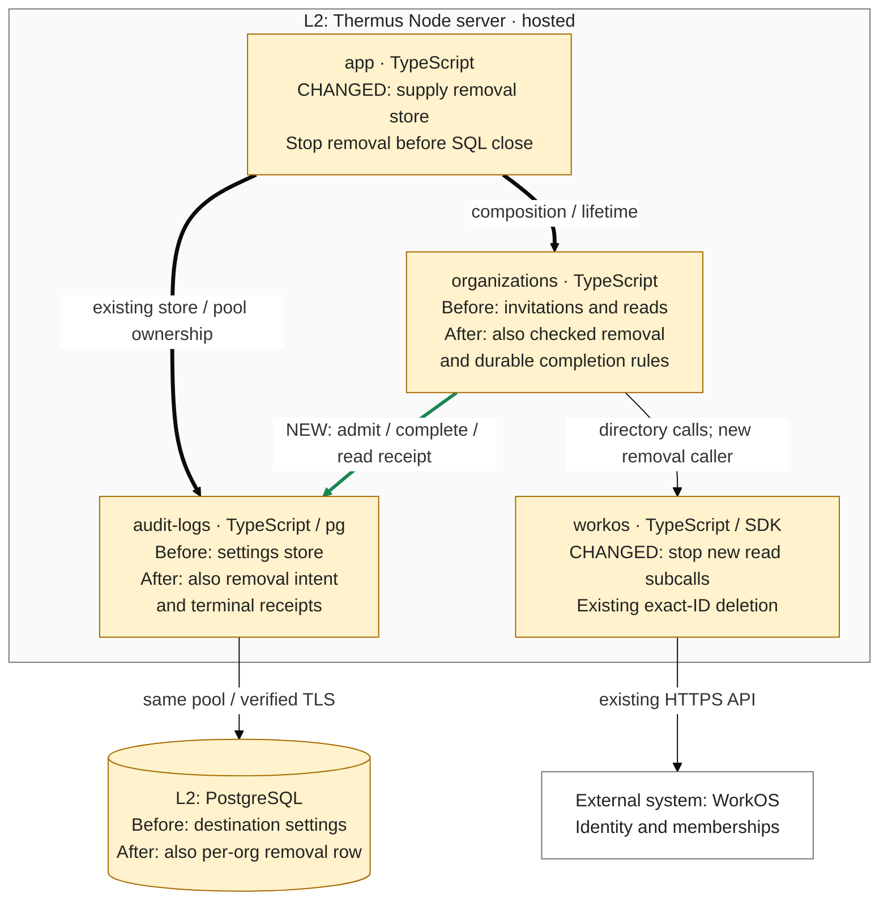

### Architecture comparison — hosted Thermus Node server

Candidate `b630a76275d5809a498ae63e1cbc322086f4194f`; actual parent and merge base `d0dd8fc8e519eb8a008ae0fe78ceb4e1199bc60d` (PR #251). Complete-stack main base: `8c6d204e8588a664438ba8934ab36670b802525f`. This supplementary C4 L3 comparison derives from the pinned code and registry; it compares this increment only.

- Before, administration did not invoke the existing deletion boundary. After, organizations checks current Admin authority before durable admission, then rereads the actor, exact target, revision, management, every grant and complete active-member pages before one DELETE. The scan allows ten pages; this increment adds no browser removal route.
- The existing SQL adapter implements the new organizations-owned admit/read/complete store through the same bounded pool. A pending per-organization row returns busy. Only a terminal row can be replaced. Statements release their SQL client before WorkOS HTTP; no transaction spans provider work. Independent operator/IdP writes remain a runbook constraint.
- Unconfirmed admission dispatches no provider deletion. Possible provider effects retain the hold across restart. Only a matching organization/operation terminal result or exact terminal receipt permits a proven result; missing or replaced rows prove nothing. No expiry, replay worker or automatic recovery is added.
- The server owns a 30-second monotonic lifetime. Optional stop signals bar later WorkOS read subcalls and deletion; started requests keep their five-second bound. Late provider replies start no completion, while an already-started terminal SQL write may settle its own row. App stops removal before snapshots clear pending content and Collector/SQL close; MCP cleanup runs beside that chain. Recording cannot change the result or release a hold.

This intermediate increment still scans display pages. The known avoidable-enrichment P2 remains present here and in the browser/proof increment; the later R1/#257 changes that scan. Controlled latency evidence is not a global transaction or throughput claim. Existing audit-logs → organizations type dependencies and the new runtime store collaboration have distinct meanings. No new source edge, component or L2 topology is introduced. The private removal table changes stored data and recovery responsibilities. Registry edits split the prior deployment view without claiming a new deployment.

Current test results, classification, human approval scope and merge eligibility belong to the maintained PR records. This architecture comparison makes no new pass, approval, merge, rollout or release claim.
