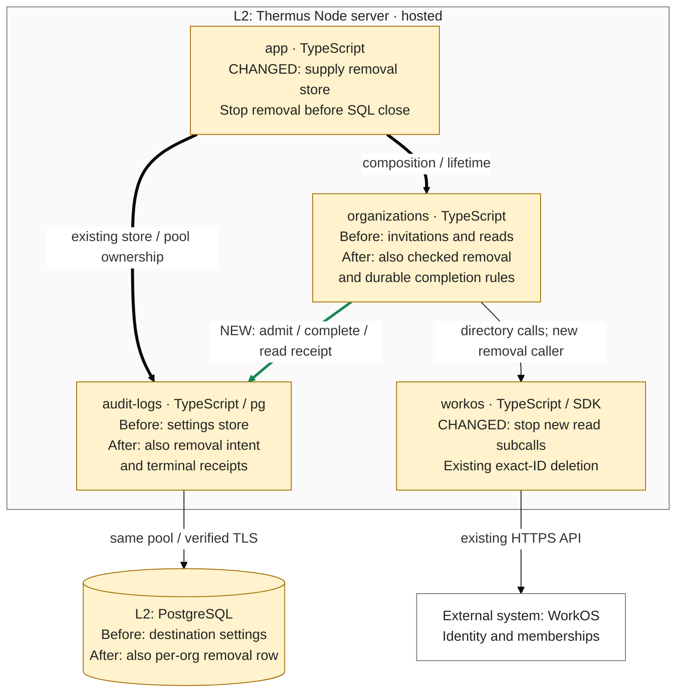

## Description

Adds durable per-organization removal admission, current actor/target and last-Admin checks, one exact provider dispatch, and operation-matched terminal receipts. The restack preserves the reviewed source and both SQL fixture intents. Parent: [PR #251](https://github.com/tomer-mayara/Thermus/pull/251).

## Review

**T2 Need architect**

Architecture: T2: 1 public module added; declarations changed in 3 public modules; 2 registry views added, 5 registry views edited

**Architecture facts**

- src/accounts/organizations/removal-operation-store.ts
- src/accounts/organizations/change-records.ts (+2 -2 lines)
- src/accounts/organizations/organization-administration.ts (+6 -0 lines)
- src/accounts/organizations/organization-directory.ts (+3 -2 lines)
- architecture/components.md: 2 views added, 5 views edited

<details><summary>Declaration diffs</summary>

```diff
diff --git a/docs/api-surface/src/accounts/organizations/change-records.d.ts b/docs/api-surface/src/accounts/organizations/change-records.d.ts
index 9688b8a9..8a8f6563 100644
--- a/docs/api-surface/src/accounts/organizations/change-records.d.ts
+++ b/docs/api-surface/src/accounts/organizations/change-records.d.ts
@@ -1,6 +1,6 @@
 import type { AuthenticatedUser } from '../identity/access-context.ts';
 export type ChangeResult = 'applied' | 'unchanged' | 'denied' | 'stale' | 'not-pending' | 'address-in-use' | 'unsupported';
-export type ChangeOutcome = ChangeResult | 'failed' | 'unknown';
+export type ChangeOutcome = ChangeResult | 'failed' | 'unknown' | 'last-admin' | 'busy' | 'unavailable';
 export declare class UnconfirmedChangeError extends Error {
     constructor(cause: unknown);
 }
@@ -40,6 +40,6 @@ export declare class ChangeRecording {
     constructor(records: ChangeRecorder, clock: () => Date);
     run(entry: ChangeEntry, check: () => Promise<ChangeResult | DirectoryChange>): Promise<ChangeResult>;
     private recordingFailure;
-    private keep;
+    record(entry: ChangeEntry, outcome: ChangeOutcome): void;
 }
 export {};

diff --git a/docs/api-surface/src/accounts/organizations/organization-administration.d.ts b/docs/api-surface/src/accounts/organizations/organization-administration.d.ts
index 2caf2796..0928c317 100644
--- a/docs/api-surface/src/accounts/organizations/organization-administration.d.ts
+++ b/docs/api-surface/src/accounts/organizations/organization-administration.d.ts
@@ -3,6 +3,8 @@ import type { Billing, BillingState } from '../billing/billing.ts';
 import { type InvitationOverview, type MemberOverview } from './administration-overviews.ts';
 import { type ChangeRecorder, type ChangeResult } from './change-records.ts';
 import type { OrganizationDirectory } from './organization-directory.ts';
+import type { MemberRemovalRequest, RemovalOperationStore, RemovalResult } from './removal-operation-store.ts';
+export type { MemberRemovalRequest, RemovalResult } from './removal-operation-store.ts';
 export interface Actor {
     readonly user: AuthenticatedUser;
 }
@@ -26,12 +28,16 @@ export interface OrganizationAdministrationOptions {
     readonly records: ChangeRecorder;
     readonly billing: Billing;
     readonly clock?: () => Date;
+    readonly removalStore?: RemovalOperationStore;
 }
 export declare class OrganizationAdministration {
     private readonly directory;
     private readonly changes;
     private readonly billing;
+    private readonly removals;
     constructor(options: OrganizationAdministrationOptions);
+    removeMember(actor: Actor, request: MemberRemovalRequest): Promise<RemovalResult>;
+    close(): Promise<void>;
     listOrganizations(user: AuthenticatedUser): Promise<readonly AuthorizedOrganization[]>;
     authorizeSelection(user: AuthenticatedUser, organizationId: string): Promise<AuthorizedOrganization | undefined>;
     memberOverview(actor: Actor, organizationId: string): Promise<MemberOverview | AdministrationRefusal>;

diff --git a/docs/api-surface/src/accounts/organizations/organization-directory.d.ts b/docs/api-surface/src/accounts/organizations/organization-directory.d.ts
index d1f5e593..614af3d0 100644
--- a/docs/api-surface/src/accounts/organizations/organization-directory.d.ts
+++ b/docs/api-surface/src/accounts/organizations/organization-directory.d.ts
@@ -35,6 +35,7 @@ export interface MemberPageRequest {
     readonly organizationId: string;
     readonly statuses: readonly MembershipStatus[];
     readonly cursor?: string;
+    readonly signal?: AbortSignal;
 }
 export interface InvitationPageRequest {
     readonly organizationId: string;
@@ -57,9 +58,9 @@ export interface MembershipDeletionResult {
     readonly outcome: 'applied' | 'unsupported';
 }
 export interface OrganizationDirectory {
-    membershipsOf(user: AuthenticatedUser): Promise<readonly OrganizationMembership[]>;
+    membershipsOf(user: AuthenticatedUser, signal?: AbortSignal): Promise<readonly OrganizationMembership[]>;
     memberPage(request: MemberPageRequest): Promise<Page<OrganizationMember>>;
-    member(membershipId: string): Promise<OrganizationMember | undefined>;
+    member(membershipId: string, signal?: AbortSignal): Promise<OrganizationMember | undefined>;
     deleteMembership(membershipId: string): Promise<MembershipDeletionResult>;
     invitationPage(request: InvitationPageRequest): Promise<Page<OrganizationInvitation>>;
     invitation(invitationId: string): Promise<OrganizationInvitation | undefined>;
```

The added public store declaration is also retained:

```diff
diff --git a/docs/api-surface/src/accounts/organizations/removal-operation-store.d.ts b/docs/api-surface/src/accounts/organizations/removal-operation-store.d.ts
new file mode 100644
index 00000000..2438f3bd
--- /dev/null
+++ b/docs/api-surface/src/accounts/organizations/removal-operation-store.d.ts
@@ -0,0 +1,35 @@
+export interface MemberRemovalRequest {
+    readonly organizationId: string;
+    readonly membershipId: string;
+    readonly revision: string;
+}
+export type RemovalResult = 'applied' | 'denied' | 'stale' | 'unsupported' | 'last-admin' | 'busy' | 'unavailable' | 'unknown';
+export interface RemovalIntent {
+    readonly organizationId: string;
+    readonly operationId: string;
+    readonly membershipId: string;
+    readonly revision: string;
+    readonly actor: {
+        readonly authority: string;
+        readonly subject: string;
+    };
+    readonly startedAt: string;
+}
+export type RemovalTerminal = 'applied' | 'no-effect';
+export type RemovalOperation = RemovalIntent & {
+    readonly outcome: RemovalTerminal | null;
+};
+export interface RemovalOperationStore {
+    admitRemoval(intent: RemovalIntent): Promise<{
+        status: 'admitted' | 'busy' | 'unavailable' | 'unconfirmed';
+    }>;
+    readRemoval(organizationId: string): Promise<{
+        status: 'found';
+        operation: RemovalOperation;
+    } | {
+        status: 'absent' | 'unavailable';
+    }>;
+    completeRemoval(organizationId: string, operationId: string, outcome: RemovalTerminal): Promise<{
+        status: 'completed' | 'mismatch' | 'unavailable' | 'unconfirmed';
+    }>;
+}
```

</details>

`.pr-impact.json` declares changed existing-component responsibilities, internal interfaces and shared storage/recovery guarantees. Deployment/component/internalInterface flags require T2; policy/read paths, three used MI exceptions and sensitiveBehavior/policy remain T1 reasons. No component set, source-owner pair, provider or L2 topology is added.

Merge status: **blocked**. Runtime validation is still in progress; preliminary checker eligibility supplies no missing gate pass. Parent integration and later R1 inclusion, qualified architect identity/current-candidate scope reconciliation, and Render workspace/target/deployment preflight remain pending. The latest authorized rollout enabled main auto-deploy; current controls still need verification. No Ready, merge or release is claimed.

### Architecture comparison — hosted Node server

Candidate `b630a76275d5809a498ae63e1cbc322086f4194f` against actual parent/merge base `d0dd8fc8e519eb8a008ae0fe78ceb4e1199bc60d`. Complete-candidate validation compares main `8c6d204e8588a664438ba8934ab36670b802525f`. This supplementary L3 view derives from pinned code and registry prose.



- Before, administration did not invoke the existing deletion boundary. After, organizations checks current Admin authority before durable admission, then rereads the actor, exact target, revision, management, every grant and complete active-member pages before one DELETE. The scan allows ten pages; this increment adds no browser removal route.
- The existing SQL adapter implements the new organizations-owned admit/read/complete store through the same bounded pool. A pending per-organization row returns busy. Only a terminal row can be replaced. Statements release their SQL client before WorkOS HTTP; no transaction spans provider work. Independent operator/IdP writes remain a runbook constraint.
- Unconfirmed admission dispatches no provider deletion. Possible provider effects retain the hold across restart. Only a matching organization/operation terminal result or exact terminal receipt permits a proven result; missing or replaced rows prove nothing. No expiry, replay worker or automatic recovery is added.
- The server owns a 30-second monotonic lifetime. Optional stop signals bar later WorkOS read subcalls and deletion; started requests keep their five-second bound. Late provider replies start no completion, while an already-started terminal SQL write may settle its own row. App stops removal before snapshots clear pending content and Collector/SQL close; MCP cleanup runs beside that chain. Recording cannot change the result or release a hold.

This intermediate head still scans display pages and retains the known avoidable-email-work P2. Later [R1 / PR #257](https://github.com/tomer-mayara/Thermus/pull/257) supplies the facts-only repair. Keep deployment held through whole-stack integration. Existing opposite type dependency and new runtime store collaboration have different meanings. The registry count reconciliation is in Quality review.

---
Candidate: [b630a762](https://github.com/tomer-mayara/Thermus/commit/b630a76275d5809a498ae63e1cbc322086f4194f) · [Validation](https://github.com/tomer-mayara/Thermus/pull/253#issuecomment-6395531390) · [Quality review](https://github.com/tomer-mayara/Thermus/pull/253#issuecomment-6395531599) · [Complete evidence](%%EVIDENCE_ROOT%%/README.md)
