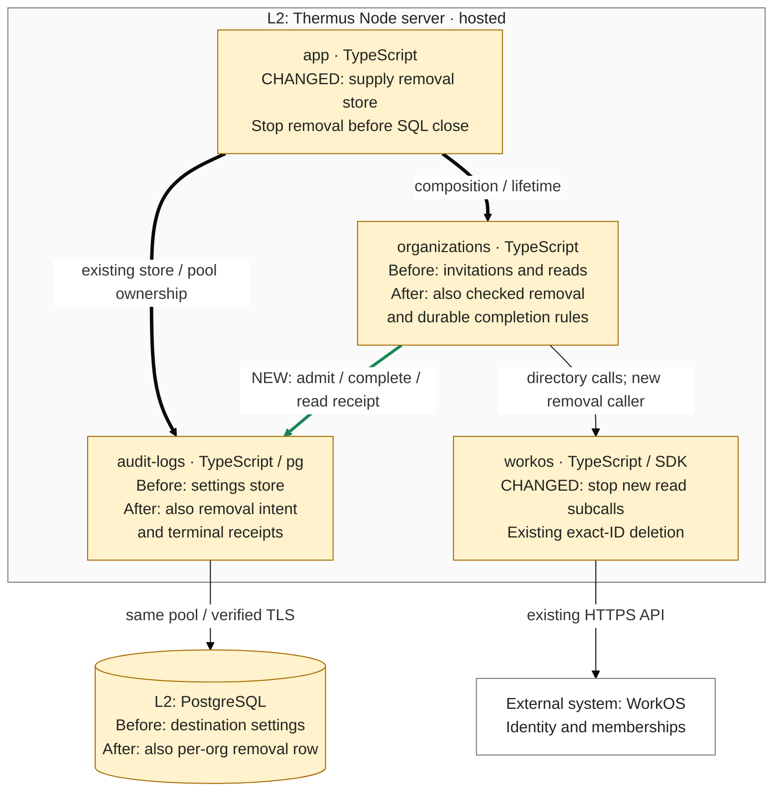

## Description

S2.5-01b coordinates membership removal across overlapping requests, timeouts, and restarts. It checks current authority and the last Admin, admits one durable operation per organization, and retains uncertain effects without replay. Stacked on [#251](https://github.com/tomer-mayara/Thermus/pull/251); browser removal remains S2.5-01c.

## Review

**T2 Need architect**

Architecture: T2: 1 public module added; declarations changed in 3 public modules; 2 registry views added, 5 registry views edited

Policy/read paths, sensitive membership behavior, and three MI exceptions also require review. **Draft; merge blocked:** the PostgreSQL gate fails one of 22 tests, R1 remains in this increment, parent #251 is unmerged, and independent authorized architect approval of this candidate is pending. The checker reports preliminary local eligibility only.

**Architecture facts** (candidate `790fa3e1f85ab3ed9a5228300cc90373117a2793`, actual parent `f03a7b73b2c27dc26477d5378a3356f28744a367`):

- src/accounts/organizations/removal-operation-store.ts
- src/accounts/organizations/change-records.ts (+2 -2 lines)
- src/accounts/organizations/organization-administration.ts (+6 -0 lines)
- src/accounts/organizations/organization-directory.ts (+3 -2 lines)
- architecture/components.md: 2 views added, 5 views edited

<details><summary>Public declaration diffs</summary>

```diff
diff --git a/docs/api-surface/src/accounts/organizations/change-records.d.ts b/docs/api-surface/src/accounts/organizations/change-records.d.ts
index 9688b8a9..8a8f6563 100644
--- a/docs/api-surface/src/accounts/organizations/change-records.d.ts
+++ b/docs/api-surface/src/accounts/organizations/change-records.d.ts
@@ -1,6 +1,6 @@
 import type { AuthenticatedUser } from '../identity/access-context.ts';
 export type ChangeResult = 'applied' | 'unchanged' | 'denied' | 'stale' | 'not-pending' | 'address-in-use' | 'unsupported';
-export type ChangeOutcome = ChangeResult | 'failed' | 'unknown';
+export type ChangeOutcome = ChangeResult | 'failed' | 'unknown' | 'last-admin' | 'busy' | 'unavailable';
 export declare class UnconfirmedChangeError extends Error {
     constructor(cause: unknown);
 }
@@ -40,6 +40,6 @@ export declare class ChangeRecording {
     constructor(records: ChangeRecorder, clock: () => Date);
     run(entry: ChangeEntry, check: () => Promise<ChangeResult | DirectoryChange>): Promise<ChangeResult>;
     private recordingFailure;
-    private keep;
+    record(entry: ChangeEntry, outcome: ChangeOutcome): void;
 }
 export {};
```

```diff
diff --git a/docs/api-surface/src/accounts/organizations/organization-administration.d.ts b/docs/api-surface/src/accounts/organizations/organization-administration.d.ts
index 2caf2796..0928c317 100644
--- a/docs/api-surface/src/accounts/organizations/organization-administration.d.ts
+++ b/docs/api-surface/src/accounts/organizations/organization-administration.d.ts
@@ -3,6 +3,8 @@ import type { Billing, BillingState } from '../billing/billing.ts';
 import { type InvitationOverview, type MemberOverview } from './administration-overviews.ts';
 import { type ChangeRecorder, type ChangeResult } from './change-records.ts';
 import type { OrganizationDirectory } from './organization-directory.ts';
+import type { MemberRemovalRequest, RemovalOperationStore, RemovalResult } from './removal-operation-store.ts';
+export type { MemberRemovalRequest, RemovalResult } from './removal-operation-store.ts';
 export interface Actor {
     readonly user: AuthenticatedUser;
 }
@@ -26,12 +28,16 @@ export interface OrganizationAdministrationOptions {
     readonly records: ChangeRecorder;
     readonly billing: Billing;
     readonly clock?: () => Date;
+    readonly removalStore?: RemovalOperationStore;
 }
 export declare class OrganizationAdministration {
     private readonly directory;
     private readonly changes;
     private readonly billing;
+    private readonly removals;
     constructor(options: OrganizationAdministrationOptions);
+    removeMember(actor: Actor, request: MemberRemovalRequest): Promise<RemovalResult>;
+    close(): Promise<void>;
     listOrganizations(user: AuthenticatedUser): Promise<readonly AuthorizedOrganization[]>;
     authorizeSelection(user: AuthenticatedUser, organizationId: string): Promise<AuthorizedOrganization | undefined>;
     memberOverview(actor: Actor, organizationId: string): Promise<MemberOverview | AdministrationRefusal>;
```

```diff
diff --git a/docs/api-surface/src/accounts/organizations/organization-directory.d.ts b/docs/api-surface/src/accounts/organizations/organization-directory.d.ts
index d1f5e593..614af3d0 100644
--- a/docs/api-surface/src/accounts/organizations/organization-directory.d.ts
+++ b/docs/api-surface/src/accounts/organizations/organization-directory.d.ts
@@ -35,6 +35,7 @@ export interface MemberPageRequest {
     readonly organizationId: string;
     readonly statuses: readonly MembershipStatus[];
     readonly cursor?: string;
+    readonly signal?: AbortSignal;
 }
 export interface InvitationPageRequest {
     readonly organizationId: string;
@@ -57,9 +58,9 @@ export interface MembershipDeletionResult {
     readonly outcome: 'applied' | 'unsupported';
 }
 export interface OrganizationDirectory {
-    membershipsOf(user: AuthenticatedUser): Promise<readonly OrganizationMembership[]>;
+    membershipsOf(user: AuthenticatedUser, signal?: AbortSignal): Promise<readonly OrganizationMembership[]>;
     memberPage(request: MemberPageRequest): Promise<Page<OrganizationMember>>;
-    member(membershipId: string): Promise<OrganizationMember | undefined>;
+    member(membershipId: string, signal?: AbortSignal): Promise<OrganizationMember | undefined>;
     deleteMembership(membershipId: string): Promise<MembershipDeletionResult>;
     invitationPage(request: InvitationPageRequest): Promise<Page<OrganizationInvitation>>;
     invitation(invitationId: string): Promise<OrganizationInvitation | undefined>;
```

</details>

[`.pr-impact.json`](https://github.com/tomer-mayara/Thermus/blob/790fa3e1f85ab3ed9a5228300cc90373117a2793/.pr-impact.json) flags shared recovery/storage, component responsibility, internal interfaces, sensitive behavior, and policy. The component set, source dependency pairs, containers, configuration, and provider stay the same.

### Architecture comparison — hosted Thermus Node server



- Administration now uses existing exact-ID deletion: check authority, admit, then reread actor, exact target/revision, grants, management, and complete active Admin pages before one deletion. Reads stop at ten pages.
- The existing SQL adapter/pool implements the store. Pending intent returns busy; terminal receipts can be replaced. Statements release clients before provider HTTP. Independent provider/operator writes remain a runbook constraint.
- Unknown admission sends nothing. Possible effects retain the hold across restart. While active, known pre-send refusals or proven outcomes settle only their own operation; uncertain completion needs its matching terminal receipt. No lease or replay is added.
- The 30-second lifetime stops later read subcalls and deletion; in-flight WorkOS calls retain five-second bounds. Late replies start no work; already-started terminal SQL may finish for its operation. App stops removal, closes snapshots/clears pending content, then closes Collector/SQL; MCP cleanup runs beside this chain. Recording cannot alter the result or hold.

The green edge is a new runtime call through the supplied store; the opposite type-only source dependency already exists. Seven registry drawings change. [Reviewed renders and provenance](architecture/provenance-final.json) explain why L3 plus these notes suffices without L4.

**R1 delivery limit:** unused per-member email lookups can exhaust the deadline before DELETE and leave a pending hold. [Controlled latency evidence](architecture/historical-r1-evidence.md) is not a production benchmark. [PR #257](https://github.com/tomer-mayara/Thermus/pull/257) implements the later repair; it is outside this rebase. Customer removal capture remains S2.5-01c. The rebase preserves feature source/tests and resolves the two document conflicts. [Validation](VALIDATION.md) retains fresh failures and passes; no merge or production change was performed.

---
Candidate: [790fa3e1](https://github.com/tomer-mayara/Thermus/commit/790fa3e1f85ab3ed9a5228300cc90373117a2793) · [Validation](https://github.com/tomer-mayara/Thermus/pull/253#issuecomment-6395531390) · [Quality review](https://github.com/tomer-mayara/Thermus/pull/253#issuecomment-6395531599)
