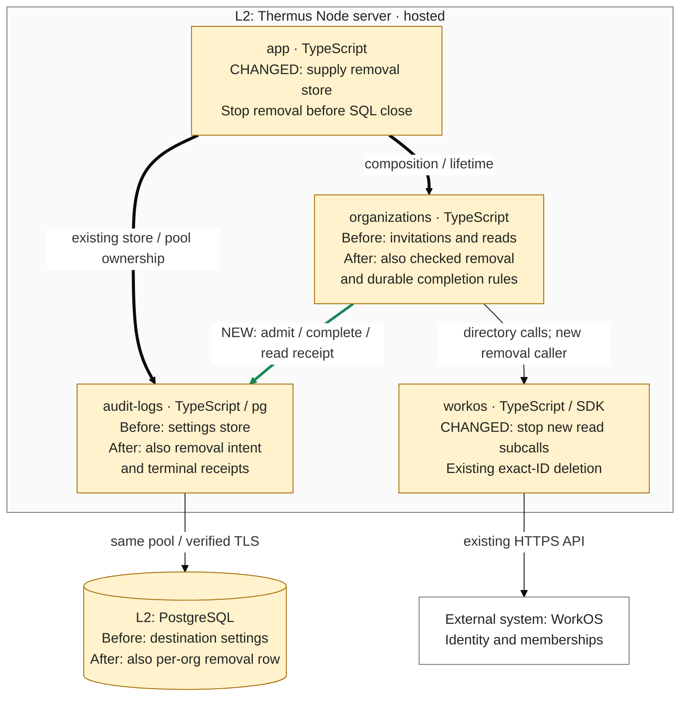

# Architecture comparison — hosted Thermus Node server

Review base: `f03a7b73b2c27dc26477d5378a3356f28744a367` (updated PR #251).
Candidate: `790fa3e1f85ab3ed9a5228300cc90373117a2793`. Source review and fresh renders were checked at gate head
`fa5d4d7f57ef270df2a056ad523ec22e3b5032b6`; the final input bridge must pass before publication.
This supplementary C4 L3 view is derived from current code and registry prose.
Amber means changed responsibility or stored data. The green edge is added runtime
collaboration; neutral relationships remain. The adapter's opposite type-only
source dependency already exists and is described below.

- Before, administration did not call the existing exact-ID deletion. It now checks
  current Admin authority before durable admission, then rereads the actor, exact
  target, revision, roles, management, and complete active Admin pages before one
  deletion. The scan is limited to ten pages. No browser removal route is added.
- The existing SQL adapter and pool implement the organizations-owned store. A
  pending row returns busy; only a terminal row can be replaced. Each statement
  releases its client before provider HTTP. Independent WorkOS/operator writes
  remain a runbook constraint. No transaction spans provider work.
- Unknown admission sends nothing. Possible provider effects keep the durable hold
  across restart. While the operation is active, known pre-send refusals or proven
  provider outcomes can settle only the same organization and operation ID. An
  uncertain completion requires its matching terminal receipt;
  missing or replacement rows prove nothing. No lease, worker, or replay is added.
- The server owns a 30-second lifetime. Its stop signal bars later WorkOS read
  subcalls and deletion; an in-flight call keeps its five-second bound. Late
  replies start no further work. An already-started terminal SQL write may still
  commit for its own operation. App stops removal, closes snapshots and clears
  pending content, then closes the Collector and SQL. MCP cleanup runs beside that
  chain. Recording cannot change the removal result or release its hold.

**Delivery limit:** S2.5-R1 remains open in this PR: the safety scan still calls
display pages, which fetch unused email for each member. Controlled 100-member,
300 ms lookup evidence shows that this work can exhaust the deadline before DELETE,
return unknown, retain the pending row, and make the next request busy. This is
simulated latency evidence, not a production benchmark or a last-Admin bypass.
[PR #257](https://github.com/tomer-mayara/Thermus/pull/257) repairs that path later in
the stack; its code is outside this rebase. Customer removal capture and the browser
caller remain S2.5-01c. Complete-candidate checks are recorded in Validation.
Parent integration, R1 resolution in this PR, and independent authorized architect approval of the current
candidate remain holds.

The existing `audit-logs -> organizations` type edge supplies the store contract;
the new runtime call follows the supplied object in the other direction. There is
no new component or source edge, container, external system, provider setting, or
environment variable. The existing PostgreSQL datastore adds a private table and
retains operation rows; this changes shared storage/recovery responsibilities.
The seven changed registry diagrams are current maps, with no comparison colors.
Parent Audit display metadata and pending snapshot capture remain inherited.
