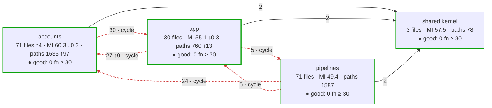
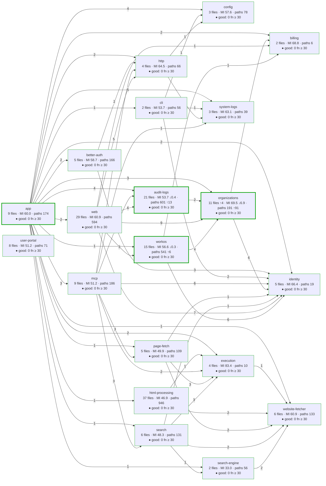
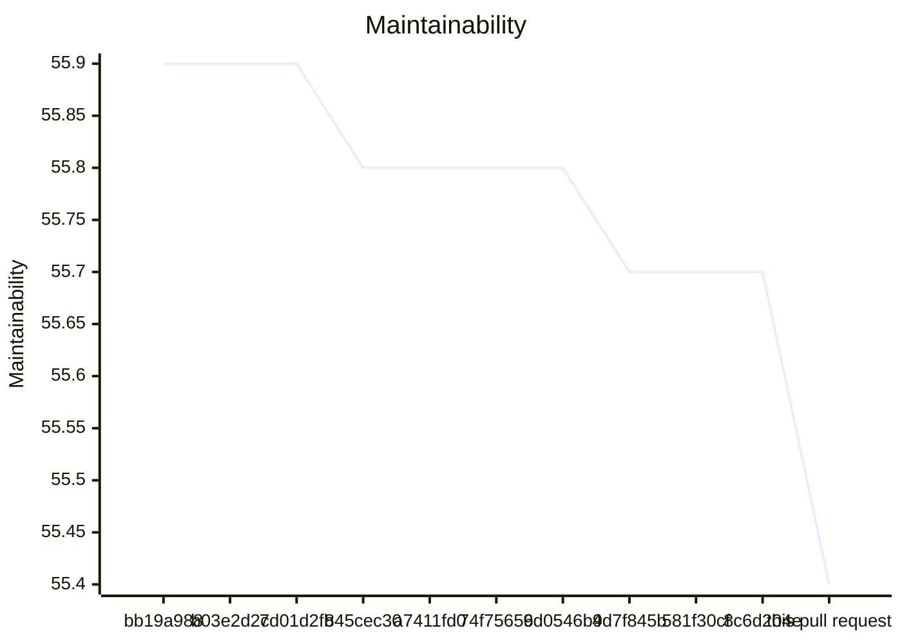
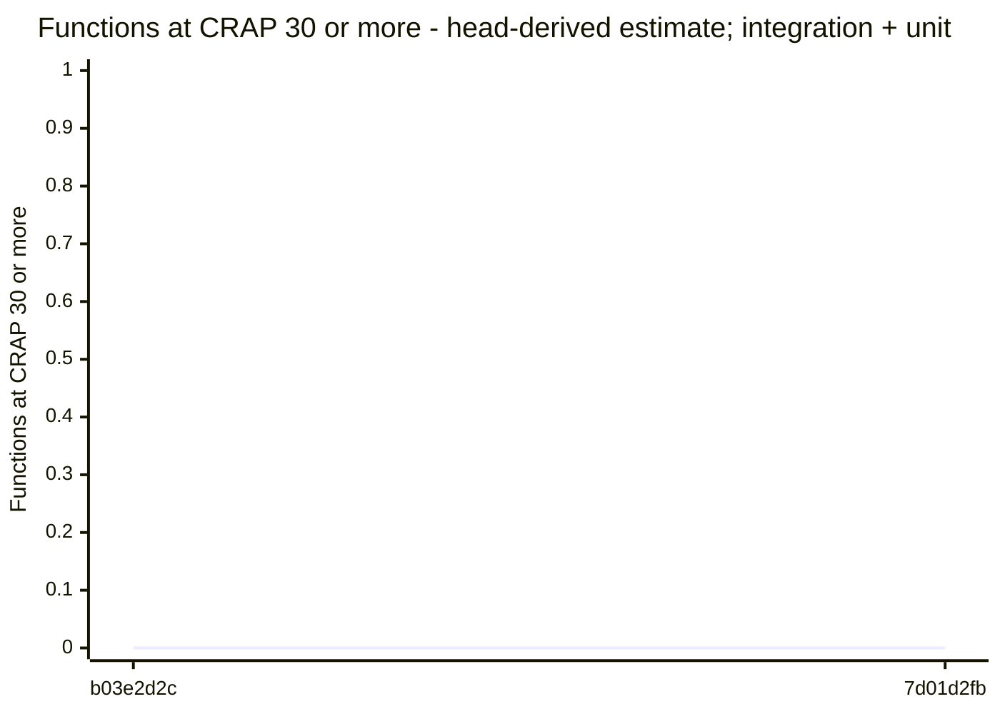
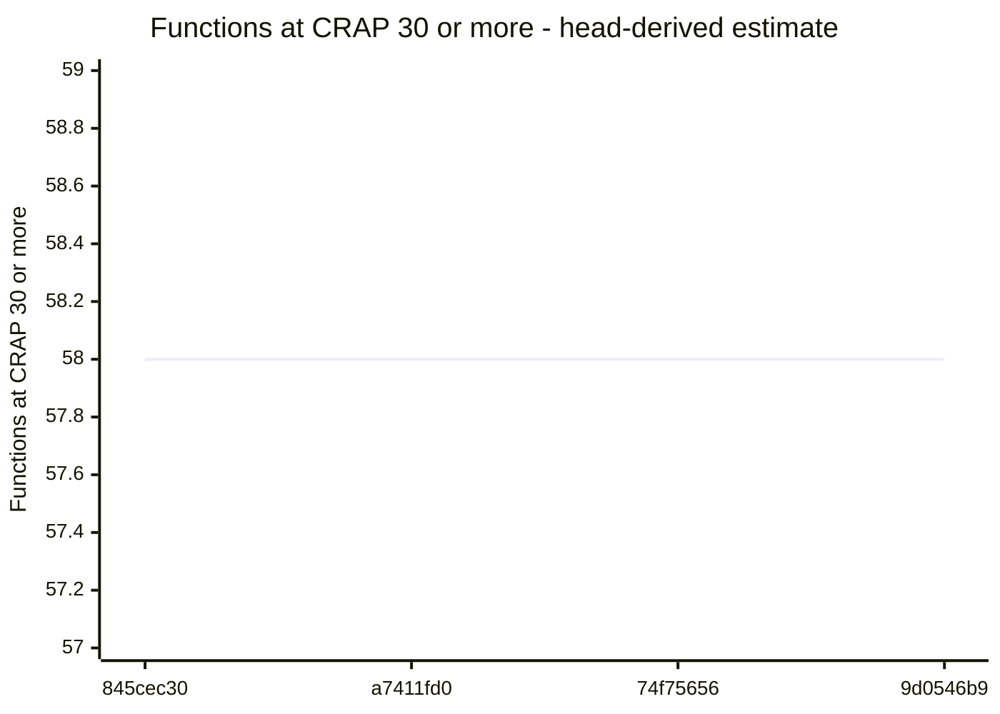
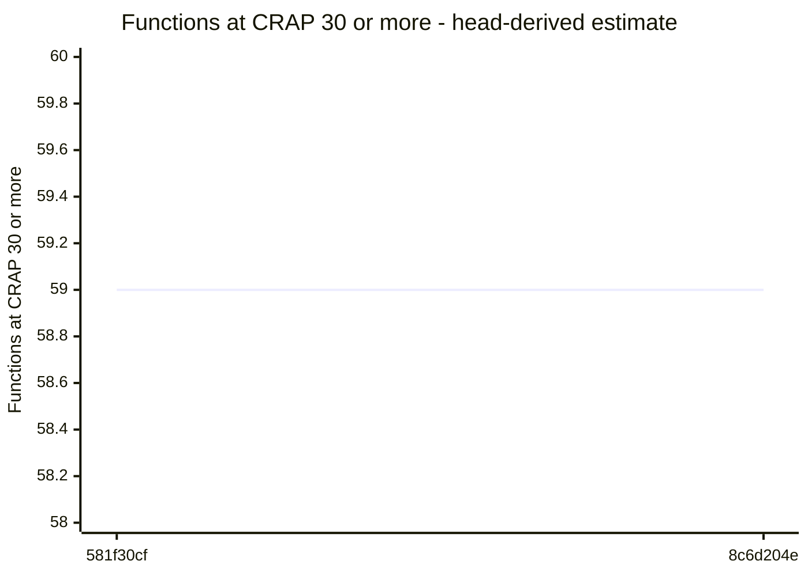

# Code quality process

## Delta

Status: goal miss.

```text
  43.7  src/accounts/organizations/membership-removal.ts  below 85
  46.3  src/logs/audit/pg-destination-settings-store.ts  below 85
  47.1  src/accounts/providers/workos/workos-organizations.ts  below 85
  54.8  src/app/application.ts  below 85
  56.9  src/accounts/organizations/membership-removal-checks.ts  below 85
  61.9  src/accounts/organizations/organization-administration.ts  below 85
  73.5  src/accounts/organizations/membership-removal-lifetime.ts  below 85
  75.1  src/app/logging-storage.ts  below 85
  77.7  src/accounts/organizations/directory-reads.ts  below 85
  89.2  src/accounts/organizations/change-records.ts
  23.3  test/acceptance/logging/audit/hosted-storage-failure.runtime.ts  no goal
  24.4  test/unit/organizations/membership-removal-lifetime.test.ts  no goal
  28.9  test/unit/organizations/membership-removal-rules.test.ts  no goal
  30.7  test/unit/organizations/membership-removal-outcomes.test.ts  no goal
  33.5  test/acceptance/auth/membership-removal.runtime.ts  no goal
  33.7  test/integration/logging/audit/removal-operations.runtime.ts  no goal
  33.8  test/integration/auth/workos-removal-lifetime.test.ts  no goal
  35.6  test/unit/auth-workos/workos-organizations-read-lifetime.test.ts  no goal
  44.4  test/unit/logging/audit/pg-removal-operation-store.test.ts  no goal
  45.7  test/acceptance/auth/membership-removal-restart.runtime.ts  no goal
  49.1  test/unit/organizations/fixtures/membership-removal-fixtures.ts  no goal
  52.4  test/support/processes/membership-removal-child.ts  no goal
  56.9  test/support/processes/membership-removal-process.ts  no goal
  59.7  test/integration/auth/hosted-storage-lifecycle.test.ts  no goal
  92.8  test/support/processes/module-paths.ts  no goal
  not measured  docs/api-surface/src/accounts/organizations/change-records.d.ts
  not measured  docs/api-surface/src/accounts/organizations/organization-administration.d.ts
  not measured  docs/api-surface/src/accounts/organizations/organization-directory.d.ts
  not measured  docs/api-surface/src/accounts/organizations/removal-operation-store.d.ts
  not measured  src/accounts/organizations/organization-directory.ts
  not measured  src/accounts/organizations/removal-operation-store.ts
Result: 9 of 10 production files below 85. Goal: 85 or more for each production file. 15 other files without a goal. 6 files not measured.
Comparison with origin/codex/s2-5-01a-membership-deletion: ast-report/compare.html
```

## Review

Status: goal miss.

## AST Metrics found blocking regressions

18 new critical issue(s), 114 other regression(s), 1 improvement(s)

### Summary

- ⚠️  **Complexity: +806**
- ✅ **Ease of maintenance: +4**
- ➖ **Outgoing dependencies: -**
- ⚠️  **Probability of bugs: +0.30**

### Regressions

- **strict_checks** (`.cache/pr251-rebase-8c6d204e/publication/prepare.py:73`, high)
  New function with cyclomatic complexity 40 (threshold: 10)
  Suggested action: Extract smaller, well-named functions to reduce decision points
- **main** (`.cache/pr251-rebase-8c6d204e/publication/publish.py:30`, high)
  New function with cyclomatic complexity 29 (threshold: 10)
  Suggested action: Extract smaller, well-named functions to reduce decision points
- **strict_checks** (`.cache/pr251-rebase-8c6d204e/publication/stage/review-evidence/pr251-rebase-8c6d204e/f03a7b73b2c27dc26477d5378a3356f28744a367/tooling/publication/prepare.py:73`, high)
  New function with cyclomatic complexity 40 (threshold: 10)
  Suggested action: Extract smaller, well-named functions to reduce decision points
- **main** (`.cache/pr251-rebase-8c6d204e/publication/stage/review-evidence/pr251-rebase-8c6d204e/f03a7b73b2c27dc26477d5378a3356f28744a367/tooling/publication/publish.py:30`, high)
  New function with cyclomatic complexity 29 (threshold: 10)
  Suggested action: Extract smaller, well-named functions to reduce decision points
- **strict_checks** (`.cache/pr253-rebase-f03a7b73/publication/prepare.py:61`, high)
  New function with cyclomatic complexity 41 (threshold: 10)
  Suggested action: Extract smaller, well-named functions to reduce decision points
- **main** (`.cache/pr253-rebase-f03a7b73/publication/publish.py:31`, high)
  New function with cyclomatic complexity 34 (threshold: 10)
  Suggested action: Extract smaller, well-named functions to reduce decision points
- **main** (`.cache/pr253-rebase-f03a7b73/publication/update-text.py:22`, high)
  New function with cyclomatic complexity 25 (threshold: 10)
  Suggested action: Extract smaller, well-named functions to reduce decision points
- **comment** (`.cache/pr253-rebase-f03a7b73/quality/bind-habit.py:13`, high)
  New function with cyclomatic complexity 35 (threshold: 10)
  Suggested action: Extract smaller, well-named functions to reduce decision points
- **inspect** (`.cache/pr253-rebase-f03a7b73/validation/inspect-hosted-builds.py:28`, high)
  New function with cyclomatic complexity 44 (threshold: 10)
  Suggested action: Extract smaller, well-named functions to reduce decision points
- **main** (`.cache/rebase251/prepare-review-evidence.py:45`, high)
  New function with cyclomatic complexity 60 (threshold: 10)
  Suggested action: Extract smaller, well-named functions to reduce decision points
- **.cache/rebase251/publish/review-evidence/s2-5-01a-rebase/07d0d0387aed511674b9b5c73aeec8169a33422b/candidate/src/accounts/providers/workos/workos-organizations.ts** (`.cache/rebase251/publish/review-evidence/s2-5-01a-rebase/07d0d0387aed511674b9b5c73aeec8169a33422b/candidate/src/accounts/providers/workos/workos-organizations.ts:103`, high)
  Maintainability too low: got 57 (min: 85)
- **main** (`.cache/rebase251/publish/review-evidence/s2-5-01a-rebase/07d0d0387aed511674b9b5c73aeec8169a33422b/tooling/prepare-review-evidence.py:45`, high)
  New function with cyclomatic complexity 60 (threshold: 10)
  Suggested action: Extract smaller, well-named functions to reduce decision points
- **main** (`.cache/s25-r1/prepare-review-evidence.py:32`, high)
  New function with cyclomatic complexity 39 (threshold: 10)
  Suggested action: Extract smaller, well-named functions to reduce decision points
- **.cache/s25-r1/publish/review-evidence/s2-5-r1/076e661d830b969bf233522e1163c22cd1934361/candidate/src/accounts/providers/workos/workos-organizations.ts** (`.cache/s25-r1/publish/review-evidence/s2-5-r1/076e661d830b969bf233522e1163c22cd1934361/candidate/src/accounts/providers/workos/workos-organizations.ts:104`, high)
  Maintainability too low: got 54 (min: 85)
- **main** (`.cache/s25-r1/publish/review-evidence/s2-5-r1/076e661d830b969bf233522e1163c22cd1934361/tooling/prepare-review-evidence.py:32`, high)
  New function with cyclomatic complexity 39 (threshold: 10)
  Suggested action: Extract smaller, well-named functions to reduce decision points
- **src/accounts/organizations/membership-removal-lifetime.ts** (`src/accounts/organizations/membership-removal-lifetime.ts:6`, high)
  Maintainability too low: got 70 (min: 85)
- **src/accounts/organizations/membership-removal.ts** (`src/accounts/organizations/membership-removal.ts:7`, high)
  Maintainability too low: got 43 (min: 85)
- **src/logs/audit/pg-destination-settings-store.ts** (`src/logs/audit/pg-destination-settings-store.ts`, high)
  Maintainability index: 54 -> 46 (below 85 is hard to maintain)
  Suggested action: Refactor long or deeply nested functions and reduce responsibilities in this file
- **.cache/pr251-rebase-8c6d204e/publication/prepare.py** (`.cache/pr251-rebase-8c6d204e/publication/prepare.py`, medium)
  Cyclomatic complexity too high: got 112 (max: 40)
- **.cache/pr251-rebase-8c6d204e/publication/prepare.py** (`.cache/pr251-rebase-8c6d204e/publication/prepare.py:42`, medium)
  LLOC too high in method blocked_draft_check(): got 28 (max: 20)
- **.cache/pr251-rebase-8c6d204e/publication/prepare.py** (`.cache/pr251-rebase-8c6d204e/publication/prepare.py:73`, medium)
  LLOC too high in method strict_checks(): got 59 (max: 20)
- **.cache/pr251-rebase-8c6d204e/publication/prepare.py** (`.cache/pr251-rebase-8c6d204e/publication/prepare.py:136`, medium)
  LLOC too high in method native_assets(): got 32 (max: 20)
- **.cache/pr251-rebase-8c6d204e/publication/prepare.py** (`.cache/pr251-rebase-8c6d204e/publication/prepare.py:172`, medium)
  LLOC too high in method collect(): got 36 (max: 20)
- **.cache/pr251-rebase-8c6d204e/publication/prepare.py** (`.cache/pr251-rebase-8c6d204e/publication/prepare.py:212`, medium)
  LLOC too high in method main(): got 39 (max: 20)
- **.cache/pr251-rebase-8c6d204e/publication/prepare.py** (`.cache/pr251-rebase-8c6d204e/publication/prepare.py`, medium)
  Too many Lines of code (255 > 150)
- **.cache/pr251-rebase-8c6d204e/publication/prepare.py** (`.cache/pr251-rebase-8c6d204e/publication/prepare.py:73`, medium)
  LOC too high in method strict_checks(): got 60 (max: 30)
- **.cache/pr251-rebase-8c6d204e/publication/prepare.py** (`.cache/pr251-rebase-8c6d204e/publication/prepare.py:136`, medium)
  LOC too high in method native_assets(): got 34 (max: 30)
- **.cache/pr251-rebase-8c6d204e/publication/prepare.py** (`.cache/pr251-rebase-8c6d204e/publication/prepare.py:172`, medium)
  LOC too high in method collect(): got 38 (max: 30)
- **.cache/pr251-rebase-8c6d204e/publication/prepare.py** (`.cache/pr251-rebase-8c6d204e/publication/prepare.py:212`, medium)
  LOC too high in method main(): got 40 (max: 30)
- **blocked_draft_check** (`.cache/pr251-rebase-8c6d204e/publication/prepare.py:42`, medium)
  New function with cyclomatic complexity 21 (threshold: 10)
  Suggested action: Extract smaller, well-named functions to reduce decision points
- **collect** (`.cache/pr251-rebase-8c6d204e/publication/prepare.py:172`, medium)
  New function with cyclomatic complexity 16 (threshold: 10)
  Suggested action: Extract smaller, well-named functions to reduce decision points
- **main** (`.cache/pr251-rebase-8c6d204e/publication/prepare.py:212`, medium)
  New function with cyclomatic complexity 12 (threshold: 10)
  Suggested action: Extract smaller, well-named functions to reduce decision points
- **native_assets** (`.cache/pr251-rebase-8c6d204e/publication/prepare.py:136`, medium)
  New function with cyclomatic complexity 13 (threshold: 10)
  Suggested action: Extract smaller, well-named functions to reduce decision points
- **.cache/pr251-rebase-8c6d204e/publication/publish.py** (`.cache/pr251-rebase-8c6d204e/publication/publish.py:30`, medium)
  LLOC too high in method main(): got 55 (max: 20)
- **.cache/pr251-rebase-8c6d204e/publication/publish.py** (`.cache/pr251-rebase-8c6d204e/publication/publish.py:30`, medium)
  LOC too high in method main(): got 58 (max: 30)
- **.cache/pr251-rebase-8c6d204e/publication/stage/review-evidence/pr251-rebase-8c6d204e/f03a7b73b2c27dc26477d5378a3356f28744a367/tooling/publication/prepare.py** (`.cache/pr251-rebase-8c6d204e/publication/stage/review-evidence/pr251-rebase-8c6d204e/f03a7b73b2c27dc26477d5378a3356f28744a367/tooling/publication/prepare.py`, medium)
  Cyclomatic complexity too high: got 112 (max: 40)
- **.cache/pr251-rebase-8c6d204e/publication/stage/review-evidence/pr251-rebase-8c6d204e/f03a7b73b2c27dc26477d5378a3356f28744a367/tooling/publication/prepare.py** (`.cache/pr251-rebase-8c6d204e/publication/stage/review-evidence/pr251-rebase-8c6d204e/f03a7b73b2c27dc26477d5378a3356f28744a367/tooling/publication/prepare.py:42`, medium)
  LLOC too high in method blocked_draft_check(): got 28 (max: 20)
- **.cache/pr251-rebase-8c6d204e/publication/stage/review-evidence/pr251-rebase-8c6d204e/f03a7b73b2c27dc26477d5378a3356f28744a367/tooling/publication/prepare.py** (`.cache/pr251-rebase-8c6d204e/publication/stage/review-evidence/pr251-rebase-8c6d204e/f03a7b73b2c27dc26477d5378a3356f28744a367/tooling/publication/prepare.py:73`, medium)
  LLOC too high in method strict_checks(): got 59 (max: 20)
- **.cache/pr251-rebase-8c6d204e/publication/stage/review-evidence/pr251-rebase-8c6d204e/f03a7b73b2c27dc26477d5378a3356f28744a367/tooling/publication/prepare.py** (`.cache/pr251-rebase-8c6d204e/publication/stage/review-evidence/pr251-rebase-8c6d204e/f03a7b73b2c27dc26477d5378a3356f28744a367/tooling/publication/prepare.py:136`, medium)
  LLOC too high in method native_assets(): got 32 (max: 20)
- **.cache/pr251-rebase-8c6d204e/publication/stage/review-evidence/pr251-rebase-8c6d204e/f03a7b73b2c27dc26477d5378a3356f28744a367/tooling/publication/prepare.py** (`.cache/pr251-rebase-8c6d204e/publication/stage/review-evidence/pr251-rebase-8c6d204e/f03a7b73b2c27dc26477d5378a3356f28744a367/tooling/publication/prepare.py:172`, medium)
  LLOC too high in method collect(): got 36 (max: 20)
- **.cache/pr251-rebase-8c6d204e/publication/stage/review-evidence/pr251-rebase-8c6d204e/f03a7b73b2c27dc26477d5378a3356f28744a367/tooling/publication/prepare.py** (`.cache/pr251-rebase-8c6d204e/publication/stage/review-evidence/pr251-rebase-8c6d204e/f03a7b73b2c27dc26477d5378a3356f28744a367/tooling/publication/prepare.py:212`, medium)
  LLOC too high in method main(): got 39 (max: 20)
- **.cache/pr251-rebase-8c6d204e/publication/stage/review-evidence/pr251-rebase-8c6d204e/f03a7b73b2c27dc26477d5378a3356f28744a367/tooling/publication/prepare.py** (`.cache/pr251-rebase-8c6d204e/publication/stage/review-evidence/pr251-rebase-8c6d204e/f03a7b73b2c27dc26477d5378a3356f28744a367/tooling/publication/prepare.py`, medium)
  Too many Lines of code (255 > 150)
- **.cache/pr251-rebase-8c6d204e/publication/stage/review-evidence/pr251-rebase-8c6d204e/f03a7b73b2c27dc26477d5378a3356f28744a367/tooling/publication/prepare.py** (`.cache/pr251-rebase-8c6d204e/publication/stage/review-evidence/pr251-rebase-8c6d204e/f03a7b73b2c27dc26477d5378a3356f28744a367/tooling/publication/prepare.py:73`, medium)
  LOC too high in method strict_checks(): got 60 (max: 30)
- **.cache/pr251-rebase-8c6d204e/publication/stage/review-evidence/pr251-rebase-8c6d204e/f03a7b73b2c27dc26477d5378a3356f28744a367/tooling/publication/prepare.py** (`.cache/pr251-rebase-8c6d204e/publication/stage/review-evidence/pr251-rebase-8c6d204e/f03a7b73b2c27dc26477d5378a3356f28744a367/tooling/publication/prepare.py:136`, medium)
  LOC too high in method native_assets(): got 34 (max: 30)
- **.cache/pr251-rebase-8c6d204e/publication/stage/review-evidence/pr251-rebase-8c6d204e/f03a7b73b2c27dc26477d5378a3356f28744a367/tooling/publication/prepare.py** (`.cache/pr251-rebase-8c6d204e/publication/stage/review-evidence/pr251-rebase-8c6d204e/f03a7b73b2c27dc26477d5378a3356f28744a367/tooling/publication/prepare.py:172`, medium)
  LOC too high in method collect(): got 38 (max: 30)
- **.cache/pr251-rebase-8c6d204e/publication/stage/review-evidence/pr251-rebase-8c6d204e/f03a7b73b2c27dc26477d5378a3356f28744a367/tooling/publication/prepare.py** (`.cache/pr251-rebase-8c6d204e/publication/stage/review-evidence/pr251-rebase-8c6d204e/f03a7b73b2c27dc26477d5378a3356f28744a367/tooling/publication/prepare.py:212`, medium)
  LOC too high in method main(): got 40 (max: 30)
- **blocked_draft_check** (`.cache/pr251-rebase-8c6d204e/publication/stage/review-evidence/pr251-rebase-8c6d204e/f03a7b73b2c27dc26477d5378a3356f28744a367/tooling/publication/prepare.py:42`, medium)
  New function with cyclomatic complexity 21 (threshold: 10)
  Suggested action: Extract smaller, well-named functions to reduce decision points
- **collect** (`.cache/pr251-rebase-8c6d204e/publication/stage/review-evidence/pr251-rebase-8c6d204e/f03a7b73b2c27dc26477d5378a3356f28744a367/tooling/publication/prepare.py:172`, medium)
  New function with cyclomatic complexity 16 (threshold: 10)
  Suggested action: Extract smaller, well-named functions to reduce decision points
- **main** (`.cache/pr251-rebase-8c6d204e/publication/stage/review-evidence/pr251-rebase-8c6d204e/f03a7b73b2c27dc26477d5378a3356f28744a367/tooling/publication/prepare.py:212`, medium)
  New function with cyclomatic complexity 12 (threshold: 10)
  Suggested action: Extract smaller, well-named functions to reduce decision points
- **native_assets** (`.cache/pr251-rebase-8c6d204e/publication/stage/review-evidence/pr251-rebase-8c6d204e/f03a7b73b2c27dc26477d5378a3356f28744a367/tooling/publication/prepare.py:136`, medium)
  New function with cyclomatic complexity 13 (threshold: 10)
  Suggested action: Extract smaller, well-named functions to reduce decision points

_... and 82 more. Download the full report for details._

### Improvements

- **test/integration/auth/hosted-storage-lifecycle.test.ts** (`test/integration/auth/hosted-storage-lifecycle.test.ts`): Maintainability index: 49 -> 60

## CRAP

Status: passed.

Reused verified compatible unit + integration + acceptance coverage.

## CRAP goals

Goals: CRAP < 30; new functions also CRAP ≤ 15.

| File | Function | Change | Paths | Coverage | CRAP | To do |
| --- | --- | --- | --- | --- | --- | --- |
| src/accounts/organizations/membership-removal-checks.ts | checkRemoval | new | 9 | 100% | 9.0 | ok |
| src/accounts/organizations/membership-removal.ts | membership-removal\MembershipRemoval.complete | new | 9 | 100% | 9.0 | ok |
| src/accounts/organizations/membership-removal-checks.ts | targetRefusal | new | 8 | 100% | 8.0 | ok |
| src/accounts/providers/workos/workos-organizations.ts | workos-organizations\WorkOSOrganizations.activeMembership | unchanged | 7 | 100% | 7.0 | ok; unchanged by this PR |
| src/app/application.ts | (anonymous) | unchanged | 7 | 100% | 7.0 | ok; unchanged by this PR |
| src/accounts/organizations/membership-removal.ts | membership-removal\MembershipRemoval.admitted | new | 6 | 100% | 6.0 | ok |
| src/accounts/providers/workos/workos-organizations.ts | workos-organizations\WorkOSOrganizations.changeInvitation | unchanged | 6 | 100% | 6.0 | ok; unchanged by this PR |
| src/accounts/organizations/organization-administration.ts | organization-administration\OrganizationAdministration. | unchanged | 5 | 97.6% | 5.0 | ok; unchanged by this PR |
| src/accounts/organizations/membership-removal.ts | membership-removal\MembershipRemoval.admit | new | 5 | 100% | 5.0 | ok |
| src/accounts/organizations/organization-administration.ts | explicitResult | unchanged | 5 | 100% | 5.0 | ok; unchanged by this PR |
| src/accounts/providers/workos/workos-organizations.ts | checkedActiveRecord | unchanged | 5 | 100% | 5.0 | ok; unchanged by this PR |
| src/accounts/providers/workos/workos-organizations.ts | workos-organizations\WorkOSOrganizations.invitationPage | unchanged | 5 | 100% | 5.0 | ok; unchanged by this PR |
| src/accounts/providers/workos/workos-organizations.ts | workos-organizations\WorkOSOrganizations.sendInvitation | unchanged | 5 | 100% | 5.0 | ok; unchanged by this PR |
| src/logs/audit/pg-destination-settings-store.ts | pg-destination-settings-store\PgDestinationSettingsStore. | unchanged | 5 | 100% | 5.0 | ok; unchanged by this PR |
| src/accounts/organizations/directory-reads.ts | readDirectoryPages | new | 4 | 100% | 4.0 | ok |
| src/accounts/organizations/membership-removal-checks.ts | (anonymous) | new | 4 | 100% | 4.0 | ok |
| src/accounts/organizations/membership-removal-lifetime.ts | membership-removal-lifetime\RemovalLifetime.finish | new | 4 | 100% | 4.0 | ok |
| src/accounts/organizations/organization-administration.ts | organization-administration\OrganizationAdministration. | unchanged | 4 | 100% | 4.0 | ok; unchanged by this PR |
| src/accounts/organizations/organization-administration.ts | organization-administration\OrganizationAdministration.managedBy | unchanged | 4 | 100% | 4.0 | ok; unchanged by this PR |
| src/accounts/providers/workos/workos-organizations.ts | hasCode | unchanged | 4 | 100% | 4.0 | ok; unchanged by this PR |
| src/accounts/providers/workos/workos-organizations.ts | hasStatus | unchanged | 4 | 100% | 4.0 | ok; unchanged by this PR |
| src/accounts/providers/workos/workos-organizations.ts | invitationStateOf | unchanged | 4 | 100% | 4.0 | ok; unchanged by this PR |
| src/accounts/providers/workos/workos-organizations.ts | isInvitationOf | unchanged | 4 | 100% | 4.0 | ok; unchanged by this PR |
| src/accounts/providers/workos/workos-organizations.ts | workos-organizations\WorkOSOrganizations.activeMembershipsOf | changed | 4 | 100% | 4.0 | ok |
| src/accounts/providers/workos/workos-organizations.ts | workos-organizations\WorkOSOrganizations.deleteMembership | unchanged | 4 | 100% | 4.0 | ok; unchanged by this PR |
| src/accounts/providers/workos/workos-organizations.ts | workos-organizations\WorkOSOrganizations.memberPage | changed | 4 | 100% | 4.0 | ok |
| src/app/application.ts | (anonymous) | unchanged | 4 | 100% | 4.0 | ok; unchanged by this PR |
| src/app/logging-storage.ts | openLoggingStorage | changed | 3 | 77.3% | 3.1 | ok |
| src/accounts/organizations/change-records.ts | change-records\ChangeRecording.record | new | 3 | 100% | 3.0 | ok |
| src/accounts/organizations/change-records.ts | change-records\ChangeRecording.recordingFailure | changed | 3 | 100% | 3.0 | ok |
| src/accounts/organizations/membership-removal-lifetime.ts | membership-removal-lifetime\RemovalLifetime.check | new | 3 | 100% | 3.0 | ok |
| src/accounts/providers/workos/workos-organizations.ts | checkedMemberRecord | unchanged | 3 | 100% | 3.0 | ok; unchanged by this PR |
| src/accounts/providers/workos/workos-organizations.ts | getOrganizationMembership | unchanged | 3 | 100% | 3.0 | ok; unchanged by this PR |
| src/accounts/providers/workos/workos-organizations.ts | managementOf | unchanged | 3 | 100% | 3.0 | ok; unchanged by this PR |
| src/accounts/providers/workos/workos-organizations.ts | pageOf | unchanged | 3 | 100% | 3.0 | ok; unchanged by this PR |
| src/accounts/providers/workos/workos-organizations.ts | unlessNotFound | unchanged | 3 | 100% | 3.0 | ok; unchanged by this PR |
| src/accounts/providers/workos/workos-organizations.ts | workos-organizations\WorkOSOrganizations.currentInvitation | unchanged | 3 | 100% | 3.0 | ok; unchanged by this PR |
| src/accounts/providers/workos/workos-organizations.ts | workos-organizations\WorkOSOrganizations.currentMembership | changed | 3 | 100% | 3.0 | ok |
| src/accounts/providers/workos/workos-organizations.ts | workos-organizations\WorkOSOrganizations.membershipsOf | changed | 3 | 100% | 3.0 | ok |
| src/accounts/organizations/change-records.ts | change-records\ChangeRecording.run | changed | 2 | 100% | 2.0 | ok |
| src/accounts/organizations/directory-reads.ts | latestOfEach | changed | 2 | 100% | 2.0 | ok |
| src/accounts/organizations/membership-removal-checks.ts | (anonymous) | new | 2 | 100% | 2.0 | ok |
| src/accounts/organizations/membership-removal-checks.ts | (anonymous) | new | 2 | 100% | 2.0 | ok |
| src/accounts/organizations/membership-removal-checks.ts | adminGrants | new | 2 | 100% | 2.0 | ok |
| src/accounts/organizations/membership-removal-lifetime.ts | membership-removal-lifetime\RemovalLifetime.stop | new | 2 | 100% | 2.0 | ok |
| src/accounts/organizations/membership-removal.ts | membership-removal\MembershipRemoval.close | new | 2 | 100% | 2.0 | ok |
| src/accounts/organizations/membership-removal.ts | membership-removal\MembershipRemoval.remove | new | 2 | 100% | 2.0 | ok |
| src/accounts/organizations/organization-administration.ts | isAuthorized | unchanged | 2 | 100% | 2.0 | ok; unchanged by this PR |
| src/accounts/organizations/organization-administration.ts | organization-administration\OrganizationAdministration. | unchanged | 2 | 100% | 2.0 | ok; unchanged by this PR |
| src/accounts/organizations/organization-administration.ts | organization-administration\OrganizationAdministration. | unchanged | 2 | 100% | 2.0 | ok; unchanged by this PR |
| src/accounts/organizations/organization-administration.ts | organization-administration\OrganizationAdministration. | unchanged | 2 | 100% | 2.0 | ok; unchanged by this PR |
| src/accounts/organizations/organization-administration.ts | organization-administration\OrganizationAdministration.billingState | unchanged | 2 | 100% | 2.0 | ok; unchanged by this PR |
| src/accounts/organizations/organization-administration.ts | organization-administration\OrganizationAdministration.invitationOverview | unchanged | 2 | 100% | 2.0 | ok; unchanged by this PR |
| src/accounts/organizations/organization-administration.ts | organization-administration\OrganizationAdministration.memberOverview | unchanged | 2 | 100% | 2.0 | ok; unchanged by this PR |
| src/accounts/providers/workos/workos-organizations.ts | afterOf | unchanged | 2 | 100% | 2.0 | ok; unchanged by this PR |
| src/accounts/providers/workos/workos-organizations.ts | eachOrganizationOnce | unchanged | 2 | 100% | 2.0 | ok; unchanged by this PR |
| src/accounts/providers/workos/workos-organizations.ts | invitationOf | unchanged | 2 | 100% | 2.0 | ok; unchanged by this PR |
| src/accounts/providers/workos/workos-organizations.ts | listOrganizationMemberships | unchanged | 2 | 100% | 2.0 | ok; unchanged by this PR |
| src/accounts/providers/workos/workos-organizations.ts | roleListOf | unchanged | 2 | 100% | 2.0 | ok; unchanged by this PR |
| src/accounts/providers/workos/workos-organizations.ts | workos-organizations\WorkOSOrganizations.activeGrants | unchanged | 2 | 100% | 2.0 | ok; unchanged by this PR |
| src/accounts/providers/workos/workos-organizations.ts | workos-organizations\WorkOSOrganizations.activeOrganizationName | unchanged | 2 | 100% | 2.0 | ok; unchanged by this PR |
| src/accounts/providers/workos/workos-organizations.ts | workos-organizations\WorkOSOrganizations.invitation | unchanged | 2 | 100% | 2.0 | ok; unchanged by this PR |
| src/accounts/providers/workos/workos-organizations.ts | workos-organizations\WorkOSOrganizations.isNoLongerPending | unchanged | 2 | 100% | 2.0 | ok; unchanged by this PR |
| src/accounts/providers/workos/workos-organizations.ts | workos-organizations\WorkOSOrganizations.member | changed | 2 | 100% | 2.0 | ok |
| src/app/application.ts | (anonymous) | unchanged | 2 | 100% | 2.0 | ok; unchanged by this PR |
| src/app/application.ts | (anonymous) | unchanged | 2 | 100% | 2.0 | ok; unchanged by this PR |
| src/app/application.ts | (anonymous) | unchanged | 2 | 100% | 2.0 | ok; unchanged by this PR |
| src/app/application.ts | createApplication | unchanged | 2 | 100% | 2.0 | ok; unchanged by this PR |
| src/logs/audit/pg-destination-settings-store.ts | pg-destination-settings-store\PgDestinationSettingsStore. | new | 2 | 100% | 2.0 | ok |
| src/logs/audit/pg-destination-settings-store.ts | pg-destination-settings-store\PgDestinationSettingsStore. | new | 2 | 100% | 2.0 | ok |
| src/logs/audit/pg-destination-settings-store.ts | pg-destination-settings-store\PgDestinationSettingsStore. | unchanged | 2 | 100% | 2.0 | ok; unchanged by this PR |
| src/logs/audit/pg-destination-settings-store.ts | pg-destination-settings-store\PgDestinationSettingsStore. | new | 2 | 100% | 2.0 | ok |
| src/logs/audit/pg-destination-settings-store.ts | pg-destination-settings-store\PgDestinationSettingsStore.admitRemoval | new | 2 | 100% | 2.0 | ok |
| src/logs/audit/pg-destination-settings-store.ts | pg-destination-settings-store\PgDestinationSettingsStore.completeRemoval | new | 2 | 100% | 2.0 | ok |
| src/logs/audit/pg-destination-settings-store.ts | pg-destination-settings-store\PgDestinationSettingsStore.read | unchanged | 2 | 100% | 2.0 | ok; unchanged by this PR |
| src/logs/audit/pg-destination-settings-store.ts | pg-destination-settings-store\PgDestinationSettingsStore.readRemoval | new | 2 | 100% | 2.0 | ok |
| src/logs/audit/pg-destination-settings-store.ts | pg-destination-settings-store\PgDestinationSettingsStore.save | unchanged | 2 | 100% | 2.0 | ok; unchanged by this PR |
| src/logs/audit/pg-destination-settings-store.ts | settings | unchanged | 2 | 100% | 2.0 | ok; unchanged by this PR |
| src/accounts/organizations/change-records.ts | change-records\ChangeRecording.constructor | unchanged | 1 | 100% | 1.0 | ok; unchanged by this PR |
| src/accounts/organizations/change-records.ts | change-records\UnconfirmedChangeError.constructor | unchanged | 1 | 100% | 1.0 | ok; unchanged by this PR |
| src/accounts/organizations/directory-reads.ts | (anonymous) | unchanged | 1 | 100% | 1.0 | ok; unchanged by this PR |
| src/accounts/organizations/directory-reads.ts | (anonymous) | unchanged | 1 | 100% | 1.0 | ok; unchanged by this PR |
| src/accounts/organizations/directory-reads.ts | (anonymous) | unchanged | 1 | 100% | 1.0 | ok; unchanged by this PR |
| src/accounts/organizations/directory-reads.ts | (anonymous) | unchanged | 1 | 100% | 1.0 | ok; unchanged by this PR |
| src/accounts/organizations/directory-reads.ts | (anonymous) | unchanged | 1 | 100% | 1.0 | ok; unchanged by this PR |
| src/accounts/organizations/directory-reads.ts | (anonymous) | unchanged | 1 | 100% | 1.0 | ok; unchanged by this PR |
| src/accounts/organizations/directory-reads.ts | invitationsOf | changed | 1 | 100% | 1.0 | ok |
| src/accounts/organizations/directory-reads.ts | membersOf | changed | 1 | 100% | 1.0 | ok |
| src/accounts/organizations/membership-removal-checks.ts | (anonymous) | new | 1 | 100% | 1.0 | ok |
| src/accounts/organizations/membership-removal-checks.ts | (anonymous) | new | 1 | 100% | 1.0 | ok |
| src/accounts/organizations/membership-removal-checks.ts | (anonymous) | new | 1 | 100% | 1.0 | ok |
| src/accounts/organizations/membership-removal-checks.ts | (anonymous) | new | 1 | 100% | 1.0 | ok |
| src/accounts/organizations/membership-removal-checks.ts | (anonymous) | new | 1 | 100% | 1.0 | ok |
| src/accounts/organizations/membership-removal-checks.ts | (anonymous) | new | 1 | 100% | 1.0 | ok |
| src/accounts/organizations/membership-removal-checks.ts | (anonymous) | new | 1 | 100% | 1.0 | ok |
| src/accounts/organizations/membership-removal-checks.ts | (anonymous) | new | 1 | 100% | 1.0 | ok |
| src/accounts/organizations/membership-removal-checks.ts | (anonymous) | new | 1 | 100% | 1.0 | ok |
| src/accounts/organizations/membership-removal-checks.ts | (anonymous) | new | 1 | 100% | 1.0 | ok |
| src/accounts/organizations/membership-removal-checks.ts | (anonymous) | new | 1 | 100% | 1.0 | ok |
| src/accounts/organizations/membership-removal-checks.ts | (anonymous) | new | 1 | 100% | 1.0 | ok |
| src/accounts/organizations/membership-removal-checks.ts | (anonymous) | new | 1 | 100% | 1.0 | ok |
| src/accounts/organizations/membership-removal-checks.ts | currentAdmin | new | 1 | 100% | 1.0 | ok |
| src/accounts/organizations/membership-removal-checks.ts | targetFacts | new | 1 | 100% | 1.0 | ok |
| src/accounts/organizations/membership-removal-lifetime.ts | membership-removal-lifetime\RemovalLifetime. | new | 1 | 100% | 1.0 | ok |
| src/accounts/organizations/membership-removal-lifetime.ts | membership-removal-lifetime\RemovalLifetime. | new | 1 | 100% | 1.0 | ok |
| src/accounts/organizations/membership-removal-lifetime.ts | membership-removal-lifetime\RemovalLifetime. | new | 1 | 100% | 1.0 | ok |
| src/accounts/organizations/membership-removal-lifetime.ts | membership-removal-lifetime\RemovalLifetime.admitting | new | 1 | 100% | 1.0 | ok |
| src/accounts/organizations/membership-removal-lifetime.ts | membership-removal-lifetime\RemovalLifetime.run | new | 1 | 100% | 1.0 | ok |
| src/accounts/organizations/membership-removal-lifetime.ts | membership-removal-lifetime\RemovalLifetime.wait | new | 1 | 100% | 1.0 | ok |
| src/accounts/organizations/membership-removal.ts | membership-removal\MembershipRemoval. | new | 1 | 100% | 1.0 | ok |
| src/accounts/organizations/membership-removal.ts | membership-removal\MembershipRemoval. | new | 1 | 100% | 1.0 | ok |
| src/accounts/organizations/membership-removal.ts | membership-removal\MembershipRemoval. | new | 1 | 100% | 1.0 | ok |
| src/accounts/organizations/membership-removal.ts | membership-removal\MembershipRemoval. | new | 1 | 100% | 1.0 | ok |
| src/accounts/organizations/membership-removal.ts | membership-removal\MembershipRemoval. | new | 1 | 100% | 1.0 | ok |
| src/accounts/organizations/membership-removal.ts | membership-removal\MembershipRemoval. | new | 1 | 100% | 1.0 | ok |
| src/accounts/organizations/membership-removal.ts | membership-removal\MembershipRemoval. | new | 1 | 100% | 1.0 | ok |
| src/accounts/organizations/membership-removal.ts | membership-removal\MembershipRemoval.constructor | new | 1 | 100% | 1.0 | ok |
| src/accounts/organizations/organization-administration.ts | (anonymous) | unchanged | 1 | 100% | 1.0 | ok; unchanged by this PR |
| src/accounts/organizations/organization-administration.ts | (anonymous) | new | 1 | 100% | 1.0 | ok |
| src/accounts/organizations/organization-administration.ts | organization-administration\OrganizationAdministration. | new | 1 | 100% | 1.0 | ok |
| src/accounts/organizations/organization-administration.ts | organization-administration\OrganizationAdministration. | unchanged | 1 | 100% | 1.0 | ok; unchanged by this PR |
| src/accounts/organizations/organization-administration.ts | organization-administration\OrganizationAdministration. | unchanged | 1 | 100% | 1.0 | ok; unchanged by this PR |
| src/accounts/organizations/organization-administration.ts | organization-administration\OrganizationAdministration. | unchanged | 1 | 100% | 1.0 | ok; unchanged by this PR |
| src/accounts/organizations/organization-administration.ts | organization-administration\OrganizationAdministration.authorizeSelection | unchanged | 1 | 100% | 1.0 | ok; unchanged by this PR |
| src/accounts/organizations/organization-administration.ts | organization-administration\OrganizationAdministration.changeInvitation | unchanged | 1 | 100% | 1.0 | ok; unchanged by this PR |
| src/accounts/organizations/organization-administration.ts | organization-administration\OrganizationAdministration.close | new | 1 | 100% | 1.0 | ok |
| src/accounts/organizations/organization-administration.ts | organization-administration\OrganizationAdministration.constructor | changed | 1 | 100% | 1.0 | ok |
| src/accounts/organizations/organization-administration.ts | organization-administration\OrganizationAdministration.isPending | unchanged | 1 | 100% | 1.0 | ok; unchanged by this PR |
| src/accounts/organizations/organization-administration.ts | organization-administration\OrganizationAdministration.listOrganizations | unchanged | 1 | 100% | 1.0 | ok; unchanged by this PR |
| src/accounts/organizations/organization-administration.ts | organization-administration\OrganizationAdministration.removeMember | new | 1 | 100% | 1.0 | ok |
| src/accounts/organizations/organization-administration.ts | organization-administration\OrganizationAdministration.resendInvitation | unchanged | 1 | 100% | 1.0 | ok; unchanged by this PR |
| src/accounts/organizations/organization-administration.ts | organization-administration\OrganizationAdministration.revokeInvitation | unchanged | 1 | 100% | 1.0 | ok; unchanged by this PR |
| src/accounts/organizations/organization-administration.ts | organization-administration\OrganizationAdministration.sendInvitation | unchanged | 1 | 100% | 1.0 | ok; unchanged by this PR |
| src/accounts/providers/workos/workos-organizations.ts | (anonymous) | unchanged | 1 | 100% | 1.0 | ok; unchanged by this PR |
| src/accounts/providers/workos/workos-organizations.ts | (anonymous) | unchanged | 1 | 100% | 1.0 | ok; unchanged by this PR |
| src/accounts/providers/workos/workos-organizations.ts | membershipRecordOf | unchanged | 1 | 100% | 1.0 | ok; unchanged by this PR |
| src/accounts/providers/workos/workos-organizations.ts | readWhileActive | new | 1 | 100% | 1.0 | ok |
| src/accounts/providers/workos/workos-organizations.ts | revisionOf | unchanged | 1 | 100% | 1.0 | ok; unchanged by this PR |
| src/accounts/providers/workos/workos-organizations.ts | workos-organizations\WorkOSOrganizations. | new | 1 | 100% | 1.0 | ok |
| src/accounts/providers/workos/workos-organizations.ts | workos-organizations\WorkOSOrganizations. | new | 1 | 100% | 1.0 | ok |
| src/accounts/providers/workos/workos-organizations.ts | workos-organizations\WorkOSOrganizations. | unchanged | 1 | 100% | 1.0 | ok; unchanged by this PR |
| src/accounts/providers/workos/workos-organizations.ts | workos-organizations\WorkOSOrganizations. | unchanged | 1 | 100% | 1.0 | ok; unchanged by this PR |
| src/accounts/providers/workos/workos-organizations.ts | workos-organizations\WorkOSOrganizations. | new | 1 | 100% | 1.0 | ok |
| src/accounts/providers/workos/workos-organizations.ts | workos-organizations\WorkOSOrganizations. | unchanged | 1 | 100% | 1.0 | ok; unchanged by this PR |
| src/accounts/providers/workos/workos-organizations.ts | workos-organizations\WorkOSOrganizations. | new | 1 | 100% | 1.0 | ok |
| src/accounts/providers/workos/workos-organizations.ts | workos-organizations\WorkOSOrganizations. | new | 1 | 100% | 1.0 | ok |
| src/accounts/providers/workos/workos-organizations.ts | workos-organizations\WorkOSOrganizations. | unchanged | 1 | 100% | 1.0 | ok; unchanged by this PR |
| src/accounts/providers/workos/workos-organizations.ts | workos-organizations\WorkOSOrganizations. | new | 1 | 100% | 1.0 | ok |
| src/accounts/providers/workos/workos-organizations.ts | workos-organizations\WorkOSOrganizations. | unchanged | 1 | 100% | 1.0 | ok; unchanged by this PR |
| src/accounts/providers/workos/workos-organizations.ts | workos-organizations\WorkOSOrganizations. | unchanged | 1 | 100% | 1.0 | ok; unchanged by this PR |
| src/accounts/providers/workos/workos-organizations.ts | workos-organizations\WorkOSOrganizations.constructor | unchanged | 1 | 100% | 1.0 | ok; unchanged by this PR |
| src/accounts/providers/workos/workos-organizations.ts | workos-organizations\WorkOSOrganizations.grantsOf | changed | 1 | 100% | 1.0 | ok |
| src/accounts/providers/workos/workos-organizations.ts | workos-organizations\WorkOSOrganizations.memberOf | changed | 1 | 100% | 1.0 | ok |
| src/accounts/providers/workos/workos-organizations.ts | workos-organizations\WorkOSOrganizations.organizationRoles | changed | 1 | 100% | 1.0 | ok |
| src/accounts/providers/workos/workos-organizations.ts | workos-organizations\WorkOSOrganizations.resendInvitation | unchanged | 1 | 100% | 1.0 | ok; unchanged by this PR |
| src/accounts/providers/workos/workos-organizations.ts | workos-organizations\WorkOSOrganizations.revokeInvitation | unchanged | 1 | 100% | 1.0 | ok; unchanged by this PR |
| src/accounts/providers/workos/workos-organizations.ts | workosMembershipReads | unchanged | 1 | 100% | 1.0 | ok; unchanged by this PR |
| src/app/application.ts | (anonymous) | unchanged | 1 | 100% | 1.0 | ok; unchanged by this PR |
| src/app/application.ts | (anonymous) | unchanged | 1 | 100% | 1.0 | ok; unchanged by this PR |
| src/app/application.ts | (anonymous) | unchanged | 1 | 100% | 1.0 | ok; unchanged by this PR |
| src/app/application.ts | (anonymous) | unchanged | 1 | 100% | 1.0 | ok; unchanged by this PR |
| src/app/application.ts | (anonymous) | unchanged | 1 | 100% | 1.0 | ok; unchanged by this PR |
| src/app/application.ts | (anonymous) | unchanged | 1 | 100% | 1.0 | ok; unchanged by this PR |
| src/app/application.ts | (anonymous) | unchanged | 1 | 100% | 1.0 | ok; unchanged by this PR |
| src/app/application.ts | (anonymous) | unchanged | 1 | 100% | 1.0 | ok; unchanged by this PR |
| src/app/application.ts | (anonymous) | new | 1 | 100% | 1.0 | ok |
| src/app/application.ts | (anonymous) | unchanged | 1 | 100% | 1.0 | ok; unchanged by this PR |
| src/app/application.ts | (anonymous) | new | 1 | 100% | 1.0 | ok |
| src/app/application.ts | (anonymous) | unchanged | 1 | 100% | 1.0 | ok; unchanged by this PR |
| src/app/application.ts | (anonymous) | unchanged | 1 | 100% | 1.0 | ok; unchanged by this PR |
| src/app/application.ts | (anonymous) | new | 1 | 100% | 1.0 | ok |
| src/app/application.ts | (anonymous) | unchanged | 1 | 100% | 1.0 | ok; unchanged by this PR |
| src/app/application.ts | (anonymous) | unchanged | 1 | 100% | 1.0 | ok; unchanged by this PR |
| src/app/application.ts | (anonymous) | unchanged | 1 | 100% | 1.0 | ok; unchanged by this PR |
| src/app/application.ts | (anonymous) | new | 1 | 100% | 1.0 | ok |
| src/app/application.ts | (anonymous) | unchanged | 1 | 100% | 1.0 | ok; unchanged by this PR |
| src/app/application.ts | accountChangeRecorder | unchanged | 1 | 100% | 1.0 | ok; unchanged by this PR |
| src/app/application.ts | accountFailureReporter | unchanged | 1 | 100% | 1.0 | ok; unchanged by this PR |
| src/app/application.ts | composeApplication | unchanged | 1 | 100% | 1.0 | ok; unchanged by this PR |
| src/app/application.ts | composeHostedApplication | changed | 1 | 100% | 1.0 | ok |
| src/app/application.ts | createHostedApplication | unchanged | 1 | 100% | 1.0 | ok; unchanged by this PR |
| src/app/application.ts | createSelfHostedApplication | unchanged | 1 | 100% | 1.0 | ok; unchanged by this PR |
| src/app/application.ts | discardAuditLog | unchanged | 1 | 100% | 1.0 | ok; unchanged by this PR |
| src/app/application.ts | operatorFailureReporter | unchanged | 1 | 100% | 1.0 | ok; unchanged by this PR |
| src/app/application.ts | routeHostedRequests | unchanged | 1 | 100% | 1.0 | ok; unchanged by this PR |
| src/app/application.ts | routeLocalRequests | unchanged | 1 | 100% | 1.0 | ok; unchanged by this PR |
| src/app/logging-storage.ts | (anonymous) | unchanged | 1 | 100% | 1.0 | ok; unchanged by this PR |
| src/app/logging-storage.ts | composeLoggingStorage | changed | 1 | 100% | 1.0 | ok |
| src/logs/audit/pg-destination-settings-store.ts | (anonymous) | new | 1 | 100% | 1.0 | ok |
| src/logs/audit/pg-destination-settings-store.ts | openDestinationSettingsRuntime | changed | 1 | 100% | 1.0 | ok |
| src/logs/audit/pg-destination-settings-store.ts | pg-destination-settings-store\PgDestinationSettingsStore.constructor | unchanged | 1 | 100% | 1.0 | ok; unchanged by this PR |
| src/logs/audit/pg-destination-settings-store.ts | removalOperation | new | 1 | 100% | 1.0 | ok |

Known limit violations: 0. Measured target misses: 0. Unmeasured functions: 0. Required functions with unknown assessment or identity: 0.

## Architecture

Status: passed.

## Architecture of src/: base f03a7b73 → head

Modularity 0.36 → 0.34 · cross share 0.20 → 0.22 · cycles 1 → 1 · communities 4 → 4 · functions ≥ 30: 0 → 0



Legend: thick border = a community this pull request touched; `· new` and `· gone` = a community or dependency that appeared or disappeared; red dashed edge = part of a cycle; thick edge = a new dependency; border color = the CRAP band of the community (● good: complete assessment, no function at CRAP 30 or more; ▲ warning: some, none added or worse by this pull request; ■ critical: one added or worse); numbers = files · maintainability (LOC-weighted) · decision paths, with the change against the base.

### Community edge evidence

Tool references and deduplicated file pairs have different units. An unchanged import means the same normalized file pair, after proven path moves; evidence kinds can differ.

Dependency evidence incomplete: base has 1 issue; head has 1 issue. A missing pair on an incomplete side does not prove an import change.

- base: <code>src/interfaces/user-portal/main.ts</code> → <code>./style.css</code> — unresolved-local.
- head: <code>src/interfaces/user-portal/main.ts</code> → <code>./style.css</code> — unresolved-local.

No new or gone community edges.

## Components of src/

Component dependency evidence is incomplete: known head dependencies and proven cycles are shown; edge and cycle changes are withheld. Additional dependencies or cycles may exist.



Legend: thick border = a component this pull request touched; `· new` and `· gone` = a component or dependency that appeared or disappeared; red dashed edge = part of a cycle; thick edge = a new dependency; border color = the CRAP band of the component (● good: complete assessment, no function at CRAP 30 or more; ▲ warning: some, none added or worse by this pull request; ■ critical: one added or worse); numbers = files · maintainability (LOC-weighted) · decision paths, with the change against the base. Edges count distinct importing files per target component.

## Complexity of the changed files

| File | Maintainability | Decision paths | CRAP ≥ 30 | Risk rank |
| --- | --- | --- | --- | --- |
| src/accounts/organizations/change-records.ts | 89.2 → 89.2 | 10 → 10 | 0 → 0 | 5 |
| src/accounts/organizations/directory-reads.ts | 77.8 → 77.7 ↓0.1 | 14 → 14 | 0 → 0 | |
| src/accounts/organizations/membership-removal-checks.ts | new → 56.9 | new → 42 | new → 0 | |
| src/accounts/organizations/membership-removal-lifetime.ts | new → 73.5 | new → 15 | new → 0 | |
| src/accounts/organizations/membership-removal.ts | new → 43.7 | new → 32 | new → 0 | |
| src/accounts/organizations/organization-administration.ts | 64.8 → 61.9 ↓2.9 | 46 → 48 ↑2 | 0 → 0 | 7 |
| src/accounts/organizations/organization-directory.ts | not measured | not measured | not measured | |
| src/accounts/organizations/removal-operation-store.ts | not measured | not measured | not measured | |
| src/accounts/providers/workos/workos-organizations.ts | 48.1 → 47.1 ↓1.0 | 118 → 124 ↑6 | 0 → 0 | 2 |
| src/app/application.ts | 54.8 → 54.8 | 48 → 48 | 0 → 0 | |
| src/app/logging-storage.ts | 75.9 → 75.1 ↓0.8 | 5 → 5 | 0 → 0 | |
| src/logs/audit/pg-destination-settings-store.ts | 53.6 → 46.3 ↓7.3 | 16 → 29 ↑13 | 0 → 0 | |

### Functions at CRAP 30 or more, added or worse

None.

Unmatched functions: 0 (anonymous, duplicate, or not in the coverage).

Base functions without an estimated covered share: 71.

Coverage: unit + integration + acceptance suites at 790fa3e1.

## Trend of src/ on main

| Commit | PR | Date | Modularity | Cross share | Cycles | Maintainability | Functions ≥ 30 |
| --- | --- | --- | --- | --- | --- | --- | --- |
| bb19a988 | – | 2026-10-23 | 0.39 | 0.15 | 1 | 55.9 | 59 (estimate) |
| b03e2d2c | – | 2026-10-23 | 0.39 | 0.15 | 1 | 55.9 | 0 (estimate; integration + unit) |
| 7d01d2fb | – | 2026-10-24 | 0.39 | 0.15 | 1 | 55.9 | 0 (estimate; integration + unit) |
| 845cec30 | – | 2026-10-24 | 0.34 | 0.31 | 1 | 55.8 | 58 (estimate) |
| a7411fd0 | #248 | 2026-10-24 | 0.34 | 0.31 | 1 | 55.8 | 58 (estimate) |
| 74f75656 | – | 2026-10-24 | 0.34 | 0.31 | 1 | 55.8 | 58 (estimate) |
| 9d0546b9 | #250 | 2026-10-25 | 0.34 | 0.31 | 1 | 55.8 | 58 (estimate) |
| 4d7f845b | – | 2026-10-25 | 0.34 | 0.31 | 1 | 55.7 | 0 (estimate; integration + unit) |
| 581f30cf | #256 | 2026-10-25 | 0.34 | 0.31 | 1 | 55.7 | 59 (estimate) |
| 8c6d204e | #258 | 2026-10-25 | 0.34 | 0.31 | 1 | 55.7 | 59 (estimate) |
| this pull request | – | | 0.34 | 0.22 | 1 | 55.4 | 0 (measured; acceptance + integration + unit) |

Historical estimates use head coverage from the first recording pull request. Later estimates for the same base can differ. Counts include known lower-bound violations; other unknown functions are not counted.

### Maintainability trend

Missing values are gaps; lines stop at each gap.

Maintainability (maintainability), bb19a988 to this pull request.




### Functions ≥ 30 trend

Missing values are gaps; lines stop at each gap or change of count basis.

bb19a988: 59 (head-derived estimate). One point; no line.

Functions ≥ 30 (head-derived estimate; integration + unit), b03e2d2c to 7d01d2fb.



Functions ≥ 30 (head-derived estimate), 845cec30 to 9d0546b9.



4d7f845b: 0 (head-derived estimate; integration + unit). One point; no line.

Functions ≥ 30 (head-derived estimate), 581f30cf to 8c6d204e.



this pull request: 0 (measured; acceptance + integration + unit). One point; no line.


### Trend by component

| Component | bb19a988 | b03e2d2c | 7d01d2fb | 845cec30 | a7411fd0 | 74f75656 | 9d0546b9 | 4d7f845b | 581f30cf | 8c6d204e | this pull request |
| --- | --- | --- | --- | --- | --- | --- | --- | --- | --- | --- | --- |
| app | MI 60.9; functions ≥ 30: 0 (estimate) | MI 60.9; functions ≥ 30: 0 (estimate; integration + unit) | MI 60.9; functions ≥ 30: 0 (estimate; integration + unit) | MI 60.0; functions ≥ 30: 0 (estimate) | MI 60.0; functions ≥ 30: 0 (estimate) | MI 60.0; functions ≥ 30: 0 (estimate) | MI 60.0; functions ≥ 30: 0 (estimate) | MI 60.0; functions ≥ 30: 0 (estimate; integration + unit) | MI 60.0; functions ≥ 30: 0 (estimate) | MI 60.0; functions ≥ 30: 0 (estimate) | MI 60.0; functions ≥ 30: 0 (measured; acceptance + integration + unit) |
| audit-logs | MI –; functions ≥ 30: – | MI –; functions ≥ 30: – | MI –; functions ≥ 30: – | MI 55.2; functions ≥ 30: 0 (estimate) | MI 54.8; functions ≥ 30: 0 (estimate) | MI 54.8; functions ≥ 30: 0 (estimate) | MI 54.7; functions ≥ 30: 0 (estimate) | MI 54.3; functions ≥ 30: 0 (estimate; integration + unit) | MI 54.2; functions ≥ 30: 0 (estimate) | MI 54.1; functions ≥ 30: 0 (estimate) | MI 53.7; functions ≥ 30: 0 (measured; acceptance + integration + unit) |
| better-auth | MI 58.8; functions ≥ 30: 2 (estimate) | MI 58.8; functions ≥ 30: 0 (estimate; integration + unit) | MI 58.8; functions ≥ 30: 0 (estimate; integration + unit) | MI 58.8; functions ≥ 30: 2 (estimate) | MI 58.8; functions ≥ 30: 2 (estimate) | MI 58.8; functions ≥ 30: 2 (estimate) | MI 58.8; functions ≥ 30: 2 (estimate) | MI 58.8; functions ≥ 30: 0 (estimate; integration + unit) | MI 58.7; functions ≥ 30: 2 (estimate) | MI 58.7; functions ≥ 30: 2 (estimate) | MI 58.7; functions ≥ 30: 0 (measured; acceptance + integration + unit) |
| billing | MI 68.8; functions ≥ 30: 0 (estimate) | MI 68.8; functions ≥ 30: 0 (estimate; integration + unit) | MI 68.8; functions ≥ 30: 0 (estimate; integration + unit) | MI 68.8; functions ≥ 30: 0 (estimate) | MI 68.8; functions ≥ 30: 0 (estimate) | MI 68.8; functions ≥ 30: 0 (estimate) | MI 68.8; functions ≥ 30: 0 (estimate) | MI 68.8; functions ≥ 30: 0 (estimate; integration + unit) | MI 68.8; functions ≥ 30: 0 (estimate) | MI 68.8; functions ≥ 30: 0 (estimate) | MI 68.8; functions ≥ 30: 0 (measured; acceptance + integration + unit) |
| cli | MI 53.8; functions ≥ 30: 3 (estimate) | MI 53.8; functions ≥ 30: 0 (estimate; integration + unit) | MI 53.8; functions ≥ 30: 0 (estimate; integration + unit) | MI 53.7; functions ≥ 30: 3 (estimate) | MI 53.7; functions ≥ 30: 3 (estimate) | MI 53.7; functions ≥ 30: 3 (estimate) | MI 53.7; functions ≥ 30: 3 (estimate) | MI 53.7; functions ≥ 30: 0 (estimate; integration + unit) | MI 53.7; functions ≥ 30: 3 (estimate) | MI 53.7; functions ≥ 30: 3 (estimate) | MI 53.7; functions ≥ 30: 0 (measured; acceptance + integration + unit) |
| config | MI 56.8; functions ≥ 30: 0 (estimate) | MI 56.8; functions ≥ 30: 0 (estimate; integration + unit) | MI 56.8; functions ≥ 30: 0 (estimate; integration + unit) | MI 57.6; functions ≥ 30: 0 (estimate) | MI 57.6; functions ≥ 30: 0 (estimate) | MI 57.6; functions ≥ 30: 0 (estimate) | MI 57.6; functions ≥ 30: 0 (estimate) | MI 57.6; functions ≥ 30: 0 (estimate; integration + unit) | MI 57.6; functions ≥ 30: 0 (estimate) | MI 57.6; functions ≥ 30: 0 (estimate) | MI 57.6; functions ≥ 30: 0 (measured; acceptance + integration + unit) |
| execution | MI 83.4; functions ≥ 30: 0 (estimate) | MI 83.4; functions ≥ 30: 0 (estimate; integration + unit) | MI 83.4; functions ≥ 30: 0 (estimate; integration + unit) | MI 83.4; functions ≥ 30: 0 (estimate) | MI 83.4; functions ≥ 30: 0 (estimate) | MI 83.4; functions ≥ 30: 0 (estimate) | MI 83.4; functions ≥ 30: 0 (estimate) | MI 83.4; functions ≥ 30: 0 (estimate; integration + unit) | MI 83.4; functions ≥ 30: 0 (estimate) | MI 83.4; functions ≥ 30: 0 (estimate) | MI 83.4; functions ≥ 30: 0 (measured; acceptance + integration + unit) |
| html-processing | MI 46.9; functions ≥ 30: 0 (estimate) | MI 46.9; functions ≥ 30: 0 (estimate; integration + unit) | MI 46.9; functions ≥ 30: 0 (estimate; integration + unit) | MI 46.9; functions ≥ 30: 0 (estimate) | MI 46.9; functions ≥ 30: 0 (estimate) | MI 46.9; functions ≥ 30: 0 (estimate) | MI 46.9; functions ≥ 30: 0 (estimate) | MI 46.9; functions ≥ 30: 0 (estimate; integration + unit) | MI 46.9; functions ≥ 30: 0 (estimate) | MI 46.9; functions ≥ 30: 0 (estimate) | MI 46.9; functions ≥ 30: 0 (measured; acceptance + integration + unit) |
| http | MI 64.6; functions ≥ 30: 0 (estimate) | MI 64.6; functions ≥ 30: 0 (estimate; integration + unit) | MI 64.6; functions ≥ 30: 0 (estimate; integration + unit) | MI 64.5; functions ≥ 30: 0 (estimate) | MI 64.5; functions ≥ 30: 0 (estimate) | MI 64.5; functions ≥ 30: 0 (estimate) | MI 64.5; functions ≥ 30: 0 (estimate) | MI 64.5; functions ≥ 30: 0 (estimate; integration + unit) | MI 64.5; functions ≥ 30: 0 (estimate) | MI 64.5; functions ≥ 30: 0 (estimate) | MI 64.5; functions ≥ 30: 0 (measured; acceptance + integration + unit) |
| identity | MI 62.0; functions ≥ 30: 0 (estimate) | MI 62.0; functions ≥ 30: 0 (estimate; integration + unit) | MI 62.0; functions ≥ 30: 0 (estimate; integration + unit) | MI 62.0; functions ≥ 30: 0 (estimate) | MI 62.0; functions ≥ 30: 0 (estimate) | MI 62.0; functions ≥ 30: 0 (estimate) | MI 62.0; functions ≥ 30: 0 (estimate) | MI 62.0; functions ≥ 30: 0 (estimate; integration + unit) | MI 66.4; functions ≥ 30: 0 (estimate) | MI 66.4; functions ≥ 30: 0 (estimate) | MI 66.4; functions ≥ 30: 0 (measured; acceptance + integration + unit) |
| logging | MI 62.4; functions ≥ 30: 0 (estimate) | MI 62.4; functions ≥ 30: 0 (estimate; integration + unit) | MI 62.4; functions ≥ 30: 0 (estimate; integration + unit) | MI –; functions ≥ 30: – | MI –; functions ≥ 30: – | MI –; functions ≥ 30: – | MI –; functions ≥ 30: – | MI –; functions ≥ 30: – | MI –; functions ≥ 30: – | MI –; functions ≥ 30: – | MI –; functions ≥ 30: – |
| mcp | MI 51.1; functions ≥ 30: 5 (estimate) | MI 51.1; functions ≥ 30: 0 (estimate; integration + unit) | MI 51.1; functions ≥ 30: 0 (estimate; integration + unit) | MI 51.2; functions ≥ 30: 3 (estimate) | MI 51.2; functions ≥ 30: 3 (estimate) | MI 51.2; functions ≥ 30: 3 (estimate) | MI 51.2; functions ≥ 30: 3 (estimate) | MI 51.2; functions ≥ 30: 0 (estimate; integration + unit) | MI 51.2; functions ≥ 30: 3 (estimate) | MI 51.2; functions ≥ 30: 3 (estimate) | MI 51.2; functions ≥ 30: 0 (measured; acceptance + integration + unit) |
| organizations | MI 76.4; functions ≥ 30: 1 (estimate) | MI 76.4; functions ≥ 30: 0 (estimate; integration + unit) | MI 76.4; functions ≥ 30: 0 (estimate; integration + unit) | MI 76.4; functions ≥ 30: 1 (estimate) | MI 76.4; functions ≥ 30: 1 (estimate) | MI 76.4; functions ≥ 30: 1 (estimate) | MI 76.4; functions ≥ 30: 1 (estimate) | MI 76.4; functions ≥ 30: 0 (estimate; integration + unit) | MI 76.4; functions ≥ 30: 1 (estimate) | MI 76.4; functions ≥ 30: 1 (estimate) | MI 69.5; functions ≥ 30: 0 (measured; acceptance + integration + unit) |
| page-fetch | MI 49.9; functions ≥ 30: 5 (estimate) | MI 49.9; functions ≥ 30: 0 (estimate; integration + unit) | MI 49.9; functions ≥ 30: 0 (estimate; integration + unit) | MI 49.9; functions ≥ 30: 5 (estimate) | MI 49.9; functions ≥ 30: 5 (estimate) | MI 49.9; functions ≥ 30: 5 (estimate) | MI 49.9; functions ≥ 30: 5 (estimate) | MI 49.9; functions ≥ 30: 0 (estimate; integration + unit) | MI 49.9; functions ≥ 30: 5 (estimate) | MI 49.9; functions ≥ 30: 5 (estimate) | MI 49.9; functions ≥ 30: 0 (measured; acceptance + integration + unit) |
| search | MI 48.3; functions ≥ 30: 7 (estimate) | MI 48.3; functions ≥ 30: 0 (estimate; integration + unit) | MI 48.3; functions ≥ 30: 0 (estimate; integration + unit) | MI 48.3; functions ≥ 30: 7 (estimate) | MI 48.3; functions ≥ 30: 7 (estimate) | MI 48.3; functions ≥ 30: 7 (estimate) | MI 48.3; functions ≥ 30: 7 (estimate) | MI 48.3; functions ≥ 30: 0 (estimate; integration + unit) | MI 48.3; functions ≥ 30: 7 (estimate) | MI 48.3; functions ≥ 30: 7 (estimate) | MI 48.3; functions ≥ 30: 0 (measured; acceptance + integration + unit) |
| search-engine | MI 33.0; functions ≥ 30: 0 (estimate) | MI 33.0; functions ≥ 30: 0 (estimate; integration + unit) | MI 33.0; functions ≥ 30: 0 (estimate; integration + unit) | MI 33.0; functions ≥ 30: 0 (estimate) | MI 33.0; functions ≥ 30: 0 (estimate) | MI 33.0; functions ≥ 30: 0 (estimate) | MI 33.0; functions ≥ 30: 0 (estimate) | MI 33.0; functions ≥ 30: 0 (estimate; integration + unit) | MI 33.0; functions ≥ 30: 0 (estimate) | MI 33.0; functions ≥ 30: 0 (estimate) | MI 33.0; functions ≥ 30: 0 (measured; acceptance + integration + unit) |
| system-logs | MI –; functions ≥ 30: – | MI –; functions ≥ 30: – | MI –; functions ≥ 30: – | MI 63.1; functions ≥ 30: 0 (estimate) | MI 63.1; functions ≥ 30: 0 (estimate) | MI 63.1; functions ≥ 30: 0 (estimate) | MI 63.1; functions ≥ 30: 0 (estimate) | MI 63.1; functions ≥ 30: 0 (estimate; integration + unit) | MI 63.1; functions ≥ 30: 0 (estimate) | MI 63.1; functions ≥ 30: 0 (estimate) | MI 63.1; functions ≥ 30: 0 (measured; acceptance + integration + unit) |
| user-portal | MI 51.2; functions ≥ 30: 0 (estimate) | MI 51.2; functions ≥ 30: 0 (estimate; integration + unit) | MI 51.2; functions ≥ 30: 0 (estimate; integration + unit) | MI 51.2; functions ≥ 30: 0 (estimate) | MI 51.2; functions ≥ 30: 0 (estimate) | MI 51.2; functions ≥ 30: 0 (estimate) | MI 51.2; functions ≥ 30: 0 (estimate) | MI 51.2; functions ≥ 30: 0 (estimate; integration + unit) | MI 51.2; functions ≥ 30: 0 (estimate) | MI 51.2; functions ≥ 30: 0 (estimate) | MI 51.2; functions ≥ 30: 0 (measured; acceptance + integration + unit) |
| web | MI 61.8; functions ≥ 30: 20 (estimate) | MI 61.8; functions ≥ 30: 0 (estimate; integration + unit) | MI 61.8; functions ≥ 30: 0 (estimate; integration + unit) | MI 61.0; functions ≥ 30: 21 (estimate) | MI 61.0; functions ≥ 30: 21 (estimate) | MI 60.9; functions ≥ 30: 21 (estimate) | MI 60.9; functions ≥ 30: 21 (estimate) | MI 60.9; functions ≥ 30: 0 (estimate; integration + unit) | MI 60.9; functions ≥ 30: 21 (estimate) | MI 60.9; functions ≥ 30: 21 (estimate) | MI 60.9; functions ≥ 30: 0 (measured; acceptance + integration + unit) |
| website-fetcher | MI 60.9; functions ≥ 30: 1 (estimate) | MI 60.9; functions ≥ 30: 0 (estimate; integration + unit) | MI 60.9; functions ≥ 30: 0 (estimate; integration + unit) | MI 60.9; functions ≥ 30: 1 (estimate) | MI 60.9; functions ≥ 30: 1 (estimate) | MI 60.9; functions ≥ 30: 1 (estimate) | MI 60.9; functions ≥ 30: 1 (estimate) | MI 60.9; functions ≥ 30: 0 (estimate; integration + unit) | MI 60.9; functions ≥ 30: 1 (estimate) | MI 60.9; functions ≥ 30: 1 (estimate) | MI 60.9; functions ≥ 30: 0 (measured; acceptance + integration + unit) |
| workos | MI 58.9; functions ≥ 30: 15 (estimate) | MI 58.9; functions ≥ 30: 0 (estimate; integration + unit) | MI 58.9; functions ≥ 30: 0 (estimate; integration + unit) | MI 58.9; functions ≥ 30: 15 (estimate) | MI 58.9; functions ≥ 30: 15 (estimate) | MI 58.9; functions ≥ 30: 15 (estimate) | MI 58.9; functions ≥ 30: 15 (estimate) | MI 58.9; functions ≥ 30: 0 (estimate; integration + unit) | MI 58.4; functions ≥ 30: 16 (estimate) | MI 58.4; functions ≥ 30: 16 (estimate) | MI 56.6; functions ≥ 30: 0 (measured; acceptance + integration + unit) |

1 commits of main between b03e2d2c and 7d01d2fb have no record.
