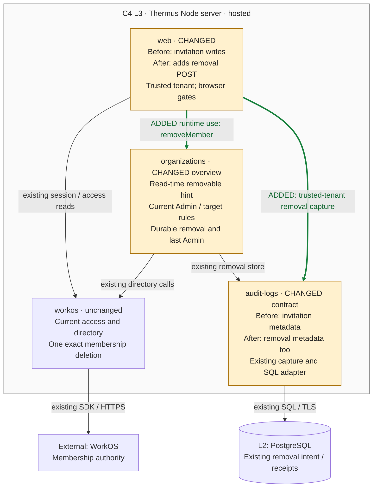

### Architecture comparison — hosted Thermus Node server

Candidate `ddad19589a13e40b1aea516b2e5e3b90ea3aec70`; actual parent and merge base `b630a76275d5809a498ae63e1cbc322086f4194f` (PR #253). Complete-stack main base: `8c6d204e8588a664438ba8934ab36670b802525f`. This supplementary C4 L3 comparison derives from the pinned code and registry; it compares this increment only.

- Before, Members offered invitation writes and the existing coordinator had no browser caller. After, web requires current selected-organization access, trusted tenant, POST, configured Origin, CSRF and exact organization/membership/revision fields before one removeMember call. The overview removable field is a display hint; organizations still owns current Admin, target support, revision and last-Admin authority.
- The existing durable per-organization hold, operation-bound receipts, 30-second server lifetime and single exact WorkOS deletion keep their rules. Busy and unknown do not replay. Native confirmation names the target and revision; Cancel follows a GET and starts no intent.
- The POST returns a fixed result without another Members GET. A later read failure cannot replace that result. Self-removal retains identity-only workspace selection and sign-in guidance, and current portal/MCP access is checked again. No new session mutation or recovery store is added; a current read cannot settle an uncertain operation.
- AdministrationChange now accepts remove-member, membership ID and safe removal outcomes. Web selects the trusted tenant and captures after the coordinator outcome, before its HTTP response. Capture remains best effort; it cannot change the result, release a hold or replay deletion. Inherited safe actor names, bounded pending first-event capture, revision-gated export and captured time in both OTLP timestamp fields remain unchanged.

Three existing public declarations change: administration-overviews (removable hint), account-form (checked memberRemovalIn parser), and audit-log (removal action/target). Existing actor-name and timestamp fields are neutral inherited context. App composition, browser HTTP, current-revision customer export, billing and MCP are omitted from the drawing; their retained rules remain in the registry.

Current test results, classification, human approval scope and merge eligibility belong to the maintained PR records. This architecture comparison makes no new pass, approval, merge, rollout or release claim.
