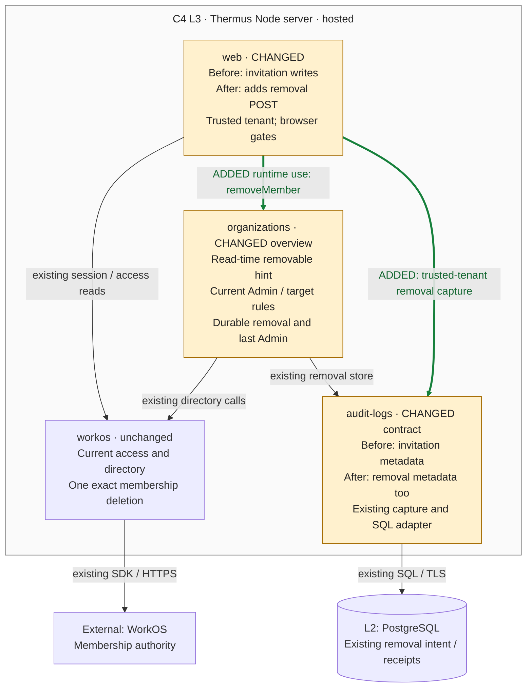

## Description

Members now offers a native confirmation for one exact workspace membership and a checked POST to the existing removal coordinator. A fixed result page preserves the write outcome and self-removal guidance. Parent: [PR #253](https://github.com/tomer-mayara/Thermus/pull/253).

## Review

**T2 Need architect**

Architecture: T2: declarations changed in 3 public modules; 2 registry views edited

**Architecture facts**

- src/logs/audit/audit-log.ts (+3 -1 lines)
- src/interfaces/web/account/account-form.ts (+2 -1 lines)
- src/accounts/organizations/administration-overviews.ts (+1 -0 lines)
- architecture/components.md: 2 views edited

<details><summary>Declaration diffs</summary>

```diff
diff --git a/docs/api-surface/src/logs/audit/audit-log.d.ts b/docs/api-surface/src/logs/audit/audit-log.d.ts
index e81e5922..208ac83d 100644
--- a/docs/api-surface/src/logs/audit/audit-log.d.ts
+++ b/docs/api-surface/src/logs/audit/audit-log.d.ts
@@ -37,11 +37,13 @@ export interface AuditResult {
     readonly truncated: boolean;
 }
 export interface AdministrationChange extends AuditContext {
-    readonly action: 'invite' | 'resend-invitation' | 'revoke-invitation';
+    readonly action: 'invite' | 'resend-invitation' | 'revoke-invitation' | 'remove-member';
     readonly target: {
         readonly email: string;
     } | {
         readonly invitationId: string;
+    } | {
+        readonly membershipId: string;
     };
     readonly role?: 'admin' | 'user';
     readonly outcome: ChangeOutcome;
diff --git a/docs/api-surface/src/interfaces/web/account/account-form.d.ts b/docs/api-surface/src/interfaces/web/account/account-form.d.ts
index 555ac53c..4d190edb 100644
--- a/docs/api-surface/src/interfaces/web/account/account-form.d.ts
+++ b/docs/api-surface/src/interfaces/web/account/account-form.d.ts
@@ -1,4 +1,4 @@
-import type { InvitationChangeRequest, InvitationSendRequest } from '../../../accounts/organizations/organization-administration.ts';
+import type { InvitationChangeRequest, InvitationSendRequest, MemberRemovalRequest } from '../../../accounts/organizations/organization-administration.ts';
 import type { NoticeName } from './account-pages.ts';
 export type FormRefusal = Extract<NoticeName, 'formTypeRefused' | 'formTooLarge' | 'forgedRequest' | 'invalidRequest'>;
 export interface Selection {
@@ -17,5 +17,6 @@ export declare function single(values: readonly string[]): string | undefined;
 export declare function selectionIn(form: URLSearchParams, csrfToken: string, destinations: ReturnDestinations): Selection | FormRefusal;
 export declare function invitationIn(form: URLSearchParams, csrfToken: string): InvitationSendRequest | FormRefusal;
 export declare function invitationChangeIn(form: URLSearchParams, csrfToken: string): InvitationChangeRequest | FormRefusal;
+export declare function memberRemovalIn(form: URLSearchParams, csrfToken: string): MemberRemovalRequest | FormRefusal;
 export declare function readForm(request: Request): Promise<URLSearchParams | FormRefusal>;
 export declare function formFields<Name extends string>(form: URLSearchParams, csrfToken: string, names: readonly Name[]): Record<Name, string> | FormRefusal;
diff --git a/docs/api-surface/src/accounts/organizations/administration-overviews.d.ts b/docs/api-surface/src/accounts/organizations/administration-overviews.d.ts
index ab92fec3..0137fbba 100644
--- a/docs/api-surface/src/accounts/organizations/administration-overviews.d.ts
+++ b/docs/api-surface/src/accounts/organizations/administration-overviews.d.ts
@@ -6,6 +6,7 @@ interface MemberEntry {
     readonly status: MembershipStatus;
     readonly roles: readonly string[];
     readonly revision: string;
+    readonly removable: boolean;
 }
 export interface MemberOverview {
     readonly organizationId: string;
```

</details>

The security boundary also requires review under `protected_paths.security`; no tier is inferred from path alone. `.pr-impact.json` declares contract, component and internalInterface, plus sensitiveBehavior and policy: browser writes reach existing organizations/Audit owners, three declarations change, and two registry views change. A dedicated Chromium gate covers the native confirmation. [Current impact/checker](%%EVIDENCE_ROOT%%/quality/final-isolated/measurements/retry-after-live/pr-review.json).

Merge status: **blocked**. All selected primary product commands passed on their first attempt; current architecture, quality and final validation are manager-reviewed. Separate failed coverage capture/retry history remains recorded. Parent and later R1 integration, qualified architect identity/current-candidate approval reconciliation, and Render workspace/target/deployment preflight remain open. The latest authorized rollout enabled main auto-deploy; current controls require verification. No Ready, merge or release is claimed.

### Architecture comparison — hosted Thermus Node server



- Before, Members offered invitation writes and the existing coordinator had no browser caller. After, web requires current selected-organization access, trusted tenant, POST, configured Origin, CSRF and exact organization/membership/revision fields before one removeMember call. The overview removable field is a display hint; organizations still owns current Admin, target support, revision and last-Admin authority.
- The existing durable per-organization hold, operation-bound receipts, 30-second server lifetime and single exact WorkOS deletion keep their rules. Busy and unknown do not replay. Native confirmation names the target and revision; Cancel follows a GET and starts no intent.
- The POST returns a fixed result without another Members GET. A later read failure cannot replace that result. Self-removal retains identity-only workspace selection and sign-in guidance, and current portal/MCP access is checked again. No new session mutation or recovery store is added; a current read cannot settle an uncertain operation.
- AdministrationChange now accepts remove-member, membership ID and safe removal outcomes. Web selects the trusted tenant and captures after the coordinator outcome, before its HTTP response. Capture remains best effort; it cannot change the result, release a hold or replay deletion. Inherited safe actor names, bounded pending first-event capture, revision-gated export and captured time in both OTLP timestamp fields remain unchanged.

Registry: two views edited; no new component, source edge, container, store or deployment topology. Existing actor-name/capture-time behavior stays neutral. [Pinned assessment and L4 omission reason](%%EVIDENCE_ROOT%%/architecture/assessment-current.md), [current manager review](%%EVIDENCE_ROOT%%/architecture/manager-review-current.json), [15→15 correction receipt](%%EVIDENCE_ROOT%%/architecture/manager-view-count-correction.json). The strongest changed callable is AuditLog.administrationChanged; L3 and the four notes cover its authority, payload and capture-failure question. The prior exact [800px render](https://github.com/tomer-mayara/Thermus/blob/61fabd6e14854f71bbe6ddd72334ebb601ae3197/review-evidence/s2-5-01c/2271545702a8f1ec28c6f7dd913fec7024ecadeb/architecture/renders-v5/comparison-v5-800.png) remains valid by byte identity.

Current candidate: [`ddad1958`](https://github.com/tomer-mayara/Thermus/commit/ddad19589a13e40b1aea516b2e5e3b90ea3aec70) · [Validation](https://github.com/tomer-mayara/Thermus/pull/254#issuecomment-6396194465) · [Quality review](https://github.com/tomer-mayara/Thermus/pull/254#issuecomment-6396194648)
