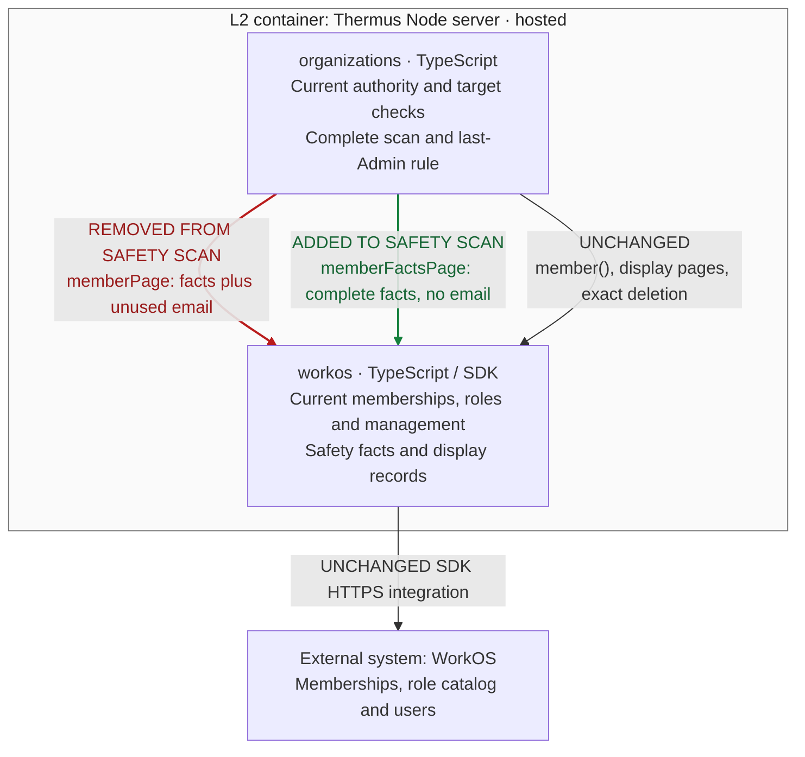

### Architecture comparison — hosted Thermus Node server

Candidate `3cd6eb0e1ebbdab3292d1b411f706a6c5749d604`; actual parent and merge base `adf3369a953792208b5c48b8776d3bfeb89c3fb7` (PR #255). Complete-stack main base: `8c6d204e8588a664438ba8934ab36670b802525f`. This supplementary C4 L3 comparison derives from the pinned code and registry; it compares this increment only.

- Before, the removal scan paged display records and performed a sequential email lookup for each member. After, it reads complete membership safety facts without those user lookups. Membership/catalog scope, failure and stop checks remain.
- The direct member() target read still enriches one user; Members display and seat reads keep their email work. Direct/page agreement still compares every safety field and normalizes grant and permission order.
- Organizations still owns current actor, exact target and last-Admin checks, ordered complete pages, later duplicate handling, repeated-cursor failure and the ten-page limit with 100 records per WorkOS page. A failed/incomplete scan stops before deletion.
- Durable admission, exact operation receipts, unknown holds, no replay, the 30-second monotonic lifetime, five-second SDK timeout with zero retry and existing SQL bounds remain. The controlled 100-member/300-ms regression concerns avoidable enrichment; it is not a capacity guarantee. Composition, SQL, access/profile reads and deployment remain inherited.

One existing public declaration changes: OrganizationDirectory adds OrganizationMemberFacts and memberFactsPage while the display record keeps email. All 15 registry diagrams remain unchanged; prose identifies facts versus display. No component, source edge, provider integration, schema, recovery or deployment change occurs in this increment.

Current test results, classification, human approval scope and merge eligibility belong to the maintained PR records. This architecture comparison makes no new pass, approval, merge, rollout or release claim.
