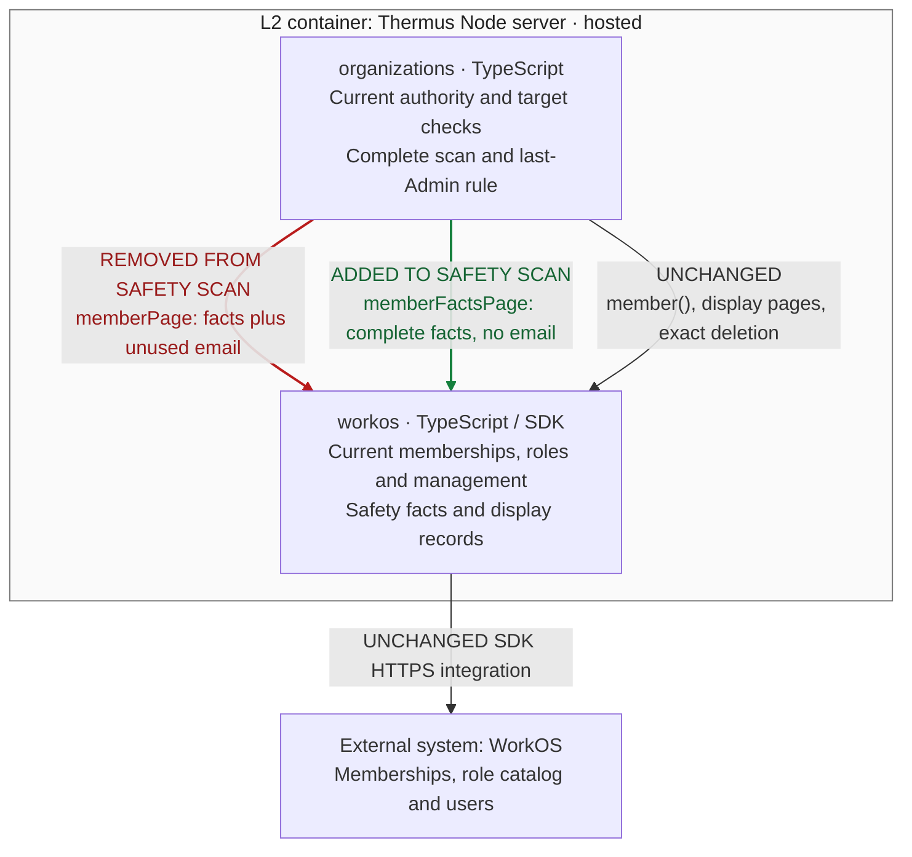

## Description

The removal safety scan now reads complete membership facts without fetching unused email data for every member. Display pages and the direct target read keep their email data. Parent: [PR #255](https://github.com/tomer-mayara/Thermus/pull/255).

## Review

**T2 Need architect**

Architecture: T2: declarations changed in 1 public module

**Architecture facts**

- src/accounts/organizations/organization-directory.ts (+5 -2 lines)

<details><summary>Declaration diff</summary>

```diff
diff --git a/docs/api-surface/src/accounts/organizations/organization-directory.d.ts b/docs/api-surface/src/accounts/organizations/organization-directory.d.ts
index 614af3d0..2e722e72 100644
--- a/docs/api-surface/src/accounts/organizations/organization-directory.d.ts
+++ b/docs/api-surface/src/accounts/organizations/organization-directory.d.ts
@@ -7,16 +7,18 @@ export interface OrganizationMembership {
 }
 export type MembershipStatus = 'active' | 'inactive' | 'pending';
 export type MembershipManagement = 'ordinary' | 'external' | 'unknown';
-export interface OrganizationMember {
+export interface OrganizationMemberFacts {
     readonly membershipId: string;
     readonly subject: string;
     readonly organizationId: string;
-    readonly email: string;
     readonly status: MembershipStatus;
     readonly management: MembershipManagement;
     readonly grants: readonly RoleGrant[];
     readonly revision: string;
 }
+export interface OrganizationMember extends OrganizationMemberFacts {
+    readonly email: string;
+}
 export type InvitationState = 'pending' | 'accepted' | 'revoked' | 'expired';
 export interface OrganizationInvitation {
     readonly invitationId: string;
@@ -60,6 +62,7 @@ export interface MembershipDeletionResult {
 export interface OrganizationDirectory {
     membershipsOf(user: AuthenticatedUser, signal?: AbortSignal): Promise<readonly OrganizationMembership[]>;
     memberPage(request: MemberPageRequest): Promise<Page<OrganizationMember>>;
+    memberFactsPage(request: MemberPageRequest): Promise<Page<OrganizationMemberFacts>>;
     member(membershipId: string, signal?: AbortSignal): Promise<OrganizationMember | undefined>;
     deleteMembership(membershipId: string): Promise<MembershipDeletionResult>;
     invitationPage(request: InvitationPageRequest): Promise<Page<OrganizationInvitation>>;
```

</details>

The internalInterface flag also selects T2; sensitiveBehavior retains T1. `.pr-impact.json` declares the facts-only server interface and existing Organizations/WorkOS collaboration. All 15 registry drawings remain unchanged; prose separates facts from display. No component, dependency edge, deployment, schema, recovery or runtime notice selection changes. [Current checker](%%EVIDENCE_ROOT%%/quality/fresh-unit/pr-review.json).

**Keep Draft; overall validation and merge blocked.** All selected offline product gates passed, with fresh measured quality and retained MI reasons. Required WorkOS live and Public Connect are **unrun at e46c5068**; the related #255 failures are not runs of this head. Independent human merge approval and main deployment containment remain open. Current heads are published as Drafts. Direct Render preflight permits non-main review/evidence publication; main/live stay 8c6d204e. [Current publication scope](%%EVIDENCE_ROOT%%/publication/render-publication-preflight.json), [atomic source receipt](%%EVIDENCE_ROOT%%/publication/source-publication-attempt.json). No production or notice release is claimed.

### Architecture comparison — hosted Thermus Node server



- Before, the removal scan paged display records and performed a sequential email lookup for each member. After, it reads complete membership safety facts without those user lookups. Membership/catalog scope, failure and stop checks remain.
- The direct member() target read still enriches one user; Members display and seat reads keep their email work. Direct/page agreement still compares every safety field and normalizes grant and permission order.
- Organizations still owns current actor, exact target and last-Admin checks, ordered complete pages, later duplicate handling, repeated-cursor failure and the ten-page limit with 100 records per WorkOS page. A failed/incomplete scan stops before deletion.
- Durable admission, exact operation receipts, unknown holds, no replay, the 30-second monotonic lifetime, five-second SDK timeout with zero retry and existing SQL bounds remain. The controlled 100-member/300-ms regression concerns avoidable enrichment; it is not a capacity guarantee. Composition, SQL, access/profile reads and deployment remain inherited.

The strongest changed callable is OrganizationDirectory.memberFactsPage. L3 and these notes answer its safety/display, authority, stop and lifetime questions; no extra L4 is needed. This supplementary view derives from code; registry drawings remain unchanged. [Current bridge and exact reused render proof](%%EVIDENCE_ROOT%%/architecture/fixture-integration-bridge-e46c5068.json), [manager review](%%EVIDENCE_ROOT%%/architecture/manager-bridge-review-e46c5068.json).

Current candidate: [`e46c5068`](https://github.com/tomer-mayara/Thermus/commit/e46c506811b8639f691304c423f4af5fe894955e) · [Validation](https://github.com/tomer-mayara/Thermus/pull/257#issuecomment-6403840671) · [Quality review](https://github.com/tomer-mayara/Thermus/pull/257#issuecomment-6403840871)
