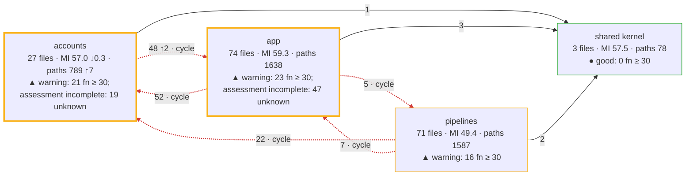
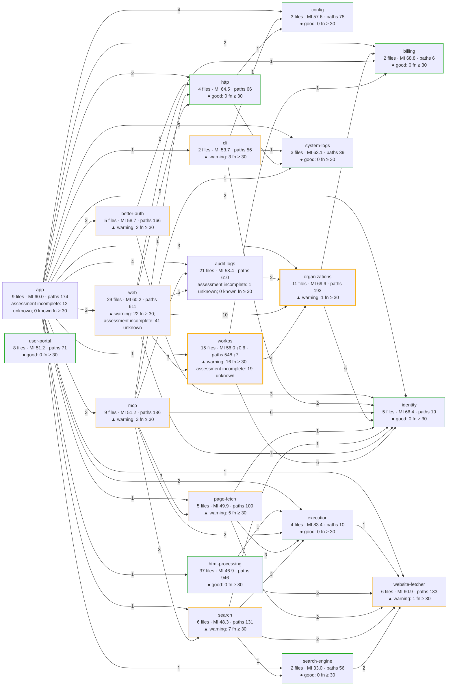
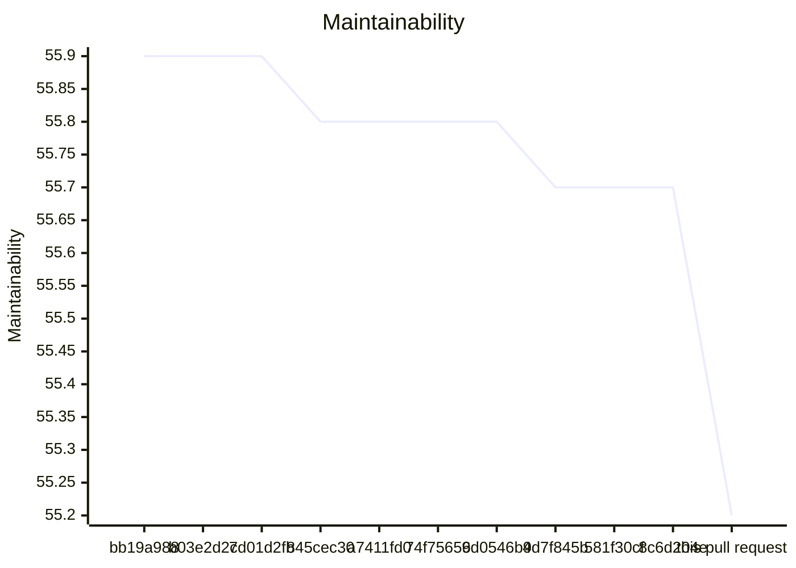
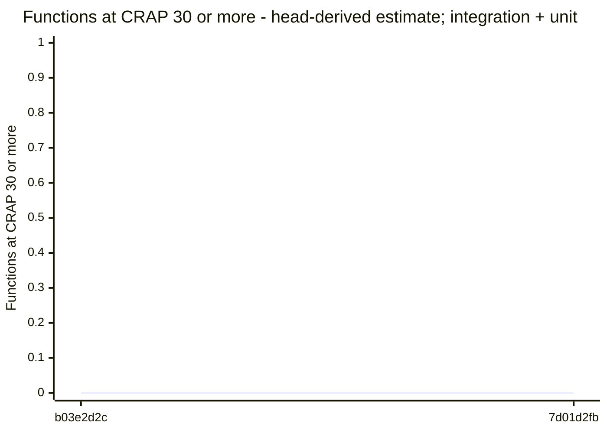
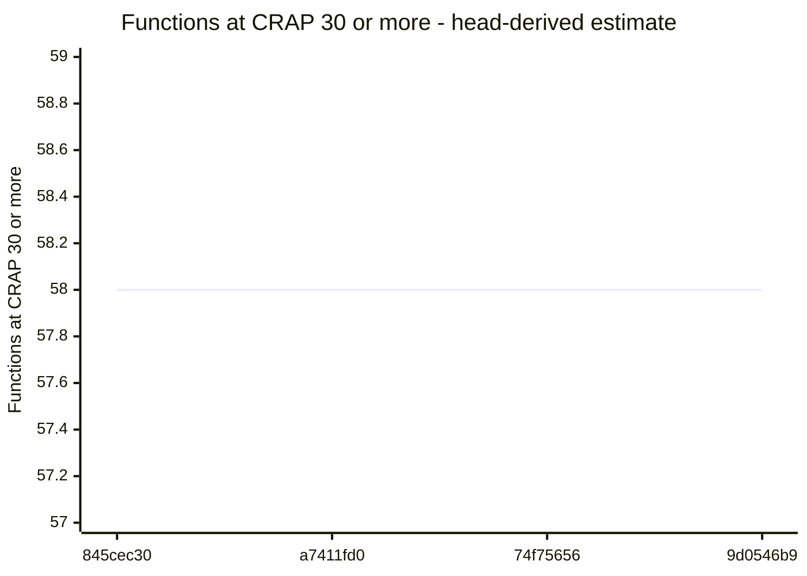
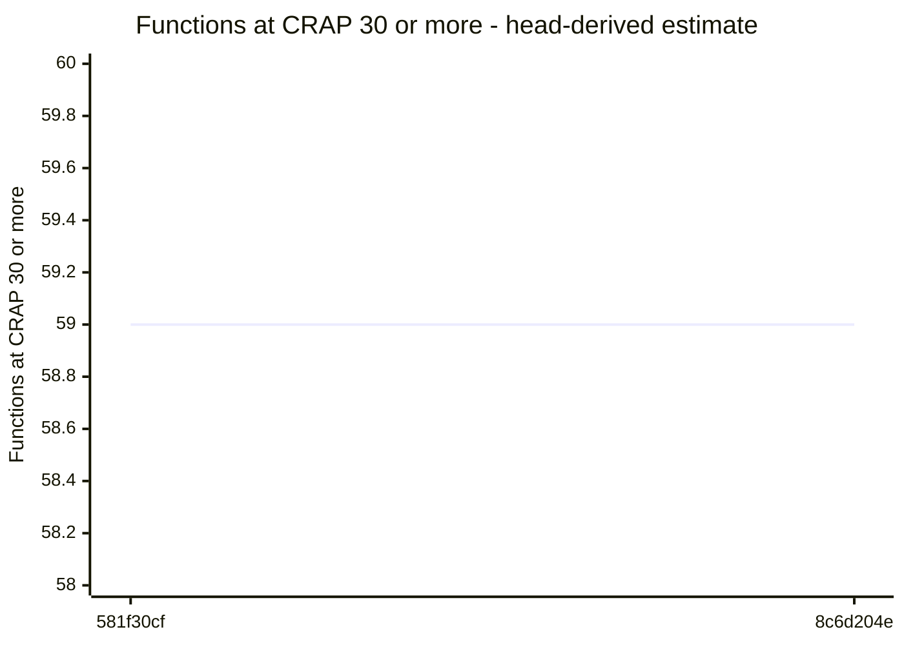

# Code quality process

## Delta

Status: goal miss.

```text
  45.1  src/accounts/providers/workos/workos-organizations.ts  below 85
  61.0  src/accounts/organizations/membership-removal-checks.ts  below 85
  24.4  test/unit/organizations/membership-removal-lifetime.test.ts  no goal
  28.2  test/unit/organizations/membership-removal-rules.test.ts  no goal
  32.1  test/unit/auth-workos/workos-organizations-read-lifetime.test.ts  no goal
  32.9  test/integration/auth/workos-removal-lifetime.test.ts  no goal
  36.0  test/unit/auth-workos/workos-organizations-member-facts.test.ts  no goal
  37.5  test/acceptance/auth/hosted-member-removal-budget.test.ts  no goal
  45.0  test/integration/auth/workos-member-facts.test.ts  no goal
  47.9  test/support/doubles/organizations/organization-directory-double.ts  no goal
  not measured  docs/api-surface/src/accounts/organizations/organization-directory.d.ts
  not measured  src/accounts/organizations/organization-directory.ts
Result: 2 of 2 production files below 85. Goal: 85 or more for each production file. 8 other files without a goal. 2 files not measured.
Comparison with 1a3e5a6638d71e03485e0280848ee5e025335382: ast-report/compare.html
```

## Review

Status: passed.

## AST Metrics found no regression

0 new critical issue(s), 0 other regression(s)

### Summary

- ➖ **Complexity: -**
- ➖ **Ease of maintenance: -**
- ➖ **Outgoing dependencies: -**
- ➖ **Probability of bugs: -**

No architectural change detected on modified code.

## CRAP

Status: passed.

Reused verified compatible unit coverage.

## CRAP goals

Goals: CRAP < 30; new functions also CRAP ≤ 15.

| File | Function | Change | Paths | Coverage | CRAP | To do |
| --- | --- | --- | --- | --- | --- | --- |
| src/accounts/organizations/membership-removal-checks.ts | checkRemoval | changed | 9 | 100% | 9.0 | ok |
| src/accounts/providers/workos/workos-organizations.ts | workos-organizations\WorkOSOrganizations.activeMembership | unchanged | 7 | 100% | 7.0 | ok; unchanged by this PR |
| src/accounts/providers/workos/workos-organizations.ts | workos-organizations\WorkOSOrganizations.changeInvitation | unchanged | 6 | 100% | 6.0 | ok; unchanged by this PR |
| src/accounts/organizations/membership-removal-checks.ts | targetRefusal | changed | 5 | 100% | 5.0 | ok |
| src/accounts/providers/workos/workos-organizations.ts | checkedActiveRecord | unchanged | 5 | 100% | 5.0 | ok; unchanged by this PR |
| src/accounts/providers/workos/workos-organizations.ts | workos-organizations\WorkOSOrganizations.invitationPage | unchanged | 5 | 100% | 5.0 | ok; unchanged by this PR |
| src/accounts/providers/workos/workos-organizations.ts | workos-organizations\WorkOSOrganizations.sendInvitation | unchanged | 5 | 100% | 5.0 | ok; unchanged by this PR |
| src/accounts/organizations/membership-removal-checks.ts | (anonymous) | unchanged | 4 | 100% | 4.0 | ok; unchanged by this PR |
| src/accounts/organizations/membership-removal-checks.ts | removalSupported | changed | 4 | 100% | 4.0 | ok |
| src/accounts/providers/workos/workos-organizations.ts | hasCode | unchanged | 4 | 100% | 4.0 | ok; unchanged by this PR |
| src/accounts/providers/workos/workos-organizations.ts | hasStatus | unchanged | 4 | 100% | 4.0 | ok; unchanged by this PR |
| src/accounts/providers/workos/workos-organizations.ts | invitationStateOf | unchanged | 4 | 100% | 4.0 | ok; unchanged by this PR |
| src/accounts/providers/workos/workos-organizations.ts | isInvitationOf | unchanged | 4 | 100% | 4.0 | ok; unchanged by this PR |
| src/accounts/providers/workos/workos-organizations.ts | workos-organizations\WorkOSOrganizations.activeMembershipsOf | unchanged | 4 | 100% | 4.0 | ok; unchanged by this PR |
| src/accounts/providers/workos/workos-organizations.ts | workos-organizations\WorkOSOrganizations.deleteMembership | unchanged | 4 | 100% | 4.0 | ok; unchanged by this PR |
| src/accounts/providers/workos/workos-organizations.ts | workos-organizations\WorkOSOrganizations.memberPage | unchanged | 4 | 100% | 4.0 | ok; unchanged by this PR |
| src/accounts/providers/workos/workos-organizations.ts | checkedMemberRecord | unchanged | 3 | 100% | 3.0 | ok; unchanged by this PR |
| src/accounts/providers/workos/workos-organizations.ts | getOrganizationMembership | unchanged | 3 | 100% | 3.0 | ok; unchanged by this PR |
| src/accounts/providers/workos/workos-organizations.ts | managementOf | unchanged | 3 | 100% | 3.0 | ok; unchanged by this PR |
| src/accounts/providers/workos/workos-organizations.ts | pageOf | unchanged | 3 | 100% | 3.0 | ok; unchanged by this PR |
| src/accounts/providers/workos/workos-organizations.ts | unlessNotFound | unchanged | 3 | 100% | 3.0 | ok; unchanged by this PR |
| src/accounts/providers/workos/workos-organizations.ts | workos-organizations\WorkOSOrganizations.currentInvitation | unchanged | 3 | 100% | 3.0 | ok; unchanged by this PR |
| src/accounts/providers/workos/workos-organizations.ts | workos-organizations\WorkOSOrganizations.currentMembership | unchanged | 3 | 100% | 3.0 | ok; unchanged by this PR |
| src/accounts/providers/workos/workos-organizations.ts | workos-organizations\WorkOSOrganizations.memberFactsPage | new | 3 | 100% | 3.0 | ok |
| src/accounts/providers/workos/workos-organizations.ts | workos-organizations\WorkOSOrganizations.membershipsOf | unchanged | 3 | 100% | 3.0 | ok; unchanged by this PR |
| src/accounts/organizations/membership-removal-checks.ts | (anonymous) | unchanged | 2 | 100% | 2.0 | ok; unchanged by this PR |
| src/accounts/organizations/membership-removal-checks.ts | (anonymous) | unchanged | 2 | 100% | 2.0 | ok; unchanged by this PR |
| src/accounts/organizations/membership-removal-checks.ts | adminGrants | unchanged | 2 | 100% | 2.0 | ok; unchanged by this PR |
| src/accounts/providers/workos/workos-organizations.ts | afterOf | unchanged | 2 | 100% | 2.0 | ok; unchanged by this PR |
| src/accounts/providers/workos/workos-organizations.ts | eachOrganizationOnce | unchanged | 2 | 100% | 2.0 | ok; unchanged by this PR |
| src/accounts/providers/workos/workos-organizations.ts | invitationOf | unchanged | 2 | 100% | 2.0 | ok; unchanged by this PR |
| src/accounts/providers/workos/workos-organizations.ts | listOrganizationMemberships | unchanged | 2 | 100% | 2.0 | ok; unchanged by this PR |
| src/accounts/providers/workos/workos-organizations.ts | roleListOf | unchanged | 2 | 100% | 2.0 | ok; unchanged by this PR |
| src/accounts/providers/workos/workos-organizations.ts | workos-organizations\WorkOSOrganizations. | new | 1 | 0% | 2.0 | ok |
| src/accounts/providers/workos/workos-organizations.ts | workos-organizations\WorkOSOrganizations.activeGrants | unchanged | 2 | 100% | 2.0 | ok; unchanged by this PR |
| src/accounts/providers/workos/workos-organizations.ts | workos-organizations\WorkOSOrganizations.activeOrganizationName | unchanged | 2 | 100% | 2.0 | ok; unchanged by this PR |
| src/accounts/providers/workos/workos-organizations.ts | workos-organizations\WorkOSOrganizations.invitation | unchanged | 2 | 100% | 2.0 | ok; unchanged by this PR |
| src/accounts/providers/workos/workos-organizations.ts | workos-organizations\WorkOSOrganizations.isNoLongerPending | unchanged | 2 | 100% | 2.0 | ok; unchanged by this PR |
| src/accounts/providers/workos/workos-organizations.ts | workos-organizations\WorkOSOrganizations.member | unchanged | 2 | 100% | 2.0 | ok; unchanged by this PR |
| src/accounts/organizations/membership-removal-checks.ts | (anonymous) | unchanged | 1 | 100% | 1.0 | ok; unchanged by this PR |
| src/accounts/organizations/membership-removal-checks.ts | (anonymous) | unchanged | 1 | 100% | 1.0 | ok; unchanged by this PR |
| src/accounts/organizations/membership-removal-checks.ts | (anonymous) | unchanged | 1 | 100% | 1.0 | ok; unchanged by this PR |
| src/accounts/organizations/membership-removal-checks.ts | (anonymous) | unchanged | 1 | 100% | 1.0 | ok; unchanged by this PR |
| src/accounts/organizations/membership-removal-checks.ts | (anonymous) | unchanged | 1 | 100% | 1.0 | ok; unchanged by this PR |
| src/accounts/organizations/membership-removal-checks.ts | (anonymous) | new | 1 | 100% | 1.0 | ok |
| src/accounts/organizations/membership-removal-checks.ts | (anonymous) | unchanged | 1 | 100% | 1.0 | ok; unchanged by this PR |
| src/accounts/organizations/membership-removal-checks.ts | (anonymous) | unchanged | 1 | 100% | 1.0 | ok; unchanged by this PR |
| src/accounts/organizations/membership-removal-checks.ts | (anonymous) | unchanged | 1 | 100% | 1.0 | ok; unchanged by this PR |
| src/accounts/organizations/membership-removal-checks.ts | (anonymous) | new | 1 | 100% | 1.0 | ok |
| src/accounts/organizations/membership-removal-checks.ts | (anonymous) | unchanged | 1 | 100% | 1.0 | ok; unchanged by this PR |
| src/accounts/organizations/membership-removal-checks.ts | (anonymous) | unchanged | 1 | 100% | 1.0 | ok; unchanged by this PR |
| src/accounts/organizations/membership-removal-checks.ts | (anonymous) | unchanged | 1 | 100% | 1.0 | ok; unchanged by this PR |
| src/accounts/organizations/membership-removal-checks.ts | currentAdmin | unchanged | 1 | 100% | 1.0 | ok; unchanged by this PR |
| src/accounts/organizations/membership-removal-checks.ts | targetFacts | changed | 1 | 100% | 1.0 | ok |
| src/accounts/providers/workos/workos-organizations.ts | (anonymous) | unchanged | 1 | 100% | 1.0 | ok; unchanged by this PR |
| src/accounts/providers/workos/workos-organizations.ts | (anonymous) | unchanged | 1 | 100% | 1.0 | ok; unchanged by this PR |
| src/accounts/providers/workos/workos-organizations.ts | memberFactsOf | new | 1 | 100% | 1.0 | ok |
| src/accounts/providers/workos/workos-organizations.ts | membershipRecordOf | unchanged | 1 | 100% | 1.0 | ok; unchanged by this PR |
| src/accounts/providers/workos/workos-organizations.ts | readWhileActive | unchanged | 1 | 100% | 1.0 | ok; unchanged by this PR |
| src/accounts/providers/workos/workos-organizations.ts | revisionOf | unchanged | 1 | 100% | 1.0 | ok; unchanged by this PR |
| src/accounts/providers/workos/workos-organizations.ts | workos-organizations\WorkOSOrganizations. | unchanged | 1 | 100% | 1.0 | ok; unchanged by this PR |
| src/accounts/providers/workos/workos-organizations.ts | workos-organizations\WorkOSOrganizations. | unchanged | 1 | 100% | 1.0 | ok; unchanged by this PR |
| src/accounts/providers/workos/workos-organizations.ts | workos-organizations\WorkOSOrganizations. | unchanged | 1 | 100% | 1.0 | ok; unchanged by this PR |
| src/accounts/providers/workos/workos-organizations.ts | workos-organizations\WorkOSOrganizations. | unchanged | 1 | 100% | 1.0 | ok; unchanged by this PR |
| src/accounts/providers/workos/workos-organizations.ts | workos-organizations\WorkOSOrganizations. | unchanged | 1 | 100% | 1.0 | ok; unchanged by this PR |
| src/accounts/providers/workos/workos-organizations.ts | workos-organizations\WorkOSOrganizations. | new | 1 | 100% | 1.0 | ok |
| src/accounts/providers/workos/workos-organizations.ts | workos-organizations\WorkOSOrganizations. | new | 1 | 100% | 1.0 | ok |
| src/accounts/providers/workos/workos-organizations.ts | workos-organizations\WorkOSOrganizations. | new | 1 | 100% | 1.0 | ok |
| src/accounts/providers/workos/workos-organizations.ts | workos-organizations\WorkOSOrganizations. | unchanged | 1 | 100% | 1.0 | ok; unchanged by this PR |
| src/accounts/providers/workos/workos-organizations.ts | workos-organizations\WorkOSOrganizations. | new | 1 | 100% | 1.0 | ok |
| src/accounts/providers/workos/workos-organizations.ts | workos-organizations\WorkOSOrganizations. | unchanged | 1 | 100% | 1.0 | ok; unchanged by this PR |
| src/accounts/providers/workos/workos-organizations.ts | workos-organizations\WorkOSOrganizations. | unchanged | 1 | 100% | 1.0 | ok; unchanged by this PR |
| src/accounts/providers/workos/workos-organizations.ts | workos-organizations\WorkOSOrganizations. | unchanged | 1 | 100% | 1.0 | ok; unchanged by this PR |
| src/accounts/providers/workos/workos-organizations.ts | workos-organizations\WorkOSOrganizations. | unchanged | 1 | 100% | 1.0 | ok; unchanged by this PR |
| src/accounts/providers/workos/workos-organizations.ts | workos-organizations\WorkOSOrganizations.constructor | unchanged | 1 | 100% | 1.0 | ok; unchanged by this PR |
| src/accounts/providers/workos/workos-organizations.ts | workos-organizations\WorkOSOrganizations.grantsOf | unchanged | 1 | 100% | 1.0 | ok; unchanged by this PR |
| src/accounts/providers/workos/workos-organizations.ts | workos-organizations\WorkOSOrganizations.memberOf | changed | 1 | 100% | 1.0 | ok |
| src/accounts/providers/workos/workos-organizations.ts | workos-organizations\WorkOSOrganizations.organizationRoles | unchanged | 1 | 100% | 1.0 | ok; unchanged by this PR |
| src/accounts/providers/workos/workos-organizations.ts | workos-organizations\WorkOSOrganizations.resendInvitation | unchanged | 1 | 100% | 1.0 | ok; unchanged by this PR |
| src/accounts/providers/workos/workos-organizations.ts | workos-organizations\WorkOSOrganizations.revokeInvitation | unchanged | 1 | 100% | 1.0 | ok; unchanged by this PR |
| src/accounts/providers/workos/workos-organizations.ts | workosMembershipReads | unchanged | 1 | 100% | 1.0 | ok; unchanged by this PR |

Known limit violations: 0. Measured target misses: 0. Unmeasured functions: 0. Required functions with unknown assessment or identity: 0.

## Architecture

Status: passed.

## Architecture of src/: base 1a3e5a66 → head

Modularity 0.34 → 0.33 · cross share 0.31 → 0.31 · cycles 1 → 1 · communities 4 → 4 · functions ≥ 30: 60 → 60



Legend: thick border = a community this pull request touched; `· new` and `· gone` = a community or dependency that appeared or disappeared; red dashed edge = part of a cycle; thick edge = a new dependency; border color = the CRAP band of the community (● good: complete assessment, no function at CRAP 30 or more; ▲ warning: some, none added or worse by this pull request; ■ critical: one added or worse); numbers = files · maintainability (LOC-weighted) · decision paths, with the change against the base.

### Community edge evidence

Tool references and deduplicated file pairs have different units. An unchanged import means the same normalized file pair, after proven path moves; evidence kinds can differ.

Dependency evidence incomplete: base has 1 issue; head has 1 issue. A missing pair on an incomplete side does not prove an import change.

- base: <code>src/interfaces/user-portal/main.ts</code> → <code>./style.css</code> — unresolved-local.
- head: <code>src/interfaces/user-portal/main.ts</code> → <code>./style.css</code> — unresolved-local.

No new or gone community edges.

## Components of src/

Component dependency evidence is incomplete: known head dependencies and proven cycles are shown; edge and cycle changes are withheld. Additional dependencies or cycles may exist.



Legend: thick border = a component this pull request touched; `· new` and `· gone` = a component or dependency that appeared or disappeared; red dashed edge = part of a cycle; thick edge = a new dependency; border color = the CRAP band of the component (● good: complete assessment, no function at CRAP 30 or more; ▲ warning: some, none added or worse by this pull request; ■ critical: one added or worse); numbers = files · maintainability (LOC-weighted) · decision paths, with the change against the base. Edges count distinct importing files per target component.

## Complexity of the changed files

| File | Maintainability | Decision paths | CRAP ≥ 30 | Risk rank |
| --- | --- | --- | --- | --- |
| src/accounts/organizations/membership-removal-checks.ts | 61.0 → 61.0 | 43 → 43 | 0 → 0 | |
| src/accounts/organizations/organization-directory.ts | not measured | not measured | not measured | |
| src/accounts/providers/workos/workos-organizations.ts | 47.1 → 45.1 ↓2.0 | 124 → 131 ↑7 | 0 → 0 | 1 |

### Functions at CRAP 30 or more, added or worse

None.

Unmatched functions: 0 (anonymous, duplicate, or not in the coverage).

Base functions without an estimated covered share: 131.

Coverage: unit suite at e46c5068.

## Trend of src/ on main

| Commit | PR | Date | Modularity | Cross share | Cycles | Maintainability | Functions ≥ 30 |
| --- | --- | --- | --- | --- | --- | --- | --- |
| bb19a988 | – | 2026-10-23 | 0.39 | 0.15 | 1 | 55.9 | 59 (estimate) |
| b03e2d2c | – | 2026-10-23 | 0.39 | 0.15 | 1 | 55.9 | 0 (estimate; integration + unit) |
| 7d01d2fb | – | 2026-10-24 | 0.39 | 0.15 | 1 | 55.9 | 0 (estimate; integration + unit) |
| 845cec30 | – | 2026-10-24 | 0.34 | 0.31 | 1 | 55.8 | 58 (estimate) |
| a7411fd0 | #248 | 2026-10-24 | 0.34 | 0.31 | 1 | 55.8 | 58 (estimate) |
| 74f75656 | – | 2026-10-24 | 0.34 | 0.31 | 1 | 55.8 | 58 (estimate) |
| 9d0546b9 | #250 | 2026-10-25 | 0.34 | 0.31 | 1 | 55.8 | 58 (estimate) |
| 4d7f845b | – | 2026-10-25 | 0.34 | 0.31 | 1 | 55.7 | 0 (estimate; integration + unit) |
| 581f30cf | #256 | 2026-10-25 | 0.34 | 0.31 | 1 | 55.7 | 59 (estimate) |
| 8c6d204e | #258 | 2026-10-25 | 0.34 | 0.31 | 1 | 55.7 | 59 (estimate) |
| this pull request | – | | 0.33 | 0.31 | 1 | 55.2 | 60 (measured) |

Historical estimates use head coverage from the first recording pull request. Later estimates for the same base can differ. Counts include known lower-bound violations; other unknown functions are not counted.

### Maintainability trend

Missing values are gaps; lines stop at each gap.

Maintainability (maintainability), bb19a988 to this pull request.




### Functions ≥ 30 trend

Missing values are gaps; lines stop at each gap or change of count basis.

bb19a988: 59 (head-derived estimate). One point; no line.

Functions ≥ 30 (head-derived estimate; integration + unit), b03e2d2c to 7d01d2fb.



Functions ≥ 30 (head-derived estimate), 845cec30 to 9d0546b9.



4d7f845b: 0 (head-derived estimate; integration + unit). One point; no line.

Functions ≥ 30 (head-derived estimate), 581f30cf to 8c6d204e.



this pull request: 60 (measured). One point; no line.


### Trend by component

| Component | bb19a988 | b03e2d2c | 7d01d2fb | 845cec30 | a7411fd0 | 74f75656 | 9d0546b9 | 4d7f845b | 581f30cf | 8c6d204e | this pull request |
| --- | --- | --- | --- | --- | --- | --- | --- | --- | --- | --- | --- |
| app | MI 60.9; functions ≥ 30: 0 (estimate) | MI 60.9; functions ≥ 30: 0 (estimate; integration + unit) | MI 60.9; functions ≥ 30: 0 (estimate; integration + unit) | MI 60.0; functions ≥ 30: 0 (estimate) | MI 60.0; functions ≥ 30: 0 (estimate) | MI 60.0; functions ≥ 30: 0 (estimate) | MI 60.0; functions ≥ 30: 0 (estimate) | MI 60.0; functions ≥ 30: 0 (estimate; integration + unit) | MI 60.0; functions ≥ 30: 0 (estimate) | MI 60.0; functions ≥ 30: 0 (estimate) | MI 60.0; functions ≥ 30: 0 (measured) |
| audit-logs | MI –; functions ≥ 30: – | MI –; functions ≥ 30: – | MI –; functions ≥ 30: – | MI 55.2; functions ≥ 30: 0 (estimate) | MI 54.8; functions ≥ 30: 0 (estimate) | MI 54.8; functions ≥ 30: 0 (estimate) | MI 54.7; functions ≥ 30: 0 (estimate) | MI 54.3; functions ≥ 30: 0 (estimate; integration + unit) | MI 54.2; functions ≥ 30: 0 (estimate) | MI 54.1; functions ≥ 30: 0 (estimate) | MI 53.4; functions ≥ 30: 0 (measured) |
| better-auth | MI 58.8; functions ≥ 30: 2 (estimate) | MI 58.8; functions ≥ 30: 0 (estimate; integration + unit) | MI 58.8; functions ≥ 30: 0 (estimate; integration + unit) | MI 58.8; functions ≥ 30: 2 (estimate) | MI 58.8; functions ≥ 30: 2 (estimate) | MI 58.8; functions ≥ 30: 2 (estimate) | MI 58.8; functions ≥ 30: 2 (estimate) | MI 58.8; functions ≥ 30: 0 (estimate; integration + unit) | MI 58.7; functions ≥ 30: 2 (estimate) | MI 58.7; functions ≥ 30: 2 (estimate) | MI 58.7; functions ≥ 30: 2 (measured) |
| billing | MI 68.8; functions ≥ 30: 0 (estimate) | MI 68.8; functions ≥ 30: 0 (estimate; integration + unit) | MI 68.8; functions ≥ 30: 0 (estimate; integration + unit) | MI 68.8; functions ≥ 30: 0 (estimate) | MI 68.8; functions ≥ 30: 0 (estimate) | MI 68.8; functions ≥ 30: 0 (estimate) | MI 68.8; functions ≥ 30: 0 (estimate) | MI 68.8; functions ≥ 30: 0 (estimate; integration + unit) | MI 68.8; functions ≥ 30: 0 (estimate) | MI 68.8; functions ≥ 30: 0 (estimate) | MI 68.8; functions ≥ 30: 0 (measured) |
| cli | MI 53.8; functions ≥ 30: 3 (estimate) | MI 53.8; functions ≥ 30: 0 (estimate; integration + unit) | MI 53.8; functions ≥ 30: 0 (estimate; integration + unit) | MI 53.7; functions ≥ 30: 3 (estimate) | MI 53.7; functions ≥ 30: 3 (estimate) | MI 53.7; functions ≥ 30: 3 (estimate) | MI 53.7; functions ≥ 30: 3 (estimate) | MI 53.7; functions ≥ 30: 0 (estimate; integration + unit) | MI 53.7; functions ≥ 30: 3 (estimate) | MI 53.7; functions ≥ 30: 3 (estimate) | MI 53.7; functions ≥ 30: 3 (measured) |
| config | MI 56.8; functions ≥ 30: 0 (estimate) | MI 56.8; functions ≥ 30: 0 (estimate; integration + unit) | MI 56.8; functions ≥ 30: 0 (estimate; integration + unit) | MI 57.6; functions ≥ 30: 0 (estimate) | MI 57.6; functions ≥ 30: 0 (estimate) | MI 57.6; functions ≥ 30: 0 (estimate) | MI 57.6; functions ≥ 30: 0 (estimate) | MI 57.6; functions ≥ 30: 0 (estimate; integration + unit) | MI 57.6; functions ≥ 30: 0 (estimate) | MI 57.6; functions ≥ 30: 0 (estimate) | MI 57.6; functions ≥ 30: 0 (measured) |
| execution | MI 83.4; functions ≥ 30: 0 (estimate) | MI 83.4; functions ≥ 30: 0 (estimate; integration + unit) | MI 83.4; functions ≥ 30: 0 (estimate; integration + unit) | MI 83.4; functions ≥ 30: 0 (estimate) | MI 83.4; functions ≥ 30: 0 (estimate) | MI 83.4; functions ≥ 30: 0 (estimate) | MI 83.4; functions ≥ 30: 0 (estimate) | MI 83.4; functions ≥ 30: 0 (estimate; integration + unit) | MI 83.4; functions ≥ 30: 0 (estimate) | MI 83.4; functions ≥ 30: 0 (estimate) | MI 83.4; functions ≥ 30: 0 (measured) |
| html-processing | MI 46.9; functions ≥ 30: 0 (estimate) | MI 46.9; functions ≥ 30: 0 (estimate; integration + unit) | MI 46.9; functions ≥ 30: 0 (estimate; integration + unit) | MI 46.9; functions ≥ 30: 0 (estimate) | MI 46.9; functions ≥ 30: 0 (estimate) | MI 46.9; functions ≥ 30: 0 (estimate) | MI 46.9; functions ≥ 30: 0 (estimate) | MI 46.9; functions ≥ 30: 0 (estimate; integration + unit) | MI 46.9; functions ≥ 30: 0 (estimate) | MI 46.9; functions ≥ 30: 0 (estimate) | MI 46.9; functions ≥ 30: 0 (measured) |
| http | MI 64.6; functions ≥ 30: 0 (estimate) | MI 64.6; functions ≥ 30: 0 (estimate; integration + unit) | MI 64.6; functions ≥ 30: 0 (estimate; integration + unit) | MI 64.5; functions ≥ 30: 0 (estimate) | MI 64.5; functions ≥ 30: 0 (estimate) | MI 64.5; functions ≥ 30: 0 (estimate) | MI 64.5; functions ≥ 30: 0 (estimate) | MI 64.5; functions ≥ 30: 0 (estimate; integration + unit) | MI 64.5; functions ≥ 30: 0 (estimate) | MI 64.5; functions ≥ 30: 0 (estimate) | MI 64.5; functions ≥ 30: 0 (measured) |
| identity | MI 62.0; functions ≥ 30: 0 (estimate) | MI 62.0; functions ≥ 30: 0 (estimate; integration + unit) | MI 62.0; functions ≥ 30: 0 (estimate; integration + unit) | MI 62.0; functions ≥ 30: 0 (estimate) | MI 62.0; functions ≥ 30: 0 (estimate) | MI 62.0; functions ≥ 30: 0 (estimate) | MI 62.0; functions ≥ 30: 0 (estimate) | MI 62.0; functions ≥ 30: 0 (estimate; integration + unit) | MI 66.4; functions ≥ 30: 0 (estimate) | MI 66.4; functions ≥ 30: 0 (estimate) | MI 66.4; functions ≥ 30: 0 (measured) |
| logging | MI 62.4; functions ≥ 30: 0 (estimate) | MI 62.4; functions ≥ 30: 0 (estimate; integration + unit) | MI 62.4; functions ≥ 30: 0 (estimate; integration + unit) | MI –; functions ≥ 30: – | MI –; functions ≥ 30: – | MI –; functions ≥ 30: – | MI –; functions ≥ 30: – | MI –; functions ≥ 30: – | MI –; functions ≥ 30: – | MI –; functions ≥ 30: – | MI –; functions ≥ 30: – |
| mcp | MI 51.1; functions ≥ 30: 5 (estimate) | MI 51.1; functions ≥ 30: 0 (estimate; integration + unit) | MI 51.1; functions ≥ 30: 0 (estimate; integration + unit) | MI 51.2; functions ≥ 30: 3 (estimate) | MI 51.2; functions ≥ 30: 3 (estimate) | MI 51.2; functions ≥ 30: 3 (estimate) | MI 51.2; functions ≥ 30: 3 (estimate) | MI 51.2; functions ≥ 30: 0 (estimate; integration + unit) | MI 51.2; functions ≥ 30: 3 (estimate) | MI 51.2; functions ≥ 30: 3 (estimate) | MI 51.2; functions ≥ 30: 3 (measured) |
| organizations | MI 76.4; functions ≥ 30: 1 (estimate) | MI 76.4; functions ≥ 30: 0 (estimate; integration + unit) | MI 76.4; functions ≥ 30: 0 (estimate; integration + unit) | MI 76.4; functions ≥ 30: 1 (estimate) | MI 76.4; functions ≥ 30: 1 (estimate) | MI 76.4; functions ≥ 30: 1 (estimate) | MI 76.4; functions ≥ 30: 1 (estimate) | MI 76.4; functions ≥ 30: 0 (estimate; integration + unit) | MI 76.4; functions ≥ 30: 1 (estimate) | MI 76.4; functions ≥ 30: 1 (estimate) | MI 69.9; functions ≥ 30: 1 (measured) |
| page-fetch | MI 49.9; functions ≥ 30: 5 (estimate) | MI 49.9; functions ≥ 30: 0 (estimate; integration + unit) | MI 49.9; functions ≥ 30: 0 (estimate; integration + unit) | MI 49.9; functions ≥ 30: 5 (estimate) | MI 49.9; functions ≥ 30: 5 (estimate) | MI 49.9; functions ≥ 30: 5 (estimate) | MI 49.9; functions ≥ 30: 5 (estimate) | MI 49.9; functions ≥ 30: 0 (estimate; integration + unit) | MI 49.9; functions ≥ 30: 5 (estimate) | MI 49.9; functions ≥ 30: 5 (estimate) | MI 49.9; functions ≥ 30: 5 (measured) |
| search | MI 48.3; functions ≥ 30: 7 (estimate) | MI 48.3; functions ≥ 30: 0 (estimate; integration + unit) | MI 48.3; functions ≥ 30: 0 (estimate; integration + unit) | MI 48.3; functions ≥ 30: 7 (estimate) | MI 48.3; functions ≥ 30: 7 (estimate) | MI 48.3; functions ≥ 30: 7 (estimate) | MI 48.3; functions ≥ 30: 7 (estimate) | MI 48.3; functions ≥ 30: 0 (estimate; integration + unit) | MI 48.3; functions ≥ 30: 7 (estimate) | MI 48.3; functions ≥ 30: 7 (estimate) | MI 48.3; functions ≥ 30: 7 (measured) |
| search-engine | MI 33.0; functions ≥ 30: 0 (estimate) | MI 33.0; functions ≥ 30: 0 (estimate; integration + unit) | MI 33.0; functions ≥ 30: 0 (estimate; integration + unit) | MI 33.0; functions ≥ 30: 0 (estimate) | MI 33.0; functions ≥ 30: 0 (estimate) | MI 33.0; functions ≥ 30: 0 (estimate) | MI 33.0; functions ≥ 30: 0 (estimate) | MI 33.0; functions ≥ 30: 0 (estimate; integration + unit) | MI 33.0; functions ≥ 30: 0 (estimate) | MI 33.0; functions ≥ 30: 0 (estimate) | MI 33.0; functions ≥ 30: 0 (measured) |
| system-logs | MI –; functions ≥ 30: – | MI –; functions ≥ 30: – | MI –; functions ≥ 30: – | MI 63.1; functions ≥ 30: 0 (estimate) | MI 63.1; functions ≥ 30: 0 (estimate) | MI 63.1; functions ≥ 30: 0 (estimate) | MI 63.1; functions ≥ 30: 0 (estimate) | MI 63.1; functions ≥ 30: 0 (estimate; integration + unit) | MI 63.1; functions ≥ 30: 0 (estimate) | MI 63.1; functions ≥ 30: 0 (estimate) | MI 63.1; functions ≥ 30: 0 (measured) |
| user-portal | MI 51.2; functions ≥ 30: 0 (estimate) | MI 51.2; functions ≥ 30: 0 (estimate; integration + unit) | MI 51.2; functions ≥ 30: 0 (estimate; integration + unit) | MI 51.2; functions ≥ 30: 0 (estimate) | MI 51.2; functions ≥ 30: 0 (estimate) | MI 51.2; functions ≥ 30: 0 (estimate) | MI 51.2; functions ≥ 30: 0 (estimate) | MI 51.2; functions ≥ 30: 0 (estimate; integration + unit) | MI 51.2; functions ≥ 30: 0 (estimate) | MI 51.2; functions ≥ 30: 0 (estimate) | MI 51.2; functions ≥ 30: 0 (measured) |
| web | MI 61.8; functions ≥ 30: 20 (estimate) | MI 61.8; functions ≥ 30: 0 (estimate; integration + unit) | MI 61.8; functions ≥ 30: 0 (estimate; integration + unit) | MI 61.0; functions ≥ 30: 21 (estimate) | MI 61.0; functions ≥ 30: 21 (estimate) | MI 60.9; functions ≥ 30: 21 (estimate) | MI 60.9; functions ≥ 30: 21 (estimate) | MI 60.9; functions ≥ 30: 0 (estimate; integration + unit) | MI 60.9; functions ≥ 30: 21 (estimate) | MI 60.9; functions ≥ 30: 21 (estimate) | MI 60.2; functions ≥ 30: 22 (measured) |
| website-fetcher | MI 60.9; functions ≥ 30: 1 (estimate) | MI 60.9; functions ≥ 30: 0 (estimate; integration + unit) | MI 60.9; functions ≥ 30: 0 (estimate; integration + unit) | MI 60.9; functions ≥ 30: 1 (estimate) | MI 60.9; functions ≥ 30: 1 (estimate) | MI 60.9; functions ≥ 30: 1 (estimate) | MI 60.9; functions ≥ 30: 1 (estimate) | MI 60.9; functions ≥ 30: 0 (estimate; integration + unit) | MI 60.9; functions ≥ 30: 1 (estimate) | MI 60.9; functions ≥ 30: 1 (estimate) | MI 60.9; functions ≥ 30: 1 (measured) |
| workos | MI 58.9; functions ≥ 30: 15 (estimate) | MI 58.9; functions ≥ 30: 0 (estimate; integration + unit) | MI 58.9; functions ≥ 30: 0 (estimate; integration + unit) | MI 58.9; functions ≥ 30: 15 (estimate) | MI 58.9; functions ≥ 30: 15 (estimate) | MI 58.9; functions ≥ 30: 15 (estimate) | MI 58.9; functions ≥ 30: 15 (estimate) | MI 58.9; functions ≥ 30: 0 (estimate; integration + unit) | MI 58.4; functions ≥ 30: 16 (estimate) | MI 58.4; functions ≥ 30: 16 (estimate) | MI 56.0; functions ≥ 30: 16 (measured) |

1 commits of main between b03e2d2c and 7d01d2fb have no record.
