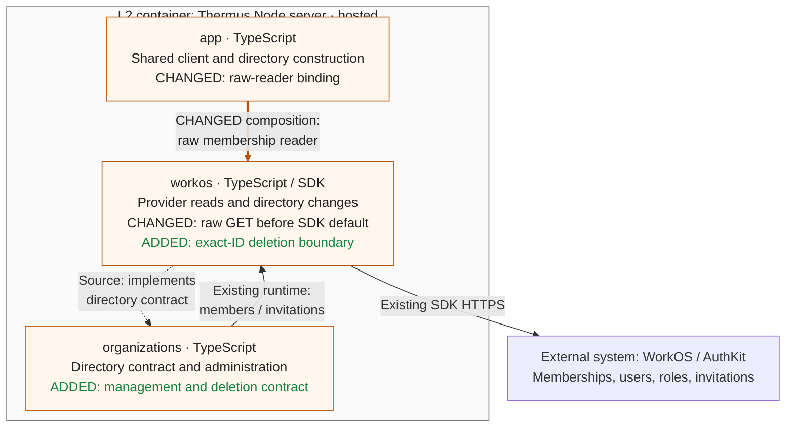

### Architecture comparison — hosted Node server

Compare candidate `07d0d0387aed511674b9b5c73aeec8169a33422b` with trusted main merge base `581f30cfaa32b01399422b087b0f0bdc3b800f70`. This is not a stack. This supplementary L3 view derives from code and registry prose; all 13 registry Mermaid views remain unchanged.

- Before, SDK normalization could turn missing/null management into ordinary. The shared-client raw reader now retains unknown; member revisions include management, and all current grant slugs remain available. It keeps filters, cursors and one request per membership read.
- Before, the directory had no deletion callable. It now sends one exact membership ID. Normal void completion reports applied; only `422 / organization_membership_directory_managed` proves unsupported without effect. Other errors throw unchanged with unknown effect; retries remain zero and the request timeout remains five seconds.
- Existing administration reads, authorization and display filtering stay at their owners. The upstream actor-name `userManagement` binding stays present; raw membership reads and optional profile reads share the same existing client. Browser routes and administration methods do not call deletion.
- This boundary adds no admission, current-authority, last-Admin, serialization, storage or recovery rule. Later slices own those rules. Controlled-wire specifications do not supply live deletion proof; S2.5-02 remains the release hold.
