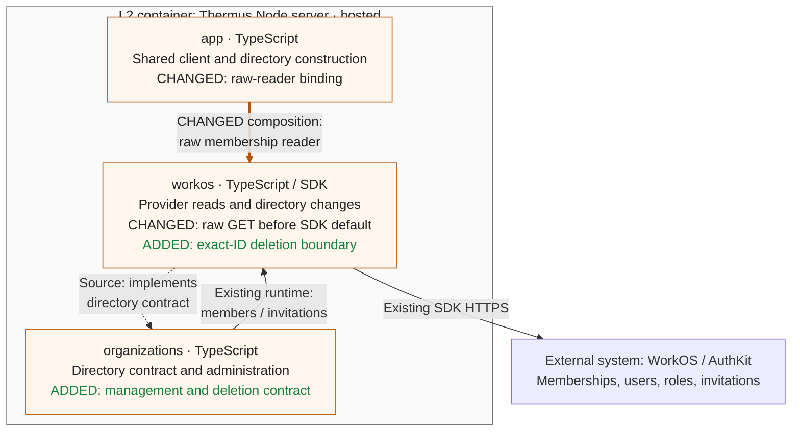

## Description

S2.5-01a adds management evidence and an exact-membership deletion boundary for later removal checks. The rebase keeps raw membership reads and upstream actor-name reads on the shared WorkOS client.

## Review

**T2 Need architect**

Architecture: {FINAL_CHECKER_ARCHITECTURE_SUMMARY}. `internalInterface` also requires T2; `sensitiveBehavior` requires T1.

**Architecture facts** (candidate `07d0d038` vs merge base `581f30cf`):

- src/accounts/organizations/organization-directory.ts (+6 -0 lines)

<details><summary>Declaration diff</summary>

```diff
diff --git a/docs/api-surface/src/accounts/organizations/organization-directory.d.ts b/docs/api-surface/src/accounts/organizations/organization-directory.d.ts
index 59fd7de3..d1f5e593 100644
--- a/docs/api-surface/src/accounts/organizations/organization-directory.d.ts
+++ b/docs/api-surface/src/accounts/organizations/organization-directory.d.ts
@@ -6,12 +6,14 @@ export interface OrganizationMembership {
     readonly grants: readonly RoleGrant[];
 }
 export type MembershipStatus = 'active' | 'inactive' | 'pending';
+export type MembershipManagement = 'ordinary' | 'external' | 'unknown';
 export interface OrganizationMember {
     readonly membershipId: string;
     readonly subject: string;
     readonly organizationId: string;
     readonly email: string;
     readonly status: MembershipStatus;
+    readonly management: MembershipManagement;
     readonly grants: readonly RoleGrant[];
     readonly revision: string;
 }
@@ -51,10 +53,14 @@ export interface InvitationSendResult {
 export interface InvitationUpdateResult {
     readonly outcome: 'applied' | 'not-pending' | 'unsupported';
 }
+export interface MembershipDeletionResult {
+    readonly outcome: 'applied' | 'unsupported';
+}
 export interface OrganizationDirectory {
     membershipsOf(user: AuthenticatedUser): Promise<readonly OrganizationMembership[]>;
     memberPage(request: MemberPageRequest): Promise<Page<OrganizationMember>>;
     member(membershipId: string): Promise<OrganizationMember | undefined>;
+    deleteMembership(membershipId: string): Promise<MembershipDeletionResult>;
     invitationPage(request: InvitationPageRequest): Promise<Page<OrganizationInvitation>>;
     invitation(invitationId: string): Promise<OrganizationInvitation | undefined>;
     sendInvitation(request: InvitationRequest): Promise<InvitationSendResult>;
```

</details>

Why, from [`.pr-impact.json`](https://github.com/tomer-mayara/Thermus/blob/07d0d0387aed511674b9b5c73aeec8169a33422b/.pr-impact.json): the existing directory gains portable management evidence and exact-ID deletion. Hosted composition binds the raw reader. Components, dependencies, all 13 registry diagrams, containers and deployment stay unchanged.

Merge status: **blocked** pending independent authorized human architect approval of the current candidate. Fresh validation and final checker evidence are pending; prior-head pass claims are stale. No release or merge is authorized by this rebase.

### Architecture comparison — hosted Node server

Compare candidate `07d0d0387aed511674b9b5c73aeec8169a33422b` with trusted main merge base `581f30cfaa32b01399422b087b0f0bdc3b800f70`. This PR is based directly on main. This supplementary L3 view derives from code and registry prose; all 13 registry Mermaid views remain unchanged.



- Before, SDK normalization could turn missing/null management into ordinary. The shared-client raw reader now retains unknown; member revisions include management, and all current grant slugs remain available. It keeps filters, cursors and one request per membership read.
- Before, the directory had no deletion callable. It now sends one exact membership ID. Normal void completion reports applied; only `422 / organization_membership_directory_managed` proves unsupported without effect. Other errors throw unchanged with unknown effect; retries remain zero and the request timeout remains five seconds.
- Existing administration reads, authorization and display filtering stay at their owners. The upstream actor-name `userManagement` binding stays present; raw membership reads and optional profile reads share the same existing client. Browser routes and administration methods do not call deletion.
- This boundary adds no admission, current-authority, last-Admin, serialization, storage or recovery rule. Later slices own those rules. Controlled-wire specifications do not supply live deletion proof; S2.5-02 remains the release hold.

---
Candidate: [07d0d038](https://github.com/tomer-mayara/Thermus/commit/07d0d0387aed511674b9b5c73aeec8169a33422b) · [Validation](https://github.com/tomer-mayara/Thermus/pull/251#issuecomment-6394917607) · [Quality review](https://github.com/tomer-mayara/Thermus/pull/251#issuecomment-6394917737)
