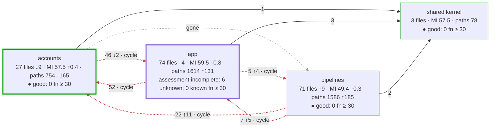
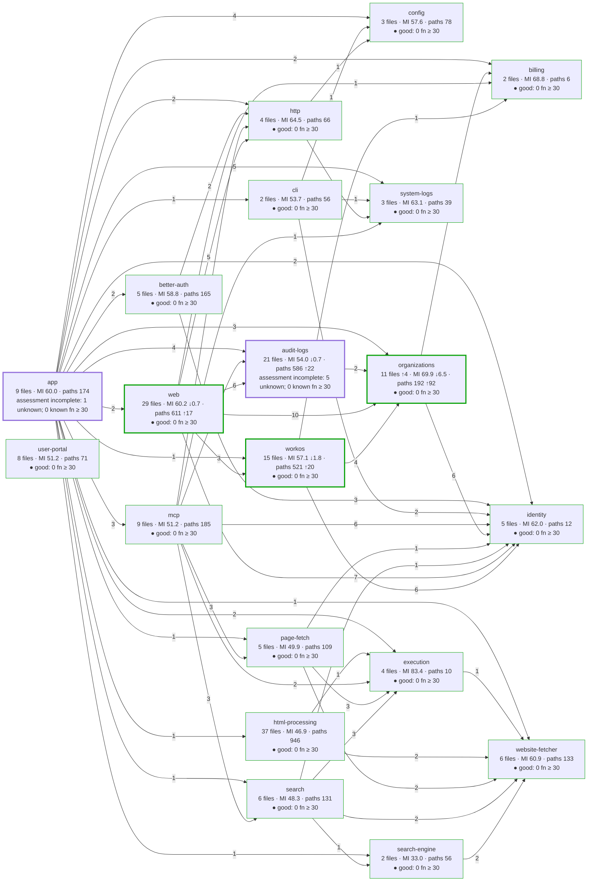
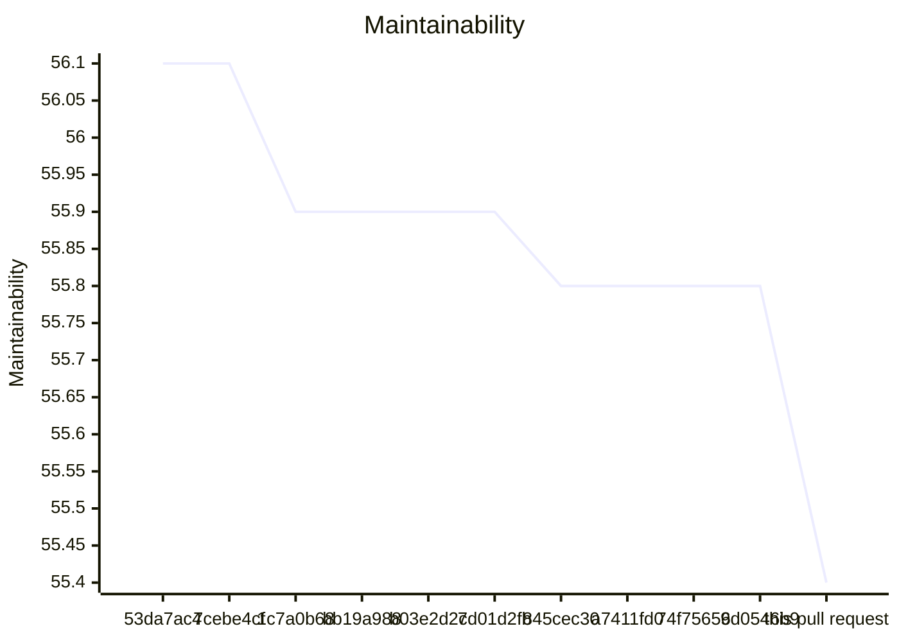
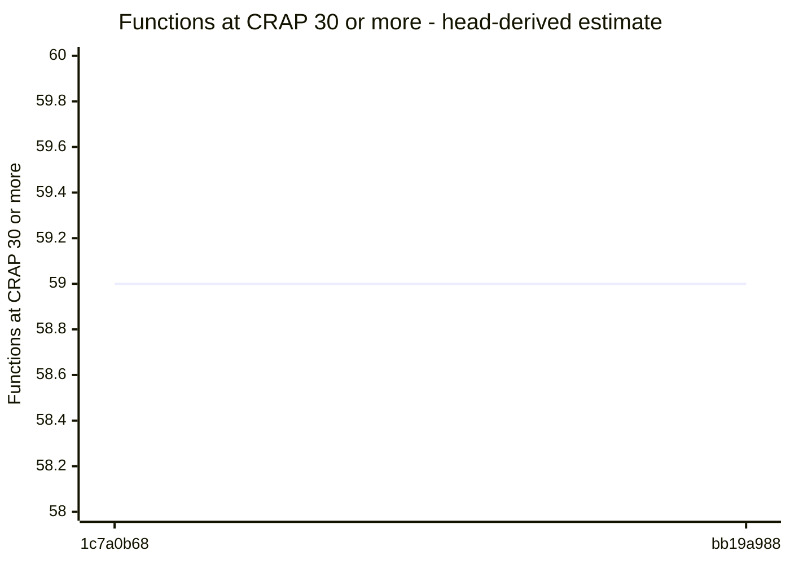
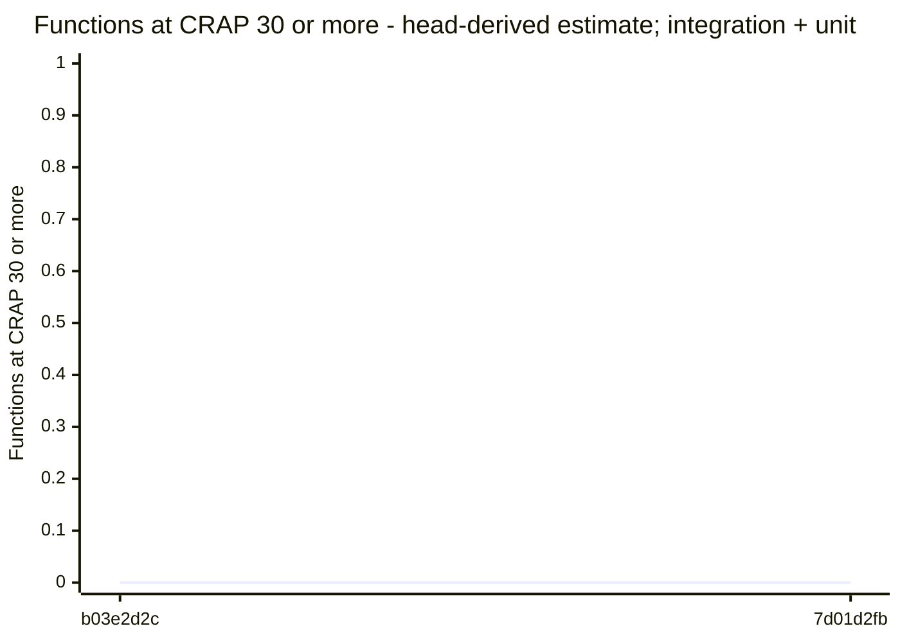
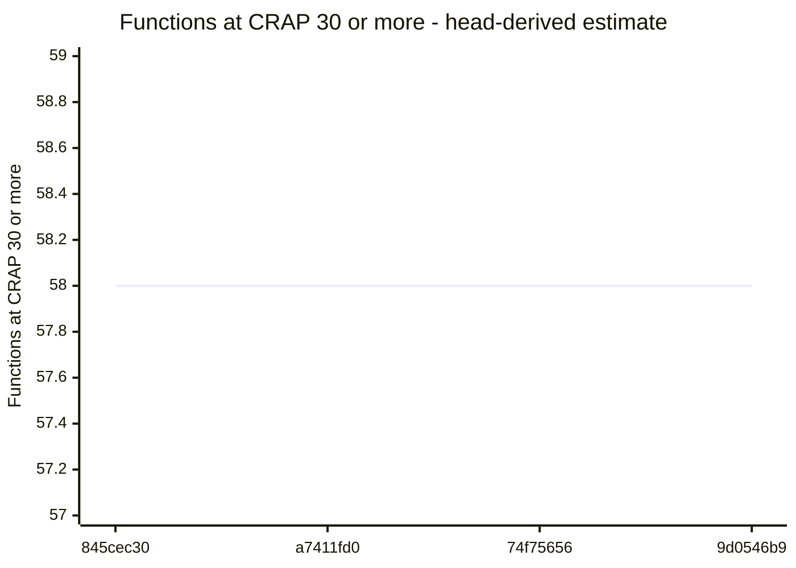

# Code quality process

## Delta

Status: goal miss.

```text
  35.2  src/logs/audit/audit-event-projection.ts  below 85
  43.7  src/accounts/organizations/membership-removal.ts  below 85
  46.3  src/logs/audit/pg-destination-settings-store.ts  below 85
  47.1  src/accounts/providers/workos/workos-organizations.ts  below 85
  51.3  src/interfaces/web/account/administration-routes.ts  below 85
  54.3  src/logs/audit/otlp-audit-encoding.ts  below 85
  54.8  src/app/application.ts  below 85
  56.2  src/app/hosted-workos-application.ts  below 85
  59.4  src/interfaces/web/account/account-routes.ts  below 85
  59.8  src/interfaces/web/account/account-form.ts  below 85
  61.0  src/accounts/organizations/membership-removal-checks.ts  below 85
  61.9  src/interfaces/web/account/administration-pages.ts  below 85
  61.9  src/accounts/organizations/organization-administration.ts  below 85
  72.8  src/interfaces/web/account/account-pages.ts  below 85
  73.5  src/accounts/organizations/membership-removal-lifetime.ts  below 85
  75.1  src/app/logging-storage.ts  below 85
  76.9  src/accounts/organizations/administration-overviews.ts  below 85
  77.7  src/accounts/organizations/directory-reads.ts  below 85
  88.1  src/logs/audit/audit-log.ts
  89.2  src/accounts/organizations/change-records.ts
  23.3  test/acceptance/logging/audit/hosted-storage-failure.runtime.ts  no goal
  23.7  test/integration/hosted-admin/account-routes-administration-pages.test.ts  no goal
  24.4  test/unit/organizations/membership-removal-lifetime.test.ts  no goal
  27.0  test/unit/organizations/organization-administration-members.test.ts  no goal
  27.3  test/unit/auth-workos/workos-organizations-members.test.ts  no goal
  28.9  test/unit/organizations/membership-removal-rules.test.ts  no goal
  30.4  test/acceptance/auth/hosted-invitations.test.ts  no goal
  30.7  test/unit/organizations/membership-removal-outcomes.test.ts  no goal
  31.0  test/acceptance/auth/hosted-live/administration-server.ts  no goal
  31.2  test/integration/auth/workos-google-onboarding.test.ts  no goal
  31.5  test/acceptance/auth/hosted-member-self-removal.test.ts  no goal
  33.2  test/acceptance/auth/hosted-member-removal-scope.test.ts  no goal
  33.5  test/acceptance/auth/membership-removal.runtime.ts  no goal
  33.7  test/integration/logging/audit/removal-operations.runtime.ts  no goal
  33.8  test/integration/auth/workos-removal-lifetime.test.ts  no goal
  34.3  test/acceptance/auth/hosted-member-removal.test.ts  no goal
  34.4  test/integration/auth/workos-provider-administration.test.ts  no goal
  35.6  test/unit/auth-workos/workos-organizations-read-lifetime.test.ts  no goal
  36.4  test/acceptance/auth/hosted-members.test.ts  no goal
  36.6  test/unit/auth-workos/workos-organizations.test.ts  no goal
  37.6  test/acceptance/auth/hosted-workos-administration.test.ts  no goal
  38.9  test/integration/hosted-admin/account-routes-removal.test.ts  no goal
  39.1  test/acceptance/auth/hosted-live/operator-setup.ts  no goal
  39.1  test/integration/auth/workos-connection.test.ts  no goal
  39.8  test/acceptance/auth/hosted-member-removal-browser.runtime.ts  no goal
  40.4  test/unit/auth-workos/workos-organizations-memberships.test.ts  no goal
  41.7  test/acceptance/auth/hosted-membership-deletion.test.ts  no goal
  43.3  test/acceptance/auth/hosted-live/administration-proofs.ts  no goal
  43.5  test/integration/auth/workos-provider-organizations.test.ts  no goal
  44.4  test/unit/logging/audit/pg-removal-operation-store.test.ts  no goal
  45.7  test/acceptance/auth/membership-removal-restart.runtime.ts  no goal
  46.2  test/integration/hosted-admin/account-routes-removal-audit.test.ts  no goal
  47.4  test/integration/auth/workos-provider-directory.test.ts  no goal
  49.1  test/unit/organizations/fixtures/membership-removal-fixtures.ts  no goal
  49.3  test/support/doubles/organizations/organization-directory-double.ts  no goal
  50.8  test/unit/auth-workos/workos-membership-reads.test.ts  no goal
  52.3  test/unit/logging/audit/audit-removal.test.ts  no goal
  52.4  test/support/processes/membership-removal-child.ts  no goal
  52.9  test/support/drivers/browser/member-removal-browser.ts  no goal
  54.1  test/unit/auth-workos/workos-organizations-deletion.test.ts  no goal
  54.4  test/support/doubles/workos/workos-fake-directory.ts  no goal
  55.9  test/integration/hosted-admin/account-routes-grant-retirement.test.ts  no goal
  56.0  test/support/in-process/hosted-member-removal-site.ts  no goal
  56.9  test/support/processes/membership-removal-process.ts  no goal
  57.7  test/integration/hosted-admin/fixtures/organization-administration-double.ts  no goal
  59.0  test/support/doubles/workos/workos-fake-sessions.ts  no goal
  59.2  test/support/doubles/workos/workos-fake-invitations.ts  no goal
  59.7  test/integration/auth/hosted-storage-lifecycle.test.ts  no goal
  65.2  test/unit/auth-workos/fixtures/workos-organizations-double.ts  no goal
  68.4  test/support/doubles/organizations/directory-double-records.ts  no goal
  68.7  test/support/dsl/hosted-member-removal.ts  no goal
  75.2  test/integration/hosted-admin/fixtures/administration-routes-fixtures.ts  no goal
  77.6  test/support/doubles/organizations/removal-operation-store-fake.ts  no goal
  79.1  test/support/doubles/workos/workos-fake.ts  no goal
  83.8  test/support/in-process/workos-site.ts  no goal
  92.8  test/support/processes/module-paths.ts  no goal
  not measured  docs/api-surface/src/accounts/organizations/administration-overviews.d.ts
  not measured  docs/api-surface/src/accounts/organizations/change-records.d.ts
  not measured  docs/api-surface/src/accounts/organizations/organization-administration.d.ts
  not measured  docs/api-surface/src/accounts/organizations/organization-directory.d.ts
  not measured  docs/api-surface/src/accounts/organizations/removal-operation-store.d.ts
  not measured  docs/api-surface/src/interfaces/web/account/account-form.d.ts
  not measured  docs/api-surface/src/logs/audit/audit-log.d.ts
  not measured  src/accounts/organizations/organization-directory.ts
  not measured  src/accounts/organizations/removal-operation-store.ts
  not measured  src/interfaces/web/account/members-style.ts
Result: 18 of 20 production files below 85. Goal: 85 or more for each production file. 56 other files without a goal. 10 files not measured.
Comparison with origin/main: ast-report/compare.html
```

## Review

Status: goal miss.

## AST Metrics found blocking regressions

5 new critical issue(s), 14 other regression(s), 3 improvement(s)

### Summary

- ⚠️  **Complexity: +28**
- ⚠️  **Ease of maintenance: -13**
- ➖ **Outgoing dependencies: -**
- ⚠️  **Probability of bugs: +0.26**

### Regressions

- **src/accounts/organizations/membership-removal-lifetime.ts** (`src/accounts/organizations/membership-removal-lifetime.ts:6`, high)
  Maintainability too low: got 70 (min: 85)
- **src/accounts/organizations/membership-removal.ts** (`src/accounts/organizations/membership-removal.ts:7`, high)
  Maintainability too low: got 43 (min: 85)
- **src/accounts/providers/workos/workos-organizations.ts** (`src/accounts/providers/workos/workos-organizations.ts`, high)
  Maintainability index: 53 -> 47 (below 85 is hard to maintain)
  Suggested action: Refactor long or deeply nested functions and reduce responsibilities in this file
- **src/logs/audit/pg-destination-settings-store.ts** (`src/logs/audit/pg-destination-settings-store.ts`, high)
  Maintainability index: 54 -> 46 (below 85 is hard to maintain)
  Suggested action: Refactor long or deeply nested functions and reduce responsibilities in this file
- **test/integration/auth/workos-connection.test.ts** (`test/integration/auth/workos-connection.test.ts`, high)
  Maintainability index: 49 -> 39 (below 85 is hard to maintain)
  Suggested action: Refactor long or deeply nested functions and reduce responsibilities in this file
- **.cache/s25-01b/prepare-review-evidence.py** (`.cache/s25-01b/prepare-review-evidence.py`, medium)
  Too many Lines of code (329 > 150)
- **.cache/s25-01c/architecture/pin-final.py** (`.cache/s25-01c/architecture/pin-final.py:41`, medium)
  LLOC too high in method main(): got 47 (max: 20)
- **.cache/s25-01c/architecture/pin-final.py** (`.cache/s25-01c/architecture/pin-final.py:41`, medium)
  LOC too high in method main(): got 73 (max: 30)
- **main** (`.cache/s25-01c/architecture/pin-final.py:41`, medium)
  New function with cyclomatic complexity 19 (threshold: 10)
  Suggested action: Extract smaller, well-named functions to reduce decision points
- **src/accounts/organizations/membership-removal-checks.ts** (`src/accounts/organizations/membership-removal-checks.ts`, medium)
  Cyclomatic complexity too high: got 43 (max: 40)
- **src/app/application.ts** (`src/app/application.ts:154`, medium)
  LOC too high in method composeHostedApplication(): got 31 (max: 30)
- **administrationTarget** (`src/logs/audit/audit-event-projection.ts:73`, medium)
  New function with cyclomatic complexity 11 (threshold: 10)
  Suggested action: Extract smaller, well-named functions to reduce decision points
- **eventAttributes** (`src/logs/audit/otlp-audit-encoding.ts:22`, medium)
  Cyclomatic complexity: 15 -> 16 (threshold: 10)
  Suggested action: Extract smaller, well-named functions to reduce decision points
- **.cache/s25-01b/publish/review-evidence/s2-5-01b/0ff3f6cdde5be4124df0ed2ab002844d5db1c502/candidate/api-surface/organization-administration.d.ts** (`.cache/s25-01b/publish/review-evidence/s2-5-01b/0ff3f6cdde5be4124df0ed2ab002844d5db1c502/candidate/api-surface/organization-administration.d.ts`, low)
  Efferent coupling too high: got 11 (max: 10)
- **docs/api-surface/src/accounts/organizations/organization-administration.d.ts** (`docs/api-surface/src/accounts/organizations/organization-administration.d.ts`, low)
  Efferent coupling too high: got 11 (max: 10)
- **src/logs/audit/pg-destination-settings-store.ts** (`src/logs/audit/pg-destination-settings-store.ts`, low)
  Efferent coupling too high: got 13 (max: 10)
- **test/acceptance/logging/audit/hosted-storage-failure.runtime.ts** (`test/acceptance/logging/audit/hosted-storage-failure.runtime.ts`, low)
  Estimated bugs (Halstead): 1.17 -> 1.47
  Suggested action: This estimate grows with code volume and complexity; consider simplifying or splitting this file
- **test/integration/hosted-admin/account-routes-administration-pages.test.ts** (`test/integration/hosted-admin/account-routes-administration-pages.test.ts`, low)
  Estimated bugs (Halstead): 2.46 -> 2.56
  Suggested action: This estimate grows with code volume and complexity; consider simplifying or splitting this file
- **test/unit/organizations/organization-administration-members.test.ts** (`test/unit/organizations/organization-administration-members.test.ts`, low)
  Estimated bugs (Halstead): 0.98 -> 1.16
  Suggested action: This estimate grows with code volume and complexity; consider simplifying or splitting this file

### Improvements

- **projectAdministrationChange** (`src/logs/audit/audit-event-projection.ts:62`): Cyclomatic complexity: 11 -> 8
- **test/acceptance/auth/hosted-invitations.test.ts** (`test/acceptance/auth/hosted-invitations.test.ts`): Estimated bugs (Halstead): 1.12 -> 0.80
- **test/integration/auth/hosted-storage-lifecycle.test.ts** (`test/integration/auth/hosted-storage-lifecycle.test.ts`): Maintainability index: 49 -> 60

## CRAP

Status: goal miss.

Reused verified compatible unit + integration + acceptance coverage.

## CRAP goals

Goals: CRAP < 30; new functions also CRAP ≤ 15.

| File | Function | Change | Paths | Coverage | CRAP | To do |
| --- | --- | --- | --- | --- | --- | --- |
| src/logs/audit/otlp-audit-encoding.ts | eventAttributes | changed | 16 | 100% | 16.0 | ok; for 15: split |
| src/logs/audit/audit-event-projection.ts | inputOf | unchanged | 13 | 91.5% | 13.1 | ok; unchanged by this PR |
| src/logs/audit/audit-event-projection.ts | administrationTarget | new | 11 | 96.7% | 11.0 | ok |
| src/interfaces/web/account/administration-routes.ts | administration-routes\AdministrationRoutes.changeOnPost | unchanged | 11 | 100% | 11.0 | ok; unchanged by this PR |
| src/logs/audit/audit-event-projection.ts | projectToolCompletion | unchanged | 9 | 98.9% | 9.0 | ok; unchanged by this PR |
| src/accounts/organizations/membership-removal-checks.ts | checkRemoval | new | 9 | 100% | 9.0 | ok |
| src/accounts/organizations/membership-removal.ts | membership-removal\MembershipRemoval.complete | new | 9 | 100% | 9.0 | ok |
| src/logs/audit/audit-event-projection.ts | projectAdministrationChange | changed | 8 | 97% | 8.0 | ok |
| src/logs/audit/audit-event-projection.ts | contextOf | unchanged | 8 | 97.6% | 8.0 | ok; unchanged by this PR |
| src/app/hosted-workos-application.ts | composeWorkOSApplication | unchanged | 8 | 100% | 8.0 | ok; unchanged by this PR |
| src/accounts/providers/workos/workos-organizations.ts | workos-organizations\WorkOSOrganizations.activeMembership | changed | 7 | 100% | 7.0 | ok |
| src/app/application.ts | (anonymous) | unchanged | 7 | 100% | 7.0 | ok; unchanged by this PR |
| src/interfaces/web/account/administration-routes.ts | administration-routes\AdministrationRoutes.keep | changed | 7 | 100% | 7.0 | ok |
| src/interfaces/web/account/administration-routes.ts | administration-routes\AdministrationRoutes.removeMember | new | 7 | 100% | 7.0 | ok |
| src/accounts/organizations/membership-removal.ts | membership-removal\MembershipRemoval.admitted | new | 6 | 100% | 6.0 | ok |
| src/accounts/providers/workos/workos-organizations.ts | workos-organizations\WorkOSOrganizations.changeInvitation | unchanged | 6 | 100% | 6.0 | ok; unchanged by this PR |
| src/interfaces/web/account/account-form.ts | account-form\ReturnDestinations.check | unchanged | 6 | 100% | 6.0 | ok; unchanged by this PR |
| src/interfaces/web/account/account-form.ts | invitationIn | unchanged | 6 | 100% | 6.0 | ok; unchanged by this PR |
| src/interfaces/web/account/account-routes.ts | account-routes\HostedAccountRoutes.organizationPage | unchanged | 6 | 100% | 6.0 | ok; unchanged by this PR |
| src/interfaces/web/account/account-routes.ts | account-routes\HostedAccountRoutes.selectOrganization | unchanged | 6 | 100% | 6.0 | ok; unchanged by this PR |
| src/interfaces/web/account/account-form.ts | readForm | unchanged | 5 | 94.6% | 5.0 | ok; unchanged by this PR |
| src/accounts/organizations/organization-administration.ts | organization-administration\OrganizationAdministration. | unchanged | 5 | 97.6% | 5.0 | ok; unchanged by this PR |
| src/accounts/organizations/membership-removal-checks.ts | targetRefusal | new | 5 | 100% | 5.0 | ok |
| src/accounts/organizations/membership-removal.ts | membership-removal\MembershipRemoval.admit | new | 5 | 100% | 5.0 | ok |
| src/accounts/organizations/organization-administration.ts | explicitResult | unchanged | 5 | 100% | 5.0 | ok; unchanged by this PR |
| src/accounts/providers/workos/workos-organizations.ts | checkedActiveRecord | unchanged | 5 | 100% | 5.0 | ok; unchanged by this PR |
| src/accounts/providers/workos/workos-organizations.ts | workos-organizations\WorkOSOrganizations.invitationPage | unchanged | 5 | 100% | 5.0 | ok; unchanged by this PR |
| src/accounts/providers/workos/workos-organizations.ts | workos-organizations\WorkOSOrganizations.sendInvitation | unchanged | 5 | 100% | 5.0 | ok; unchanged by this PR |
| src/interfaces/web/account/account-routes.ts | account-routes\HostedAccountRoutes.tenantOperation | unchanged | 5 | 100% | 5.0 | ok; unchanged by this PR |
| src/logs/audit/audit-event-projection.ts | inputText | unchanged | 5 | 100% | 5.0 | ok; unchanged by this PR |
| src/logs/audit/otlp-audit-encoding.ts | timestampNanos | unchanged | 5 | 100% | 5.0 | ok; unchanged by this PR |
| src/logs/audit/pg-destination-settings-store.ts | pg-destination-settings-store\PgDestinationSettingsStore. | unchanged | 5 | 100% | 5.0 | ok; unchanged by this PR |
| src/accounts/organizations/directory-reads.ts | readDirectoryPages | new | 4 | 100% | 4.0 | ok |
| src/accounts/organizations/membership-removal-checks.ts | (anonymous) | new | 4 | 100% | 4.0 | ok |
| src/accounts/organizations/membership-removal-checks.ts | removalSupported | new | 4 | 100% | 4.0 | ok |
| src/accounts/organizations/membership-removal-lifetime.ts | membership-removal-lifetime\RemovalLifetime.finish | new | 4 | 100% | 4.0 | ok |
| src/accounts/organizations/organization-administration.ts | organization-administration\OrganizationAdministration. | unchanged | 4 | 100% | 4.0 | ok; unchanged by this PR |
| src/accounts/organizations/organization-administration.ts | organization-administration\OrganizationAdministration.managedBy | unchanged | 4 | 100% | 4.0 | ok; unchanged by this PR |
| src/accounts/providers/workos/workos-organizations.ts | hasCode | unchanged | 4 | 100% | 4.0 | ok; unchanged by this PR |
| src/accounts/providers/workos/workos-organizations.ts | hasStatus | unchanged | 4 | 100% | 4.0 | ok; unchanged by this PR |
| src/accounts/providers/workos/workos-organizations.ts | invitationStateOf | unchanged | 4 | 100% | 4.0 | ok; unchanged by this PR |
| src/accounts/providers/workos/workos-organizations.ts | isInvitationOf | unchanged | 4 | 100% | 4.0 | ok; unchanged by this PR |
| src/accounts/providers/workos/workos-organizations.ts | workos-organizations\WorkOSOrganizations.activeMembershipsOf | changed | 4 | 100% | 4.0 | ok |
| src/accounts/providers/workos/workos-organizations.ts | workos-organizations\WorkOSOrganizations.deleteMembership | new | 4 | 100% | 4.0 | ok |
| src/accounts/providers/workos/workos-organizations.ts | workos-organizations\WorkOSOrganizations.memberPage | changed | 4 | 100% | 4.0 | ok |
| src/app/application.ts | (anonymous) | unchanged | 4 | 100% | 4.0 | ok; unchanged by this PR |
| src/interfaces/web/account/account-form.ts | formFields | unchanged | 4 | 100% | 4.0 | ok; unchanged by this PR |
| src/interfaces/web/account/account-form.ts | invitationChangeIn | unchanged | 4 | 100% | 4.0 | ok; unchanged by this PR |
| src/interfaces/web/account/account-form.ts | isSessionToken | unchanged | 4 | 100% | 4.0 | ok; unchanged by this PR |
| src/interfaces/web/account/account-form.ts | selectionIn | unchanged | 4 | 100% | 4.0 | ok; unchanged by this PR |
| src/interfaces/web/account/account-routes.ts | deepFreeze | unchanged | 4 | 100% | 4.0 | ok; unchanged by this PR |
| src/interfaces/web/account/administration-routes.ts | administration-routes\AdministrationRoutes.page | unchanged | 4 | 100% | 4.0 | ok; unchanged by this PR |
| src/logs/audit/audit-event-projection.ts | metadata | unchanged | 4 | 100% | 4.0 | ok; unchanged by this PR |
| src/logs/audit/audit-event-projection.ts | projectDestinationChange | unchanged | 4 | 100% | 4.0 | ok; unchanged by this PR |
| src/logs/audit/otlp-audit-encoding.ts | encodeAuditEvent | unchanged | 4 | unknown | ≥ 4 | no coverage data; unchanged by this PR |
| src/app/logging-storage.ts | openLoggingStorage | changed | 3 | 77.3% | 3.1 | ok |
| src/logs/audit/otlp-audit-encoding.ts | stringAttribute | unchanged | 3 | 78.2% | 3.1 | ok; unchanged by this PR |
| src/interfaces/web/account/administration-routes.ts | administration-routes\AdministrationRoutes. | unchanged | 3 | 96.8% | 3.0 | ok; unchanged by this PR |
| src/interfaces/web/account/administration-pages.ts | membersPage | changed | 3 | 98% | 3.0 | ok |
| src/accounts/organizations/administration-overviews.ts | invitationEntry | unchanged | 3 | 100% | 3.0 | ok; unchanged by this PR |
| src/accounts/organizations/change-records.ts | change-records\ChangeRecording.record | new | 3 | 100% | 3.0 | ok |
| src/accounts/organizations/change-records.ts | change-records\ChangeRecording.recordingFailure | changed | 3 | 100% | 3.0 | ok |
| src/accounts/organizations/membership-removal-lifetime.ts | membership-removal-lifetime\RemovalLifetime.check | new | 3 | 100% | 3.0 | ok |
| src/accounts/providers/workos/workos-organizations.ts | checkedMemberRecord | unchanged | 3 | 100% | 3.0 | ok; unchanged by this PR |
| src/accounts/providers/workos/workos-organizations.ts | getOrganizationMembership | new | 3 | 100% | 3.0 | ok |
| src/accounts/providers/workos/workos-organizations.ts | managementOf | new | 3 | 100% | 3.0 | ok |
| src/accounts/providers/workos/workos-organizations.ts | pageOf | unchanged | 3 | 100% | 3.0 | ok; unchanged by this PR |
| src/accounts/providers/workos/workos-organizations.ts | unlessNotFound | unchanged | 3 | 100% | 3.0 | ok; unchanged by this PR |
| src/accounts/providers/workos/workos-organizations.ts | workos-organizations\WorkOSOrganizations.currentInvitation | unchanged | 3 | 100% | 3.0 | ok; unchanged by this PR |
| src/accounts/providers/workos/workos-organizations.ts | workos-organizations\WorkOSOrganizations.currentMembership | changed | 3 | 100% | 3.0 | ok |
| src/accounts/providers/workos/workos-organizations.ts | workos-organizations\WorkOSOrganizations.membershipsOf | changed | 3 | 100% | 3.0 | ok |
| src/app/hosted-workos-application.ts | openWorkOSApplication | unchanged | 3 | 100% | 3.0 | ok; unchanged by this PR |
| src/app/hosted-workos-application.ts | workosProviderParts | changed | 3 | 100% | 3.0 | ok |
| src/interfaces/web/account/account-form.ts | memberRemovalIn | new | 3 | 100% | 3.0 | ok |
| src/interfaces/web/account/account-form.ts | readBody | unchanged | 3 | 100% | 3.0 | ok; unchanged by this PR |
| src/interfaces/web/account/account-routes.ts | account-routes\HostedAccountRoutes.answerSignedIn | unchanged | 3 | 100% | 3.0 | ok; unchanged by this PR |
| src/interfaces/web/account/account-routes.ts | account-routes\HostedAccountRoutes.route | unchanged | 3 | 100% | 3.0 | ok; unchanged by this PR |
| src/interfaces/web/account/account-routes.ts | account-routes\HostedAccountRoutes.switchAnswer | unchanged | 3 | 100% | 3.0 | ok; unchanged by this PR |
| src/interfaces/web/account/account-routes.ts | requireTrustedTenant | unchanged | 3 | 100% | 3.0 | ok; unchanged by this PR |
| src/interfaces/web/account/account-routes.ts | withCookies | unchanged | 3 | 100% | 3.0 | ok; unchanged by this PR |
| src/interfaces/web/account/administration-pages.ts | (anonymous) | new | 3 | 100% | 3.0 | ok |
| src/logs/audit/audit-log.ts | audit-log\AuditLog.administrationChanged | unchanged | 3 | 100% | 3.0 | ok; unchanged by this PR |
| src/logs/audit/audit-log.ts | audit-log\AuditLog.destinationChanged | unchanged | 3 | 100% | 3.0 | ok; unchanged by this PR |
| src/logs/audit/audit-log.ts | audit-log\AuditLog.toolCompleted | unchanged | 3 | 100% | 3.0 | ok; unchanged by this PR |
| src/interfaces/web/account/administration-pages.ts | sendForm | unchanged | 2 | 98.3% | 2.0 | ok; unchanged by this PR |
| src/accounts/organizations/administration-overviews.ts | holdsUserSeat | unchanged | 2 | 100% | 2.0 | ok; unchanged by this PR |
| src/accounts/organizations/change-records.ts | change-records\ChangeRecording.run | changed | 2 | 100% | 2.0 | ok |
| src/accounts/organizations/directory-reads.ts | latestOfEach | changed | 2 | 100% | 2.0 | ok |
| src/accounts/organizations/membership-removal-checks.ts | (anonymous) | new | 2 | 100% | 2.0 | ok |
| src/accounts/organizations/membership-removal-checks.ts | (anonymous) | new | 2 | 100% | 2.0 | ok |
| src/accounts/organizations/membership-removal-checks.ts | adminGrants | new | 2 | 100% | 2.0 | ok |
| src/accounts/organizations/membership-removal-lifetime.ts | membership-removal-lifetime\RemovalLifetime.stop | new | 2 | 100% | 2.0 | ok |
| src/accounts/organizations/membership-removal.ts | membership-removal\MembershipRemoval.close | new | 2 | 100% | 2.0 | ok |
| src/accounts/organizations/membership-removal.ts | membership-removal\MembershipRemoval.remove | new | 2 | 100% | 2.0 | ok |
| src/accounts/organizations/organization-administration.ts | isAuthorized | unchanged | 2 | 100% | 2.0 | ok; unchanged by this PR |
| src/accounts/organizations/organization-administration.ts | organization-administration\OrganizationAdministration. | unchanged | 2 | 100% | 2.0 | ok; unchanged by this PR |
| src/accounts/organizations/organization-administration.ts | organization-administration\OrganizationAdministration. | unchanged | 2 | 100% | 2.0 | ok; unchanged by this PR |
| src/accounts/organizations/organization-administration.ts | organization-administration\OrganizationAdministration. | unchanged | 2 | 100% | 2.0 | ok; unchanged by this PR |
| src/accounts/organizations/organization-administration.ts | organization-administration\OrganizationAdministration.billingState | unchanged | 2 | 100% | 2.0 | ok; unchanged by this PR |
| src/accounts/organizations/organization-administration.ts | organization-administration\OrganizationAdministration.invitationOverview | unchanged | 2 | 100% | 2.0 | ok; unchanged by this PR |
| src/accounts/organizations/organization-administration.ts | organization-administration\OrganizationAdministration.memberOverview | unchanged | 2 | 100% | 2.0 | ok; unchanged by this PR |
| src/accounts/providers/workos/workos-organizations.ts | afterOf | unchanged | 2 | 100% | 2.0 | ok; unchanged by this PR |
| src/accounts/providers/workos/workos-organizations.ts | eachOrganizationOnce | unchanged | 2 | 100% | 2.0 | ok; unchanged by this PR |
| src/accounts/providers/workos/workos-organizations.ts | invitationOf | unchanged | 2 | 100% | 2.0 | ok; unchanged by this PR |
| src/accounts/providers/workos/workos-organizations.ts | listOrganizationMemberships | new | 2 | 100% | 2.0 | ok |
| src/accounts/providers/workos/workos-organizations.ts | roleListOf | unchanged | 2 | 100% | 2.0 | ok; unchanged by this PR |
| src/accounts/providers/workos/workos-organizations.ts | workos-organizations\WorkOSOrganizations.activeGrants | unchanged | 2 | 100% | 2.0 | ok; unchanged by this PR |
| src/accounts/providers/workos/workos-organizations.ts | workos-organizations\WorkOSOrganizations.activeOrganizationName | unchanged | 2 | 100% | 2.0 | ok; unchanged by this PR |
| src/accounts/providers/workos/workos-organizations.ts | workos-organizations\WorkOSOrganizations.invitation | unchanged | 2 | 100% | 2.0 | ok; unchanged by this PR |
| src/accounts/providers/workos/workos-organizations.ts | workos-organizations\WorkOSOrganizations.isNoLongerPending | unchanged | 2 | 100% | 2.0 | ok; unchanged by this PR |
| src/accounts/providers/workos/workos-organizations.ts | workos-organizations\WorkOSOrganizations.member | changed | 2 | 100% | 2.0 | ok |
| src/app/application.ts | (anonymous) | unchanged | 2 | 100% | 2.0 | ok; unchanged by this PR |
| src/app/application.ts | (anonymous) | unchanged | 2 | 100% | 2.0 | ok; unchanged by this PR |
| src/app/application.ts | (anonymous) | unchanged | 2 | 100% | 2.0 | ok; unchanged by this PR |
| src/app/application.ts | createApplication | unchanged | 2 | 100% | 2.0 | ok; unchanged by this PR |
| src/app/hosted-workos-application.ts | (anonymous) | unchanged | 1 | 0% | 2.0 | ok; unchanged by this PR |
| src/app/hosted-workos-application.ts | (anonymous) | unchanged | 2 | 100% | 2.0 | ok; unchanged by this PR |
| src/app/hosted-workos-application.ts | (anonymous) | unchanged | 2 | 100% | 2.0 | ok; unchanged by this PR |
| src/interfaces/web/account/account-form.ts | (anonymous) | new | 1 | 0% | 2.0 | ok |
| src/interfaces/web/account/account-form.ts | single | unchanged | 2 | 100% | 2.0 | ok; unchanged by this PR |
| src/interfaces/web/account/account-pages.ts | noOrganizationPage | unchanged | 2 | 100% | 2.0 | ok; unchanged by this PR |
| src/interfaces/web/account/account-pages.ts | removalResultPage | new | 2 | 100% | 2.0 | ok |
| src/interfaces/web/account/account-routes.ts | account-routes\HostedAccountRoutes.handle | unchanged | 2 | 100% | 2.0 | ok; unchanged by this PR |
| src/interfaces/web/account/account-routes.ts | directoryUrl | unchanged | 2 | 100% | 2.0 | ok; unchanged by this PR |
| src/interfaces/web/account/administration-pages.ts | (anonymous) | unchanged | 2 | 100% | 2.0 | ok; unchanged by this PR |
| src/interfaces/web/account/administration-pages.ts | (anonymous) | unchanged | 2 | 100% | 2.0 | ok; unchanged by this PR |
| src/interfaces/web/account/administration-pages.ts | identityPolicyText | unchanged | 2 | 100% | 2.0 | ok; unchanged by this PR |
| src/interfaces/web/account/administration-pages.ts | rolesText | unchanged | 2 | 100% | 2.0 | ok; unchanged by this PR |
| src/interfaces/web/account/administration-routes.ts | administration-routes\AdministrationRoutes.handlerFor | unchanged | 2 | 100% | 2.0 | ok; unchanged by this PR |
| src/interfaces/web/account/administration-routes.ts | administration-routes\AdministrationRoutes.withScope | unchanged | 2 | 100% | 2.0 | ok; unchanged by this PR |
| src/logs/audit/pg-destination-settings-store.ts | pg-destination-settings-store\PgDestinationSettingsStore. | new | 2 | 100% | 2.0 | ok |
| src/logs/audit/pg-destination-settings-store.ts | pg-destination-settings-store\PgDestinationSettingsStore. | new | 2 | 100% | 2.0 | ok |
| src/logs/audit/pg-destination-settings-store.ts | pg-destination-settings-store\PgDestinationSettingsStore. | unchanged | 2 | 100% | 2.0 | ok; unchanged by this PR |
| src/logs/audit/pg-destination-settings-store.ts | pg-destination-settings-store\PgDestinationSettingsStore. | new | 2 | 100% | 2.0 | ok |
| src/logs/audit/pg-destination-settings-store.ts | pg-destination-settings-store\PgDestinationSettingsStore.admitRemoval | new | 2 | 100% | 2.0 | ok |
| src/logs/audit/pg-destination-settings-store.ts | pg-destination-settings-store\PgDestinationSettingsStore.completeRemoval | new | 2 | 100% | 2.0 | ok |
| src/logs/audit/pg-destination-settings-store.ts | pg-destination-settings-store\PgDestinationSettingsStore.read | unchanged | 2 | 100% | 2.0 | ok; unchanged by this PR |
| src/logs/audit/pg-destination-settings-store.ts | pg-destination-settings-store\PgDestinationSettingsStore.readRemoval | new | 2 | 100% | 2.0 | ok |
| src/logs/audit/pg-destination-settings-store.ts | pg-destination-settings-store\PgDestinationSettingsStore.save | unchanged | 2 | 100% | 2.0 | ok; unchanged by this PR |
| src/logs/audit/pg-destination-settings-store.ts | settings | unchanged | 2 | 100% | 2.0 | ok; unchanged by this PR |
| src/accounts/organizations/administration-overviews.ts | (anonymous) | new | 1 | 100% | 1.0 | ok |
| src/accounts/organizations/administration-overviews.ts | (anonymous) | unchanged | 1 | 100% | 1.0 | ok; unchanged by this PR |
| src/accounts/organizations/administration-overviews.ts | (anonymous) | new | 1 | 100% | 1.0 | ok |
| src/accounts/organizations/administration-overviews.ts | (anonymous) | new | 1 | 100% | 1.0 | ok |
| src/accounts/organizations/administration-overviews.ts | (anonymous) | unchanged | 1 | 100% | 1.0 | ok; unchanged by this PR |
| src/accounts/organizations/administration-overviews.ts | activeUserSeatCount | unchanged | 1 | 100% | 1.0 | ok; unchanged by this PR |
| src/accounts/organizations/administration-overviews.ts | memberEntry | changed | 1 | 100% | 1.0 | ok |
| src/accounts/organizations/administration-overviews.ts | readInvitationOverview | unchanged | 1 | 100% | 1.0 | ok; unchanged by this PR |
| src/accounts/organizations/administration-overviews.ts | readMemberOverview | unchanged | 1 | 100% | 1.0 | ok; unchanged by this PR |
| src/accounts/organizations/administration-overviews.ts | userSeatsOf | unchanged | 1 | 100% | 1.0 | ok; unchanged by this PR |
| src/accounts/organizations/change-records.ts | change-records\ChangeRecording.constructor | unchanged | 1 | 100% | 1.0 | ok; unchanged by this PR |
| src/accounts/organizations/change-records.ts | change-records\UnconfirmedChangeError.constructor | unchanged | 1 | 100% | 1.0 | ok; unchanged by this PR |
| src/accounts/organizations/directory-reads.ts | (anonymous) | unchanged | 1 | 100% | 1.0 | ok; unchanged by this PR |
| src/accounts/organizations/directory-reads.ts | (anonymous) | unchanged | 1 | 100% | 1.0 | ok; unchanged by this PR |
| src/accounts/organizations/directory-reads.ts | (anonymous) | unchanged | 1 | 100% | 1.0 | ok; unchanged by this PR |
| src/accounts/organizations/directory-reads.ts | (anonymous) | unchanged | 1 | 100% | 1.0 | ok; unchanged by this PR |
| src/accounts/organizations/directory-reads.ts | (anonymous) | unchanged | 1 | 100% | 1.0 | ok; unchanged by this PR |
| src/accounts/organizations/directory-reads.ts | (anonymous) | unchanged | 1 | 100% | 1.0 | ok; unchanged by this PR |
| src/accounts/organizations/directory-reads.ts | invitationsOf | changed | 1 | 100% | 1.0 | ok |
| src/accounts/organizations/directory-reads.ts | membersOf | changed | 1 | 100% | 1.0 | ok |
| src/accounts/organizations/membership-removal-checks.ts | (anonymous) | new | 1 | 100% | 1.0 | ok |
| src/accounts/organizations/membership-removal-checks.ts | (anonymous) | new | 1 | 100% | 1.0 | ok |
| src/accounts/organizations/membership-removal-checks.ts | (anonymous) | new | 1 | 100% | 1.0 | ok |
| src/accounts/organizations/membership-removal-checks.ts | (anonymous) | new | 1 | 100% | 1.0 | ok |
| src/accounts/organizations/membership-removal-checks.ts | (anonymous) | new | 1 | 100% | 1.0 | ok |
| src/accounts/organizations/membership-removal-checks.ts | (anonymous) | new | 1 | 100% | 1.0 | ok |
| src/accounts/organizations/membership-removal-checks.ts | (anonymous) | new | 1 | 100% | 1.0 | ok |
| src/accounts/organizations/membership-removal-checks.ts | (anonymous) | new | 1 | 100% | 1.0 | ok |
| src/accounts/organizations/membership-removal-checks.ts | (anonymous) | new | 1 | 100% | 1.0 | ok |
| src/accounts/organizations/membership-removal-checks.ts | (anonymous) | new | 1 | 100% | 1.0 | ok |
| src/accounts/organizations/membership-removal-checks.ts | (anonymous) | new | 1 | 100% | 1.0 | ok |
| src/accounts/organizations/membership-removal-checks.ts | (anonymous) | new | 1 | 100% | 1.0 | ok |
| src/accounts/organizations/membership-removal-checks.ts | (anonymous) | new | 1 | 100% | 1.0 | ok |
| src/accounts/organizations/membership-removal-checks.ts | currentAdmin | new | 1 | 100% | 1.0 | ok |
| src/accounts/organizations/membership-removal-checks.ts | targetFacts | new | 1 | 100% | 1.0 | ok |
| src/accounts/organizations/membership-removal-lifetime.ts | membership-removal-lifetime\RemovalLifetime. | new | 1 | 100% | 1.0 | ok |
| src/accounts/organizations/membership-removal-lifetime.ts | membership-removal-lifetime\RemovalLifetime. | new | 1 | 100% | 1.0 | ok |
| src/accounts/organizations/membership-removal-lifetime.ts | membership-removal-lifetime\RemovalLifetime. | new | 1 | 100% | 1.0 | ok |
| src/accounts/organizations/membership-removal-lifetime.ts | membership-removal-lifetime\RemovalLifetime.admitting | new | 1 | 100% | 1.0 | ok |
| src/accounts/organizations/membership-removal-lifetime.ts | membership-removal-lifetime\RemovalLifetime.run | new | 1 | 100% | 1.0 | ok |
| src/accounts/organizations/membership-removal-lifetime.ts | membership-removal-lifetime\RemovalLifetime.wait | new | 1 | 100% | 1.0 | ok |
| src/accounts/organizations/membership-removal.ts | membership-removal\MembershipRemoval. | new | 1 | 100% | 1.0 | ok |
| src/accounts/organizations/membership-removal.ts | membership-removal\MembershipRemoval. | new | 1 | 100% | 1.0 | ok |
| src/accounts/organizations/membership-removal.ts | membership-removal\MembershipRemoval. | new | 1 | 100% | 1.0 | ok |
| src/accounts/organizations/membership-removal.ts | membership-removal\MembershipRemoval. | new | 1 | 100% | 1.0 | ok |
| src/accounts/organizations/membership-removal.ts | membership-removal\MembershipRemoval. | new | 1 | 100% | 1.0 | ok |
| src/accounts/organizations/membership-removal.ts | membership-removal\MembershipRemoval. | new | 1 | 100% | 1.0 | ok |
| src/accounts/organizations/membership-removal.ts | membership-removal\MembershipRemoval. | new | 1 | 100% | 1.0 | ok |
| src/accounts/organizations/membership-removal.ts | membership-removal\MembershipRemoval.constructor | new | 1 | 100% | 1.0 | ok |
| src/accounts/organizations/organization-administration.ts | (anonymous) | unchanged | 1 | 100% | 1.0 | ok; unchanged by this PR |
| src/accounts/organizations/organization-administration.ts | (anonymous) | new | 1 | 100% | 1.0 | ok |
| src/accounts/organizations/organization-administration.ts | organization-administration\OrganizationAdministration. | new | 1 | 100% | 1.0 | ok |
| src/accounts/organizations/organization-administration.ts | organization-administration\OrganizationAdministration. | unchanged | 1 | 100% | 1.0 | ok; unchanged by this PR |
| src/accounts/organizations/organization-administration.ts | organization-administration\OrganizationAdministration. | unchanged | 1 | 100% | 1.0 | ok; unchanged by this PR |
| src/accounts/organizations/organization-administration.ts | organization-administration\OrganizationAdministration. | unchanged | 1 | 100% | 1.0 | ok; unchanged by this PR |
| src/accounts/organizations/organization-administration.ts | organization-administration\OrganizationAdministration.authorizeSelection | unchanged | 1 | 100% | 1.0 | ok; unchanged by this PR |
| src/accounts/organizations/organization-administration.ts | organization-administration\OrganizationAdministration.changeInvitation | unchanged | 1 | 100% | 1.0 | ok; unchanged by this PR |
| src/accounts/organizations/organization-administration.ts | organization-administration\OrganizationAdministration.close | new | 1 | 100% | 1.0 | ok |
| src/accounts/organizations/organization-administration.ts | organization-administration\OrganizationAdministration.constructor | changed | 1 | 100% | 1.0 | ok |
| src/accounts/organizations/organization-administration.ts | organization-administration\OrganizationAdministration.isPending | unchanged | 1 | 100% | 1.0 | ok; unchanged by this PR |
| src/accounts/organizations/organization-administration.ts | organization-administration\OrganizationAdministration.listOrganizations | unchanged | 1 | 100% | 1.0 | ok; unchanged by this PR |
| src/accounts/organizations/organization-administration.ts | organization-administration\OrganizationAdministration.removeMember | new | 1 | 100% | 1.0 | ok |
| src/accounts/organizations/organization-administration.ts | organization-administration\OrganizationAdministration.resendInvitation | unchanged | 1 | 100% | 1.0 | ok; unchanged by this PR |
| src/accounts/organizations/organization-administration.ts | organization-administration\OrganizationAdministration.revokeInvitation | unchanged | 1 | 100% | 1.0 | ok; unchanged by this PR |
| src/accounts/organizations/organization-administration.ts | organization-administration\OrganizationAdministration.sendInvitation | unchanged | 1 | 100% | 1.0 | ok; unchanged by this PR |
| src/accounts/providers/workos/workos-organizations.ts | (anonymous) | unchanged | 1 | 100% | 1.0 | ok; unchanged by this PR |
| src/accounts/providers/workos/workos-organizations.ts | (anonymous) | unchanged | 1 | 100% | 1.0 | ok; unchanged by this PR |
| src/accounts/providers/workos/workos-organizations.ts | membershipRecordOf | new | 1 | 100% | 1.0 | ok |
| src/accounts/providers/workos/workos-organizations.ts | readWhileActive | new | 1 | 100% | 1.0 | ok |
| src/accounts/providers/workos/workos-organizations.ts | revisionOf | changed | 1 | 100% | 1.0 | ok |
| src/accounts/providers/workos/workos-organizations.ts | workos-organizations\WorkOSOrganizations. | new | 1 | 100% | 1.0 | ok |
| src/accounts/providers/workos/workos-organizations.ts | workos-organizations\WorkOSOrganizations. | new | 1 | 100% | 1.0 | ok |
| src/accounts/providers/workos/workos-organizations.ts | workos-organizations\WorkOSOrganizations. | unchanged | 1 | 100% | 1.0 | ok; unchanged by this PR |
| src/accounts/providers/workos/workos-organizations.ts | workos-organizations\WorkOSOrganizations. | unchanged | 1 | 100% | 1.0 | ok; unchanged by this PR |
| src/accounts/providers/workos/workos-organizations.ts | workos-organizations\WorkOSOrganizations. | new | 1 | 100% | 1.0 | ok |
| src/accounts/providers/workos/workos-organizations.ts | workos-organizations\WorkOSOrganizations. | new | 1 | 100% | 1.0 | ok |
| src/accounts/providers/workos/workos-organizations.ts | workos-organizations\WorkOSOrganizations. | new | 1 | 100% | 1.0 | ok |
| src/accounts/providers/workos/workos-organizations.ts | workos-organizations\WorkOSOrganizations. | new | 1 | 100% | 1.0 | ok |
| src/accounts/providers/workos/workos-organizations.ts | workos-organizations\WorkOSOrganizations. | unchanged | 1 | 100% | 1.0 | ok; unchanged by this PR |
| src/accounts/providers/workos/workos-organizations.ts | workos-organizations\WorkOSOrganizations. | new | 1 | 100% | 1.0 | ok |
| src/accounts/providers/workos/workos-organizations.ts | workos-organizations\WorkOSOrganizations. | unchanged | 1 | 100% | 1.0 | ok; unchanged by this PR |
| src/accounts/providers/workos/workos-organizations.ts | workos-organizations\WorkOSOrganizations. | unchanged | 1 | 100% | 1.0 | ok; unchanged by this PR |
| src/accounts/providers/workos/workos-organizations.ts | workos-organizations\WorkOSOrganizations.constructor | changed | 1 | 100% | 1.0 | ok |
| src/accounts/providers/workos/workos-organizations.ts | workos-organizations\WorkOSOrganizations.grantsOf | changed | 1 | 100% | 1.0 | ok |
| src/accounts/providers/workos/workos-organizations.ts | workos-organizations\WorkOSOrganizations.memberOf | changed | 1 | 100% | 1.0 | ok |
| src/accounts/providers/workos/workos-organizations.ts | workos-organizations\WorkOSOrganizations.organizationRoles | changed | 1 | 100% | 1.0 | ok |
| src/accounts/providers/workos/workos-organizations.ts | workos-organizations\WorkOSOrganizations.resendInvitation | unchanged | 1 | 100% | 1.0 | ok; unchanged by this PR |
| src/accounts/providers/workos/workos-organizations.ts | workos-organizations\WorkOSOrganizations.revokeInvitation | unchanged | 1 | 100% | 1.0 | ok; unchanged by this PR |
| src/accounts/providers/workos/workos-organizations.ts | workosMembershipReads | new | 1 | 100% | 1.0 | ok |
| src/app/application.ts | (anonymous) | unchanged | 1 | 100% | 1.0 | ok; unchanged by this PR |
| src/app/application.ts | (anonymous) | unchanged | 1 | 100% | 1.0 | ok; unchanged by this PR |
| src/app/application.ts | (anonymous) | unchanged | 1 | 100% | 1.0 | ok; unchanged by this PR |
| src/app/application.ts | (anonymous) | unchanged | 1 | 100% | 1.0 | ok; unchanged by this PR |
| src/app/application.ts | (anonymous) | unchanged | 1 | 100% | 1.0 | ok; unchanged by this PR |
| src/app/application.ts | (anonymous) | unchanged | 1 | 100% | 1.0 | ok; unchanged by this PR |
| src/app/application.ts | (anonymous) | unchanged | 1 | 100% | 1.0 | ok; unchanged by this PR |
| src/app/application.ts | (anonymous) | unchanged | 1 | 100% | 1.0 | ok; unchanged by this PR |
| src/app/application.ts | (anonymous) | new | 1 | 100% | 1.0 | ok |
| src/app/application.ts | (anonymous) | unchanged | 1 | 100% | 1.0 | ok; unchanged by this PR |
| src/app/application.ts | (anonymous) | new | 1 | 100% | 1.0 | ok |
| src/app/application.ts | (anonymous) | unchanged | 1 | 100% | 1.0 | ok; unchanged by this PR |
| src/app/application.ts | (anonymous) | unchanged | 1 | 100% | 1.0 | ok; unchanged by this PR |
| src/app/application.ts | (anonymous) | new | 1 | 100% | 1.0 | ok |
| src/app/application.ts | (anonymous) | unchanged | 1 | 100% | 1.0 | ok; unchanged by this PR |
| src/app/application.ts | (anonymous) | unchanged | 1 | 100% | 1.0 | ok; unchanged by this PR |
| src/app/application.ts | (anonymous) | unchanged | 1 | 100% | 1.0 | ok; unchanged by this PR |
| src/app/application.ts | (anonymous) | new | 1 | 100% | 1.0 | ok |
| src/app/application.ts | (anonymous) | unchanged | 1 | 100% | 1.0 | ok; unchanged by this PR |
| src/app/application.ts | accountChangeRecorder | unchanged | 1 | 100% | 1.0 | ok; unchanged by this PR |
| src/app/application.ts | accountFailureReporter | unchanged | 1 | 100% | 1.0 | ok; unchanged by this PR |
| src/app/application.ts | composeApplication | unchanged | 1 | 100% | 1.0 | ok; unchanged by this PR |
| src/app/application.ts | composeHostedApplication | changed | 1 | 100% | 1.0 | ok |
| src/app/application.ts | createHostedApplication | unchanged | 1 | 100% | 1.0 | ok; unchanged by this PR |
| src/app/application.ts | createSelfHostedApplication | unchanged | 1 | 100% | 1.0 | ok; unchanged by this PR |
| src/app/application.ts | discardAuditLog | unchanged | 1 | 100% | 1.0 | ok; unchanged by this PR |
| src/app/application.ts | operatorFailureReporter | unchanged | 1 | 100% | 1.0 | ok; unchanged by this PR |
| src/app/application.ts | routeHostedRequests | unchanged | 1 | 100% | 1.0 | ok; unchanged by this PR |
| src/app/application.ts | routeLocalRequests | unchanged | 1 | 100% | 1.0 | ok; unchanged by this PR |
| src/app/hosted-workos-application.ts | (anonymous) | unchanged | 1 | 100% | 1.0 | ok; unchanged by this PR |
| src/app/hosted-workos-application.ts | (anonymous) | new | 1 | 100% | 1.0 | ok |
| src/app/hosted-workos-application.ts | (anonymous) | unchanged | 1 | 100% | 1.0 | ok; unchanged by this PR |
| src/app/hosted-workos-application.ts | (anonymous) | unchanged | 1 | 100% | 1.0 | ok; unchanged by this PR |
| src/app/hosted-workos-application.ts | (anonymous) | unchanged | 1 | 100% | 1.0 | ok; unchanged by this PR |
| src/app/hosted-workos-application.ts | openWorkOSConnection | unchanged | 1 | 100% | 1.0 | ok; unchanged by this PR |
| src/app/logging-storage.ts | (anonymous) | unchanged | 1 | 100% | 1.0 | ok; unchanged by this PR |
| src/app/logging-storage.ts | composeLoggingStorage | changed | 1 | unknown | ≥ 1 | no coverage data |
| src/interfaces/web/account/account-form.ts | (anonymous) | unchanged | 1 | 100% | 1.0 | ok; unchanged by this PR |
| src/interfaces/web/account/account-form.ts | (anonymous) | unchanged | 1 | 100% | 1.0 | ok; unchanged by this PR |
| src/interfaces/web/account/account-form.ts | (anonymous) | unchanged | 1 | 100% | 1.0 | ok; unchanged by this PR |
| src/interfaces/web/account/account-form.ts | (anonymous) | new | 1 | 100% | 1.0 | ok |
| src/interfaces/web/account/account-form.ts | account-form\ReturnDestinations.constructor | unchanged | 1 | 100% | 1.0 | ok; unchanged by this PR |
| src/interfaces/web/account/account-form.ts | account-form\ReturnDestinations.urlOf | unchanged | 1 | 100% | 1.0 | ok; unchanged by this PR |
| src/interfaces/web/account/account-form.ts | cancelOnAbort | unchanged | 1 | 100% | 1.0 | ok; unchanged by this PR |
| src/interfaces/web/account/account-pages.ts | (anonymous) | new | 1 | 100% | 1.0 | ok |
| src/interfaces/web/account/account-pages.ts | accessDeniedPage | unchanged | 1 | 100% | 1.0 | ok; unchanged by this PR |
| src/interfaces/web/account/account-pages.ts | noticePage | unchanged | 1 | 100% | 1.0 | ok; unchanged by this PR |
| src/interfaces/web/account/account-pages.ts | noticeResponse | unchanged | 1 | 100% | 1.0 | ok; unchanged by this PR |
| src/interfaces/web/account/account-pages.ts | seeOther | unchanged | 1 | 100% | 1.0 | ok; unchanged by this PR |
| src/interfaces/web/account/account-pages.ts | unconfirmedInvitationPage | unchanged | 1 | 100% | 1.0 | ok; unchanged by this PR |
| src/interfaces/web/account/account-routes.ts | (anonymous) | new | 1 | 100% | 1.0 | ok |
| src/interfaces/web/account/account-routes.ts | account-routes\HostedAccountRoutes. | unchanged | 1 | 100% | 1.0 | ok; unchanged by this PR |
| src/interfaces/web/account/account-routes.ts | account-routes\HostedAccountRoutes. | unchanged | 1 | 100% | 1.0 | ok; unchanged by this PR |
| src/interfaces/web/account/account-routes.ts | account-routes\HostedAccountRoutes. | unchanged | 1 | 100% | 1.0 | ok; unchanged by this PR |
| src/interfaces/web/account/account-routes.ts | account-routes\HostedAccountRoutes. | unchanged | 1 | 100% | 1.0 | ok; unchanged by this PR |
| src/interfaces/web/account/account-routes.ts | account-routes\HostedAccountRoutes.constructor | unchanged | 1 | 100% | 1.0 | ok; unchanged by this PR |
| src/interfaces/web/account/account-routes.ts | frozenCopy | unchanged | 1 | 100% | 1.0 | ok; unchanged by this PR |
| src/interfaces/web/account/administration-pages.ts | (anonymous) | unchanged | 1 | 100% | 1.0 | ok; unchanged by this PR |
| src/interfaces/web/account/administration-pages.ts | (anonymous) | unchanged | 1 | 100% | 1.0 | ok; unchanged by this PR |
| src/interfaces/web/account/administration-pages.ts | (anonymous) | unchanged | 1 | 100% | 1.0 | ok; unchanged by this PR |
| src/interfaces/web/account/administration-pages.ts | (anonymous) | unchanged | 1 | 100% | 1.0 | ok; unchanged by this PR |
| src/interfaces/web/account/administration-pages.ts | invitationRow | unchanged | 1 | 100% | 1.0 | ok; unchanged by this PR |
| src/interfaces/web/account/administration-pages.ts | removalForm | new | 1 | 100% | 1.0 | ok |
| src/interfaces/web/account/administration-pages.ts | roleLabel | unchanged | 1 | 100% | 1.0 | ok; unchanged by this PR |
| src/interfaces/web/account/administration-routes.ts | administration-routes\AdministrationRoutes. | unchanged | 1 | 100% | 1.0 | ok; unchanged by this PR |
| src/interfaces/web/account/administration-routes.ts | administration-routes\AdministrationRoutes. | unchanged | 1 | 100% | 1.0 | ok; unchanged by this PR |
| src/interfaces/web/account/administration-routes.ts | administration-routes\AdministrationRoutes. | unchanged | 1 | 100% | 1.0 | ok; unchanged by this PR |
| src/interfaces/web/account/administration-routes.ts | administration-routes\AdministrationRoutes. | unchanged | 1 | 100% | 1.0 | ok; unchanged by this PR |
| src/interfaces/web/account/administration-routes.ts | administration-routes\AdministrationRoutes. | unchanged | 1 | 100% | 1.0 | ok; unchanged by this PR |
| src/interfaces/web/account/administration-routes.ts | administration-routes\AdministrationRoutes. | new | 1 | 100% | 1.0 | ok |
| src/interfaces/web/account/administration-routes.ts | administration-routes\AdministrationRoutes. | unchanged | 1 | 100% | 1.0 | ok; unchanged by this PR |
| src/interfaces/web/account/administration-routes.ts | administration-routes\AdministrationRoutes. | unchanged | 1 | 100% | 1.0 | ok; unchanged by this PR |
| src/interfaces/web/account/administration-routes.ts | administration-routes\AdministrationRoutes. | unchanged | 1 | 100% | 1.0 | ok; unchanged by this PR |
| src/interfaces/web/account/administration-routes.ts | administration-routes\AdministrationRoutes. | unchanged | 1 | 100% | 1.0 | ok; unchanged by this PR |
| src/interfaces/web/account/administration-routes.ts | administration-routes\AdministrationRoutes. | unchanged | 1 | 100% | 1.0 | ok; unchanged by this PR |
| src/interfaces/web/account/administration-routes.ts | administration-routes\AdministrationRoutes. | unchanged | 1 | 100% | 1.0 | ok; unchanged by this PR |
| src/interfaces/web/account/administration-routes.ts | administration-routes\AdministrationRoutes. | new | 1 | 100% | 1.0 | ok |
| src/interfaces/web/account/administration-routes.ts | administration-routes\AdministrationRoutes. | unchanged | 1 | 100% | 1.0 | ok; unchanged by this PR |
| src/interfaces/web/account/administration-routes.ts | administration-routes\AdministrationRoutes. | unchanged | 1 | 100% | 1.0 | ok; unchanged by this PR |
| src/interfaces/web/account/administration-routes.ts | administration-routes\AdministrationRoutes. | unchanged | 1 | 100% | 1.0 | ok; unchanged by this PR |
| src/interfaces/web/account/administration-routes.ts | administration-routes\AdministrationRoutes.billingPage | unchanged | 1 | 100% | 1.0 | ok; unchanged by this PR |
| src/interfaces/web/account/administration-routes.ts | administration-routes\AdministrationRoutes.constructor | changed | 1 | 100% | 1.0 | ok |
| src/interfaces/web/account/administration-routes.ts | administration-routes\AdministrationRoutes.invitationsPage | unchanged | 1 | 100% | 1.0 | ok; unchanged by this PR |
| src/interfaces/web/account/administration-routes.ts | administration-routes\AdministrationRoutes.membersPage | changed | 1 | 100% | 1.0 | ok |
| src/interfaces/web/account/administration-routes.ts | administration-routes\AdministrationRoutes.pathOf | unchanged | 1 | 100% | 1.0 | ok; unchanged by this PR |
| src/interfaces/web/account/administration-routes.ts | administration-routes\AdministrationRoutes.resendInvitation | unchanged | 1 | 100% | 1.0 | ok; unchanged by this PR |
| src/interfaces/web/account/administration-routes.ts | administration-routes\AdministrationRoutes.revokeInvitation | unchanged | 1 | 100% | 1.0 | ok; unchanged by this PR |
| src/interfaces/web/account/administration-routes.ts | administration-routes\AdministrationRoutes.sendInvitation | unchanged | 1 | 100% | 1.0 | ok; unchanged by this PR |
| src/logs/audit/audit-log.ts | audit-log\AuditLog.constructor | unchanged | 1 | 100% | 1.0 | ok; unchanged by this PR |
| src/logs/audit/pg-destination-settings-store.ts | (anonymous) | new | 1 | 100% | 1.0 | ok |
| src/logs/audit/pg-destination-settings-store.ts | openDestinationSettingsRuntime | changed | 1 | 100% | 1.0 | ok |
| src/logs/audit/pg-destination-settings-store.ts | pg-destination-settings-store\PgDestinationSettingsStore.constructor | unchanged | 1 | 100% | 1.0 | ok; unchanged by this PR |
| src/logs/audit/pg-destination-settings-store.ts | removalOperation | new | 1 | 100% | 1.0 | ok |

Known limit violations: 0. Measured target misses: 1. Unmeasured functions: 2. Required functions with unknown assessment or identity: 1.
Unmeasured values are lower bounds; the known violation count is not an exact total.

## Architecture

Status: passed.

## Architecture of src/: base 9d0546b9 → head

Modularity 0.34 → 0.34 · cross share 0.31 → 0.31 · cycles 1 → 1 · communities 4 → 4 · functions ≥ 30: 0 → 0



Legend: thick border = a community this pull request touched; `· new` and `· gone` = a community or dependency that appeared or disappeared; red dashed edge = part of a cycle; thick edge = a new dependency; border color = the CRAP band of the community (● good: complete assessment, no function at CRAP 30 or more; ▲ warning: some, none added or worse by this pull request; ■ critical: one added or worse); numbers = files · maintainability (LOC-weighted) · decision paths, with the change against the base.

### Community edge evidence

Tool references and deduplicated file pairs have different units. An unchanged import means the same normalized file pair, after proven path moves; evidence kinds can differ.

Dependency evidence incomplete: base has 1 issue; head has 1 issue. A missing pair on an incomplete side does not prove an import change.

- base: <code>src/interfaces/user-portal/main.ts</code> → <code>./style.css</code> — unresolved-local.
- head: <code>src/interfaces/user-portal/main.ts</code> → <code>./style.css</code> — unresolved-local.

- accounts → pipelines · gone: 9 tool references; 8 deduplicated file pairs.
  - `src/interfaces/mcp/fetch-tool-schema.ts` → `src/pipelines/page-fetch/fetch-url.ts` — unchanged import; community regrouping.
  - `src/interfaces/mcp/fetch-tool-server.ts` → `src/pipelines/page-fetch/fetch-failure.ts` — unchanged import; community regrouping.
  - `src/interfaces/mcp/fetch-tool-server.ts` → `src/pipelines/search/search-failure.ts` — unchanged import; community regrouping.
  - `src/interfaces/mcp/get-url-as-markdown.ts` → `src/pipelines/execution/execution-context.ts` — unchanged import; community regrouping.
  - `src/interfaces/mcp/get-url-as-markdown.ts` → `src/pipelines/page-fetch/fetch-page.ts` — unchanged import; community regrouping.
  - `src/interfaces/mcp/search-tool-schema.ts` → `src/pipelines/search/search-query.ts` — unchanged import; community regrouping.
  - `src/interfaces/mcp/search.ts` → `src/pipelines/execution/execution-context.ts` — unchanged import; community regrouping.
  - `src/interfaces/mcp/search.ts` → `src/pipelines/search/search-pipeline.ts` — unchanged import; community regrouping.

### Community regrouping

- `src/interfaces/mcp/fetch-tool-schema.ts`: accounts → pipelines.
- `src/interfaces/mcp/fetch-tool-server.ts`: accounts → pipelines.
- `src/interfaces/mcp/get-url-as-markdown.ts`: accounts → pipelines.
- `src/interfaces/mcp/identity-verifier-sdk-adapter.ts`: accounts → pipelines.
- `src/interfaces/mcp/mcp-server.ts`: accounts → pipelines.
- `src/interfaces/mcp/protected-resource-endpoint.ts`: accounts → pipelines.
- `src/interfaces/mcp/search-tool-schema.ts`: accounts → pipelines.
- `src/interfaces/mcp/search.ts`: accounts → pipelines.
- `src/interfaces/mcp/tool-completion-record.ts`: accounts → pipelines.

## Components of src/

Component dependency evidence is incomplete: known head dependencies and proven cycles are shown; edge and cycle changes are withheld. Additional dependencies or cycles may exist.



Legend: thick border = a component this pull request touched; `· new` and `· gone` = a component or dependency that appeared or disappeared; red dashed edge = part of a cycle; thick edge = a new dependency; border color = the CRAP band of the component (● good: complete assessment, no function at CRAP 30 or more; ▲ warning: some, none added or worse by this pull request; ■ critical: one added or worse); numbers = files · maintainability (LOC-weighted) · decision paths, with the change against the base. Edges count distinct importing files per target component.

## Complexity of the changed files

| File | Maintainability | Decision paths | CRAP ≥ 30 | Risk rank |
| --- | --- | --- | --- | --- |
| src/accounts/organizations/administration-overviews.ts | 75.8 → 76.9 ↑1.1 | 15 → 15 | 0 → 0 | |
| src/accounts/organizations/change-records.ts | 89.2 → 89.2 | 10 → 10 | 0 → 0 | 5 |
| src/accounts/organizations/directory-reads.ts | 77.8 → 77.7 ↓0.1 | 14 → 14 | 0 → 0 | |
| src/accounts/organizations/membership-removal-checks.ts | new → 61.0 | new → 43 | new → 0 | |
| src/accounts/organizations/membership-removal-lifetime.ts | new → 73.5 | new → 15 | new → 0 | |
| src/accounts/organizations/membership-removal.ts | new → 43.7 | new → 32 | new → 0 | |
| src/accounts/organizations/organization-administration.ts | 64.8 → 61.9 ↓2.9 | 46 → 48 ↑2 | 0 → 0 | 7 |
| src/accounts/organizations/organization-directory.ts | not measured | not measured | not measured | |
| src/accounts/organizations/removal-operation-store.ts | not measured | not measured | not measured | |
| src/accounts/providers/workos/workos-organizations.ts | 53.5 → 47.1 ↓6.4 | 104 → 124 ↑20 | 0 → 0 | 1 |
| src/app/application.ts | 54.8 → 54.8 | 48 → 48 | 0 → 0 | |
| src/app/hosted-workos-application.ts | 56.2 → 56.2 | 25 → 25 | 0 → 0 | |
| src/app/logging-storage.ts | 75.9 → 75.1 ↓0.8 | 5 → 5 | 0 → 0 | |
| src/interfaces/web/account/account-form.ts | 61.6 → 59.8 ↓1.8 | 45 → 49 ↑4 | 0 → 0 | |
| src/interfaces/web/account/account-pages.ts | 73.9 → 72.8 ↓1.1 | 8 → 10 ↑2 | 0 → 0 | |
| src/interfaces/web/account/account-routes.ts | 60.1 → 59.4 ↓0.7 | 47 → 47 | 0 → 0 | 8 |
| src/interfaces/web/account/administration-pages.ts | 64.9 → 61.9 ↓3.0 | 21 → 23 ↑2 | 0 → 0 | |
| src/interfaces/web/account/administration-routes.ts | 56.1 → 51.3 ↓4.8 | 51 → 60 ↑9 | 0 → 0 | 3 |
| src/interfaces/web/account/members-style.ts | not measured | not measured | not measured | |
| src/logs/audit/audit-event-projection.ts | 37.0 → 35.2 ↓1.8 | 54 → 62 ↑8 | 0 → 0 | |
| src/logs/audit/audit-log.ts | 88.1 → 88.1 | 10 → 10 | 0 → 0 | |
| src/logs/audit/otlp-audit-encoding.ts | 54.6 → 54.3 ↓0.3 | 27 → 28 ↑1 | 0 → 0 | |
| src/logs/audit/pg-destination-settings-store.ts | 53.6 → 46.3 ↓7.3 | 16 → 29 ↑13 | 0 → 0 | |

### Functions at CRAP 30 or more, added or worse

None.

Unmatched functions: 2 (anonymous, duplicate, or not in the coverage).

Base functions without an estimated covered share: 80.

Coverage: unit + integration + acceptance suites at 22715457.

## Trend of src/ on main

| Commit | PR | Date | Modularity | Cross share | Cycles | Maintainability | Functions ≥ 30 |
| --- | --- | --- | --- | --- | --- | --- | --- |
| 53da7ac4 | #232 | 2026-10-23 | 0.40 | 0.16 | 1 | 56.1 | – |
| 7cebe4cf | #233 | 2026-10-23 | 0.40 | 0.16 | 1 | 56.1 | – |
| 1c7a0b68 | – | 2026-10-23 | 0.39 | 0.15 | 1 | 55.9 | 59 (estimate) |
| bb19a988 | – | 2026-10-23 | 0.39 | 0.15 | 1 | 55.9 | 59 (estimate) |
| b03e2d2c | – | 2026-10-23 | 0.39 | 0.15 | 1 | 55.9 | 0 (estimate; integration + unit) |
| 7d01d2fb | – | 2026-10-24 | 0.39 | 0.15 | 1 | 55.9 | 0 (estimate; integration + unit) |
| 845cec30 | – | 2026-10-24 | 0.34 | 0.31 | 1 | 55.8 | 58 (estimate) |
| a7411fd0 | #248 | 2026-10-24 | 0.34 | 0.31 | 1 | 55.8 | 58 (estimate) |
| 74f75656 | – | 2026-10-24 | 0.34 | 0.31 | 1 | 55.8 | 58 (estimate) |
| 9d0546b9 | #250 | 2026-10-25 | 0.34 | 0.31 | 1 | 55.8 | 58 (estimate) |
| this pull request | – | | 0.34 | 0.31 | 1 | 55.4 | 0 (measured; acceptance + integration + unit) |

Historical estimates use head coverage from the first recording pull request. Later estimates for the same base can differ. Counts include known lower-bound violations; other unknown functions are not counted.

### Maintainability trend

Missing values are gaps; lines stop at each gap.

Maintainability (maintainability), 53da7ac4 to this pull request.




### Functions ≥ 30 trend

Missing values are gaps; lines stop at each gap or change of count basis.

Functions ≥ 30 (head-derived estimate), 1c7a0b68 to bb19a988.



Functions ≥ 30 (head-derived estimate; integration + unit), b03e2d2c to 7d01d2fb.



Functions ≥ 30 (head-derived estimate), 845cec30 to 9d0546b9.



this pull request: 0 (measured; acceptance + integration + unit). One point; no line.


### Trend by component

| Component | 53da7ac4 | 7cebe4cf | 1c7a0b68 | bb19a988 | b03e2d2c | 7d01d2fb | 845cec30 | a7411fd0 | 74f75656 | 9d0546b9 | this pull request |
| --- | --- | --- | --- | --- | --- | --- | --- | --- | --- | --- | --- |
| app | MI 61.3; functions ≥ 30: – | MI 61.3; functions ≥ 30: – | MI 60.9; functions ≥ 30: 0 (estimate) | MI 60.9; functions ≥ 30: 0 (estimate) | MI 60.9; functions ≥ 30: 0 (estimate; integration + unit) | MI 60.9; functions ≥ 30: 0 (estimate; integration + unit) | MI 60.0; functions ≥ 30: 0 (estimate) | MI 60.0; functions ≥ 30: 0 (estimate) | MI 60.0; functions ≥ 30: 0 (estimate) | MI 60.0; functions ≥ 30: 0 (estimate) | MI 60.0; functions ≥ 30: 0 (measured; acceptance + integration + unit) |
| audit-logs | MI –; functions ≥ 30: – | MI –; functions ≥ 30: – | MI –; functions ≥ 30: – | MI –; functions ≥ 30: – | MI –; functions ≥ 30: – | MI –; functions ≥ 30: – | MI 55.2; functions ≥ 30: 0 (estimate) | MI 54.8; functions ≥ 30: 0 (estimate) | MI 54.8; functions ≥ 30: 0 (estimate) | MI 54.7; functions ≥ 30: 0 (estimate) | MI 54.0; functions ≥ 30: 0 (measured; acceptance + integration + unit) |
| better-auth | MI 58.8; functions ≥ 30: – | MI 58.8; functions ≥ 30: – | MI 58.8; functions ≥ 30: 2 (estimate) | MI 58.8; functions ≥ 30: 2 (estimate) | MI 58.8; functions ≥ 30: 0 (estimate; integration + unit) | MI 58.8; functions ≥ 30: 0 (estimate; integration + unit) | MI 58.8; functions ≥ 30: 2 (estimate) | MI 58.8; functions ≥ 30: 2 (estimate) | MI 58.8; functions ≥ 30: 2 (estimate) | MI 58.8; functions ≥ 30: 2 (estimate) | MI 58.8; functions ≥ 30: 0 (measured; acceptance + integration + unit) |
| billing | MI 68.8; functions ≥ 30: – | MI 68.8; functions ≥ 30: – | MI 68.8; functions ≥ 30: 0 (estimate) | MI 68.8; functions ≥ 30: 0 (estimate) | MI 68.8; functions ≥ 30: 0 (estimate; integration + unit) | MI 68.8; functions ≥ 30: 0 (estimate; integration + unit) | MI 68.8; functions ≥ 30: 0 (estimate) | MI 68.8; functions ≥ 30: 0 (estimate) | MI 68.8; functions ≥ 30: 0 (estimate) | MI 68.8; functions ≥ 30: 0 (estimate) | MI 68.8; functions ≥ 30: 0 (measured; acceptance + integration + unit) |
| cli | MI 53.8; functions ≥ 30: – | MI 53.8; functions ≥ 30: – | MI 53.8; functions ≥ 30: 3 (estimate) | MI 53.8; functions ≥ 30: 3 (estimate) | MI 53.8; functions ≥ 30: 0 (estimate; integration + unit) | MI 53.8; functions ≥ 30: 0 (estimate; integration + unit) | MI 53.7; functions ≥ 30: 3 (estimate) | MI 53.7; functions ≥ 30: 3 (estimate) | MI 53.7; functions ≥ 30: 3 (estimate) | MI 53.7; functions ≥ 30: 3 (estimate) | MI 53.7; functions ≥ 30: 0 (measured; acceptance + integration + unit) |
| config | MI 56.8; functions ≥ 30: – | MI 56.8; functions ≥ 30: – | MI 56.8; functions ≥ 30: 0 (estimate) | MI 56.8; functions ≥ 30: 0 (estimate) | MI 56.8; functions ≥ 30: 0 (estimate; integration + unit) | MI 56.8; functions ≥ 30: 0 (estimate; integration + unit) | MI 57.6; functions ≥ 30: 0 (estimate) | MI 57.6; functions ≥ 30: 0 (estimate) | MI 57.6; functions ≥ 30: 0 (estimate) | MI 57.6; functions ≥ 30: 0 (estimate) | MI 57.6; functions ≥ 30: 0 (measured; acceptance + integration + unit) |
| execution | MI 83.4; functions ≥ 30: – | MI 83.4; functions ≥ 30: – | MI 83.4; functions ≥ 30: 0 (estimate) | MI 83.4; functions ≥ 30: 0 (estimate) | MI 83.4; functions ≥ 30: 0 (estimate; integration + unit) | MI 83.4; functions ≥ 30: 0 (estimate; integration + unit) | MI 83.4; functions ≥ 30: 0 (estimate) | MI 83.4; functions ≥ 30: 0 (estimate) | MI 83.4; functions ≥ 30: 0 (estimate) | MI 83.4; functions ≥ 30: 0 (estimate) | MI 83.4; functions ≥ 30: 0 (measured; acceptance + integration + unit) |
| html-processing | MI 46.9; functions ≥ 30: – | MI 46.9; functions ≥ 30: – | MI 46.9; functions ≥ 30: 0 (estimate) | MI 46.9; functions ≥ 30: 0 (estimate) | MI 46.9; functions ≥ 30: 0 (estimate; integration + unit) | MI 46.9; functions ≥ 30: 0 (estimate; integration + unit) | MI 46.9; functions ≥ 30: 0 (estimate) | MI 46.9; functions ≥ 30: 0 (estimate) | MI 46.9; functions ≥ 30: 0 (estimate) | MI 46.9; functions ≥ 30: 0 (estimate) | MI 46.9; functions ≥ 30: 0 (measured; acceptance + integration + unit) |
| http | MI 64.6; functions ≥ 30: – | MI 64.6; functions ≥ 30: – | MI 64.6; functions ≥ 30: 0 (estimate) | MI 64.6; functions ≥ 30: 0 (estimate) | MI 64.6; functions ≥ 30: 0 (estimate; integration + unit) | MI 64.6; functions ≥ 30: 0 (estimate; integration + unit) | MI 64.5; functions ≥ 30: 0 (estimate) | MI 64.5; functions ≥ 30: 0 (estimate) | MI 64.5; functions ≥ 30: 0 (estimate) | MI 64.5; functions ≥ 30: 0 (estimate) | MI 64.5; functions ≥ 30: 0 (measured; acceptance + integration + unit) |
| identity | MI 62.0; functions ≥ 30: – | MI 62.0; functions ≥ 30: – | MI 62.0; functions ≥ 30: 0 (estimate) | MI 62.0; functions ≥ 30: 0 (estimate) | MI 62.0; functions ≥ 30: 0 (estimate; integration + unit) | MI 62.0; functions ≥ 30: 0 (estimate; integration + unit) | MI 62.0; functions ≥ 30: 0 (estimate) | MI 62.0; functions ≥ 30: 0 (estimate) | MI 62.0; functions ≥ 30: 0 (estimate) | MI 62.0; functions ≥ 30: 0 (estimate) | MI 62.0; functions ≥ 30: 0 (measured; acceptance + integration + unit) |
| logging | MI 62.4; functions ≥ 30: – | MI 62.4; functions ≥ 30: – | MI 62.4; functions ≥ 30: 0 (estimate) | MI 62.4; functions ≥ 30: 0 (estimate) | MI 62.4; functions ≥ 30: 0 (estimate; integration + unit) | MI 62.4; functions ≥ 30: 0 (estimate; integration + unit) | MI –; functions ≥ 30: – | MI –; functions ≥ 30: – | MI –; functions ≥ 30: – | MI –; functions ≥ 30: – | MI –; functions ≥ 30: – |
| mcp | MI 51.1; functions ≥ 30: – | MI 51.1; functions ≥ 30: – | MI 51.1; functions ≥ 30: 5 (estimate) | MI 51.1; functions ≥ 30: 5 (estimate) | MI 51.1; functions ≥ 30: 0 (estimate; integration + unit) | MI 51.1; functions ≥ 30: 0 (estimate; integration + unit) | MI 51.2; functions ≥ 30: 3 (estimate) | MI 51.2; functions ≥ 30: 3 (estimate) | MI 51.2; functions ≥ 30: 3 (estimate) | MI 51.2; functions ≥ 30: 3 (estimate) | MI 51.2; functions ≥ 30: 0 (measured; acceptance + integration + unit) |
| organizations | MI 75.0; functions ≥ 30: – | MI 75.0; functions ≥ 30: – | MI 76.4; functions ≥ 30: 1 (estimate) | MI 76.4; functions ≥ 30: 1 (estimate) | MI 76.4; functions ≥ 30: 0 (estimate; integration + unit) | MI 76.4; functions ≥ 30: 0 (estimate; integration + unit) | MI 76.4; functions ≥ 30: 1 (estimate) | MI 76.4; functions ≥ 30: 1 (estimate) | MI 76.4; functions ≥ 30: 1 (estimate) | MI 76.4; functions ≥ 30: 1 (estimate) | MI 69.9; functions ≥ 30: 0 (measured; acceptance + integration + unit) |
| page-fetch | MI 49.9; functions ≥ 30: – | MI 49.9; functions ≥ 30: – | MI 49.9; functions ≥ 30: 5 (estimate) | MI 49.9; functions ≥ 30: 5 (estimate) | MI 49.9; functions ≥ 30: 0 (estimate; integration + unit) | MI 49.9; functions ≥ 30: 0 (estimate; integration + unit) | MI 49.9; functions ≥ 30: 5 (estimate) | MI 49.9; functions ≥ 30: 5 (estimate) | MI 49.9; functions ≥ 30: 5 (estimate) | MI 49.9; functions ≥ 30: 5 (estimate) | MI 49.9; functions ≥ 30: 0 (measured; acceptance + integration + unit) |
| search | MI 48.3; functions ≥ 30: – | MI 48.3; functions ≥ 30: – | MI 48.3; functions ≥ 30: 7 (estimate) | MI 48.3; functions ≥ 30: 7 (estimate) | MI 48.3; functions ≥ 30: 0 (estimate; integration + unit) | MI 48.3; functions ≥ 30: 0 (estimate; integration + unit) | MI 48.3; functions ≥ 30: 7 (estimate) | MI 48.3; functions ≥ 30: 7 (estimate) | MI 48.3; functions ≥ 30: 7 (estimate) | MI 48.3; functions ≥ 30: 7 (estimate) | MI 48.3; functions ≥ 30: 0 (measured; acceptance + integration + unit) |
| search-engine | MI 33.0; functions ≥ 30: – | MI 33.0; functions ≥ 30: – | MI 33.0; functions ≥ 30: 0 (estimate) | MI 33.0; functions ≥ 30: 0 (estimate) | MI 33.0; functions ≥ 30: 0 (estimate; integration + unit) | MI 33.0; functions ≥ 30: 0 (estimate; integration + unit) | MI 33.0; functions ≥ 30: 0 (estimate) | MI 33.0; functions ≥ 30: 0 (estimate) | MI 33.0; functions ≥ 30: 0 (estimate) | MI 33.0; functions ≥ 30: 0 (estimate) | MI 33.0; functions ≥ 30: 0 (measured; acceptance + integration + unit) |
| system-logs | MI –; functions ≥ 30: – | MI –; functions ≥ 30: – | MI –; functions ≥ 30: – | MI –; functions ≥ 30: – | MI –; functions ≥ 30: – | MI –; functions ≥ 30: – | MI 63.1; functions ≥ 30: 0 (estimate) | MI 63.1; functions ≥ 30: 0 (estimate) | MI 63.1; functions ≥ 30: 0 (estimate) | MI 63.1; functions ≥ 30: 0 (estimate) | MI 63.1; functions ≥ 30: 0 (measured; acceptance + integration + unit) |
| user-portal | MI 52.7; functions ≥ 30: – | MI 52.7; functions ≥ 30: – | MI 51.2; functions ≥ 30: 0 (estimate) | MI 51.2; functions ≥ 30: 0 (estimate) | MI 51.2; functions ≥ 30: 0 (estimate; integration + unit) | MI 51.2; functions ≥ 30: 0 (estimate; integration + unit) | MI 51.2; functions ≥ 30: 0 (estimate) | MI 51.2; functions ≥ 30: 0 (estimate) | MI 51.2; functions ≥ 30: 0 (estimate) | MI 51.2; functions ≥ 30: 0 (estimate) | MI 51.2; functions ≥ 30: 0 (measured; acceptance + integration + unit) |
| web | MI 62.7; functions ≥ 30: – | MI 62.7; functions ≥ 30: – | MI 61.8; functions ≥ 30: 20 (estimate) | MI 61.8; functions ≥ 30: 20 (estimate) | MI 61.8; functions ≥ 30: 0 (estimate; integration + unit) | MI 61.8; functions ≥ 30: 0 (estimate; integration + unit) | MI 61.0; functions ≥ 30: 21 (estimate) | MI 61.0; functions ≥ 30: 21 (estimate) | MI 60.9; functions ≥ 30: 21 (estimate) | MI 60.9; functions ≥ 30: 21 (estimate) | MI 60.2; functions ≥ 30: 0 (measured; acceptance + integration + unit) |
| website-fetcher | MI 60.9; functions ≥ 30: – | MI 60.9; functions ≥ 30: – | MI 60.9; functions ≥ 30: 1 (estimate) | MI 60.9; functions ≥ 30: 1 (estimate) | MI 60.9; functions ≥ 30: 0 (estimate; integration + unit) | MI 60.9; functions ≥ 30: 0 (estimate; integration + unit) | MI 60.9; functions ≥ 30: 1 (estimate) | MI 60.9; functions ≥ 30: 1 (estimate) | MI 60.9; functions ≥ 30: 1 (estimate) | MI 60.9; functions ≥ 30: 1 (estimate) | MI 60.9; functions ≥ 30: 0 (measured; acceptance + integration + unit) |
| workos | MI 59.3; functions ≥ 30: – | MI 59.3; functions ≥ 30: – | MI 58.9; functions ≥ 30: 15 (estimate) | MI 58.9; functions ≥ 30: 15 (estimate) | MI 58.9; functions ≥ 30: 0 (estimate; integration + unit) | MI 58.9; functions ≥ 30: 0 (estimate; integration + unit) | MI 58.9; functions ≥ 30: 15 (estimate) | MI 58.9; functions ≥ 30: 15 (estimate) | MI 58.9; functions ≥ 30: 15 (estimate) | MI 58.9; functions ≥ 30: 15 (estimate) | MI 57.1; functions ≥ 30: 0 (measured; acceptance + integration + unit) |

8 commits of main between 7cebe4cf and 1c7a0b68 have no record.
1 commits of main between b03e2d2c and 7d01d2fb have no record.
