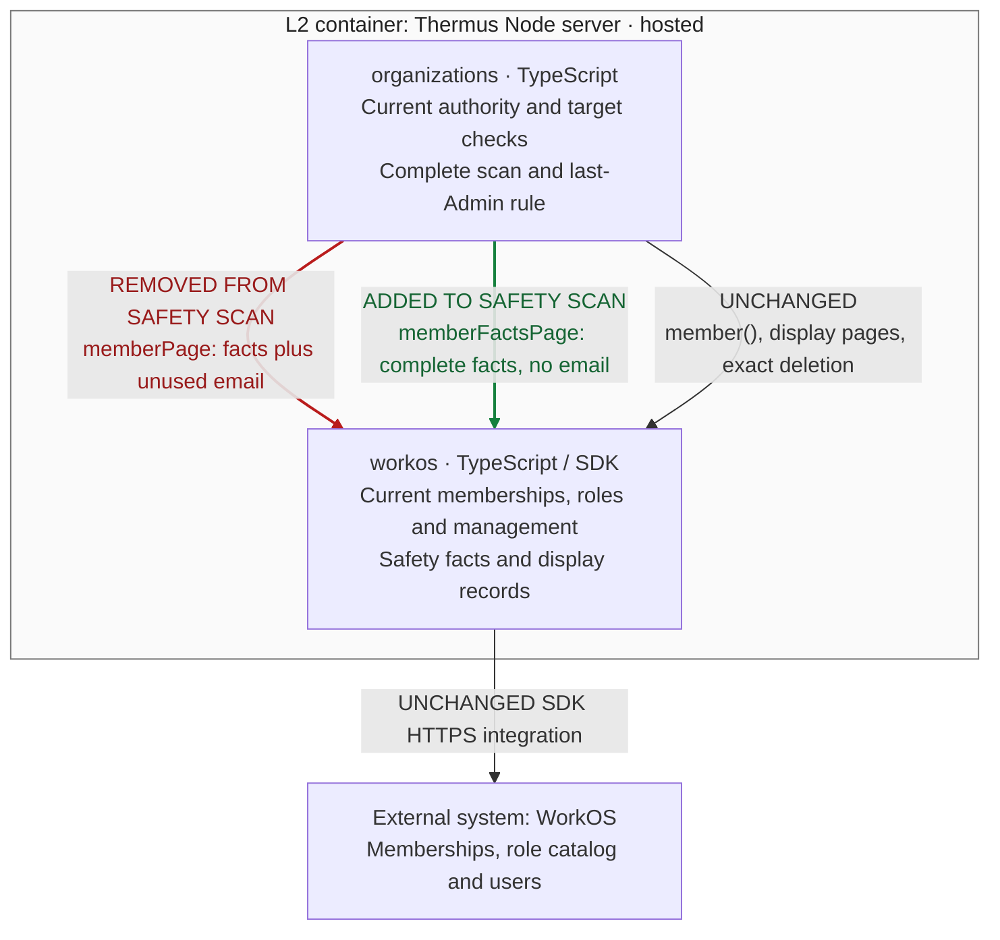

## Description

Removal loaded every member’s email while checking safety. In the 100-member regression, successful 300 ms lookups exhausted the 30-second budget and left a pending hold. The scan now reads membership facts without those email lookups; the regression completes with one direct-target lookup and an exact terminal receipt.

Stacked on [#255](https://github.com/tomer-mayara/Thermus/pull/255). The plan and implementation record now reflect the verified repair.

## Review

**T2 Need architect**
Architecture: T2: declarations changed in 1 public module.
Other reasons: declared `internalInterface` and `sensitiveBehavior`.

**Architecture facts** (current candidate against actual parent):

- `architecture.declarations_changed`: `src/accounts/organizations/organization-directory.ts (+5 -2 lines)`.

<details><summary>Declaration diff</summary>

```diff
diff --git a/docs/api-surface/src/accounts/organizations/organization-directory.d.ts b/docs/api-surface/src/accounts/organizations/organization-directory.d.ts
index 614af3d0..2e722e72 100644
--- a/docs/api-surface/src/accounts/organizations/organization-directory.d.ts
+++ b/docs/api-surface/src/accounts/organizations/organization-directory.d.ts
@@ -7,16 +7,18 @@ export interface OrganizationMembership {
 }
 export type MembershipStatus = 'active' | 'inactive' | 'pending';
 export type MembershipManagement = 'ordinary' | 'external' | 'unknown';
-export interface OrganizationMember {
+export interface OrganizationMemberFacts {
     readonly membershipId: string;
     readonly subject: string;
     readonly organizationId: string;
-    readonly email: string;
     readonly status: MembershipStatus;
     readonly management: MembershipManagement;
     readonly grants: readonly RoleGrant[];
     readonly revision: string;
 }
+export interface OrganizationMember extends OrganizationMemberFacts {
+    readonly email: string;
+}
 export type InvitationState = 'pending' | 'accepted' | 'revoked' | 'expired';
 export interface OrganizationInvitation {
     readonly invitationId: string;
@@ -60,6 +62,7 @@ export interface MembershipDeletionResult {
 export interface OrganizationDirectory {
     membershipsOf(user: AuthenticatedUser, signal?: AbortSignal): Promise<readonly OrganizationMembership[]>;
     memberPage(request: MemberPageRequest): Promise<Page<OrganizationMember>>;
+    memberFactsPage(request: MemberPageRequest): Promise<Page<OrganizationMemberFacts>>;
     member(membershipId: string, signal?: AbortSignal): Promise<OrganizationMember | undefined>;
     deleteMembership(membershipId: string): Promise<MembershipDeletionResult>;
     invitationPage(request: InvitationPageRequest): Promise<Page<OrganizationInvitation>>;
```

</details>

The committed `.pr-impact.json` declares a changed interface between existing Organizations and WorkOS components and sensitive removal preflight work. Other flags are false. Registry prose changed; its 15 diagrams, component/dependency sets, deployment and schema remain unchanged.

Local checks are complete; the checker reports no local blockers. **Overall merge is blocked** pending independent authorized human architect approval of this candidate and parent-stack integration. The separate [release/owner gates](https://github.com/tomer-mayara/Thermus/blob/076e661d830b969bf233522e1163c22cd1934361/docs/implementation/admin-s2-5-02.md#ordered-release-sequence) remain open; removal is not released. [Validation](https://github.com/tomer-mayara/Thermus/pull/257#issuecomment-6403840671) and [Quality review](https://github.com/tomer-mayara/Thermus/pull/257#issuecomment-6403840871) retain exact evidence and limits.

### Architecture comparison

Architecture comparison — actual parent PR #255 at `0530dd634fe8302b55d4a0669463ef733199cc40`; candidate `076e661d830b969bf233522e1163c22cd1934361`. Supplementary L3 view derived from registry prose and source; scope: hosted Node server.



- Before: removal paged display records and paid one sequential email read per member. After: it pages all safety facts without user reads; membership/role-catalog scope and failure checks remain.
- Direct `member()` still enriches one target; Members display/seat reads keep email. Direct/page agreement still compares every safety field and normalizes grant/permission order.
- Organizations still owns current actor, last-Admin and exact-target checks, ordered complete pages, latest duplicate handling, repeated-cursor failure and the ten-page limit (100 records per WorkOS page). A failed/incomplete scan stops before exact-ID deletion.
- Durable admission, exact operation receipts, unknown holds, no replay, the 30-second monotonic lifetime, five-second SDK timeout/no retry and existing SQL bounds remain. The 100-member/300-ms regression establishes removal of avoidable enrichment; it is not a 1,000-member throughput guarantee. No deployment/container change. Composition, SQL work and retained remote reads are condensed.

Pinned evidence: [before checks](https://github.com/tomer-mayara/Thermus/blob/0530dd634fe8302b55d4a0669463ef733199cc40/src/accounts/organizations/membership-removal-checks.ts#L1-L55), [after checks](https://github.com/tomer-mayara/Thermus/blob/076e661d830b969bf233522e1163c22cd1934361/src/accounts/organizations/membership-removal-checks.ts#L1-L55), [before adapter](https://github.com/tomer-mayara/Thermus/blob/0530dd634fe8302b55d4a0669463ef733199cc40/src/accounts/providers/workos/workos-organizations.ts#L148-L164), [after adapter](https://github.com/tomer-mayara/Thermus/blob/076e661d830b969bf233522e1163c22cd1934361/src/accounts/providers/workos/workos-organizations.ts#L149-L174). Registry drawings are unchanged; [before registry](https://github.com/tomer-mayara/Thermus/blob/0530dd634fe8302b55d4a0669463ef733199cc40/architecture/components.md) and [after registry](https://github.com/tomer-mayara/Thermus/blob/076e661d830b969bf233522e1163c22cd1934361/architecture/components.md).

---
Candidate: [076e661d](https://github.com/tomer-mayara/Thermus/commit/076e661d830b969bf233522e1163c22cd1934361) · [Validation](https://github.com/tomer-mayara/Thermus/pull/257#issuecomment-6403840671) · [Quality review](https://github.com/tomer-mayara/Thermus/pull/257#issuecomment-6403840871)
