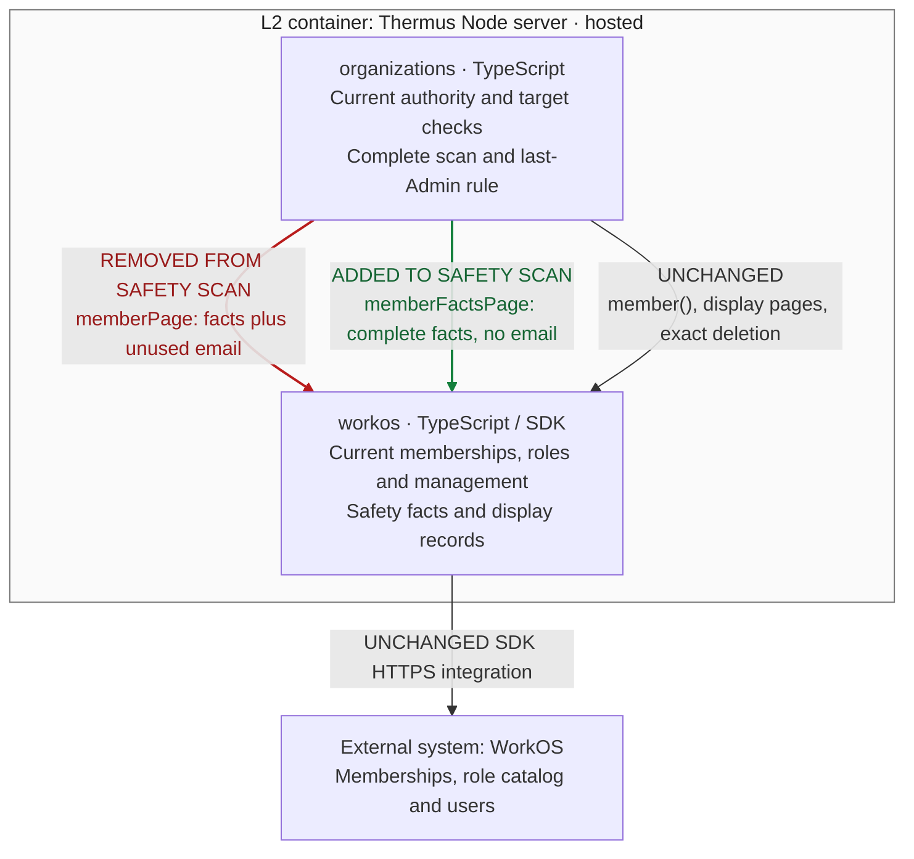

Architecture comparison — actual parent PR #255 at `0530dd634fe8302b55d4a0669463ef733199cc40`; candidate `076e661d830b969bf233522e1163c22cd1934361`. Supplementary L3 view derived from registry prose and source; scope: hosted Node server.

- Before: removal paged display records and paid one sequential email read per member. After: it pages all safety facts without user reads; membership/role-catalog scope and failure checks remain.
- Direct `member()` still enriches one target; Members display/seat reads keep email. Direct/page agreement still compares every safety field and normalizes grant/permission order.
- Organizations still owns current actor, last-Admin and exact-target checks, ordered complete pages, latest duplicate handling, repeated-cursor failure and the ten-page limit (100 records per WorkOS page). A failed/incomplete scan stops before exact-ID deletion.
- Durable admission, exact operation receipts, unknown holds, no replay, the 30-second monotonic lifetime, five-second SDK timeout/no retry and existing SQL bounds remain. The 100-member/300-ms regression establishes removal of avoidable enrichment; it is not a 1,000-member throughput guarantee. No deployment/container change. Composition, SQL work and retained remote reads are condensed.

Pinned evidence: [before checks](https://github.com/tomer-mayara/Thermus/blob/0530dd634fe8302b55d4a0669463ef733199cc40/src/accounts/organizations/membership-removal-checks.ts#L1-L55), [after checks](https://github.com/tomer-mayara/Thermus/blob/076e661d830b969bf233522e1163c22cd1934361/src/accounts/organizations/membership-removal-checks.ts#L1-L55), [before adapter](https://github.com/tomer-mayara/Thermus/blob/0530dd634fe8302b55d4a0669463ef733199cc40/src/accounts/providers/workos/workos-organizations.ts#L148-L164), [after adapter](https://github.com/tomer-mayara/Thermus/blob/076e661d830b969bf233522e1163c22cd1934361/src/accounts/providers/workos/workos-organizations.ts#L149-L174). Registry drawings are unchanged; [before registry](https://github.com/tomer-mayara/Thermus/blob/0530dd634fe8302b55d4a0669463ef733199cc40/architecture/components.md) and [after registry](https://github.com/tomer-mayara/Thermus/blob/076e661d830b969bf233522e1163c22cd1934361/architecture/components.md).
