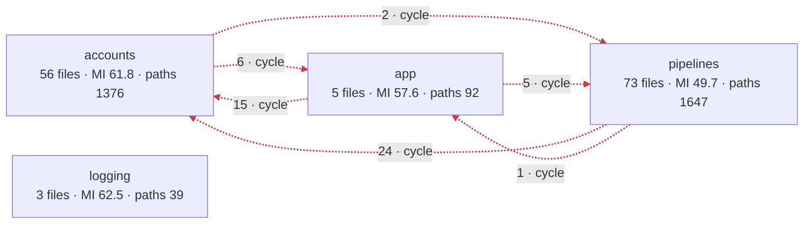
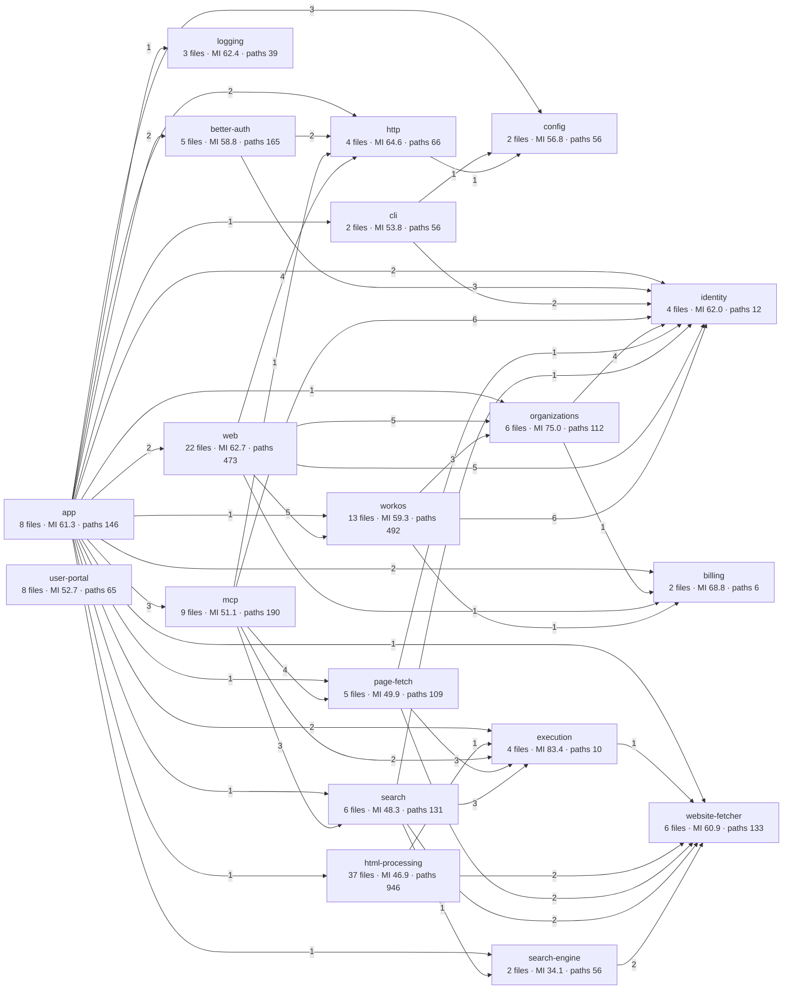
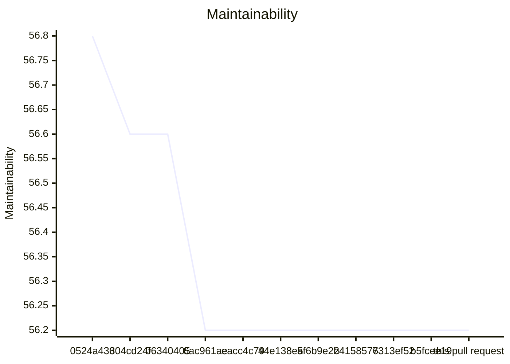
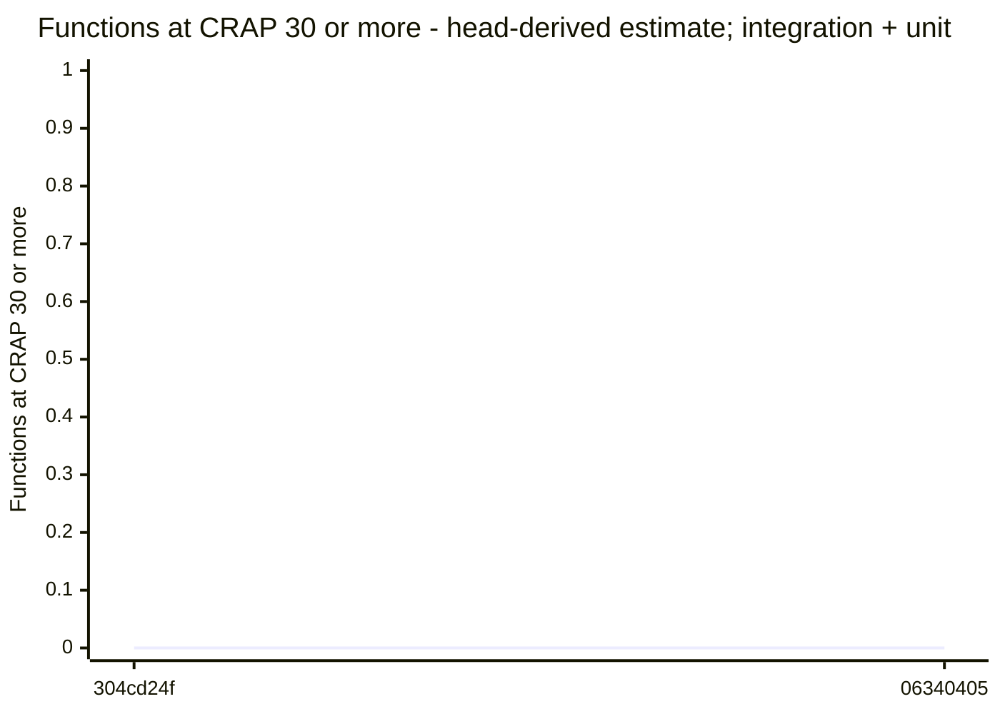

Keep `test/` focused on components under `src/`, whether a test calls them directly or reaches them through HTTP, MCP, a browser, a CLI, or a container.

- Remove 218 ordinary test files and 8 live test files whose subjects are repository tools, test helpers, documentation, synthetic lint rules, packaging, or external libraries alone.
- Remove 69 support, fixture, and case-module files that only served those tests. Remove out-of-scope cases from mixed files while retaining their component scenarios.
- Remove commands for deleted tests and update active test inventories and instructions. Keep historical records intact.

The CLI failure acceptance test stays because it checks the real fetch/MCP service, safe errors, and completion records. The hosted, renderer, and container scenarios that check production behavior stay. No file under `src/` changes.

## Architecture impact

Checked the registry's context, source-owner mapping, server/CLI/portal collaboration, runtime scenarios, and deployment views against the complete cleanup. The source components, public contracts, runtime ownership, Docker images, and deployment configuration do not change. The retained tests still exercise those components. No registry or Mermaid change is needed. This is a deliberate reduction in tests of repository tools, infrastructure, and dependencies themselves.

## Validation

The selected ordinary groups are unit, integration, acceptance, and interface. Shared process paths and changed dedicated gates also select renderer, live search, hosted live, and container checks. Commands run sequentially to preserve fixed-port and process isolation. The manual work-slice browser walks are not automated; their offline component acceptance tests run in the selected acceptance group.


## Validation evidence

Node 24.20.0; pnpm 12.10.1. Tests ran sequentially. The live hosted gate used the Optional MFA staging profile. No file under `src/` changed.

| Command | Result | Test cases |
| --- | --- | --- |
| `npm run test:unit` | Passed | 2726 |
| `npm run test:integration` | Passed | 950 |
| `npm run test:acceptance` | Passed | 459 |
| `npm run test:interface` | Passed | 63 |
| `npm run test:mcp:renderer` | Passed | 13 |
| `npm run test:mcp:search:live` | Passed | 1 |
| `npm run typecheck` | Passed | — |
| `npm run test:hosted-live` | Passed | 35 |
| `npm run test:container` | Passed | 11 |
| `npm run test:container:hosted` | Passed | 7 |

The four ordinary groups passed 4,198 tests in total. The focused modified cases and retained CLI failure acceptance cases passed 19 tests before the full group runs; the hosted-config case also passed after unused-import cleanup. The hosted command built the portal successfully.

The selection covers unit, integration, acceptance, and interface groups, plus the real consumers of the shared process-path helper: renderer, live search, hosted live, and both container gates. The nested hosted build stays within this selected union. Manual work-slice browser walks were not run; their offline component acceptance cases passed with the acceptance group.

Two stale comments in the hosted-server case module were corrected while the live gate ran. This changed no executable statement. Later container builds used the final file.

`git diff --check`, the changed Markdown link checks, and JSON/YAML parsing passed. No new test was added for this removal-only change. The retained tests supply the regression checks.


## Review route

Route: `CLARIFICATION_NEEDED`
Candidate: aac2214d2ecec766132a900d005b39b9f4f8028c
Merge base: b5fcee19e5880d086b11bf9d716c4f87891b46fd

Reasons:
- CLARIFICATION_NEEDED protected_paths.policy: .habit-hooks/eslint.config.mjs
- CLARIFICATION_NEEDED protected_paths.policy: AGENTS.md
- CLARIFICATION_NEEDED protected_paths.policy: docs/implementation/pr-review-rules.yaml
- CLARIFICATION_NEEDED protected_paths.policy: script/pr-review/README.md
- CLARIFICATION_NEEDED protected_paths.policy: test/acceptance/architecture/auth-boundaries.test.ts
- CLARIFICATION_NEEDED protected_paths.policy: test/acceptance/architecture/component-context-boundaries.test.ts
- CLARIFICATION_NEEDED protected_paths.policy: test/acceptance/architecture/fixtures/import-guards.ts
- CLARIFICATION_NEEDED protected_paths.policy: test/acceptance/architecture/page-fetch-boundaries.test.ts
- CLARIFICATION_NEEDED protected_paths.policy: test/acceptance/architecture/search-pipeline-boundaries.test.ts
- CLARIFICATION_NEEDED protected_paths.policy: test/acceptance/architecture/test-support-boundaries.test.ts
- CLARIFICATION_NEEDED protected_paths.policy: test/acceptance/architecture/test-type-boundaries.test.ts
- CLARIFICATION_NEEDED protected_paths.dependencies_and_build: package.json
- CLARIFICATION_NEEDED protected_paths.dependencies_and_build: tsconfig.build.json
- ARCHITECT_REVIEW_NEEDED read_paths: docs/implementation/ast-metrics-review.md
- ARCHITECT_REVIEW_NEEDED read_paths: docs/implementation/test-gate-policy.md
- ARCHITECT_REVIEW_NEEDED size.total_lines_read_above: 27443 lines without generated files, above the limit of 1500
- ARCHITECT_REVIEW_NEEDED size.test_counts: test/acceptance/architecture/auth-boundaries.test.ts: it(`when ${filePath} names a provider, then every literal import and re-export is refused`, async () => {
- ARCHITECT_REVIEW_NEEDED size.test_counts: test/acceptance/architecture/auth-boundaries.test.ts: it(`when ${filePath} names a transport implementation, then the dependency is refused`, async () => {
- ARCHITECT_REVIEW_NEEDED size.test_counts: test/acceptance/architecture/auth-boundaries.test.ts: it(`when ${filePath} names a provider, then the neutral local role stays independent`, async () => {
- ARCHITECT_REVIEW_NEEDED size.test_counts: test/acceptance/architecture/auth-boundaries.test.ts: it(`when ${filePath} names an auth implementation, then the consumer is refused`, async () => {
- ARCHITECT_REVIEW_NEEDED size.test_counts: test/acceptance/architecture/auth-boundaries.test.ts: it('when neutral local files name public contracts, then the collaboration is allowed', async () => {
- ARCHITECT_REVIEW_NEEDED size.test_counts: test/acceptance/architecture/auth-boundaries.test.ts: it('when external consumers name auth roles, use cases, headers, or their own modules, then imports are allowed', async () => {
- ARCHITECT_REVIEW_NEEDED size.test_counts: test/acceptance/architecture/auth-boundaries.test.ts: it('when providers and their browser adapters name their own implementation, then imports are allowed', async () => {
- ARCHITECT_REVIEW_NEEDED size.test_counts: test/acceptance/architecture/auth-boundaries.test.ts: it('when composition roots select concrete implementations, then static and lazy imports are allowed', async () => {
- ARCHITECT_REVIEW_NEEDED size.test_counts: test/acceptance/architecture/auth-boundaries.test.ts: it('when names only resemble implementation paths, then the exact scopes and path segments do not refuse them', async () => {
- ARCHITECT_REVIEW_NEEDED size.test_counts: test/acceptance/architecture/auth-boundaries.test.ts: it('when a dynamic import is computed, then it is outside the literal guard scope', async () => {
- ARCHITECT_REVIEW_NEEDED size.test_counts: test/acceptance/architecture/component-context-boundaries.test.ts: it('when its WorkOS adapter imports named whole-statement role types and approved helpers, then access is allowed', async () => {
- ARCHITECT_REVIEW_NEEDED size.test_counts: test/acceptance/architecture/component-context-boundaries.test.ts: it(`when a browser adapter broadens provider access with ${source}, then access is refused`, async () => {
- ARCHITECT_REVIEW_NEEDED size.test_counts: test/acceptance/architecture/component-context-boundaries.test.ts: it('when account code imports even an approved provider helper or role, then access is refused', async () => {
- ARCHITECT_REVIEW_NEEDED size.test_counts: test/acceptance/architecture/component-context-boundaries.test.ts: it('when composition selects provider implementations, then construction remains allowed', async () => {
- ARCHITECT_REVIEW_NEEDED size.test_counts: test/acceptance/architecture/component-context-boundaries.test.ts: it(`when browser runtime names ${source}, then the dependency is refused`, async () => {
- ARCHITECT_REVIEW_NEEDED size.test_counts: test/acceptance/architecture/component-context-boundaries.test.ts: it('when Vite tooling imports declared Node and build dependencies, then it stays allowed', async () => {
- ARCHITECT_REVIEW_NEEDED size.test_counts: test/acceptance/architecture/component-context-boundaries.test.ts: it(`when ${filePath} names ${source}, then the import is refused`, async () => {
- ARCHITECT_REVIEW_NEEDED size.test_counts: test/acceptance/architecture/component-context-boundaries.test.ts: it('when pipelines use their public contracts and composition selects concrete collaborators, then access remains allowed', async () => {
- ARCHITECT_REVIEW_NEEDED size.test_counts: test/acceptance/architecture/component-context-boundaries.test.ts: it('when the root Vite config names a server provider, then the shared component policy still refuses it', async () => {
- ARCHITECT_REVIEW_NEEDED size.test_counts: test/acceptance/architecture/component-context-boundaries.test.ts: it('when a component computes an import target, then the uninspectable dependency is refused', async () => {
- ARCHITECT_REVIEW_NEEDED size.test_counts: test/acceptance/architecture/component-context-boundaries.test.ts: it('when a private WorkOS subfolder repeats a public basename, then the helper and role stay private', async () => {
- ARCHITECT_REVIEW_NEEDED size.test_counts: test/acceptance/architecture/component-context-boundaries.test.ts: it('when browser code repeats the Vite config basename in a nested folder, then Node dependencies stay refused', async () => {
- ARCHITECT_REVIEW_NEEDED size.test_counts: test/acceptance/architecture/page-fetch-boundaries.test.ts: it(`when ${filePath} names transport or composition, then every literal import and re-export is refused`, async () => {
- ARCHITECT_REVIEW_NEEDED size.test_counts: test/acceptance/architecture/page-fetch-boundaries.test.ts: it(`when ${filePath} names an implementation, then type imports cannot hide that dependency`, async () => {
- ARCHITECT_REVIEW_NEEDED size.test_counts: test/acceptance/architecture/page-fetch-boundaries.test.ts: it(`when ${filePath} names public contracts or its own modules, then collaboration is allowed`, async () => {
- ARCHITECT_REVIEW_NEEDED size.test_counts: test/acceptance/architecture/page-fetch-boundaries.test.ts: it('when the cleaner adapter implements the neutral role, then the inward type dependency is allowed', async () => {
- ARCHITECT_REVIEW_NEEDED size.test_counts: test/acceptance/architecture/page-fetch-boundaries.test.ts: it('when composition selects real collaborators, then it can name the core and both adapters', async () => {
- ARCHITECT_REVIEW_NEEDED size.test_counts: test/acceptance/architecture/search-pipeline-boundaries.test.ts: it(`when ${filePath} names concrete collaborators, then all literal imports and re-exports are refused`, async () => {
- ARCHITECT_REVIEW_NEEDED size.test_counts: test/acceptance/architecture/search-pipeline-boundaries.test.ts: it(`when ${filePath} names public contracts and local modules, then collaboration is allowed`, async () => {
- ARCHITECT_REVIEW_NEEDED size.test_counts: test/acceptance/architecture/test-support-boundaries.test.ts: it(`when ${filePath} names a test type folder, then every literal import and re-export is refused`, async () => {
- ARCHITECT_REVIEW_NEEDED size.test_counts: test/acceptance/architecture/test-support-boundaries.test.ts: it(`when ${filePath} names src, a package, or support code, then the import is allowed`, async () => {
- ARCHITECT_REVIEW_NEEDED size.test_counts: test/acceptance/architecture/test-support-boundaries.test.ts: it(`when ${filePath} names the DSL folder, then every literal import and re-export is refused`, async () => {
- ARCHITECT_REVIEW_NEEDED size.test_counts: test/acceptance/architecture/test-support-boundaries.test.ts: it(`when ${filePath} names a test type folder, then rule D1 still refuses the import`, async () => {
- ARCHITECT_REVIEW_NEEDED size.test_counts: test/acceptance/architecture/test-support-boundaries.test.ts: it(`when ${filePath} names src, a package, or other support code, then the import is allowed`, async () => {
- ARCHITECT_REVIEW_NEEDED size.test_counts: test/acceptance/architecture/test-support-boundaries.test.ts: it(`when ${filePath} names the DSL or drivers folder, then every literal import and re-export is refused`, async () => {
- ARCHITECT_REVIEW_NEEDED size.test_counts: test/acceptance/architecture/test-support-boundaries.test.ts: it(`when ${filePath} names a test type folder, then rule D1 still refuses the import`, async () => {
- ARCHITECT_REVIEW_NEEDED size.test_counts: test/acceptance/architecture/test-support-boundaries.test.ts: it(`when ${filePath} names src, a package, or other support code, then the import is allowed`, async () => {
- ARCHITECT_REVIEW_NEEDED size.test_counts: test/acceptance/architecture/test-support-boundaries.test.ts: it('when a site sends a script into a container, then rule D6 covers that script', async () => {
- ARCHITECT_REVIEW_NEEDED size.test_counts: test/acceptance/architecture/test-support-boundaries.test.ts: it(`when ${filePath} names a module that is not a node: module, then the import is refused`, async () => {
- ARCHITECT_REVIEW_NEEDED size.test_counts: test/acceptance/architecture/test-support-boundaries.test.ts: it('when a container script names node: modules, then the imports are allowed', async () => {
- ARCHITECT_REVIEW_NEEDED size.test_counts: test/acceptance/architecture/test-support-boundaries.test.ts: it('when the identity preload of the hosted image names src, then rule D1 allows the import, because the preload runs in the server process and rule D6 does not cover it', async () => {
- ARCHITECT_REVIEW_NEEDED size.test_counts: test/acceptance/architecture/test-support-boundaries.test.ts: it(`when a test file lives at ${filePath}, then the whole file is refused`, async () => {
- ARCHITECT_REVIEW_NEEDED size.test_counts: test/acceptance/architecture/test-support-boundaries.test.ts: it('when a test of support code lives in test/unit/test-support/, then the file is allowed', async () => {
- ARCHITECT_REVIEW_NEEDED size.test_counts: test/acceptance/architecture/test-support-boundaries.test.ts: it('when a dynamic import is computed, then it is outside the literal guard scope', async () => {
- ARCHITECT_REVIEW_NEEDED size.test_counts: test/acceptance/architecture/test-type-boundaries.test.ts: it(`when ${filePath} names another test type, then every literal import and re-export is refused`, async () => {
- ARCHITECT_REVIEW_NEEDED size.test_counts: test/acceptance/architecture/test-type-boundaries.test.ts: it(`when ${filePath} names support code, its own fixtures, its own type, src, or a package, then the import is allowed`, async () => {
- ARCHITECT_REVIEW_NEEDED size.test_counts: test/acceptance/architecture/test-type-boundaries.test.ts: it('when names only resemble a test type folder, then the exact path segments do not refuse them', async () => {
- ARCHITECT_REVIEW_NEEDED size.test_counts: test/acceptance/architecture/test-type-boundaries.test.ts: it('when the unit test of the work-slice fetch lines names a work-slice entry point, then the import is refused', async () => {
- ARCHITECT_REVIEW_NEEDED size.test_counts: test/acceptance/architecture/test-type-boundaries.test.ts: it(`when ${filePath} names the fixtures of another unit package, then the import is refused`, async () => {
- ARCHITECT_REVIEW_NEEDED size.test_counts: test/acceptance/architecture/test-type-boundaries.test.ts: it(`when ${filePath} names its own fixtures or shared support, then the import is allowed`, async () => {
- ARCHITECT_REVIEW_NEEDED size.test_counts: test/acceptance/architecture/test-type-boundaries.test.ts: it('when a nested folder of a package names fixtures, then only the fixtures of its own package are allowed', async () => {
- ARCHITECT_REVIEW_NEEDED size.test_counts: test/acceptance/auth/authkit-branding.test.ts: test('Given the approved design, when the hosted panel is prepared, then it has the exact copy and four directed flows', () => {
- ARCHITECT_REVIEW_NEEDED size.test_counts: test/acceptance/auth/authkit-branding.test.ts: test('Given WorkOS embeds element styles literally, when a style is prepared, then it uses a complete CSS rule', () => {
- ARCHITECT_REVIEW_NEEDED size.test_counts: test/acceptance/auth/authkit-branding.test.ts: test('Given a branding update, when its fields are prepared, then authentication and redirect settings are absent', () => {
- ARCHITECT_REVIEW_NEEDED size.test_counts: test/acceptance/auth/hosted-image.test.ts: await t.test('Given the final image, when its metadata and files are inspected, then it contains the checked portal, native cleaner, renderer, certificates and production dependencies, runs as non-root, and contains no development tools or test output', async () => {
- ARCHITECT_REVIEW_NEEDED size.test_counts: test/acceptance/auth/hosted-image.test.ts: assert.deepEqual(Object.keys(environment).filter((name) => /WORKOS|AXIOM|PUBLIC_BASE_URL/.test(name)), []);
- ARCHITECT_REVIEW_NEEDED size.test_counts: test/acceptance/auth/hosted-image.test.ts: await t.test('Given a copied clean context with a failing offline unit check, when the final image target builds, then that check fails and no runtime image is created', { timeout: 1_200_000 }, (step) => gate.assertFailedCheckStopsImage(step.signal));
- ARCHITECT_REVIEW_NEEDED size.test_counts: test/acceptance/auth/hosted-live-setup.test.ts: const glob = /node --test(?: --test-concurrency=1)? "(dist\/test\/[^"]+)"/.exec(scripts[name] ?? '')?.[1];
- ARCHITECT_REVIEW_NEEDED size.test_counts: test/acceptance/auth/hosted-live-setup.test.ts: test('Given no WorkOS settings, when the hosted live gate runs, then it exits 1 with one failed test and no skipped or todo test, its setup error names WORKOS_API_KEY, WORKOS_CLIENT_ID, and WORKOS_AUTHKIT_ISSUER as missing, and it attempts no outbound network access', caseOptions, async (t) => {
- ARCHITECT_REVIEW_NEEDED size.test_counts: test/acceptance/auth/hosted-live-setup.test.ts: test('Given a production API key with the other settings, when the hosted live gate runs, then its setup error refuses the key and requires a staging key, and the output never shows the key or another setting value', caseOptions, async (t) => {
- ARCHITECT_REVIEW_NEEDED size.test_counts: test/acceptance/auth/hosted-live-setup.test.ts: test(`Given an empty ${name} with the other settings, when the hosted live gate runs, then the empty value counts as missing`, caseOptions, async (t) => {
- ARCHITECT_REVIEW_NEEDED size.test_counts: test/acceptance/auth/hosted-live-setup.test.ts: test('Given an AuthKit issuer that is not an absolute https URL without spaces, a username, a password, a query, or a fragment, when the hosted live gate runs, then its setup error refuses the issuer and shows no value', caseOptions, async (t) => {
- ARCHITECT_REVIEW_NEEDED size.test_counts: test/acceptance/auth/hosted-live-setup.test.ts: test('Given staging settings and outbound access denied, when the global MFA preflight reaches the network blocker, then the gate exits 1 with all 79 planned proofs cancelled, no pass, skip, or todo, and a visible preflight failure before browser or provider work; the API key stays private', caseOptions, async (t) => {
- ARCHITECT_REVIEW_NEEDED size.test_counts: test/acceptance/auth/hosted-live-setup.test.ts: test('Given the package scripts, when the suite commands select compiled tests, then only test:hosted-live runs the hosted live file, and the acceptance suite runs this setup specification', () => {
- ARCHITECT_REVIEW_NEEDED size.test_counts: test/acceptance/auth/hosted-live/administration-proofs.ts: test('Given a membership with User in D, when WorkOS assigns Admin on the organization resource and then assigns Admin again, then the first assignment adds only Admin and changes the update time, and the repeated one gives the same role assignment and changes neither the roles nor the update time', proofOptions, async (t) => {
- ARCHITECT_REVIEW_NEEDED size.test_counts: test/acceptance/auth/hosted-live/administration-proofs.ts: test('Given a membership with User in D, when two single-role writes assign Admin and Super Admin at the same time, then both roles stay, and User stays', proofOptions, async (t) => {
- ARCHITECT_REVIEW_NEEDED size.test_counts: test/acceptance/auth/hosted-live/administration-proofs.ts: test('Given a membership with User in D, when WorkOS removes Admin, which the membership does not have, then the removal succeeds and changes neither the roles nor the update time', proofOptions, async () => {
- ARCHITECT_REVIEW_NEEDED size.test_counts: test/acceptance/auth/hosted-live/administration-proofs.ts: test('Given a membership with User in D, when a single-role write names the organization resource of B, then WorkOS refuses it with 404 entity_not_found and changes neither the roles nor the update time', proofOptions, async (t) => {
- ARCHITECT_REVIEW_NEEDED size.test_counts: test/acceptance/auth/hosted-live/browser-sign-in.ts: test(requiredMfa
- ARCHITECT_REVIEW_NEEDED size.test_counts: test/acceptance/auth/hosted-live/browser-sign-in.ts: test('Given the code of that sign-in, when the server exchanges it with PKCE and seals the session, then the access token is an RS256 browser token of the environment client with a session_ sid, no aud, no org_id, and a 300-second lifetime that verifies with the browser-session key set, and the sealed session is shorter than 3,800 characters', signInOptions, async (t) => {
- ARCHITECT_REVIEW_NEEDED size.test_counts: test/acceptance/auth/hosted-live/browser-sign-in.ts: test(requiredMfa
- ARCHITECT_REVIEW_NEEDED size.test_counts: test/acceptance/auth/hosted-live/browser-sign-in.ts: test('Given a user with User and Admin in organization A and User in organization B, when the user signs in and chooses A, then AuthKit asks for the organization, and the access token has org_id A, the roles admin and user, and the permissions product:access and user-grants:manage', signInOptions, async (t) => {
- ARCHITECT_REVIEW_NEEDED size.test_counts: test/acceptance/auth/hosted-live/browser-sign-in.ts: test('Given that session in organization A, when the server refreshes it for organization B and then for an organization without a membership, then B gives org_id B with the role user and the permission product:access in the same session, the other organization fails with organization_membership_not_found, and the session still refreshes after it', signInOptions, async (t) => {
- ARCHITECT_REVIEW_NEEDED size.test_counts: test/acceptance/auth/hosted-live/configuration.ts: test('Given the staging environment, when its redirect URIs are read, then exactly https://localhost:46443/callback is saved, and it is the default', readOptions, async (t) => {
- ARCHITECT_REVIEW_NEEDED size.test_counts: test/acceptance/auth/hosted-live/configuration.ts: test('Given the staging environment, when its CORS origins are read, then none is saved', readOptions, async (t) => {
- ARCHITECT_REVIEW_NEEDED size.test_counts: test/acceptance/auth/hosted-live/configuration.ts: test('Given the staging environment, when its MCP resource indicators are read, then https://localhost:46443/mcp is saved', readOptions, async (t) => {
- ARCHITECT_REVIEW_NEEDED size.test_counts: test/acceptance/auth/hosted-live/configuration.ts: test('Given the hosted role mapping, when the environment roles are read, then user, admin, super-admin, and member have exactly their mapped permissions, and no other role has an application permission', readOptions, async (t) => {
- ARCHITECT_REVIEW_NEEDED size.test_counts: test/acceptance/auth/hosted-live/configuration.ts: test(`Given the ${settings.mfaPolicy} profile and a member of a staging organization, when a widget token reads authentication settings, then MFA is enabled with the selected requirement, password sign-in is on, and passkey sign-in is off`, fixtureOptions, async (t) => {
- ARCHITECT_REVIEW_NEEDED size.test_counts: test/acceptance/auth/hosted-live/configuration.ts: test('Given the hosted sign-in page, when a browser opens it, then it offers email sign-in and Google as its only social provider', browserOptions, async (t) => {
- ARCHITECT_REVIEW_NEEDED size.test_counts: test/acceptance/auth/hosted-live/configuration.ts: const offered = choices.filter((name) => socialChoice.test(name));
- ARCHITECT_REVIEW_NEEDED size.test_counts: test/acceptance/auth/hosted-live/connect-authorization.ts: test(`Given a public MCP client with PKCE and a User of organization A in the ${requiredMfa ? 'Required' : 'Optional'} MFA profile, when the user authorizes the MCP resource, then AuthKit asks for the password${requiredMfa ? ', MFA' : ' without an MFA step'}, the organization, and consent before the callback with its code and request state`, authorizationOptions, async (t) => {
- ARCHITECT_REVIEW_NEEDED size.test_counts: test/acceptance/auth/hosted-live/connect-authorization.ts: test('Given that code, when the client exchanges it with its PKCE verifier and the MCP resource, then the answer has a bearer access token and a refresh token for offline_access with the requested scopes', authorizationOptions, async (t) => {
- ARCHITECT_REVIEW_NEEDED size.test_counts: test/acceptance/auth/hosted-live/connect-authorization.ts: test('Given that access token, then it is an RS256 JWT of the AuthKit issuer for the MCP resource with the user as sub, the MCP client as client_id, an app_consent_ sid, org_id A, the granted scope, and no role or permission claim, and it verifies with the AuthKit key set', authorizationOptions, async (t) => {
- ARCHITECT_REVIEW_NEEDED size.test_counts: test/acceptance/auth/hosted-live/connect-tokens.ts: test('Given a Connect grant with a refresh token, when the client refreshes it with the MCP resource, then the new access token has the same user, consent sid, organization, client, and audience, and the answer shows whether WorkOS rotated the refresh token', tokenOptions, async (t) => {
- ARCHITECT_REVIEW_NEEDED size.test_counts: test/acceptance/auth/hosted-live/connect-tokens.ts: test('Given a browser access token of the environment client, when it is checked with the checks of the MCP verifier, then it is refused, because its issuer is not the AuthKit issuer and it has no MCP audience', tokenOptions, async (t) => {
- ARCHITECT_REVIEW_NEEDED size.test_counts: test/acceptance/auth/hosted-live/connect-tokens.ts: test('Given an M2M application of Connect, when it gets a client_credentials token for the MCP resource, then the token has no sid and its sub equals its client_id, and the checks of the MCP verifier refuse it or only the sid and sub rule can refuse it', tokenOptions, async (t) => {
- ARCHITECT_REVIEW_NEEDED size.test_counts: test/acceptance/auth/hosted-live/connect-tokens.ts: test('Given a Connect grant, when the operator deletes the authorized application of the user, then the refresh token gives invalid_grant, and the issued access token still verifies until it expires', tokenOptions, async (t) => {
- ARCHITECT_REVIEW_NEEDED size.test_counts: test/acceptance/auth/hosted-live/memberships.ts: test('Given a user with User and Admin in organization A and User in organization B, when its active memberships are read, then each has its complete independent role list, and the roles of A combine product:access and user-grants:manage without a highest role', readOptions, async (t) => {
- ARCHITECT_REVIEW_NEEDED size.test_counts: test/acceptance/auth/hosted-live/memberships.ts: test('Given an Admin-only membership, when it is read, then its one role gives user-grants:manage and no product:access', readOptions, async (t) => {
- ARCHITECT_REVIEW_NEEDED size.test_counts: test/acceptance/auth/hosted-live/memberships.ts: test('Given a membership made without a role, when it is read, then it has only the default role member, and member gives no application permission', readOptions, async (t) => {
- ARCHITECT_REVIEW_NEEDED size.test_counts: test/acceptance/auth/hosted-live/memberships.ts: test('Given a deactivated membership, when the memberships of its user are read with the explicit status active, then none is listed; with the status inactive, it is listed as inactive with its roles', readOptions, async (t) => {
- ARCHITECT_REVIEW_NEEDED size.test_counts: test/acceptance/auth/hosted-live/memberships.ts: test('Given organization A with six memberships, when they are read with the explicit statuses active and inactive and a page limit of 2, then the after cursor reads each membership exactly once, and the last page has no after cursor', readOptions, async (t) => {
- ARCHITECT_REVIEW_NEEDED size.test_counts: test/acceptance/auth/hosted-live/memberships.ts: test('Given the roles of organization A, when they are read, then they are the environment roles of the hosted mapping with their exact permissions', readOptions, async (t) => {
- ARCHITECT_REVIEW_NEEDED size.test_counts: test/acceptance/auth/hosted-live/operator-setup.ts: test('Given the external ID of the operator, when the operator locates or creates the organization, then WorkOS has it once: a second create with the same external ID is refused with external_id_already_used, also with an idempotency key, and a second locate step finds it without a change', proofOptions, async (t) => {
- ARCHITECT_REVIEW_NEEDED size.test_counts: test/acceptance/auth/hosted-live/operator-setup.ts: test('Given a membership made without a role, when its role assignments are read and the operator grants Super Admin, then the default role member is a role assignment on the authorization resource of type organization with the external ID of the organization, a role assignment that names the organization ID instead is refused with 404 entity_not_found and changes nothing, and the grant adds super-admin and keeps member', proofOptions, async (t) => {
- ARCHITECT_REVIEW_NEEDED size.test_counts: test/acceptance/auth/hosted-live/operator-setup.ts: test('Given an active membership with User and Admin, when the operator grants Super Admin and a customer revokes Admin with a single-role write after the inspection of the runbook and before its write, then the grant adds only super-admin, and the Admin revocation of the customer stays', proofOptions, async (t) => {
- ARCHITECT_REVIEW_NEEDED size.test_counts: test/acceptance/auth/hosted-live/operator-setup.ts: test('Given an active membership with only Super Admin, when the operator revokes Super Admin and a customer grants User with a single-role write after the inspection of the runbook and before its write, then the revocation removes only super-admin, and the User grant of the customer stays', proofOptions, async (t) => {
- ARCHITECT_REVIEW_NEEDED size.test_counts: test/acceptance/auth/hosted-live/operator-setup.ts: test('Given a Super Admin grant whose outcome the operator does not know and a later User grant, when the operator retries, then it inspects first and writes nothing for a grant in place, and a blind create would leave both grants; after a later revocation, the inspection stops without a write, so that the removed grant stays removed', proofOptions, async (t) => {
- ARCHITECT_REVIEW_NEEDED size.test_counts: test/acceptance/auth/hosted-live/operator-setup.ts: test('Given an inactive membership, when the operator retries a Super Admin grant after an unknown outcome, then the inspection finds it with the explicit statuses and stops without a create or a reactivation, and the membership stays inactive with its roles', proofOptions, async (t) => {
- ARCHITECT_REVIEW_NEEDED size.test_counts: test/acceptance/auth/hosted-live/operator-setup.ts: test('Given the records of the operator steps of this run, when they are read, then each names the actor, the organization, the target, the action, the time, and the outcome, each grant change names the roles before and after, and no record holds a credential', proofOptions, async (t) => {
- ARCHITECT_REVIEW_NEEDED size.test_counts: test/acceptance/auth/hosted-live/session-ending.ts: test('Given a browser session, when its refresh token is used, replayed at once, and replayed after 31 seconds, then the refresh and the replay succeed, and the old token works after 31 seconds only if WorkOS did not rotate it', signInOptions, async (t) => {
- ARCHITECT_REVIEW_NEEDED size.test_counts: test/acceptance/auth/hosted-live/session-ending.ts: test('Given a browser session, when the operator revokes it, then the sealed refresh gives invalid_grant without retry, the session leaves the session list, and the issued access token still verifies until it expires', signInOptions, async (t) => {
- ARCHITECT_REVIEW_NEEDED size.test_counts: test/acceptance/auth/hosted-live/session-ending.ts: test('Given a signed-in browser session, when the browser opens the WorkOS logout URL of the session, then the session ends: it leaves the session list, and its sealed refresh gives invalid_grant', signInOptions, async (t) => {
- ARCHITECT_REVIEW_NEEDED size.test_counts: test/acceptance/auth/hosted-live/session-ending.ts: test('Given that logout, when WorkOS ends the session, then the browser lands on the default Sign-out URI https://localhost:46443/', signInOptions, async (t) => {
- ARCHITECT_REVIEW_NEEDED size.test_counts: test/acceptance/auth/hosted-live/session-ending.ts: test('Given no sign-in request, when a browser opens the AuthKit domain directly, then AuthKit sends it to the Initiate login URI https://localhost:46443/login before any sign-in page', signInOptions, async (t) => {
- ARCHITECT_REVIEW_NEEDED size.test_counts: test/acceptance/auth/hosted.live.ts: test('Given the AuthKit issuer, when its authorization-server metadata is read, then it names the exact issuer, the AuthKit key set, the authorization code grant, S256 PKCE, the client registration endpoint, and client ID metadata documents', proofOptions, async (t) => {
- ARCHITECT_REVIEW_NEEDED size.test_counts: test/acceptance/auth/hosted.live.ts: test('Given the AuthKit key set, when it is read, then it has signing keys with key IDs, and jose accepts the set', proofOptions, async (t) => {
- ARCHITECT_REVIEW_NEEDED size.test_counts: test/acceptance/auth/hosted.live.ts: test('Given the WorkOS client ID, when the browser-session key set is read, then it has signing keys with key IDs, and jose accepts the set', proofOptions, async (t) => {
- ARCHITECT_REVIEW_NEEDED size.test_counts: test/acceptance/auth/hosted.live.ts: test('Given the staging API key, when it lists organizations, then WorkOS accepts the key', proofOptions, async () => {
- ARCHITECT_REVIEW_NEEDED size.test_counts: test/acceptance/auth/self-hosted-container.test.ts: test('Given an image build with a Lightpanda asset that does not match the SHA256 digest that docs/lightpanda-runtime.md records, when the build runs, then it stops with the Lightpanda digest error and makes no image', { timeout: 600_000 }, async (t) => {
- ARCHITECT_REVIEW_NEEDED size.test_counts: test/acceptance/auth/self-hosted-container.test.ts: test('Given the image and the compose file, when they are inspected, then the image holds the compiled server and commands of this build, the shipped migrations, the pinned production packages with the native ad blocker built for its platform, and the pinned Lightpanda 1.0.0 at LIGHTPANDA_BIN, owned by root and not writable by the image user, which loads the CA certificates of the image, but no TypeScript source, test output, or development package; it runs as a non-root user with production settings, no telemetry setting except the one that turns off the renderer telemetry, its data directory on the one volume, and the path of the trusted ad rules, but no rules file; the compose service mounts only that volume and the read-only rules file of the operator, which Compose must not make, starts with an init process, and publishes its port on the loopback address', { timeout: 300_000 }, async () => {
- ARCHITECT_REVIEW_NEEDED size.test_counts: test/acceptance/auth/self-hosted-container.test.ts: assert.deepEqual(Object.keys(settings).filter((name) => /TELEMETRY|BETTER_AUTH|^AUTH_/.test(name)), ['LIGHTPANDA_DISABLE_TELEMETRY']);
- ARCHITECT_REVIEW_NEEDED size.test_counts: test/acceptance/mcp/renderer-gate-setup.test.ts: test('Given the package scripts, when the local renderer gates are selected, then renderer and hosted build commands run both fetch and search runtime files and hosted search public, capacity, and shutdown cases', () => {
- ARCHITECT_REVIEW_NEEDED size.test_counts: test/acceptance/mcp/renderer-gate-setup.test.ts: test('Given the package scripts, when the live Brave search proof is selected, then only its dedicated command builds and runs the live file', () => {
- ARCHITECT_REVIEW_NEEDED size.test_counts: test/acceptance/mcp/renderer-gate-setup.test.ts: test(`Given LIGHTPANDA_BIN is unset, relative, a missing file, or an unsupported Lightpanda version, when ${name} runs, then shared setup validation fails before network access, and no gate test passes, is skipped, or is left as todo`, { timeout: 120_000 }, (t) => {
- ARCHITECT_REVIEW_NEEDED size.test_counts: test/acceptance/script/ast-metrics-architecture-bands.test.ts: test('Given equal covered snapshots, when the command runs, then it prints the unchanged-map line, every node with its assessable band and no change arrow or touched border, and the legend', { timeout }, async (t) => {
- ARCHITECT_REVIEW_NEEDED size.test_counts: test/acceptance/script/ast-metrics-architecture-bands.test.ts: test('Given a touched community with no function at CRAP 30 or more, when the command runs with --coverage, then its node says good with 0 functions and has the touched and the good class, each other node has its band, and the summary line counts the functions at 30 or more on each side', { timeout }, async (t) => {
- ARCHITECT_REVIEW_NEEDED size.test_counts: test/acceptance/script/ast-metrics-architecture-bands.test.ts: test('Given a touched community with two functions at CRAP 30 or more in the base and none added or worse, when the command runs, then its node says warning with 2 functions, and the list of the changed files is empty', { timeout }, async (t) => {
- ARCHITECT_REVIEW_NEEDED size.test_counts: test/acceptance/script/ast-metrics-architecture-bands.test.ts: test('Given a pull request that adds a function at CRAP 30 or more to a community with two such functions, when the command runs, then its count rises but unresolved base identity prevents a false new-function claim', { timeout }, async (t) => {
- ARCHITECT_REVIEW_NEEDED size.test_counts: test/acceptance/script/ast-metrics-architecture-bands.test.ts: test('Given a pull request that raises the decision paths of a function so that its CRAP goes from below 30 to 30 or more, when the command runs, then the function is worse, its community is critical, and the list names it with its base CRAP', { timeout }, async (t) => {
- ARCHITECT_REVIEW_NEEDED size.test_counts: test/acceptance/script/ast-metrics-architecture-bands.test.ts: test('Given a changed file with an anonymous function and a function whose name the coverage report has twice, when the command runs, then each has a lower bound, the row counts 1 → 1, and the unmatched count is 2', { timeout }, async (t) => {
- ARCHITECT_REVIEW_NEEDED size.test_counts: test/acceptance/script/ast-metrics-architecture-bands.test.ts: test('Given a changed file that the coverage report does not have, when the command runs, then its functions count as uncovered with CRAP = paths² + paths, and the new declaration stays unknown while a base move candidate is unresolved', { timeout }, async (t) => {
- ARCHITECT_REVIEW_NEEDED size.test_counts: test/acceptance/script/ast-metrics-architecture-bands.test.ts: test('Given snapshot files without --coverage, when the command runs, then the line after the summary says that the bands need the coverage run, and the output has no band, no band class, no CRAP column, and no list of functions', { timeout }, async (t) => {
- ARCHITECT_REVIEW_NEEDED size.test_counts: test/acceptance/script/ast-metrics-architecture-base.test.ts: test('Given a branch whose working tree changes one src/ file and both doubles on PATH, when the command runs with --base main, then it takes the snapshot of the merge base and of the working tree, prints the graph with the community of that file touched and the complexity table with the row of that file, and no worktree stays', { timeout }, async (t) => {
- ARCHITECT_REVIEW_NEEDED size.test_counts: test/acceptance/script/ast-metrics-architecture-base.test.ts: test('Given a branch that changes one src/ file and adds one, a working tree that changes a test file, and a change of main after the fork, when the command runs with --base main, then the complexity table has a row for the changed and for the added file, from the merge base to the working tree, and none for the test file or for the file of main', { timeout }, async (t) => {
- ARCHITECT_REVIEW_NEEDED size.test_counts: test/acceptance/script/ast-metrics-architecture-base.test.ts: test('Given a repository with ast-report/coverage.json in its root and both doubles on PATH, when the command runs with --base main, then the bands come from that report: the summary line counts the functions at CRAP 30 or more, each node has its band and band class, the table has the CRAP column, and the list follows the table', { timeout }, async (t) => {
- ARCHITECT_REVIEW_NEEDED size.test_counts: test/acceptance/script/ast-metrics-architecture-base.test.ts: test('Given an analysis of the merge base that exits 2 with an error text, when the command runs with --base main, then it fails with the one diagnostic line of the snapshot, removes the temporary worktree, and prints no Markdown', { timeout }, async (t) => {
- ARCHITECT_REVIEW_NEEDED size.test_counts: test/acceptance/script/ast-metrics-architecture-base.test.ts: test('Given an unknown base ref, when the command runs, then it fails with the diagnostic of the shared repository helper and runs no ast-metrics', { timeout }, async (t) => {
- ARCHITECT_REVIEW_NEEDED size.test_counts: test/acceptance/script/ast-metrics-architecture-changes.test.ts: test('Given offline snapshots and a rename tied to both source identities, when architecture reads --changes without tools, then it compares one row at the new path', async (t) => {
- ARCHITECT_REVIEW_NEEDED size.test_counts: test/acceptance/script/ast-metrics-architecture-components.test.ts: test('Given populated folders, root files, repeated imports and an internal pair, when offline architecture runs, then its stable component graph deduplicates edges and shows only cross-folder cycles', { timeout: 20_000 }, async (t) => {
- ARCHITECT_REVIEW_NEEDED size.test_counts: test/acceptance/script/ast-metrics-architecture-components.test.ts: test('Given known cross-folder dependencies and an unresolved stylesheet import, when offline architecture runs, then it shows proven head edges and cycles without change claims', { timeout: 20_000 }, async (t) => {
- ARCHITECT_REVIEW_NEEDED size.test_counts: test/acceptance/script/ast-metrics-architecture-coverage.live.ts: test('Given the coverage report of the real unit suite and no source edits, when architecture runs with --base HEAD and each src/ file touched, then head risk counts bound base estimates, every node has an assessable band or an incomplete note, no function is added or worse, and the default report stays unchanged within 5 minutes', { timeout: 300_000, skip }, async (t) => {
- ARCHITECT_REVIEW_NEEDED size.test_counts: test/acceptance/script/ast-metrics-architecture-coverage.live.ts: const nodes = lines.filter((line) => /^ {2}c_\w+\["/.test(line));
- ARCHITECT_REVIEW_NEEDED size.test_counts: test/acceptance/script/ast-metrics-architecture-coverage.live.ts: assert.deepEqual(nodes.filter((line) => !/<br\/>(?:(?:● good|▲ warning): \d+ fn ≥ 30(?: \(\+\d+\))?(?:; assessment incomplete: \d+ unknown)?|assessment incomplete: \d+ unknown; 0 known fn ≥ 30)"\]$/.test(line)), [], result.stdout);
- ARCHITECT_REVIEW_NEEDED size.test_counts: test/acceptance/script/ast-metrics-architecture-identity.test.ts: test('Given legacy snapshots with an unrelated same-name function, when the offline report runs, then identity is unknown and the removed base has no estimated CRAP', async (t) => {
- ARCHITECT_REVIEW_NEEDED size.test_counts: test/acceptance/script/ast-metrics-architecture-identity.test.ts: test('Given a deleted base function without a head partner, when compatible coverage is supplied, then its estimated share remains unknown', async (t) => {
- ARCHITECT_REVIEW_NEEDED size.test_counts: test/acceptance/script/ast-metrics-architecture-provenance.test.ts: test(`Given version ${version} coverage with matching provenance from an older capture commit, when architecture renders offline without Git, then it names the original commit after complexity`, async (t) => {
- ARCHITECT_REVIEW_NEEDED size.test_counts: test/acceptance/script/ast-metrics-architecture-provenance.test.ts: test('Given coverage that does not match the supplied offline head, when architecture renders, then it withholds bands and gives the stale notice in stderr and after the summary', async (t) => {
- ARCHITECT_REVIEW_NEEDED size.test_counts: test/acceptance/script/ast-metrics-architecture-provenance.test.ts: test(`Given ${name}, when architecture renders offline, then structure succeeds with its distinct diagnostic`, async (t) => {
- ARCHITECT_REVIEW_NEEDED size.test_counts: test/acceptance/script/ast-metrics-architecture-provenance.test.ts: test('Given --no-coverage and an explicit coverage path, when the command parses options, then it rejects their conflict before reading files', async (t) => {
- ARCHITECT_REVIEW_NEEDED size.test_counts: test/acceptance/script/ast-metrics-architecture-provenance.test.ts: test(`Given coverage with ${name}, when architecture renders offline, then it withholds every assessment and preserves structural output`, async (t) => {
- ARCHITECT_REVIEW_NEEDED size.test_counts: test/acceptance/script/ast-metrics-architecture-provenance.test.ts: test('Given offline snapshots and no coverage file, when architecture renders, then it names missing data without asking for a broader suite', async (t) => {
- ARCHITECT_REVIEW_NEEDED size.test_counts: test/acceptance/script/ast-metrics-architecture-provenance.test.ts: test('Given explicit skip with offline snapshots, when architecture renders, then its distinct notice explains the absent bands', async (t) => {
- ARCHITECT_REVIEW_NEEDED size.test_counts: test/acceptance/script/ast-metrics-architecture-repository-changes.test.ts: test('Given a pure Git file rename and compatible head coverage, when architecture compares the working tree, then one new-path row retains equal base values and no function is falsely new', async (t) => {
- ARCHITECT_REVIEW_NEEDED size.test_counts: test/acceptance/script/ast-metrics-architecture-repository-changes.test.ts: test('Given only a deleted function file, when architecture compares the working tree, then its community is touched, its row is gone, and base coverage remains unknown', async (t) => {
- ARCHITECT_REVIEW_NEEDED size.test_counts: test/acceptance/script/ast-metrics-architecture-repository-changes.test.ts: test('Given a unique unchanged function moved to an untracked destination, when architecture compares Git deletion and addition evidence, then its covered share follows the proven function move', async (t) => {
- ARCHITECT_REVIEW_NEEDED size.test_counts: test/acceptance/script/ast-metrics-architecture-repository-provenance.test.ts: test('Given matching default coverage at an older commit and a prose-only commit, when repository architecture renders, then it keeps bands and the original capture commit', async (t) => {
- ARCHITECT_REVIEW_NEEDED size.test_counts: test/acceptance/script/ast-metrics-architecture-repository-provenance.test.ts: test('Given a malformed default coverage file, when architecture explicitly skips coverage, then it ignores that file and renders structure', async (t) => {
- ARCHITECT_REVIEW_NEEDED size.test_counts: test/acceptance/script/ast-metrics-architecture-repository-provenance.test.ts: test('Given coverage from another source tree, when repository architecture uses the default report, then it withholds assessments in Markdown and stderr', async (t) => {
- ARCHITECT_REVIEW_NEEDED size.test_counts: test/acceptance/script/ast-metrics-architecture-repository-provenance.test.ts: test('Given a repository without a coverage report, when architecture renders, then it names missing data and succeeds with structure', async (t) => {
- ARCHITECT_REVIEW_NEEDED size.test_counts: test/acceptance/script/ast-metrics-architecture-repository-provenance.test.ts: test('Given coverage matching the caller repository but not the supplied head snapshot, when offline architecture renders without Git, then only the supplied head controls compatibility', async (t) => {
- ARCHITECT_REVIEW_NEEDED size.test_counts: test/acceptance/script/ast-metrics-architecture-table.test.ts: test('Given a changed file whose maintainability fell from 72.0 to 60.0 and whose decision paths rose from 12 to 15, when the command runs, then its row shows both before and after with the arrow and the size of each change, and its rank among the ten riskiest files of the head', { timeout }, async (t) => {
- ARCHITECT_REVIEW_NEEDED size.test_counts: test/acceptance/script/ast-metrics-architecture-table.test.ts: test('Given a new file without a risk score, when the command runs, then its row says new before each value of the head and its rank cell says gone', { timeout }, async (t) => {
- ARCHITECT_REVIEW_NEEDED size.test_counts: test/acceptance/script/ast-metrics-architecture-table.test.ts: test('Given a changed file that the head does not have, when the command runs, then its row says gone after each value of the base and its rank cell says gone', { timeout }, async (t) => {
- ARCHITECT_REVIEW_NEEDED size.test_counts: test/acceptance/script/ast-metrics-architecture-table.test.ts: test('Given a changed file of types, which has no maintainability index in the head, when the command runs, then its row says not measured for the maintainability and for the decision paths', { timeout }, async (t) => {
- ARCHITECT_REVIEW_NEEDED size.test_counts: test/acceptance/script/ast-metrics-architecture-table.test.ts: test('Given changed files of each kind, when the command runs, then the table has one row for each, sorted by path', { timeout }, async (t) => {
- ARCHITECT_REVIEW_NEEDED size.test_counts: test/acceptance/script/ast-metrics-architecture-table.test.ts: test('Given changed files of which none is under src/, when the command runs, then the complexity section after the architecture delta says that no production file changed, and has no table', { timeout }, async (t) => {
- ARCHITECT_REVIEW_NEEDED size.test_counts: test/acceptance/script/ast-metrics-architecture-test-changes.test.ts: test(`Given changes to ${name}, when architecture compares the repository, then the complexity section explains the available test comparison`, { timeout: 20_000 }, async (t) => {
- ARCHITECT_REVIEW_NEEDED size.test_counts: test/acceptance/script/ast-metrics-architecture-test-changes.test.ts: test('Given offline snapshots and a declared fixture change, when architecture runs without tools, then it prints the head-coverage warning below complexity', async (t) => {
- ARCHITECT_REVIEW_NEEDED size.test_counts: test/acceptance/script/ast-metrics-architecture-test-changes.test.ts: test('Given offline snapshots without declared changes, when architecture runs in a checkout with changed tests, then it makes no test-change claim', async (t) => {
- ARCHITECT_REVIEW_NEEDED size.test_counts: test/acceptance/script/ast-metrics-architecture-test-changes.test.ts: test('Given a declared fixture change and skipped coverage, when architecture runs offline, then it says no coverage comparison was made', async (t) => {
- ARCHITECT_REVIEW_NEEDED size.test_counts: test/acceptance/script/ast-metrics-architecture-test-changes.test.ts: test('Given offline source-change evidence and a touched fixture, when architecture runs without tools, then the touched override cannot claim test-only changes', async (t) => {
- ARCHITECT_REVIEW_NEEDED size.test_counts: test/acceptance/script/ast-metrics-architecture-test-changes.test.ts: test('Given offline snapshots with different source fingerprints and a touched fixture, when architecture runs without tools, then it cannot claim test-only changes', async (t) => {
- ARCHITECT_REVIEW_NEEDED size.test_counts: test/acceptance/script/ast-metrics-architecture-test-changes.test.ts: test('Given an offline base snapshot with missing provenance and a touched fixture, when architecture runs without tools, then it cannot claim test-only changes', async (t) => {
- ARCHITECT_REVIEW_NEEDED size.test_counts: test/acceptance/script/ast-metrics-architecture-trend-charts.test.ts: test('Given stored history with missing values and different count bases, when offline architecture renders it, then separate Mermaid trends preserve each gap and basis', { timeout: 20_000 }, async (t) => {
- ARCHITECT_REVIEW_NEEDED size.test_counts: test/acceptance/script/ast-metrics-architecture-trend-view.test.ts: test('Given three records with PR titles, component changes, gaps and count provenance, when offline architecture runs, then its full trend Markdown preserves the numbers and unknown history', { timeout: 20_000 }, async (t) => {
- ARCHITECT_REVIEW_NEEDED size.test_counts: test/acceptance/script/ast-metrics-architecture-trend.test.ts: for (const scenario of scenarios) test(scenario.name, { timeout }, (t) => checkTrendScenario(t, scenario));
- ARCHITECT_REVIEW_NEEDED size.test_counts: test/acceptance/script/ast-metrics-architecture-unchanged.test.ts: test('Given a branch that changes only a document, no coverage, and both doubles on PATH, when the architecture command runs, then it prints the unchanged-map line, every community and the legend without bands, and invokes no test suite', { timeout: 20_000 }, async (t) => {
- ARCHITECT_REVIEW_NEEDED size.test_counts: test/acceptance/script/ast-metrics-architecture-unmeasured.test.ts: test('Given an excluded zero-own function at 30 paths, when architecture runs, then its covered share stays unknown and its known violation is a lower bound', { timeout }, async (t) => {
- ARCHITECT_REVIEW_NEEDED size.test_counts: test/acceptance/script/ast-metrics-architecture-unmeasured.test.ts: test('Given unmatched refresh at 30 paths and an anonymous function at five paths, when architecture runs, then known risk is counted, lower bounds and unmeasured functions are shown, and assessment is incomplete', { timeout }, async (t) => {
- ARCHITECT_REVIEW_NEEDED size.test_counts: test/acceptance/script/ast-metrics-architecture.live.ts: test('Given the real ast-metrics and no source edits, when architecture runs with explicit coverage skip, then equal structure includes every community and populated source component and creates no record or worktree', { timeout: 30_000, skip }, async (t) => {
- ARCHITECT_REVIEW_NEEDED size.test_counts: test/acceptance/script/ast-metrics-architecture.test.ts: test('Given two equal snapshots, when the command runs with --head and --base-snapshot, then it prints the header, the summary line with equal sides, the unchanged-map line, every node without change arrows or touched borders, the missing-coverage reason, and the legend', { timeout }, async (t) => {
- ARCHITECT_REVIEW_NEEDED size.test_counts: test/acceptance/script/ast-metrics-architecture.test.ts: test('Given a head with a new dependency between two matched communities, when the command runs, then the graph shows it as a thick edge with its references and new, and the summary line shows the modularity and the cross share before and after', { timeout }, async (t) => {
- ARCHITECT_REVIEW_NEEDED size.test_counts: test/acceptance/script/ast-metrics-architecture.test.ts: test('Given a cycle in the head, when the command runs, then each edge of the cycle is dashed with cycle in its label and a red link style at its position, and the summary counts the cycle', { timeout }, async (t) => {
- ARCHITECT_REVIEW_NEEDED size.test_counts: test/acceptance/script/ast-metrics-architecture.test.ts: test('Given a base community whose files split into two head communities, each with an overlap below 0.5, when the command runs, then the graph names it gone with its base numbers and dashed grey edges, names the two new, and the summary counts them', { timeout }, async (t) => {
- ARCHITECT_REVIEW_NEEDED size.test_counts: test/acceptance/script/ast-metrics-architecture.test.ts: test('Given --touched with a file of one community whose maintainability fell by 2.0, when the command runs, then that node has the touched class and its label shows the arrows and the changes, an edge shows the change of its references, and the complexity table after the legend has the row of the file', { timeout }, async (t) => {
- ARCHITECT_REVIEW_NEEDED size.test_counts: test/acceptance/script/ast-metrics-architecture.test.ts: test('Given a head whose numbers and references changed but whose communities, dependencies, and cycles did not, and no touched file, when the command runs, then it prints the unchanged-map line and the graph with the numeric deltas', { timeout }, async (t) => {
- ARCHITECT_REVIEW_NEEDED size.test_counts: test/acceptance/script/ast-metrics-architecture.test.ts: test('Given a new community whose label has a double quote and a backtick, when the command runs, then its label text has a single quote in place of each, and its id has an underscore in place of each character outside a-z and 0-9', { timeout }, async (t) => {
- ARCHITECT_REVIEW_NEEDED size.test_counts: test/acceptance/script/ast-metrics-architecture.test.ts: test('Given --out with a path in a new folder, when the command runs, then the file holds the Markdown that the command prints, relative to the current folder', { timeout }, async (t) => {
- ARCHITECT_REVIEW_NEEDED size.test_counts: test/acceptance/script/ast-metrics-backfill.test.ts: test('Given main moved after a branch fork, when manual backfill selects two commits and then repeats, then it records each exact main tree once without coverage or changes to existing records', { timeout }, async (t) => {
- ARCHITECT_REVIEW_NEEDED size.test_counts: test/acceptance/script/ast-metrics-backfill.test.ts: test('Given help or an invalid count outside a repository, when manual backfill runs, then help defines the default and bad counts fail before Git or tool access', { timeout }, async (t) => {
- ARCHITECT_REVIEW_NEEDED size.test_counts: test/acceptance/script/ast-metrics-backfill.test.ts: test(`Given ${history} history, when manual backfill runs, then it explains the unavailable history before analysis and creates no records`, { timeout }, async (t) => {
- ARCHITECT_REVIEW_NEEDED size.test_counts: test/acceptance/script/ast-metrics-backfill.test.ts: test('Given an analysis failure, when backfill stops, then it removes its exact-commit worktree and writes no record for the failed commit', { timeout }, async (t) => {
- ARCHITECT_REVIEW_NEEDED size.test_counts: test/acceptance/script/ast-metrics-backfill.test.ts: test('Given failed worktree cleanup, when a backfill snapshot succeeds, then publication fails and the record stays absent', { timeout }, async (t) => {
- ARCHITECT_REVIEW_NEEDED size.test_counts: test/acceptance/script/ast-metrics-backfill.test.ts: test('Given a non-pinned tool version, when backfill is allowed explicitly, then it checks the version once and records that version', { timeout }, async (t) => {
- ARCHITECT_REVIEW_NEEDED size.test_counts: test/acceptance/script/ast-metrics-backfill.test.ts: test('Given a merge on main with a side-parent commit, when backfill selects two commits, then it records only the latest two first-parent commits', { timeout }, async (t) => {
- ARCHITECT_REVIEW_NEEDED size.test_counts: test/acceptance/script/ast-metrics-baseline.test.ts: test('Given a baseline and a caller in a subfolder, when baseline runs, then it checks the version once and reports entry counts at the root', async (t) => {
- ARCHITECT_REVIEW_NEEDED size.test_counts: test/acceptance/script/ast-metrics-baseline.test.ts: test('Given no baseline file, when baseline runs, then it reports zero before creating the tool baseline', async (t) => {
- ARCHITECT_REVIEW_NEEDED size.test_counts: test/acceptance/script/ast-metrics-baseline.test.ts: test('Given another tool version, when baseline runs, then it refuses mutation until an explicit override', async (t) => {
- ARCHITECT_REVIEW_NEEDED size.test_counts: test/acceptance/script/ast-metrics-baseline.test.ts: test('Given a failed baseline tool, when the wrapper runs, then it reports failure without a successful after count', async (t) => {
- ARCHITECT_REVIEW_NEEDED size.test_counts: test/acceptance/script/ast-metrics-baseline.test.ts: test('Given invalid existing baseline data, when baseline runs, then it rejects the file before the tool can replace it', async (t) => {
- ARCHITECT_REVIEW_NEEDED size.test_counts: test/acceptance/script/ast-metrics-baseline.test.ts: test('Given malformed tool output, when baseline finishes, then the wrapper fails without publishing success counts', async (t) => {
- ARCHITECT_REVIEW_NEEDED size.test_counts: test/acceptance/script/ast-metrics-community-evidence.test.ts: test(`Given ${given}, when the offline architecture command runs, then it reports supported community evidence`, async (t) => {
- ARCHITECT_REVIEW_NEEDED size.test_counts: test/acceptance/script/ast-metrics-coverage-crash.test.ts: "test('sealed crash', async (t) => { const child = spawn(process.execPath, ['--input-type=module', '-e', \"import { earlier, later } from './dist/src/sample.js'; earlier(); setTimeout(later, 150); process.send('ready'); setInterval(() => {}, 1000);\"], { env: { ...process.env, THERMUS_COVERAGE_CRASH: '1' }, stdio: ['ignore', 'ignore', 'inherit', 'ipc'] }); t.after(() => child.kill('SIGKILL')); await once(child, 'message'); await crashChild(child, async () => { await delay(250); assert.equal(existsSync('later-ran'), false); }); assert.equal(child.signalCode, 'SIGKILL'); });",
- ARCHITECT_REVIEW_NEEDED size.test_counts: test/acceptance/script/ast-metrics-coverage-crash.test.ts: test('Given earlier product work and a queued later call, when the child seals coverage before SIGKILL, then earlier work is covered and later work never runs', { timeout: 15_000 }, async (t) => {
- ARCHITECT_REVIEW_NEEDED size.test_counts: test/acceptance/script/ast-metrics-coverage-crash.test.ts: test(`Given a real sealed crash capture with ${corruption}, when imported, then verification refuses publication`, { timeout: 15_000 }, async (t) => {
- ARCHITECT_REVIEW_NEEDED size.test_counts: test/acceptance/script/ast-metrics-coverage-crash.test.ts: test('Given an active captured worker, when a pre-crash seal is requested, then the child refuses the seal and no verified report is written', { timeout: 15_000 }, async (t) => {
- ARCHITECT_REVIEW_NEEDED size.test_counts: test/acceptance/script/ast-metrics-coverage-crash.test.ts: `test('active worker rejects seal', async () => { const child = spawn(process.execPath, ['--input-type=module', '-e', ${JSON.stringify(workerProgram)}], { env: { ...process.env, THERMUS_COVERAGE_CRASH: '1' }, stdio: ['ignore', 'ignore', 'inherit', 'ipc'] }); await Promise.race([once(child, 'message'), once(child, 'exit').then(() => { throw Error('worker child exited before ready'); })]); await assert.rejects(crashChild(child), /workers cannot seal/); assert.equal(child.signalCode, 'SIGKILL'); });`,
- ARCHITECT_REVIEW_NEEDED size.test_counts: test/acceptance/script/ast-metrics-coverage-crash.test.ts: test(`Given ${ending} in an exit listener installed after the capture preload, when capture finishes, then later flush evidence and the observed process outcome are required`, { timeout: 15_000 }, async (t) => {
- ARCHITECT_REVIEW_NEEDED size.test_counts: test/acceptance/script/ast-metrics-coverage-crash.test.ts: 'dist/test/unit/exit.test.js': `import assert from 'node:assert/strict'; import { spawnSync } from 'node:child_process'; import { test } from 'node:test'; test('exit work', () => { const child = spawnSync(process.execPath, ['--input-type=module', '-e', ${JSON.stringify(childProgram)}]); assert.equal(child.signal, ${ending === 'late SIGKILL' ? "'SIGKILL'" : 'null'}); });`,
- ARCHITECT_REVIEW_NEEDED size.test_counts: test/acceptance/script/ast-metrics-coverage-failures.test.ts: test('Given no package suite selection, when the command runs, then collection is deferred before build', { timeout }, async (t) => {
- ARCHITECT_REVIEW_NEEDED size.test_counts: test/acceptance/script/ast-metrics-coverage-failures.test.ts: test('Given a build whose unit suite fails, when the command runs, then the test output reaches stderr, the command fails, keeps the earlier report, and removes its temporary folder', { timeout }, async (t) => {
- ARCHITECT_REVIEW_NEEDED size.test_counts: test/acceptance/script/ast-metrics-coverage-failures.test.ts: test('Given a repository without a commit, when the command runs, then it fails with a diagnostic before it reads any coverage', { timeout }, async (t) => {
- ARCHITECT_REVIEW_NEEDED size.test_counts: test/acceptance/script/ast-metrics-coverage-failures.test.ts: test('Given coverage from two builds whose whole ranges have different lengths, when the current script is shorter, then it rejects the out-of-bounds build and keeps the report', { timeout }, async (t) => {
- ARCHITECT_REVIEW_NEEDED size.test_counts: test/acceptance/script/ast-metrics-coverage-failures.test.ts: test(`Given selected unit and acceptance runs with a ${failure}, when collection runs, then no union replaces the good report`, { timeout }, async (t) => {
- ARCHITECT_REVIEW_NEEDED size.test_counts: test/acceptance/script/ast-metrics-coverage-failures.test.ts: "test('killed captured child', async () => { const child = spawn(process.execPath, ['--input-type=module', '-e', \"import './dist/src/sample.js'; process.stdout.write('ready'); setInterval(() => {}, 1000);\"], { env: process.env, stdio: ['ignore', 'pipe', 'inherit'] }); await once(child.stdout, 'data'); child.kill('SIGKILL'); await once(child, 'exit'); });",
- ARCHITECT_REVIEW_NEEDED size.test_counts: test/acceptance/script/ast-metrics-coverage-failures.test.ts: 'dist/test/unit/sample.test.js': "import { test } from 'node:test'; import { sample } from '../../src/sample.js'; test('first suite', () => sample());\n",
- ARCHITECT_REVIEW_NEEDED size.test_counts: test/acceptance/script/ast-metrics-coverage-failures.test.ts: ? "import { test } from 'node:test'; test('second suite failed', () => { throw Error('failed'); });\n"
- ARCHITECT_REVIEW_NEEDED size.test_counts: test/acceptance/script/ast-metrics-coverage-failures.test.ts: : "import { test } from 'node:test'; import { sample } from '../../../src/sample.ts'; test('source representation', () => sample());\n",
- ARCHITECT_REVIEW_NEEDED size.test_counts: test/acceptance/script/ast-metrics-coverage-loader-exit.test.ts: test('Given nested manual exit events and a late module.register exit listener, when a real tsx owner reaches normal exit, then later typed imports and synchronous loader work finish before verification', { timeout: 30_000 }, async (t) => {
- ARCHITECT_REVIEW_NEEDED size.test_counts: test/acceptance/script/ast-metrics-coverage-loader-exit.test.ts: test('Given a real worker that owns a tsx loader, when its typed entry and delayed cleanup finish, then the loader participant names its worker owner and the capture verifies', { timeout: 30_000 }, async (t) => {
- ARCHITECT_REVIEW_NEEDED size.test_counts: test/acceptance/script/ast-metrics-coverage-loader-refusal.test.ts: test(`Given verified coverage and a real tsx entry with ${behavior}, when capture cannot prove loader completion, then it fails within the deadline and preserves the known-good report`, { timeout: 30_000 }, async (t) => {
- ARCHITECT_REVIEW_NEEDED size.test_counts: test/acceptance/script/ast-metrics-coverage-loader.test.ts: test(`Given real pnpm and the ${loader}, when its typed entry emits exit and later imports shutdown work, then collection and strict import verify every loader participant and retain its provenance`, { timeout: 30_000 }, async (t) => {
- ARCHITECT_REVIEW_NEEDED size.test_counts: test/acceptance/script/ast-metrics-coverage-own.test.ts: test('Given called factories with uncalled and partly called nested functions, when coverage is read, then each share measures only its own characters', async (t) => {
- ARCHITECT_REVIEW_NEEDED size.test_counts: test/acceptance/script/ast-metrics-coverage-own.test.ts: test('Given emitted and typed portal unit tests with non-ASCII text, when coverage runs, then both suites run and typed offsets and shares match UTF-16 source text', async (t) => {
- ARCHITECT_REVIEW_NEEDED size.test_counts: test/acceptance/script/ast-metrics-coverage-own.test.ts: test(`Given ${label} raw coverage, when the command reads it, then it fails and keeps the earlier report`, async (t) => {
- ARCHITECT_REVIEW_NEEDED size.test_counts: test/acceptance/script/ast-metrics-coverage-own.test.ts: test('Given emitted and source coordinates for the same logical file, when the command reads them, then it rejects incompatible representations', async (t) => {
- ARCHITECT_REVIEW_NEEDED size.test_counts: test/acceptance/script/ast-metrics-coverage-own.test.ts: test('Given summed calls that exceed a safe integer, when the command reads them, then it fails and keeps the earlier report', async (t) => {
- ARCHITECT_REVIEW_NEEDED size.test_counts: test/acceptance/script/ast-metrics-coverage-own.test.ts: test('Given two processes with crossing function ranges, when the command reads them, then it fails with a diagnostic and keeps the earlier report', { timeout }, async (t) => {
- ARCHITECT_REVIEW_NEEDED size.test_counts: test/acceptance/script/ast-metrics-coverage-own.test.ts: test('Given emitted tests that pass and portal tests that fail, when collection runs, then it keeps the earlier report and removes the capture folder', { timeout }, async (t) => {
- ARCHITECT_REVIEW_NEEDED size.test_counts: test/acceptance/script/ast-metrics-coverage-own.test.ts: 'test/unit/user-portal/sample.test.ts': "import { test } from 'node:test'; test('portal failure', () => { throw Error('defect'); });\n",
- ARCHITECT_REVIEW_NEEDED size.test_counts: test/acceptance/script/ast-metrics-coverage-provenance.test.ts: test('Given raw data without original capture evidence, when imported, then publication fails unless inspection is explicit', async (t) => {
- ARCHITECT_REVIEW_NEEDED size.test_counts: test/acceptance/script/ast-metrics-coverage.live.ts: test('Given this repository, when the command builds and runs the unit suite, then its private report names the suite and application functions, shows portal unit calls, and preserves the default report within 5 minutes', { timeout: 300_000 }, async (t) => {
- ARCHITECT_REVIEW_NEEDED size.test_counts: test/acceptance/script/ast-metrics-coverage.test.ts: test('Given the coverage files of two processes that ran one build differently, when the command reads them with --from, then coverage.json holds the two src/ files, each call count is the sum of the two processes, and a character counts as covered when one process ran it', { timeout }, async (t) => {
- ARCHITECT_REVIEW_NEEDED size.test_counts: test/acceptance/script/ast-metrics-coverage.test.ts: test('Given a function with a nested function, when the command reads the coverage, then the outer and the inner function each have an entry with their own share', { timeout }, async (t) => {
- ARCHITECT_REVIEW_NEEDED size.test_counts: test/acceptance/script/ast-metrics-coverage.test.ts: test('Given a compiler helper with a function inside it and the script of a test file, when the command reads the coverage, then neither the helper, the function inside it, nor the test file is in coverage.json', { timeout }, async (t) => {
- ARCHITECT_REVIEW_NEEDED size.test_counts: test/acceptance/script/ast-metrics-coverage.test.ts: 'test/unit/user-portal/sample.test.ts': "import { test } from 'node:test'; test('portal part', () => {});\n",
- ARCHITECT_REVIEW_NEEDED size.test_counts: test/acceptance/script/ast-metrics-coverage.test.ts: "test('Given true, when used runs, then it gives yes', () => { assert.equal(used(true), 'yes'); });",
- ARCHITECT_REVIEW_NEEDED size.test_counts: test/acceptance/script/ast-metrics-coverage.test.ts: test('Given a build whose unit suite passes, when the command runs without --from, then it runs the suite with the test output on stderr, writes the coverage of the build of src/, and removes its temporary folder', { timeout }, async (t) => {
- ARCHITECT_REVIEW_NEEDED size.test_counts: test/acceptance/script/ast-metrics-coverage.test.ts: test('Given unit and acceptance runs where only acceptance calls unused, when both suites are selected, then their own-character coverage is a verified union in requested order', { timeout }, async (t) => {
- ARCHITECT_REVIEW_NEEDED size.test_counts: test/acceptance/script/ast-metrics-coverage.test.ts: 'dist/test/acceptance/sample.test.js': "import { test } from 'node:test'; import { unused } from '../../src/sample.js'; test('second suite', () => unused());\n",
- ARCHITECT_REVIEW_NEEDED size.test_counts: test/acceptance/script/ast-metrics-coverage.test.ts: test('Given only acceptance is selected, when its normally exiting child returns status one, then the child contributes coverage and the report names acceptance alone', { timeout }, async (t) => {
- ARCHITECT_REVIEW_NEEDED size.test_counts: test/acceptance/script/ast-metrics-coverage.test.ts: "test('normal child shutdown', () => { const child = spawnSync(process.execPath, ['--input-type=module', '-e', \"import { unused } from './dist/src/sample.js'; unused(); process.exitCode = 1;\"], { env: process.env }); assert.equal(child.status, 1); });",
- ARCHITECT_REVIEW_NEEDED size.test_counts: test/acceptance/script/ast-metrics-coverage.test.ts: test('Given an acceptance worker inherits capture settings and exits normally, when coverage is collected, then its own thread flush contributes', { timeout }, async (t) => {
- ARCHITECT_REVIEW_NEEDED size.test_counts: test/acceptance/script/ast-metrics-coverage.test.ts: 'dist/test/acceptance/worker.test.js': "import { Worker } from 'node:worker_threads'; import { once } from 'node:events'; import { test } from 'node:test'; test('worker shutdown', async () => { const worker = new Worker(new URL('../../worker.js', import.meta.url)); await once(worker, 'exit'); });\n",
- ARCHITECT_REVIEW_NEEDED size.test_counts: test/acceptance/script/ast-metrics-crap-absolute.test.ts: test('Given known coverage, when absolute CRAP goals are calculated, then 15 passes the inclusive goal and 30 fails the strict goal', async () => {
- ARCHITECT_REVIEW_NEEDED size.test_counts: test/acceptance/script/ast-metrics-crap-absolute.test.ts: test('Given no coverage share, when paths prove an absolute result, then bounds or proven zero retain that proof without invented coverage', async () => {
- ARCHITECT_REVIEW_NEEDED size.test_counts: test/acceptance/script/ast-metrics-crap-absolute.test.ts: test('Given missing coverage ranges that cross or exceed goals, when assessed, then uncertainty and proven misses remain separate', async () => {
- ARCHITECT_REVIEW_NEEDED size.test_counts: test/acceptance/script/ast-metrics-crap-absolute.test.ts: test('Given tiny positive coverage whose displayed CRAP rounds to 30, when the strict goal is assessed, then exact operands still prove a pass', async () => {
- ARCHITECT_REVIEW_NEEDED size.test_counts: test/acceptance/script/ast-metrics-crap-absolute.test.ts: test('Given almost complete coverage whose displayed CRAP rounds to 15, when the inclusive goal is assessed, then exact operands still prove a miss', async () => {
- ARCHITECT_REVIEW_NEEDED size.test_counts: test/acceptance/script/ast-metrics-crap-goals.test.ts: test(`Given a new function with ${paths} paths and share ${share}, when goals run, then the table shows ${instruction} and the required goal result`, async (t) => {
- ARCHITECT_REVIEW_NEEDED size.test_counts: test/acceptance/script/ast-metrics-crap-goals.test.ts: test('Given an unchanged high function explicitly selected against HEAD, when goals run, then its retained reason is visible and known limit violation fails', async (t) => {
- ARCHITECT_REVIEW_NEEDED size.test_counts: test/acceptance/script/ast-metrics-crap-goals.test.ts: test('Given a changed four-path function, when goals run, then the new-function target is advisory and the strict limit passes', async (t) => {
- ARCHITECT_REVIEW_NEEDED size.test_counts: test/acceptance/script/ast-metrics-crap-goals.test.ts: test('Given a measured function missing from valid coverage, when goals run, then it shows an unknown bound and fails its required goal', async (t) => {
- ARCHITECT_REVIEW_NEEDED size.test_counts: test/acceptance/script/ast-metrics-crap-identity.test.ts: test(`Given ${scenario} source evidence, when goals run, then identity remains unknown and fails even with full coverage`, async (t) => {
- ARCHITECT_REVIEW_NEEDED size.test_counts: test/acceptance/script/ast-metrics-crap-identity.test.ts: test(`Given a proven ${scenario}, when explicit inspection runs, then source continuity keeps unchanged identity`, async (t) => {
- ARCHITECT_REVIEW_NEEDED size.test_counts: test/acceptance/script/ast-metrics-crap-identity.test.ts: test('Given a new risk and unknown identity in two selected files, when inspection runs, then one server gives the complete actionable Markdown', async (t) => {
- ARCHITECT_REVIEW_NEEDED size.test_counts: test/acceptance/script/ast-metrics-crap-inputs.test.ts: test(`Given ${fault} coverage evidence, when the required assessment runs, then it fails with no measured table or MCP request`, async (t) => {
- ARCHITECT_REVIEW_NEEDED size.test_counts: test/acceptance/script/ast-metrics-crap-inputs.test.ts: test(`Given incomplete or invalid file metrics ${JSON.stringify(functions)}, when the required assessment runs, then it fails without a measured table`, async (t) => {
- ARCHITECT_REVIEW_NEEDED size.test_counts: test/acceptance/script/ast-metrics-crap-inputs.test.ts: test(`Given a covered share ${share}, when goals run, then invalid coverage cannot pass`, async (t) => {
- ARCHITECT_REVIEW_NEEDED size.test_counts: test/acceptance/script/ast-metrics-crap-inputs.test.ts: test('Given compatible coverage from an older prose-only commit and no emitted build, when explicit inspection runs, then it uses the original capture without changing the report', async (t) => {
- ARCHITECT_REVIEW_NEEDED size.test_counts: test/acceptance/script/ast-metrics-crap-inputs.test.ts: test('Given invalid source syntax without reported functions, when inspection runs, then missing assessment cannot pass', async (t) => {
- ARCHITECT_REVIEW_NEEDED size.test_counts: test/acceptance/script/ast-metrics-crap-inputs.test.ts: test(`Given ${overload ? 'an overload signature and implementation' : 'a type-only file'}, when metrics omit nonexecutable declarations, then they are not reported as omitted functions`, async (t) => {
- ARCHITECT_REVIEW_NEEDED size.test_counts: test/acceptance/script/ast-metrics-crap-paths.test.ts: test(`Given invalid inspection path ${path}, when goals run, then input validation fails before coverage or MCP`, async (t) => {
- ARCHITECT_REVIEW_NEEDED size.test_counts: test/acceptance/script/ast-metrics-crap-paths.test.ts: test('Given a src symlink to a file outside the repository, when inspection runs, then it fails path validation', async (t) => {
- ARCHITECT_REVIEW_NEEDED size.test_counts: test/acceptance/script/ast-metrics-crap-paths.test.ts: test(`Given an unpinned MCP version and override ${allow}, when goals run, then the version policy controls the result`, async (t) => {
- ARCHITECT_REVIEW_NEEDED size.test_counts: test/acceptance/script/ast-metrics-crap-paths.test.ts: test('Given a tracked generated source path in the default delta and a caller below the root, when goals run, then path validation fails before coverage or MCP', async (t) => {
- ARCHITECT_REVIEW_NEEDED size.test_counts: test/acceptance/script/ast-metrics-crap.live.ts: test('Given real ast-metrics, compatible existing coverage and no source edits, when CRAP inspects a real file against HEAD, then each function has a bounded assessment, scope and consistent goal status without changing reports', { timeout: 60_000, skip }, async (t) => {
- ARCHITECT_REVIEW_NEEDED size.test_counts: test/acceptance/script/ast-metrics-crap.test.ts: test('Given no changed production file, when the CRAP goal runs, then it passes without coverage or MCP', async (t) => {
- ARCHITECT_REVIEW_NEEDED size.test_counts: test/acceptance/script/ast-metrics-crap.test.ts: test('Given a changed production file without coverage, when the CRAP goal runs, then it fails unresolved without a measured table or MCP', async (t) => {
- ARCHITECT_REVIEW_NEEDED size.test_counts: test/acceptance/script/ast-metrics-crap.test.ts: test('Given a new measured function and an unmeasured function without identity, when the CRAP goal runs with --json, then the file holds the rows of the table in its order and the table and exit status stay the same', async (t) => {
- ARCHITECT_REVIEW_NEEDED size.test_counts: test/acceptance/script/ast-metrics-crap.test.ts: test('Given no changed production file, when the CRAP goal runs with --json, then the file has no rows and the command passes without coverage or MCP', async (t) => {
- ARCHITECT_REVIEW_NEEDED size.test_counts: test/acceptance/script/ast-metrics-delta-failures.test.ts: test('Given a caller in the repository through a symbolic link, when the check runs, then each score still belongs to its file', { timeout }, async (t) => {
- ARCHITECT_REVIEW_NEEDED size.test_counts: test/acceptance/script/ast-metrics-delta-failures.test.ts: test('Given a PATH without ast-metrics, when the check runs, then it fails with a diagnostic that names ast-metrics', { timeout }, async (t) => {
- ARCHITECT_REVIEW_NEEDED size.test_counts: test/acceptance/script/ast-metrics-delta-failures.test.ts: test('Given ast-metrics that exits 2 with an error text, when the check runs, then the error text reaches the caller and the check fails', { timeout }, async (t) => {
- ARCHITECT_REVIEW_NEEDED size.test_counts: test/acceptance/script/ast-metrics-delta-failures.test.ts: test(`Given the unknown base ref ${base}, when the check runs, then it fails with a diagnostic and does not run ast-metrics`, { timeout }, async (t) => {
- ARCHITECT_REVIEW_NEEDED size.test_counts: test/acceptance/script/ast-metrics-delta-goal.test.ts: test('Given each production file at 85 or more as the line shows it, when the check runs, then the result says so and the check passes', { timeout }, async (t) => {
- ARCHITECT_REVIEW_NEEDED size.test_counts: test/acceptance/script/ast-metrics-delta-goal.test.ts: test(`Given a test file below 85 and a production file at ${score}, when the check runs, then the test file has no goal and only the production file decides the result`, { timeout }, async (t) => {
- ARCHITECT_REVIEW_NEEDED size.test_counts: test/acceptance/script/ast-metrics-delta-goal.test.ts: test('Given a delta with test files only, when the check runs, then it lists them without a goal, says that no measured production file is in the delta, and passes', { timeout }, async (t) => {
- ARCHITECT_REVIEW_NEEDED size.test_counts: test/acceptance/script/ast-metrics-delta-goal.test.ts: test('Given production files, other files, and files without a measurement, when the check runs, then it lists the production files first, then the other files, each group lowest score first, and then the files without a measurement', { timeout }, async (t) => {
- ARCHITECT_REVIEW_NEEDED size.test_counts: test/acceptance/script/ast-metrics-delta-goal.test.ts: test('Given a production file that ast-metrics does not measure, when the check runs, then the file is listed as not measured and does not fail the check', { timeout }, async (t) => {
- ARCHITECT_REVIEW_NEEDED size.test_counts: test/acceptance/script/ast-metrics-delta-goal.test.ts: test('Given --min 50, when the check runs, then the marker, the goal, and the result of the production files follow 50, and a test file below 50 has no goal', { timeout }, async (t) => {
- ARCHITECT_REVIEW_NEEDED size.test_counts: test/acceptance/script/ast-metrics-delta.test.ts: test('Given a branch with a committed change, a committed new file, an edit without a commit, and an untracked new file, when the check runs against main, then it lists the four files lowest score first, marks each file below 85, and fails', { timeout }, async (t) => {
- ARCHITECT_REVIEW_NEEDED size.test_counts: test/acceptance/script/ast-metrics-delta.test.ts: test('Given a branch that changes no TypeScript file, when the check runs, then it says so, passes, and does not run ast-metrics', { timeout }, async (t) => {
- ARCHITECT_REVIEW_NEEDED size.test_counts: test/acceptance/script/ast-metrics-delta.test.ts: test('Given a deleted TypeScript file and a changed Markdown file on the branch, when the check runs, then neither file appears', { timeout }, async (t) => {
- ARCHITECT_REVIEW_NEEDED size.test_counts: test/acceptance/script/ast-metrics-delta.test.ts: test('Given a renamed TypeScript file on the branch, when the check runs, then the file appears with its new path', { timeout }, async (t) => {
- ARCHITECT_REVIEW_NEEDED size.test_counts: test/acceptance/script/ast-metrics-delta.test.ts: test('Given --no-compare, when the check runs, then ast-metrics gets no comparison ref and no comparison line is printed', { timeout }, async (t) => {
- ARCHITECT_REVIEW_NEEDED size.test_counts: test/acceptance/script/ast-metrics-delta.test.ts: test('Given origin/main and no --base, when the check runs, then it compares with origin/main', { timeout }, async (t) => {
- ARCHITECT_REVIEW_NEEDED size.test_counts: test/acceptance/script/ast-metrics-file-changes.test.ts: test('Given committed and working changes, deletions, renames, and untracked TypeScript files, when Git changes are read, then status and exact paths stay available while scores use current files only', (t) => {
- ARCHITECT_REVIEW_NEEDED size.test_counts: test/acceptance/script/ast-metrics-file-changes.test.ts: test('Given renames to and from unsupported file types, when TypeScript changes are read, then each supported endpoint retains its addition or deletion', (t) => {
- ARCHITECT_REVIEW_NEEDED size.test_counts: test/acceptance/script/ast-metrics-mcp-help.test.ts: test('Given no git or ast-metrics on PATH, when MCP help runs, then it explains the score range and distinguishes LOC from source positions', async (t) => {
- ARCHITECT_REVIEW_NEEDED size.test_counts: test/acceptance/script/ast-metrics-mcp-shutdown.test.ts: test('Given the MCP double is busy without answering, when shutdown sends SIGTERM, then it releases its input and timer and exits normally', { timeout: 5_000 }, async (t) => {
- ARCHITECT_REVIEW_NEEDED size.test_counts: test/acceptance/script/ast-metrics-mcp.live.ts: test('Given the real ast-metrics and a production file, when file runs in the repository root, then it prints one line for each function within 30 seconds', live, async (t) => {
- ARCHITECT_REVIEW_NEEDED size.test_counts: test/acceptance/script/ast-metrics-mcp.live.ts: test('Given the real ast-metrics and a file that does not exist, when file runs in the repository root, then it fails with the text of ast-metrics within 30 seconds', live, async (t) => {
- ARCHITECT_REVIEW_NEEDED size.test_counts: test/acceptance/script/ast-metrics-mcp.test.ts: test('Given the double on PATH and the known file, when file runs from a subfolder of the root, then it prints the functions by score ascending', { timeout: 10_000 }, async (t) => {
- ARCHITECT_REVIEW_NEEDED size.test_counts: test/acceptance/script/ast-metrics-mcp.test.ts: test('Given --json and an absolute path through a symbolic link, when file runs, then it prints the answer of the server as pretty JSON', { timeout: 10_000 }, async (t) => {
- ARCHITECT_REVIEW_NEEDED size.test_counts: test/acceptance/script/ast-metrics-mcp.test.ts: test('Given an answer without a file score, when file runs, then the header gives no score', { timeout: 10_000 }, async (t) => {
- ARCHITECT_REVIEW_NEEDED size.test_counts: test/acceptance/script/ast-metrics-mcp.test.ts: test('Given a path that the server does not know, when file runs, then it fails with the text of the server', { timeout: 10_000 }, async (t) => {
- ARCHITECT_REVIEW_NEEDED size.test_counts: test/acceptance/script/ast-metrics-mcp.test.ts: test('Given a path outside the root, when file runs, then it fails and starts no server', { timeout: 10_000 }, async (t) => {
- ARCHITECT_REVIEW_NEEDED size.test_counts: test/acceptance/script/ast-metrics-mcp.test.ts: test('Given a folder outside each git working tree, when the command runs, then it fails with the text of git and starts no server', { timeout: 10_000 }, async (t) => {
- ARCHITECT_REVIEW_NEEDED size.test_counts: test/acceptance/script/ast-metrics-mcp.test.ts: test(`Given ${args.join(' ')}, when the command runs, then ${tool} gets the options and the answer is printed as pretty JSON`, { timeout: 10_000 }, async (t) => {
- ARCHITECT_REVIEW_NEEDED size.test_counts: test/acceptance/script/ast-metrics-mcp.test.ts: test('Given tools, when the command runs, then it lists each tool of the server with its description', { timeout: 10_000 }, async (t) => {
- ARCHITECT_REVIEW_NEEDED size.test_counts: test/acceptance/script/ast-metrics-mcp.test.ts: test('Given call with a JSON object, when the command runs, then the tool gets the object unchanged', { timeout: 10_000 }, async (t) => {
- ARCHITECT_REVIEW_NEEDED size.test_counts: test/acceptance/script/ast-metrics-mcp.test.ts: test('Given a tool that answers plain text, when call runs without arguments, then it prints the text as it is', { timeout: 10_000 }, async (t) => {
- ARCHITECT_REVIEW_NEEDED size.test_counts: test/acceptance/script/ast-metrics-mcp.test.ts: test('Given an unknown tool, when call runs, then it fails with the message of the server', { timeout: 10_000 }, async (t) => {
- ARCHITECT_REVIEW_NEEDED size.test_counts: test/acceptance/script/ast-metrics-mcp.test.ts: test('Given a server that does not answer, when the deadline passes, then the command stops the server and reports the timeout', { timeout: 10_000 }, async (t) => {
- ARCHITECT_REVIEW_NEEDED size.test_counts: test/acceptance/script/ast-metrics-mcp.test.ts: test('Given a server that exits before it answers, when the command runs, then it fails with the stderr of the server', { timeout: 10_000 }, async (t) => {
- ARCHITECT_REVIEW_NEEDED size.test_counts: test/acceptance/script/ast-metrics-mcp.test.ts: test('Given a PATH without ast-metrics, when the command runs, then it fails and names ast-metrics and its guide', { timeout: 10_000 }, async (t) => {
- ARCHITECT_REVIEW_NEEDED size.test_counts: test/acceptance/script/ast-metrics-process-collection.test.ts: 'dist/test/unit/process.test.js': "import {appendFileSync} from 'node:fs'; import {test} from 'node:test'; import {openSession} from '../../src/auth/session.js'; test('emitted fixture',()=>{openSession(); appendFileSync('ast-report/collection.log','node\\n');});\n",
- ARCHITECT_REVIEW_NEEDED size.test_counts: test/acceptance/script/ast-metrics-process-collection.test.ts: 'test/unit/user-portal/process.test.ts': "import {appendFileSync} from 'node:fs'; import {test} from 'node:test'; test('portal fixture',()=>appendFileSync('ast-report/collection.log','portal\\n'));\n",
- ARCHITECT_REVIEW_NEEDED size.test_counts: test/acceptance/script/ast-metrics-process-collection.test.ts: test('Given both fixture unit parts were selected, when collection is explicit, then the process builds once, runs each part once, and uses the verified report', { timeout: 20_000 }, async (t) => {
- ARCHITECT_REVIEW_NEEDED size.test_counts: test/acceptance/script/ast-metrics-process-collection.test.ts: test('Given the fixture build fails during explicit collection, when the process runs, then it saves an unavailable assessment and writes no historical record', { timeout: 20_000 }, async (t) => {
- ARCHITECT_REVIEW_NEEDED size.test_counts: test/acceptance/script/ast-metrics-process-coverage.test.ts: test('Given compatible coverage from an older capture commit, when only prose changes, then the process reuses its coverage and records labeled estimates', { timeout: 20_000 }, async (t) => {
- ARCHITECT_REVIEW_NEEDED size.test_counts: test/acceptance/script/ast-metrics-process-coverage.test.ts: test(`Given required source changes and ${mode} coverage, when the process runs, then CRAP remains unavailable, structure renders, and history stays empty`, { timeout: 20_000 }, async (t) => {
- ARCHITECT_REVIEW_NEEDED size.test_counts: test/acceptance/script/ast-metrics-process-coverage.test.ts: test('Given a malformed available report, when skip is explicit, then the process ignores the report and records a document-only structural result', { timeout: 20_000 }, async (t) => {
- ARCHITECT_REVIEW_NEEDED size.test_counts: test/acceptance/script/ast-metrics-process-coverage.test.ts: test('Given explicit report and output paths from a nested caller, when the process runs, then both paths resolve from that caller and defaults stay at root', { timeout: 20_000 }, async (t) => {
- ARCHITECT_REVIEW_NEEDED size.test_counts: test/acceptance/script/ast-metrics-process-coverage.test.ts: test('Given compatible selected-suite coverage and forbidden suite commands, when the default process runs, then it reuses every capture identity without launching a suite', { timeout: 20_000 }, async (t) => {
- ARCHITECT_REVIEW_NEEDED size.test_counts: test/acceptance/script/ast-metrics-process-failures.test.ts: test('Given a source goal miss, a custom base, and a version override, when the process completes, then all stages keep evidence and a verified history record can be added', { timeout: 20_000 }, async (t) => {
- ARCHITECT_REVIEW_NEEDED size.test_counts: test/acceptance/script/ast-metrics-process-failures.test.ts: test('Given an ambiguous review exit 1 with no completed JSON, when the process runs, then it saves a failed review and unavailable dependent sections without history', { timeout: 20_000 }, async (t) => {
- ARCHITECT_REVIEW_NEEDED size.test_counts: test/acceptance/script/ast-metrics-process-failures.test.ts: test('Given malformed architecture analysis, when the process runs, then it keeps earlier sections and adds no history record', { timeout: 20_000 }, async (t) => {
- ARCHITECT_REVIEW_NEEDED size.test_counts: test/acceptance/script/ast-metrics-process-failures.test.ts: test('Given a missing main ancestry prerequisite, when recording fails after rendering, then the saved partial report keeps the complete drawing and the failure', { timeout: 20_000 }, async (t) => {
- ARCHITECT_REVIEW_NEEDED size.test_counts: test/acceptance/script/ast-metrics-process-json.test.ts: test('Given --json FILE, when the complete process runs, then the file holds the merge base, HEAD, and the four stage outcomes of the printed report, which does not change', { timeout }, async (t) => {
- ARCHITECT_REVIEW_NEEDED size.test_counts: test/acceptance/script/ast-metrics-process-json.test.ts: test('Given an ambiguous review exit 1 and --json with a path relative to a subfolder, when the process runs, then the file holds the failed review and the unavailable dependent stages of the printed report', { timeout }, async (t) => {
- ARCHITECT_REVIEW_NEEDED size.test_counts: test/acceptance/script/ast-metrics-process.test.ts: test('Given a document-only candidate without coverage, when the complete process runs, then it saves four ordered sections, records structure, and calls no CRAP session or suite', { timeout: 20_000 }, async (t) => {
- ARCHITECT_REVIEW_NEEDED size.test_counts: test/acceptance/script/ast-metrics-review-policy.test.ts: test('Given new forbidden imports in both approved components, when review runs, then resolved source-to-target pairs are high findings and both reports agree', async (t) => {
- ARCHITECT_REVIEW_NEEDED size.test_counts: test/acceptance/script/ast-metrics-review-policy.test.ts: test(`Given nested component roots and a website-fetcher import of ${target}, when review runs, then the high-severity layer guard remains active`, async (t) => {
- ARCHITECT_REVIEW_NEEDED size.test_counts: test/acceptance/script/ast-metrics-review-policy.test.ts: test('Given HTML and MCP nested roots, when a literal dynamic import crosses the boundary, then the high-severity layer guard remains active', async (t) => {
- ARCHITECT_REVIEW_NEEDED size.test_counts: test/acceptance/script/ast-metrics-review-policy.test.ts: ] as const) test(`Given a new forbidden ${kind} import, when review runs, then the wrapper reports a high dependency finding`, async (t) => {
- ARCHITECT_REVIEW_NEEDED size.test_counts: test/acceptance/script/ast-metrics-review-policy.test.ts: test('Given an existing forbidden pair and renamed source and target files, when imports retain that pair, then review adds no high finding', async (t) => {
- ARCHITECT_REVIEW_NEEDED size.test_counts: test/acceptance/script/ast-metrics-review-policy.test.ts: test('Given a target moved from an allowed component into a forbidden component, when its guarded importer follows the move, then review reports the newly forbidden pair', async (t) => {
- ARCHITECT_REVIEW_NEEDED size.test_counts: test/acceptance/script/ast-metrics-review-policy.test.ts: test('Given a guarded source moved from an allowed source folder, when its unchanged import crosses the approved boundary, then review reports the newly forbidden pair', async (t) => {
- ARCHITECT_REVIEW_NEEDED size.test_counts: test/acceptance/script/ast-metrics-review-policy.test.ts: test('Given a forbidden import added only to the base branch after divergence, when the candidate adds the same pair, then comparison with the merge base still reports it as new', async (t) => {
- ARCHITECT_REVIEW_NEEDED size.test_counts: test/acceptance/script/ast-metrics-review-policy.test.ts: test('Given an unchanged uncertain guarded source and an unrelated document change, when review runs, then that old uncertainty does not block the review', async (t) => {
- ARCHITECT_REVIEW_NEEDED size.test_counts: test/acceptance/script/ast-metrics-review-policy.test.ts: test('Given an unstaged move of a guarded source with an existing forbidden import, when review runs, then its unique unchanged content proves the pair is unchanged', async (t) => {
- ARCHITECT_REVIEW_NEEDED size.test_counts: test/acceptance/script/ast-metrics-review-policy.test.ts: test(`Given uncertain imports in a changed guarded source ${JSON.stringify(source)}, when review runs, then it fails with an explicit dependency diagnostic`, async (t) => {
- ARCHITECT_REVIEW_NEEDED size.test_counts: test/acceptance/script/ast-metrics-review-policy.test.ts: test('Given a new forbidden import, when the composed process runs, then its Review stage and process gate fail', async (t) => {
- ARCHITECT_REVIEW_NEEDED size.test_counts: test/acceptance/script/ast-metrics-review.test.ts: test('Given a branch with a baseline, when the review runs against main, then ast-metrics review gets the agreed arguments at the root and its Markdown reaches stdout', { timeout }, async (t) => {
- ARCHITECT_REVIEW_NEEDED size.test_counts: test/acceptance/script/ast-metrics-review.test.ts: test('Given a review that finds a high finding and exits 1, when the review runs, then the Markdown and the error text reach the caller and the review fails', { timeout }, async (t) => {
- ARCHITECT_REVIEW_NEEDED size.test_counts: test/acceptance/script/ast-metrics-review.test.ts: test('Given no baseline file at the root, when the review runs, then it warns that each existing violation counts as new and continues', { timeout }, async (t) => {
- ARCHITECT_REVIEW_NEEDED size.test_counts: test/acceptance/script/ast-metrics-review.test.ts: test('Given --max-findings 7, when the review runs, then ast-metrics review gets 7', { timeout }, async (t) => {
- ARCHITECT_REVIEW_NEEDED size.test_counts: test/acceptance/script/ast-metrics-review.test.ts: test('Given origin/main and no --base, when the review runs, then it compares with origin/main', { timeout }, async (t) => {
- ARCHITECT_REVIEW_NEEDED size.test_counts: test/acceptance/script/ast-metrics-review.test.ts: test('Given a PATH without ast-metrics, when the review runs, then it fails with a diagnostic that names ast-metrics', { timeout }, async (t) => {
- ARCHITECT_REVIEW_NEEDED size.test_counts: test/acceptance/script/ast-metrics-review.test.ts: test('Given an unknown base ref, when the review runs, then it fails with a diagnostic and does not run ast-metrics', { timeout }, async (t) => {
- ARCHITECT_REVIEW_NEEDED size.test_counts: test/acceptance/script/ast-metrics-rules.live.ts: test('Given a target-path coupling rule, when a TypeScript named import crosses that path, then the pinned tool reports no coupling finding', live, async (t) => {
- ARCHITECT_REVIEW_NEEDED size.test_counts: test/acceptance/script/ast-metrics-rules.live.ts: test('Given a symbol coupling rule, when a new TypeScript import aliases that symbol, then the pinned tool reports a low finding and permits the high gate', live, async (t) => {
- ARCHITECT_REVIEW_NEEDED size.test_counts: test/acceptance/script/ast-metrics-rules.live.ts: test('Given a symbol coupling rule, when the same symbol comes from another path, then it still matches while another symbol is permitted', live, async (t) => {
- ARCHITECT_REVIEW_NEEDED size.test_counts: test/acceptance/script/ast-metrics-rules.live.ts: test('Given a high file cap and new functions with nine, ten, eleven, twenty-four, and twenty-five paths, when review runs, then its fixed warnings start at ten paths and become high at twenty-five', live, async (t) => {
- ARCHITECT_REVIEW_NEEDED size.test_counts: test/acceptance/script/ast-metrics-rules.live.ts: test('Given the approved repository caps, when files reach 39, 40, and 41 paths and 149, 150, and 151 lines, then only 41 paths and 151 lines exceed the native limits', live, async (t) => {
- ARCHITECT_REVIEW_NEEDED size.test_counts: test/acceptance/script/ast-metrics-snapshot-base-failures.test.ts: test('Given an analysis of the merge base that exits 2 with an error text, when the snapshot runs with --base main, then it fails with one diagnostic line, removes the temporary worktree, and writes no snapshot', { timeout }, async (t) => {
- ARCHITECT_REVIEW_NEEDED size.test_counts: test/acceptance/script/ast-metrics-snapshot-base-failures.test.ts: test('Given an unknown base ref, when the snapshot runs, then it fails with the diagnostic of the shared repository helper, adds no worktree, and runs no ast-metrics', { timeout }, async (t) => {
- ARCHITECT_REVIEW_NEEDED size.test_counts: test/acceptance/script/ast-metrics-snapshot-base-failures.test.ts: test('Given a branch without a commit in common with main, when the snapshot runs with --base main, then it fails with one diagnostic line, adds no worktree, and runs no ast-metrics', { timeout }, async (t) => {
- ARCHITECT_REVIEW_NEEDED size.test_counts: test/acceptance/script/ast-metrics-snapshot-base-failures.test.ts: test(`Given ${analysis} and a git that cannot remove the worktree, when the snapshot runs with --base main, then it fails with one diagnostic line that names the worktree that stays, and writes no snapshot`, { timeout }, async (t) => {
- ARCHITECT_REVIEW_NEEDED size.test_counts: test/acceptance/script/ast-metrics-snapshot-base-worktree.test.ts: test(`Given ${worktree} of an interrupted run, when the snapshot runs with --base main, then it removes that worktree, says so in one line, and writes the snapshot`, { timeout }, async (t) => {
- ARCHITECT_REVIEW_NEEDED size.test_counts: test/acceptance/script/ast-metrics-snapshot-base-worktree.test.ts: test('Given the temporary worktree of a run that is still active, when the snapshot runs with --base main, then that worktree stays', { timeout }, async (t) => {
- ARCHITECT_REVIEW_NEEDED size.test_counts: test/acceptance/script/ast-metrics-snapshot-base-worktree.test.ts: test('Given a stale temporary worktree that git cannot remove, when the snapshot runs with --base main, then the snapshot is still written, and the line about stale worktrees names the one that stays', { timeout }, async (t) => {
- ARCHITECT_REVIEW_NEEDED size.test_counts: test/acceptance/script/ast-metrics-snapshot-base-worktree.test.ts: test(`Given a slow analysis of the merge base, when the command gets ${signal}, then it removes the temporary worktree, says so in one line, and exits ${status}`, { timeout }, async (t) => {
- ARCHITECT_REVIEW_NEEDED size.test_counts: test/acceptance/script/ast-metrics-snapshot-base-worktree.test.ts: test('Given a post-checkout hook in the repository, when the snapshot runs with --base main, then the hook does not run for the temporary worktree', { timeout }, async (t) => {
- ARCHITECT_REVIEW_NEEDED size.test_counts: test/acceptance/script/ast-metrics-snapshot-base.test.ts: test('Given a branch that changes one src/ file and adds one, and a main that moved on after the fork, when the snapshot runs with --base main, then ast-report/snapshot-base.json holds the files of the merge base with their numbers and names the merge base and its date, from the calls in a temporary worktree', { timeout }, async (t) => {
- ARCHITECT_REVIEW_NEEDED size.test_counts: test/acceptance/script/ast-metrics-snapshot-base.test.ts: test('Given --base main and --out with a path in a new folder, when the snapshot runs from a subfolder, then the snapshot of the merge base goes to that path, relative to the current folder, and not to ast-report/', { timeout }, async (t) => {
- ARCHITECT_REVIEW_NEEDED size.test_counts: test/acceptance/script/ast-metrics-snapshot-base.test.ts: test('Given a snapshot of the merge base that succeeds, when the command ends, then git lists only the main worktree, and the temporary worktree and its folder are gone', { timeout }, async (t) => {
- ARCHITECT_REVIEW_NEEDED size.test_counts: test/acceptance/script/ast-metrics-snapshot-base.test.ts: test('Given a branch without a commit of its own, when the snapshot runs with --base main, then the snapshot of the merge base is the snapshot of HEAD', { timeout }, async (t) => {
- ARCHITECT_REVIEW_NEEDED size.test_counts: test/acceptance/script/ast-metrics-snapshot-dependencies.test.ts: test('Given local imports and unknown targets, when a snapshot is captured, then it persists normalized file pairs and incomplete evidence', async (t) => {
- ARCHITECT_REVIEW_NEEDED size.test_counts: test/acceptance/script/ast-metrics-snapshot-failures.test.ts: test('Given a PATH without ast-metrics, when the snapshot runs, then it fails with a diagnostic that names ast-metrics and its guide, and writes no snapshot', { timeout }, async (t) => {
- ARCHITECT_REVIEW_NEEDED size.test_counts: test/acceptance/script/ast-metrics-snapshot-failures.test.ts: test('Given an analysis that exits 2 with an error text, when the snapshot runs, then it fails with one diagnostic line that holds the text, starts no server, and writes no snapshot', { timeout }, async (t) => {
- ARCHITECT_REVIEW_NEEDED size.test_counts: test/acceptance/script/ast-metrics-snapshot-failures.test.ts: test('Given a server that has no metrics for one src/ file, when the snapshot runs, then it fails with the text of the server, stops the server, and writes no snapshot', { timeout }, async (t) => {
- ARCHITECT_REVIEW_NEEDED size.test_counts: test/acceptance/script/ast-metrics-snapshot-provenance.test.ts: test('Given a source tree, when a snapshot captures its metrics, then it records source and expected coverage input identities', async (t) => {
- ARCHITECT_REVIEW_NEEDED size.test_counts: test/acceptance/script/ast-metrics-snapshot-provenance.test.ts: test('Given source inputs that change during analysis, when a snapshot finishes, then it refuses to publish mixed metrics', async (t) => {
- ARCHITECT_REVIEW_NEEDED size.test_counts: test/acceptance/script/ast-metrics-snapshot-raw-mi.test.ts: test('Given native file MI 84.96, when the snapshot command runs, then it keeps raw 84.96 and rounded 85 from one analysis and one session', { timeout: 20_000 }, async (t) => {
- ARCHITECT_REVIEW_NEEDED size.test_counts: test/acceptance/script/ast-metrics-snapshot-raw-mi.test.ts: test('Given a numeric string for native file MI and an existing capture, when the snapshot command runs, then it names the file and keeps the capture', { timeout: 20_000 }, async (t) => {
- ARCHITECT_REVIEW_NEEDED size.test_counts: test/acceptance/script/ast-metrics-snapshot-raw-mi.test.ts: test('Given legacy snapshots and copies with raw file MI, when architecture reads each pair, then both complete reports are identical', { timeout: 20_000 }, async (t) => {
- ARCHITECT_REVIEW_NEEDED size.test_counts: test/acceptance/script/ast-metrics-snapshot-source.test.ts: test('Given source declarations, when metrics are captured, then the snapshot binds unique names to source identity and leaves unmatched names unknown', async (t) => {
- ARCHITECT_REVIEW_NEEDED size.test_counts: test/acceptance/script/ast-metrics-snapshot-title.test.ts: test('Given a commit with a title and body, when its repository snapshot is captured, then the snapshot keeps the first message line', async (t) => {
- ARCHITECT_REVIEW_NEEDED size.test_counts: test/acceptance/script/ast-metrics-snapshot.live.ts: test('Given the real ast-metrics, when the snapshot runs in the repository root, then it keeps native file MI precision and valid source metrics within 60 seconds', live, async (t) => {
- ARCHITECT_REVIEW_NEEDED size.test_counts: test/acceptance/script/ast-metrics-snapshot.live.ts: test('Given the real ast-metrics, when the snapshot runs with --base HEAD, then it has valid source communities, dependencies, and counts and names HEAD within 30 seconds, and no worktree stays', { ...live, timeout: 30_000 }, async (t) => {
- ARCHITECT_REVIEW_NEEDED size.test_counts: test/acceptance/script/ast-metrics-snapshot.test.ts: test('Given the doubles with the answers of a small repository, when the snapshot runs, then ast-report/snapshot.json holds the src/ communities, the LOC-weighted maintainability, each file with its functions, and the commit and date of HEAD, from one analysis and one MCP session', { timeout }, async (t) => {
- ARCHITECT_REVIEW_NEEDED size.test_counts: test/acceptance/script/ast-metrics-snapshot.test.ts: test('Given the doubles, when the snapshot runs, then the analysis and the MCP server get the folder src, in the repository root, so that code outside src/ cannot regroup its communities', { timeout }, async (t) => {
- ARCHITECT_REVIEW_NEEDED size.test_counts: test/acceptance/script/ast-metrics-snapshot.test.ts: test('Given a script/ community in a cycle with a src/ community, when the snapshot runs, then the snapshot has neither that community, nor its edges, nor its cycle', { timeout }, async (t) => {
- ARCHITECT_REVIEW_NEEDED size.test_counts: test/acceptance/script/ast-metrics-snapshot.test.ts: test('Given two communities with the same largest namespace, when the snapshot runs, then each label carries the basename of its hub', { timeout }, async (t) => {
- ARCHITECT_REVIEW_NEEDED size.test_counts: test/acceptance/script/ast-metrics-snapshot.test.ts: test('Given a caller in the repository through a symbolic link, when the snapshot runs, then the snapshot still holds each src/ file of the report', { timeout }, async (t) => {
- ARCHITECT_REVIEW_NEEDED size.test_counts: test/acceptance/script/ast-metrics-snapshot.test.ts: test('Given --out with a path in a new folder, when the snapshot runs from a subfolder, then the snapshot goes to that path, relative to the current folder, and not to ast-report/', { timeout }, async (t) => {
- ARCHITECT_REVIEW_NEEDED size.test_counts: test/acceptance/script/ast-metrics-stage-outcomes.test.ts: test('Given a low production score, when the internal delta runs, then it returns a completed failed goal', async (t) => {
- ARCHITECT_REVIEW_NEEDED size.test_counts: test/acceptance/script/ast-metrics-stage-outcomes.test.ts: test('Given completed high review findings, when the internal review runs, then it returns failed goals and the Markdown', async (t) => {
- ARCHITECT_REVIEW_NEEDED size.test_counts: test/acceptance/script/ast-metrics-stage-outcomes.test.ts: test('Given an operational review failure, when the internal review runs, then it throws instead of returning failed goals', async (t) => {
- ARCHITECT_REVIEW_NEEDED size.test_counts: test/acceptance/script/ast-metrics-stage-outcomes.test.ts: test('Given stale review JSON and a tool that writes no JSON, when review runs, then it rejects the incomplete result', async (t) => {
- ARCHITECT_REVIEW_NEEDED size.test_counts: test/acceptance/script/ast-metrics-stage-outcomes.test.ts: test('Given a complete clean JSON report and operational exit status 2, when review runs, then it throws', async (t) => {
- ARCHITECT_REVIEW_NEEDED size.test_counts: test/acceptance/script/ast-metrics-stage-outcomes.test.ts: test('Given measured CRAP goals that fail, when the internal CRAP operation runs, then it returns a completed failed goal', async (t) => {
- ARCHITECT_REVIEW_NEEDED size.test_counts: test/acceptance/script/ast-metrics-tool-version.test.ts: test(`Given another tool version, when ${name} runs, then it refuses before analysis or record writes and an explicit override runs it once`, { timeout: 30_000 }, async (t) => {
- ARCHITECT_REVIEW_NEEDED size.test_counts: test/acceptance/script/ast-metrics-tool-version.test.ts: test('Given another MCP version, when MCP runs, then it refuses before tool calls and explicit override permits the call', async (t) => {
- ARCHITECT_REVIEW_NEEDED size.test_counts: test/acceptance/script/ast-metrics-tool-version.test.ts: test(`Given help for ${name}, when it runs, then it starts no tool and checks no version`, async (t) => {
- ARCHITECT_REVIEW_NEEDED size.test_counts: test/acceptance/script/ast-metrics-tool-version.test.ts: test('Given coverage data and no installed ast-metrics, when coverage imports it for inspection, then it succeeds', async (t) => {
- ARCHITECT_REVIEW_NEEDED size.test_counts: test/acceptance/script/ast-metrics-tool-version.test.ts: test('Given CLI and MCP versions that differ, when an overridden snapshot runs, then it refuses the mixed evidence before MCP calls or publication', async (t) => {
- ARCHITECT_REVIEW_NEEDED size.test_counts: test/acceptance/script/ast-metrics-tool-version.test.ts: test('Given offline snapshots with different tool versions, when architecture renders without installed tools, then it identifies both versions', async (t) => {
- ARCHITECT_REVIEW_NEEDED size.test_counts: test/acceptance/script/ast-metrics-tool-version.test.ts: for (const tool of [43, '', ' ']) test(`Given a snapshot with malformed tool metadata ${JSON.stringify(tool)}, when offline rendering reads it, then it rejects the file`, async (t) => {
- ARCHITECT_REVIEW_NEEDED size.test_counts: test/acceptance/script/ast-metrics-tool-version.test.ts: test('Given a stored trend record from another tool version, when architecture reads it on a later run, then it retains the recorded version without changing the file', async (t) => {
- ARCHITECT_REVIEW_NEEDED size.test_counts: test/acceptance/script/ast-metrics-trend-gaps.test.ts: test('Given two recorded endpoints and two missing first-parent commits, when architecture renders repository history, then it reports one exact gap', { timeout }, async (t) => {
- ARCHITECT_REVIEW_NEEDED size.test_counts: test/acceptance/script/ast-metrics-trend-gaps.test.ts: test('Given offline snapshots and a stored record with no Git or tool on PATH, when architecture renders, then it states dates cannot establish gaps', { timeout }, async (t) => {
- ARCHITECT_REVIEW_NEEDED size.test_counts: test/acceptance/script/ast-metrics-trend-gaps.test.ts: test(`Given repository snapshots with ${history} history, when architecture renders, then structural output remains available and gap checks explain their limit`, { timeout }, async (t) => {
- ARCHITECT_REVIEW_NEEDED size.test_counts: test/acceptance/script/fetch-url-oauth-failures.test.ts: test('Given ready credentials, when refresh and MCP requests arrive, then the marker precedes refresh and durable matching ready state precedes MCP', async (t) => {
- ARCHITECT_REVIEW_NEEDED size.test_counts: test/acceptance/script/fetch-url-oauth-failures.test.ts: test('Given failed marker persistence, when expiring credentials need refresh, then no refresh POST is sent', async (t) => {
- ARCHITECT_REVIEW_NEEDED size.test_counts: test/acceptance/script/fetch-url-oauth-failures.test.ts: test('Given a lost refresh response, when fetch is repeated, then the marker stops replay of the uncertain refresh', async (t) => {
- ARCHITECT_REVIEW_NEEDED size.test_counts: test/acceptance/script/fetch-url-oauth-failures.test.ts: test('Given discovery failure before refresh, when fetch stops, then the previous record remains without a marker or token request', async (t) => {
- ARCHITECT_REVIEW_NEEDED size.test_counts: test/acceptance/script/fetch-url-oauth-failures.test.ts: test('Given a malformed saved record, when interactive fetch runs, then it reports recovery without browser or network fallback', async (t) => {
- ARCHITECT_REVIEW_NEEDED size.test_counts: test/acceptance/script/fetch-url-oauth-failures.test.ts: test('Given unusable OAuth cache and an explicit credential, when stdin selects Bearer mode, then OAuth files and endpoints stay untouched', async (t) => {
- ARCHITECT_REVIEW_NEEDED size.test_counts: test/acceptance/script/fetch-url-oauth.test.ts: test('Given no saved credentials, when an interactive hosted fetch authorizes through the browser, then it sends one tool call and exact Markdown', { timeout: 15_000 }, async (t) => {
- ARCHITECT_REVIEW_NEEDED size.test_counts: test/acceptance/script/fetch-url-oauth.test.ts: test('Given a saved hosted grant, when non-interactive fetch runs, then it reuses the unchanged absolute expiry without browser or refresh', async (t) => {
- ARCHITECT_REVIEW_NEEDED size.test_counts: test/acceptance/script/fetch-url-oauth.test.ts: test('Given expiring access and a saved refresh token, when non-interactive fetch runs, then one refresh saves the rotated grant before the tool', async (t) => {
- ARCHITECT_REVIEW_NEEDED size.test_counts: test/acceptance/script/fetch-url-oauth.test.ts: test('Given a refresh refusal, when fetch fails and is repeated interactively, then the marker prevents another refresh or browser fallback', async (t) => {
- ARCHITECT_REVIEW_NEEDED size.test_counts: test/acceptance/script/fetch-url-oauth.test.ts: test('Given access without refresh credentials, when it nears expiry, then fetch requires explicit login without inventing offline support', async (t) => {
- ARCHITECT_REVIEW_NEEDED size.test_counts: test/acceptance/script/fetch-url-oauth.test.ts: test('Given a saved grant, when fresh login and local logout run, then login replaces it and logout retains the lock inode without remote calls', async (t) => {
- ARCHITECT_REVIEW_NEEDED size.test_counts: test/acceptance/script/fetch-url-oauth.test.ts: test(`Given ${fault} authorization, when interactive fetch runs, then it fails without tool work or remote diagnostics`, async (t) => {
- ARCHITECT_REVIEW_NEEDED size.test_counts: test/acceptance/script/fetch-url-oauth.test.ts: test('Given refresh without a replacement refresh token, when it succeeds, then the saved grant retains the existing refresh token', async (t) => {
- ARCHITECT_REVIEW_NEEDED size.test_counts: test/acceptance/script/fetch-url-oauth.test.ts: test('Given an existing grant, when fresh login is denied, then the prior record stays and no tool runs', async (t) => {
- ARCHITECT_REVIEW_NEEDED size.test_counts: test/acceptance/script/fetch-url-oauth.test.ts: test(`Given pending browser ${action}, when authorization ends, then a later login can reacquire the listener and lock`, { timeout: 5_000 }, async (t) => {
- ARCHITECT_REVIEW_NEEDED size.test_counts: test/acceptance/script/fetch-url-oauth.test.ts: test('Given a busy callback port, when login starts, then it fails before opening the browser or exchanging a code', async (t) => {
- ARCHITECT_REVIEW_NEEDED size.test_counts: test/acceptance/script/fetch-url-oauth.test.ts: test('Given a token response without expiry, when authorization exchanges the code, then it fails without saving or running a tool', async (t) => {
- ARCHITECT_REVIEW_NEEDED size.test_counts: test/acceptance/script/fetch-url.test.ts: test('Given an accepted Bearer credential, when the command fetches a URL with a reason, then it prints exact Markdown', { timeout: 10_000 }, async (t) => {
- ARCHITECT_REVIEW_NEEDED size.test_counts: test/acceptance/script/fetch-url.test.ts: test(`Given a modern endpoint with ${mode} responses, when a credential comes from stdin, then the command negotiates and prints exact Markdown`, { timeout: 10_000 }, async (t) => {
- ARCHITECT_REVIEW_NEEDED size.test_counts: test/acceptance/script/fetch-url.test.ts: test('Given a legacy endpoint and empty Markdown, when the command fetches, then negotiation succeeds with empty stdout', { timeout: 10_000 }, async (t) => {
- ARCHITECT_REVIEW_NEEDED size.test_counts: test/acceptance/script/fetch-url.test.ts: test(`Given HTTP ${status} with an echoed credential, when the command runs, then it fails without printing credentials`, { timeout: 10_000 }, async (t) => {
- ARCHITECT_REVIEW_NEEDED size.test_counts: test/acceptance/script/fetch-url.test.ts: test('Given a rejected credential, when the command fetches, then it reports authentication failure without running the tool', { timeout: 10_000 }, async (t) => {
- ARCHITECT_REVIEW_NEEDED size.test_counts: test/acceptance/script/fetch-url.test.ts: test(`Given the public failure "${message}", when the command fetches, then it preserves the diagnosis on stderr`, { timeout: 10_000 }, async (t) => {
- ARCHITECT_REVIEW_NEEDED size.test_counts: test/acceptance/script/fetch-url.test.ts: test(`Given a tool error with ${name}, when the command fetches, then it uses the generic diagnosis without exposing content`, { timeout: 10_000 }, async (t) => {
- ARCHITECT_REVIEW_NEEDED size.test_counts: test/acceptance/script/fetch-url.test.ts: test(`Given ${toolResult.isError ? 'a failed tool' : toolResult.content.length ? 'an image result' : 'no text item'}, when the command fetches, then it prints no Markdown or credentials`, { timeout: 10_000 }, async (t) => {
- ARCHITECT_REVIEW_NEEDED size.test_counts: test/acceptance/script/fetch-url.test.ts: test(`Given a hung ${hang}, when the deadline passes, then the command aborts the connection and exits`, { timeout: 5_000 }, async (t) => {
- ARCHITECT_REVIEW_NEEDED size.test_counts: test/acceptance/script/fetch-url.test.ts: test(`Given a ${crossOrigin ? 'cross-origin' : 'same-origin'} redirect, when the command connects, then it refuses to follow with the credential`, { timeout: 10_000 }, async (t) => {
- ARCHITECT_REVIEW_NEEDED size.test_counts: test/acceptance/script/fetch-url.test.ts: test('Given a malformed MCP response, when the command connects, then it fails with a protocol diagnostic', { timeout: 10_000 }, async (t) => {
- ARCHITECT_REVIEW_NEEDED size.test_counts: test/acceptance/script/fetch-url.test.ts: test('Given an unreachable endpoint, when the command connects, then it exits with a transport diagnostic', { timeout: 5_000 }, async (t) => {
- ARCHITECT_REVIEW_NEEDED size.test_counts: test/acceptance/script/fetch-url.test.ts: test('Given a URL with caller spelling, when the command fetches, then it sends the original URL unchanged', { timeout: 10_000 }, async (t) => {
- ARCHITECT_REVIEW_NEEDED size.test_counts: test/acceptance/script/fetch-url.test.ts: test('Given no credential in a non-interactive process, when hosted fetch runs, then it requests login without starting a tool', async (t) => {
- ARCHITECT_REVIEW_NEEDED size.test_counts: test/acceptance/script/fetch-url.test.ts: test('Given an explicit environment credential, when login is requested, then it explains how to select OAuth without exposing the credential', async (t) => {
- ARCHITECT_REVIEW_NEEDED size.test_counts: test/acceptance/script/fetch-url.test.ts: test('Given a custom endpoint without an explicit credential, when fetch runs, then it refuses OAuth for that endpoint', async (t) => {
- ARCHITECT_REVIEW_NEEDED size.test_counts: test/acceptance/script/fixtures/ast-metrics-coverage-loader-harness.ts: const loaders = names.filter((name) => /^coverage-\d+-\d+-[1-9]\d*\.json$/.test(name)).filter((name) => {
- ARCHITECT_REVIEW_NEEDED size.test_counts: test/acceptance/script/fixtures/ast-metrics-coverage-loader-refusal.ts: "  const raw = readdirSync(process.env.NODE_V8_COVERAGE).filter((name) => /^coverage-\\d+-\\d+-[1-9]\\d*\\.json$/.test(name));",
- ARCHITECT_REVIEW_NEEDED size.test_counts: test/acceptance/script/fixtures/ast-metrics-coverage-loader.ts: "test('real pnpm and tsx complete typed shutdown work', () => {",
- ARCHITECT_REVIEW_NEEDED size.test_counts: test/acceptance/script/fixtures/ast-metrics-live-assertions.ts: const nodes = output.slice(0, componentStart).split('\n').filter((line) => /^ {2}c_\w+\["/.test(line));
- ARCHITECT_REVIEW_NEEDED size.test_counts: test/acceptance/script/fixtures/ast-metrics-live-assertions.ts: const sourcePaths = sourceInventory.trim().split('\n').filter((path) => /\.tsx?$/u.test(path));
- ARCHITECT_REVIEW_NEEDED size.test_counts: test/acceptance/script/fixtures/pr-review-rules.ts: return `import { test } from 'node:test';\n\n${names.map((name) => `test('${name}', () => {});\n`).join('')}`;
- ARCHITECT_REVIEW_NEEDED size.test_counts: test/acceptance/script/pr-review-check-components.test.ts: test('Given committed nested component roots and an exact entrypoint, when the candidate is checked, then grouping folders are not packages and unstaged files are not read', async (t) => {
- ARCHITECT_REVIEW_NEEDED size.test_counts: test/acceptance/script/pr-review-check-components.test.ts: test(`Given a declared component layout and the committed unowned file ${path}, when checked, then the complete inventory fails`, async (t) => {
- ARCHITECT_REVIEW_NEEDED size.test_counts: test/acceptance/script/pr-review-check-crap.test.ts: test('Given a new function with three paths and no coverage share, when the check runs with the CRAP file, then the CRAP section gives a pass from the bound 12 and no CRAP reason fires', { timeout }, async (t) => {
- ARCHITECT_REVIEW_NEEDED size.test_counts: test/acceptance/script/pr-review-check-crap.test.ts: test('Given a new function with four paths and no coverage share, when the check runs with the CRAP file, then its range crosses 15 and the route is FIX', { timeout }, async (t) => {
- ARCHITECT_REVIEW_NEEDED size.test_counts: test/acceptance/script/pr-review-check-crap.test.ts: test('Given changed legacy functions at CRAP 29.999 and 30 from known coverage, when the check runs, then the first passes and the second is FIX', { timeout }, async (t) => {
- ARCHITECT_REVIEW_NEEDED size.test_counts: test/acceptance/script/pr-review-check-crap.test.ts: test('Given an unknown function above 15, an unchanged function above 30, and a row of an unchanged file, when the check runs, then only the unknown function is FIX, with the goal of a new function', { timeout }, async (t) => {
- ARCHITECT_REVIEW_NEEDED size.test_counts: test/acceptance/script/pr-review-check-crap.test.ts: test(`Given an exception entry for the function with a bound of 20 that expires on ${expires}, when the check runs, then the route is ${route}`, { timeout }, async (t) => {
- ARCHITECT_REVIEW_NEEDED size.test_counts: test/acceptance/script/pr-review-check-crap.test.ts: test('Given a CRAP file of another commit, when the check runs, then it exits 1 and names the file and both commits', { timeout }, async (t) => {
- ARCHITECT_REVIEW_NEEDED size.test_counts: test/acceptance/script/pr-review-check-crap.test.ts: test(`Given a CRAP file ${name}, when the check runs, then it exits 1 and names the file`, { timeout }, async (t) => {
- ARCHITECT_REVIEW_NEEDED size.test_counts: test/acceptance/script/pr-review-check-exceptions.test.ts: test('Given an exception entry with a bound of 80 and a future date for a new file at raw MI 82, when the check runs, then the FIX becomes an ARCHITECT_REVIEW_NEEDED reason that names the entry', { timeout }, async (t) => {
- ARCHITECT_REVIEW_NEEDED size.test_counts: test/acceptance/script/pr-review-check-exceptions.test.ts: test('Given the same exception entry with a past date, when the check runs, then the FIX stays and the expired entry is FIX too', { timeout }, async (t) => {
- ARCHITECT_REVIEW_NEEDED size.test_counts: test/acceptance/script/pr-review-check-exceptions.test.ts: test('Given an expired exception entry for a changed file and no snapshot options, when the check runs, then the expired entry is FIX and the MI section says that MI was not checked', { timeout }, async (t) => {
- ARCHITECT_REVIEW_NEEDED size.test_counts: test/acceptance/script/pr-review-check-exceptions.test.ts: test('Given an exception entry whose expiry is not a calendar date, when the check runs, then it exits 1 and names the entry and the field', { timeout }, async (t) => {
- ARCHITECT_REVIEW_NEEDED size.test_counts: test/acceptance/script/pr-review-check-facts.test.ts: test('Given a source change that adds a package edge that the rules file does not list, when the check runs, then the route is FIX and the report names the fact and the key that declares it', { timeout }, async (t) => {
- ARCHITECT_REVIEW_NEEDED size.test_counts: test/acceptance/script/pr-review-check-facts.test.ts: test('Given the edge declared in a rules file that no protected group lists, when the check runs, then the route is CLARIFICATION_NEEDED for the rules file and for the declared fact', { timeout }, async (t) => {
- ARCHITECT_REVIEW_NEEDED size.test_counts: test/acceptance/script/pr-review-check-facts.test.ts: test('Given a source change that adds a forbidden edge, when the check runs, then the route is FIX and no listing can declare the edge', { timeout }, async (t) => {
- ARCHITECT_REVIEW_NEEDED size.test_counts: test/acceptance/script/pr-review-check-facts.test.ts: test('Given two packages that start to import each other, when the check runs, then the route is FIX for the new cycle, which no listing can declare', { timeout }, async (t) => {
- ARCHITECT_REVIEW_NEEDED size.test_counts: test/acceptance/script/pr-review-check-facts.test.ts: test('Given a new edge inside a known cycle that the rules file of the branch declares, when the check runs, then the known cycle grows and the route stays FIX', { timeout }, async (t) => {
- ARCHITECT_REVIEW_NEEDED size.test_counts: test/acceptance/script/pr-review-check-facts.test.ts: test('Given a source change that imports a file of another package outside the public surface, when the check runs, then the route is FIX and the report names the surface key', { timeout }, async (t) => {
- ARCHITECT_REVIEW_NEEDED size.test_counts: test/acceptance/script/pr-review-check-facts.test.ts: test('Given a changed file with a missing import and a stylesheet import, and an unchanged file with a missing import, when the check runs, then the first is FIX, the stylesheet is no fact, and the last is a note', { timeout }, async (t) => {
- ARCHITECT_REVIEW_NEEDED size.test_counts: test/acceptance/script/pr-review-check-facts.test.ts: test('Given a changed JavaScript file under src, when the check runs, then the route is FIX because the check reads TypeScript only', { timeout }, async (t) => {
- ARCHITECT_REVIEW_NEEDED size.test_counts: test/acceptance/script/pr-review-check-failures.test.ts: test(`Given a rules file ${name}, when the check runs, then it exits 1 and names the key`, { timeout }, async (t) => {
- ARCHITECT_REVIEW_NEEDED size.test_counts: test/acceptance/script/pr-review-check-failures.test.ts: test('Given a rules file that is not valid YAML, when the check runs, then it exits 1 and says so', { timeout }, async (t) => {
- ARCHITECT_REVIEW_NEEDED size.test_counts: test/acceptance/script/pr-review-check-failures.test.ts: test('Given a branch that deletes the rules file, when the check runs, then it exits 1 because the rules file does not exist at HEAD', { timeout }, async (t) => {
- ARCHITECT_REVIEW_NEEDED size.test_counts: test/acceptance/script/pr-review-check-failures.test.ts: test('Given a base ref that does not exist, when the check runs, then it exits 1 and names the ref', { timeout }, async (t) => {
- ARCHITECT_REVIEW_NEEDED size.test_counts: test/acceptance/script/pr-review-check-failures.test.ts: test(`Given ${name}, when the check runs, then it exits 1 with a diagnostic before it reads git`, { timeout }, async (t) => {
- ARCHITECT_REVIEW_NEEDED size.test_counts: test/acceptance/script/pr-review-check-failures.test.ts: test('Given the README of the check, when the help is read without child processes, then the README gives the same synopsis, options, and defaults', { timeout }, async (t) => {
- ARCHITECT_REVIEW_NEEDED size.test_counts: test/acceptance/script/pr-review-check-metrics.test.ts: test('Given goal misses of the process and high findings on unchanged files only, when the check runs with both files, then the metrics step adds no reason and counts the findings', { timeout }, async (t) => {
- ARCHITECT_REVIEW_NEEDED size.test_counts: test/acceptance/script/pr-review-check-metrics.test.ts: test('Given a high finding on a changed production file, when the check runs with both files, then the route is ARCHITECT_REVIEW_NEEDED with the file and the message, and a finding on a changed test file is no reason', { timeout }, async (t) => {
- ARCHITECT_REVIEW_NEEDED size.test_counts: test/acceptance/script/pr-review-check-metrics.test.ts: test('Given a process file with the Delta stage failed and no review file, when the check runs with both options, then the route is FIX with each stage that did not complete', { timeout }, async (t) => {
- ARCHITECT_REVIEW_NEEDED size.test_counts: test/acceptance/script/pr-review-check-metrics.test.ts: test(`Given a ${name} of another commit, when the check runs, then it exits 1 and names the file and both commits`, { timeout }, async (t) => {
- ARCHITECT_REVIEW_NEEDED size.test_counts: test/acceptance/script/pr-review-check-metrics.test.ts: test(`Given metrics files ${name}, when the check runs, then it exits 1 and names the file`, { timeout }, async (t) => {
- ARCHITECT_REVIEW_NEEDED size.test_counts: test/acceptance/script/pr-review-check-ratchet.test.ts: test('Given a new production file at raw MI 84.96 and one at 85, when the check runs with both snapshots, then the first is FIX and the second is no reason', { timeout }, async (t) => {
- ARCHITECT_REVIEW_NEEDED size.test_counts: test/acceptance/script/pr-review-check-ratchet.test.ts: test('Given an existing file at raw MI 90.0 in the base and 85.0 in the head, and one at 85.1, when the check runs, then only the first is ARCHITECT_REVIEW_NEEDED with both values', { timeout }, async (t) => {
- ARCHITECT_REVIEW_NEEDED size.test_counts: test/acceptance/script/pr-review-check-ratchet.test.ts: test('Given a renamed production file whose raw MI drops by five, when the check runs, then it compares the old path in the base snapshot with the new path in the head snapshot', { timeout }, async (t) => {
- ARCHITECT_REVIEW_NEEDED size.test_counts: test/acceptance/script/pr-review-check-ratchet.test.ts: test('Given changed and new production files without raw MI in the snapshot that each needs, when the check runs, then the MI section names each as not applicable with the reason and no MI reason fires', { timeout }, async (t) => {
- ARCHITECT_REVIEW_NEEDED size.test_counts: test/acceptance/script/pr-review-check-ratchet.test.ts: test(`Given a ${snapshot} snapshot of another commit, when the check runs, then it exits 1 and names the snapshot and both commits`, { timeout }, async (t) => {
- ARCHITECT_REVIEW_NEEDED size.test_counts: test/acceptance/script/pr-review-check-ratchet.test.ts: test(`Given snapshot options ${name}, when the check runs, then it exits 1 and names the file`, { timeout }, async (t) => {
- ARCHITECT_REVIEW_NEEDED size.test_counts: test/acceptance/script/pr-review-check-record.test.ts: test('Given --json, when the check runs, then it prints one JSON object with stable keys, the commits, the route, and the reasons', { timeout }, async (t) => {
- ARCHITECT_REVIEW_NEEDED size.test_counts: test/acceptance/script/pr-review-check-record.test.ts: test('Given an uncommitted source file and an uncommitted edit, when the check runs, then it exits 1 and asks for a commit', { timeout }, async (t) => {
- ARCHITECT_REVIEW_NEEDED size.test_counts: test/acceptance/script/pr-review-check-record.test.ts: test('Given uncommitted changes and --allow-dirty, when the check runs, then a note says that they are not part of the candidate and they do not count', { timeout }, async (t) => {
- ARCHITECT_REVIEW_NEEDED size.test_counts: test/acceptance/script/pr-review-check-record.test.ts: test('Given a merge base without the rules file, when the check runs, then the rules file of the branch applies, a note says so, and the route is CLARIFICATION_NEEDED', { timeout }, async (t) => {
- ARCHITECT_REVIEW_NEEDED size.test_counts: test/acceptance/script/pr-review-check-record.test.ts: test('Given a merge base with a rules file that is not valid, when the check runs, then the rules file of the branch applies, a note names the problem, and the route is CLARIFICATION_NEEDED', { timeout }, async (t) => {
- ARCHITECT_REVIEW_NEEDED size.test_counts: test/acceptance/script/pr-review-check-record.test.ts: test('Given historical routes at the merge base and relaxed current rules at HEAD, when the check runs, then base protections and thresholds still apply with current route names', { timeout }, async (t) => {
- ARCHITECT_REVIEW_NEEDED size.test_counts: test/acceptance/script/pr-review-check-record.test.ts: test('Given historical route names at HEAD, when the check runs, then the check requires the current four routes', { timeout }, async (t) => {
- ARCHITECT_REVIEW_NEEDED size.test_counts: test/acceptance/script/pr-review-check-size.test.ts: test('Given a source change above the production line limit, when the check runs, then the route is ARCHITECT_REVIEW_NEEDED with the count and the limit', { timeout }, async (t) => {
- ARCHITECT_REVIEW_NEEDED size.test_counts: test/acceptance/script/pr-review-check-size.test.ts: test('Given a file that moves into src without a change, when the check runs, then all its lines count as production lines', { timeout }, async (t) => {
- ARCHITECT_REVIEW_NEEDED size.test_counts: test/acceptance/script/pr-review-check-size.test.ts: test('Given a branch that removes a test case, when the check runs, then the route is ARCHITECT_REVIEW_NEEDED and the reason names the removed case', { timeout }, async (t) => {
- ARCHITECT_REVIEW_NEEDED size.test_counts: test/acceptance/script/pr-review-check-size.test.ts: "- ARCHITECT_REVIEW_NEEDED size.test_counts: test/unit/sample.test.ts: test('second', () => {});",
- ARCHITECT_REVIEW_NEEDED size.test_counts: test/acceptance/script/pr-review-check-size.test.ts: test('Given a branch that skips a test with an option shorthand, when the check runs, then the route is ARCHITECT_REVIEW_NEEDED and names the file', { timeout }, async (t) => {
- ARCHITECT_REVIEW_NEEDED size.test_counts: test/acceptance/script/pr-review-check.test.ts: test('Given a branch that changes only a document, when the check runs, then the route is SHIPPED and the report gives every section in order', { timeout }, async (t) => {
- ARCHITECT_REVIEW_NEEDED size.test_counts: test/acceptance/script/pr-review-check.test.ts: test('Given a branch that changes a protected policy path, when the check runs with --repo, then the route is CLARIFICATION_NEEDED with the question of the group and the label command names the repository', { timeout }, async (t) => {
- ARCHITECT_REVIEW_NEEDED size.test_counts: test/acceptance/script/pr-review-check.test.ts: test('Given a branch that renames a protected file, when the check runs, then the old path gives CLARIFICATION_NEEDED and the changed paths show the rename', { timeout }, async (t) => {
- ARCHITECT_REVIEW_NEEDED size.test_counts: test/acceptance/script/pr-review-check.test.ts: test('Given a change to a module of the public surface, when the check runs, then the route is CLARIFICATION_NEEDED with the question of the contracts group', { timeout }, async (t) => {
- ARCHITECT_REVIEW_NEEDED size.test_counts: test/acceptance/script/pr-review-check.test.ts: test('Given a change to a contract document, when the check runs, then it is a surface difference with the question of the contracts group', { timeout }, async (t) => {
- ARCHITECT_REVIEW_NEEDED size.test_counts: test/acceptance/script/pr-review-check.test.ts: test('Given a branch that only adds a test case, when the check runs, then the route is SHIPPED with no reason that requires a human review', { timeout }, async (t) => {
- ARCHITECT_REVIEW_NEEDED size.test_counts: test/acceptance/script/pr-review-check.test.ts: test('Given a branch whose HEAD is the merge base, when the check runs, then the route is SHIPPED with no changed path', { timeout }, async (t) => {
- ARCHITECT_REVIEW_NEEDED size.test_counts: test/acceptance/script/script-readme.test.ts: test('Given the code-quality entry points in knip, when their real help is read without child processes, then the README gives every synopsis, option, and declared default', { timeout: 20_000 }, async (t) => {
- ARCHITECT_REVIEW_NEEDED size.test_counts: test/acceptance/script/script-readme.test.ts: test('Given the complete available ordinary and live tests, when both document inventories are read, then each lists the same tests and identifies every live coverage collector', () => {
- ARCHITECT_REVIEW_NEEDED size.test_counts: test/acceptance/script/script-readme.test.ts: test('Given matching fixture documents with several synopses and a delegated default, when the contract is checked, then pnpm prefixes, wrapped options, and whitespace are normalized', () => {
- ARCHITECT_REVIEW_NEEDED size.test_counts: test/acceptance/script/script-readme.test.ts: test(`Given a fixture README with ${name}, when its help contract is checked, then the exact discrepancy is reported`, () => {
- ARCHITECT_REVIEW_NEEDED size.test_counts: test/acceptance/script/script-readme.test.ts: test(`Given a future command without a ${block} block, when its help contract is checked, then the command and missing block are reported`, () => {
- ARCHITECT_REVIEW_NEEDED size.test_counts: test/acceptance/script/script-readme.test.ts: test(`Given a fixture inventory with ${name}, when available tests are compared, then the exact discrepancy is reported`, () => {
- ARCHITECT_REVIEW_NEEDED size.test_counts: test/acceptance/script/search-oauth.test.ts: test('Given a saved OAuth grant, when search runs non-interactively, then it sends the saved Bearer token and preserves the grant', async (t) => {
- ARCHITECT_REVIEW_NEEDED size.test_counts: test/acceptance/script/search-oauth.test.ts: test('Given search browser login, when fetch reuses its grant and search logs out, then both commands share the local grant', { timeout: 15_000 }, async (t) => {
- ARCHITECT_REVIEW_NEEDED size.test_counts: test/acceptance/script/search.test.ts: test('Given an accepted Bearer credential, when the command searches with a reason, then it prints the exact Markdown', { timeout: 10_000 }, async (t) => {
- ARCHITECT_REVIEW_NEEDED size.test_counts: test/acceptance/script/search.test.ts: test(`Given modern ${mode} responses, when search runs, then it negotiates the modern protocol and prints exact no-results Markdown`, async (t) => {
- ARCHITECT_REVIEW_NEEDED size.test_counts: test/acceptance/script/search.test.ts: test('Given a legacy server and maximum search inputs, when search runs, then it preserves the accepted text and empty Markdown', async (t) => {
- ARCHITECT_REVIEW_NEEDED size.test_counts: test/acceptance/script/search.test.ts: test(`Given the public failure ${message}, when search fails, then it preserves only the safe diagnosis`, async (t) => {
- ARCHITECT_REVIEW_NEEDED size.test_counts: test/acceptance/script/search.test.ts: test(`Given ${name}, when search receives the tool result, then it fails without printing the remote content`, async (t) => {
- ARCHITECT_REVIEW_NEEDED size.test_counts: test/acceptance/script/search.test.ts: test(`Given HTTP ${status} with private remote text, when search runs, then it reports the refusal without running the tool`, async (t) => {
- ARCHITECT_REVIEW_NEEDED size.test_counts: test/acceptance/script/search.test.ts: test('Given a redirect to another endpoint, when search connects, then it refuses before forwarding credentials', async (t) => {
- ARCHITECT_REVIEW_NEEDED size.test_counts: test/acceptance/script/search.test.ts: test(`Given a hung ${hang}, when the search deadline passes, then network work stops and the command exits`, { timeout: 5_000 }, async (t) => {
- ARCHITECT_REVIEW_NEEDED size.test_counts: test/acceptance/script/search.test.ts: test('Given a pending search, when SIGTERM arrives, then the command cancels network work and exits', { timeout: 5_000 }, async (t) => {
- ARCHITECT_REVIEW_NEEDED size.test_counts: test/acceptance/script/search.test.ts: test('Given a credential pipe that stays open, when the search deadline passes, then stdin closes and the command exits', { timeout: 5_000 }, async (t) => {
- ARCHITECT_REVIEW_NEEDED size.test_counts: test/acceptance/script/search.test.ts: test('Given a Bearer credential on stdin, when the command searches, then stdin replaces the environment credential', { timeout: 10_000 }, async (t) => {
- ARCHITECT_REVIEW_NEEDED size.test_counts: test/acceptance/script/search.test.ts: test('Given a search failure with private remote text, when the command searches, then it reports a safe diagnosis and no Markdown', { timeout: 10_000 }, async (t) => {
- ARCHITECT_REVIEW_NEEDED size.test_counts: test/acceptance/work-slice/auth-workos-mcp-url-fetch/auth-workos-onboarding.test.ts: test('Given slice settings without an organization ID, when the slice is composed, then it fails before sign-in can enroll any user', async (t) => {
- ARCHITECT_REVIEW_NEEDED size.test_counts: test/integration/auth/hosted-live-site.test.ts: test('Given the production application and a custom front portal directory, when the site starts, then it refuses the unused override', async (t) => {
- ARCHITECT_REVIEW_NEEDED size.test_counts: test/integration/auth/hosted-live-site.test.ts: test('Given a portal build directory that does not exist, when the site starts, then it rejects with the message that names the directory and npm run build:user-portal, keeps the file system error as the cause, and leaves no server listening', caseOptions, async (t) => {
- ARCHITECT_REVIEW_NEEDED size.test_counts: test/integration/auth/hosted-live-site.test.ts: test('Given a portal build and a PATH without OpenSSL, when the site starts, then it rejects with the spawn error, closes the application that it started, and leaves no server listening', caseOptions, async (t) => {
- ARCHITECT_REVIEW_NEEDED size.test_counts: test/integration/auth/hosted-live-site.test.ts: test('Given a portal build, certificate files from the OpenSSL command of the site, a logger, and an application function, when the site starts, then the front at https://localhost:46443/ gives that certificate, serves the portal, and forwards each other request to the application of that function, which gets that logger; a request that the application fails gives 500 and a report to that logger; close() closes the application one time and leaves no server listening', caseOptions, async (t) => {
- ARCHITECT_REVIEW_NEEDED size.test_counts: test/integration/auth/hosted-live-site/cancellation.ts: test('Given an active request before response headers, when its HTTPS client disconnects, then the backend request is cancelled', { timeout: 10_000 }, async (t) => {
- ARCHITECT_REVIEW_NEEDED size.test_counts: test/integration/auth/hosted-live-site/cancellation.ts: test('Given a response stream with no first chunk, when the HTTPS client receives its headers and then disconnects after a chunk, then the backend stream is cancelled', { timeout: 10_000 }, async (t) => {
- ARCHITECT_REVIEW_NEEDED size.test_counts: test/integration/auth/hosted-live-site/cancellation.ts: test('Given a stream whose first chunk arrived, when the backend stream fails, then the HTTPS response fails instead of completing with truncated content', { timeout: 10_000 }, async (t) => {
- ARCHITECT_REVIEW_NEEDED size.test_counts: test/integration/auth/hosted-live-site/cancellation.ts: test('Given active backend work and its application cleanup, when the site closes, then cleanup cancels the work before the listener drain deadline and the close waits for that drain', { timeout: 10_000 }, async (t) => {
- ARCHITECT_REVIEW_NEEDED size.test_counts: test/integration/auth/hosted-live-site/cancellation.ts: test(`Given an application whose cleanup ${cleanupFails ? 'throws' : 'ignores the drain argument'}, when the site closes with a response still pending, then it waits for the listener to drain before ${cleanupFails ? 'reporting the cleanup failure' : 'completing'}`, { timeout: 10_000 }, async (t) => {
- ARCHITECT_REVIEW_NEEDED size.test_counts: test/integration/work-slice/shutdown-signals.test.ts: test(`Given stale dependency state and a slice process started by real pnpm and an outer signal forwarder, when terminal ${signal} reaches the process group and the outer forwards it again during async cleanup, then the first signal is logged, cleanup flushes, the dependency tree stays unchanged, and the whole chain exits 0`, { timeout: 15_000 }, async (t) => {
- ARCHITECT_REVIEW_NEEDED size.test_counts: test/interface/auth/workos-signup.live.ts: test('Given a fresh personal external ID and acceptance record in Staging, when eight requests create it together, then one new-create winner saves the record and inherits the required roles, and all other requests refuse', { timeout: 60_000 }, async (t) => {
- ARCHITECT_REVIEW_NEEDED size.test_counts: test/interface/auth/workos-signup.test.ts: test('Given maxRetries 0 and a bounded timeout, when an organization or membership create gets 500, 429, a dropped connection, or no answer, then the SDK sends one POST and never repeats the write', async (t) => {
- ARCHITECT_REVIEW_NEEDED size.test_counts: test/interface/auth/workos.test.ts: test('Given the pinned SDK, when the app asks twice for an AuthKit sign-in URL with PKCE, then each URL targets /user_management/authorize with the client ID, the exact redirect URI, response_type=code, provider=authkit, and the S256 challenge of a fresh 43-character verifier with a fresh 43-character state; an organization ID adds organization_id, and no request is sent', async (t) => {
- ARCHITECT_REVIEW_NEEDED size.test_counts: test/interface/auth/workos.test.ts: test('Given an authorization code, when the app exchanges it with the PKCE verifier and asks for a sealed session, then the SDK posts one JSON authorization_code grant with the client ID, the API key as client_secret, the code, and the verifier, and returns the user, both tokens, and an iron seal (Fe26.2) that hides the tokens and authenticates as that session', async (t) => {
- ARCHITECT_REVIEW_NEEDED size.test_counts: test/interface/auth/workos.test.ts: test('Given a code that WorkOS refuses with 400 invalid_grant, when the app exchanges it, then the SDK throws OauthException with status 400 and error invalid_grant instead of returning a result', async (t) => {
- ARCHITECT_REVIEW_NEEDED size.test_counts: test/interface/auth/workos.test.ts: test('Given a sealed session with a valid access token, when a client with the issuer option authenticates it twice, then the SDK reads /sso/jwks/client_test once and returns sid as sessionId, org_id, role, roles, permissions, the sealed user, the authentication method, and the access token', async (t) => {
- ARCHITECT_REVIEW_NEEDED size.test_counts: test/interface/auth/workos.test.ts: test('Given a sealed session, when the cookie password is wrong, one base64url character of the encrypted part changes, a "!" or a "%" replaces one, the value is no seal, or the value is empty, then authenticate returns invalid_session_cookie (no_session_cookie_provided when empty) and reads no key set', async (t) => {
- ARCHITECT_REVIEW_NEEDED size.test_counts: test/interface/auth/workos.test.ts: test('Given a sealed session, when a "!" replaces a character of the HMAC part, the last 3 characters become "abc" (an HMAC of invalid length), or the expiration part is not a number, then authenticate throws instead of returning a failure: DOMException InvalidCharacterError from atob, or Error "Invalid expiration"', async (t) => {
- ARCHITECT_REVIEW_NEEDED size.test_counts: test/interface/auth/workos.test.ts: test('Given access tokens that are expired, from another issuer, or signed by another key under the published kid, when a client with the issuer option authenticates their seals, then each gives invalid_jwt, so the SDK does not tell an expired token from a forged one; a client without the issuer option accepts the foreign issuer', async (t) => {
- ARCHITECT_REVIEW_NEEDED size.test_counts: test/interface/auth/workos.test.ts: test('Given an access token signed with a kid that the browser key set does not contain, when the client authenticates its seal, then the SDK reads the key set once and throws JWKSNoMatchingKey (code ERR_JWKS_NO_MATCHING_KEY) from its inlined jose copy, which the error classes of the jose package do not match', async (t) => {
- ARCHITECT_REVIEW_NEEDED size.test_counts: test/interface/auth/workos.test.ts: test('Given a browser key set that answers 500, never answers, or refuses the connection, when a client without cached keys authenticates a valid seal, then the SDK throws ERR_JOSE_GENERIC, ERR_JWKS_TIMEOUT after the jose default of 5 s, or TypeError "fetch failed" instead of returning a failure result', async (t) => {
- ARCHITECT_REVIEW_NEEDED size.test_counts: test/interface/auth/workos.test.ts: test('Given a client that read the browser key set, when the key set then never answers or answers 500, then a valid seal still authenticates without a new read until the 10-minute cache age of the SDK ends; then the SDK reads again and throws the key-set error', async (t) => {
- ARCHITECT_REVIEW_NEEDED size.test_counts: test/interface/auth/workos.test.ts: test('Given a client that read the browser key set, when WorkOS signs with a newly published kid, then authenticate throws ERR_JWKS_NO_MATCHING_KEY without a new read until 5 minutes after the last read (the SDK cooldown), and then reads once and authenticates', async (t) => {
- ARCHITECT_REVIEW_NEEDED size.test_counts: test/interface/auth/workos.test.ts: test('Given a sealed session, when the refresh succeeds, then the SDK posts one refresh_token grant with the stored refresh token and the org_id of the current token and returns a new seal with the claims of the new token; the new seal sends the rotated refresh token, and the old seal still authenticates and sends the old refresh token again, because only WorkOS can refuse a reused refresh token', async (t) => {
- ARCHITECT_REVIEW_NEEDED size.test_counts: test/interface/auth/workos.test.ts: test('Given a sealed session in one organization, when the app refreshes it with another organization ID, then the SDK sends that organization_id and reports the organization, role, and permissions of the new token, and the new seal authenticates in that organization', async (t) => {
- ARCHITECT_REVIEW_NEEDED size.test_counts: test/interface/auth/workos.test.ts: test('Given WorkOS refuses a refresh with 400 invalid_grant, 403 mfa_enrollment, or 403 sso_required as an error or as a code, when the app refreshes with maxRetries 0, then each gives a terminal failure (retryable false) with that reason after exactly one request', async (t) => {
- ARCHITECT_REVIEW_NEEDED size.test_counts: test/interface/auth/workos.test.ts: test('Given a refresh that gets 500, 429 with Retry-After 7 or with an HTTP date, no answer within the client timeout, or a dropped or refused connection, when the app refreshes with maxRetries 0, then each gives a retryable failure (server_error; rate_limit_exceeded with retryAfter 7 or NaN; timeout; network_error) after one attempt', async (t) => {
- ARCHITECT_REVIEW_NEEDED size.test_counts: test/interface/auth/workos.test.ts: test('Given a refresh that gets 401, 400 invalid_request, or a 502 gateway page that is not JSON, when the app refreshes, then the SDK throws UnauthorizedException, OauthException, or an Error caused by a ParseError instead of returning a failure result', async (t) => {
- ARCHITECT_REVIEW_NEEDED size.test_counts: test/interface/auth/workos.test.ts: test('Given an absent membership and maxRetries 0, when onboarding creates explicit User, then the SDK sends role_slug user with no absence precondition or idempotency key and reads the returned status and roles', async (t) => {
- ARCHITECT_REVIEW_NEEDED size.test_counts: test/interface/auth/workos.test.ts: test('Given the SDK default of 3 retries, when WorkOS answers every refresh attempt with 500 and Retry-After 3600, then the SDK sends 4 requests with one shared generated Idempotency-Key, waits the 60 s cap instead of 3600 s before each retry, and then gives server_error', async (t) => {
- ARCHITECT_REVIEW_NEEDED size.test_counts: test/interface/auth/workos.test.ts: test('Given an authenticated seal, when the app asks for the logout URL and revokes the session, then the URL is /user_management/sessions/logout with session_id set to the sid and the encoded return_to, the revocation posts session_id to /user_management/sessions/revoke, and a seal that does not authenticate, also one whose access token has expired, gets an Error instead of a logout URL', async (t) => {
- ARCHITECT_REVIEW_NEEDED size.test_counts: test/interface/auth/workos.test.ts: test('Given a user with several roles in an organization, when the app lists the active memberships of that user in that organization with limit 100, then the SDK sends exactly that query with order=desc, joins two statuses with a comma, and keeps roles and role; a membership that WorkOS sends without roles has no roles field', async (t) => {
- ARCHITECT_REVIEW_NEEDED size.test_counts: test/interface/auth/workos.test.ts: test('Given three memberships on two pages, when the app pages with limit and the after cursor, then each call reads one page and listMetadata.after is null on the last page; autoPagination returns only the first page when the first call had a limit, and without a limit it reads the first page again with limit 100 and waits at least 350 ms before it follows the cursor', async (t) => {
- ARCHITECT_REVIEW_NEEDED size.test_counts: test/interface/auth/workos.test.ts: test('Given an environment role and an organization role, when the app lists the roles of an organization, then the SDK sends one GET to /authorization/organizations/<id>/roles without paging and returns each slug, permission list, and role type', async (t) => {
- ARCHITECT_REVIEW_NEEDED size.test_counts: test/interface/auth/workos.test.ts: test('Given maxRetries 0, when the app replaces the role set of a membership, creates a membership with a role set, and deactivates and reactivates a membership, then the SDK sends the complete role_slugs in a PUT, the create fields in a POST, and empty PUT bodies to /deactivate and /reactivate, with no Idempotency-Key, no If-Match, and no version field', async (t) => {
- ARCHITECT_REVIEW_NEEDED size.test_counts: test/interface/auth/workos.test.ts: test('Given the SDK default of 3 retries, when WorkOS answers 500 with Retry-After 0, then a membership create is sent 4 times with one shared generated Idempotency-Key, and a role-set update is sent 4 times with none, so the SDK protects only the retries of the create with a key', async (t) => {
- ARCHITECT_REVIEW_NEEDED size.test_counts: test/interface/auth/workos.test.ts: test('Given two administrators who read the same membership, when both replace its role set at the same time, then both calls succeed and the fake keeps only the role set of the last PUT it received, so one grant is lost: the SDK alone cannot make concurrent grant changes safe', async (t) => {
- ARCHITECT_REVIEW_NEEDED size.test_counts: test/interface/auth/workos.test.ts: test('Given an invitation with one role, when the app sends it, then the SDK posts email, organization_id, inviter_user_id, and role_slug to /user_management/invitations; a role set added at run time is dropped, because an invitation carries one role', async (t) => {
- ARCHITECT_REVIEW_NEEDED size.test_counts: test/interface/auth/workos.test.ts: test('Given a pending, directory-managed membership with two roles and its user, when the app reads each by ID, then the SDK sends one GET to /user_management/organization_memberships/<id> and one to /user_management/users/<id> and returns id, organizationId, status, updatedAt, directoryManaged, roles, and the email; a 404 entity_not_found answer throws NotFoundException with status 404 and code entity_not_found', async (t) => {
- ARCHITECT_REVIEW_NEEDED size.test_counts: test/interface/auth/workos.test.ts: test('Given maxRetries 0, when the app assigns and then removes one role of a membership on the authorization resource of its organization, then the SDK posts and deletes the same JSON body (role_slug, resource_type_slug organization, resource_external_id) at /authorization/organization_memberships/<id>/role_assignments without If-Match or Idempotency-Key, assignRole returns the role assignment, and removeRole reads no answer body and resolves undefined for a 204 without a body and for a 200', async (t) => {
- ARCHITECT_REVIEW_NEEDED size.test_counts: test/interface/auth/workos.test.ts: test('Given an organization with an external ID, one whose external_id is null, and one whose answer has no external_id, when the app reads each by ID, then the SDK sends one GET to /organizations/<id> for each and gives the ID and the external ID, or null for each organization without one', async (t) => {
- ARCHITECT_REVIEW_NEEDED size.test_counts: test/interface/auth/workos.test.ts: test('Given invitations on two pages, when the app lists the invitations of an organization with limit 100, follows the after cursor, and reads one invitation, then the SDK sends organization_id, limit, after, and order=desc and one GET to /user_management/invitations/<id>, and each deserialized invitation keeps token and acceptInvitationUrl, so the directory must drop them', async (t) => {
- ARCHITECT_REVIEW_NEEDED size.test_counts: test/interface/auth/workos.test.ts: test('Given an invitation of one role without an inviter, when the app sends it, then the SDK posts exactly email, organization_id, and role_slug to /user_management/invitations; the 400 refusals email_already_invited_to_organization, user_already_organization_member, and invalid_role, whose body has a code and a message but no errors list, each throw GenericServerException with status 400 and that code, not BadRequestException', async (t) => {
- ARCHITECT_REVIEW_NEEDED size.test_counts: test/interface/auth/workos.test.ts: test('Given a pending invitation, when the app resends it and then revokes it, then the SDK posts {} to /user_management/invitations/<id>/resend and an empty body to /revoke and returns each answer; a 400 invite_not_pending answer to a revoke throws GenericServerException with status 400 and code invite_not_pending', async (t) => {
- ARCHITECT_REVIEW_NEEDED size.test_counts: test/interface/auth/workos.test.ts: test('Given a Connect access token from the AuthKit issuer for the MCP resource with user claims, when jose verifies it against the AuthKit key set with RS256 only, then it returns the claims; another issuer, another audience, an expired token, another key under the published kid, and an HS256 token are rejected with their jose codes', async (t) => {
- ARCHITECT_REVIEW_NEEDED size.test_counts: test/interface/auth/workos.test.ts: test('Given an M2M-shaped token without sid whose sub equals its client_id, with the right issuer and audience, when jose verifies it, then jose accepts it, so the MCP verifier must reject it by its own rule', async (t) => {
- ARCHITECT_REVIEW_NEEDED size.test_counts: test/interface/auth/workos.test.ts: test('Given an AuthKit key set read with a 100 ms cooldown, when WorkOS publishes a new kid, then a token with that kid fails with ERR_JWKS_NO_MATCHING_KEY and no read during the cooldown, and after the cooldown jose reads the key set once and accepts the token', async (t) => {
- ARCHITECT_REVIEW_NEEDED size.test_counts: test/interface/auth/workos.test.ts: test('Given an AuthKit key set read with a 300 ms cache age, when WorkOS withdraws a key, then tokens signed with it verify from the cache until the cache age passes; then jose reads the key set again and rejects them with ERR_JWKS_NO_MATCHING_KEY while the next key verifies', async (t) => {
- ARCHITECT_REVIEW_NEEDED size.test_counts: test/interface/auth/workos.test.ts: test('Given an AuthKit key set outage (500 or no answer), when jose verifies a token with fresh cached keys, then the result does not change and nothing is read; after the cache age, without cached keys, or with a refused connection, jose throws a key-set error (ERR_JOSE_GENERIC, ERR_JWKS_TIMEOUT after the 100 ms timeout, or TypeError) and not a token rejection', async (t) => {
- ARCHITECT_REVIEW_NEEDED size.test_counts: test/interface/auth/workos.test.ts: test('Given jose defaults, when the clock moves, then a read AuthKit key set refuses a new kid without a new read for 30 s, reads it at 30 s, and keeps a withdrawn key for 10 min after that read', async (t) => {
- ARCHITECT_REVIEW_NEEDED size.test_counts: test/interface/defuddle-emoji-joiners.test.ts: test(`Defuddle keeps woman-technologist code points from ${name}`, async () => {
- ARCHITECT_REVIEW_NEEDED size.test_counts: test/interface/defuddle-extracted-dom.test.ts: test(`Defuddle checks ${page.name} after decoding and before URL conversion`, async () => {
- ARCHITECT_REVIEW_NEEDED size.test_counts: test/interface/linkedom-serialization.test.ts: test(`${entryPoint} LinkeDOM preserves visible attribute values after serialization roundtrip`, () => {
- ARCHITECT_REVIEW_NEEDED size.test_counts: test/interface/logging/axiom-logging.test.ts: test('Given a loopback receiver that refuses the export with 401 and a JSON body, when the Axiom test logging writes one INFO line and closes, then close() rejects with the count of failed exports, and the console gets only one failure line with the HTTP status and without the error message or the body', { timeout: 20_000 }, async (t) => {
- ARCHITECT_REVIEW_NEEDED size.test_counts: test/interface/logging/axiom-logging.test.ts: test('Given a loopback receiver that refuses each export with 401, when the Axiom test logging writes one line more than a batch holds and closes, then close() rejects with the plural count, and the console gets only one failure line for each export', { timeout: 20_000 }, async (t) => {
- ARCHITECT_REVIEW_NEEDED size.test_counts: test/interface/logging/axiom-logging.test.ts: test('Given an endpoint on a closed loopback port, when the Axiom test logging writes one INFO line and closes, then close() rejects with the count of failed exports, and the console gets only one failure line with the system error name and without an HTTP status, the address, or the error message', { timeout: 30_000 }, async () => {
- ARCHITECT_REVIEW_NEEDED size.test_counts: test/interface/logging/axiom-test-export.test.ts: test('Given test settings, when the destination is selected, then only the Axiom test dataset and HTTPS endpoint are accepted', () => {
- ARCHITECT_REVIEW_NEEDED size.test_counts: test/interface/logging/axiom-test-export.test.ts: test('Given an exporter callback, when export finishes, then success is required and exporter errors stay private', () => {
- ARCHITECT_REVIEW_NEEDED size.test_counts: test/interface/logging/axiom-test-export.test.ts: test('Given no completed callback, when export is checked, then the test fails', () => {
- ARCHITECT_REVIEW_NEEDED size.test_counts: test/interface/sanitizer-deletions.test.ts: test(`sanitizer reports deletion positions for ${name}`, () => {
- ARCHITECT_REVIEW_NEEDED size.test_counts: test/interface/script/fetch-url-oauth.test.ts: test('Given complete metadata, when the SDK discovers it, then only the configured resource and issuer endpoints are read', async (t) => {
- ARCHITECT_REVIEW_NEEDED size.test_counts: test/interface/script/fetch-url-oauth.test.ts: test('Given unavailable discovery, when the SDK asks for metadata, then a refused response has no fallback request', async (t) => {
- ARCHITECT_REVIEW_NEEDED size.test_counts: test/interface/script/fetch-url-oauth.test.ts: test(`Given ${name}, when discovery finishes, then no token endpoint becomes usable`, async (t) => {
- ARCHITECT_REVIEW_NEEDED size.test_counts: test/interface/translation-offset-bounds.test.ts: test(`isHiddenElement ${hidden ? 'hides' : 'keeps'} an element with ${name}`, () => {
- ARCHITECT_REVIEW_NEEDED size.test_counts: test/support/container/hosted-image-gate.ts: && !/^(?:\.env|credentials)|\.(?:pem|key|p12|pfx|log)$/.test(basename(path)),
- ARCHITECT_REVIEW_NEEDED size.test_counts: test/support/drivers/script-documentation.ts: const commands = knip.workspaces['.'].entry.filter((entry) => /^script\/code-quality\/ast-metrics-[^/]+\.ts$/.test(entry)).sort();
- ARCHITECT_REVIEW_NEEDED size.test_counts: test/support/drivers/script-documentation.ts: const issues = ['Usage', 'Options'].filter((block) => !new RegExp(`^${block}:`, 'm').test(text));
- ARCHITECT_REVIEW_NEEDED size.test_counts: test/support/drivers/script-documentation.ts: const documented = blocks.filter((block) => block.includes(command) && /^Usage:/m.test(block)).join('\n\n');
- ARCHITECT_REVIEW_NEEDED size.test_counts: test/unit/auth-workos/operator-runbook.test.ts: test('Given an active membership with User and Admin, when the operator grants Super Admin, then the runbook sends one role assignment of super-admin on the organization resource with the external ID of the organization, no other write, and records applied with the roles before and after', async () => {
- ARCHITECT_REVIEW_NEEDED size.test_counts: test/unit/auth-workos/operator-runbook.test.ts: test('Given a membership with Super Admin, when the operator revokes it, then the runbook sends one removal of super-admin on the organization resource and no other write; the other role stays, and without another role the default role counts as applied', async () => {
- ARCHITECT_REVIEW_NEEDED size.test_counts: test/unit/auth-workos/operator-runbook.test.ts: test('Given a customer change of another role at the same time as the operator write, when the runbook verifies its grant or revocation, then the change of super-admin with the other changed roles counts as applied, and the record keeps the current roles', async () => {
- ARCHITECT_REVIEW_NEEDED size.test_counts: test/unit/auth-workos/operator-runbook.test.ts: test('Given an identity without a membership, when the operator grants Super Admin, then the runbook creates the membership with only super-admin', async () => {
- ARCHITECT_REVIEW_NEEDED size.test_counts: test/unit/auth-workos/operator-runbook.test.ts: test('Given an inactive or a pending membership, when the operator grants or revokes Super Admin or inspects after an unknown outcome, then each step stops without a write; a grant in place and an absent grant for a revocation give unchanged without a write', async () => {
- ARCHITECT_REVIEW_NEEDED size.test_counts: test/unit/auth-workos/operator-runbook.test.ts: test('Given a membership that someone deactivates during the grant, or a Super Admin grant that someone removes at once, when the runbook verifies its write, then the record is unknown', async () => {
- ARCHITECT_REVIEW_NEEDED size.test_counts: test/unit/auth-workos/operator-runbook.test.ts: test('Given a grant write that fails before or after its effect, when the operator inspects after the unknown outcome, then the runbook records unknown for the write, sends no second write, and records applied for a grant in place and stopped for an absent grant', async () => {
- ARCHITECT_REVIEW_NEEDED size.test_counts: test/unit/auth-workos/operator-runbook.test.ts: test('Given an organization without an external ID, when the operator grants or revokes Super Admin, then the runbook stops before a write, because the authorization resource of a runbook organization has the external ID of the operator', async () => {
- ARCHITECT_REVIEW_NEEDED size.test_counts: test/unit/build-output.test.ts: test(`Given renamed and deleted tests, ${command} executes only current source`, (t) => {
- ARCHITECT_REVIEW_NEEDED size.test_counts: test/unit/build-output.test.ts: test('Given a deleted module, repeated builds remove its output and preserve outside files', (t) => {
- ARCHITECT_REVIEW_NEEDED size.test_counts: test/unit/build-output.test.ts: test('Given a symlink output directory, build rejects it and preserves its target', (t) => {
- ARCHITECT_REVIEW_NEEDED size.test_counts: test/unit/build-output.test.ts: test('Given a regular file at the output path, build rejects it without deletion', (t) => {
- ARCHITECT_REVIEW_NEEDED size.test_counts: test/unit/build-output.test.ts: test('Given another working directory and configured output, build uses only the owned dist path', (t) => {
- ARCHITECT_REVIEW_NEEDED size.test_counts: test/unit/build-output.test.ts: test('Given existing output, typecheck does not emit or clear it', (t) => {
- ARCHITECT_REVIEW_NEEDED size.test_counts: test/unit/build-output.test.ts: test(`Given the hosted image acceptance has a standard test name, when ${command} runs, then it ${dedicated ? 'selects only the image gate' : 'excludes the image gate and keeps ordinary tests'}`, (t) => {
- ARCHITECT_REVIEW_NEEDED size.test_counts: test/unit/image/check-lightpanda-digest.test.ts: test(`Given the asset digest that docs/lightpanda-runtime.md records for linux/${architecture}, when the image build checks the asset, then the check accepts it without output`, (t) => {
- ARCHITECT_REVIEW_NEEDED size.test_counts: test/unit/image/check-lightpanda-digest.test.ts: test(`Given another digest for linux/${architecture}, also the digest of the other Linux asset, when the image build checks the asset, then the check stops the build with an error that names the platform and both digests`, (t) => {
- ARCHITECT_REVIEW_NEEDED size.test_counts: test/unit/image/check-lightpanda-digest.test.ts: test('Given a target architecture without a Lightpanda 1.0.0 Linux asset, when the image build checks an asset for it, then the check stops the build with an error that names the supported platforms', (t) => {
- ARCHITECT_REVIEW_NEEDED size.test_counts: test/unit/script/ast-metrics-architecture-bands.test.ts: return communityGraph.split('\n').filter((line) => pattern.test(line));
- ARCHITECT_REVIEW_NEEDED size.test_counts: test/unit/script/ast-metrics-architecture-bands.test.ts: test('Given a community without a function at 30 or more, one with such a function in both trees, and one with an added such function, when the report is made, then their bands are good, warning, and critical with their counts, and a change of the count shows with its sign', () => {
- ARCHITECT_REVIEW_NEEDED size.test_counts: test/unit/script/ast-metrics-architecture-bands.test.ts: test('Given a community that has one function at 30 or more fewer than in the base, and still one, when the report is made, then its band stays warning and its count has the change −1', () => {
- ARCHITECT_REVIEW_NEEDED size.test_counts: test/unit/script/ast-metrics-architecture-bands.test.ts: test('Given a gone community with a function at 30 or more in the base and a gone one without, when the report is made, then each shows its base count and any incomplete estimate, and a new community shows its head count without a false new-function claim', () => {
- ARCHITECT_REVIEW_NEEDED size.test_counts: test/unit/script/ast-metrics-architecture-bands.test.ts: test('Given nodes of each band, a touched one among them, and a gone one, when the report is made, then the block defines only the band classes that it uses, in the order good, warning, critical, after touched and gone, and the class lines follow in the same order, so that a touched node is in its touched line and in its band line', () => {
- ARCHITECT_REVIEW_NEEDED size.test_counts: test/unit/script/ast-metrics-architecture-bands.test.ts: test('Given nodes that are all good, when the report is made, then the block defines the good class only', () => {
- ARCHITECT_REVIEW_NEEDED size.test_counts: test/unit/script/ast-metrics-architecture-bands.test.ts: test('Given a coverage report, when the report is made, then the summary line ends with the count of the functions at 30 or more in all of src/, files in no community included, the legend names the bands before the numbers, and no line says that the bands need the coverage', () => {
- ARCHITECT_REVIEW_NEEDED size.test_counts: test/unit/script/ast-metrics-architecture-bands.test.ts: test('Given no coverage report, when the report is made, then the summary line has no count, the next line says that the bands need the coverage run, and the graph has no band text, no band class, and no band legend', () => {
- ARCHITECT_REVIEW_NEEDED size.test_counts: test/unit/script/ast-metrics-architecture-bands.test.ts: test(`Given ${name} and no other change of the map, when the report is made, then the map ${changed ? 'changed' : 'did not change'}`, () => {
- ARCHITECT_REVIEW_NEEDED size.test_counts: test/unit/script/ast-metrics-architecture-changes.test.ts: test('Given valid change metadata, when it is read, then each status and rename endpoint stays available', (t) => {
- ARCHITECT_REVIEW_NEEDED size.test_counts: test/unit/script/ast-metrics-architecture-changes.test.ts: test(`Given change metadata with ${name}, when it is read, then it rejects invalid evidence`, (t) => {
- ARCHITECT_REVIEW_NEEDED size.test_counts: test/unit/script/ast-metrics-architecture-changes.test.ts: test('Given a legacy snapshot without a content fingerprint, when offline changes are supplied, then commit equality cannot validate them', (t) => {
- ARCHITECT_REVIEW_NEEDED size.test_counts: test/unit/script/ast-metrics-architecture-changes.test.ts: test('Given --changes in repository mode or an empty file value, when options are read, then it fails before Git can run', () => {
- ARCHITECT_REVIEW_NEEDED size.test_counts: test/unit/script/ast-metrics-architecture-changes.test.ts: test('Given offline rename evidence and a path-only override, when sources are read, then evidence stays independent of the touched selection', async (t) => {
- ARCHITECT_REVIEW_NEEDED size.test_counts: test/unit/script/ast-metrics-architecture-component-records.test.ts: test('Given stable component metrics and verified coverage, when records form, then sorted components retain individual count provenance and unknown counts', () => {
- ARCHITECT_REVIEW_NEEDED size.test_counts: test/unit/script/ast-metrics-architecture-component-records.test.ts: test('Given unverified coverage or an absent CRAP file, when records form, then component count provenance is absent rather than a fabricated zero', () => {
- ARCHITECT_REVIEW_NEEDED size.test_counts: test/unit/script/ast-metrics-architecture-component-records.test.ts: test('Given legacy files without LOC, when records form, then the whole component field stays absent', () => {
- ARCHITECT_REVIEW_NEEDED size.test_counts: test/unit/script/ast-metrics-architecture-component-records.test.ts: test('Given malformed new components, when the record validates, then it is rejected', () => {
- ARCHITECT_REVIEW_NEEDED size.test_counts: test/unit/script/ast-metrics-architecture-components.test.ts: test('Given unequal file LOC and missing metrics, when components aggregate, then maintainability is weighted and unknown totals stay unknown', () => {
- ARCHITECT_REVIEW_NEEDED size.test_counts: test/unit/script/ast-metrics-architecture-components.test.ts: test('Given complete member replacement and a proven folder move, when components match, then folder names stay stable and both move ends are touched', () => {
- ARCHITECT_REVIEW_NEEDED size.test_counts: test/unit/script/ast-metrics-architecture-components.test.ts: test('Given only internal imports, when a component map is made, then no self-loop or cycle exists', () => {
- ARCHITECT_REVIEW_NEEDED size.test_counts: test/unit/script/ast-metrics-architecture-components.test.ts: test(`Given ${legacy ? 'legacy missing' : 'incomplete'} dependencies, when components render, then unavailable edge evidence and withheld change claims are explicit`, () => {
- ARCHITECT_REVIEW_NEEDED size.test_counts: test/unit/script/ast-metrics-architecture-components.test.ts: test('Given new, gone and cycle dependencies, when components compare, then edge status and cycles follow complete file evidence', () => {
- ARCHITECT_REVIEW_NEEDED size.test_counts: test/unit/script/ast-metrics-architecture-components.test.ts: test('Given legacy files without structural metrics, when components render, then unknown totals are explicit and no caller source is needed', () => {
- ARCHITECT_REVIEW_NEEDED size.test_counts: test/unit/script/ast-metrics-architecture-components.test.ts: test('Given noncanonical legacy paths, when files group, then traversal does not create a component', () => {
- ARCHITECT_REVIEW_NEEDED size.test_counts: test/unit/script/ast-metrics-architecture-components.test.ts: test('Given nested ownership in each snapshot, when roots change under stable IDs, then the components and their dependency remain matched', () => {
- ARCHITECT_REVIEW_NEEDED size.test_counts: test/unit/script/ast-metrics-architecture-components.test.ts: test('Given legacy root files and an explicit app owner, when compared, then src continues as app without changing historical grouping', () => {
- ARCHITECT_REVIEW_NEEDED size.test_counts: test/unit/script/ast-metrics-architecture-components.test.ts: test('Given explicit snapshot owners and an unowned measured file, when components aggregate, then missing ownership cannot omit the file', () => {
- ARCHITECT_REVIEW_NEEDED size.test_counts: test/unit/script/ast-metrics-architecture-components.test.ts: test('Given an existing CRAP delta for members in different tool communities, when a folder component renders, then its band uses the supplied complete member assessment', () => {
- ARCHITECT_REVIEW_NEEDED size.test_counts: test/unit/script/ast-metrics-architecture-components.test.ts: test('Given incomplete evidence with a proven head cycle and a removed base edge, when components compare, then only observed head edges have neutral status and proven cycle marks', () => {
- ARCHITECT_REVIEW_NEEDED size.test_counts: test/unit/script/ast-metrics-architecture-coverage.test.ts: test('Given a --coverage file that does not exist, when the architecture command runs, then it fails with one diagnostic line that names the file', async (t) => {
- ARCHITECT_REVIEW_NEEDED size.test_counts: test/unit/script/ast-metrics-architecture-coverage.test.ts: test(`Given a --coverage file with ${name}, when the architecture command runs, then it fails with one diagnostic line that names the file`, async (t) => {
- ARCHITECT_REVIEW_NEEDED size.test_counts: test/unit/script/ast-metrics-architecture-coverage.test.ts: test('Given a legacy --coverage file, when the architecture command runs, then it prints structure without bands and exits 0', async (t) => {
- ARCHITECT_REVIEW_NEEDED size.test_counts: test/unit/script/ast-metrics-architecture-crap.test.ts: test('Given no coverage report, when the delta is made, then there is none', () => {
- ARCHITECT_REVIEW_NEEDED size.test_counts: test/unit/script/ast-metrics-architecture-crap.test.ts: test('Given functions of 10 decision paths with the covered shares 0 and 1, when the CRAP is computed, then it is 10² × 1³ + 10 = 110 and 10² × 0³ + 10 = 10', () => {
- ARCHITECT_REVIEW_NEEDED size.test_counts: test/unit/script/ast-metrics-architecture-crap.test.ts: test('Given CRAP values with more decimals, when the CRAP is computed, then it retains the unrounded values', () => {
- ARCHITECT_REVIEW_NEEDED size.test_counts: test/unit/script/ast-metrics-architecture-crap.test.ts: test('Given an anonymous function, a method without a name, a name that the file has twice, a name that the report has twice, and a name that the report does not have, when the CRAP is computed, then each has an unknown covered share and its paths as a lower bound', () => {
- ARCHITECT_REVIEW_NEEDED size.test_counts: test/unit/script/ast-metrics-architecture-crap.test.ts: test('Given methods and a constructor in the names of ast-metrics, when the CRAP is computed, then each matches the function of the report with the name that V8 gives it', () => {
- ARCHITECT_REVIEW_NEEDED size.test_counts: test/unit/script/ast-metrics-architecture-crap.test.ts: test('Given a method and a function with the same name as V8 gives it, when the CRAP is computed, then the key is the same twice, and neither gets a CRAP', () => {
- ARCHITECT_REVIEW_NEEDED size.test_counts: test/unit/script/ast-metrics-architecture-crap.test.ts: test('Given a file that the report does not have, when the CRAP is computed, then each of its named functions counts as uncovered with CRAP = paths² + paths, and an anonymous function keeps its unknown share', () => {
- ARCHITECT_REVIEW_NEEDED size.test_counts: test/unit/script/ast-metrics-architecture-crap.test.ts: test('Given a function whose decision paths changed, when the delta is made, then the base CRAP uses the base decision paths with the covered share of the head', () => {
- ARCHITECT_REVIEW_NEEDED size.test_counts: test/unit/script/ast-metrics-architecture-crap.test.ts: test('Given a function that the pull request removed, a removed file, and a function that the head has without a CRAP, when the delta is made, then removed functions and the ambiguous head function get no estimated base CRAP', () => {
- ARCHITECT_REVIEW_NEEDED size.test_counts: test/unit/script/ast-metrics-architecture-crap.test.ts: test('Given the same tree on both sides, when the delta is made, then each function of the base has the CRAP of the head and none is added or worse', () => {
- ARCHITECT_REVIEW_NEEDED size.test_counts: test/unit/script/ast-metrics-architecture-crap.test.ts: test(`Given ${name}, when the delta is made, then its base and whether it is added or worse follow the rules of the bands`, () => {
- ARCHITECT_REVIEW_NEEDED size.test_counts: test/unit/script/ast-metrics-architecture-crap.test.ts: test('Given a function at 30 or more in a file that the base does not have, when the delta is made, then it is new and added', () => {
- ARCHITECT_REVIEW_NEEDED size.test_counts: test/unit/script/ast-metrics-architecture-crap.test.ts: test('Given a function at 30 or more whose name the base file has twice, when the delta is made, then its base is not known, and it is neither added nor worse', () => {
- ARCHITECT_REVIEW_NEEDED size.test_counts: test/unit/script/ast-metrics-architecture-crap.test.ts: test('Given unmatched functions at and below 30 paths, when risk is judged, then paths remain a lower bound and a larger bound does not prove worsening', () => {
- ARCHITECT_REVIEW_NEEDED size.test_counts: test/unit/script/ast-metrics-architecture-crap.test.ts: test('Given a proven new function without coverage and at least 30 paths, when risk is judged, then it is added known risk', () => {
- ARCHITECT_REVIEW_NEEDED size.test_counts: test/unit/script/ast-metrics-architecture-crap.test.ts: test('Given scores at and just below 30, when architecture risk is judged, then it uses exact values before display rounding', () => {
- ARCHITECT_REVIEW_NEEDED size.test_counts: test/unit/script/ast-metrics-architecture-functions.test.ts: test('Given a coverage report and a changed file, when the table is made, then the CRAP column follows the decision paths in the head row, and a line, the heading of the list, and the list follow the table', () => {
- ARCHITECT_REVIEW_NEEDED size.test_counts: test/unit/script/ast-metrics-architecture-functions.test.ts: test('Given changed files of each kind with a coverage report, when the table is made, then the CRAP cell gives the count at 30 or more of each side with the arrow of a change, new and gone for a side without the file, and not measured for a side without a function with a CRAP', () => {
- ARCHITECT_REVIEW_NEEDED size.test_counts: test/unit/script/ast-metrics-architecture-functions.test.ts: test('Given added and worse functions in changed files out of order, and one in a file that did not change, when the table is made, then the list names those of the changed files, sorted by path and name, with the decision paths, the covered share, the CRAP, and the base, and the unmatched count covers the changed files only', () => {
- ARCHITECT_REVIEW_NEEDED size.test_counts: test/unit/script/ast-metrics-architecture-functions.test.ts: test('Given a worse function with a covered share, when the table is made, then its line gives the share with two decimals and each CRAP with one', () => {
- ARCHITECT_REVIEW_NEEDED size.test_counts: test/unit/script/ast-metrics-architecture-functions.test.ts: test('Given a coverage report and no changed file under src/, when the table is made, then the section is the heading and the line that no production file changed, without a list', () => {
- ARCHITECT_REVIEW_NEEDED size.test_counts: test/unit/script/ast-metrics-architecture-identity.test.ts: test('Given a unique declaration edit, when identities match in one file, then continuity is changed', () => {
- ARCHITECT_REVIEW_NEEDED size.test_counts: test/unit/script/ast-metrics-architecture-identity.test.ts: test('Given a proven rename, when declarations match, then continuity survives the path change', () => {
- ARCHITECT_REVIEW_NEEDED size.test_counts: test/unit/script/ast-metrics-architecture-identity.test.ts: test('Given a unique unchanged body and signature, when a function moves and renames, then it retains continuity', () => {
- ARCHITECT_REVIEW_NEEDED size.test_counts: test/unit/script/ast-metrics-architecture-identity.test.ts: test(`Given ${scenario}, when move evidence is insufficient, then identity is unknown`, () => {
- ARCHITECT_REVIEW_NEEDED size.test_counts: test/unit/script/ast-metrics-architecture-identity.test.ts: test('Given a complete base with no unresolved predecessor, when a distinct declaration is added, then it is new', () => {
- ARCHITECT_REVIEW_NEEDED size.test_counts: test/unit/script/ast-metrics-architecture-identity.test.ts: test('Given a legacy base without complete source evidence, when a declaration appears, then absence is unproven', () => {
- ARCHITECT_REVIEW_NEEDED size.test_counts: test/unit/script/ast-metrics-architecture-identity.test.ts: test('Given a declaration signature edit, when its binding is unique, then the function is changed', () => {
- ARCHITECT_REVIEW_NEEDED size.test_counts: test/unit/script/ast-metrics-architecture-identity.test.ts: test('Given duplicate declarations with distinct bodies, when one body survives, then the duplicate identity stays unknown', () => {
- ARCHITECT_REVIEW_NEEDED size.test_counts: test/unit/script/ast-metrics-architecture-identity.test.ts: test('Given an anonymous source function, when a matching body appears elsewhere, then its unstable declaration stays unknown', () => {
- ARCHITECT_REVIEW_NEEDED size.test_counts: test/unit/script/ast-metrics-architecture-identity.test.ts: test('Given a file rename and only its old path touched, when the table renders, then one new-path row compares old measurements', () => {
- ARCHITECT_REVIEW_NEEDED size.test_counts: test/unit/script/ast-metrics-architecture-identity.test.ts: test('Given a rename out of src, when the table renders, then the old source row is gone', () => {
- ARCHITECT_REVIEW_NEEDED size.test_counts: test/unit/script/ast-metrics-architecture-identity.test.ts: test('Given a pure rename, when communities match, then their old and new member paths retain one community', () => {
- ARCHITECT_REVIEW_NEEDED size.test_counts: test/unit/script/ast-metrics-architecture-identity.test.ts: test('Given a deleted member of a kept community, when nodes render, then the surviving community is touched', () => {
- ARCHITECT_REVIEW_NEEDED size.test_counts: test/unit/script/ast-metrics-architecture-identity.test.ts: test('Given a unique unchanged function moved to an untracked path and renamed, when risk is compared, then its base share follows it without a false addition', () => {
- ARCHITECT_REVIEW_NEEDED size.test_counts: test/unit/script/ast-metrics-architecture-provenance.test.ts: test('Given verified coverage from an older commit with the same inputs, when matched to a snapshot identity, then all coverage metadata stays available', () => {
- ARCHITECT_REVIEW_NEEDED size.test_counts: test/unit/script/ast-metrics-architecture-provenance.test.ts: test(`Given a different ${key}, when coverage is matched, then the result withholds it`, () => {
- ARCHITECT_REVIEW_NEEDED size.test_counts: test/unit/script/ast-metrics-architecture-provenance.test.ts: test(`Given invalid report metadata ${JSON.stringify(changes)}, when coverage is matched, then the result withholds it`, () => {
- ARCHITECT_REVIEW_NEEDED size.test_counts: test/unit/script/ast-metrics-architecture-provenance.test.ts: test(`Given selected ${captures.map(({ suite }) => suite).join(' and ')} captures from this input tree, when compared with the unit snapshot identity, then the true suite set is compatible`, () => {
- ARCHITECT_REVIEW_NEEDED size.test_counts: test/unit/script/ast-metrics-architecture-report.test.ts: return communityGraph.split('\n').filter((line) => pattern.test(line));
- ARCHITECT_REVIEW_NEEDED size.test_counts: test/unit/script/ast-metrics-architecture-report.test.ts: test('Given a head community with 2 of the 4 files of a base community, and one with 1 of 3 files of another, when the report is made, then the overlap of 0.5 matches and the overlap of 1/3 gives one new and one gone community', () => {
- ARCHITECT_REVIEW_NEEDED size.test_counts: test/unit/script/ast-metrics-architecture-report.test.ts: test('Given two head communities with an equal overlap of 0.5 with one base community, when the report is made, then the first head label matches, not the first in the snapshot, and the other is new', () => {
- ARCHITECT_REVIEW_NEEDED size.test_counts: test/unit/script/ast-metrics-architecture-report.test.ts: test('Given two head communities that overlap one base community by 0.5 and by 0.75, when the report is made, then the larger overlap matches first, and the base community matches only once', () => {
- ARCHITECT_REVIEW_NEEDED size.test_counts: test/unit/script/ast-metrics-architecture-report.test.ts: test('Given a head whose communities have other ids and labels but the same files and dependencies, when the report is made, then the communities and their dependencies match, and the map did not change', () => {
- ARCHITECT_REVIEW_NEEDED size.test_counts: test/unit/script/ast-metrics-architecture-report.test.ts: test('Given labels with a Mermaid keyword, a double quote, a backtick, upper case, and parentheses, when the report is made, then each id is c_ and the label in lower case with _ for each other character, and each label text has a single quote for each quote and backtick', () => {
- ARCHITECT_REVIEW_NEEDED size.test_counts: test/unit/script/ast-metrics-architecture-report.test.ts: test('Given a gone community and a new one with the same label, when the report is made, then the new one keeps the id of the label, the gone one gets a number, and each edge names the right node', () => {
- ARCHITECT_REVIEW_NEEDED size.test_counts: test/unit/script/ast-metrics-architecture-report.test.ts: test('Given changes of files, maintainability, decision paths, and references, when the report is made for a touched community, then each change shows as an arrow and its size after the value, maintainability with one decimal, and a change that rounds to zero or that has no base value shows nothing', () => {
- ARCHITECT_REVIEW_NEEDED size.test_counts: test/unit/script/ast-metrics-architecture-report.test.ts: test(`Given ${name}, when the report is made, then the map ${changed ? 'changed' : 'did not change'}`, () => {
- ARCHITECT_REVIEW_NEEDED size.test_counts: test/unit/script/ast-metrics-architecture-report.test.ts: test('Given a gone dependency between two matched communities, when the report is made, then its edge is dashed with gone and a grey link style', () => {
- ARCHITECT_REVIEW_NEEDED size.test_counts: test/unit/script/ast-metrics-architecture-table.test.ts: test('Given a changed file under src/, when the table is made, then the section is the heading, an empty line, the head row, the separator row, and one row with a cell for each column', () => {
- ARCHITECT_REVIEW_NEEDED size.test_counts: test/unit/script/ast-metrics-architecture-table.test.ts: test('Given changes of maintainability and decision paths, when the table is made, then each cell is base → head with one decimal for maintainability and an integer for paths, and the arrow and the size of a change that does not round to zero', () => {
- ARCHITECT_REVIEW_NEEDED size.test_counts: test/unit/script/ast-metrics-architecture-table.test.ts: test('Given a file that only the head has and a file that only the base has, when the table is made, then the first says new before the values of the head and the second gone after the values of the base', () => {
- ARCHITECT_REVIEW_NEEDED size.test_counts: test/unit/script/ast-metrics-architecture-table.test.ts: test('Given files without a value on one side, when the table is made, then a head without maintainability is not measured in both columns, a head without paths in the paths column, a base without maintainability before the arrow, and a file that neither side has in both columns', () => {
- ARCHITECT_REVIEW_NEEDED size.test_counts: test/unit/script/ast-metrics-architecture-table.test.ts: test('Given twelve files of the head with a risk score, when the table is made, then a changed file among the ten riskiest has its position from 1, and the eleventh has no rank', () => {
- ARCHITECT_REVIEW_NEEDED size.test_counts: test/unit/script/ast-metrics-architecture-table.test.ts: test('Given files of the head with an equal risk score, when the table is made, then the first path ranks first, whatever the order of the snapshot', () => {
- ARCHITECT_REVIEW_NEEDED size.test_counts: test/unit/script/ast-metrics-architecture-table.test.ts: test('Given a changed file without a risk score in the head, and a gone file with the highest risk score of the base, when the table is made, then the gone rank is marked and the unscored head has no rank, also when fewer than ten files have a score', () => {
- ARCHITECT_REVIEW_NEEDED size.test_counts: test/unit/script/ast-metrics-architecture-table.test.ts: test(`Given ${name}, when the table is made, then the section is the heading and the line that no production file changed`, () => {
- ARCHITECT_REVIEW_NEEDED size.test_counts: test/unit/script/ast-metrics-architecture-table.test.ts: test('Given changed files out of order, twice, and outside src/, when the table is made, then each file under src/ has one row, sorted by the code units of its path', () => {
- ARCHITECT_REVIEW_NEEDED size.test_counts: test/unit/script/ast-metrics-architecture-test-changes.test.ts: test(`Given changed paths ${JSON.stringify(paths)}, when test-only changes are selected, then the result is ${expected}`, () => {
- ARCHITECT_REVIEW_NEEDED size.test_counts: test/unit/script/ast-metrics-architecture-test-changes.test.ts: test(`Given ${state} JSON fixture changes, when Git inputs are selected, then it is a test-only change`, (t) => {
- ARCHITECT_REVIEW_NEEDED size.test_counts: test/unit/script/ast-metrics-architecture-test-changes.test.ts: test('Given ignored untracked fixture and source files, when Git inputs are selected, then neither affects the result', (t) => {
- ARCHITECT_REVIEW_NEEDED size.test_counts: test/unit/script/ast-metrics-architecture-test-changes.test.ts: test(`Given ${state} source asset changes and a fixture change, when Git inputs are selected, then it is not test-only`, (t) => {
- ARCHITECT_REVIEW_NEEDED size.test_counts: test/unit/script/ast-metrics-architecture-trend-charts.test.ts: test('Given no numeric samples, when charts render, then both metrics are unavailable without a chart', () => {
- ARCHITECT_REVIEW_NEEDED size.test_counts: test/unit/script/ast-metrics-architecture-trend-charts.test.ts: test('Given only the head has values, when charts render, then each singleton names the value and basis without a line', () => {
- ARCHITECT_REVIEW_NEEDED size.test_counts: test/unit/script/ast-metrics-architecture-trend-charts.test.ts: test('Given constant zero samples, when charts render, then zero stays a value and the y range has width', () => {
- ARCHITECT_REVIEW_NEEDED size.test_counts: test/unit/script/ast-metrics-architecture-trend-charts.test.ts: test('Given a nonzero constant series, when charts render, then its y range encloses the constant', () => {
- ARCHITECT_REVIEW_NEEDED size.test_counts: test/unit/script/ast-metrics-architecture-trend-charts.test.ts: test('Given missing values between available samples, when charts render, then no line crosses the missing records', () => {
- ARCHITECT_REVIEW_NEEDED size.test_counts: test/unit/script/ast-metrics-architecture-trend-charts.test.ts: test('Given each count basis changes, when charts render, then separate runs retain order and identify their basis', () => {
- ARCHITECT_REVIEW_NEEDED size.test_counts: test/unit/script/ast-metrics-architecture-trend-charts.test.ts: test('Given singleton count runs separated by gaps and basis changes, when charts render, then each value remains explicit', () => {
- ARCHITECT_REVIEW_NEEDED size.test_counts: test/unit/script/ast-metrics-architecture-trend-charts.test.ts: test('Given hostile titles and invalid commit text, when charts render, then arbitrary labels cannot change Mermaid or Markdown', () => {
- ARCHITECT_REVIEW_NEEDED size.test_counts: test/unit/script/ast-metrics-architecture-trend-charts.test.ts: test('Given numeric runs, when charts render, then each block uses the documented categorical axis and numeric line grammar', () => {
- ARCHITECT_REVIEW_NEEDED size.test_counts: test/unit/script/ast-metrics-architecture-trend-charts.test.ts: test('Given finite values that use exponent notation or have large magnitude, when charts render, then their numbers have decimal syntax and constant axes have width', () => {
- ARCHITECT_REVIEW_NEEDED size.test_counts: test/unit/script/ast-metrics-architecture-trend-file.test.ts: test(`Given a record file with ${name}, when the record goes to the store, then the store fails with a diagnostic that names the file and writes no file`, (t) => {
- ARCHITECT_REVIEW_NEEDED size.test_counts: test/unit/script/ast-metrics-architecture-trend-provenance.test.ts: test('Given measured, estimated, legacy, and absent counts, when the trend renders, then its cells state their basis', () => {
- ARCHITECT_REVIEW_NEEDED size.test_counts: test/unit/script/ast-metrics-architecture-trend-provenance.test.ts: test('Given invalid count provenance, when a trend file is read, then it fails', (t) => {
- ARCHITECT_REVIEW_NEEDED size.test_counts: test/unit/script/ast-metrics-architecture-trend-provenance.test.ts: test('Given valid count provenance, when a trend file is read, then the basis is retained', (t) => {
- ARCHITECT_REVIEW_NEEDED size.test_counts: test/unit/script/ast-metrics-architecture-trend-provenance.test.ts: test('Given verified coverage with unmatched functions, when base and head records are made, then both retain the total unknown count and their distinct basis', () => {
- ARCHITECT_REVIEW_NEEDED size.test_counts: test/unit/script/ast-metrics-architecture-trend-provenance.test.ts: test('Given CRAP values without verified coverage, when a record is made, then coverage counts and basis stay absent', () => {
- ARCHITECT_REVIEW_NEEDED size.test_counts: test/unit/script/ast-metrics-architecture-trend-provenance.test.ts: test(`Given a trend record with ${description}, when its table numbers are read, then the optional version is preserved`, (t) => {
- ARCHITECT_REVIEW_NEEDED size.test_counts: test/unit/script/ast-metrics-architecture-trend-provenance.test.ts: test('Given counts from selected suites, when stored and read, then every original suite and capture identity survives', (t) => {
- ARCHITECT_REVIEW_NEEDED size.test_counts: test/unit/script/ast-metrics-architecture-trend-provenance.test.ts: test('Given unit and combined count sources with reordered suite requests, when charts are made, then different sets split while equivalent sets share a run', () => {
- ARCHITECT_REVIEW_NEEDED size.test_counts: test/unit/script/ast-metrics-architecture-trend-provenance.test.ts: test('Given a stored combined count with missing suite capture evidence, when read, then it cannot be verified as trend evidence', (t) => {
- ARCHITECT_REVIEW_NEEDED size.test_counts: test/unit/script/ast-metrics-architecture-trend-publication.test.ts: test('Given full commits with one eight-character prefix, when recording the second, then a collision fails without changing the first', (t) => {
- ARCHITECT_REVIEW_NEEDED size.test_counts: test/unit/script/ast-metrics-architecture-trend-publication.test.ts: test(`Given a record-shaped ${kind}, when reading the store, then malformed history is refused`, (t) => {
- ARCHITECT_REVIEW_NEEDED size.test_counts: test/unit/script/ast-metrics-architecture-trend-publication.test.ts: test('Given malformed optional coverage data in another record, when recording a base, then every stored file is validated first', (t) => {
- ARCHITECT_REVIEW_NEEDED size.test_counts: test/unit/script/ast-metrics-architecture-trend-publication.test.ts: test('Given two concurrent dates and counts for one full commit, when both writers finish, then the first complete record stays alone', async (t) => {
- ARCHITECT_REVIEW_NEEDED size.test_counts: test/unit/script/ast-metrics-architecture-trend-publication.test.ts: test('Given a busy or abandoned writer lock, when recording a base, then a bounded wait fails with recovery instructions', { timeout: 8_000 }, (t) => {
- ARCHITECT_REVIEW_NEEDED size.test_counts: test/unit/script/ast-metrics-architecture-trend-publication.test.ts: test('Given malformed structure in history, when recording a base, then no record is added', (t) => {
- ARCHITECT_REVIEW_NEEDED size.test_counts: test/unit/script/ast-metrics-architecture-trend-store.test.ts: test('Given an empty store and a record whose date is in a time zone east of UTC, when the record goes to the store, then the name of its file is the day of the date in the time zone of the commit, a dash, the first eight characters of the commit, and .json', (t) => {
- ARCHITECT_REVIEW_NEEDED size.test_counts: test/unit/script/ast-metrics-architecture-trend-store.test.ts: test('Given a folder that does not exist, when the record goes to the store, then the store makes the folder and writes the record as JSON with two spaces and a newline at the end, and gives the record as the only row', (t) => {
- ARCHITECT_REVIEW_NEEDED size.test_counts: test/unit/script/ast-metrics-architecture-trend-store.test.ts: test('Given a store with a file of the same commit under another date, when the record goes to the store, then the store keeps that file as it is, writes no file, and gives the numbers of that file', (t) => {
- ARCHITECT_REVIEW_NEEDED size.test_counts: test/unit/script/ast-metrics-architecture-trend-store.test.ts: test('Given a store with a file of another commit, files that are not records, and a folder without the name of a record, when the record goes to the store, then the store writes the file of the record, reads no other file, and gives both records by date', (t) => {
- ARCHITECT_REVIEW_NEEDED size.test_counts: test/unit/script/ast-metrics-architecture-trend-store.test.ts: test('Given a store with eleven records, when a newer record goes to the store, then the store gives the ten records with the latest dates, oldest first, with the new record last', (t) => {
- ARCHITECT_REVIEW_NEEDED size.test_counts: test/unit/script/ast-metrics-architecture-trend-store.test.ts: test('Given records of one day in several time zones and two records of the same time, when the record of one of them goes to the store, then the time of the date orders the records, and the file name orders the two of the same time', (t) => {
- ARCHITECT_REVIEW_NEEDED size.test_counts: test/unit/script/ast-metrics-architecture-trend-title.test.ts: test(`Given title ${JSON.stringify(title)}, when trend records are made and read offline, then the title and component numbers survive`, (t) => {
- ARCHITECT_REVIEW_NEEDED size.test_counts: test/unit/script/ast-metrics-architecture-trend-title.test.ts: test(`Given a trend record with title type ${typeof title}, when it is read, then the reader rejects its declared title`, (t) => {
- ARCHITECT_REVIEW_NEEDED size.test_counts: test/unit/script/ast-metrics-architecture-trend-title.test.ts: test('Given a legacy trend record without title or components, when it is read offline, then both values remain unknown', (t) => {
- ARCHITECT_REVIEW_NEEDED size.test_counts: test/unit/script/ast-metrics-architecture-trend-view.test.ts: test(`Given title ${JSON.stringify(title)}, when the trend renders, then only a terminal PR suffix is used`, () => {
- ARCHITECT_REVIEW_NEEDED size.test_counts: test/unit/script/ast-metrics-architecture-trend-view.test.ts: test('Given legacy, measured and estimated component counts with missing MI, when the trend renders, then labels preserve each measure and count basis', () => {
- ARCHITECT_REVIEW_NEEDED size.test_counts: test/unit/script/ast-metrics-architecture-trend-view.test.ts: test('Given missing legacy component history and one current constant value, when the trend renders, then absence is unknown and names are sorted', () => {
- ARCHITECT_REVIEW_NEEDED size.test_counts: test/unit/script/ast-metrics-architecture-trend-view.test.ts: test('Given names and a title with Markdown and HTML text, when the trend renders, then no cell can add markup', () => {
- ARCHITECT_REVIEW_NEEDED size.test_counts: test/unit/script/ast-metrics-architecture-trend-view.test.ts: test('Given no components in historical or current records, when the trend renders, then component history is explicitly unavailable', () => {
- ARCHITECT_REVIEW_NEEDED size.test_counts: test/unit/script/ast-metrics-architecture-trend-view.test.ts: test('Given no store or an empty store and current components, when the trend renders, then it does not invent history', () => {
- ARCHITECT_REVIEW_NEEDED size.test_counts: test/unit/script/ast-metrics-architecture-trend.test.ts: test('Given a snapshot and the CRAP of its files, when the record is made, then it holds, in this order, the version, the commit, the date, the global numbers with the count of the cycles and the count of the functions at CRAP 30 or more, and each community sorted by label with its numbers and its count, and nothing for each file', () => {
- ARCHITECT_REVIEW_NEEDED size.test_counts: test/unit/script/ast-metrics-architecture-trend.test.ts: test('Given no CRAP, and a snapshot and a community without maintainability, when the record is made, then the record and its communities have no count of the functions at CRAP 30 or more, and neither has a maintainability', () => {
- ARCHITECT_REVIEW_NEEDED size.test_counts: test/unit/script/ast-metrics-architecture-trend.test.ts: test('Given two stored records and the head, when the trend section is made, then it has the heading and the table with one row for each record, with the first eight characters of its commit and the day of its date, and the head last as this pull request, without a date', () => {
- ARCHITECT_REVIEW_NEEDED size.test_counts: test/unit/script/ast-metrics-architecture-trend.test.ts: test('Given a stored record and a head without maintainability and without the count of the functions at CRAP 30 or more, when the trend section is made, then each of those cells has an en dash', () => {
- ARCHITECT_REVIEW_NEEDED size.test_counts: test/unit/script/ast-metrics-architecture-trend.test.ts: test('Given an empty trend store, when the trend section is made, then it names the empty store and has no table or row of the head', () => {
- ARCHITECT_REVIEW_NEEDED size.test_counts: test/unit/script/ast-metrics-architecture-unmeasured.test.ts: test('Given unknown functions below 30, when communities are rendered, then head and gone base show incomplete counts without a good band', () => {
- ARCHITECT_REVIEW_NEEDED size.test_counts: test/unit/script/ast-metrics-architecture-unmeasured.test.ts: test('Given both duplicate and anonymous lower bounds, when risk is counted, then each counts once and neither identity is guessed', () => {
- ARCHITECT_REVIEW_NEEDED size.test_counts: test/unit/script/ast-metrics-architecture-unmeasured.test.ts: test('Given a proven new named lower bound with an unknown small function, when rendered, then its band is critical with an incomplete count', () => {
- ARCHITECT_REVIEW_NEEDED size.test_counts: test/unit/script/ast-metrics-architecture-unmeasured.test.ts: test('Given unsorted changed files and unmeasured functions, when rendered, then the list includes every function at five paths or more in path and name order', () => {
- ARCHITECT_REVIEW_NEEDED size.test_counts: test/unit/script/ast-metrics-architecture-unmeasured.test.ts: test('Given unmatched lower bounds and verified coverage, when trend records are made, then known violations keep their unknown-share count', () => {
- ARCHITECT_REVIEW_NEEDED size.test_counts: test/unit/script/ast-metrics-architecture-unmeasured.test.ts: test('Given a file without function metrics, when its community is rendered, then assessment is incomplete without a guessed function count or good band', () => {
- ARCHITECT_REVIEW_NEEDED size.test_counts: test/unit/script/ast-metrics-architecture.test.ts: test('Given --help, when the architecture command runs, then it explains the two sources of the snapshots, the changed files, the matching, the change of the map, the complexity table, the bands, the trend, the options, and the exit status', async (t) => {
- ARCHITECT_REVIEW_NEEDED size.test_counts: test/unit/script/ast-metrics-architecture.test.ts: test(`Given the arguments ${args.join(' ')}, when the architecture command runs, then it fails with one diagnostic line`, async (t) => {
- ARCHITECT_REVIEW_NEEDED size.test_counts: test/unit/script/ast-metrics-architecture.test.ts: test('Given a --head file that does not exist, when the architecture command runs, then it fails with one diagnostic line that names the file', async (t) => {
- ARCHITECT_REVIEW_NEEDED size.test_counts: test/unit/script/ast-metrics-architecture.test.ts: test(`Given a --base-snapshot file with ${name}, when the architecture command runs, then it fails with one diagnostic line that names the file`, async (t) => {
- ARCHITECT_REVIEW_NEEDED size.test_counts: test/unit/script/ast-metrics-backfill.test.ts: test('Given a backfill command, when arguments are parsed, then count is a positive safe integer and help is resolved before count validation', () => {
- ARCHITECT_REVIEW_NEEDED size.test_counts: test/unit/script/ast-metrics-backfill.test.ts: test('Given records out of date order, when first-parent history proves two separate gaps, then each gap has one line and full identities determine membership', () => {
- ARCHITECT_REVIEW_NEEDED size.test_counts: test/unit/script/ast-metrics-backfill.test.ts: test('Given unavailable history or offline snapshot input, when gaps are requested, then the report states why omitted commits cannot be checked', () => {
- ARCHITECT_REVIEW_NEEDED size.test_counts: test/unit/script/ast-metrics-backfill.test.ts: test('Given a record omitted by display date ordering, when gaps are checked, then its full identity prevents a false gap', () => {
- ARCHITECT_REVIEW_NEEDED size.test_counts: test/unit/script/ast-metrics-backfill.test.ts: test('Given full identities with the same eight-character prefix, when a record has the wrong suffix, then it does not fill a first-parent gap', () => {
- ARCHITECT_REVIEW_NEEDED size.test_counts: test/unit/script/ast-metrics-backfill.test.ts: test('Given unrecorded commits outside displayed endpoints, when gaps render, then the check is bounded to those endpoints', () => {
- ARCHITECT_REVIEW_NEEDED size.test_counts: test/unit/script/ast-metrics-baseline.test.ts: test('Given --help outside a repository without tools, when baseline runs, then it explains the command and baseline policy', async (t) => {
- ARCHITECT_REVIEW_NEEDED size.test_counts: test/unit/script/ast-metrics-baseline.test.ts: test(`Given invalid arguments ${args.join(' ')}, when baseline runs, then it rejects them before tool or Git access`, async (t) => {
- ARCHITECT_REVIEW_NEEDED size.test_counts: test/unit/script/ast-metrics-baseline.test.ts: test('Given the generated tool shape, when counted, then each ignored entry counts once regardless of its occurrence count', () => {
- ARCHITECT_REVIEW_NEEDED size.test_counts: test/unit/script/ast-metrics-baseline.test.ts: test('Given YAML quoting and a multiline message, when counted, then scalar text cannot create extra entries', () => {
- ARCHITECT_REVIEW_NEEDED size.test_counts: test/unit/script/ast-metrics-baseline.test.ts: test(`Given invalid baseline data ${JSON.stringify(input)}, when counted, then it refuses an invented count`, () => {
- ARCHITECT_REVIEW_NEEDED size.test_counts: test/unit/script/ast-metrics-community-evidence.test.ts: test('Given the same file import in different matched communities, when evidence is rendered, then it names regrouping without an import change', () => {
- ARCHITECT_REVIEW_NEEDED size.test_counts: test/unit/script/ast-metrics-community-evidence.test.ts: test('Given proven moves of both import endpoints, when evidence is rendered, then it reports paths without an import change or community regrouping', () => {
- ARCHITECT_REVIEW_NEEDED size.test_counts: test/unit/script/ast-metrics-community-evidence.test.ts: test('Given the same basename without status evidence, when evidence is rendered, then it compares distinct file pairs', () => {
- ARCHITECT_REVIEW_NEEDED size.test_counts: test/unit/script/ast-metrics-community-evidence.test.ts: test('Given incomplete base dependencies, when a head pair has no base evidence, then an addition remains unknown', () => {
- ARCHITECT_REVIEW_NEEDED size.test_counts: test/unit/script/ast-metrics-community-evidence.test.ts: test('Given incomplete head dependencies, when a base pair has no head evidence, then a removal remains unknown', () => {
- ARCHITECT_REVIEW_NEEDED size.test_counts: test/unit/script/ast-metrics-community-evidence.test.ts: test('Given a tool edge without observed dependency pairs, when evidence is rendered, then it does not claim zero imports', () => {
- ARCHITECT_REVIEW_NEEDED size.test_counts: test/unit/script/ast-metrics-community-evidence.test.ts: test('Given a split with unmatched community identity, when an unchanged import crosses a new edge, then it states the identity limit', () => {
- ARCHITECT_REVIEW_NEEDED size.test_counts: test/unit/script/ast-metrics-community-evidence.test.ts: test('Given twelve pairs in reverse order with duplicate evidence kinds, when evidence is rendered, then it deduplicates and prints ten sorted pairs', () => {
- ARCHITECT_REVIEW_NEEDED size.test_counts: test/unit/script/ast-metrics-community-evidence.test.ts: test('Given changed labels and ids with matched members, when evidence is rendered, then it does not report community movement', () => {
- ARCHITECT_REVIEW_NEEDED size.test_counts: test/unit/script/ast-metrics-community-evidence.test.ts: test('Given missing base evidence and known head resolution issues, when evidence is rendered, then it preserves both limits and escapes issue text', () => {
- ARCHITECT_REVIEW_NEEDED size.test_counts: test/unit/script/ast-metrics-community-evidence.test.ts: test('Given both import endpoints moved and one community regrouped, when edge evidence is rendered, then proven moves preserve the import pair', () => {
- ARCHITECT_REVIEW_NEEDED size.test_counts: test/unit/script/ast-metrics-community-evidence.test.ts: test('Given different import kinds for the same normalized pair, when communities regroup, then it reports the pair as unchanged', () => {
- ARCHITECT_REVIEW_NEEDED size.test_counts: test/unit/script/ast-metrics-community-evidence.test.ts: test('Given a retained file that leaves an unmatched community, when evidence is rendered, then it discloses the missing head community identity', () => {
- ARCHITECT_REVIEW_NEEDED size.test_counts: test/unit/script/ast-metrics-coverage-capture.test.ts: test('Given a stable tree, when capture runs, then build precedes both unit parts and reimport retains the original commit', (t) => {
- ARCHITECT_REVIEW_NEEDED size.test_counts: test/unit/script/ast-metrics-coverage-capture.test.ts: test(`Given input mutation at stage ${stage}, when capture runs, then it refuses publication`, (t) => {
- ARCHITECT_REVIEW_NEEDED size.test_counts: test/unit/script/ast-metrics-coverage-capture.test.ts: test('Given changed emitted output, when --no-build reuses its manifest, then it rejects the stale build', (t) => {
- ARCHITECT_REVIEW_NEEDED size.test_counts: test/unit/script/ast-metrics-coverage-capture.test.ts: test('Given changed raw data after capture, when imported, then verification fails and explicit inspection retains the original evidence', (t) => {
- ARCHITECT_REVIEW_NEEDED size.test_counts: test/unit/script/ast-metrics-coverage-capture.test.ts: test('Given a valid build manifest, when --no-build captures again, then it skips build but runs both unit parts', (t) => {
- ARCHITECT_REVIEW_NEEDED size.test_counts: test/unit/script/ast-metrics-coverage-capture.test.ts: test('Given raw data changes while archived, when capture finishes, then no verified capture survives', (t) => {
- ARCHITECT_REVIEW_NEEDED size.test_counts: test/unit/script/ast-metrics-coverage-capture.test.ts: test('Given conflicting script evidence in a capture manifest, when inspection is explicit, then it labels the original evidence unverified', (t) => {
- ARCHITECT_REVIEW_NEEDED size.test_counts: test/unit/script/ast-metrics-coverage-capture.test.ts: test('Given a later selected suite has a nested suite command, when collection is requested, then preflight starts neither the build nor the first suite', (t) => {
- ARCHITECT_REVIEW_NEEDED size.test_counts: test/unit/script/ast-metrics-coverage-capture.test.ts: test('Given an archived v2 capture loses normal shutdown evidence, when imported, then strict verification fails and inspection stays unverified', (t) => {
- ARCHITECT_REVIEW_NEEDED size.test_counts: test/unit/script/ast-metrics-coverage-capture.test.ts: test('Given a legacy v1 unit manifest without lifecycle evidence, when imported, then its original unit identity remains readable', (t) => {
- ARCHITECT_REVIEW_NEEDED size.test_counts: test/unit/script/ast-metrics-coverage-capture.test.ts: test('Given a v1 manifest relabeled as acceptance, when imported, then it cannot claim legacy verified capture evidence', (t) => {
- ARCHITECT_REVIEW_NEEDED size.test_counts: test/unit/script/ast-metrics-coverage-input.test.ts: test('Given both unit parts, when coverage runs, then both Node calls share one capture folder in suite order', (t) => {
- ARCHITECT_REVIEW_NEEDED size.test_counts: test/unit/script/ast-metrics-coverage-input.test.ts: test('Given typed source and test URLs, when coverage is read, then source identity uses actual UTF-16 text and test URLs stay absent', (t) => {
- ARCHITECT_REVIEW_NEEDED size.test_counts: test/unit/script/ast-metrics-coverage-input.test.ts: test('Given a script file changed between process reads, when coverage is read, then each process carries its actual content identity', (t) => {
- ARCHITECT_REVIEW_NEEDED size.test_counts: test/unit/script/ast-metrics-coverage-input.test.ts: test('Given a missing identified script, when coverage is read, then it fails with the script path', (t) => {
- ARCHITECT_REVIEW_NEEDED size.test_counts: test/unit/script/ast-metrics-coverage-input.test.ts: test(`Given a noncanonical script URL ${suffix}, when coverage is read, then it does not accept an alias into src`, (t) => {
- ARCHITECT_REVIEW_NEEDED size.test_counts: test/unit/script/ast-metrics-coverage-loader-checkpoint.test.ts: test(`Given matching loader checkpoints with ${name}, when capture is checked, then agreement cannot make invalid raw proof complete`, (t) => {
- ARCHITECT_REVIEW_NEEDED size.test_counts: test/unit/script/ast-metrics-coverage-loader-checkpoint.test.ts: test('Given a loader checkpoint and final file with the same timestamp, when capture is checked, then a filename alias is not a later V8 flush', (t) => {
- ARCHITECT_REVIEW_NEEDED size.test_counts: test/unit/script/ast-metrics-coverage-loader-checkpoint.test.ts: test(`Given extra raw filename alias ${name}, when loader evidence is checked, then numeric coercion cannot hide an extra file`, (t) => {
- ARCHITECT_REVIEW_NEEDED size.test_counts: test/unit/script/ast-metrics-coverage-loader-manifest.test.ts: test('Given a v4 loader archive, when its manifest and provenance are read, then the original protocol and capture identity remain verified', (t) => {
- ARCHITECT_REVIEW_NEEDED size.test_counts: test/unit/script/ast-metrics-coverage-loader-manifest.test.ts: test(`Given a loader ${field}, when its evidence changes, then the raw capture fingerprint changes`, (t) => {
- ARCHITECT_REVIEW_NEEDED size.test_counts: test/unit/script/ast-metrics-coverage-loader-manifest.test.ts: test(`Given unchanged legacy v${version} normal evidence, when its archive is read, then its original validation contract remains supported`, (t) => {
- ARCHITECT_REVIEW_NEEDED size.test_counts: test/unit/script/ast-metrics-coverage-loader-manifest.test.ts: test(`Given loader evidence relabeled as a v${version} archive, when read, then the legacy protocol cannot approve a loader participant`, (t) => {
- ARCHITECT_REVIEW_NEEDED size.test_counts: test/unit/script/ast-metrics-coverage-loader-manifest.test.ts: test(`Given a v4 capture with mismatched ${JSON.stringify(change)}, when its manifest is read, then version and protocol cannot be mixed`, (t) => {
- ARCHITECT_REVIEW_NEEDED size.test_counts: test/unit/script/ast-metrics-coverage-loader-runtime.test.ts: test('Given public module registration, when coverage observes its loader, then arguments, receiver, results, and thrown errors remain intact', (t) => {
- ARCHITECT_REVIEW_NEEDED size.test_counts: test/unit/script/ast-metrics-coverage-loader-runtime.test.ts: test('Given a nested exit emission, when outer exit listeners continue, then loader shutdown waits for all outer listeners and a timeout remains rejected', (t) => {
- ARCHITECT_REVIEW_NEEDED size.test_counts: test/unit/script/ast-metrics-coverage-loader-runtime.test.ts: test('Given manual exit events or unavailable exit state, when the emitter is called, then it preserves receiver, results, and exceptions without requesting loader shutdown', (t) => {
- ARCHITECT_REVIEW_NEEDED size.test_counts: test/unit/script/ast-metrics-coverage-loader-validation.test.ts: test(`Given acknowledged loader ${threads.threadId} with normal owner ${threads.ownerThreadId}, when capture is checked, then its intact checkpoint and later flush verify`, (t) => {
- ARCHITECT_REVIEW_NEEDED size.test_counts: test/unit/script/ast-metrics-coverage-loader-validation.test.ts: test(`Given a loader without its ${field}, when capture is checked, then its other evidence cannot complete it`, (t) => {
- ARCHITECT_REVIEW_NEEDED size.test_counts: test/unit/script/ast-metrics-coverage-loader-validation.test.ts: test(`Given a loader ${field} with mismatched ${Object.keys(change)[0]}, when capture is checked, then the proof is rejected`, (t) => {
- ARCHITECT_REVIEW_NEEDED size.test_counts: test/unit/script/ast-metrics-coverage-loader-validation.test.ts: test(`Given invalid loader marker ${JSON.stringify(change)}, when capture is checked, then the marker cannot approve its thread`, (t) => {
- ARCHITECT_REVIEW_NEEDED size.test_counts: test/unit/script/ast-metrics-coverage-loader-validation.test.ts: test(`Given loader ${field} state ${state}, when capture is checked, then later raw data cannot resurrect acknowledgement`, (t) => {
- ARCHITECT_REVIEW_NEEDED size.test_counts: test/unit/script/ast-metrics-coverage-loader-validation.test.ts: test(`Given invalid owner ${JSON.stringify(change)}, when a loader is checked, then its own handshake is insufficient`, (t) => {
- ARCHITECT_REVIEW_NEEDED size.test_counts: test/unit/script/ast-metrics-coverage-loader-validation.test.ts: test(`Given missing loader ${field} raw evidence, when capture is checked, then verification fails`, (t) => {
- ARCHITECT_REVIEW_NEEDED size.test_counts: test/unit/script/ast-metrics-coverage-loader-validation.test.ts: test(`Given a stale checkpoint in the loader ${field}, when capture is checked, then only exact checkpoint agreement verifies`, (t) => {
- ARCHITECT_REVIEW_NEEDED size.test_counts: test/unit/script/ast-metrics-coverage-loader-validation.test.ts: test(`Given ${mutation}, when loader evidence is checked, then it cannot become a complete capture`, (t) => {
- ARCHITECT_REVIEW_NEEDED size.test_counts: test/unit/script/ast-metrics-coverage-loader-validation.test.ts: test('Given loader evidence and a signal outcome, when the normal owner appears complete, then the existing pre-crash seal guard still rejects the signal death', (t) => {
- ARCHITECT_REVIEW_NEEDED size.test_counts: test/unit/script/ast-metrics-coverage-loader-validation.test.ts: test('Given a copied loader marker with no loader request files, when its state claims legacy completion, then the old protocol cannot approve it', (t) => {
- ARCHITECT_REVIEW_NEEDED size.test_counts: test/unit/script/ast-metrics-coverage-loader-validation.test.ts: test('Given intact loader evidence, when its marker JSON has another file name, then the filename does not replace actual identity validation', (t) => {
- ARCHITECT_REVIEW_NEEDED size.test_counts: test/unit/script/ast-metrics-coverage-loader-validation.test.ts: test('Given every loader record agrees on an invalid capture ID, when the proof is checked, then agreement does not make the identity valid', (t) => {
- ARCHITECT_REVIEW_NEEDED size.test_counts: test/unit/script/ast-metrics-coverage-own.test.ts: test(`Given nested entries missing from one process and reversed=${reversed}, when calls merge, then ownership uses the union of all function ranges`, (t) => {
- ARCHITECT_REVIEW_NEEDED size.test_counts: test/unit/script/ast-metrics-coverage-own.test.ts: test('Given nested grandchildren, when ownership is measured, then each descendant is subtracted once', (t) => {
- ARCHITECT_REVIEW_NEEDED size.test_counts: test/unit/script/ast-metrics-coverage-own.test.ts: test('Given distinct functions with equal ranges, when ownership is measured, then neither function owns the other', (t) => {
- ARCHITECT_REVIEW_NEEDED size.test_counts: test/unit/script/ast-metrics-coverage-own.test.ts: test('Given an uncalled compiler helper and descendant, when shares are measured, then their ranges leave the parent mask before they leave the report', (t) => {
- ARCHITECT_REVIEW_NEEDED size.test_counts: test/unit/script/ast-metrics-coverage-own.test.ts: test('Given a helper and source function with equal ranges, when functions are filtered, then equal ranges do not prove helper descent', (t) => {
- ARCHITECT_REVIEW_NEEDED size.test_counts: test/unit/script/ast-metrics-coverage-own.test.ts: test(`Given conflicting script identity ${Object.keys(change)[0]}, when coverage merges, then it rejects incompatible coordinates`, () => {
- ARCHITECT_REVIEW_NEEDED size.test_counts: test/unit/script/ast-metrics-coverage-own.test.ts: test('Given crossing function ranges across processes, when coverage merges, then it rejects invalid ownership', () => {
- ARCHITECT_REVIEW_NEEDED size.test_counts: test/unit/script/ast-metrics-coverage-own.test.ts: test('Given call counts whose sum is unsafe, when coverage merges, then it fails instead of rounding the count', () => {
- ARCHITECT_REVIEW_NEEDED size.test_counts: test/unit/script/ast-metrics-coverage-own.test.ts: test(`Given ${label}, when coverage merges, then it rejects the raw data before it allocates or measures`, () => {
- ARCHITECT_REVIEW_NEEDED size.test_counts: test/unit/script/ast-metrics-coverage-own.test.ts: assert.throws(() => mergedCoverage([[script([entry])]]), (error: unknown) => error instanceof CommandError && /range|count|integer|offset/i.test(error.message));
- ARCHITECT_REVIEW_NEEDED size.test_counts: test/unit/script/ast-metrics-coverage-own.test.ts: test('Given a source function whose own text consists only of helpers, when the report is written, then its file stays present with no measured functions', (t) => {
- ARCHITECT_REVIEW_NEEDED size.test_counts: test/unit/script/ast-metrics-coverage-own.test.ts: test('Given an uncalled whole function with a positive block, when coverage merges, then the process ran none of its characters', (t) => {
- ARCHITECT_REVIEW_NEEDED size.test_counts: test/unit/script/ast-metrics-coverage-own.test.ts: test('Given a zero block overlapped by a positive block, when execution merges, then the zero block still clears its full range', (t) => {
- ARCHITECT_REVIEW_NEEDED size.test_counts: test/unit/script/ast-metrics-coverage-propagation.test.ts: test('Given minimal child environments and replaced Node options, when ESM child-process APIs run real Node children, then only the capture preload is added and each child completes', (t) => {
- ARCHITECT_REVIEW_NEEDED size.test_counts: test/unit/script/ast-metrics-coverage-propagation.test.ts: test('Given children that write raw coverage and kill themselves after their exit markers, when public child-process APIs observe SIGKILL, then the capture remains unverified', async (t) => {
- ARCHITECT_REVIEW_NEEDED size.test_counts: test/unit/script/ast-metrics-coverage-propagation.test.ts: test('Given a native child that writes no V8 data, when it stops on SIGKILL, then its observed signal does not invalidate Node coverage', async (t) => {
- ARCHITECT_REVIEW_NEEDED size.test_counts: test/unit/script/ast-metrics-coverage-propagation.test.ts: test('Given explicit alternate, empty, or undefined coverage folders, when a child starts, then its capture choice and Node options stay unchanged', (t) => {
- ARCHITECT_REVIEW_NEEDED size.test_counts: test/unit/script/ast-metrics-coverage-propagation.test.ts: test('Given workers with explicit arguments and capture choices, when they start and exit, then current-capture workers complete and active workers are known before startup', (t) => {
- ARCHITECT_REVIEW_NEEDED size.test_counts: test/unit/script/ast-metrics-coverage-propagation.test.ts: test('Given default Worker arguments under the real test runner, when workers inherit or replace Node options, then Node keeps its default argument filtering and coverage completes', async (t) => {
- ARCHITECT_REVIEW_NEEDED size.test_counts: test/unit/script/ast-metrics-coverage-propagation.test.ts: for(const replaced of [false,true])test('default worker '+replaced,async()=>{
- ARCHITECT_REVIEW_NEEDED size.test_counts: test/unit/script/ast-metrics-coverage-seal.test.ts: test(`Given a seal request with ${name}, when the runtime reads it, then it cannot authorize a seal`, () => {
- ARCHITECT_REVIEW_NEEDED size.test_counts: test/unit/script/ast-metrics-coverage-seal.test.ts: test('Given a valid process and main thread seal request, when read from marker evidence, then only the request fields identify it', () => {
- ARCHITECT_REVIEW_NEEDED size.test_counts: test/unit/script/ast-metrics-coverage-seal.test.ts: test(`Given a captured fork with ${productIpc ? 'a product message listener' : 'no product IPC work'}${startupDelay ? ' and slow startup' : ''}, when it reaches its normal end, then capture preserves its channel lifetime`, (t) => {
- ARCHITECT_REVIEW_NEEDED size.test_counts: test/unit/script/ast-metrics-coverage-suites.test.ts: test('Given repeated suites in request order, when selected, then unit is the default and duplicates keep their first position', () => {
- ARCHITECT_REVIEW_NEEDED size.test_counts: test/unit/script/ast-metrics-coverage-suites.test.ts: test(`Given unsupported package selection ${script}, when selected, then collection is deferred before launch`, (t) => {
- ARCHITECT_REVIEW_NEEDED size.test_counts: test/unit/script/ast-metrics-coverage-suites.test.ts: test('Given the package acceptance selection, when read, then the hosted image exclusion and portal part stay exact', (t) => {
- ARCHITECT_REVIEW_NEEDED size.test_counts: test/unit/script/ast-metrics-coverage-suites.test.ts: test(`Given ${name}, when capture completeness is checked, then only matching normal shutdown evidence verifies`, (t) => {
- ARCHITECT_REVIEW_NEEDED size.test_counts: test/unit/script/ast-metrics-coverage-suites.test.ts: test(`Given report suite contract ${JSON.stringify(suite)}, when read, then the reader explicitly validates string and array contracts`, (t) => {
- ARCHITECT_REVIEW_NEEDED size.test_counts: test/unit/script/ast-metrics-coverage-suites.test.ts: test('Given four incomplete child captures in arbitrary file order, when completeness is checked, then the diagnostic names the first three sorted process and thread identities and the remaining count', (t) => {
- ARCHITECT_REVIEW_NEEDED size.test_counts: test/unit/script/ast-metrics-coverage-unmeasured.test.ts: test(`Given an unmeasured run and ${functions.length} measured namesake, when the report is read, then it preserves the file and withholds a guessed share`, (t) => {
- ARCHITECT_REVIEW_NEEDED size.test_counts: test/unit/script/ast-metrics-coverage.test.ts: test('Given --help, when the coverage command runs, then it explains the run of the unit suite, the options, the report file, and the exit status', async (t) => {
- ARCHITECT_REVIEW_NEEDED size.test_counts: test/unit/script/ast-metrics-coverage.test.ts: test(`Given the arguments ${args.join(' ')}, when the coverage command runs, then it fails with one diagnostic line`, async (t) => {
- ARCHITECT_REVIEW_NEEDED size.test_counts: test/unit/script/ast-metrics-coverage.test.ts: test('Given scripts in folders of dist/src/, in a sibling folder, of another type, and of tests, when the coverage command merges them, then each JavaScript file under dist/src/ has the path of its source file and source TypeScript is accepted while the others are absent', async (t) => {
- ARCHITECT_REVIEW_NEEDED size.test_counts: test/unit/script/ast-metrics-coverage.test.ts: test('Given zero-count blocks that overlap in one process, when the coverage command merges them, then each uncovered character counts once', async (t) => {
- ARCHITECT_REVIEW_NEEDED size.test_counts: test/unit/script/ast-metrics-coverage.test.ts: test('Given a function that no process called, when the coverage command merges two processes, then it has no call and a covered share of 0', async (t) => {
- ARCHITECT_REVIEW_NEEDED size.test_counts: test/unit/script/ast-metrics-coverage.test.ts: test('Given covered shares with more than three decimals, when the coverage command merges them, then each share is rounded to three decimals', async (t) => {
- ARCHITECT_REVIEW_NEEDED size.test_counts: test/unit/script/ast-metrics-coverage.test.ts: test('Given compiler helpers, functions inside a helper, and a helper inside a source function, when the coverage command merges them, then only the source functions remain', async (t) => {
- ARCHITECT_REVIEW_NEEDED size.test_counts: test/unit/script/ast-metrics-coverage.test.ts: test('Given files and functions in another order, when the coverage command merges them, then the files are in the order of their paths and the functions in the order of their start, the outer one first', async (t) => {
- ARCHITECT_REVIEW_NEEDED size.test_counts: test/unit/script/ast-metrics-coverage.test.ts: test('Given the stub of git on PATH, when the coverage command merges a folder, then raw inspection has no claimed capture commit', async (t) => {
- ARCHITECT_REVIEW_NEEDED size.test_counts: test/unit/script/ast-metrics-coverage.test.ts: test('Given --out with a folder that does not exist, when the coverage command runs, then it makes the folder, writes the report there, and names the file', async (t) => {
- ARCHITECT_REVIEW_NEEDED size.test_counts: test/unit/script/ast-metrics-coverage.test.ts: test(`Given ${name}, when the coverage command reads the folder, then it fails with a diagnostic and writes no report`, async (t) => {
- ARCHITECT_REVIEW_NEEDED size.test_counts: test/unit/script/ast-metrics-coverage.test.ts: test('Given a folder that does not exist, when the coverage command reads it, then it fails with a diagnostic', async (t) => {
- ARCHITECT_REVIEW_NEEDED size.test_counts: test/unit/script/ast-metrics-crap-absolute.test.ts: test(`Given invalid input shape ${JSON.stringify(input)}, when CRAP goals are assessed, then the input is rejected`, async () => {
- ARCHITECT_REVIEW_NEEDED size.test_counts: test/unit/script/ast-metrics-crap-absolute.test.ts: test(`Given invalid paths ${String(paths)}, when CRAP goals are assessed, then the count is rejected`, async () => {
- ARCHITECT_REVIEW_NEEDED size.test_counts: test/unit/script/ast-metrics-crap-absolute.test.ts: test(`Given invalid share ${JSON.stringify(share)}, when CRAP goals are assessed, then the share is rejected`, async () => {
- ARCHITECT_REVIEW_NEEDED size.test_counts: test/unit/script/ast-metrics-crap-absolute.test.ts: test(`Given ${paths} paths without coverage, when assessed, then exact bounds retain the two independent goal results`, async () => {
- ARCHITECT_REVIEW_NEEDED size.test_counts: test/unit/script/ast-metrics-crap-absolute.test.ts: test('Given the largest safe missing-coverage upper bound and one count more, when assessed, then only the safe returned interval is accepted', async () => {
- ARCHITECT_REVIEW_NEEDED size.test_counts: test/unit/script/ast-metrics-crap-absolute.test.ts: test('Given large safe path counts with known coverage, when assessed, then no unused bound cap rejects the input', async () => {
- ARCHITECT_REVIEW_NEEDED size.test_counts: test/unit/script/ast-metrics-crap-absolute.test.ts: test('Given zero paths with missing or known coverage, when assessed, then missing coverage proves zero and supplied shares remain supplied', async () => {
- ARCHITECT_REVIEW_NEEDED size.test_counts: test/unit/script/ast-metrics-crap-absolute.test.ts: test('Given frozen operands, when both goals are assessed, then the supplied input stays unchanged', async () => {
- ARCHITECT_REVIEW_NEEDED size.test_counts: test/unit/script/ast-metrics-crap-command.test.ts: test('Given no options, when the CRAP command line is read, then it selects the approved goals and changed source files', () => {
- ARCHITECT_REVIEW_NEEDED size.test_counts: test/unit/script/ast-metrics-crap-command.test.ts: test('Given --json with a file, when the command line is read, then it keeps the file of the rows next to the other options', () => {
- ARCHITECT_REVIEW_NEEDED size.test_counts: test/unit/script/ast-metrics-crap-command.test.ts: test(`Given threshold ${value}, when the command line is read, then it rejects unsupported precision or nonpositive values`, () => {
- ARCHITECT_REVIEW_NEEDED size.test_counts: test/unit/script/ast-metrics-crap-command.test.ts: test('Given equal or reversed goals, when the command line is read, then it rejects them', () => {
- ARCHITECT_REVIEW_NEEDED size.test_counts: test/unit/script/ast-metrics-crap-command.test.ts: test('Given decimal goals and explicit paths, when the command line is read, then it keeps the base and version override', () => {
- ARCHITECT_REVIEW_NEEDED size.test_counts: test/unit/script/ast-metrics-crap-command.test.ts: test('Given an option-like or empty base, when the command line is read, then it rejects the ref before Git', () => {
- ARCHITECT_REVIEW_NEEDED size.test_counts: test/unit/script/ast-metrics-crap-goals.test.ts: test(`Given ${paths} paths, when coverage advice is requested, then it respects strict and inclusive boundaries`, () => {
- ARCHITECT_REVIEW_NEEDED size.test_counts: test/unit/script/ast-metrics-crap-goals.test.ts: test('Given exact and fractional scores, when CRAP is calculated, then decimal equality is retained without display rounding', () => {
- ARCHITECT_REVIEW_NEEDED size.test_counts: test/unit/script/ast-metrics-crap-goals.test.ts: test('Given scores near both goals, when displayed and assessed, then the display cannot hide the result', () => {
- ARCHITECT_REVIEW_NEEDED size.test_counts: test/unit/script/ast-metrics-crap-goals.test.ts: test('Given measured or unmeasured unknown identity, when assessed, then the required classification is unresolved', () => {
- ARCHITECT_REVIEW_NEEDED size.test_counts: test/unit/script/ast-metrics-crap-goals.test.ts: test('Given custom thresholds, when advice is requested, then equality obeys the selected inequality', () => {
- ARCHITECT_REVIEW_NEEDED size.test_counts: test/unit/script/ast-metrics-crap-goals.test.ts: test('Given a score too close to the limit for Number, when compared, then the decimal inequality remains exact', async () => {
- ARCHITECT_REVIEW_NEEDED size.test_counts: test/unit/script/ast-metrics-crap-json.test.ts: test('Given measured, unmeasured and unidentified rows in table order, when the JSON is made, then each row keeps its order and leaves out what the table shows as unknown', () => {
- ARCHITECT_REVIEW_NEEDED size.test_counts: test/unit/script/ast-metrics-crap-json.test.ts: test('Given no rows, when the JSON is made, then it still names both commits', () => {
- ARCHITECT_REVIEW_NEEDED size.test_counts: test/unit/script/ast-metrics-crap-json.test.ts: test('Given a file in a folder that does not exist, when the JSON is written, then the folder is made and the file holds the text', (t) => {
- ARCHITECT_REVIEW_NEEDED size.test_counts: test/unit/script/ast-metrics-crap-json.test.ts: test('Given a file path that names a folder, when the JSON is written, then the diagnostic names the file', (t) => {
- ARCHITECT_REVIEW_NEEDED size.test_counts: test/unit/script/ast-metrics-crap-metrics.test.ts: test('Given a constant module and pinned metrics without functions, when CRAP reads the measurement, then it accepts no function rows', () => {
- ARCHITECT_REVIEW_NEEDED size.test_counts: test/unit/script/ast-metrics-crap-metrics.test.ts: test('Given an absolute metrics path inside the explicit repository root, when CRAP reads omitted functions, then it accepts the selected file', () => {
- ARCHITECT_REVIEW_NEEDED size.test_counts: test/unit/script/ast-metrics-crap-metrics.test.ts: test('Given an absolute metrics path in another repository with the same source suffix, when CRAP reads omitted functions, then it rejects the answer', () => {
- ARCHITECT_REVIEW_NEEDED size.test_counts: test/unit/script/ast-metrics-crap-metrics.test.ts: test('Given source function declarations and omitted metrics, when CRAP reads the measurement, then the goals remain unresolved', () => {
- ARCHITECT_REVIEW_NEEDED size.test_counts: test/unit/script/ast-metrics-crap-metrics.test.ts: test(`Given ${name}, when CRAP reads omitted or malformed function metrics, then it rejects the answer`, () => {
- ARCHITECT_REVIEW_NEEDED size.test_counts: test/unit/script/ast-metrics-crap-metrics.test.ts: test('Given explicit function metrics, when CRAP reads the measurement, then it keeps function validation and source completeness', () => {
- ARCHITECT_REVIEW_NEEDED size.test_counts: test/unit/script/ast-metrics-crap-report.test.ts: test('Given new, changed, unchanged and unmeasured functions, when goals are assessed, then the report gives required work and unresolved counts', () => {
- ARCHITECT_REVIEW_NEEDED size.test_counts: test/unit/script/ast-metrics-crap-report.test.ts: test('Given tied scores and duplicate names, when rows are reported, then file, name and source identity give a stable order', () => {
- ARCHITECT_REVIEW_NEEDED size.test_counts: test/unit/script/ast-metrics-crap-report.test.ts: test('Given unknown shares, when bounds are assessed, then only an impossible applicable goal says split', () => {
- ARCHITECT_REVIEW_NEEDED size.test_counts: test/unit/script/ast-metrics-crap-report.test.ts: test('Given a custom strict limit and inclusive target, when exact scores meet each boundary, then only the strict equality fails', () => {
- ARCHITECT_REVIEW_NEEDED size.test_counts: test/unit/script/ast-metrics-delta.test.ts: test('Given --help, when the delta check runs, then it explains the options, the goal for the production files under src/, and the report folder', async (t) => {
- ARCHITECT_REVIEW_NEEDED size.test_counts: test/unit/script/ast-metrics-delta.test.ts: test(`Given --min=${value}, when the delta check runs, then it fails with a diagnostic about --min`, async (t) => {
- ARCHITECT_REVIEW_NEEDED size.test_counts: test/unit/script/ast-metrics-delta.test.ts: test(`Given --base=${value}, when the delta check runs, then it fails with a diagnostic about --base`, async (t) => {
- ARCHITECT_REVIEW_NEEDED size.test_counts: test/unit/script/ast-metrics-delta.test.ts: test(`Given the arguments ${args.join(' ')}, when the delta check runs, then it fails with a diagnostic that points to --help`, async (t) => {
- ARCHITECT_REVIEW_NEEDED size.test_counts: test/unit/script/ast-metrics-dependencies-read.test.ts: test('Given offline dependency evidence, when read, then dependencies and optional LOC survive without caller sources', (t) => {
- ARCHITECT_REVIEW_NEEDED size.test_counts: test/unit/script/ast-metrics-dependencies-read.test.ts: test('Given legacy snapshots, when read, then missing dependencies stay absent', (t) => {
- ARCHITECT_REVIEW_NEEDED size.test_counts: test/unit/script/ast-metrics-dependencies-read.test.ts: test(`Given malformed dependency evidence ${JSON.stringify(dependencies)}, when read, then it is rejected`, (t) => {
- ARCHITECT_REVIEW_NEEDED size.test_counts: test/unit/script/ast-metrics-dependencies.test.ts: test('Given all supported import forms, when parsed, then dependency kinds are deduplicated and sorted for each normalized pair', () => {
- ARCHITECT_REVIEW_NEEDED size.test_counts: test/unit/script/ast-metrics-dependencies.test.ts: test('Given comments, strings, packages and import.meta, when parsed, then none create internal dependencies', () => {
- ARCHITECT_REVIEW_NEEDED size.test_counts: test/unit/script/ast-metrics-dependencies.test.ts: test('Given unresolved, outside, alias and computed imports, when parsed, then unknown dependencies are explicit', () => {
- ARCHITECT_REVIEW_NEEDED size.test_counts: test/unit/script/ast-metrics-dependencies.test.ts: test('Given an invalid source, when parsed, then it reports incomplete evidence and keeps no speculative edges', () => {
- ARCHITECT_REVIEW_NEEDED size.test_counts: test/unit/script/ast-metrics-dependencies.test.ts: test('Given explicit and extensionless paths, when parsed, then known files take precedence over directory indexes and no runtime suffix is guessed', () => {
- ARCHITECT_REVIEW_NEEDED size.test_counts: test/unit/script/ast-metrics-dependencies.test.ts: test('Given directory paths and a literal template import, when parsed, then root and folder index files resolve inside src', () => {
- ARCHITECT_REVIEW_NEEDED size.test_counts: test/unit/script/ast-metrics-dependencies.test.ts: test('Given a measured file without source text, when dependencies are collected, then it cannot be mistaken for a file without imports', () => {
- ARCHITECT_REVIEW_NEEDED size.test_counts: test/unit/script/ast-metrics-dependencies.test.ts: test('Given TypeScript external module imports, when parsed, then value and type-only imports retain their kinds', () => {
- ARCHITECT_REVIEW_NEEDED size.test_counts: test/unit/script/ast-metrics-file-changes.test.ts: test('Given NUL records with similarity scores and unusual names, when statuses are read, then rename pairs and exact paths survive', () => {
- ARCHITECT_REVIEW_NEEDED size.test_counts: test/unit/script/ast-metrics-file-changes.test.ts: test(`Given an incomplete or unsupported Git record ${JSON.stringify(text)}, when statuses are read, then it fails visibly`, () => {
- ARCHITECT_REVIEW_NEEDED size.test_counts: test/unit/script/ast-metrics-file-changes.test.ts: test('Given conflicting destination or predecessor claims, when file changes are checked, then no mapping is silently chosen', () => {
- ARCHITECT_REVIEW_NEEDED size.test_counts: test/unit/script/ast-metrics-file-changes.test.ts: test('Given renames across the production source boundary, when source changes are selected, then the source side is added or deleted', () => {
- ARCHITECT_REVIEW_NEEDED size.test_counts: test/unit/script/ast-metrics-json-file.test.ts: test(`Given a missing ${kind} file, when its reader runs, then the read diagnostic names its kind and path`, (t) => {
- ARCHITECT_REVIEW_NEEDED size.test_counts: test/unit/script/ast-metrics-json-file.test.ts: test(`Given ${text} in a ${kind} file, when its reader runs, then its schema diagnostic names the path`, (t) => {
- ARCHITECT_REVIEW_NEEDED size.test_counts: test/unit/script/ast-metrics-mcp.test.ts: test('Given --help, when the command runs, then it prints the usage of each subcommand and starts no server', async (t) => {
- ARCHITECT_REVIEW_NEEDED size.test_counts: test/unit/script/ast-metrics-mcp.test.ts: test(`Given ${name}, when the command runs, then it fails with one diagnostic line and starts no server`, async (t) => {
- ARCHITECT_REVIEW_NEEDED size.test_counts: test/unit/script/ast-metrics-order.test.ts: test('Given equal labels and risks, when map items are ordered, then exact ties compare equal and tied risks use UTF-16 paths', () => {
- ARCHITECT_REVIEW_NEEDED size.test_counts: test/unit/script/ast-metrics-order.test.ts: test('Given duplicate file paths, when measurements are sorted, then tied entries retain their input order', () => {
- ARCHITECT_REVIEW_NEEDED size.test_counts: test/unit/script/ast-metrics-order.test.ts: test('Given equal community labels and target labels, when a snapshot is made, then tied communities and edges retain their input order', () => {
- ARCHITECT_REVIEW_NEEDED size.test_counts: test/unit/script/ast-metrics-order.test.ts: test('Given equal function ranges and locale-equal names, when coverage is written, then locale ordering preserves the input order of equal names', (t) => {
- ARCHITECT_REVIEW_NEEDED size.test_counts: test/unit/script/ast-metrics-process.test.ts: test('completed stages run in order and publish only after all analysis completes', async () => {
- ARCHITECT_REVIEW_NEEDED size.test_counts: test/unit/script/ast-metrics-process.test.ts: test('the Delta text fence preserves aligned rows and other Markdown keeps its leading indentation', () => {
- ARCHITECT_REVIEW_NEEDED size.test_counts: test/unit/script/ast-metrics-process.test.ts: test('completed goal misses continue through all evidence and may record', async () => {
- ARCHITECT_REVIEW_NEEDED size.test_counts: test/unit/script/ast-metrics-process.test.ts: test(`${stage} operational failure keeps partial evidence and does not record`, async () => {
- ARCHITECT_REVIEW_NEEDED size.test_counts: test/unit/script/ast-metrics-process.test.ts: test('missing required coverage withholds CRAP and history but keeps structure', async () => {
- ARCHITECT_REVIEW_NEEDED size.test_counts: test/unit/script/ast-metrics-process.test.ts: test('empty selection needs no coverage and can record structural history', async () => {
- ARCHITECT_REVIEW_NEEDED size.test_counts: test/unit/script/ast-metrics-process.test.ts: test('recording failure keeps the completed architecture evidence and fails', async () => {
- ARCHITECT_REVIEW_NEEDED size.test_counts: test/unit/script/ast-metrics-process.test.ts: test('options preserve custom paths, base, collection choice, and tool override', () => {
- ARCHITECT_REVIEW_NEEDED size.test_counts: test/unit/script/ast-metrics-process.test.ts: test(`invalid options run no process: ${args.join(' ')}`, () => assert.throws(() => processCommandOf(args)));
- ARCHITECT_REVIEW_NEEDED size.test_counts: test/unit/script/ast-metrics-process.test.ts: test('help works outside a repository without tools and states coverage policy', async (t) => {
- ARCHITECT_REVIEW_NEEDED size.test_counts: test/unit/script/ast-metrics-process.test.ts: test('conflicting CLI options fail before repository or tool access', async (t) => {
- ARCHITECT_REVIEW_NEEDED size.test_counts: test/unit/script/ast-metrics-provenance-inputs.test.ts: test(`Given ${path}, when its content changes, then coverage input identity changes`, (t) => {
- ARCHITECT_REVIEW_NEEDED size.test_counts: test/unit/script/ast-metrics-provenance-inputs.test.ts: test('Given two trees in different creation order, when hashed, then framing is stable and unrelated prose is excluded', (t) => {
- ARCHITECT_REVIEW_NEEDED size.test_counts: test/unit/script/ast-metrics-provenance-inputs.test.ts: test('Given a symlink to an external fixture, when its target changes, then identity changes and cycles fail', (t) => {
- ARCHITECT_REVIEW_NEEDED size.test_counts: test/unit/script/ast-metrics-provenance-inputs.test.ts: test('Given file additions and removals, when hashed, then identity tracks both without Git', (t) => {
- ARCHITECT_REVIEW_NEEDED size.test_counts: test/unit/script/ast-metrics-provenance-inputs.test.ts: test('Given an input executable mode change, when hashed, then identity changes', (t) => {
- ARCHITECT_REVIEW_NEEDED size.test_counts: test/unit/script/ast-metrics-provenance-inputs.test.ts: test('Given a dangling input symlink, when hashed, then fingerprinting fails', (t) => {
- ARCHITECT_REVIEW_NEEDED size.test_counts: test/unit/script/ast-metrics-provenance-inputs.test.ts: test(`Given generated portal output at ${generated}, when it changes, then source and input fingerprints stay unchanged`, (t) => {
- ARCHITECT_REVIEW_NEEDED size.test_counts: test/unit/script/ast-metrics-provenance-inputs.test.ts: test('Given architecture policy and adjacent prose, when the policy changes, then only the input fingerprint changes', (t) => {
- ARCHITECT_REVIEW_NEEDED size.test_counts: test/unit/script/ast-metrics-provenance-read.test.ts: test('Given the implemented provenance contract, when read, then every verified identity is retained', () => {
- ARCHITECT_REVIEW_NEEDED size.test_counts: test/unit/script/ast-metrics-provenance-read.test.ts: test(`Given malformed provenance ${JSON.stringify(changed)}, when read, then it cannot become verified`, () => {
- ARCHITECT_REVIEW_NEEDED size.test_counts: test/unit/script/ast-metrics-provenance-read.test.ts: test('Given explicit unverified inspection, when read, then the reason and original data are retained', () => {
- ARCHITECT_REVIEW_NEEDED size.test_counts: test/unit/script/ast-metrics-provenance-read.test.ts: test('Given verified unit and acceptance capture identities, when read, then the exact selected order and true fingerprints remain', () => {
- ARCHITECT_REVIEW_NEEDED size.test_counts: test/unit/script/ast-metrics-provenance-read.test.ts: test(`Given mismatched selected capture evidence ${index + 1}, when read, then it cannot become verified`, () => {
- ARCHITECT_REVIEW_NEEDED size.test_counts: test/unit/script/ast-metrics-provenance-read.test.ts: test('Given only acceptance capture evidence, when combined and read, then it truthfully names only acceptance', () => {
- ARCHITECT_REVIEW_NEEDED size.test_counts: test/unit/script/ast-metrics-review-moves.test.ts: test('A unique exact deleted/added source body proves an unstaged move', () => {
- ARCHITECT_REVIEW_NEEDED size.test_counts: test/unit/script/ast-metrics-review-moves.test.ts: test('Ambiguous identical additions or deletions prove no move', () => {
- ARCHITECT_REVIEW_NEEDED size.test_counts: test/unit/script/ast-metrics-review-moves.test.ts: test('Changed bodies do not prove unstaged moves and non-source changes do not enter the correspondence', () => {
- ARCHITECT_REVIEW_NEEDED size.test_counts: test/unit/script/ast-metrics-review-moves.test.ts: test('Explicit Git rename evidence keeps correspondence for a changed body', () => {
- ARCHITECT_REVIEW_NEEDED size.test_counts: test/unit/script/ast-metrics-review-policy.test.ts: test('The strict new-function boundary removes only ten-path medium findings and retains native metadata, improvements, other findings, and full native evidence', () => {
- ARCHITECT_REVIEW_NEEDED size.test_counts: test/unit/script/ast-metrics-review-policy.test.ts: test('A report without boundary or layer changes keeps its native Markdown and JSON', () => {
- ARCHITECT_REVIEW_NEEDED size.test_counts: test/unit/script/ast-metrics-review-policy.test.ts: for (const after of [undefined, '10', -1, 10.5]) test(`A new-function finding with invalid numeric path evidence ${String(after)} fails instead of using its message`, () => {
- ARCHITECT_REVIEW_NEEDED size.test_counts: test/unit/script/ast-metrics-review-policy.test.ts: test('Ten-path suppression cannot remove a native high finding', () => {
- ARCHITECT_REVIEW_NEEDED size.test_counts: test/unit/script/ast-metrics-review-policy.test.ts: test('An unexpected native new-function finding below ten paths is preserved', () => {
- ARCHITECT_REVIEW_NEEDED size.test_counts: test/unit/script/ast-metrics-review-policy.test.ts: test('Regenerated Markdown keeps special characters in findings readable without introducing HTML or table markup', () => {
- ARCHITECT_REVIEW_NEEDED size.test_counts: test/unit/script/ast-metrics-review-policy.test.ts: test('Backticks in source locations cannot close the regenerated Markdown code span', () => {
- ARCHITECT_REVIEW_NEEDED size.test_counts: test/unit/script/ast-metrics-review-report.test.ts: test('A completed review returns its structured quality outcome', () => {
- ARCHITECT_REVIEW_NEEDED size.test_counts: test/unit/script/ast-metrics-review-report.test.ts: test(`The review rejects ${name} JSON as an operational failure`, () => {
- ARCHITECT_REVIEW_NEEDED size.test_counts: test/unit/script/ast-metrics-review-report.test.ts: test(`The review rejects status ${status} without a corresponding quality outcome`, () => {
- ARCHITECT_REVIEW_NEEDED size.test_counts: test/unit/script/ast-metrics-review-report.test.ts: test('A completed improvement report can omit a suggestion', () => {
- ARCHITECT_REVIEW_NEEDED size.test_counts: test/unit/script/ast-metrics-review.test.ts: test('Given --help, when the review runs, then it explains the options, the report file, and the exit status', async (t) => {
- ARCHITECT_REVIEW_NEEDED size.test_counts: test/unit/script/ast-metrics-review.test.ts: test(`Given --max-findings=${value}, when the review runs, then it fails with a diagnostic about --max-findings`, async (t) => {
- ARCHITECT_REVIEW_NEEDED size.test_counts: test/unit/script/ast-metrics-review.test.ts: test(`Given --base=${value}, when the review runs, then it fails with a diagnostic about --base`, async (t) => {
- ARCHITECT_REVIEW_NEEDED size.test_counts: test/unit/script/ast-metrics-review.test.ts: test(`Given the arguments ${args.join(' ')}, when the review runs, then it fails with a diagnostic that points to --help`, async (t) => {
- ARCHITECT_REVIEW_NEEDED size.test_counts: test/unit/script/ast-metrics-snapshot-source.test.ts: test(`Given a source ${kind} symlink, when source text is acquired, then the snapshot fails without following the link`, (t) => {
- ARCHITECT_REVIEW_NEEDED size.test_counts: test/unit/script/ast-metrics-snapshot-source.test.ts: test('Given a path outside src, when source text is acquired, then the snapshot refuses it', (t) => {
- ARCHITECT_REVIEW_NEEDED size.test_counts: test/unit/script/ast-metrics-snapshot-source.test.ts: test('Given regular source files, when source text is acquired, then the supplied text is returned', (t) => {
- ARCHITECT_REVIEW_NEEDED size.test_counts: test/unit/script/ast-metrics-snapshot-title.test.ts: test(`Given title ${JSON.stringify(title)}, when a snapshot is built and read offline, then its title stays unchanged without Git`, (t) => {
- ARCHITECT_REVIEW_NEEDED size.test_counts: test/unit/script/ast-metrics-snapshot-title.test.ts: test(`Given a snapshot with title type ${typeof title}, when it is read, then the reader rejects its declared title`, (t) => {
- ARCHITECT_REVIEW_NEEDED size.test_counts: test/unit/script/ast-metrics-snapshot.test.ts: test('Given --help, when the snapshot command runs, then it explains the options, the default files of the working tree and of the merge base, and the exit status', async (t) => {
- ARCHITECT_REVIEW_NEEDED size.test_counts: test/unit/script/ast-metrics-snapshot.test.ts: test(`Given the arguments ${args.join(' ')}, when the snapshot command runs, then it fails with one diagnostic line`, async (t) => {
- ARCHITECT_REVIEW_NEEDED size.test_counts: test/unit/script/ast-metrics-snapshot.test.ts: test('Given absent native file MI, when a snapshot is built, then both MI fields stay absent', () => {
- ARCHITECT_REVIEW_NEEDED size.test_counts: test/unit/script/ast-metrics-snapshot.test.ts: test('Given finite native file MI, when a snapshot is built, then zero and full precision remain raw while the old field stays rounded', () => {
- ARCHITECT_REVIEW_NEEDED size.test_counts: test/unit/script/ast-metrics-snapshot.test.ts: test('Given malformed or nonfinite native file MI, when the report is read, then a path-specific error rejects it', () => {
- ARCHITECT_REVIEW_NEEDED size.test_counts: test/unit/script/ast-metrics-snapshot.test.ts: test('Given malformed MI outside src and malformed unrelated source metrics, when the report is read, then only source file MI has the new validation', () => {
- ARCHITECT_REVIEW_NEEDED size.test_counts: test/unit/script/ast-metrics-snapshot.test.ts: test('Given files with and without a maintainability index, when the snapshot is built, then the maintainability of a community and of src/ is the sum of index × lines over the sum of lines of the files with an index', () => {
- ARCHITECT_REVIEW_NEEDED size.test_counts: test/unit/script/ast-metrics-snapshot.test.ts: test('Given the namespaces of the communities, when the snapshot is built, then a label is the largest namespace in src/ without the prefix, a tie goes to the first name, the top folder stays src, and the shared kernel is shared kernel', () => {
- ARCHITECT_REVIEW_NEEDED size.test_counts: test/unit/script/ast-metrics-snapshot.test.ts: test('Given two communities with the same largest namespace, when the snapshot is built, then each label carries the basename of its hub, also for a hub that is a folder', () => {
- ARCHITECT_REVIEW_NEEDED size.test_counts: test/unit/script/ast-metrics-snapshot.test.ts: test('Given a community without a member in src/, when the snapshot is built, then it, its edges, and each cycle through it are absent, and a cycle lists the sorted labels of its communities', () => {
- ARCHITECT_REVIEW_NEEDED size.test_counts: test/unit/script/ast-metrics-snapshot.test.ts: test('Given files in a folder unit, in a file unit, and in no community, when the snapshot is built, then each file names the community of the nearest unit that holds it, or null', () => {
- ARCHITECT_REVIEW_NEEDED size.test_counts: test/unit/script/ast-metrics-snapshot.test.ts: test('Given the answers of get_file_metrics, when the snapshot is built, then each file has its functions in order, an empty name is (anonymous), a value that the answer leaves out is absent, and the numbers are rounded', () => {
- ARCHITECT_REVIEW_NEEDED size.test_counts: test/unit/script/ast-metrics-snapshot.test.ts: test(`Given ${name}, when the snapshot is built, then the build fails with a message that names it`, () => {
- ARCHITECT_REVIEW_NEEDED size.test_counts: test/unit/script/ast-metrics-source-evidence-read.test.ts: test('Given an offline snapshot with source evidence, when read, then its optional identity is preserved without reading a checkout', (t) => {
- ARCHITECT_REVIEW_NEEDED size.test_counts: test/unit/script/ast-metrics-source-evidence-read.test.ts: test(`Given malformed optional identity ${JSON.stringify(change)}, when an offline snapshot is read, then it fails`, (t) => {
- ARCHITECT_REVIEW_NEEDED size.test_counts: test/unit/script/ast-metrics-source-evidence-read.test.ts: test(`Given malformed source evidence ${JSON.stringify(invalid)}, when an offline snapshot is read, then it fails`, (t) => {
- ARCHITECT_REVIEW_NEEDED size.test_counts: test/unit/script/ast-metrics-source-evidence-read.test.ts: test('Given complete evidence with an unknown function, when an offline snapshot is read, then it fails', (t) => {
- ARCHITECT_REVIEW_NEEDED size.test_counts: test/unit/script/ast-metrics-source-evidence-read.test.ts: test(`Given complete evidence with missing or repeated declarations ${JSON.stringify(functions)}, when an offline snapshot is read, then it fails`, (t) => {
- ARCHITECT_REVIEW_NEEDED size.test_counts: test/unit/script/ast-metrics-source-evidence-read.test.ts: test(`Given an identity attached to an unrelated metric with complete ${complete}, when an offline snapshot is read, then it fails`, (t) => {
- ARCHITECT_REVIEW_NEEDED size.test_counts: test/unit/script/ast-metrics-source-evidence-read.test.ts: test('Given duplicate identity ranges with incomplete metadata, when an offline snapshot is read, then it fails', (t) => {
- ARCHITECT_REVIEW_NEEDED size.test_counts: test/unit/script/ast-metrics-source-evidence-read.test.ts: test('Given a class-qualified metric and matching lexical owner, when an offline snapshot is read, then its identity is accepted', (t) => {
- ARCHITECT_REVIEW_NEEDED size.test_counts: test/unit/script/ast-metrics-source-evidence.test.ts: test('Given a named declaration, when source evidence is read, then it has source coordinates, kind, lexical owner, and versioned fingerprints', () => {
- ARCHITECT_REVIEW_NEEDED size.test_counts: test/unit/script/ast-metrics-source-evidence.test.ts: test('Given only whitespace and comment changes, when evidence is compared, then body and signature are unchanged', () => {
- ARCHITECT_REVIEW_NEEDED size.test_counts: test/unit/script/ast-metrics-source-evidence.test.ts: test(`Given executable token or ASI changes (${before}), when evidence is compared, then body fingerprints differ`, () => {
- ARCHITECT_REVIEW_NEEDED size.test_counts: test/unit/script/ast-metrics-source-evidence.test.ts: test('Given a simple rename, when fingerprints are compared, then only the declaration binding is excluded and recursive calls stay visible', () => {
- ARCHITECT_REVIEW_NEEDED size.test_counts: test/unit/script/ast-metrics-source-evidence.test.ts: test('Given a signature edit, when fingerprints are compared, then body stays equal and signature differs', () => {
- ARCHITECT_REVIEW_NEEDED size.test_counts: test/unit/script/ast-metrics-source-evidence.test.ts: test(`Given ambiguous or unsupported source ${text}, when evidence is attached, then it stays unknown`, () => {
- ARCHITECT_REVIEW_NEEDED size.test_counts: test/unit/script/ast-metrics-source-evidence.test.ts: test('Given an identifier-bound arrow nested in a named function, when evidence is captured, then each declaration has a lexical owner', () => {
- ARCHITECT_REVIEW_NEEDED size.test_counts: test/unit/script/ast-metrics-source-evidence.test.ts: test('Given class-qualified MCP names, when evidence is captured, then unique methods and constructors attach without confusing another class', () => {
- ARCHITECT_REVIEW_NEEDED size.test_counts: test/unit/script/ast-metrics-source-evidence.test.ts: test('Given getter and setter with the same metric name, when evidence is attached, then both remain unknown', () => {
- ARCHITECT_REVIEW_NEEDED size.test_counts: test/unit/script/ast-metrics-source-evidence.test.ts: test('Given an arrow variable type edit, when fingerprints are compared, then its signature changes', () => {
- ARCHITECT_REVIEW_NEEDED size.test_counts: test/unit/script/ast-metrics-source-evidence.test.ts: test('Given a body with comments only, when comments change, then normalized fingerprints stay equal', () => {
- ARCHITECT_REVIEW_NEEDED size.test_counts: test/unit/script/ast-metrics-source-evidence.test.ts: test('Given overload declarations, when metrics cannot identify one source declaration, then identity stays unknown', () => {
- ARCHITECT_REVIEW_NEEDED size.test_counts: test/unit/script/ast-metrics-source-evidence.test.ts: test('Given JSDoc changes on a declaration or nested statement, when fingerprints are compared, then comments are ignored', () => {
- ARCHITECT_REVIEW_NEEDED size.test_counts: test/unit/script/ast-metrics-tool-version.test.ts: test('Given the pinned server version, when checked, then the session can continue', () => {
- ARCHITECT_REVIEW_NEEDED size.test_counts: test/unit/script/ast-metrics-tool-version.test.ts: test('Given an unsupported version, when checked, then only an explicit override permits it', () => {
- ARCHITECT_REVIEW_NEEDED size.test_counts: test/unit/script/ast-metrics-tool-version.test.ts: test('Given a checked composite, when an MCP session reports another version, then it fails even with the override', () => {
- ARCHITECT_REVIEW_NEEDED size.test_counts: test/unit/script/ast-metrics-tool-version.test.ts: test('Given the CLI version display, when checked, then the version subcommand supplies the actual version', (t) => {
- ARCHITECT_REVIEW_NEEDED size.test_counts: test/unit/script/ast-metrics-tool-version.test.ts: test('Given different or missing snapshot tool versions, when compared offline, then the notice identifies both versions', async () => {
- ARCHITECT_REVIEW_NEEDED size.test_counts: test/unit/script/ast-metrics-tool-version.test.ts: test('Given mixed trend tool versions, when the trend is rendered, then the notice names the version of each row', async () => {
- ARCHITECT_REVIEW_NEEDED size.test_counts: test/unit/script/component-ownership.test.ts: test('Given nested roots and an exact entrypoint, when ownership is resolved, then grouping folders and other root files have no owner', () => {
- ARCHITECT_REVIEW_NEEDED size.test_counts: test/unit/script/component-ownership.test.ts: test('Given overlapping owner roots or exact files, when the inventory is checked, then ambiguity is refused instead of choosing the longest match', () => {
- ARCHITECT_REVIEW_NEEDED size.test_counts: test/unit/script/component-ownership.test.ts: test('Given legacy ownership without a definition, when the resolver runs, then first-level folders and composition remain compatible', () => {
- ARCHITECT_REVIEW_NEEDED size.test_counts: test/unit/script/component-ownership.test.ts: test(`Given invalid owner metadata ${JSON.stringify(value)}, when it is read, then the error identifies the definition`, () => {
- ARCHITECT_REVIEW_NEEDED size.test_counts: test/unit/script/fetch-url-browser.test.ts: test('Given current metadata without issuer response support, when the callback has code and matching state, then it accepts an absent iss', async () => {
- ARCHITECT_REVIEW_NEEDED size.test_counts: test/unit/script/fetch-url-browser.test.ts: test('Given a matching issuer and a denied authorization, when the callback is checked, then only the denial result is returned', async () => {
- ARCHITECT_REVIEW_NEEDED size.test_counts: test/unit/script/fetch-url-browser.test.ts: test(`Given an invalid callback ${callback.split('&')[0]}, when it is checked, then it fails without remote details`, async () => {
- ARCHITECT_REVIEW_NEEDED size.test_counts: test/unit/script/fetch-url-browser.test.ts: test('Given metadata that requires iss, when it is absent, then the callback is rejected', async () => {
- ARCHITECT_REVIEW_NEEDED size.test_counts: test/unit/script/fetch-url-browser.test.ts: test('Given malformed HTTP input before the valid callback, when the listener receives it, then the process stays alive and accepts the valid authorization', async () => {
- ARCHITECT_REVIEW_NEEDED size.test_counts: test/unit/script/fetch-url-browser.test.ts: test('Given an OS opener that exits unsuccessfully, when the browser is launched, then launch failure is observable for manual URL fallback', async (t) => {
- ARCHITECT_REVIEW_NEEDED size.test_counts: test/unit/script/fetch-url-credentials.test.ts: test('Given private OAuth state, when a grant and refresh marker are saved, then later reads retain exact expiry and the marker contains no credential', async (t) => {
- ARCHITECT_REVIEW_NEEDED size.test_counts: test/unit/script/fetch-url-credentials.test.ts: test('Given a local grant, when logout runs repeatedly, then it removes credentials and retains the same lock inode', async (t) => {
- ARCHITECT_REVIEW_NEEDED size.test_counts: test/unit/script/fetch-url-credentials.test.ts: test('Given a ready record without refresh credentials, when it is saved and loaded, then no token or expiry is invented', async (t) => {
- ARCHITECT_REVIEW_NEEDED size.test_counts: test/unit/script/fetch-url-credentials.test.ts: test('Given a crash temporary file and an unrelated file, when logout opens the store, then it removes owned credentials and keeps unrelated bytes and the lock inode', async (t) => {
- ARCHITECT_REVIEW_NEEDED size.test_counts: test/unit/script/fetch-url-credentials.test.ts: test('Given a symbolic link with a reserved temporary name, when the store opens, then it refuses without following or deleting that link', async (t) => {
- ARCHITECT_REVIEW_NEEDED size.test_counts: test/unit/script/fetch-url-credentials.test.ts: test('Given an operation that has ended, when a retained store handle tries to write, then it cannot change credentials outside its lock', async (t) => {
- ARCHITECT_REVIEW_NEEDED size.test_counts: test/unit/script/fetch-url-credentials.test.ts: test(`Given ${name} in a saved record, when the store reads it, then it refuses with a safe local login diagnostic`, async (t) => {
- ARCHITECT_REVIEW_NEEDED size.test_counts: test/unit/script/fetch-url-credentials.test.ts: test('Given a relative state path, when OAuth storage opens, then it refuses before creating a cache', async (t) => {
- ARCHITECT_REVIEW_NEEDED size.test_counts: test/unit/script/fetch-url-credentials.test.ts: test('Given a filesystem that cannot sync new directory entries, when the store opens, then it stops before authentication can start', async (t) => {
- ARCHITECT_REVIEW_NEEDED size.test_counts: test/unit/script/fetch-url-credentials.test.ts: test(`Given a symlink at the OAuth ${target}, when the store opens it, then the target is not read or changed`, async (t) => {
- ARCHITECT_REVIEW_NEEDED size.test_counts: test/unit/script/fetch-url-credentials.test.ts: test(`Given public permissions on the OAuth ${target}, when the store opens it, then it refuses instead of silently changing permissions`, async (t) => {
- ARCHITECT_REVIEW_NEEDED size.test_counts: test/unit/script/fetch-url-credentials.test.ts: test(`Given a ${failDirectorySync ? 'directory' : 'file'} sync failure, when replacement is attempted, then the failed run stops and disk holds only the ${failDirectorySync ? 'new validated' : 'previous'} record`, async (t) => {
- ARCHITECT_REVIEW_NEEDED size.test_counts: test/unit/script/fetch-url-credentials.test.ts: test(`Given a process killed at the ${saved} boundary, when another process uses the store, then the OS releases the lock and only the committed record remains`, { timeout: 10_000 }, async (t) => {
- ARCHITECT_REVIEW_NEEDED size.test_counts: test/unit/script/fetch-url-oauth.test.ts: test('Given an OAuth response, when it becomes ready credentials, then expiry uses request start and unused identity data is discarded', async (t) => {
- ARCHITECT_REVIEW_NEEDED size.test_counts: test/unit/script/fetch-url-oauth.test.ts: test('Given no refresh token, when access is usable, then ready credentials do not invent offline support', async (t) => {
- ARCHITECT_REVIEW_NEEDED size.test_counts: test/unit/script/fetch-url-oauth.test.ts: test(`Given invalid token response field ${JSON.stringify(Object.keys(response))}, when credentials are prepared, then only a local failure is exposed`, async (t) => {
- ARCHITECT_REVIEW_NEEDED size.test_counts: test/unit/script/fetch-url-public-failure.test.ts: test('Given each fixed public failure and every failed HTTP status, when the CLI validates it, then it accepts the exact text', () => {
- ARCHITECT_REVIEW_NEEDED size.test_counts: test/unit/script/fetch-url-public-failure.test.ts: test('Given private or malformed detail text, when the CLI validates it, then it rejects the entire text', () => {
- ARCHITECT_REVIEW_NEEDED size.test_counts: test/unit/script/fetch-url.test.ts: test('Given no credential, when help is requested, then it explains the tool and current authentication', async (t) => {
- ARCHITECT_REVIEW_NEEDED size.test_counts: test/unit/script/fetch-url.test.ts: test(`Given ${name}, when the command runs, then it fails without revealing input`, async (t) => {
- ARCHITECT_REVIEW_NEEDED size.test_counts: test/unit/script/fetch-url.test.ts: test('Given an open credential pipe, when the deadline passes, then the command exits with a timeout', { timeout: 5_000 }, async (t) => {
- ARCHITECT_REVIEW_NEEDED size.test_counts: test/unit/script/fetch-url.test.ts: test(`Given ${input.length ? 'oversized' : 'empty'} stdin, when the command reads the credential, then it refuses without using the environment credential`, async (t) => {
- ARCHITECT_REVIEW_NEEDED size.test_counts: test/unit/script/pr-review-blobs.test.ts: test('Given a commit, when files are read with one git cat-file process, then each file gives its text by its byte size, and a missing path or a folder gives none', (t) => {
- ARCHITECT_REVIEW_NEEDED size.test_counts: test/unit/script/pr-review-changes.test.ts: test('Given the output of git diff --name-status -z, when it is read, then each change keeps its status letter and a rename keeps both paths', () => {
- ARCHITECT_REVIEW_NEEDED size.test_counts: test/unit/script/pr-review-changes.test.ts: test('Given the output of git diff --numstat -z, when it is read, then a binary file counts no line and a rename keeps both paths', () => {
- ARCHITECT_REVIEW_NEEDED size.test_counts: test/unit/script/pr-review-changes.test.ts: test('Given numstat output that the check cannot read, when it is read, then the diagnostic says so', () => {
- ARCHITECT_REVIEW_NEEDED size.test_counts: test/unit/script/pr-review-component-moves.test.ts: test('Given proven renames and a new forbidden import, when ownership changes, then the merge-base prohibition still blocks it even if HEAD permits it', () => {
- ARCHITECT_REVIEW_NEEDED size.test_counts: test/unit/script/pr-review-component-moves.test.ts: test('Given renamed files and runtime escalation, when HEAD declares the stronger kind, then the old type boundary remains an explicit declaration for review', () => {
- ARCHITECT_REVIEW_NEEDED size.test_counts: test/unit/script/pr-review-component-moves.test.ts: test('Given a renamed private target made public by HEAD, when checked, then the old private access still needs an explicit declaration', () => {
- ARCHITECT_REVIEW_NEEDED size.test_counts: test/unit/script/pr-review-component-moves.test.ts: test('Given a regrouped external import, when HEAD grants the new owner access, then the old owner remains visible in the declaration', () => {
- ARCHITECT_REVIEW_NEEDED size.test_counts: test/unit/script/pr-review-component-moves.test.ts: test('Given unproven deletion and addition, when the new owner is evaluated, then no old source identity is inferred from similar names', () => {
- ARCHITECT_REVIEW_NEEDED size.test_counts: test/unit/script/pr-review-component-moves.test.ts: test('Given a known all-type cycle and a renamed runtime escalation, when HEAD declares it, then the known cycle cannot grow', () => {
- ARCHITECT_REVIEW_NEEDED size.test_counts: test/unit/script/pr-review-component-moves.test.ts: test('Given an ownership-only regrouping of unchanged files, when a private dependency becomes internal to the new owner, then the old private access remains visible', () => {
- ARCHITECT_REVIEW_NEEDED size.test_counts: test/unit/script/pr-review-crap-rows.test.ts: test('Given the rows of the CRAP command for HEAD, when they are read, then each row keeps its file, function, change, paths, and share, and other fields do not count', (t) => {
- ARCHITECT_REVIEW_NEEDED size.test_counts: test/unit/script/pr-review-crap-rows.test.ts: test('Given rows of another commit, when they are read, then the diagnostic names the file and both commits', (t) => {
- ARCHITECT_REVIEW_NEEDED size.test_counts: test/unit/script/pr-review-crap-rows.test.ts: test(`Given a CRAP file ${name}, when it is read, then the diagnostic names the file and the key`, (t) => {
- ARCHITECT_REVIEW_NEEDED size.test_counts: test/unit/script/pr-review-crap-rows.test.ts: test('Given a CRAP file that does not exist, when it is read, then the diagnostic names the file', (t) => {
- ARCHITECT_REVIEW_NEEDED size.test_counts: test/unit/script/pr-review-crap-rows.test.ts: test('Given rows that the CRAP command compared with another base, when they are read, then the check refuses them and names both commits', (t) => {
- ARCHITECT_REVIEW_NEEDED size.test_counts: test/unit/script/pr-review-crap.test.ts: test('Given no CRAP rows, when the CRAP rules run, then the CRAP section says that they were not checked and no CRAP reason fires', () => {
- ARCHITECT_REVIEW_NEEDED size.test_counts: test/unit/script/pr-review-crap.test.ts: test(`Given a new function with ${paths} paths and no covered share, when the CRAP rules run, then the bounds decide the goal of 15`, () => {
- ARCHITECT_REVIEW_NEEDED size.test_counts: test/unit/script/pr-review-crap.test.ts: test(`Given a changed function with ${paths} paths and no covered share, when the CRAP rules run, then the bounds decide the goal below 30`, () => {
- ARCHITECT_REVIEW_NEEDED size.test_counts: test/unit/script/pr-review-crap.test.ts: test('Given functions with known coverage near their goals, when the CRAP rules run, then the exact operands decide and the value shows the side of the goal', () => {
- ARCHITECT_REVIEW_NEEDED size.test_counts: test/unit/script/pr-review-crap.test.ts: test('Given rows of unchanged functions, of unchanged and deleted files, and of files outside the production scope, when the CRAP rules run, then only the new or changed functions of changed production files count', () => {
- ARCHITECT_REVIEW_NEEDED size.test_counts: test/unit/script/pr-review-crap.test.ts: test(`Given a CRAP miss and ${name}, when the CRAP rules run, then the route of the reason is ${route}`, () => {
- ARCHITECT_REVIEW_NEEDED size.test_counts: test/unit/script/pr-review-crap.test.ts: test('Given an exception entry that covers a miss of four paths, when the CRAP rules run, then the ARCHITECT_REVIEW_NEEDED reason names the entry and the range', () => {
- ARCHITECT_REVIEW_NEEDED size.test_counts: test/unit/script/pr-review-cycles.test.ts: test('Given a graph without known cycles, when the cycles are checked, then each component of two or more packages gives one fact, sorted', () => {
- ARCHITECT_REVIEW_NEEDED size.test_counts: test/unit/script/pr-review-cycles.test.ts: test('Given the known cycles of the rules file and a graph that matches them, when the cycles are checked, then there is no fact', () => {
- ARCHITECT_REVIEW_NEEDED size.test_counts: test/unit/script/pr-review-cycles.test.ts: test('Given a runtime cycle with the same members as the cycle of all edges, when the cycles are checked, then one runtime fact names it, with no entry that could declare it', () => {
- ARCHITECT_REVIEW_NEEDED size.test_counts: test/unit/script/pr-review-cycles.test.ts: test('Given a new cycle of type edges only, when the cycles are checked, then the fact is a cycle of all edges', () => {
- ARCHITECT_REVIEW_NEEDED size.test_counts: test/unit/script/pr-review-cycles.test.ts: test('Given a known runtime cycle that gains a member, when the cycles are checked, then the fact says that the known cycle grows', () => {
- ARCHITECT_REVIEW_NEEDED size.test_counts: test/unit/script/pr-review-cycles.test.ts: test('Given a known type cycle whose edge becomes runtime, when the cycles are checked, then the runtime cycle grows', () => {
- ARCHITECT_REVIEW_NEEDED size.test_counts: test/unit/script/pr-review-cycles.test.ts: test('Given a known cycle that shrinks, when the cycles are checked, then there is no fact', () => {
- ARCHITECT_REVIEW_NEEDED size.test_counts: test/unit/script/pr-review-cycles.test.ts: test('Given a new edge between two members of a known cycle, when the cycles are checked, then the known cycle grows unless allowed_edges covers the edge and its kind', () => {
- ARCHITECT_REVIEW_NEEDED size.test_counts: test/unit/script/pr-review-dependency-facts.test.ts: test('Given an edge that the rules do not list, when the facts are computed, then it is edge_not_listed with the entry that would list it', () => {
- ARCHITECT_REVIEW_NEEDED size.test_counts: test/unit/script/pr-review-dependency-facts.test.ts: test('Given a runtime edge that the rules list as type, when the facts are computed, then it is type_edge_becomes_runtime', () => {
- ARCHITECT_REVIEW_NEEDED size.test_counts: test/unit/script/pr-review-dependency-facts.test.ts: test('Given edges within their listed kind, when the facts are computed, then there is no fact', () => {
- ARCHITECT_REVIEW_NEEDED size.test_counts: test/unit/script/pr-review-dependency-facts.test.ts: test('Given an edge in a forbidden list, when the facts are computed, then it is forbidden_edge with no entry to list it, also when allowed_edges lists it', () => {
- ARCHITECT_REVIEW_NEEDED size.test_counts: test/unit/script/pr-review-dependency-facts.test.ts: test('Given a package that the rules do not list and a listed package without files, when the facts are computed, then both are facts of the package list', () => {
- ARCHITECT_REVIEW_NEEDED size.test_counts: test/unit/script/pr-review-dependency-facts.test.ts: test('Given external imports of a package, when the facts are computed, then each npm package or builtin that its lists lack is a fact with the list to add it to', () => {
- ARCHITECT_REVIEW_NEEDED size.test_counts: test/unit/script/pr-review-dependency-facts.test.ts: test('Given a changed file that imports a file of another package outside the public surface, when the facts are computed, then it is a fact of between_packages; composition and unchanged files have none', () => {
- ARCHITECT_REVIEW_NEEDED size.test_counts: test/unit/script/pr-review-dependency-facts.test.ts: test('Given a listed edge that joins two members of a known cycle only as a type edge, when the facts are computed, then the runtime use makes the known cycle grow', () => {
- ARCHITECT_REVIEW_NEEDED size.test_counts: test/unit/script/pr-review-exceptions.test.ts: test('Given no exceptions file, when it is read, then there is no entry', () => {
- ARCHITECT_REVIEW_NEEDED size.test_counts: test/unit/script/pr-review-exceptions.test.ts: test('Given entries with every field and an unknown field, when the file is read, then each entry keeps its path, bound, reason, and expiry', () => {
- ARCHITECT_REVIEW_NEEDED size.test_counts: test/unit/script/pr-review-exceptions.test.ts: test(`Given an exceptions file with ${name}, when it is read, then the diagnostic names the entry and the field`, () => {
- ARCHITECT_REVIEW_NEEDED size.test_counts: test/unit/script/pr-review-exceptions.test.ts: test('Given entries for a file and for functions, when the file is read, then each function entry keeps its function, bound, reason, and expiry', () => {
- ARCHITECT_REVIEW_NEEDED size.test_counts: test/unit/script/pr-review-exceptions.test.ts: test('Given an exceptions file with a bound of infinity in the second entry, when it is read, then the diagnostic names that entry', () => {
- ARCHITECT_REVIEW_NEEDED size.test_counts: test/unit/script/pr-review-exceptions.test.ts: test('Given text that is not valid YAML, when the exceptions file is read, then the diagnostic says so', () => {
- ARCHITECT_REVIEW_NEEDED size.test_counts: test/unit/script/pr-review-exceptions.test.ts: test('Given an entry for a file, when a raw MI is compared with it, then it covers a value at or above its bound up to and on its expiry date', () => {
- ARCHITECT_REVIEW_NEEDED size.test_counts: test/unit/script/pr-review-exceptions.test.ts: test('Given a function entry, when a CRAP value is compared with it, then it covers a value within its bound up to and on its expiry date, and an entry for a file covers no function', () => {
- ARCHITECT_REVIEW_NEEDED size.test_counts: test/unit/script/pr-review-exceptions.test.ts: test('Given an expired function entry, when the changed paths are compared, then it is FIX when the file of its function changed', () => {
- ARCHITECT_REVIEW_NEEDED size.test_counts: test/unit/script/pr-review-exceptions.test.ts: test('Given entries that expired before today, when the changed paths are compared, then each expired entry of a changed path is FIX once', () => {
- ARCHITECT_REVIEW_NEEDED size.test_counts: test/unit/script/pr-review-facts.test.ts: test('Given an edge that the rules of the merge base lack and the rules of HEAD list, when the outcome is computed, then it is declared, not FIX', () => {
- ARCHITECT_REVIEW_NEEDED size.test_counts: test/unit/script/pr-review-facts.test.ts: test('Given an edge that both rules files lack, also under another trigger, when the outcome is computed, then it is FIX once', () => {
- ARCHITECT_REVIEW_NEEDED size.test_counts: test/unit/script/pr-review-facts.test.ts: test('Given an edge that the merge base forbids and HEAD no longer forbids, when the outcome is computed, then it stays FIX', () => {
- ARCHITECT_REVIEW_NEEDED size.test_counts: test/unit/script/pr-review-facts.test.ts: test('Given an edge that only the rules of HEAD lack, when the outcome is computed, then it is FIX, because the merge would bring it to main unlisted', () => {
- ARCHITECT_REVIEW_NEEDED size.test_counts: test/unit/script/pr-review-facts.test.ts: test('Given unresolved imports, when the outcome is computed, then those in changed files are FIX and the others are notes', () => {
- ARCHITECT_REVIEW_NEEDED size.test_counts: test/unit/script/pr-review-facts.test.ts: test('Given a new cycle that the rules of HEAD list as known, when the outcome is computed, then the cycle fact of the merge base stays FIX', () => {
- ARCHITECT_REVIEW_NEEDED size.test_counts: test/unit/script/pr-review-globs.test.ts: test('Given Node 24, when path.matchesGlob meets a name that starts with a dot, then it does not match, so the check has its own matcher', () => {
- ARCHITECT_REVIEW_NEEDED size.test_counts: test/unit/script/pr-review-globs.test.ts: test(`Given the pattern ${pattern}, when the path ${path} is matched, then it matches, also with a dot file`, () => {
- ARCHITECT_REVIEW_NEEDED size.test_counts: test/unit/script/pr-review-globs.test.ts: test(`Given the pattern ${pattern}, when the path ${path} is matched, then it does not match`, () => {
- ARCHITECT_REVIEW_NEEDED size.test_counts: test/unit/script/pr-review-globs.test.ts: test('Given a list of patterns, when a path matches one of them, then the list matches', () => {
- ARCHITECT_REVIEW_NEEDED size.test_counts: test/unit/script/pr-review-globs.test.ts: test('Given a pattern with minimatch syntax that the check does not support, when it is checked, then it is refused', () => {
- ARCHITECT_REVIEW_NEEDED size.test_counts: test/unit/script/pr-review-graph.test.ts: test('Given source paths, when their package is named, then it is the first folder under src/, or composition for a file directly in src/', () => {
- ARCHITECT_REVIEW_NEEDED size.test_counts: test/unit/script/pr-review-graph.test.ts: test(`Given the external specifier ${specifier}, when it is named, then the rules file lists it as ${name}`, () => {
- ARCHITECT_REVIEW_NEEDED size.test_counts: test/unit/script/pr-review-graph.test.ts: test('Given type and runtime imports between packages, when the graph is built, then an edge is runtime if one statement is runtime, and names the first file that makes it so', () => {
- ARCHITECT_REVIEW_NEEDED size.test_counts: test/unit/script/pr-review-graph.test.ts: test('Given external imports, when the graph is built, then each package lists each npm package or builtin once with the first file', () => {
- ARCHITECT_REVIEW_NEEDED size.test_counts: test/unit/script/pr-review-graph.test.ts: test('Given imports whose target is missing, when the graph is built, then each is unresolved once with its file and specifier', () => {
- ARCHITECT_REVIEW_NEEDED size.test_counts: test/unit/script/pr-review-graph.test.ts: test('Given an import of a stylesheet or a data file that exists, when the graph is built, then it is an asset with no edge and no fact', () => {
- ARCHITECT_REVIEW_NEEDED size.test_counts: test/unit/script/pr-review-graph.test.ts: test('Given imports that TypeScript resolves to other TypeScript files, when the graph is built, then each finds its target', () => {
- ARCHITECT_REVIEW_NEEDED size.test_counts: test/unit/script/pr-review-graph.test.ts: test('Given a JavaScript file under src, when the graph is built, then it is unresolved because the check reads TypeScript only, and an import of it finds it', () => {
- ARCHITECT_REVIEW_NEEDED size.test_counts: test/unit/script/pr-review-graph.test.ts: test('Given every path under src/, when the graph is built, then the packages include a folder without TypeScript', () => {
- ARCHITECT_REVIEW_NEEDED size.test_counts: test/unit/script/pr-review-imports.test.ts: test(`Given ${form}, when the statements are read, then the kind is ${statement.kind}`, () => {
- ARCHITECT_REVIEW_NEEDED size.test_counts: test/unit/script/pr-review-imports.test.ts: test('Given a file with several imports and a local export, when the statements are read, then each import gives one statement in source order', () => {
- ARCHITECT_REVIEW_NEEDED size.test_counts: test/unit/script/pr-review-imports.test.ts: test('Given JSX, when the statements are read, then a .tsx file parses and a .ts file does not', () => {
- ARCHITECT_REVIEW_NEEDED size.test_counts: test/unit/script/pr-review-imports.test.ts: test('Given .mts and .cts files, when the statements are read, then they parse as TypeScript', () => {
- ARCHITECT_REVIEW_NEEDED size.test_counts: test/unit/script/pr-review-imports.test.ts: test('Given a declaration file, when the statements are read, then every statement is a type statement', () => {
- ARCHITECT_REVIEW_NEEDED size.test_counts: test/unit/script/pr-review-imports.test.ts: test('Given a module augmentation and reference directives, when the statements are read, then the relative augmentation and each reference are type statements', () => {
- ARCHITECT_REVIEW_NEEDED size.test_counts: test/unit/script/pr-review-imports.test.ts: test('Given a file that does not parse, when the statements are read, then there is no result', () => {
- ARCHITECT_REVIEW_NEEDED size.test_counts: test/unit/script/pr-review-metrics-files.test.ts: test('Given the files of a completed metrics process for HEAD, when they are read, then each stage keeps its name and status, and each finding its severity, file, and message', (t) => {
- ARCHITECT_REVIEW_NEEDED size.test_counts: test/unit/script/pr-review-metrics-files.test.ts: test(`Given a Review stage that is ${status}, when the files are read, then the check does not read the review file, which can be missing`, (t) => {
- ARCHITECT_REVIEW_NEEDED size.test_counts: test/unit/script/pr-review-metrics-files.test.ts: test(`Given ${name} of another commit, when it is read, then the diagnostic names the file and both commits`, (t) => {
- ARCHITECT_REVIEW_NEEDED size.test_counts: test/unit/script/pr-review-metrics-files.test.ts: test(`Given a process file ${name}, when it is read, then the diagnostic names the file and the key`, (t) => {
- ARCHITECT_REVIEW_NEEDED size.test_counts: test/unit/script/pr-review-metrics-files.test.ts: test(`Given a review file ${name}, when it is read, then the diagnostic names the file and the key`, (t) => {
- ARCHITECT_REVIEW_NEEDED size.test_counts: test/unit/script/pr-review-metrics-files.test.ts: test(`Given ${name} that does not exist, when it is read, then the diagnostic names the file`, (t) => {
- ARCHITECT_REVIEW_NEEDED size.test_counts: test/unit/script/pr-review-metrics.test.ts: test('Given no metrics files, when the metrics step runs, then the Metrics section says that it was not checked and no reason fires', () => {
- ARCHITECT_REVIEW_NEEDED size.test_counts: test/unit/script/pr-review-metrics.test.ts: test('Given goal misses of Delta, Review, and CRAP and no finding, when the metrics step runs, then a goal miss alone is no reason and each stage keeps its status', () => {
- ARCHITECT_REVIEW_NEEDED size.test_counts: test/unit/script/pr-review-metrics.test.ts: test('Given a failed CRAP stage and an unavailable Architecture stage, when the metrics step runs, then each is a FIX reason of the required checks with its status', () => {
- ARCHITECT_REVIEW_NEEDED size.test_counts: test/unit/script/pr-review-metrics.test.ts: test('Given a Review stage that did not complete, when the metrics step runs, then the section says that the findings were not read', () => {
- ARCHITECT_REVIEW_NEEDED size.test_counts: test/unit/script/pr-review-metrics.test.ts: test('Given high findings on a changed and on a renamed production file, when the metrics step runs, then each is an ARCHITECT_REVIEW_NEEDED reason with its file and message', () => {
- ARCHITECT_REVIEW_NEEDED size.test_counts: test/unit/script/pr-review-metrics.test.ts: test('Given medium and low findings on a changed production file, when the metrics step runs, then they give no reason and no count', () => {
- ARCHITECT_REVIEW_NEEDED size.test_counts: test/unit/script/pr-review-metrics.test.ts: test('Given high findings on a changed test file and on unchanged files, when the metrics step runs, then the test file has a line without a reason and the unchanged files are counted', () => {
- ARCHITECT_REVIEW_NEEDED size.test_counts: test/unit/script/pr-review-metrics.test.ts: test('Given one high finding on an unchanged file, when the metrics step runs, then the count names one finding', () => {
- ARCHITECT_REVIEW_NEEDED size.test_counts: test/unit/script/pr-review-paths.test.ts: test('Given changed paths in protected groups, read paths, and source files, when the path reasons are made, then each protected or read path is a reason, each group asks its question once', () => {
- ARCHITECT_REVIEW_NEEDED size.test_counts: test/unit/script/pr-review-paths.test.ts: test('Given a protected file renamed into src, when the path reasons are made, then the old path is protected', () => {
- ARCHITECT_REVIEW_NEEDED size.test_counts: test/unit/script/pr-review-paths.test.ts: test('Given a change to the rules file that no group lists, when the path reasons are made, then it is CLARIFICATION_NEEDED in the policy group with its question', () => {
- ARCHITECT_REVIEW_NEEDED size.test_counts: test/unit/script/pr-review-paths.test.ts: test('Given a document change only, when the path reasons are made, then there is no reason and no question', () => {
- ARCHITECT_REVIEW_NEEDED size.test_counts: test/unit/script/pr-review-paths.test.ts: test('Given a changed surface module, a surface module that imports a changed file of its package, and a changed contract document, when the surface reasons are made, then each is CLARIFICATION_NEEDED', () => {
- ARCHITECT_REVIEW_NEEDED size.test_counts: test/unit/script/pr-review-paths.test.ts: test('Given an ordinary executable change, when the path reasons are made, then there is no reason and no question', () => {
- ARCHITECT_REVIEW_NEEDED size.test_counts: test/unit/script/pr-review-ratchet.test.ts: test('Given no snapshots, when the MI rules run, then the MI section says that they were not checked and no MI reason fires', () => {
- ARCHITECT_REVIEW_NEEDED size.test_counts: test/unit/script/pr-review-ratchet.test.ts: test('Given new production files around the limit, when the MI rules run, then a raw value below 85 is FIX with the exact value and a value at 85 is no reason', () => {
- ARCHITECT_REVIEW_NEEDED size.test_counts: test/unit/script/pr-review-ratchet.test.ts: test('Given changed production files, when the MI rules run, then a raw drop of five or more is ARCHITECT_REVIEW_NEEDED with both exact values, and a smaller drop or a rise is no reason', () => {
- ARCHITECT_REVIEW_NEEDED size.test_counts: test/unit/script/pr-review-ratchet.test.ts: test('Given renames inside, into, and out of the production scope, when the MI rules run, then each compares the old path in the base with the new path in the head', () => {
- ARCHITECT_REVIEW_NEEDED size.test_counts: test/unit/script/pr-review-ratchet.test.ts: test('Given files without raw MI in the snapshot that each needs, a deleted file, and files outside the production scope, when the MI rules run, then only the production files that exist at HEAD get a line', () => {
- ARCHITECT_REVIEW_NEEDED size.test_counts: test/unit/script/pr-review-ratchet.test.ts: test('Given an exception entry for a new file below the limit, when its raw MI is at its bound and today is its expiry date, then the FIX becomes an ARCHITECT_REVIEW_NEEDED reason that names the entry', () => {
- ARCHITECT_REVIEW_NEEDED size.test_counts: test/unit/script/pr-review-ratchet.test.ts: test('Given an exception entry with a bound above the raw MI, when the MI rules run, then the FIX stays', () => {
- ARCHITECT_REVIEW_NEEDED size.test_counts: test/unit/script/pr-review-ratchet.test.ts: test('Given an exception entry that expired yesterday, when the MI rules run with or without snapshots, then the expired entry of the changed file is FIX after the MI reasons', () => {
- ARCHITECT_REVIEW_NEEDED size.test_counts: test/unit/script/pr-review-ratchet.test.ts: test('Given an exceptions file that is not valid, when the MI rules run, then they stop with the diagnostic of the file', () => {
- ARCHITECT_REVIEW_NEEDED size.test_counts: test/unit/script/pr-review-result.test.ts: test('Given a renamed file and a changed module that is both a protected contract and a surface module, when the result is made, then the contracts question comes once and the notes keep their order', () => {
- ARCHITECT_REVIEW_NEEDED size.test_counts: test/unit/script/pr-review-result.test.ts: test('Given snapshots in which the changed contract drops by five, when the result is made, then the MI reason is ARCHITECT_REVIEW_NEEDED among the other reasons and the report gives the MI section after the tests', () => {
- ARCHITECT_REVIEW_NEEDED size.test_counts: test/unit/script/pr-review-result.test.ts: test('Given CRAP rows of the renamed file, when the result is made, then the CRAP reason is FIX among the other reasons and the report gives the CRAP section after the MI section', () => {
- ARCHITECT_REVIEW_NEEDED size.test_counts: test/unit/script/pr-review-result.test.ts: test('Given metrics files with a failed CRAP stage and a high finding on the renamed file, when the result is made, then the metrics reasons join the others, the report gives the Metrics section after the CRAP section, and only the step "Decision" stays manual', () => {
- ARCHITECT_REVIEW_NEEDED size.test_counts: test/unit/script/pr-review-route.test.ts: test('Given reasons of several routes, when the route is computed, then the first route of FIX, CLARIFICATION_NEEDED, ARCHITECT_REVIEW_NEEDED with a reason applies, else SHIPPED', () => {
- ARCHITECT_REVIEW_NEEDED size.test_counts: test/unit/script/pr-review-route.test.ts: test('Given reasons in any order, when they are ordered, then they follow the route order and keep their order within a route', () => {
- ARCHITECT_REVIEW_NEEDED size.test_counts: test/unit/script/pr-review-route.test.ts: test('Given a route, when the label command is made, then it adds the route label and removes each other route label', () => {
- ARCHITECT_REVIEW_NEEDED size.test_counts: test/unit/script/pr-review-rules.test.ts: test('Given a complete rules document, when it is read, then the check gets the lists, limits, and graph rules that it uses', () => {
- ARCHITECT_REVIEW_NEEDED size.test_counts: test/unit/script/pr-review-rules.test.ts: test('Given contract documents as a list, when the rules are read, then each pattern counts', () => {
- ARCHITECT_REVIEW_NEEDED size.test_counts: test/unit/script/pr-review-rules.test.ts: test(`Given a rules document ${name}, when it is read, then the diagnostic names the key`, () => {
- ARCHITECT_REVIEW_NEEDED size.test_counts: test/unit/script/pr-review-rules.test.ts: test(`Given the pattern ${JSON.stringify(pattern)}, when the rules are read, then the diagnostic names the scope`, () => {
- ARCHITECT_REVIEW_NEEDED size.test_counts: test/unit/script/pr-review-rules.test.ts: test('Given a rules document without the locations of the metrics files, when it is read, then the check accepts it, because it takes the files from --process and --review', () => {
- ARCHITECT_REVIEW_NEEDED size.test_counts: test/unit/script/pr-review-rules.test.ts: test('Given the trigger runtime_edge_becomes_type with the value none, when the rules are read, then the check accepts it, because it does not implement that trigger', () => {
- ARCHITECT_REVIEW_NEEDED size.test_counts: test/unit/script/pr-review-rules.test.ts: test('Given text that is not valid YAML, when it is read, then the diagnostic says so on one line', () => {
- ARCHITECT_REVIEW_NEEDED size.test_counts: test/unit/script/pr-review-rules.test.ts: test('Given an empty document, when it is read, then the diagnostic names the first key that the check uses', () => {
- ARCHITECT_REVIEW_NEEDED size.test_counts: test/unit/script/pr-review-size.test.ts: test('Given the numstat of the whole tree and the numstat of the production scope, when the lines are counted, then production sums its own numstat and the total leaves out generated files', () => {
- ARCHITECT_REVIEW_NEEDED size.test_counts: test/unit/script/pr-review-size.test.ts: test('Given counts above the limits, when the size reasons are made, then each is ARCHITECT_REVIEW_NEEDED with the count and the limit, and a count at the limit is no reason', () => {
- ARCHITECT_REVIEW_NEEDED size.test_counts: test/unit/script/pr-review-size.test.ts: test('Given a test diff with a removed case, when the size outcome is made, then it holds the test counts and their reasons', () => {
- ARCHITECT_REVIEW_NEEDED size.test_counts: test/unit/script/pr-review-size.test.ts: const testDiff = ['diff --git test/a.test.ts test/a.test.ts', '--- test/a.test.ts', '+++ test/a.test.ts', '@@ -1 +0,0 @@', "-test('one', () => {});", ''].join('\n');
- ARCHITECT_REVIEW_NEEDED size.test_counts: test/unit/script/pr-review-size.test.ts: assert.deepEqual(outcome.tests, { added: 0, removedCases: ["test/a.test.ts: test('one', () => {});"], skippedOrTodo: [] });
- ARCHITECT_REVIEW_NEEDED size.test_counts: test/unit/script/pr-review-size.test.ts: assert.deepEqual(outcome.reasons, [{ route: 'ARCHITECT_REVIEW_NEEDED', key: 'size.test_counts', fact: "test/a.test.ts: test('one', () => {});" }]);
- ARCHITECT_REVIEW_NEEDED size.test_counts: test/unit/script/pr-review-size.test.ts: test('Given the snooze file of habit-hooks, when it is not an empty list, then the reason is FIX', () => {
- ARCHITECT_REVIEW_NEEDED size.test_counts: test/unit/script/pr-review-snapshots.test.ts: test('Given two snapshots of the merge base and of HEAD, when they are read, then each gives the raw MI of its files by path, exactly, and other fields do not count', (t) => {
- ARCHITECT_REVIEW_NEEDED size.test_counts: test/unit/script/pr-review-snapshots.test.ts: test('Given a head snapshot of another commit, when it is read, then the diagnostic names the snapshot and both commits', (t) => {
- ARCHITECT_REVIEW_NEEDED size.test_counts: test/unit/script/pr-review-snapshots.test.ts: test('Given a base snapshot of another commit, when it is read, then the diagnostic names the snapshot, both commits, and the base ref', (t) => {
- ARCHITECT_REVIEW_NEEDED size.test_counts: test/unit/script/pr-review-snapshots.test.ts: test(`Given a head snapshot ${name}, when it is read, then the diagnostic names the snapshot and the key`, (t) => {
- ARCHITECT_REVIEW_NEEDED size.test_counts: test/unit/script/pr-review-snapshots.test.ts: test('Given a snapshot path that does not exist, when it is read, then the diagnostic names the file', (t) => {
- ARCHITECT_REVIEW_NEEDED size.test_counts: test/unit/script/pr-review-test-counts.test.ts: ['an option shorthand', "+test('a', { timeout, skip }, () => {});"],
- ARCHITECT_REVIEW_NEEDED size.test_counts: test/unit/script/pr-review-test-counts.test.ts: ['an option with a reason', "+test('a', { skip: 'not on this host' }, () => {});"],
- ARCHITECT_REVIEW_NEEDED size.test_counts: test/unit/script/pr-review-test-counts.test.ts: ['a todo option with a reason', "+test('a', { todo: 'later' }, () => {});"],
- ARCHITECT_REVIEW_NEEDED size.test_counts: test/unit/script/pr-review-test-counts.test.ts: ['a skip option of true', "+it('a', { skip: true }, () => {});"],
- ARCHITECT_REVIEW_NEEDED size.test_counts: test/unit/script/pr-review-test-counts.test.ts: ['a call of test.skip', "+test.skip('a', () => {});"],
- ARCHITECT_REVIEW_NEEDED size.test_counts: test/unit/script/pr-review-test-counts.test.ts: test(`Given an added line with ${form}, when the test diff is read, then its file has an added skip or todo`, () => {
- ARCHITECT_REVIEW_NEEDED size.test_counts: test/unit/script/pr-review-test-counts.test.ts: test('Given added lines that only name skips in other words, when the test diff is read, then no file has an added skip or todo', () => {
- ARCHITECT_REVIEW_NEEDED size.test_counts: test/unit/script/pr-review-test-counts.test.ts: ['test(', "test('a', () => {});"],
- ARCHITECT_REVIEW_NEEDED size.test_counts: test/unit/script/pr-review-test-counts.test.ts: ['it(', "  it('a', () => {});"],
- ARCHITECT_REVIEW_NEEDED size.test_counts: test/unit/script/pr-review-test-counts.test.ts: ['a subtest', "  await t.test('a', async () => {});"],
- ARCHITECT_REVIEW_NEEDED size.test_counts: test/unit/script/pr-review-test-counts.test.ts: ['test.only(', "test.only('a', () => {});"],
- ARCHITECT_REVIEW_NEEDED size.test_counts: test/unit/script/pr-review-test-counts.test.ts: ['a row of a loop', 'for (const row of rows) test(`case ${row}`, () => {});'],
- ARCHITECT_REVIEW_NEEDED size.test_counts: test/unit/script/pr-review-test-counts.test.ts: test(`Given an added and a removed line with ${form}, when the test diff is read, then each counts as a test case`, () => {
- ARCHITECT_REVIEW_NEEDED size.test_counts: test/unit/script/pr-review-test-counts.test.ts: test('Given calls that only end like test or it, when the test diff is read, then they are no test cases', () => {
- ARCHITECT_REVIEW_NEEDED size.test_counts: test/unit/script/pr-review-test-counts.test.ts: test('Given file headers with a quoted path, a trailing tab, and a line of content that starts with +++, when the test diff is read, then the file names and the counts stay right', () => {
- ARCHITECT_REVIEW_NEEDED size.test_counts: test/unit/script/pr-review-test-counts.test.ts: '@@ -1 +1 @@', "-test('old', () => {});", '+++ a line of content',
- ARCHITECT_REVIEW_NEEDED size.test_counts: test/unit/script/pr-review-test-counts.test.ts: '@@ -1 +0,0 @@', "-test('gone', () => {});", '',
- ARCHITECT_REVIEW_NEEDED size.test_counts: test/unit/script/pr-review-test-counts.test.ts: removedCases: ["test/my dir/a.test.ts: test('old', () => {});", "test/b.test.ts: test('gone', () => {});"],
- ARCHITECT_REVIEW_NEEDED size.test_counts: test/unit/script/pr-review-test-counts.test.ts: test('Given more removed test cases than added ones, when the test reasons are made, then each removed case is an ARCHITECT_REVIEW_NEEDED reason, and each file with a skip or todo too', () => {
- ARCHITECT_REVIEW_NEEDED size.test_counts: test/unit/script/pr-review-test-counts.test.ts: const reasons = testReasons({ added: 1, removedCases: ["test/a.test.ts: test('one', () => {});", "test/a.test.ts: test('two', () => {});"], skippedOrTodo: ['test/b.test.ts'] });
- ARCHITECT_REVIEW_NEEDED size.test_counts: test/unit/script/pr-review-test-counts.test.ts: { route: 'ARCHITECT_REVIEW_NEEDED', key: 'size.test_counts', fact: "test/a.test.ts: test('one', () => {});" },
- ARCHITECT_REVIEW_NEEDED size.test_counts: test/unit/script/pr-review-test-counts.test.ts: { route: 'ARCHITECT_REVIEW_NEEDED', key: 'size.test_counts', fact: "test/a.test.ts: test('two', () => {});" },
- ARCHITECT_REVIEW_NEEDED size.test_counts: test/unit/script/pr-review-test-counts.test.ts: assert.deepEqual(testReasons({ added: 2, removedCases: ["test/a.test.ts: test('one', () => {});", "test/a.test.ts: test('two', () => {});"], skippedOrTodo: [] }), []);
- ARCHITECT_REVIEW_NEEDED size.test_counts: test/unit/script/search-input.test.ts: test('Given search text at each limit, when it is checked, then scalar query and code point reason counts are accepted', () => {
- ARCHITECT_REVIEW_NEEDED size.test_counts: test/unit/script/search-input.test.ts: test('Given invalid query text, when it is checked, then blank, oversized and lone surrogate values are refused', () => {
- ARCHITECT_REVIEW_NEEDED size.test_counts: test/unit/script/search-input.test.ts: test('Given invalid reason text, when it is checked, then blank and oversized values are refused', () => {
- ARCHITECT_REVIEW_NEEDED size.test_counts: test/unit/script/search-public-failure.test.ts: test('Given fixed search failures and HTTP failures, when the CLI checks them, then it accepts exact public text', () => {
- ARCHITECT_REVIEW_NEEDED size.test_counts: test/unit/script/search-public-failure.test.ts: test('Given private or malformed failure text, when the CLI checks it, then it refuses the entire text', () => {
- ARCHITECT_REVIEW_NEEDED size.test_counts: test/unit/script/search.test.ts: test('Given no credential, when search help is requested, then it explains the hosted command and authentication', async (t) => {
- ARCHITECT_REVIEW_NEEDED size.test_counts: test/unit/script/search.test.ts: test(`Given ${name}, when search runs, then it rejects the input without exposing it`, async (t) => {
- ARCHITECT_REVIEW_NEEDED size.test_counts: test/unit/script/search.test.ts: test('Given no saved hosted grant, when search runs non-interactively, then it requests login without opening a browser', async (t) => {
- ARCHITECT_REVIEW_NEEDED size.test_counts: test/unit/script/search.test.ts: test('Given a custom endpoint and no explicit credential, when search runs, then it refuses hosted OAuth', async (t) => {
- ARCHITECT_REVIEW_NEEDED size.test_counts: test/unit/script/search.test.ts: test(`Given ${credential ? 'an invalid' : 'an empty'} explicit credential, when search runs, then it fails without OAuth or private text`, async (t) => {
- ARCHITECT_REVIEW_NEEDED size.test_counts: test/unit/test-support-paths.test.ts: test(`Given a build, when ${name} is resolved, then it names a file that exists`, () => {
- ARCHITECT_REVIEW_NEEDED size.test_counts: test/unit/test-support-paths.test.ts: test('Given the repository, when the portal build is resolved, then it is the dist folder of the portal source', () => {
- ARCHITECT_REVIEW_NEEDED size.test_counts: test/unit/test-support-paths.test.ts: test('Given a build, when the repository root is resolved, then it is the folder of package.json', () => {
- ARCHITECT_REVIEW_NEEDED size.test_counts: test/unit/test-support/axiom-test-export.test.ts: test('Given Axiom test settings, when the export headers are built, then they are exactly the Authorization header with the API key as a bearer token and the X-Axiom-Dataset header with the dataset', () => {
- ARCHITECT_REVIEW_NEEDED size.test_counts: test/unit/test-support/builtin-mocks.test.ts: test('Given a mock of lookup of node:dns/promises, when syncBuiltinMocks runs in a test, then the named export lookup is the mock in that test, and at the end of that test the named export and the module property are the original function again', async (t) => {
- ARCHITECT_REVIEW_NEEDED size.test_counts: test/unit/test-support/builtin-mocks.test.ts: await t.test('mocks lookup and syncs the built-in mocks', (inner) => {
- ARCHITECT_REVIEW_NEEDED size.test_counts: test/unit/test-support/builtin-mocks.test.ts: test('Given mocks of two built-in modules and one syncBuiltinMocks call, when the test ends, then the named exports and the module properties of both modules are the original functions again', async (t) => {
- ARCHITECT_REVIEW_NEEDED size.test_counts: test/unit/test-support/builtin-mocks.test.ts: await t.test('mocks lookup and execFile and syncs the built-in mocks', (inner) => {
- ARCHITECT_REVIEW_NEEDED size.test_counts: test/unit/test-support/cookie-jar.test.ts: test('Given an empty jar, when a Set-Cookie line with attributes is kept, then the jar has the cookie by name without its attributes', () => {
- ARCHITECT_REVIEW_NEEDED size.test_counts: test/unit/test-support/cookie-jar.test.ts: test('Given a jar with a cookie, when a line sets the same name again, then the new value replaces the old one in its place', () => {
- ARCHITECT_REVIEW_NEEDED size.test_counts: test/unit/test-support/cookie-jar.test.ts: test('Given several lines for one cookie in one answer, when they are kept, then they apply in order and the last one wins', () => {
- ARCHITECT_REVIEW_NEEDED size.test_counts: test/unit/test-support/cookie-jar.test.ts: test('Given a jar with a cookie, when a line has Max-Age=0 in any letter case and at any position, then the cookie leaves the jar and the other cookies stay', () => {
- ARCHITECT_REVIEW_NEEDED size.test_counts: test/unit/test-support/cookie-jar.test.ts: test('Given a jar with a cookie, when a line gives the cookie an empty value, then the cookie leaves the jar', () => {
- ARCHITECT_REVIEW_NEEDED size.test_counts: test/unit/test-support/cookie-jar.test.ts: test('Given a jar with a cookie, when a line has no cookie name, then the line is skipped and the jar does not change', () => {
- ARCHITECT_REVIEW_NEEDED size.test_counts: test/unit/test-support/cookie-jar.test.ts: test('Given a line with spaces around the name and the value, when it is kept, then the jar has the name and the value without the spaces', () => {
- ARCHITECT_REVIEW_NEEDED size.test_counts: test/unit/test-support/cookie-jar.test.ts: test('Given an empty jar, when its Cookie header is made, then there is no header', () => {
- ARCHITECT_REVIEW_NEEDED size.test_counts: test/unit/test-support/cookie-jar.test.ts: test('Given a jar with cookies, when its Cookie header is made, then the header has each name=value pair in the order that the jar got them, joined by a semicolon and a space', () => {
- ARCHITECT_REVIEW_NEEDED size.test_counts: test/unit/test-support/cookie-jar.test.ts: test('Given the pairs of a Cookie header, when they are kept as lines, then they seed the jar with each cookie, and the jar gives the same header', () => {
- ARCHITECT_REVIEW_NEEDED size.test_counts: test/unit/test-support/fetch-operation-spy.test.ts: test('Given an operation that gives Markdown below the limit, when the observed fetch runs, then the started line comes before the operation, and the completed line has the count and the whole Markdown', async () => {
- ARCHITECT_REVIEW_NEEDED size.test_counts: test/unit/test-support/fetch-operation-spy.test.ts: test('Given an operation that gives 2,000 emoji, when the observed fetch runs with the limit 2,000, then the completed line counts 2,000 code points, not 4,000 UTF-16 units, and has the whole Markdown without a cut marker', async () => {
- ARCHITECT_REVIEW_NEEDED size.test_counts: test/unit/test-support/fetch-operation-spy.test.ts: test(`Given an operation that gives ${name}, which are 2,001 code points, when the observed fetch runs with the limit 2,000, then the completed line counts 2,001 characters, keeps the first 2,000 code points without a split surrogate pair, and names the 1 more character, and the caller gets the whole Markdown`, async () => {
- ARCHITECT_REVIEW_NEEDED size.test_counts: test/unit/test-support/fetch-operation-spy.test.ts: test('Given no limit, when the operation gives MARKDOWN_LOG_LIMIT code points or one code point more, then the limit is 64 Ki code points and only the longer Markdown is cut', async () => {
- ARCHITECT_REVIEW_NEEDED size.test_counts: test/unit/test-support/fetch-operation-spy.test.ts: test(`Given an operation that fails with ${kind}, when the observed fetch runs, then the log has the started line and an ERROR line with the message "${message}", and the fetch fails with the same value`, async () => {
- ARCHITECT_REVIEW_NEEDED size.test_counts: test/unit/test-support/fetch-operation-spy.test.ts: test('Given an observed fetch, when it runs, then the operation gets the same URL, request context, execution context, and signal', async () => {
- ARCHITECT_REVIEW_NEEDED size.test_counts: test/unit/test-support/form-labelled.test.ts: test('Given the forms of a page, when a form is asked for by its button text, then it gives that form with its action and its fields', () => {
- ARCHITECT_REVIEW_NEEDED size.test_counts: test/unit/test-support/form-labelled.test.ts: test('Given the forms of a page, when no form has the button text, then it fails with an AssertionError that names the text and lists the button texts of the page, and no field value is in the message', () => {
- ARCHITECT_REVIEW_NEEDED size.test_counts: test/unit/test-support/form-labelled.test.ts: test('Given no form, when a form is asked for by its button text, then it fails with an AssertionError that names the text and lists no button text', () => {
- ARCHITECT_REVIEW_NEEDED size.test_counts: test/unit/test-support/hosted-access.test.ts: test('Given a browser whose pages answer with their own status, when statusesOf() reads two paths, then it gives the status of each path, in the order of the paths', async () => {
- ARCHITECT_REVIEW_NEEDED size.test_counts: test/unit/test-support/hosted-access.test.ts: test('Given no paths, when statusesOf() reads a browser, then it reads the four destinations: portal, administration/users, administration/admins, and billing', async () => {
- ARCHITECT_REVIEW_NEEDED size.test_counts: test/unit/test-support/hosted-access.test.ts: test('Given a page that answers 200 with a request context in JSON, when contextAt() opens it, then it gives that context', async () => {
- ARCHITECT_REVIEW_NEEDED size.test_counts: test/unit/test-support/hosted-access.test.ts: test('Given a page that answers 403, when contextAt() opens it, then it fails with an AssertionError whose message begins with the body of the answer', async () => {
- ARCHITECT_REVIEW_NEEDED size.test_counts: test/unit/test-support/hosted-config.test.ts: test('Given the hosted test configuration, when a test reads it, then it is the hosted edition at the public base URL https://thermus.example/team/, with the slash that the loader adds', () => {
- ARCHITECT_REVIEW_NEEDED size.test_counts: test/unit/test-support/hosted-config.test.ts: test('Given the hosted test configuration, when a test reads its MCP URLs, then the MCP resource is https://thermus.example/team/mcp, and the resource metadata URL is on the same origin', () => {
- ARCHITECT_REVIEW_NEEDED size.test_counts: test/unit/test-support/hosted-members.test.ts: test('Given each of the five organizations of the tests, when member() makes a membership in it, then the membership is active, has the given grants, and has the name of that organization: Acme, Globex, Initech, Umbrella, or Hooli', () => {
- ARCHITECT_REVIEW_NEEDED size.test_counts: test/unit/test-support/hosted-members.test.ts: test('Given an organization that is not one of the five, when member() makes a membership in it, then the organization name is the organization ID', () => {
- ARCHITECT_REVIEW_NEEDED size.test_counts: test/unit/test-support/hosted-members.test.ts: test('Given only a subject, when userOf() makes a user, then the user has the authority of the provider double, hosted-provider-double, and no selectedOrganizationId', () => {
- ARCHITECT_REVIEW_NEEDED size.test_counts: test/unit/test-support/hosted-members.test.ts: test('Given a subject and an organization, when userOf() makes a user, then the user has that organization as selectedOrganizationId', () => {
- ARCHITECT_REVIEW_NEEDED size.test_counts: test/unit/test-support/hosted-members.test.ts: test('Given the memberships of the organization tests, when they are read, then nora has no membership, mia is a User in Acme, an Admin in Globex, and inactive in Initech, and otto is the only member of Umbrella', () => {
- ARCHITECT_REVIEW_NEEDED size.test_counts: test/unit/test-support/hosted-members.test.ts: test('Given the memberships of the administration tests, when the active memberships with User are listed, then Acme has 4: otto, cy, fay, and una, and Globex has 3: cy, una, and ben; the User grants of ivy, which is inactive, and of pia, which is pending, do not count', () => {
- ARCHITECT_REVIEW_NEEDED size.test_counts: test/unit/test-support/hosted-mfa-profile.test.ts: test('Given no live MFA profile, when the gate selects its policy, then Optional is the safe default', () => {
- ARCHITECT_REVIEW_NEEDED size.test_counts: test/unit/test-support/hosted-mfa-profile.test.ts: test('Given an invalid live MFA profile, when the gate selects its policy, then it refuses the setting without repeating the value', () => {
- ARCHITECT_REVIEW_NEEDED size.test_counts: test/unit/test-support/hosted-mfa-profile.test.ts: test(`Given the ${policy} live profile, when the provider settings match, then its preflight accepts them`, () => {
- ARCHITECT_REVIEW_NEEDED size.test_counts: test/unit/test-support/hosted-mfa-profile.test.ts: test(`Given the ${policy} live profile, when MFA is Off, absent, or another profile, then its preflight refuses before sign-in`, () => {
- ARCHITECT_REVIEW_NEEDED size.test_counts: test/unit/test-support/hosted-roles.test.ts: test('Given the hosted role catalog, when its roles are listed, then they are user, admin, super-admin, and member, in this order, the order in which the WorkOS fake lists them', () => {
- ARCHITECT_REVIEW_NEEDED size.test_counts: test/unit/test-support/hosted-roles.test.ts: test('Given the four grants of the catalog, when each is compared with its role in the catalog, then it has the name of that role and exactly its permissions', () => {
- ARCHITECT_REVIEW_NEEDED size.test_counts: test/unit/test-support/hosted-roles.test.ts: test('Given the member role, when its permissions are read, then it gives no permission', () => {
- ARCHITECT_REVIEW_NEEDED size.test_counts: test/unit/test-support/hosted-roles.test.ts: test('Given the catalog, when the permissions of all its roles are put together, then no permission is in two roles', () => {
- ARCHITECT_REVIEW_NEEDED size.test_counts: test/unit/test-support/html-entities.test.ts: test('Given each of the five entities that the pages write, when it is decoded, then it gives its character', () => {
- ARCHITECT_REVIEW_NEEDED size.test_counts: test/unit/test-support/html-entities.test.ts: test('Given a text with several entities, when it is decoded, then each entity gives its character and the other text stays', () => {
- ARCHITECT_REVIEW_NEEDED size.test_counts: test/unit/test-support/html-entities.test.ts: test('Given an entity whose text is also encoded, when it is decoded, then it is decoded one time only', () => {
- ARCHITECT_REVIEW_NEEDED size.test_counts: test/unit/test-support/html-entities.test.ts: test('Given plain text, an unknown named entity, and a numeric entity other than &#39;, when each is decoded, then it stays unchanged', () => {
- ARCHITECT_REVIEW_NEEDED size.test_counts: test/unit/test-support/html-entities.test.ts: test('Given the empty string, when it is decoded, then it gives the empty string', () => {
- ARCHITECT_REVIEW_NEEDED size.test_counts: test/unit/test-support/mcp-sdk-client.test.ts: test('Given an SDK server, when the driver connects with the defaults, then the client uses protocol version 2026-07-28 and lists the tools of the server', async (t) => {
- ARCHITECT_REVIEW_NEEDED size.test_counts: test/unit/test-support/mcp-sdk-client.test.ts: test('Given an SDK server, when the driver connects in the era 2025-11-25, then the legacy negotiation of the SDK gives protocol version 2025-11-25 and the client lists the tools of the server', async (t) => {
- ARCHITECT_REVIEW_NEEDED size.test_counts: test/unit/test-support/mcp-sdk-client.test.ts: test(`Given a server that does not answer, when the driver connects with ${label}, then the version probe stops ${stop} and the connection fails`, { timeout: 5_000 }, async (t) => {
- ARCHITECT_REVIEW_NEEDED size.test_counts: test/unit/test-support/mcp-sdk-client.test.ts: test('Given an SDK server that offers only protocol version 2025-06-18, when the driver connects in the era 2025-11-25, then the era check fails and the driver closes the client', async (t) => {
- ARCHITECT_REVIEW_NEEDED size.test_counts: test/unit/test-support/mcp-sdk-client.test.ts: test('Given an SDK server that offers only protocol version 2025-06-18, when the driver connects in the era 2025-11-25 with checkEra: false, then the driver gives the client, which uses protocol version 2025-06-18', async (t) => {
- ARCHITECT_REVIEW_NEEDED size.test_counts: test/unit/test-support/network-fixture.test.ts: test(`fixture launcher permits the selected executable and keeps the launch options, also the environment, when LIGHTPANDA_BIN is ${String(configured)}`, (t) => {
- ARCHITECT_REVIEW_NEEDED size.test_counts: test/unit/test-support/no-auth-provider.test.ts: test('Given the test-only NoAuthProvider, when supplied different token contents and caller identity, then it supplies one fixed synthetic identity and workspace with only product access', async () => {
- ARCHITECT_REVIEW_NEEDED size.test_counts: test/unit/test-support/operator-log-spy.test.ts: test('Given a new spy, when info and error are called in turn, then the lines have the INFO and ERROR lines in the order of the calls', () => {
- ARCHITECT_REVIEW_NEEDED size.test_counts: test/unit/test-support/operator-log-spy.test.ts: test('Given info and error taken off the spy, when they are called without the spy, then the lines still go to that spy', () => {
- ARCHITECT_REVIEW_NEEDED size.test_counts: test/unit/test-support/operator-log-spy.test.ts: test('Given two new spies, when each gets one line, then each spy has only its own line', () => {
- ARCHITECT_REVIEW_NEEDED size.test_counts: test/unit/test-support/operator-log.test.ts: test('Given step and completion events from two operations, when step records are selected, then only that event and exact operation ID match', () => {
- ARCHITECT_REVIEW_NEEDED size.test_counts: test/unit/test-support/operator-log.test.ts: test('Given mixed events from two operations, when one exact ID is selected, then only its actual completion is read', () => {
- ARCHITECT_REVIEW_NEEDED size.test_counts: test/unit/test-support/operator-log.test.ts: test('Given the output of a server, when the listening URL is read, then it is undefined before the listening line arrives, and it is the URL of that line when other lines are around it', () => {
- ARCHITECT_REVIEW_NEEDED size.test_counts: test/unit/test-support/operator-log.test.ts: test('Given the output of a server, when the tenant is read, then it is the local tenant of the tenant line, and it is undefined without that line or before the full stop of that line arrives', () => {
- ARCHITECT_REVIEW_NEEDED size.test_counts: test/unit/test-support/operator-log.test.ts: test('Given an output with two completion records between other lines and a JSON line of another event, when the records are read, then they are the two records in their order, and an output without a record gives none', () => {
- ARCHITECT_REVIEW_NEEDED size.test_counts: test/unit/test-support/operator-log.test.ts: test('Given the messages of the in-process logger as lines, when the lines are joined with line breaks and read, then they give the same URL, tenant, and records as the console text of the same messages', () => {
- ARCHITECT_REVIEW_NEEDED size.test_counts: test/unit/test-support/outbound-fetch-guard.test.ts: test('Given a guard that refuses each request, when a request to a public URL runs, then the request fails with the refusal, the record of the guard lists the URL at once, and the release puts the real fetch back and fails with the finding, which lists the URL', async () => {
- ARCHITECT_REVIEW_NEEDED size.test_counts: test/unit/test-support/outbound-fetch-guard.test.ts: test('Given a guard that refuses each request, when a Request object and a URL object are refused, then the finding lists the URL of each', async () => {
- ARCHITECT_REVIEW_NEEDED size.test_counts: test/unit/test-support/outbound-fetch-guard.test.ts: test('Given a guard that lets requests to 127.0.0.1 through and a local server on that address, when a POST with a body and a Request object go to the server, then the real fetch sends each with its method and its body, the answers of the server come back, and the release passes and puts the real fetch back', async (t) => {
- ARCHITECT_REVIEW_NEEDED size.test_counts: test/unit/test-support/outbound-fetch-guard.test.ts: test('Given a guard that lets requests to 127.0.0.1 through, when a request to a public URL and a request to localhost run, then each request fails with the refusal, and the finding lists both', async () => {
- ARCHITECT_REVIEW_NEEDED size.test_counts: test/unit/test-support/outbound-fetch-guard.test.ts: test('Given guardOutboundFetch in a describe block, when a test of the block runs, then the guard has replaced the real fetch and the record that guardOutboundFetch gives is empty, and at the end of the block an after hook finds the real fetch back', () => {
- ARCHITECT_REVIEW_NEEDED size.test_counts: test/unit/test-support/renderer-process-double.test.ts: test(`Given a running fetch with the renderer child double, when ${requester} requests a kill, then the double records SIGKILL and sends no signal to a process`, async (t) => {
- ARCHITECT_REVIEW_NEEDED size.test_counts: test/unit/test-support/sdk-errors.test.ts: test('Given an object with a numeric status, also an error of a refused SDK call, when statusOf reads it, then it gives that number', () => {
- ARCHITECT_REVIEW_NEEDED size.test_counts: test/unit/test-support/sdk-errors.test.ts: test('Given an object whose status is not a number, when statusOf reads it, then it gives that value unchanged', () => {
- ARCHITECT_REVIEW_NEEDED size.test_counts: test/unit/test-support/sdk-errors.test.ts: test('Given an Error without a status, when statusOf reads it, then it gives undefined', () => {
- ARCHITECT_REVIEW_NEEDED size.test_counts: test/unit/test-support/sdk-errors.test.ts: test('Given null, undefined, or a string, when statusOf reads it, then it gives undefined', () => {
- ARCHITECT_REVIEW_NEEDED size.test_counts: test/unit/test-support/search-results.test.ts: test('Given a numbered Lightpanda result with its own useful description, when the live result is checked, then it passes', () => {
- ARCHITECT_REVIEW_NEEDED size.test_counts: test/unit/test-support/search-results.test.ts: test('Given a numbered Lightpanda result without a description, when only the next row has one, then the live result check fails', () => {
- ARCHITECT_REVIEW_NEEDED size.test_counts: test/unit/test-support/search-results.test.ts: test('Given a numbered Lightpanda result whose description has a safe inline link, when the live result is checked, then it passes', () => {
- ARCHITECT_REVIEW_NEEDED size.test_counts: test/unit/test-support/search-results.test.ts: test('Given two result links in one numbered row, when only the other result has a description, then the live result check fails', () => {
- ARCHITECT_REVIEW_NEEDED size.test_counts: test/unit/test-support/search-results.test.ts: test('Given a useful external Lightpanda title followed by its description, when the live result is checked, then it passes', () => {
- ARCHITECT_REVIEW_NEEDED size.test_counts: test/unit/test-support/search-results.test.ts: test('Given a useful external Lightpanda title with its description in the same paragraph, when the live result is checked, then it passes', () => {
- ARCHITECT_REVIEW_NEEDED size.test_counts: test/unit/test-support/search-results.test.ts: test('Given a Lightpanda result without a description and an unrelated footer paragraph, when the live result is checked, then it fails', () => {
- ARCHITECT_REVIEW_NEEDED size.test_counts: test/unit/test-support/search-results.test.ts: test('Given a Lightpanda result without a description before another result, when only the other result has a description, then it fails', () => {
- ARCHITECT_REVIEW_NEEDED size.test_counts: test/unit/test-support/search-results.test.ts: test('Given a Lightpanda result followed by another result and its description in one paragraph, when checked, then it fails', () => {
- ARCHITECT_REVIEW_NEEDED size.test_counts: test/unit/test-support/search-results.test.ts: test('Given a useful description after a Brave navigation link, when the live result is checked, then it fails', () => {
- ARCHITECT_REVIEW_NEEDED size.test_counts: test/unit/test-support/search-results.test.ts: test('Given a useful description only inside a result title, when the live result is checked, then it fails', () => {
- ARCHITECT_REVIEW_NEEDED size.test_counts: test/unit/test-support/search-results.test.ts: test('Given a Lightpanda result and a useful paragraph after a rule, when the live result is checked, then it fails', () => {
- ARCHITECT_REVIEW_NEEDED size.test_counts: test/unit/test-support/search-results.test.ts: test('Given two result links in one paragraph with only the other result description, when the live result is checked, then it fails', () => {
- ARCHITECT_REVIEW_NEEDED size.test_counts: test/unit/test-support/server-preloads.test.ts: test('Given settings without a preload, when a test adds one, then it keeps the settings and selects that preload', () => {
- ARCHITECT_REVIEW_NEEDED size.test_counts: test/unit/test-support/server-preloads.test.ts: test('Given settings with an existing preload, when a test adds another, then it keeps both in order', () => {
- ARCHITECT_REVIEW_NEEDED size.test_counts: test/unit/test-support/signup-contract-cleanup.test.ts: test('Given deletion succeeded, when confirmation reads time out and still find the organization, then cleanup waits for an explicit 404 and deletes once', async (t) => {
- ARCHITECT_REVIEW_NEEDED size.test_counts: test/unit/test-support/signup-contract-cleanup.test.ts: test('Given deletion succeeded, when every confirmation read times out, then cleanup fails at the original deadline without another delete', async (t) => {
- ARCHITECT_REVIEW_NEEDED size.test_counts: test/unit/test-support/signup-contract-cleanup.test.ts: test(`Given deletion succeeded, when confirmation returns ${status}, then cleanup fails without a read or write retry`, async (t) => {
- ARCHITECT_REVIEW_NEEDED size.test_counts: test/unit/test-support/signup-contract-cleanup.test.ts: test('Given deletion times out, when cleanup runs, then it fails without retrying the write or confirming absence', async (t) => {
- ARCHITECT_REVIEW_NEEDED size.test_counts: test/unit/test-support/signup-contract-cleanup.test.ts: test('Given creation times out, when concurrent creation runs, then each requested write runs only once', async (t) => {
- ARCHITECT_REVIEW_NEEDED size.test_counts: test/unit/test-support/signup-contract-cleanup.test.ts: test('Given the external ID resolves to an unexpected organization, when cleanup runs, then it refuses deletion', async (t) => {
- ARCHITECT_REVIEW_NEEDED size.test_counts: test/unit/test-support/signup-contract-cleanup.test.ts: test('Given recovery lookup times out, when cleanup runs, then it fails without retrying or deleting', async (t) => {
- ARCHITECT_REVIEW_NEEDED size.test_counts: test/unit/test-support/signup-live-cleanup.test.ts: test('Given a recorded test user whose activation response was lost, when fixture cleanup runs, then only that user personal record is recovered and deleted after its user', async () => {
- ARCHITECT_REVIEW_NEEDED size.test_counts: test/unit/test-support/signup-live-cleanup.test.ts: test('Given a deterministic lookup with another subject record, when fixture cleanup runs, then it refuses deletion', async () => {
- ARCHITECT_REVIEW_NEEDED size.test_counts: test/unit/test-support/stop-signal.test.ts: test('Given the slice stop wait, when a signal arrives during startup, then the first stop request is kept and both handlers stay until cleanup completes', async () => {
- ARCHITECT_REVIEW_NEEDED size.test_counts: test/unit/test-support/stop-signal.test.ts: test('Given a slice that is stopping after SIGINT, when forwarded SIGINT and SIGTERM arrive during cleanup, then the stop request stays SIGINT and both handlers still protect cleanup', async () => {
- ARCHITECT_REVIEW_NEEDED size.test_counts: test/unit/test-support/stop-signal.test.ts: test('Given startup that fails without a stop signal, when the stop wait is disposed twice, then it removes only its own handlers and leaves no pending stop result', async () => {
- ARCHITECT_REVIEW_NEEDED size.test_counts: test/unit/test-support/workos-site.test.ts: test('Given a site without a set-up, when a test reads it, then it has the public base URL of the hosted test configuration and a fake without memberships', async (t) => {
- ARCHITECT_REVIEW_NEEDED size.test_counts: test/unit/test-support/workos-site.test.ts: test('Given a site that a subtest opened, when the subtest ends, then the server of the site is closed, and a request to it fails', async (t) => {
- ARCHITECT_REVIEW_NEEDED size.test_counts: test/unit/test-support/workos-site.test.ts: await t.test('the subtest opens the site, and the site answers', async (subtest) => {
- ARCHITECT_REVIEW_NEEDED size.test_counts: test/unit/work-slice/auth-workos-mcp-url-fetch-script.test.ts: test('Given only the three WorkOS settings and AXIOM_API_KEY, when the script runs from another directory, then pnpm exec runs the entry point with the pinned Node runtime in the repository root with the defaults of the other settings, the redirect URI on the public base URL, a new cookie password from openssl rand, and the keys; stderr lists the eleven settings after the certificate line; and no output shows a secret', (t) => {
- ARCHITECT_REVIEW_NEEDED size.test_counts: test/unit/work-slice/auth-workos-mcp-url-fetch-script.test.ts: test('Given each setting with a custom value, a cookie password, and a TLS directory with both files, when the script runs, then pnpm gets each value unchanged, openssl does not run, the files stay, and stderr lists the eleven values without the secrets', (t) => {
- ARCHITECT_REVIEW_NEEDED size.test_counts: test/unit/work-slice/auth-workos-mcp-url-fetch-script.test.ts: test('Given a PUBLIC_BASE_URL with a final slash and no WORKOS_REDIRECT_URI, when the script runs, then the redirect URI is the callback on that base without a double slash', (t) => {
- ARCHITECT_REVIEW_NEEDED size.test_counts: test/unit/work-slice/auth-workos-mcp-url-fetch-script.test.ts: test(`Given no ${name}, when the script runs, then it exits with status 1 and a message that names ${name} and the staging launcher and shows no value, and neither openssl nor pnpm runs`, (t) => {
- ARCHITECT_REVIEW_NEEDED size.test_counts: test/unit/work-slice/auth-workos-mcp-url-fetch-script.test.ts: test('Given the three WorkOS settings with empty values, when the script runs, then it exits with status 1 and the message names the three settings', (t) => {
- ARCHITECT_REVIEW_NEEDED size.test_counts: test/unit/work-slice/auth-workos-mcp-url-fetch-script.test.ts: test('Given no certificate files, when the script runs two times, then the first run makes key.pem and cert.pem with openssl req in the default TLS directory, which only the owner can read, and says so on stderr; the second run calls no openssl req and keeps the files', (t) => {
- ARCHITECT_REVIEW_NEEDED size.test_counts: test/unit/work-slice/auth-workos-mcp-url-fetch-script.test.ts: test('Given a TLS directory with cert.pem only, when the script runs, then it makes a new key.pem and cert.pem', (t) => {
- ARCHITECT_REVIEW_NEEDED size.test_counts: test/unit/work-slice/auth-workos-mcp-url-fetch-script.test.ts: test('Given an AD_RULES_FILE that does not exist, when the script runs, then it exits with status 1 and a message that names AD_RULES_FILE and the touch command, it makes no certificate, and pnpm does not run', (t) => {
- ARCHITECT_REVIEW_NEEDED size.test_counts: test/unit/work-slice/auth-workos-mcp-url-fetch-script.test.ts: test('Given a repository root without the portal build, when the script runs, then it exits with status 1 and a message that names the missing index.html and npm run build:user-portal, it makes no certificate, and pnpm does not run', (t) => {
- ARCHITECT_REVIEW_NEEDED size.test_counts: test/unit/work-slice/auth-workos-mcp-url-fetch-script.test.ts: test('Given extra arguments, when the script runs, then pnpm exec gets them after the entry point', (t) => {
- ARCHITECT_REVIEW_NEEDED size.test_counts: test/unit/work-slice/auth-workos-mcp-url-fetch-script.test.ts: test('Given a pnpm that exits with status 3, when the script runs, then the script exits with status 3', (t) => {
- ARCHITECT_REVIEW_NEEDED size.test_counts: test/unit/work-slice/basic-mcp-url-fetch-script.test.ts: test(`Given only AD_RULES_FILE with an empty file and AXIOM_API_KEY, when the script runs from another directory, then pnpm exec runs the entry point with the pinned Node runtime in the repository root with the defaults of the other four settings and the key, stderr lists the five settings, and no output shows the key`, (t) => {
- ARCHITECT_REVIEW_NEEDED size.test_counts: test/unit/work-slice/basic-mcp-url-fetch-script.test.ts: test('Given each of the five settings with a custom value, when the script runs, then pnpm gets each value unchanged, and stderr lists these values', (t) => {
- ARCHITECT_REVIEW_NEEDED size.test_counts: test/unit/work-slice/basic-mcp-url-fetch-script.test.ts: test('Given extra arguments, when the script runs, then pnpm exec gets them after the entry point', (t) => {
- ARCHITECT_REVIEW_NEEDED size.test_counts: test/unit/work-slice/basic-mcp-url-fetch-script.test.ts: test('Given an AD_RULES_FILE that does not exist, when the script runs, then it exits with status 1 and a message that names AD_RULES_FILE and the touch command, and pnpm does not run', (t) => {
- ARCHITECT_REVIEW_NEEDED size.test_counts: test/unit/work-slice/basic-mcp-url-fetch-script.test.ts: test('Given a pnpm that exits with status 3, when the script runs, then the script exits with status 3', (t) => {

Questions to answer:
- protected_paths.policy: Does this change what the checks enforce, or who decides? Record the new rule and why.
- protected_paths.dependencies_and_build: Which new code runs in production or in the build, and who maintains it? Record the reason for the dependency.

Changed paths:
- M .habit-hooks/eslint.config.mjs
- M AGENTS.md
- M README.md
- M docs/design/authentication-design.md
- M docs/design/authkit/README.md
- M docs/design/authkit/manifest.json
- M docs/implementation/ast-metrics-review.md
- M docs/implementation/hosted-organization-setup.md
- M docs/implementation/pr-review-rules.yaml
- M docs/implementation/test-gate-policy.md
- A docs/metrics/2026-10-21-b5fcee19.json
- M docs/testing/test-code-layout.md
- M docs/testing/test-list.md
- M package.json
- M script/README.md
- M script/code-quality/README.md
- M script/pr-review/README.md
- D test/acceptance/architecture/auth-boundaries.test.ts
- D test/acceptance/architecture/component-context-boundaries.test.ts
- D test/acceptance/architecture/fixtures/import-guards.ts
- D test/acceptance/architecture/page-fetch-boundaries.test.ts
- D test/acceptance/architecture/search-pipeline-boundaries.test.ts
- D test/acceptance/architecture/test-support-boundaries.test.ts
- D test/acceptance/architecture/test-type-boundaries.test.ts
- D test/acceptance/auth/authkit-branding.test.ts
- M test/acceptance/auth/hosted-image.test.ts
- D test/acceptance/auth/hosted-live-setup.test.ts
- M test/acceptance/auth/hosted-live/administration-proofs.ts
- D test/acceptance/auth/hosted-live/browser-sign-in.ts
- M test/acceptance/auth/hosted-live/configuration.ts
- D test/acceptance/auth/hosted-live/connect-authorization.ts
- D test/acceptance/auth/hosted-live/connect-tokens.ts
- M test/acceptance/auth/hosted-live/hosted-server.ts
- D test/acceptance/auth/hosted-live/memberships.ts
- M test/acceptance/auth/hosted-live/operator-setup.ts
- D test/acceptance/auth/hosted-live/session-ending.ts
- M test/acceptance/auth/hosted.live.ts
- M test/acceptance/auth/self-hosted-container.test.ts
- D test/acceptance/mcp/renderer-gate-setup.test.ts
- D test/acceptance/script/ast-metrics-architecture-bands.test.ts
- D test/acceptance/script/ast-metrics-architecture-base.test.ts
- D test/acceptance/script/ast-metrics-architecture-changes.test.ts
- D test/acceptance/script/ast-metrics-architecture-components.test.ts
- D test/acceptance/script/ast-metrics-architecture-coverage.live.ts
- D test/acceptance/script/ast-metrics-architecture-identity.test.ts
- D test/acceptance/script/ast-metrics-architecture-provenance.test.ts
- D test/acceptance/script/ast-metrics-architecture-repository-changes.test.ts
- D test/acceptance/script/ast-metrics-architecture-repository-provenance.test.ts
- D test/acceptance/script/ast-metrics-architecture-table.test.ts
- D test/acceptance/script/ast-metrics-architecture-test-changes.test.ts
- D test/acceptance/script/ast-metrics-architecture-trend-charts.test.ts
- D test/acceptance/script/ast-metrics-architecture-trend-view.test.ts
- D test/acceptance/script/ast-metrics-architecture-trend.test.ts
- D test/acceptance/script/ast-metrics-architecture-unchanged.test.ts
- D test/acceptance/script/ast-metrics-architecture-unmeasured.test.ts
- D test/acceptance/script/ast-metrics-architecture.live.ts
- D test/acceptance/script/ast-metrics-architecture.test.ts
- D test/acceptance/script/ast-metrics-backfill.test.ts
- D test/acceptance/script/ast-metrics-baseline.test.ts
- D test/acceptance/script/ast-metrics-community-evidence.test.ts
- D test/acceptance/script/ast-metrics-coverage-crash.test.ts
- D test/acceptance/script/ast-metrics-coverage-failures.test.ts
- D test/acceptance/script/ast-metrics-coverage-loader-exit.test.ts
- D test/acceptance/script/ast-metrics-coverage-loader-refusal.test.ts
- D test/acceptance/script/ast-metrics-coverage-loader.test.ts
- D test/acceptance/script/ast-metrics-coverage-own.test.ts
- D test/acceptance/script/ast-metrics-coverage-provenance.test.ts
- D test/acceptance/script/ast-metrics-coverage.live.ts
- D test/acceptance/script/ast-metrics-coverage.test.ts
- D test/acceptance/script/ast-metrics-crap-absolute.test.ts
- D test/acceptance/script/ast-metrics-crap-goals.test.ts
- D test/acceptance/script/ast-metrics-crap-identity.test.ts
- D test/acceptance/script/ast-metrics-crap-inputs.test.ts
- D test/acceptance/script/ast-metrics-crap-paths.test.ts
- D test/acceptance/script/ast-metrics-crap.live.ts
- D test/acceptance/script/ast-metrics-crap.test.ts
- D test/acceptance/script/ast-metrics-delta-failures.test.ts
- D test/acceptance/script/ast-metrics-delta-goal.test.ts
- D test/acceptance/script/ast-metrics-delta.test.ts
- D test/acceptance/script/ast-metrics-file-changes.test.ts
- D test/acceptance/script/ast-metrics-mcp-help.test.ts
- D test/acceptance/script/ast-metrics-mcp-shutdown.test.ts
- D test/acceptance/script/ast-metrics-mcp.live.ts
- D test/acceptance/script/ast-metrics-mcp.test.ts
- D test/acceptance/script/ast-metrics-process-collection.test.ts
- D test/acceptance/script/ast-metrics-process-coverage.test.ts
- D test/acceptance/script/ast-metrics-process-failures.test.ts
- D test/acceptance/script/ast-metrics-process-json.test.ts
- D test/acceptance/script/ast-metrics-process.test.ts
- D test/acceptance/script/ast-metrics-review-policy.test.ts
- D test/acceptance/script/ast-metrics-review.test.ts
- D test/acceptance/script/ast-metrics-rules.live.ts
- D test/acceptance/script/ast-metrics-snapshot-base-failures.test.ts
- D test/acceptance/script/ast-metrics-snapshot-base-worktree.test.ts
- D test/acceptance/script/ast-metrics-snapshot-base.test.ts
- D test/acceptance/script/ast-metrics-snapshot-dependencies.test.ts
- D test/acceptance/script/ast-metrics-snapshot-failures.test.ts
- D test/acceptance/script/ast-metrics-snapshot-provenance.test.ts
- D test/acceptance/script/ast-metrics-snapshot-raw-mi.test.ts
- D test/acceptance/script/ast-metrics-snapshot-source.test.ts
- D test/acceptance/script/ast-metrics-snapshot-title.test.ts
- D test/acceptance/script/ast-metrics-snapshot.live.ts
- D test/acceptance/script/ast-metrics-snapshot.test.ts
- D test/acceptance/script/ast-metrics-stage-outcomes.test.ts
- D test/acceptance/script/ast-metrics-tool-version.test.ts
- D test/acceptance/script/ast-metrics-trend-gaps.test.ts
- D test/acceptance/script/fetch-url-oauth-failures.test.ts
- D test/acceptance/script/fetch-url-oauth.test.ts
- D test/acceptance/script/fetch-url.test.ts
- D test/acceptance/script/fixtures/ast-metrics-architecture-coverage.ts
- D test/acceptance/script/fixtures/ast-metrics-architecture-goldens.ts
- D test/acceptance/script/fixtures/ast-metrics-architecture-repository-goldens.ts
- D test/acceptance/script/fixtures/ast-metrics-architecture-snapshots.ts
- D test/acceptance/script/fixtures/ast-metrics-architecture-trend.ts
- D test/acceptance/script/fixtures/ast-metrics-component-goldens.ts
- D test/acceptance/script/fixtures/ast-metrics-coverage-loader-async.ts
- D test/acceptance/script/fixtures/ast-metrics-coverage-loader-exit.ts
- D test/acceptance/script/fixtures/ast-metrics-coverage-loader-harness.ts
- D test/acceptance/script/fixtures/ast-metrics-coverage-loader-refusal.ts
- D test/acceptance/script/fixtures/ast-metrics-coverage-loader.ts
- D test/acceptance/script/fixtures/ast-metrics-crap-goldens.ts
- D test/acceptance/script/fixtures/ast-metrics-crap.ts
- D test/acceptance/script/fixtures/ast-metrics-live-assertions.ts
- D test/acceptance/script/fixtures/ast-metrics-process.ts
- D test/acceptance/script/fixtures/ast-metrics-provenance-goldens.ts
- D test/acceptance/script/fixtures/ast-metrics-report.ts
- D test/acceptance/script/fixtures/ast-metrics-repository-changes-harness.ts
- D test/acceptance/script/fixtures/ast-metrics-review-policy.ts
- D test/acceptance/script/fixtures/ast-metrics-snapshot-answers.ts
- D test/acceptance/script/fixtures/ast-metrics-snapshot-base.ts
- D test/acceptance/script/fixtures/ast-metrics-test-change-goldens.ts
- D test/acceptance/script/fixtures/ast-metrics-trend-harness.ts
- D test/acceptance/script/fixtures/ast-metrics-trend-view.ts
- D test/acceptance/script/fixtures/ast-metrics-verified-coverage.ts
- D test/acceptance/script/fixtures/community-evidence/added.md
- D test/acceptance/script/fixtures/community-evidence/legacy.md
- D test/acceptance/script/fixtures/community-evidence/moved-regrouped.md
- D test/acceptance/script/fixtures/community-evidence/regrouped.md
- D test/acceptance/script/fixtures/community-evidence/renamed.md
- D test/acceptance/script/fixtures/community-evidence/truncated.md
- D test/acceptance/script/fixtures/community-evidence/unproven.md
- D test/acceptance/script/fixtures/git-repository.ts
- D test/acceptance/script/fixtures/pr-review-check.ts
- D test/acceptance/script/fixtures/pr-review-rules.ts
- D test/acceptance/script/fixtures/script-documents.ts
- D test/acceptance/script/pr-review-check-components.test.ts
- D test/acceptance/script/pr-review-check-crap.test.ts
- D test/acceptance/script/pr-review-check-exceptions.test.ts
- D test/acceptance/script/pr-review-check-facts.test.ts
- D test/acceptance/script/pr-review-check-failures.test.ts
- D test/acceptance/script/pr-review-check-metrics.test.ts
- D test/acceptance/script/pr-review-check-ratchet.test.ts
- D test/acceptance/script/pr-review-check-record.test.ts
- D test/acceptance/script/pr-review-check-size.test.ts
- D test/acceptance/script/pr-review-check.test.ts
- D test/acceptance/script/script-readme.test.ts
- D test/acceptance/script/search-oauth.test.ts
- D test/acceptance/script/search.test.ts
- M test/acceptance/work-slice/auth-workos-mcp-url-fetch/README.md
- M test/acceptance/work-slice/auth-workos-mcp-url-fetch/auth-workos-onboarding.test.ts
- M test/acceptance/work-slice/basic-mcp-url-fetch/README.md
- M test/integration/auth/hosted-live-site.test.ts
- D test/integration/auth/hosted-live-site/cancellation.ts
- D test/integration/work-slice/shutdown-signals.test.ts
- D test/interface/auth/workos-signup.live.ts
- D test/interface/auth/workos-signup.test.ts
- D test/interface/auth/workos.test.ts
- D test/interface/defuddle-emoji-joiners.test.ts
- D test/interface/defuddle-extracted-dom.test.ts
- D test/interface/linkedom-serialization.test.ts
- M test/interface/logging/axiom-logging.test.ts
- D test/interface/logging/axiom-test-export.test.ts
- D test/interface/sanitizer-deletions.test.ts
- D test/interface/script/fetch-url-oauth.test.ts
- D test/interface/translation-offset-bounds.test.ts
- M test/support/container/container-gate.ts
- M test/support/container/container-probe.ts
- M test/support/container/hosted-image-gate.ts
- D test/support/doubles/ast-metrics/ast-metrics-cli-fake.ts
- D test/support/doubles/ast-metrics/ast-metrics-cli-path.ts
- D test/support/doubles/ast-metrics/ast-metrics-mcp-fake-path.ts
- D test/support/doubles/ast-metrics/ast-metrics-mcp-fake.ts
- D test/support/doubles/ast-metrics/git-cli-stub.ts
- D test/support/drivers/script-documentation.ts
- D test/support/drivers/workos/signup-contract-driver.ts
- D test/support/fixtures/ast-metrics-community-evidence.ts
- D test/support/fixtures/ast-metrics-function-identity.ts
- D test/support/fixtures/ast-metrics-map-snapshot.ts
- D test/support/fixtures/v8-coverage.ts
- M test/support/hosted-live/browser-session.ts
- M test/support/hosted-live/connect-client.ts
- M test/support/hosted-live/settings.ts
- M test/support/hosted-live/tokens.ts
- M test/support/hosted-live/workos-api.ts
- D test/support/in-process/fetch-url-debug-site.ts
- D test/support/in-process/fetch-url-oauth-site.ts
- D test/support/in-process/search-debug-site.ts
- D test/support/processes/deny-child-processes.ts
- M test/support/processes/fetch-url-command.ts
- D test/support/processes/fetch-url-oauth-entry.ts
- M test/support/processes/module-paths.ts
- D test/support/processes/oauth-store-process.ts
- D test/support/processes/script-help.ts
- D test/support/processes/search-command.ts
- D test/support/processes/search-oauth-entry.ts
- D test/support/processes/work-slice-shutdown-probe.ts
- D test/unit/auth-workos/fixtures/runbook-client-double.ts
- D test/unit/auth-workos/operator-runbook.test.ts
- D test/unit/build-output.test.ts
- D test/unit/image/check-lightpanda-digest.test.ts
- D test/unit/script/ast-metrics-architecture-bands.test.ts
- D test/unit/script/ast-metrics-architecture-changes.test.ts
- D test/unit/script/ast-metrics-architecture-component-records.test.ts
- D test/unit/script/ast-metrics-architecture-components.test.ts
- D test/unit/script/ast-metrics-architecture-coverage.test.ts
- D test/unit/script/ast-metrics-architecture-crap.test.ts
- D test/unit/script/ast-metrics-architecture-functions.test.ts
- D test/unit/script/ast-metrics-architecture-identity.test.ts
- D test/unit/script/ast-metrics-architecture-provenance.test.ts
- D test/unit/script/ast-metrics-architecture-report.test.ts
- D test/unit/script/ast-metrics-architecture-table.test.ts
- D test/unit/script/ast-metrics-architecture-test-changes.test.ts
- D test/unit/script/ast-metrics-architecture-trend-charts.test.ts
- D test/unit/script/ast-metrics-architecture-trend-file.test.ts
- D test/unit/script/ast-metrics-architecture-trend-provenance.test.ts
- D test/unit/script/ast-metrics-architecture-trend-publication.test.ts
- D test/unit/script/ast-metrics-architecture-trend-store.test.ts
- D test/unit/script/ast-metrics-architecture-trend-title.test.ts
- D test/unit/script/ast-metrics-architecture-trend-view.test.ts
- D test/unit/script/ast-metrics-architecture-trend.test.ts
- D test/unit/script/ast-metrics-architecture-unmeasured.test.ts
- D test/unit/script/ast-metrics-architecture.test.ts
- D test/unit/script/ast-metrics-backfill.test.ts
- D test/unit/script/ast-metrics-baseline.test.ts
- D test/unit/script/ast-metrics-community-evidence.test.ts
- D test/unit/script/ast-metrics-coverage-capture.test.ts
- D test/unit/script/ast-metrics-coverage-input.test.ts
- D test/unit/script/ast-metrics-coverage-loader-checkpoint.test.ts
- D test/unit/script/ast-metrics-coverage-loader-manifest.test.ts
- D test/unit/script/ast-metrics-coverage-loader-runtime.test.ts
- D test/unit/script/ast-metrics-coverage-loader-validation.test.ts
- D test/unit/script/ast-metrics-coverage-own.test.ts
- D test/unit/script/ast-metrics-coverage-propagation.test.ts
- D test/unit/script/ast-metrics-coverage-seal.test.ts
- D test/unit/script/ast-metrics-coverage-suites.test.ts
- D test/unit/script/ast-metrics-coverage-unmeasured.test.ts
- D test/unit/script/ast-metrics-coverage.test.ts
- D test/unit/script/ast-metrics-crap-absolute.test.ts
- D test/unit/script/ast-metrics-crap-command.test.ts
- D test/unit/script/ast-metrics-crap-goals.test.ts
- D test/unit/script/ast-metrics-crap-json.test.ts
- D test/unit/script/ast-metrics-crap-metrics.test.ts
- D test/unit/script/ast-metrics-crap-report.test.ts
- D test/unit/script/ast-metrics-delta.test.ts
- D test/unit/script/ast-metrics-dependencies-read.test.ts
- D test/unit/script/ast-metrics-dependencies.test.ts
- D test/unit/script/ast-metrics-file-changes.test.ts
- D test/unit/script/ast-metrics-json-file.test.ts
- D test/unit/script/ast-metrics-mcp.test.ts
- D test/unit/script/ast-metrics-order.test.ts
- D test/unit/script/ast-metrics-process.test.ts
- D test/unit/script/ast-metrics-provenance-inputs.test.ts
- D test/unit/script/ast-metrics-provenance-read.test.ts
- D test/unit/script/ast-metrics-review-moves.test.ts
- D test/unit/script/ast-metrics-review-policy.test.ts
- D test/unit/script/ast-metrics-review-report.test.ts
- D test/unit/script/ast-metrics-review.test.ts
- D test/unit/script/ast-metrics-snapshot-source.test.ts
- D test/unit/script/ast-metrics-snapshot-title.test.ts
- D test/unit/script/ast-metrics-snapshot.test.ts
- D test/unit/script/ast-metrics-source-evidence-read.test.ts
- D test/unit/script/ast-metrics-source-evidence.test.ts
- D test/unit/script/ast-metrics-tool-version.test.ts
- D test/unit/script/component-ownership.test.ts
- D test/unit/script/fetch-url-browser.test.ts
- D test/unit/script/fetch-url-credentials.test.ts
- D test/unit/script/fetch-url-oauth.test.ts
- D test/unit/script/fetch-url-public-failure.test.ts
- D test/unit/script/fetch-url.test.ts
- D test/unit/script/fixtures/browser-callback-harness.ts
- D test/unit/script/fixtures/loader-capture.ts
- D test/unit/script/fixtures/oauth-login-harness.ts
- D test/unit/script/pr-review-blobs.test.ts
- D test/unit/script/pr-review-changes.test.ts
- D test/unit/script/pr-review-component-moves.test.ts
- D test/unit/script/pr-review-crap-rows.test.ts
- D test/unit/script/pr-review-crap.test.ts
- D test/unit/script/pr-review-cycles.test.ts
- D test/unit/script/pr-review-dependency-facts.test.ts
- D test/unit/script/pr-review-exceptions.test.ts
- D test/unit/script/pr-review-facts.test.ts
- D test/unit/script/pr-review-globs.test.ts
- D test/unit/script/pr-review-graph.test.ts
- D test/unit/script/pr-review-imports.test.ts
- D test/unit/script/pr-review-metrics-files.test.ts
- D test/unit/script/pr-review-metrics.test.ts
- D test/unit/script/pr-review-paths.test.ts
- D test/unit/script/pr-review-ratchet.test.ts
- D test/unit/script/pr-review-result.test.ts
- D test/unit/script/pr-review-route.test.ts
- D test/unit/script/pr-review-rules.test.ts
- D test/unit/script/pr-review-size.test.ts
- D test/unit/script/pr-review-snapshots.test.ts
- D test/unit/script/pr-review-test-counts.test.ts
- D test/unit/script/search-input.test.ts
- D test/unit/script/search-public-failure.test.ts
- D test/unit/script/search.test.ts
- D test/unit/test-support-paths.test.ts
- D test/unit/test-support/axiom-test-export.test.ts
- D test/unit/test-support/builtin-mocks.test.ts
- D test/unit/test-support/cookie-jar.test.ts
- D test/unit/test-support/fetch-operation-spy.test.ts
- D test/unit/test-support/form-labelled.test.ts
- D test/unit/test-support/hosted-access.test.ts
- M test/unit/test-support/hosted-config.test.ts
- D test/unit/test-support/hosted-members.test.ts
- D test/unit/test-support/hosted-mfa-profile.test.ts
- D test/unit/test-support/hosted-roles.test.ts
- D test/unit/test-support/html-entities.test.ts
- D test/unit/test-support/mcp-sdk-client.test.ts
- D test/unit/test-support/network-fixture.test.ts
- D test/unit/test-support/no-auth-provider.test.ts
- D test/unit/test-support/operator-log-spy.test.ts
- D test/unit/test-support/operator-log.test.ts
- D test/unit/test-support/outbound-fetch-guard.test.ts
- D test/unit/test-support/renderer-process-double.test.ts
- D test/unit/test-support/sdk-errors.test.ts
- D test/unit/test-support/search-results.test.ts
- D test/unit/test-support/server-preloads.test.ts
- D test/unit/test-support/signup-contract-cleanup.test.ts
- D test/unit/test-support/signup-live-cleanup.test.ts
- D test/unit/test-support/stop-signal.test.ts
- M test/unit/test-support/workos-site.test.ts
- D test/unit/work-slice/auth-workos-mcp-url-fetch-script.test.ts
- D test/unit/work-slice/basic-mcp-url-fetch-script.test.ts
- D test/unit/work-slice/fixtures/auth-workos-mcp-url-fetch-script-harness.ts
- M tsconfig.build.json

Line counts:
- Production: 0 (limit 400)
- Total without generated files: 27443 (limit 1500)

Tests:
- Added test cases: 0
- Removed test cases: 1319
- Added skips or todos: none

MI:
- none

CRAP:
- none

Metrics:
- Delta: passed
- Review: goal miss
- CRAP: passed
- Architecture: passed
- outside scopes.production: test/support/hosted-live/workos-api.ts: Maintainability index: 65 -> 57 (below 85 is hard to maintain)
- 62 findings on unchanged files, reason unchanged by this PR

Facts to declare:
- none

Declared facts:
- none

Surface differences:
- none

Notes:
- The step "Decision" of the review route is manual: do it before Ready, as AGENTS.md says.

Label:
`gh pr edit <n> --repo tomer-mayara/Thermus --add-label route:clarification_needed --remove-label route:fix --remove-label route:architect_review_needed --remove-label route:shipped --remove-label route:ask --remove-label route:read --remove-label route:show --remove-label route:ship`


### Draft decision for the owner

**Policy — Does this change what the checks enforce, or who decides?**

Tests under `test/` exercise components under `src/`, directly or through a public entry point. Remove tests whose subject is only a repository tool, fixture, document, synthetic lint input, packaging mechanism, or third-party API. Keep support needed by component tests. This implements the requested scope. Tooling and dependency behavior lose their separate regression tests. The existing lint boundary rules, metrics review, route thresholds, test selection rules, and owner review duties stay in force. Remove obsolete references to the deleted build and signup-provider test commands.

**Dependencies and build — Which new code runs in production or in the build, and who maintains it?**

No dependency or production code is added or changed. The build commands stop selecting deleted tests, and the build configuration drops an exclusion for the deleted build-output test. The compiler still clears its owned output and builds the current source and tests; portal and container component checks remain. The project continues to maintain these commands.

**Guarantee and review scope.** Production inputs, outputs, permissions, persistence, component ownership, and dependency edges do not change. The retained suites check application behavior, including external-provider collaboration through production adapters. The manager reviewed and signed off the tooling, other-test, and documentation edits. The cleanup exceeds the line-size threshold and reduces the test count by design; keeping the deletions and their active command/document updates together prevents dangling references. The owner must review this reduction and decide whether this draft decision needs an architecture decision record before merge.


## habit-hooks review

`pnpm exec habit-hooks --branch origin/main` completed with exit 1: 55 comment findings and 4 file-size findings. No unused-variable or boundary-rule finding remains. The snooze file is `[]`.

The manager reviewed each finding and keeps it for the reasons below, as AGENTS.md permits. No lint rule or threshold was relaxed.

- `.habit-hooks/eslint.config.mjs` (comments at lines 63): The comment ties the standalone container script list to layout rule D6. The rule file remains one coherent lint configuration, and shrinks from 218 to 217 lines.
- `test/acceptance/auth/hosted-image.test.ts` (comments at lines 19): The comment states the AMD64 and credential preconditions of the explicit gate.
- `test/acceptance/auth/hosted.live.ts` (comments at lines 15, 41, 73, 91, 92): The comments state credential-redaction and setup-failure constraints, plus the suite order that shares the real token-expiry wait.
- `test/acceptance/auth/self-hosted-container.test.ts` (comments at lines 24, 27, 28, 54, 90, 153): The comments explain gate isolation, excluded hosted capabilities, test-only network seams, and why an address literal avoids outbound DNS. Its 506 lines keep deployment scenarios and their one gate lifecycle together; it shrinks from 642 lines.
- `test/integration/auth/hosted-live-site.test.ts` (comments at lines 13): The comment states why placeholder credentials cannot reach a WorkOS environment at startup.
- `test/support/container/container-gate.ts` (comments at lines 9, 13, 20): The comments explain the operator mount, resource labels used by failure cleanup, and the same-content image used to model an update.
- `test/support/container/container-probe.ts` (comments at lines 1): The comment identifies the separate container execution context of the probe.
- `test/support/container/hosted-image-gate.ts` (comments at lines 13, 14): The comments explain why mounted support must retain relative access to compiled src inside the image.
- `test/support/hosted-live/browser-session.ts` (comments at lines 31, 62): The comments distinguish the sealed session from the browser callback that the fixture intercepts.
- `test/support/hosted-live/connect-client.ts` (comments at lines 46): The comment names the public PKCE/MCP resource contract modeled by the client.
- `test/support/hosted-live/settings.ts` (comments at lines 22): The comment explains why live failures use no retry and a short timeout.
- `test/support/processes/module-paths.ts` (comments at lines 3, 4, 5, 6, 18, 21, 24, 25, 30, 33, 43, 44, 50, 53): The comments explain source-versus-emitted paths, URL-versus-path uses, generated portal and renderer inputs, container mounts, and preloads that the compiler cannot check.
- `test/acceptance/auth/hosted-live/administration-proofs.ts` (comments at lines 28, 45, 68, 69, 80, 96, 122, 135, 153, 189): The comments identify staging read/write boundaries, page-size instrumentation, state and revision comparisons, and fixture invariants. Its 290 lines share one directory-service lifecycle and shrink from 357 lines.
- `test/acceptance/auth/hosted-live/hosted-server.ts` (comments at lines 21, 88, 107, 163, 198, 228): The comments explain token expiry and revocation timing, independent fresh grants, and navigation-sensitive logout assertions. Its 234 lines keep the hosted credential lifecycle together; only stale comments changed in this file.
- `test/acceptance/auth/hosted-live/operator-setup.ts` (comments at lines 22): The comment identifies the application service reads against staging, distinct from fixture setup.


## Metrics findings retained

All four stages completed. Delta, CRAP, and architecture passed. Review reports a goal miss; it is not a failed or unavailable stage. No production file changed, so no production MI or CRAP goal applies. Coverage was not collected for this test-only scope. No rule, baseline, exception, or coverage report was changed.

The 62 high maintainability findings in the source files below are **unchanged by this PR**. Each file has the same committed content as the merge base. Their existing scores are not a regression caused by this cleanup.

| File | Finding | Reason |
| --- | --- | --- |
| `src/accounts/billing/billing-free.ts` | Maintainability too low: got 68 (min: 85) | unchanged by this PR |
| `src/accounts/identity/access-context.ts` | Maintainability too low: got 79 (min: 85) | unchanged by this PR |
| `src/accounts/organizations/change-records.ts` | Maintainability too low: got 73 (min: 85) | unchanged by this PR |
| `src/accounts/organizations/organization-administration.ts` | Maintainability too low: got 65 (min: 85) | unchanged by this PR |
| `src/accounts/providers/better-auth/better-auth-provider.ts` | Maintainability too low: got 73 (min: 85) | unchanged by this PR |
| `src/accounts/providers/better-auth/better-auth-runtime.ts` | Maintainability too low: got 82 (min: 85) | unchanged by this PR |
| `src/accounts/providers/better-auth/better-auth-user-administration.ts` | Maintainability too low: got 76 (min: 85) | unchanged by this PR |
| `src/accounts/providers/better-auth/local-installation.ts` | Maintainability too low: got 84 (min: 85) | unchanged by this PR |
| `src/accounts/providers/workos/hosted-role-mapping.ts` | Maintainability too low: got 84 (min: 85) | unchanged by this PR |
| `src/accounts/providers/workos/workos-auth-provider.ts` | Maintainability too low: got 72 (min: 85) | unchanged by this PR |
| `src/accounts/providers/workos/workos-browser-session.ts` | Maintainability too low: got 62 (min: 85) | unchanged by this PR |
| `src/accounts/providers/workos/workos-google-onboarding.ts` | Maintainability too low: got 48 (min: 85) | unchanged by this PR |
| `src/accounts/providers/workos/workos-organizations.ts` | Maintainability too low: got 60 (min: 85) | unchanged by this PR |
| `src/accounts/providers/workos/workos-settings.ts` | Maintainability too low: got 80 (min: 85) | unchanged by this PR |
| `src/accounts/providers/workos/workos-sign-in.ts` | Maintainability too low: got 65 (min: 85) | unchanged by this PR |
| `src/accounts/providers/workos/workos-signup.ts` | Maintainability too low: got 38 (min: 85) | unchanged by this PR |
| `src/app/hidden-line-input.ts` | Maintainability too low: got 80 (min: 85) | unchanged by this PR |
| `src/app/hosted-portal.ts` | Maintainability too low: got 47 (min: 85) | unchanged by this PR |
| `src/app/operation-capacity.ts` | Maintainability too low: got 65 (min: 85) | unchanged by this PR |
| `src/interfaces/cli/local-auth-command-line.ts` | Maintainability too low: got 84 (min: 85) | unchanged by this PR |
| `src/interfaces/cli/local-auth-command.ts` | Maintainability too low: got 84 (min: 85) | unchanged by this PR |
| `src/interfaces/mcp/identity-verifier-sdk-adapter.ts` | Maintainability too low: got 62 (min: 85) | unchanged by this PR |
| `src/interfaces/mcp/mcp-server.ts` | Maintainability too low: got 43 (min: 85) | unchanged by this PR |
| `src/interfaces/mcp/protected-resource-endpoint.ts` | Maintainability too low: got 64 (min: 85) | unchanged by this PR |
| `src/interfaces/user-portal/connection-guide.ts` | Maintainability too low: got 42 (min: 85) | unchanged by this PR |
| `src/interfaces/web/account/account-routes.ts` | Maintainability too low: got 61 (min: 85) | unchanged by this PR |
| `src/interfaces/web/account/administration-routes.ts` | Maintainability too low: got 59 (min: 85) | unchanged by this PR |
| `src/interfaces/web/auth/better-auth/local-auth-pages.ts` | Maintainability too low: got 41 (min: 85) | unchanged by this PR |
| `src/interfaces/web/auth/better-auth/local-auth-provider-routes.ts` | Maintainability too low: got 67 (min: 85) | unchanged by this PR |
| `src/interfaces/web/auth/workos/workos-session-routes.ts` | Maintainability too low: got 62 (min: 85) | unchanged by this PR |
| `src/interfaces/web/auth/workos/workos-signup-routes.ts` | Maintainability too low: got 39 (min: 85) | unchanged by this PR |
| `src/pipelines/html-processing/ad-cleaner/adb/clean-html-ads-adblock-rs.ts` | Maintainability too low: got 37 (min: 85) | unchanged by this PR |
| `src/pipelines/html-processing/ad-cleaner/adb/source-range-parser.ts` | Maintainability too low: got 51 (min: 85) | unchanged by this PR |
| `src/pipelines/html-processing/ad-cleaner/html-depth-limit-error.ts` | Maintainability too low: got 84 (min: 85) | unchanged by this PR |
| `src/pipelines/html-processing/html-to-markdown-pipeline.ts` | Maintainability too low: got 69 (min: 85) | unchanged by this PR |
| `src/pipelines/html-processing/html-to-markdown/clean-html-to-markdown-defuddle.ts` | Maintainability too low: got 63 (min: 85) | unchanged by this PR |
| `src/pipelines/html-processing/html-to-markdown/prepare-html-document.ts` | Maintainability too low: got 59 (min: 85) | unchanged by this PR |
| `src/pipelines/html-processing/process-html-step.ts` | Maintainability too low: got 59 (min: 85) | unchanged by this PR |
| `src/pipelines/html-processing/prompt-injection-remover/css-opacity-animations.ts` | Maintainability too low: got 68 (min: 85) | unchanged by this PR |
| `src/pipelines/html-processing/prompt-injection-remover/css-selector-index.ts` | Maintainability too low: got 33 (min: 85) | unchanged by this PR |
| `src/pipelines/html-processing/prompt-injection-remover/css-visibility-provenance.ts` | Maintainability too low: got 53 (min: 85) | unchanged by this PR |
| `src/pipelines/html-processing/prompt-injection-remover/css-visibility-tree.ts` | Maintainability too low: got 55 (min: 85) | unchanged by this PR |
| `src/pipelines/html-processing/prompt-injection-remover/hidden-html-removal-counts.ts` | Maintainability too low: got 61 (min: 85) | unchanged by this PR |
| `src/pipelines/html-processing/prompt-injection-remover/hidden-html-removal-session.ts` | Maintainability too low: got 63 (min: 85) | unchanged by this PR |
| `src/pipelines/html-processing/prompt-injection-remover/hidden-html-scanner.ts` | Maintainability too low: got 34 (min: 85) | unchanged by this PR |
| `src/pipelines/html-processing/prompt-injection-remover/html-text-source-ranges.ts` | Maintainability too low: got 67 (min: 85) | unchanged by this PR |
| `src/pipelines/html-processing/prompt-injection-remover/prompt-injection-remover-sanitizer.ts` | Maintainability too low: got 50 (min: 85) | unchanged by this PR |
| `src/pipelines/html-processing/prompt-injection-remover/small-text-policy.ts` | Maintainability too low: got 66 (min: 85) | unchanged by this PR |
| `src/pipelines/html-processing/search-results/brave-http-result-cleanup.ts` | Maintainability too low: got 74 (min: 85) | unchanged by this PR |
| `src/pipelines/html-processing/search-results/brave-result-document.ts` | Maintainability too low: got 43 (min: 85) | unchanged by this PR |
| `src/pipelines/html-processing/search-results/brave-result-fields.ts` | Maintainability too low: got 58 (min: 85) | unchanged by this PR |
| `src/pipelines/page-fetch/fetch-failure.ts` | Maintainability too low: got 71 (min: 85) | unchanged by this PR |
| `src/pipelines/providers/search-engine/search-engine-brave-http.ts` | Maintainability too low: got 34 (min: 85) | unchanged by this PR |
| `src/pipelines/providers/website-fetcher/fetch-diagnostic.ts` | Maintainability too low: got 81 (min: 85) | unchanged by this PR |
| `src/pipelines/providers/website-fetcher/network-policy.ts` | Maintainability too low: got 61 (min: 85) | unchanged by this PR |
| `src/pipelines/providers/website-fetcher/website-fetcher-lightpanda.ts` | Maintainability too low: got 71 (min: 85) | unchanged by this PR |
| `src/pipelines/providers/website-fetcher/website-fetcher.ts` | Maintainability too low: got 80 (min: 85) | unchanged by this PR |
| `src/pipelines/search/search-failure.ts` | Maintainability too low: got 71 (min: 85) | unchanged by this PR |
| `src/pipelines/search/search-pipeline.ts` | Maintainability too low: got 47 (min: 85) | unchanged by this PR |
| `src/pipelines/search/search-query.ts` | Maintainability too low: got 65 (min: 85) | unchanged by this PR |
| `src/runtime/config/ad-rules-file.ts` | Maintainability too low: got 82 (min: 85) | unchanged by this PR |
| `src/runtime/config/deployment-config.ts` | Maintainability too low: got 84 (min: 85) | unchanged by this PR |

The remaining high finding is `test/support/hosted-live/workos-api.ts`: MI 64.77 → 56.80. Removing the unused `readWorkOSList` function changes the aggregate score of this smaller file; the remaining functions keep the same implementation and staging API responsibilities. Test support has no MI goal. The deletion keeps the support module limited to the remaining tests. The retained hosted live tests passed.

The architecture report retains its notices about the unchanged unresolved CSS import and unknown function correspondence. No coverage comparison is claimed. The map did not change. The immutable base history record was generated by the process and committed without edits.


# Code quality process

## Delta

Status: passed.

```text
  20.4  test/acceptance/auth/self-hosted-container.test.ts  no goal
  33.9  test/acceptance/auth/hosted-live/hosted-server.ts  no goal
  34.4  test/acceptance/auth/hosted-image.test.ts  no goal
  34.8  test/acceptance/auth/hosted-live/administration-proofs.ts  no goal
  38.4  test/acceptance/auth/hosted-live/operator-setup.ts  no goal
  38.9  test/unit/test-support/workos-site.test.ts  no goal
  42.6  test/acceptance/work-slice/auth-workos-mcp-url-fetch/auth-workos-onboarding.test.ts  no goal
  48.5  test/interface/logging/axiom-logging.test.ts  no goal
  53.4  test/integration/auth/hosted-live-site.test.ts  no goal
  55.4  test/support/container/hosted-image-gate.ts  no goal
  56.8  test/support/hosted-live/workos-api.ts  no goal
  63.6  test/support/hosted-live/browser-session.ts  no goal
  63.8  test/acceptance/auth/hosted.live.ts  no goal
  65.1  test/support/hosted-live/connect-client.ts  no goal
  66.0  test/support/container/container-gate.ts  no goal
  66.4  test/acceptance/auth/hosted-live/configuration.ts  no goal
  67.1  test/unit/test-support/hosted-config.test.ts  no goal
  70.1  test/support/hosted-live/tokens.ts  no goal
  73.1  test/support/processes/fetch-url-command.ts  no goal
  82.2  test/support/container/container-probe.ts  no goal
  82.7  test/support/hosted-live/settings.ts  no goal
  94.7  test/support/processes/module-paths.ts  no goal
Result: no measured production file in the delta. 22 other files without a goal.
Comparison with origin/main: ast-report/compare.html
```

## Review

Status: goal miss.

## AST Metrics found blocking regressions

63 new critical issue(s), 119 other regression(s), 11 improvement(s)

### Summary

- ➖ **Complexity: -**
- ✅ **Ease of maintenance: +110**
- ➖ **Outgoing dependencies: -**
- ✅ **Probability of bugs: -0.77**

### Regressions

- **src/accounts/billing/billing-free.ts** (`src/accounts/billing/billing-free.ts:3`, high)
  Maintainability too low: got 68 (min: 85)
- **src/accounts/identity/access-context.ts** (`src/accounts/identity/access-context.ts:34`, high)
  Maintainability too low: got 79 (min: 85)
- **src/accounts/organizations/change-records.ts** (`src/accounts/organizations/change-records.ts:46`, high)
  Maintainability too low: got 73 (min: 85)
- **src/accounts/organizations/organization-administration.ts** (`src/accounts/organizations/organization-administration.ts:63`, high)
  Maintainability too low: got 65 (min: 85)
- **src/accounts/providers/better-auth/better-auth-provider.ts** (`src/accounts/providers/better-auth/better-auth-provider.ts:49`, high)
  Maintainability too low: got 73 (min: 85)
- **src/accounts/providers/better-auth/better-auth-runtime.ts** (`src/accounts/providers/better-auth/better-auth-runtime.ts:55`, high)
  Maintainability too low: got 82 (min: 85)
- **src/accounts/providers/better-auth/better-auth-user-administration.ts** (`src/accounts/providers/better-auth/better-auth-user-administration.ts:34`, high)
  Maintainability too low: got 76 (min: 85)
- **src/accounts/providers/better-auth/local-installation.ts** (`src/accounts/providers/better-auth/local-installation.ts:32`, high)
  Maintainability too low: got 84 (min: 85)
- **src/accounts/providers/workos/hosted-role-mapping.ts** (`src/accounts/providers/workos/hosted-role-mapping.ts:9`, high)
  Maintainability too low: got 84 (min: 85)
- **src/accounts/providers/workos/workos-auth-provider.ts** (`src/accounts/providers/workos/workos-auth-provider.ts:58`, high)
  Maintainability too low: got 72 (min: 85)
- **src/accounts/providers/workos/workos-browser-session.ts** (`src/accounts/providers/workos/workos-browser-session.ts:46`, high)
  Maintainability too low: got 62 (min: 85)
- **src/accounts/providers/workos/workos-google-onboarding.ts** (`src/accounts/providers/workos/workos-google-onboarding.ts:32`, high)
  Maintainability too low: got 48 (min: 85)
- **src/accounts/providers/workos/workos-organizations.ts** (`src/accounts/providers/workos/workos-organizations.ts:107`, high)
  Maintainability too low: got 60 (min: 85)
- **src/accounts/providers/workos/workos-settings.ts** (`src/accounts/providers/workos/workos-settings.ts:16`, high)
  Maintainability too low: got 80 (min: 85)
- **src/accounts/providers/workos/workos-sign-in.ts** (`src/accounts/providers/workos/workos-sign-in.ts:49`, high)
  Maintainability too low: got 65 (min: 85)
- **src/accounts/providers/workos/workos-signup.ts** (`src/accounts/providers/workos/workos-signup.ts:73`, high)
  Maintainability too low: got 38 (min: 85)
- **src/app/hidden-line-input.ts** (`src/app/hidden-line-input.ts:11`, high)
  Maintainability too low: got 80 (min: 85)
- **src/app/hosted-portal.ts** (`src/app/hosted-portal.ts:26`, high)
  Maintainability too low: got 47 (min: 85)
- **src/app/operation-capacity.ts** (`src/app/operation-capacity.ts:6`, high)
  Maintainability too low: got 65 (min: 85)
- **src/interfaces/cli/local-auth-command-line.ts** (`src/interfaces/cli/local-auth-command-line.ts:10`, high)
  Maintainability too low: got 84 (min: 85)
- **src/interfaces/cli/local-auth-command.ts** (`src/interfaces/cli/local-auth-command.ts:29`, high)
  Maintainability too low: got 84 (min: 85)
- **src/interfaces/mcp/identity-verifier-sdk-adapter.ts** (`src/interfaces/mcp/identity-verifier-sdk-adapter.ts:20`, high)
  Maintainability too low: got 62 (min: 85)
- **src/interfaces/mcp/mcp-server.ts** (`src/interfaces/mcp/mcp-server.ts:49`, high)
  Maintainability too low: got 43 (min: 85)
- **src/interfaces/mcp/protected-resource-endpoint.ts** (`src/interfaces/mcp/protected-resource-endpoint.ts:18`, high)
  Maintainability too low: got 64 (min: 85)
- **src/interfaces/user-portal/connection-guide.ts** (`src/interfaces/user-portal/connection-guide.ts:19`, high)
  Maintainability too low: got 42 (min: 85)
- **src/interfaces/web/account/account-routes.ts** (`src/interfaces/web/account/account-routes.ts:32`, high)
  Maintainability too low: got 61 (min: 85)
- **src/interfaces/web/account/administration-routes.ts** (`src/interfaces/web/account/administration-routes.ts:63`, high)
  Maintainability too low: got 59 (min: 85)
- **src/interfaces/web/auth/better-auth/local-auth-pages.ts** (`src/interfaces/web/auth/better-auth/local-auth-pages.ts:41`, high)
  Maintainability too low: got 41 (min: 85)
- **src/interfaces/web/auth/better-auth/local-auth-provider-routes.ts** (`src/interfaces/web/auth/better-auth/local-auth-provider-routes.ts:16`, high)
  Maintainability too low: got 67 (min: 85)
- **src/interfaces/web/auth/workos/workos-session-routes.ts** (`src/interfaces/web/auth/workos/workos-session-routes.ts:39`, high)
  Maintainability too low: got 62 (min: 85)
- **src/interfaces/web/auth/workos/workos-signup-routes.ts** (`src/interfaces/web/auth/workos/workos-signup-routes.ts:29`, high)
  Maintainability too low: got 39 (min: 85)
- **src/pipelines/html-processing/ad-cleaner/adb/clean-html-ads-adblock-rs.ts** (`src/pipelines/html-processing/ad-cleaner/adb/clean-html-ads-adblock-rs.ts:17`, high)
  Maintainability too low: got 37 (min: 85)
- **src/pipelines/html-processing/ad-cleaner/adb/source-range-parser.ts** (`src/pipelines/html-processing/ad-cleaner/adb/source-range-parser.ts:15`, high)
  Maintainability too low: got 51 (min: 85)
- **src/pipelines/html-processing/ad-cleaner/html-depth-limit-error.ts** (`src/pipelines/html-processing/ad-cleaner/html-depth-limit-error.ts:3`, high)
  Maintainability too low: got 84 (min: 85)
- **src/pipelines/html-processing/html-to-markdown-pipeline.ts** (`src/pipelines/html-processing/html-to-markdown-pipeline.ts:21`, high)
  Maintainability too low: got 69 (min: 85)
- **src/pipelines/html-processing/html-to-markdown/clean-html-to-markdown-defuddle.ts** (`src/pipelines/html-processing/html-to-markdown/clean-html-to-markdown-defuddle.ts:8`, high)
  Maintainability too low: got 63 (min: 85)
- **src/pipelines/html-processing/html-to-markdown/prepare-html-document.ts** (`src/pipelines/html-processing/html-to-markdown/prepare-html-document.ts:9`, high)
  Maintainability too low: got 59 (min: 85)
- **src/pipelines/html-processing/process-html-step.ts** (`src/pipelines/html-processing/process-html-step.ts:6`, high)
  Maintainability too low: got 59 (min: 85)
- **src/pipelines/html-processing/prompt-injection-remover/css-opacity-animations.ts** (`src/pipelines/html-processing/prompt-injection-remover/css-opacity-animations.ts:51`, high)
  Maintainability too low: got 68 (min: 85)
- **src/pipelines/html-processing/prompt-injection-remover/css-selector-index.ts** (`src/pipelines/html-processing/prompt-injection-remover/css-selector-index.ts:10`, high)
  Maintainability too low: got 33 (min: 85)
- **src/pipelines/html-processing/prompt-injection-remover/css-visibility-provenance.ts** (`src/pipelines/html-processing/prompt-injection-remover/css-visibility-provenance.ts:86`, high)
  Maintainability too low: got 53 (min: 85)
- **src/pipelines/html-processing/prompt-injection-remover/css-visibility-tree.ts** (`src/pipelines/html-processing/prompt-injection-remover/css-visibility-tree.ts:10`, high)
  Maintainability too low: got 55 (min: 85)
- **src/pipelines/html-processing/prompt-injection-remover/hidden-html-removal-counts.ts** (`src/pipelines/html-processing/prompt-injection-remover/hidden-html-removal-counts.ts:7`, high)
  Maintainability too low: got 61 (min: 85)
- **src/pipelines/html-processing/prompt-injection-remover/hidden-html-removal-session.ts** (`src/pipelines/html-processing/prompt-injection-remover/hidden-html-removal-session.ts:19`, high)
  Maintainability too low: got 63 (min: 85)
- **src/pipelines/html-processing/prompt-injection-remover/hidden-html-scanner.ts** (`src/pipelines/html-processing/prompt-injection-remover/hidden-html-scanner.ts:15`, high)
  Maintainability too low: got 34 (min: 85)
- **src/pipelines/html-processing/prompt-injection-remover/html-text-source-ranges.ts** (`src/pipelines/html-processing/prompt-injection-remover/html-text-source-ranges.ts:6`, high)
  Maintainability too low: got 67 (min: 85)
- **src/pipelines/html-processing/prompt-injection-remover/prompt-injection-remover-sanitizer.ts** (`src/pipelines/html-processing/prompt-injection-remover/prompt-injection-remover-sanitizer.ts:10`, high)
  Maintainability too low: got 50 (min: 85)
- **src/pipelines/html-processing/prompt-injection-remover/small-text-policy.ts** (`src/pipelines/html-processing/prompt-injection-remover/small-text-policy.ts:7`, high)
  Maintainability too low: got 66 (min: 85)
- **src/pipelines/html-processing/search-results/brave-http-result-cleanup.ts** (`src/pipelines/html-processing/search-results/brave-http-result-cleanup.ts:4`, high)
  Maintainability too low: got 74 (min: 85)
- **src/pipelines/html-processing/search-results/brave-result-document.ts** (`src/pipelines/html-processing/search-results/brave-result-document.ts:11`, high)
  Maintainability too low: got 43 (min: 85)

_... and 132 more. Download the full report for details._

### Improvements

- **test/acceptance/auth/hosted-image.test.ts** (`test/acceptance/auth/hosted-image.test.ts`): Estimated bugs (Halstead): 1.56 -> 1.19
- **test/acceptance/auth/hosted-live/configuration.ts** (`test/acceptance/auth/hosted-live/configuration.ts`): Estimated bugs (Halstead): 0.49 -> 0.08
- **test/acceptance/auth/hosted-live/configuration.ts** (`test/acceptance/auth/hosted-live/configuration.ts`): Maintainability index: 38 -> 66

_... and 8 more._

## CRAP

Status: passed.

No coverage report: the bands are withheld. Run the coverage command when the test selection permits it.

No production files to assess.

## Architecture

Status: passed.

## Architecture of src/: base b5fcee19 → head

Modularity 0.40 → 0.40 · cross share 0.16 → 0.16 · cycles 1 → 1 · communities 4 → 4

No coverage report: the bands are withheld. Run the coverage command when the test selection permits it.

The map did not change.



Legend: thick border = a community this pull request touched; `· new` and `· gone` = a community or dependency that appeared or disappeared; red dashed edge = part of a cycle; thick edge = a new dependency; numbers = files · maintainability (LOC-weighted) · decision paths, with the change against the base.

### Community edge evidence

Tool references and deduplicated file pairs have different units. An unchanged import means the same normalized file pair, after proven path moves; evidence kinds can differ.

Dependency evidence incomplete: base has 1 issue; head has 1 issue. A missing pair on an incomplete side does not prove an import change.

- base: <code>src/interfaces/user-portal/main.ts</code> → <code>./style.css</code> — unresolved-local.
- head: <code>src/interfaces/user-portal/main.ts</code> → <code>./style.css</code> — unresolved-local.

No new or gone community edges.

## Components of src/

Component dependency evidence is incomplete: known head dependencies and proven cycles are shown; edge and cycle changes are withheld. Additional dependencies or cycles may exist.



Legend: thick border = a component this pull request touched; `· new` and `· gone` = a component or dependency that appeared or disappeared; red dashed edge = part of a cycle; thick edge = a new dependency; numbers = files · maintainability (LOC-weighted) · decision paths, with the change against the base. Edges count distinct importing files per target component.

## Complexity of the changed files

No production file changed.

Test changes are not judged: no coverage comparison was made.

Unknown function identity: 264 (no proven declaration or unique unchanged body/signature correspondence).

## Trend of src/ on main

| Commit | PR | Date | Modularity | Cross share | Cycles | Maintainability | Functions ≥ 30 |
| --- | --- | --- | --- | --- | --- | --- | --- |
| 0524a436 | #199 | 2026-10-19 | 0.56 | 0.26 | 2 | 56.8 | 18 (estimate) |
| 304cd24f | #200 | 2026-10-20 | 0.57 | 0.26 | 2 | 56.6 | 0 (estimate; integration + unit) |
| 06340405 | – | 2026-10-20 | 0.57 | 0.26 | 2 | 56.6 | 0 (estimate; integration + unit) |
| 6ac961ae | #202 | 2026-10-20 | 0.58 | 0.26 | 2 | 56.2 | – |
| eacc4c79 | #203 | 2026-10-21 | 0.58 | 0.27 | 2 | 56.2 | – |
| 44e138e5 | #210 | 2026-10-21 | 0.58 | 0.27 | 2 | 56.2 | – |
| af6b9e22 | #211 | 2026-10-21 | 0.58 | 0.27 | 2 | 56.2 | – |
| b4158576 | #214 | 2026-10-21 | 0.40 | 0.16 | 1 | 56.2 | – |
| 7313ef52 | – | 2026-10-21 | 0.40 | 0.16 | 1 | 56.2 | – |
| b5fcee19 | #215 | 2026-10-21 | 0.40 | 0.16 | 1 | 56.2 | – |
| this pull request | – | | 0.40 | 0.16 | 1 | 56.2 | – |

Historical estimates use head coverage from the first recording pull request. Later estimates for the same base can differ. Counts include known lower-bound violations; other unknown functions are not counted.

Trend tool versions: 0524a436: ast-metrics 0.43.1; 304cd24f: ast-metrics 0.43.1-search02-anonymous-fix; 06340405: ast-metrics 0.43.1-search02-anonymous-fix; 6ac961ae: ast-metrics 0.43.1; eacc4c79: ast-metrics 0.43.1; 44e138e5: ast-metrics 0.43.1; af6b9e22: ast-metrics 0.43.1; b4158576: ast-metrics 0.43.1; 7313ef52: ast-metrics 0.43.1; b5fcee19: ast-metrics 0.43.1; this pull request: ast-metrics 0.43.1.

### Maintainability trend

Missing values are gaps; lines stop at each gap.

Maintainability (maintainability), 0524a436 to this pull request.




### Functions ≥ 30 trend

Missing values are gaps; lines stop at each gap or change of count basis.

0524a436: 18 (head-derived estimate). One point; no line.

Functions ≥ 30 (head-derived estimate; integration + unit), 304cd24f to 06340405.




### Trend by component

| Component | 0524a436 | 304cd24f | 06340405 | 6ac961ae | eacc4c79 | 44e138e5 | af6b9e22 | b4158576 | 7313ef52 | b5fcee19 | this pull request |
| --- | --- | --- | --- | --- | --- | --- | --- | --- | --- | --- | --- |
| app | MI –; functions ≥ 30: – | MI –; functions ≥ 30: – | MI –; functions ≥ 30: – | MI –; functions ≥ 30: – | MI –; functions ≥ 30: – | MI –; functions ≥ 30: – | MI –; functions ≥ 30: – | MI 61.3; functions ≥ 30: – | MI 61.3; functions ≥ 30: – | MI 61.3; functions ≥ 30: – | MI 61.3; functions ≥ 30: – |
| auth | MI 58.8; functions ≥ 30: 12 (estimate) | MI 58.8; functions ≥ 30: 0 (estimate; integration + unit) | MI 58.8; functions ≥ 30: 0 (estimate; integration + unit) | MI 58.8; functions ≥ 30: – | MI 58.8; functions ≥ 30: – | MI 58.8; functions ≥ 30: – | MI 58.8; functions ≥ 30: – | MI –; functions ≥ 30: – | MI –; functions ≥ 30: – | MI –; functions ≥ 30: – | MI –; functions ≥ 30: – |
| better-auth | MI –; functions ≥ 30: – | MI –; functions ≥ 30: – | MI –; functions ≥ 30: – | MI –; functions ≥ 30: – | MI –; functions ≥ 30: – | MI –; functions ≥ 30: – | MI –; functions ≥ 30: – | MI 58.8; functions ≥ 30: – | MI 58.8; functions ≥ 30: – | MI 58.8; functions ≥ 30: – | MI 58.8; functions ≥ 30: – |
| billing | MI 68.8; functions ≥ 30: 0 (estimate) | MI 68.8; functions ≥ 30: 0 (estimate; integration + unit) | MI 68.8; functions ≥ 30: 0 (estimate; integration + unit) | MI 68.8; functions ≥ 30: – | MI 68.8; functions ≥ 30: – | MI 68.8; functions ≥ 30: – | MI 68.8; functions ≥ 30: – | MI 68.8; functions ≥ 30: – | MI 68.8; functions ≥ 30: – | MI 68.8; functions ≥ 30: – | MI 68.8; functions ≥ 30: – |
| cli | MI –; functions ≥ 30: – | MI –; functions ≥ 30: – | MI –; functions ≥ 30: – | MI –; functions ≥ 30: – | MI –; functions ≥ 30: – | MI –; functions ≥ 30: – | MI –; functions ≥ 30: – | MI 53.8; functions ≥ 30: – | MI 53.8; functions ≥ 30: – | MI 53.8; functions ≥ 30: – | MI 53.8; functions ≥ 30: – |
| config | MI 56.8; functions ≥ 30: 0 (estimate) | MI 56.8; functions ≥ 30: 0 (estimate; integration + unit) | MI 56.8; functions ≥ 30: 0 (estimate; integration + unit) | MI 56.8; functions ≥ 30: – | MI 56.8; functions ≥ 30: – | MI 56.8; functions ≥ 30: – | MI 56.8; functions ≥ 30: – | MI 56.8; functions ≥ 30: – | MI 56.8; functions ≥ 30: – | MI 56.8; functions ≥ 30: – | MI 56.8; functions ≥ 30: – |
| execution | MI –; functions ≥ 30: – | MI –; functions ≥ 30: – | MI –; functions ≥ 30: – | MI –; functions ≥ 30: – | MI –; functions ≥ 30: – | MI –; functions ≥ 30: – | MI –; functions ≥ 30: – | MI 83.4; functions ≥ 30: – | MI 83.4; functions ≥ 30: – | MI 83.4; functions ≥ 30: – | MI 83.4; functions ≥ 30: – |
| hosted-admin | MI 66.8; functions ≥ 30: 0 (estimate) | MI 66.8; functions ≥ 30: 0 (estimate; integration + unit) | MI 66.8; functions ≥ 30: 0 (estimate; integration + unit) | MI 66.8; functions ≥ 30: – | MI 66.8; functions ≥ 30: – | MI 66.8; functions ≥ 30: – | MI 66.8; functions ≥ 30: – | MI –; functions ≥ 30: – | MI –; functions ≥ 30: – | MI –; functions ≥ 30: – | MI –; functions ≥ 30: – |
| html | MI 121.4; functions ≥ 30: 0 (estimate) | MI 121.4; functions ≥ 30: 0 (estimate; integration + unit) | MI 121.4; functions ≥ 30: 0 (estimate; integration + unit) | MI 121.4; functions ≥ 30: – | MI 121.4; functions ≥ 30: – | MI 121.4; functions ≥ 30: – | MI 121.4; functions ≥ 30: – | MI –; functions ≥ 30: – | MI –; functions ≥ 30: – | MI –; functions ≥ 30: – | MI –; functions ≥ 30: – |
| html-cleaner-pipeline | MI 46.9; functions ≥ 30: 0 (estimate) | MI 46.8; functions ≥ 30: 0 (estimate; integration + unit) | MI 46.8; functions ≥ 30: 0 (estimate; integration + unit) | MI 46.8; functions ≥ 30: – | MI 46.9; functions ≥ 30: – | MI 46.9; functions ≥ 30: – | MI 46.9; functions ≥ 30: – | MI –; functions ≥ 30: – | MI –; functions ≥ 30: – | MI –; functions ≥ 30: – | MI –; functions ≥ 30: – |
| html-processing | MI –; functions ≥ 30: – | MI –; functions ≥ 30: – | MI –; functions ≥ 30: – | MI –; functions ≥ 30: – | MI –; functions ≥ 30: – | MI –; functions ≥ 30: – | MI –; functions ≥ 30: – | MI 46.9; functions ≥ 30: – | MI 46.9; functions ≥ 30: – | MI 46.9; functions ≥ 30: – | MI 46.9; functions ≥ 30: – |
| http | MI 64.6; functions ≥ 30: 0 (estimate) | MI 64.6; functions ≥ 30: 0 (estimate; integration + unit) | MI 64.6; functions ≥ 30: 0 (estimate; integration + unit) | MI 64.6; functions ≥ 30: – | MI 64.6; functions ≥ 30: – | MI 64.6; functions ≥ 30: – | MI 64.6; functions ≥ 30: – | MI 64.6; functions ≥ 30: – | MI 64.6; functions ≥ 30: – | MI 64.6; functions ≥ 30: – | MI 64.6; functions ≥ 30: – |
| identity | MI –; functions ≥ 30: – | MI –; functions ≥ 30: – | MI –; functions ≥ 30: – | MI –; functions ≥ 30: – | MI –; functions ≥ 30: – | MI –; functions ≥ 30: – | MI –; functions ≥ 30: – | MI 62.0; functions ≥ 30: – | MI 62.0; functions ≥ 30: – | MI 62.0; functions ≥ 30: – | MI 62.0; functions ≥ 30: – |
| logging | MI 62.4; functions ≥ 30: 0 (estimate) | MI 62.4; functions ≥ 30: 0 (estimate; integration + unit) | MI 62.4; functions ≥ 30: 0 (estimate; integration + unit) | MI 62.4; functions ≥ 30: – | MI 62.4; functions ≥ 30: – | MI 62.4; functions ≥ 30: – | MI 62.4; functions ≥ 30: – | MI 62.4; functions ≥ 30: – | MI 62.4; functions ≥ 30: – | MI 62.4; functions ≥ 30: – | MI 62.4; functions ≥ 30: – |
| mcp | MI 51.7; functions ≥ 30: 4 (estimate) | MI 51.7; functions ≥ 30: 0 (estimate; integration + unit) | MI 51.7; functions ≥ 30: 0 (estimate; integration + unit) | MI 51.5; functions ≥ 30: – | MI 51.5; functions ≥ 30: – | MI 51.5; functions ≥ 30: – | MI 51.5; functions ≥ 30: – | MI 51.1; functions ≥ 30: – | MI 51.1; functions ≥ 30: – | MI 51.1; functions ≥ 30: – | MI 51.1; functions ≥ 30: – |
| organizations | MI 75.0; functions ≥ 30: 0 (estimate) | MI 75.0; functions ≥ 30: 0 (estimate; integration + unit) | MI 75.0; functions ≥ 30: 0 (estimate; integration + unit) | MI 75.0; functions ≥ 30: – | MI 75.0; functions ≥ 30: – | MI 75.0; functions ≥ 30: – | MI 75.0; functions ≥ 30: – | MI 75.0; functions ≥ 30: – | MI 75.0; functions ≥ 30: – | MI 75.0; functions ≥ 30: – | MI 75.0; functions ≥ 30: – |
| page-fetch | MI 57.8; functions ≥ 30: 2 (estimate) | MI 57.8; functions ≥ 30: 0 (estimate; integration + unit) | MI 57.8; functions ≥ 30: 0 (estimate; integration + unit) | MI 57.8; functions ≥ 30: – | MI 57.8; functions ≥ 30: – | MI 57.8; functions ≥ 30: – | MI 57.8; functions ≥ 30: – | MI 49.9; functions ≥ 30: – | MI 49.9; functions ≥ 30: – | MI 49.9; functions ≥ 30: – | MI 49.9; functions ≥ 30: – |
| search | MI –; functions ≥ 30: – | MI –; functions ≥ 30: – | MI –; functions ≥ 30: – | MI –; functions ≥ 30: – | MI –; functions ≥ 30: – | MI –; functions ≥ 30: – | MI –; functions ≥ 30: – | MI 48.3; functions ≥ 30: – | MI 48.3; functions ≥ 30: – | MI 48.3; functions ≥ 30: – | MI 48.3; functions ≥ 30: – |
| search-engine | MI –; functions ≥ 30: – | MI 34.3; functions ≥ 30: 0 (estimate; integration + unit) | MI 34.3; functions ≥ 30: 0 (estimate; integration + unit) | MI 34.1; functions ≥ 30: – | MI 34.1; functions ≥ 30: – | MI 34.1; functions ≥ 30: – | MI 34.1; functions ≥ 30: – | MI 34.1; functions ≥ 30: – | MI 34.1; functions ≥ 30: – | MI 34.1; functions ≥ 30: – | MI 34.1; functions ≥ 30: – |
| search-pipeline | MI –; functions ≥ 30: – | MI 65.4; functions ≥ 30: 0 (estimate; integration + unit) | MI 65.4; functions ≥ 30: 0 (estimate; integration + unit) | MI 48.3; functions ≥ 30: – | MI 48.3; functions ≥ 30: – | MI 48.3; functions ≥ 30: – | MI 48.3; functions ≥ 30: – | MI –; functions ≥ 30: – | MI –; functions ≥ 30: – | MI –; functions ≥ 30: – | MI –; functions ≥ 30: – |
| src | MI 60.5; functions ≥ 30: 0 (estimate) | MI 60.5; functions ≥ 30: 0 (estimate; integration + unit) | MI 60.5; functions ≥ 30: 0 (estimate; integration + unit) | MI 59.6; functions ≥ 30: – | MI 59.6; functions ≥ 30: – | MI 59.6; functions ≥ 30: – | MI 59.6; functions ≥ 30: – | MI –; functions ≥ 30: – | MI –; functions ≥ 30: – | MI –; functions ≥ 30: – | MI –; functions ≥ 30: – |
| terminal | MI 77.2; functions ≥ 30: 0 (estimate) | MI 77.2; functions ≥ 30: 0 (estimate; integration + unit) | MI 77.2; functions ≥ 30: 0 (estimate; integration + unit) | MI 77.2; functions ≥ 30: – | MI 77.2; functions ≥ 30: – | MI 77.2; functions ≥ 30: – | MI 77.2; functions ≥ 30: – | MI –; functions ≥ 30: – | MI –; functions ≥ 30: – | MI –; functions ≥ 30: – | MI –; functions ≥ 30: – |
| user-portal | MI 52.7; functions ≥ 30: 0 (estimate) | MI 52.7; functions ≥ 30: 0 (estimate; integration + unit) | MI 52.7; functions ≥ 30: 0 (estimate; integration + unit) | MI 52.7; functions ≥ 30: – | MI 52.7; functions ≥ 30: – | MI 52.7; functions ≥ 30: – | MI 52.7; functions ≥ 30: – | MI 52.7; functions ≥ 30: – | MI 52.7; functions ≥ 30: – | MI 52.7; functions ≥ 30: – | MI 52.7; functions ≥ 30: – |
| web | MI –; functions ≥ 30: – | MI –; functions ≥ 30: – | MI –; functions ≥ 30: – | MI –; functions ≥ 30: – | MI –; functions ≥ 30: – | MI –; functions ≥ 30: – | MI –; functions ≥ 30: – | MI 62.7; functions ≥ 30: – | MI 62.7; functions ≥ 30: – | MI 62.7; functions ≥ 30: – | MI 62.7; functions ≥ 30: – |
| website-fetcher | MI 59.0; functions ≥ 30: 0 (estimate) | MI 59.0; functions ≥ 30: 0 (estimate; integration + unit) | MI 59.0; functions ≥ 30: 0 (estimate; integration + unit) | MI 59.0; functions ≥ 30: – | MI 59.0; functions ≥ 30: – | MI 59.0; functions ≥ 30: – | MI 59.0; functions ≥ 30: – | MI 60.9; functions ≥ 30: – | MI 60.9; functions ≥ 30: – | MI 60.9; functions ≥ 30: – | MI 60.9; functions ≥ 30: – |
| workos | MI –; functions ≥ 30: – | MI –; functions ≥ 30: – | MI –; functions ≥ 30: – | MI –; functions ≥ 30: – | MI –; functions ≥ 30: – | MI –; functions ≥ 30: – | MI –; functions ≥ 30: – | MI 59.3; functions ≥ 30: – | MI 59.3; functions ≥ 30: – | MI 59.3; functions ≥ 30: – | MI 59.3; functions ≥ 30: – |

2 commits of main between 6ac961ae and eacc4c79 have no record.
1 commits of main between af6b9e22 and b4158576 have no record.
