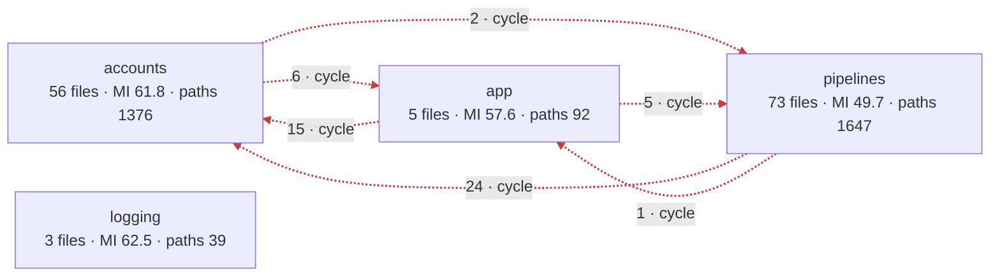
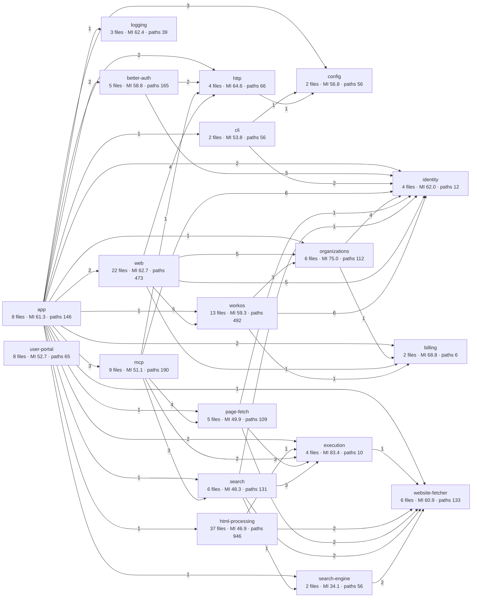
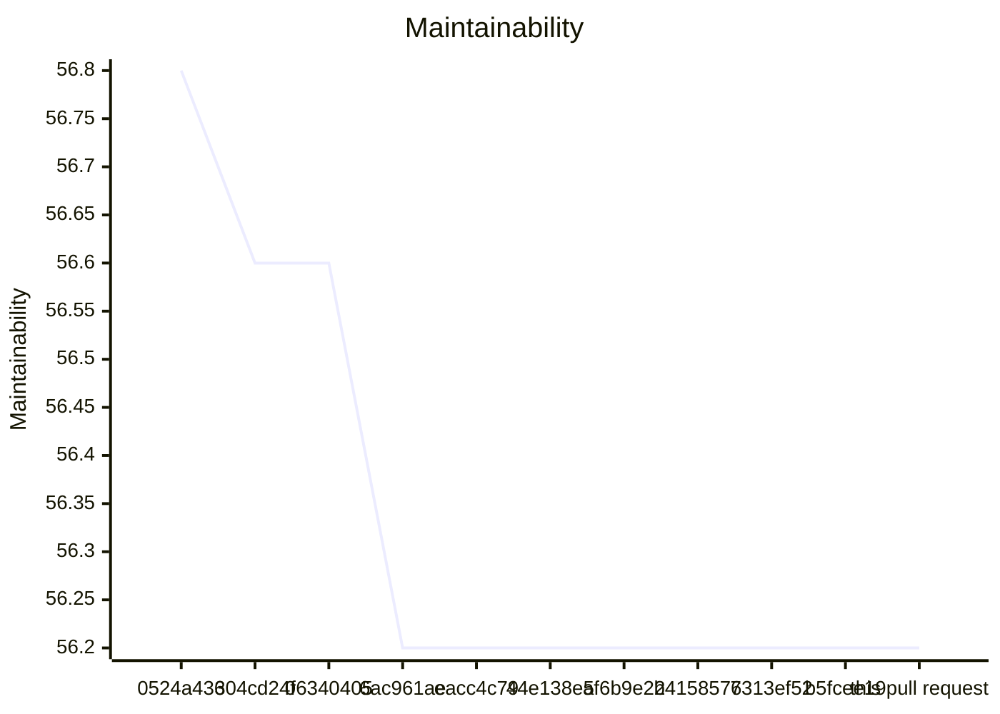
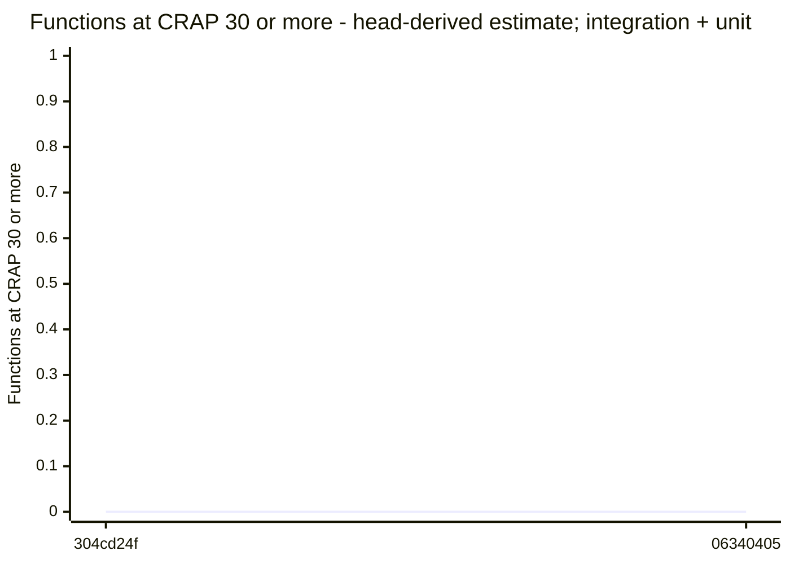

# Code quality process

## Delta

Status: passed.

```text
  20.4  test/acceptance/auth/self-hosted-container.test.ts  no goal
  33.9  test/acceptance/auth/hosted-live/hosted-server.ts  no goal
  34.4  test/acceptance/auth/hosted-image.test.ts  no goal
  34.8  test/acceptance/auth/hosted-live/administration-proofs.ts  no goal
  38.4  test/acceptance/auth/hosted-live/operator-setup.ts  no goal
  38.9  test/unit/test-support/workos-site.test.ts  no goal
  42.6  test/acceptance/work-slice/auth-workos-mcp-url-fetch/auth-workos-onboarding.test.ts  no goal
  48.5  test/interface/logging/axiom-logging.test.ts  no goal
  53.4  test/integration/auth/hosted-live-site.test.ts  no goal
  55.4  test/support/container/hosted-image-gate.ts  no goal
  56.8  test/support/hosted-live/workos-api.ts  no goal
  63.6  test/support/hosted-live/browser-session.ts  no goal
  63.8  test/acceptance/auth/hosted.live.ts  no goal
  65.1  test/support/hosted-live/connect-client.ts  no goal
  66.0  test/support/container/container-gate.ts  no goal
  66.4  test/acceptance/auth/hosted-live/configuration.ts  no goal
  67.1  test/unit/test-support/hosted-config.test.ts  no goal
  70.1  test/support/hosted-live/tokens.ts  no goal
  73.1  test/support/processes/fetch-url-command.ts  no goal
  82.2  test/support/container/container-probe.ts  no goal
  82.7  test/support/hosted-live/settings.ts  no goal
  94.7  test/support/processes/module-paths.ts  no goal
Result: no measured production file in the delta. 22 other files without a goal.
Comparison with origin/main: ast-report/compare.html
```

## Review

Status: goal miss.

## AST Metrics found blocking regressions

63 new critical issue(s), 119 other regression(s), 11 improvement(s)

### Summary

- ➖ **Complexity: -**
- ✅ **Ease of maintenance: +110**
- ➖ **Outgoing dependencies: -**
- ✅ **Probability of bugs: -0.77**

### Regressions

- **src/accounts/billing/billing-free.ts** (`src/accounts/billing/billing-free.ts:3`, high)
  Maintainability too low: got 68 (min: 85)
- **src/accounts/identity/access-context.ts** (`src/accounts/identity/access-context.ts:34`, high)
  Maintainability too low: got 79 (min: 85)
- **src/accounts/organizations/change-records.ts** (`src/accounts/organizations/change-records.ts:46`, high)
  Maintainability too low: got 73 (min: 85)
- **src/accounts/organizations/organization-administration.ts** (`src/accounts/organizations/organization-administration.ts:63`, high)
  Maintainability too low: got 65 (min: 85)
- **src/accounts/providers/better-auth/better-auth-provider.ts** (`src/accounts/providers/better-auth/better-auth-provider.ts:49`, high)
  Maintainability too low: got 73 (min: 85)
- **src/accounts/providers/better-auth/better-auth-runtime.ts** (`src/accounts/providers/better-auth/better-auth-runtime.ts:55`, high)
  Maintainability too low: got 82 (min: 85)
- **src/accounts/providers/better-auth/better-auth-user-administration.ts** (`src/accounts/providers/better-auth/better-auth-user-administration.ts:34`, high)
  Maintainability too low: got 76 (min: 85)
- **src/accounts/providers/better-auth/local-installation.ts** (`src/accounts/providers/better-auth/local-installation.ts:32`, high)
  Maintainability too low: got 84 (min: 85)
- **src/accounts/providers/workos/hosted-role-mapping.ts** (`src/accounts/providers/workos/hosted-role-mapping.ts:9`, high)
  Maintainability too low: got 84 (min: 85)
- **src/accounts/providers/workos/workos-auth-provider.ts** (`src/accounts/providers/workos/workos-auth-provider.ts:58`, high)
  Maintainability too low: got 72 (min: 85)
- **src/accounts/providers/workos/workos-browser-session.ts** (`src/accounts/providers/workos/workos-browser-session.ts:46`, high)
  Maintainability too low: got 62 (min: 85)
- **src/accounts/providers/workos/workos-google-onboarding.ts** (`src/accounts/providers/workos/workos-google-onboarding.ts:32`, high)
  Maintainability too low: got 48 (min: 85)
- **src/accounts/providers/workos/workos-organizations.ts** (`src/accounts/providers/workos/workos-organizations.ts:107`, high)
  Maintainability too low: got 60 (min: 85)
- **src/accounts/providers/workos/workos-settings.ts** (`src/accounts/providers/workos/workos-settings.ts:16`, high)
  Maintainability too low: got 80 (min: 85)
- **src/accounts/providers/workos/workos-sign-in.ts** (`src/accounts/providers/workos/workos-sign-in.ts:49`, high)
  Maintainability too low: got 65 (min: 85)
- **src/accounts/providers/workos/workos-signup.ts** (`src/accounts/providers/workos/workos-signup.ts:73`, high)
  Maintainability too low: got 38 (min: 85)
- **src/app/hidden-line-input.ts** (`src/app/hidden-line-input.ts:11`, high)
  Maintainability too low: got 80 (min: 85)
- **src/app/hosted-portal.ts** (`src/app/hosted-portal.ts:26`, high)
  Maintainability too low: got 47 (min: 85)
- **src/app/operation-capacity.ts** (`src/app/operation-capacity.ts:6`, high)
  Maintainability too low: got 65 (min: 85)
- **src/interfaces/cli/local-auth-command-line.ts** (`src/interfaces/cli/local-auth-command-line.ts:10`, high)
  Maintainability too low: got 84 (min: 85)
- **src/interfaces/cli/local-auth-command.ts** (`src/interfaces/cli/local-auth-command.ts:29`, high)
  Maintainability too low: got 84 (min: 85)
- **src/interfaces/mcp/identity-verifier-sdk-adapter.ts** (`src/interfaces/mcp/identity-verifier-sdk-adapter.ts:20`, high)
  Maintainability too low: got 62 (min: 85)
- **src/interfaces/mcp/mcp-server.ts** (`src/interfaces/mcp/mcp-server.ts:49`, high)
  Maintainability too low: got 43 (min: 85)
- **src/interfaces/mcp/protected-resource-endpoint.ts** (`src/interfaces/mcp/protected-resource-endpoint.ts:18`, high)
  Maintainability too low: got 64 (min: 85)
- **src/interfaces/user-portal/connection-guide.ts** (`src/interfaces/user-portal/connection-guide.ts:19`, high)
  Maintainability too low: got 42 (min: 85)
- **src/interfaces/web/account/account-routes.ts** (`src/interfaces/web/account/account-routes.ts:32`, high)
  Maintainability too low: got 61 (min: 85)
- **src/interfaces/web/account/administration-routes.ts** (`src/interfaces/web/account/administration-routes.ts:63`, high)
  Maintainability too low: got 59 (min: 85)
- **src/interfaces/web/auth/better-auth/local-auth-pages.ts** (`src/interfaces/web/auth/better-auth/local-auth-pages.ts:41`, high)
  Maintainability too low: got 41 (min: 85)
- **src/interfaces/web/auth/better-auth/local-auth-provider-routes.ts** (`src/interfaces/web/auth/better-auth/local-auth-provider-routes.ts:16`, high)
  Maintainability too low: got 67 (min: 85)
- **src/interfaces/web/auth/workos/workos-session-routes.ts** (`src/interfaces/web/auth/workos/workos-session-routes.ts:39`, high)
  Maintainability too low: got 62 (min: 85)
- **src/interfaces/web/auth/workos/workos-signup-routes.ts** (`src/interfaces/web/auth/workos/workos-signup-routes.ts:29`, high)
  Maintainability too low: got 39 (min: 85)
- **src/pipelines/html-processing/ad-cleaner/adb/clean-html-ads-adblock-rs.ts** (`src/pipelines/html-processing/ad-cleaner/adb/clean-html-ads-adblock-rs.ts:17`, high)
  Maintainability too low: got 37 (min: 85)
- **src/pipelines/html-processing/ad-cleaner/adb/source-range-parser.ts** (`src/pipelines/html-processing/ad-cleaner/adb/source-range-parser.ts:15`, high)
  Maintainability too low: got 51 (min: 85)
- **src/pipelines/html-processing/ad-cleaner/html-depth-limit-error.ts** (`src/pipelines/html-processing/ad-cleaner/html-depth-limit-error.ts:3`, high)
  Maintainability too low: got 84 (min: 85)
- **src/pipelines/html-processing/html-to-markdown-pipeline.ts** (`src/pipelines/html-processing/html-to-markdown-pipeline.ts:21`, high)
  Maintainability too low: got 69 (min: 85)
- **src/pipelines/html-processing/html-to-markdown/clean-html-to-markdown-defuddle.ts** (`src/pipelines/html-processing/html-to-markdown/clean-html-to-markdown-defuddle.ts:8`, high)
  Maintainability too low: got 63 (min: 85)
- **src/pipelines/html-processing/html-to-markdown/prepare-html-document.ts** (`src/pipelines/html-processing/html-to-markdown/prepare-html-document.ts:9`, high)
  Maintainability too low: got 59 (min: 85)
- **src/pipelines/html-processing/process-html-step.ts** (`src/pipelines/html-processing/process-html-step.ts:6`, high)
  Maintainability too low: got 59 (min: 85)
- **src/pipelines/html-processing/prompt-injection-remover/css-opacity-animations.ts** (`src/pipelines/html-processing/prompt-injection-remover/css-opacity-animations.ts:51`, high)
  Maintainability too low: got 68 (min: 85)
- **src/pipelines/html-processing/prompt-injection-remover/css-selector-index.ts** (`src/pipelines/html-processing/prompt-injection-remover/css-selector-index.ts:10`, high)
  Maintainability too low: got 33 (min: 85)
- **src/pipelines/html-processing/prompt-injection-remover/css-visibility-provenance.ts** (`src/pipelines/html-processing/prompt-injection-remover/css-visibility-provenance.ts:86`, high)
  Maintainability too low: got 53 (min: 85)
- **src/pipelines/html-processing/prompt-injection-remover/css-visibility-tree.ts** (`src/pipelines/html-processing/prompt-injection-remover/css-visibility-tree.ts:10`, high)
  Maintainability too low: got 55 (min: 85)
- **src/pipelines/html-processing/prompt-injection-remover/hidden-html-removal-counts.ts** (`src/pipelines/html-processing/prompt-injection-remover/hidden-html-removal-counts.ts:7`, high)
  Maintainability too low: got 61 (min: 85)
- **src/pipelines/html-processing/prompt-injection-remover/hidden-html-removal-session.ts** (`src/pipelines/html-processing/prompt-injection-remover/hidden-html-removal-session.ts:19`, high)
  Maintainability too low: got 63 (min: 85)
- **src/pipelines/html-processing/prompt-injection-remover/hidden-html-scanner.ts** (`src/pipelines/html-processing/prompt-injection-remover/hidden-html-scanner.ts:15`, high)
  Maintainability too low: got 34 (min: 85)
- **src/pipelines/html-processing/prompt-injection-remover/html-text-source-ranges.ts** (`src/pipelines/html-processing/prompt-injection-remover/html-text-source-ranges.ts:6`, high)
  Maintainability too low: got 67 (min: 85)
- **src/pipelines/html-processing/prompt-injection-remover/prompt-injection-remover-sanitizer.ts** (`src/pipelines/html-processing/prompt-injection-remover/prompt-injection-remover-sanitizer.ts:10`, high)
  Maintainability too low: got 50 (min: 85)
- **src/pipelines/html-processing/prompt-injection-remover/small-text-policy.ts** (`src/pipelines/html-processing/prompt-injection-remover/small-text-policy.ts:7`, high)
  Maintainability too low: got 66 (min: 85)
- **src/pipelines/html-processing/search-results/brave-http-result-cleanup.ts** (`src/pipelines/html-processing/search-results/brave-http-result-cleanup.ts:4`, high)
  Maintainability too low: got 74 (min: 85)
- **src/pipelines/html-processing/search-results/brave-result-document.ts** (`src/pipelines/html-processing/search-results/brave-result-document.ts:11`, high)
  Maintainability too low: got 43 (min: 85)

_... and 132 more. Download the full report for details._

### Improvements

- **test/acceptance/auth/hosted-image.test.ts** (`test/acceptance/auth/hosted-image.test.ts`): Estimated bugs (Halstead): 1.56 -> 1.19
- **test/acceptance/auth/hosted-live/configuration.ts** (`test/acceptance/auth/hosted-live/configuration.ts`): Estimated bugs (Halstead): 0.49 -> 0.08
- **test/acceptance/auth/hosted-live/configuration.ts** (`test/acceptance/auth/hosted-live/configuration.ts`): Maintainability index: 38 -> 66

_... and 8 more._

## CRAP

Status: passed.

No coverage report: the bands are withheld. Run the coverage command when the test selection permits it.

No production files to assess.

## Architecture

Status: passed.

## Architecture of src/: base b5fcee19 → head

Modularity 0.40 → 0.40 · cross share 0.16 → 0.16 · cycles 1 → 1 · communities 4 → 4

No coverage report: the bands are withheld. Run the coverage command when the test selection permits it.

The map did not change.



Legend: thick border = a community this pull request touched; `· new` and `· gone` = a community or dependency that appeared or disappeared; red dashed edge = part of a cycle; thick edge = a new dependency; numbers = files · maintainability (LOC-weighted) · decision paths, with the change against the base.

### Community edge evidence

Tool references and deduplicated file pairs have different units. An unchanged import means the same normalized file pair, after proven path moves; evidence kinds can differ.

Dependency evidence incomplete: base has 1 issue; head has 1 issue. A missing pair on an incomplete side does not prove an import change.

- base: <code>src/interfaces/user-portal/main.ts</code> → <code>./style.css</code> — unresolved-local.
- head: <code>src/interfaces/user-portal/main.ts</code> → <code>./style.css</code> — unresolved-local.

No new or gone community edges.

## Components of src/

Component dependency evidence is incomplete: known head dependencies and proven cycles are shown; edge and cycle changes are withheld. Additional dependencies or cycles may exist.



Legend: thick border = a component this pull request touched; `· new` and `· gone` = a component or dependency that appeared or disappeared; red dashed edge = part of a cycle; thick edge = a new dependency; numbers = files · maintainability (LOC-weighted) · decision paths, with the change against the base. Edges count distinct importing files per target component.

## Complexity of the changed files

No production file changed.

Test changes are not judged: no coverage comparison was made.

Unknown function identity: 264 (no proven declaration or unique unchanged body/signature correspondence).

## Trend of src/ on main

| Commit | PR | Date | Modularity | Cross share | Cycles | Maintainability | Functions ≥ 30 |
| --- | --- | --- | --- | --- | --- | --- | --- |
| 0524a436 | #199 | 2026-10-19 | 0.56 | 0.26 | 2 | 56.8 | 18 (estimate) |
| 304cd24f | #200 | 2026-10-20 | 0.57 | 0.26 | 2 | 56.6 | 0 (estimate; integration + unit) |
| 06340405 | – | 2026-10-20 | 0.57 | 0.26 | 2 | 56.6 | 0 (estimate; integration + unit) |
| 6ac961ae | #202 | 2026-10-20 | 0.58 | 0.26 | 2 | 56.2 | – |
| eacc4c79 | #203 | 2026-10-21 | 0.58 | 0.27 | 2 | 56.2 | – |
| 44e138e5 | #210 | 2026-10-21 | 0.58 | 0.27 | 2 | 56.2 | – |
| af6b9e22 | #211 | 2026-10-21 | 0.58 | 0.27 | 2 | 56.2 | – |
| b4158576 | #214 | 2026-10-21 | 0.40 | 0.16 | 1 | 56.2 | – |
| 7313ef52 | – | 2026-10-21 | 0.40 | 0.16 | 1 | 56.2 | – |
| b5fcee19 | #215 | 2026-10-21 | 0.40 | 0.16 | 1 | 56.2 | – |
| this pull request | – | | 0.40 | 0.16 | 1 | 56.2 | – |

Historical estimates use head coverage from the first recording pull request. Later estimates for the same base can differ. Counts include known lower-bound violations; other unknown functions are not counted.

Trend tool versions: 0524a436: ast-metrics 0.43.1; 304cd24f: ast-metrics 0.43.1-search02-anonymous-fix; 06340405: ast-metrics 0.43.1-search02-anonymous-fix; 6ac961ae: ast-metrics 0.43.1; eacc4c79: ast-metrics 0.43.1; 44e138e5: ast-metrics 0.43.1; af6b9e22: ast-metrics 0.43.1; b4158576: ast-metrics 0.43.1; 7313ef52: ast-metrics 0.43.1; b5fcee19: ast-metrics 0.43.1; this pull request: ast-metrics 0.43.1.

### Maintainability trend

Missing values are gaps; lines stop at each gap.

Maintainability (maintainability), 0524a436 to this pull request.




### Functions ≥ 30 trend

Missing values are gaps; lines stop at each gap or change of count basis.

0524a436: 18 (head-derived estimate). One point; no line.

Functions ≥ 30 (head-derived estimate; integration + unit), 304cd24f to 06340405.




### Trend by component

| Component | 0524a436 | 304cd24f | 06340405 | 6ac961ae | eacc4c79 | 44e138e5 | af6b9e22 | b4158576 | 7313ef52 | b5fcee19 | this pull request |
| --- | --- | --- | --- | --- | --- | --- | --- | --- | --- | --- | --- |
| app | MI –; functions ≥ 30: – | MI –; functions ≥ 30: – | MI –; functions ≥ 30: – | MI –; functions ≥ 30: – | MI –; functions ≥ 30: – | MI –; functions ≥ 30: – | MI –; functions ≥ 30: – | MI 61.3; functions ≥ 30: – | MI 61.3; functions ≥ 30: – | MI 61.3; functions ≥ 30: – | MI 61.3; functions ≥ 30: – |
| auth | MI 58.8; functions ≥ 30: 12 (estimate) | MI 58.8; functions ≥ 30: 0 (estimate; integration + unit) | MI 58.8; functions ≥ 30: 0 (estimate; integration + unit) | MI 58.8; functions ≥ 30: – | MI 58.8; functions ≥ 30: – | MI 58.8; functions ≥ 30: – | MI 58.8; functions ≥ 30: – | MI –; functions ≥ 30: – | MI –; functions ≥ 30: – | MI –; functions ≥ 30: – | MI –; functions ≥ 30: – |
| better-auth | MI –; functions ≥ 30: – | MI –; functions ≥ 30: – | MI –; functions ≥ 30: – | MI –; functions ≥ 30: – | MI –; functions ≥ 30: – | MI –; functions ≥ 30: – | MI –; functions ≥ 30: – | MI 58.8; functions ≥ 30: – | MI 58.8; functions ≥ 30: – | MI 58.8; functions ≥ 30: – | MI 58.8; functions ≥ 30: – |
| billing | MI 68.8; functions ≥ 30: 0 (estimate) | MI 68.8; functions ≥ 30: 0 (estimate; integration + unit) | MI 68.8; functions ≥ 30: 0 (estimate; integration + unit) | MI 68.8; functions ≥ 30: – | MI 68.8; functions ≥ 30: – | MI 68.8; functions ≥ 30: – | MI 68.8; functions ≥ 30: – | MI 68.8; functions ≥ 30: – | MI 68.8; functions ≥ 30: – | MI 68.8; functions ≥ 30: – | MI 68.8; functions ≥ 30: – |
| cli | MI –; functions ≥ 30: – | MI –; functions ≥ 30: – | MI –; functions ≥ 30: – | MI –; functions ≥ 30: – | MI –; functions ≥ 30: – | MI –; functions ≥ 30: – | MI –; functions ≥ 30: – | MI 53.8; functions ≥ 30: – | MI 53.8; functions ≥ 30: – | MI 53.8; functions ≥ 30: – | MI 53.8; functions ≥ 30: – |
| config | MI 56.8; functions ≥ 30: 0 (estimate) | MI 56.8; functions ≥ 30: 0 (estimate; integration + unit) | MI 56.8; functions ≥ 30: 0 (estimate; integration + unit) | MI 56.8; functions ≥ 30: – | MI 56.8; functions ≥ 30: – | MI 56.8; functions ≥ 30: – | MI 56.8; functions ≥ 30: – | MI 56.8; functions ≥ 30: – | MI 56.8; functions ≥ 30: – | MI 56.8; functions ≥ 30: – | MI 56.8; functions ≥ 30: – |
| execution | MI –; functions ≥ 30: – | MI –; functions ≥ 30: – | MI –; functions ≥ 30: – | MI –; functions ≥ 30: – | MI –; functions ≥ 30: – | MI –; functions ≥ 30: – | MI –; functions ≥ 30: – | MI 83.4; functions ≥ 30: – | MI 83.4; functions ≥ 30: – | MI 83.4; functions ≥ 30: – | MI 83.4; functions ≥ 30: – |
| hosted-admin | MI 66.8; functions ≥ 30: 0 (estimate) | MI 66.8; functions ≥ 30: 0 (estimate; integration + unit) | MI 66.8; functions ≥ 30: 0 (estimate; integration + unit) | MI 66.8; functions ≥ 30: – | MI 66.8; functions ≥ 30: – | MI 66.8; functions ≥ 30: – | MI 66.8; functions ≥ 30: – | MI –; functions ≥ 30: – | MI –; functions ≥ 30: – | MI –; functions ≥ 30: – | MI –; functions ≥ 30: – |
| html | MI 121.4; functions ≥ 30: 0 (estimate) | MI 121.4; functions ≥ 30: 0 (estimate; integration + unit) | MI 121.4; functions ≥ 30: 0 (estimate; integration + unit) | MI 121.4; functions ≥ 30: – | MI 121.4; functions ≥ 30: – | MI 121.4; functions ≥ 30: – | MI 121.4; functions ≥ 30: – | MI –; functions ≥ 30: – | MI –; functions ≥ 30: – | MI –; functions ≥ 30: – | MI –; functions ≥ 30: – |
| html-cleaner-pipeline | MI 46.9; functions ≥ 30: 0 (estimate) | MI 46.8; functions ≥ 30: 0 (estimate; integration + unit) | MI 46.8; functions ≥ 30: 0 (estimate; integration + unit) | MI 46.8; functions ≥ 30: – | MI 46.9; functions ≥ 30: – | MI 46.9; functions ≥ 30: – | MI 46.9; functions ≥ 30: – | MI –; functions ≥ 30: – | MI –; functions ≥ 30: – | MI –; functions ≥ 30: – | MI –; functions ≥ 30: – |
| html-processing | MI –; functions ≥ 30: – | MI –; functions ≥ 30: – | MI –; functions ≥ 30: – | MI –; functions ≥ 30: – | MI –; functions ≥ 30: – | MI –; functions ≥ 30: – | MI –; functions ≥ 30: – | MI 46.9; functions ≥ 30: – | MI 46.9; functions ≥ 30: – | MI 46.9; functions ≥ 30: – | MI 46.9; functions ≥ 30: – |
| http | MI 64.6; functions ≥ 30: 0 (estimate) | MI 64.6; functions ≥ 30: 0 (estimate; integration + unit) | MI 64.6; functions ≥ 30: 0 (estimate; integration + unit) | MI 64.6; functions ≥ 30: – | MI 64.6; functions ≥ 30: – | MI 64.6; functions ≥ 30: – | MI 64.6; functions ≥ 30: – | MI 64.6; functions ≥ 30: – | MI 64.6; functions ≥ 30: – | MI 64.6; functions ≥ 30: – | MI 64.6; functions ≥ 30: – |
| identity | MI –; functions ≥ 30: – | MI –; functions ≥ 30: – | MI –; functions ≥ 30: – | MI –; functions ≥ 30: – | MI –; functions ≥ 30: – | MI –; functions ≥ 30: – | MI –; functions ≥ 30: – | MI 62.0; functions ≥ 30: – | MI 62.0; functions ≥ 30: – | MI 62.0; functions ≥ 30: – | MI 62.0; functions ≥ 30: – |
| logging | MI 62.4; functions ≥ 30: 0 (estimate) | MI 62.4; functions ≥ 30: 0 (estimate; integration + unit) | MI 62.4; functions ≥ 30: 0 (estimate; integration + unit) | MI 62.4; functions ≥ 30: – | MI 62.4; functions ≥ 30: – | MI 62.4; functions ≥ 30: – | MI 62.4; functions ≥ 30: – | MI 62.4; functions ≥ 30: – | MI 62.4; functions ≥ 30: – | MI 62.4; functions ≥ 30: – | MI 62.4; functions ≥ 30: – |
| mcp | MI 51.7; functions ≥ 30: 4 (estimate) | MI 51.7; functions ≥ 30: 0 (estimate; integration + unit) | MI 51.7; functions ≥ 30: 0 (estimate; integration + unit) | MI 51.5; functions ≥ 30: – | MI 51.5; functions ≥ 30: – | MI 51.5; functions ≥ 30: – | MI 51.5; functions ≥ 30: – | MI 51.1; functions ≥ 30: – | MI 51.1; functions ≥ 30: – | MI 51.1; functions ≥ 30: – | MI 51.1; functions ≥ 30: – |
| organizations | MI 75.0; functions ≥ 30: 0 (estimate) | MI 75.0; functions ≥ 30: 0 (estimate; integration + unit) | MI 75.0; functions ≥ 30: 0 (estimate; integration + unit) | MI 75.0; functions ≥ 30: – | MI 75.0; functions ≥ 30: – | MI 75.0; functions ≥ 30: – | MI 75.0; functions ≥ 30: – | MI 75.0; functions ≥ 30: – | MI 75.0; functions ≥ 30: – | MI 75.0; functions ≥ 30: – | MI 75.0; functions ≥ 30: – |
| page-fetch | MI 57.8; functions ≥ 30: 2 (estimate) | MI 57.8; functions ≥ 30: 0 (estimate; integration + unit) | MI 57.8; functions ≥ 30: 0 (estimate; integration + unit) | MI 57.8; functions ≥ 30: – | MI 57.8; functions ≥ 30: – | MI 57.8; functions ≥ 30: – | MI 57.8; functions ≥ 30: – | MI 49.9; functions ≥ 30: – | MI 49.9; functions ≥ 30: – | MI 49.9; functions ≥ 30: – | MI 49.9; functions ≥ 30: – |
| search | MI –; functions ≥ 30: – | MI –; functions ≥ 30: – | MI –; functions ≥ 30: – | MI –; functions ≥ 30: – | MI –; functions ≥ 30: – | MI –; functions ≥ 30: – | MI –; functions ≥ 30: – | MI 48.3; functions ≥ 30: – | MI 48.3; functions ≥ 30: – | MI 48.3; functions ≥ 30: – | MI 48.3; functions ≥ 30: – |
| search-engine | MI –; functions ≥ 30: – | MI 34.3; functions ≥ 30: 0 (estimate; integration + unit) | MI 34.3; functions ≥ 30: 0 (estimate; integration + unit) | MI 34.1; functions ≥ 30: – | MI 34.1; functions ≥ 30: – | MI 34.1; functions ≥ 30: – | MI 34.1; functions ≥ 30: – | MI 34.1; functions ≥ 30: – | MI 34.1; functions ≥ 30: – | MI 34.1; functions ≥ 30: – | MI 34.1; functions ≥ 30: – |
| search-pipeline | MI –; functions ≥ 30: – | MI 65.4; functions ≥ 30: 0 (estimate; integration + unit) | MI 65.4; functions ≥ 30: 0 (estimate; integration + unit) | MI 48.3; functions ≥ 30: – | MI 48.3; functions ≥ 30: – | MI 48.3; functions ≥ 30: – | MI 48.3; functions ≥ 30: – | MI –; functions ≥ 30: – | MI –; functions ≥ 30: – | MI –; functions ≥ 30: – | MI –; functions ≥ 30: – |
| src | MI 60.5; functions ≥ 30: 0 (estimate) | MI 60.5; functions ≥ 30: 0 (estimate; integration + unit) | MI 60.5; functions ≥ 30: 0 (estimate; integration + unit) | MI 59.6; functions ≥ 30: – | MI 59.6; functions ≥ 30: – | MI 59.6; functions ≥ 30: – | MI 59.6; functions ≥ 30: – | MI –; functions ≥ 30: – | MI –; functions ≥ 30: – | MI –; functions ≥ 30: – | MI –; functions ≥ 30: – |
| terminal | MI 77.2; functions ≥ 30: 0 (estimate) | MI 77.2; functions ≥ 30: 0 (estimate; integration + unit) | MI 77.2; functions ≥ 30: 0 (estimate; integration + unit) | MI 77.2; functions ≥ 30: – | MI 77.2; functions ≥ 30: – | MI 77.2; functions ≥ 30: – | MI 77.2; functions ≥ 30: – | MI –; functions ≥ 30: – | MI –; functions ≥ 30: – | MI –; functions ≥ 30: – | MI –; functions ≥ 30: – |
| user-portal | MI 52.7; functions ≥ 30: 0 (estimate) | MI 52.7; functions ≥ 30: 0 (estimate; integration + unit) | MI 52.7; functions ≥ 30: 0 (estimate; integration + unit) | MI 52.7; functions ≥ 30: – | MI 52.7; functions ≥ 30: – | MI 52.7; functions ≥ 30: – | MI 52.7; functions ≥ 30: – | MI 52.7; functions ≥ 30: – | MI 52.7; functions ≥ 30: – | MI 52.7; functions ≥ 30: – | MI 52.7; functions ≥ 30: – |
| web | MI –; functions ≥ 30: – | MI –; functions ≥ 30: – | MI –; functions ≥ 30: – | MI –; functions ≥ 30: – | MI –; functions ≥ 30: – | MI –; functions ≥ 30: – | MI –; functions ≥ 30: – | MI 62.7; functions ≥ 30: – | MI 62.7; functions ≥ 30: – | MI 62.7; functions ≥ 30: – | MI 62.7; functions ≥ 30: – |
| website-fetcher | MI 59.0; functions ≥ 30: 0 (estimate) | MI 59.0; functions ≥ 30: 0 (estimate; integration + unit) | MI 59.0; functions ≥ 30: 0 (estimate; integration + unit) | MI 59.0; functions ≥ 30: – | MI 59.0; functions ≥ 30: – | MI 59.0; functions ≥ 30: – | MI 59.0; functions ≥ 30: – | MI 60.9; functions ≥ 30: – | MI 60.9; functions ≥ 30: – | MI 60.9; functions ≥ 30: – | MI 60.9; functions ≥ 30: – |
| workos | MI –; functions ≥ 30: – | MI –; functions ≥ 30: – | MI –; functions ≥ 30: – | MI –; functions ≥ 30: – | MI –; functions ≥ 30: – | MI –; functions ≥ 30: – | MI –; functions ≥ 30: – | MI 59.3; functions ≥ 30: – | MI 59.3; functions ≥ 30: – | MI 59.3; functions ≥ 30: – | MI 59.3; functions ≥ 30: – |

2 commits of main between 6ac961ae and eacc4c79 have no record.
1 commits of main between af6b9e22 and b4158576 have no record.
