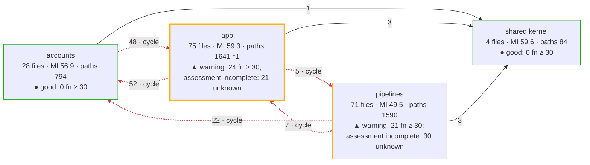
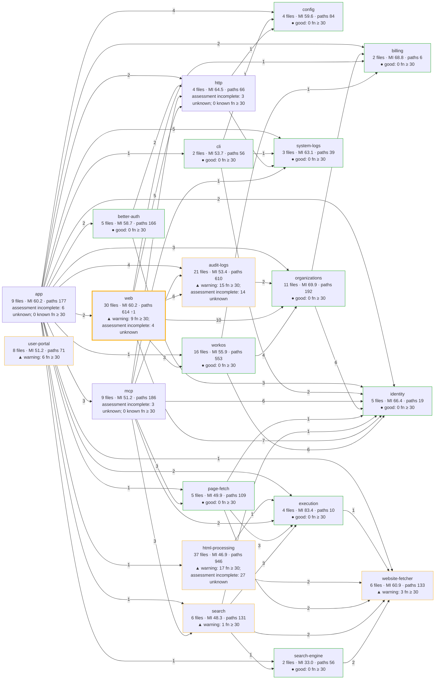
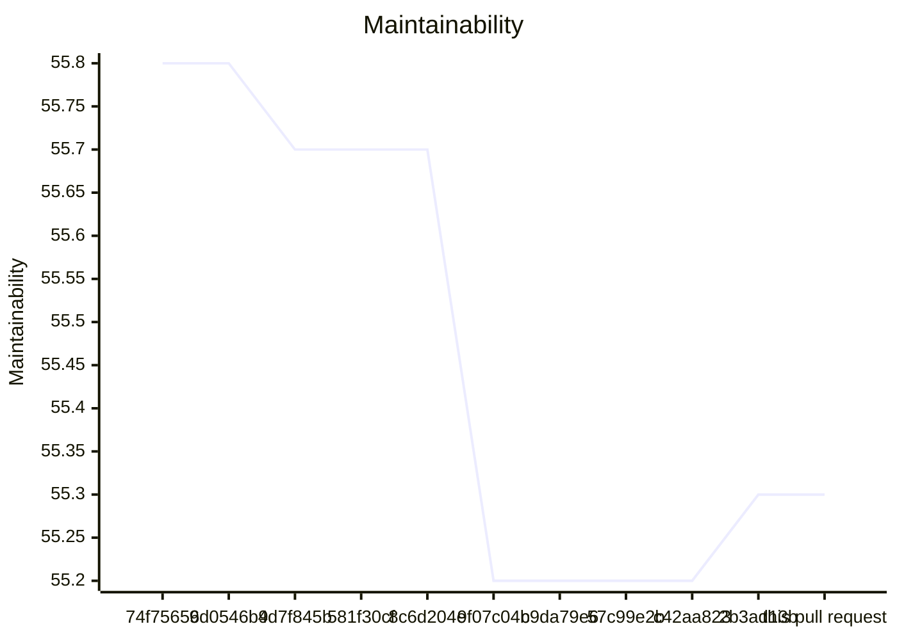
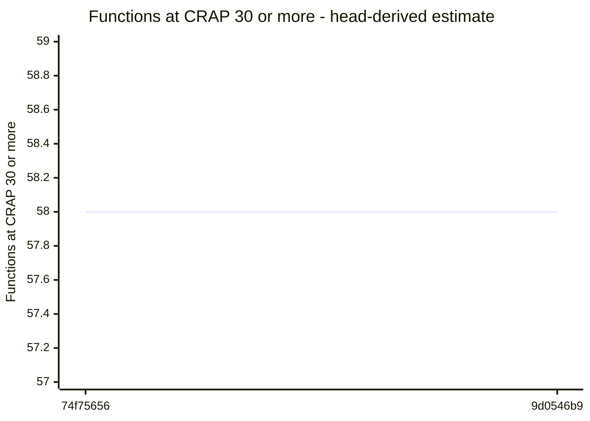
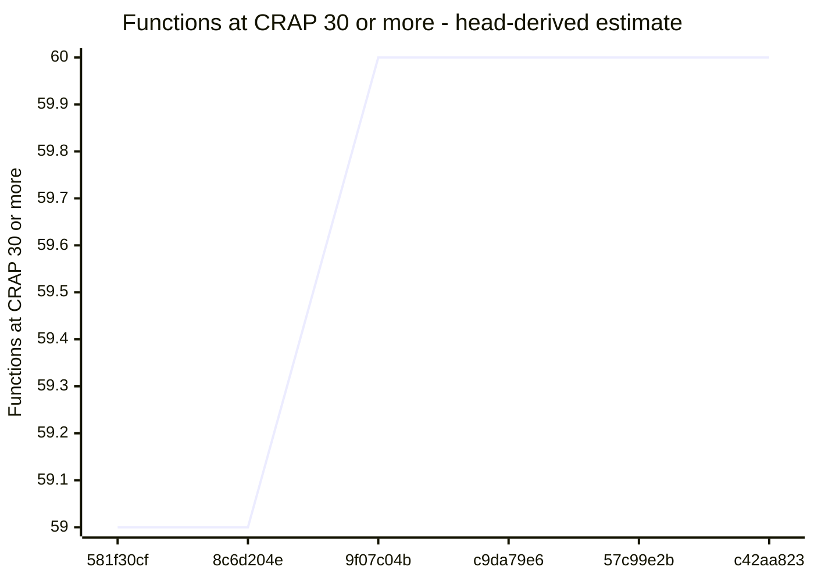

# Code quality process

## Delta

Status: goal miss.

```text
  61.3  src/interfaces/web/account/administration-pages.ts  below 85
  80.4  src/interfaces/web/account/members-page-layout.ts  below 85
  22.1  test/integration/hosted-admin/account-routes-administration-pages.test.ts  no goal
  28.2  test/acceptance/auth/hosted-member-removal-browser.runtime.ts  no goal
  28.6  test/acceptance/auth/hosted-members.test.ts  no goal
  34.7  test/support/drivers/browser/admin-shell-browser.ts  no goal
  43.0  test/support/drivers/browser/admin-shell-measurements.ts  no goal
  55.8  test/support/in-process/hosted-member-removal-site.ts  no goal
  not measured  src/interfaces/web/account/members-style.ts
Result: 2 of 2 production files below 85. Goal: 85 or more for each production file. 6 other files without a goal. 1 file not measured.
Comparison with 2b3ad13b9e2e61e206479b82e91359192cae1d00: ast-report/compare.html
```

## Review

Status: goal miss.

## AST Metrics found blocking regressions

1 new critical issue(s), 2 other regression(s), 1 improvement(s)

### Summary

- ➖ **Complexity: -**
- ⚠️  **Ease of maintenance: -5**
- ➖ **Outgoing dependencies: -**
- ⚠️  **Probability of bugs: +0.48**

### Regressions

- **test/acceptance/auth/hosted-member-removal-browser.runtime.ts** (`test/acceptance/auth/hosted-member-removal-browser.runtime.ts`, high)
  Maintainability index: 33 -> 28 (below 85 is hard to maintain)
  Suggested action: Refactor long or deeply nested functions and reduce responsibilities in this file
- **test/acceptance/auth/hosted-members.test.ts** (`test/acceptance/auth/hosted-members.test.ts`, low)
  Estimated bugs (Halstead): 1.30 -> 1.80
  Suggested action: This estimate grows with code volume and complexity; consider simplifying or splitting this file
- **test/integration/hosted-admin/account-routes-administration-pages.test.ts** (`test/integration/hosted-admin/account-routes-administration-pages.test.ts`, low)
  Estimated bugs (Halstead): 2.56 -> 2.83
  Suggested action: This estimate grows with code volume and complexity; consider simplifying or splitting this file

### Improvements

- **test/acceptance/auth/hosted-member-removal-browser.runtime.ts** (`test/acceptance/auth/hosted-member-removal-browser.runtime.ts`): Estimated bugs (Halstead): 0.72 -> 0.43

## CRAP

Status: passed.

Reused verified compatible integration coverage.

## CRAP goals

Goals: CRAP < 30; new functions also CRAP ≤ 15.

| File | Function | Change | Paths | Coverage | CRAP | To do |
| --- | --- | --- | --- | --- | --- | --- |
| src/interfaces/web/account/members-page-layout.ts | membersPageLayout | changed | 8 | 99.8% | 8.0 | ok |
| src/interfaces/web/account/administration-pages.ts | membersPage | changed | 3 | 98% | 3.0 | ok |
| src/interfaces/web/account/administration-pages.ts | (anonymous) | unchanged | 3 | 100% | 3.0 | ok; unchanged by this PR |
| src/interfaces/web/account/administration-pages.ts | sendForm | unchanged | 2 | 98.3% | 2.0 | ok; unchanged by this PR |
| src/interfaces/web/account/administration-pages.ts | (anonymous) | unchanged | 2 | 100% | 2.0 | ok; unchanged by this PR |
| src/interfaces/web/account/administration-pages.ts | (anonymous) | unchanged | 2 | 100% | 2.0 | ok; unchanged by this PR |
| src/interfaces/web/account/administration-pages.ts | identityPolicyText | unchanged | 2 | 100% | 2.0 | ok; unchanged by this PR |
| src/interfaces/web/account/administration-pages.ts | rolesText | unchanged | 2 | 100% | 2.0 | ok; unchanged by this PR |
| src/interfaces/web/account/administration-pages.ts | (anonymous) | new | 1 | 100% | 1.0 | ok |
| src/interfaces/web/account/administration-pages.ts | (anonymous) | unchanged | 1 | 100% | 1.0 | ok; unchanged by this PR |
| src/interfaces/web/account/administration-pages.ts | (anonymous) | unchanged | 1 | 100% | 1.0 | ok; unchanged by this PR |
| src/interfaces/web/account/administration-pages.ts | (anonymous) | unchanged | 1 | 100% | 1.0 | ok; unchanged by this PR |
| src/interfaces/web/account/administration-pages.ts | (anonymous) | unchanged | 1 | 100% | 1.0 | ok; unchanged by this PR |
| src/interfaces/web/account/administration-pages.ts | invitationRow | unchanged | 1 | 100% | 1.0 | ok; unchanged by this PR |
| src/interfaces/web/account/administration-pages.ts | removalForm | unchanged | 1 | 100% | 1.0 | ok; unchanged by this PR |
| src/interfaces/web/account/administration-pages.ts | roleLabel | unchanged | 1 | 100% | 1.0 | ok; unchanged by this PR |

Known limit violations: 0. Measured target misses: 0. Unmeasured functions: 0. Required functions with unknown assessment or identity: 0.

## Architecture

Status: passed.

## Architecture of src/: base 2b3ad13b → head

Modularity 0.33 → 0.33 · cross share 0.31 → 0.31 · cycles 1 → 1 · communities 4 → 4 · functions ≥ 30: 51 → 51



Legend: thick border = a community this pull request touched; `· new` and `· gone` = a community or dependency that appeared or disappeared; red dashed edge = part of a cycle; thick edge = a new dependency; border color = the CRAP band of the community (● good: complete assessment, no function at CRAP 30 or more; ▲ warning: some, none added or worse by this pull request; ■ critical: one added or worse); numbers = files · maintainability (LOC-weighted) · decision paths, with the change against the base.

### Community edge evidence

Tool references and deduplicated file pairs have different units. An unchanged import means the same normalized file pair, after proven path moves; evidence kinds can differ.

Dependency evidence incomplete: base has 1 issue; head has 1 issue. A missing pair on an incomplete side does not prove an import change.

- base: <code>src/interfaces/user-portal/main.ts</code> → <code>./style.css</code> — unresolved-local.
- head: <code>src/interfaces/user-portal/main.ts</code> → <code>./style.css</code> — unresolved-local.

No new or gone community edges.

## Components of src/

Component dependency evidence is incomplete: known head dependencies and proven cycles are shown; edge and cycle changes are withheld. Additional dependencies or cycles may exist.



Legend: thick border = a component this pull request touched; `· new` and `· gone` = a component or dependency that appeared or disappeared; red dashed edge = part of a cycle; thick edge = a new dependency; border color = the CRAP band of the component (● good: complete assessment, no function at CRAP 30 or more; ▲ warning: some, none added or worse by this pull request; ■ critical: one added or worse); numbers = files · maintainability (LOC-weighted) · decision paths, with the change against the base. Edges count distinct importing files per target component.

## Complexity of the changed files

| File | Maintainability | Decision paths | CRAP ≥ 30 | Risk rank |
| --- | --- | --- | --- | --- |
| src/interfaces/web/account/administration-pages.ts | 61.3 → 61.3 | 24 → 24 | 0 → 0 | |
| src/interfaces/web/account/members-page-layout.ts | 81.0 → 80.4 ↓0.6 | 7 → 8 ↑1 | 0 → 0 | |
| src/interfaces/web/account/members-style.ts | not measured | not measured | not measured | |

### Functions at CRAP 30 or more, added or worse

None.

Unmatched functions: 0 (anonymous, duplicate, or not in the coverage).

Base functions without an estimated covered share: 123.

Coverage: integration suites at 639827bc.

## Trend of src/ on main

| Commit | PR | Date | Modularity | Cross share | Cycles | Maintainability | Functions ≥ 30 |
| --- | --- | --- | --- | --- | --- | --- | --- |
| 74f75656 | – | 2026-10-24 | 0.34 | 0.31 | 1 | 55.8 | 58 (estimate) |
| 9d0546b9 | #250 | 2026-10-25 | 0.34 | 0.31 | 1 | 55.8 | 58 (estimate) |
| 4d7f845b | – | 2026-10-25 | 0.34 | 0.31 | 1 | 55.7 | 0 (estimate; integration + unit) |
| 581f30cf | #256 | 2026-10-25 | 0.34 | 0.31 | 1 | 55.7 | 59 (estimate) |
| 8c6d204e | #258 | 2026-10-25 | 0.34 | 0.31 | 1 | 55.7 | 59 (estimate) |
| 9f07c04b | – | 2026-10-26 | 0.33 | 0.31 | 1 | 55.2 | 60 (estimate) |
| c9da79e6 | #260 | 2026-10-26 | 0.33 | 0.31 | 1 | 55.2 | 60 (estimate) |
| 57c99e2b | #261 | 2026-10-26 | 0.33 | 0.31 | 1 | 55.2 | 60 (estimate) |
| c42aa823 | #262 | 2026-10-26 | 0.33 | 0.31 | 1 | 55.2 | 60 (estimate) |
| 2b3ad13b | #269 | 2026-10-26 | 0.33 | 0.31 | 1 | 55.3 | 51 (estimate; integration) |
| this pull request | – | | 0.33 | 0.31 | 1 | 55.3 | 51 (measured; integration) |

Historical estimates use head coverage from the first recording pull request. Later estimates for the same base can differ. Counts include known lower-bound violations; other unknown functions are not counted.

### Maintainability trend

Missing values are gaps; lines stop at each gap.

Maintainability (maintainability), 74f75656 to this pull request.




### Functions ≥ 30 trend

Missing values are gaps; lines stop at each gap or change of count basis.

Functions ≥ 30 (head-derived estimate), 74f75656 to 9d0546b9.



4d7f845b: 0 (head-derived estimate; integration + unit). One point; no line.

Functions ≥ 30 (head-derived estimate), 581f30cf to c42aa823.



2b3ad13b: 51 (head-derived estimate; integration). One point; no line.

this pull request: 51 (measured; integration). One point; no line.


### Trend by component

| Component | 74f75656 | 9d0546b9 | 4d7f845b | 581f30cf | 8c6d204e | 9f07c04b | c9da79e6 | 57c99e2b | c42aa823 | 2b3ad13b | this pull request |
| --- | --- | --- | --- | --- | --- | --- | --- | --- | --- | --- | --- |
| app | MI 60.0; functions ≥ 30: 0 (estimate) | MI 60.0; functions ≥ 30: 0 (estimate) | MI 60.0; functions ≥ 30: 0 (estimate; integration + unit) | MI 60.0; functions ≥ 30: 0 (estimate) | MI 60.0; functions ≥ 30: 0 (estimate) | MI 60.0; functions ≥ 30: 0 (estimate) | MI 60.0; functions ≥ 30: 0 (estimate) | MI 60.0; functions ≥ 30: 0 (estimate) | MI 60.0; functions ≥ 30: 0 (estimate) | MI 60.2; functions ≥ 30: 0 (estimate; integration) | MI 60.2; functions ≥ 30: 0 (measured; integration) |
| audit-logs | MI 54.8; functions ≥ 30: 0 (estimate) | MI 54.7; functions ≥ 30: 0 (estimate) | MI 54.3; functions ≥ 30: 0 (estimate; integration + unit) | MI 54.2; functions ≥ 30: 0 (estimate) | MI 54.1; functions ≥ 30: 0 (estimate) | MI 53.4; functions ≥ 30: 0 (estimate) | MI 53.4; functions ≥ 30: 0 (estimate) | MI 53.4; functions ≥ 30: 0 (estimate) | MI 53.4; functions ≥ 30: 0 (estimate) | MI 53.4; functions ≥ 30: 15 (estimate; integration) | MI 53.4; functions ≥ 30: 15 (measured; integration) |
| better-auth | MI 58.8; functions ≥ 30: 2 (estimate) | MI 58.8; functions ≥ 30: 2 (estimate) | MI 58.8; functions ≥ 30: 0 (estimate; integration + unit) | MI 58.7; functions ≥ 30: 2 (estimate) | MI 58.7; functions ≥ 30: 2 (estimate) | MI 58.7; functions ≥ 30: 2 (estimate) | MI 58.7; functions ≥ 30: 2 (estimate) | MI 58.7; functions ≥ 30: 2 (estimate) | MI 58.7; functions ≥ 30: 2 (estimate) | MI 58.7; functions ≥ 30: 0 (estimate; integration) | MI 58.7; functions ≥ 30: 0 (measured; integration) |
| billing | MI 68.8; functions ≥ 30: 0 (estimate) | MI 68.8; functions ≥ 30: 0 (estimate) | MI 68.8; functions ≥ 30: 0 (estimate; integration + unit) | MI 68.8; functions ≥ 30: 0 (estimate) | MI 68.8; functions ≥ 30: 0 (estimate) | MI 68.8; functions ≥ 30: 0 (estimate) | MI 68.8; functions ≥ 30: 0 (estimate) | MI 68.8; functions ≥ 30: 0 (estimate) | MI 68.8; functions ≥ 30: 0 (estimate) | MI 68.8; functions ≥ 30: 0 (estimate; integration) | MI 68.8; functions ≥ 30: 0 (measured; integration) |
| cli | MI 53.7; functions ≥ 30: 3 (estimate) | MI 53.7; functions ≥ 30: 3 (estimate) | MI 53.7; functions ≥ 30: 0 (estimate; integration + unit) | MI 53.7; functions ≥ 30: 3 (estimate) | MI 53.7; functions ≥ 30: 3 (estimate) | MI 53.7; functions ≥ 30: 3 (estimate) | MI 53.7; functions ≥ 30: 3 (estimate) | MI 53.7; functions ≥ 30: 3 (estimate) | MI 53.7; functions ≥ 30: 3 (estimate) | MI 53.7; functions ≥ 30: 0 (estimate; integration) | MI 53.7; functions ≥ 30: 0 (measured; integration) |
| config | MI 57.6; functions ≥ 30: 0 (estimate) | MI 57.6; functions ≥ 30: 0 (estimate) | MI 57.6; functions ≥ 30: 0 (estimate; integration + unit) | MI 57.6; functions ≥ 30: 0 (estimate) | MI 57.6; functions ≥ 30: 0 (estimate) | MI 57.6; functions ≥ 30: 0 (estimate) | MI 57.6; functions ≥ 30: 0 (estimate) | MI 57.6; functions ≥ 30: 0 (estimate) | MI 57.6; functions ≥ 30: 0 (estimate) | MI 59.6; functions ≥ 30: 0 (estimate; integration) | MI 59.6; functions ≥ 30: 0 (measured; integration) |
| execution | MI 83.4; functions ≥ 30: 0 (estimate) | MI 83.4; functions ≥ 30: 0 (estimate) | MI 83.4; functions ≥ 30: 0 (estimate; integration + unit) | MI 83.4; functions ≥ 30: 0 (estimate) | MI 83.4; functions ≥ 30: 0 (estimate) | MI 83.4; functions ≥ 30: 0 (estimate) | MI 83.4; functions ≥ 30: 0 (estimate) | MI 83.4; functions ≥ 30: 0 (estimate) | MI 83.4; functions ≥ 30: 0 (estimate) | MI 83.4; functions ≥ 30: 0 (estimate; integration) | MI 83.4; functions ≥ 30: 0 (measured; integration) |
| html-processing | MI 46.9; functions ≥ 30: 0 (estimate) | MI 46.9; functions ≥ 30: 0 (estimate) | MI 46.9; functions ≥ 30: 0 (estimate; integration + unit) | MI 46.9; functions ≥ 30: 0 (estimate) | MI 46.9; functions ≥ 30: 0 (estimate) | MI 46.9; functions ≥ 30: 0 (estimate) | MI 46.9; functions ≥ 30: 0 (estimate) | MI 46.9; functions ≥ 30: 0 (estimate) | MI 46.9; functions ≥ 30: 0 (estimate) | MI 46.9; functions ≥ 30: 17 (estimate; integration) | MI 46.9; functions ≥ 30: 17 (measured; integration) |
| http | MI 64.5; functions ≥ 30: 0 (estimate) | MI 64.5; functions ≥ 30: 0 (estimate) | MI 64.5; functions ≥ 30: 0 (estimate; integration + unit) | MI 64.5; functions ≥ 30: 0 (estimate) | MI 64.5; functions ≥ 30: 0 (estimate) | MI 64.5; functions ≥ 30: 0 (estimate) | MI 64.5; functions ≥ 30: 0 (estimate) | MI 64.5; functions ≥ 30: 0 (estimate) | MI 64.5; functions ≥ 30: 0 (estimate) | MI 64.5; functions ≥ 30: 0 (estimate; integration) | MI 64.5; functions ≥ 30: 0 (measured; integration) |
| identity | MI 62.0; functions ≥ 30: 0 (estimate) | MI 62.0; functions ≥ 30: 0 (estimate) | MI 62.0; functions ≥ 30: 0 (estimate; integration + unit) | MI 66.4; functions ≥ 30: 0 (estimate) | MI 66.4; functions ≥ 30: 0 (estimate) | MI 66.4; functions ≥ 30: 0 (estimate) | MI 66.4; functions ≥ 30: 0 (estimate) | MI 66.4; functions ≥ 30: 0 (estimate) | MI 66.4; functions ≥ 30: 0 (estimate) | MI 66.4; functions ≥ 30: 0 (estimate; integration) | MI 66.4; functions ≥ 30: 0 (measured; integration) |
| mcp | MI 51.2; functions ≥ 30: 3 (estimate) | MI 51.2; functions ≥ 30: 3 (estimate) | MI 51.2; functions ≥ 30: 0 (estimate; integration + unit) | MI 51.2; functions ≥ 30: 3 (estimate) | MI 51.2; functions ≥ 30: 3 (estimate) | MI 51.2; functions ≥ 30: 3 (estimate) | MI 51.2; functions ≥ 30: 3 (estimate) | MI 51.2; functions ≥ 30: 3 (estimate) | MI 51.2; functions ≥ 30: 3 (estimate) | MI 51.2; functions ≥ 30: 0 (estimate; integration) | MI 51.2; functions ≥ 30: 0 (measured; integration) |
| organizations | MI 76.4; functions ≥ 30: 1 (estimate) | MI 76.4; functions ≥ 30: 1 (estimate) | MI 76.4; functions ≥ 30: 0 (estimate; integration + unit) | MI 76.4; functions ≥ 30: 1 (estimate) | MI 76.4; functions ≥ 30: 1 (estimate) | MI 69.9; functions ≥ 30: 1 (estimate) | MI 69.9; functions ≥ 30: 1 (estimate) | MI 69.9; functions ≥ 30: 1 (estimate) | MI 69.9; functions ≥ 30: 1 (estimate) | MI 69.9; functions ≥ 30: 0 (estimate; integration) | MI 69.9; functions ≥ 30: 0 (measured; integration) |
| page-fetch | MI 49.9; functions ≥ 30: 5 (estimate) | MI 49.9; functions ≥ 30: 5 (estimate) | MI 49.9; functions ≥ 30: 0 (estimate; integration + unit) | MI 49.9; functions ≥ 30: 5 (estimate) | MI 49.9; functions ≥ 30: 5 (estimate) | MI 49.9; functions ≥ 30: 5 (estimate) | MI 49.9; functions ≥ 30: 5 (estimate) | MI 49.9; functions ≥ 30: 5 (estimate) | MI 49.9; functions ≥ 30: 5 (estimate) | MI 49.9; functions ≥ 30: 0 (estimate; integration) | MI 49.9; functions ≥ 30: 0 (measured; integration) |
| search | MI 48.3; functions ≥ 30: 7 (estimate) | MI 48.3; functions ≥ 30: 7 (estimate) | MI 48.3; functions ≥ 30: 0 (estimate; integration + unit) | MI 48.3; functions ≥ 30: 7 (estimate) | MI 48.3; functions ≥ 30: 7 (estimate) | MI 48.3; functions ≥ 30: 7 (estimate) | MI 48.3; functions ≥ 30: 7 (estimate) | MI 48.3; functions ≥ 30: 7 (estimate) | MI 48.3; functions ≥ 30: 7 (estimate) | MI 48.3; functions ≥ 30: 1 (estimate; integration) | MI 48.3; functions ≥ 30: 1 (measured; integration) |
| search-engine | MI 33.0; functions ≥ 30: 0 (estimate) | MI 33.0; functions ≥ 30: 0 (estimate) | MI 33.0; functions ≥ 30: 0 (estimate; integration + unit) | MI 33.0; functions ≥ 30: 0 (estimate) | MI 33.0; functions ≥ 30: 0 (estimate) | MI 33.0; functions ≥ 30: 0 (estimate) | MI 33.0; functions ≥ 30: 0 (estimate) | MI 33.0; functions ≥ 30: 0 (estimate) | MI 33.0; functions ≥ 30: 0 (estimate) | MI 33.0; functions ≥ 30: 0 (estimate; integration) | MI 33.0; functions ≥ 30: 0 (measured; integration) |
| system-logs | MI 63.1; functions ≥ 30: 0 (estimate) | MI 63.1; functions ≥ 30: 0 (estimate) | MI 63.1; functions ≥ 30: 0 (estimate; integration + unit) | MI 63.1; functions ≥ 30: 0 (estimate) | MI 63.1; functions ≥ 30: 0 (estimate) | MI 63.1; functions ≥ 30: 0 (estimate) | MI 63.1; functions ≥ 30: 0 (estimate) | MI 63.1; functions ≥ 30: 0 (estimate) | MI 63.1; functions ≥ 30: 0 (estimate) | MI 63.1; functions ≥ 30: 0 (estimate; integration) | MI 63.1; functions ≥ 30: 0 (measured; integration) |
| user-portal | MI 51.2; functions ≥ 30: 0 (estimate) | MI 51.2; functions ≥ 30: 0 (estimate) | MI 51.2; functions ≥ 30: 0 (estimate; integration + unit) | MI 51.2; functions ≥ 30: 0 (estimate) | MI 51.2; functions ≥ 30: 0 (estimate) | MI 51.2; functions ≥ 30: 0 (estimate) | MI 51.2; functions ≥ 30: 0 (estimate) | MI 51.2; functions ≥ 30: 0 (estimate) | MI 51.2; functions ≥ 30: 0 (estimate) | MI 51.2; functions ≥ 30: 6 (estimate; integration) | MI 51.2; functions ≥ 30: 6 (measured; integration) |
| web | MI 60.9; functions ≥ 30: 21 (estimate) | MI 60.9; functions ≥ 30: 21 (estimate) | MI 60.9; functions ≥ 30: 0 (estimate; integration + unit) | MI 60.9; functions ≥ 30: 21 (estimate) | MI 60.9; functions ≥ 30: 21 (estimate) | MI 60.2; functions ≥ 30: 22 (estimate) | MI 60.2; functions ≥ 30: 22 (estimate) | MI 60.2; functions ≥ 30: 22 (estimate) | MI 60.2; functions ≥ 30: 22 (estimate) | MI 60.2; functions ≥ 30: 9 (estimate; integration) | MI 60.2; functions ≥ 30: 9 (measured; integration) |
| website-fetcher | MI 60.9; functions ≥ 30: 1 (estimate) | MI 60.9; functions ≥ 30: 1 (estimate) | MI 60.9; functions ≥ 30: 0 (estimate; integration + unit) | MI 60.9; functions ≥ 30: 1 (estimate) | MI 60.9; functions ≥ 30: 1 (estimate) | MI 60.9; functions ≥ 30: 1 (estimate) | MI 60.9; functions ≥ 30: 1 (estimate) | MI 60.9; functions ≥ 30: 1 (estimate) | MI 60.9; functions ≥ 30: 1 (estimate) | MI 60.9; functions ≥ 30: 3 (estimate; integration) | MI 60.9; functions ≥ 30: 3 (measured; integration) |
| workos | MI 58.9; functions ≥ 30: 15 (estimate) | MI 58.9; functions ≥ 30: 15 (estimate) | MI 58.9; functions ≥ 30: 0 (estimate; integration + unit) | MI 58.4; functions ≥ 30: 16 (estimate) | MI 58.4; functions ≥ 30: 16 (estimate) | MI 56.0; functions ≥ 30: 16 (estimate) | MI 56.0; functions ≥ 30: 16 (estimate) | MI 55.9; functions ≥ 30: 16 (estimate) | MI 55.9; functions ≥ 30: 16 (estimate) | MI 55.9; functions ≥ 30: 0 (estimate; integration) | MI 55.9; functions ≥ 30: 0 (measured; integration) |

4 commits of main between 8c6d204e and 9f07c04b have no record.
3 commits of main between c42aa823 and 2b3ad13b have no record.
