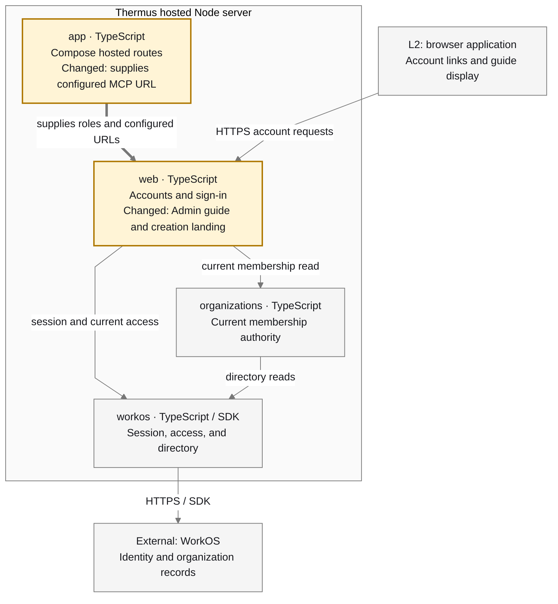

## Description

After organization creation, Admins now land on **Quick start**, the first Admin menu item. The guide links to agent internet controls, OpenTelemetry audit-log setup, and invitations, with a full Markdown copy and manual fallback. IdP enrollment is marked **Planned**; external policies and delivery remain the Admin's responsibility.

## Review

**T2 Need architect** — `Architecture: T0: no architecture fact`. Declared browser-contract and internal-interface changes require T2; sensitive behavior, the protected exception file, and two used MI exceptions also require review.

Architecture facts (checker, `f5f8cd2` vs `feeaad4d`):

- None; all 53 public declaration snapshots are unchanged.

`.pr-impact.json` declares `contract`, `internalInterface`, and `sensitiveBehavior`; other flags are false. Registry prose is updated. Components, dependencies, deployment, and all 20 registry drawings are unchanged.

**Merge status: blocked.** Local gates and checker are complete. Independent authorized architect approval of this candidate is the remaining blocker; agent review is not that approval. See [full checker](./checker.md).

### Architecture comparison

Supplementary L3, hosted Node-server L2 container; main merge base `feeaad4d5f04212f033366c232180be4bd40da4c` to candidate `f5f8cd2e3a2297d73a44fbc2974c6eee5a59d81e`:

- Confirmed activation and checked selection now lead to Quick start. Existing-access Continue, later login, workspace switching, and grant replay rules keep their behavior.
- Current session, matching identity/organization, product access, exact Admin role, and an authorized nonblank organization name determine the guide. Query hints cannot choose its context.
- App supplies trusted portal/MCP URLs. Escaped page/Markdown content contains no secrets. Copy success follows the clipboard write; failure exposes selectable text.
- GET serves the guide; HEAD omits its body. Other methods return 405 for admitted Admins. Refused names return 403, provider failure returns 500, and cancellation produces no guide.

[Rendered comparison and retained rationale](./final-manager-review.md) cover omitted context and the L4 decision.

---
Candidate: [f5f8cd2](https://github.com/tomer-mayara/Thermus/commit/f5f8cd2e3a2297d73a44fbc2974c6eee5a59d81e) · [Validation](https://github.com/tomer-mayara/Thermus/pull/289#issuecomment-6474821759) · [Quality review](https://github.com/tomer-mayara/Thermus/pull/289#issuecomment-6474822296)
