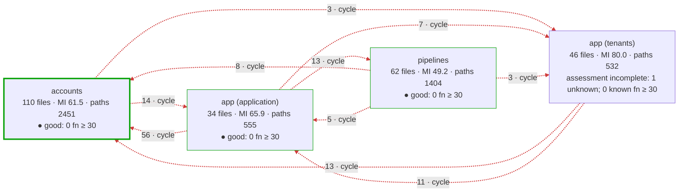
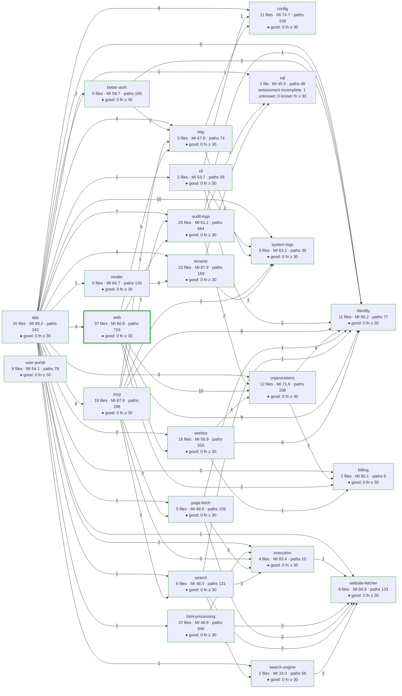
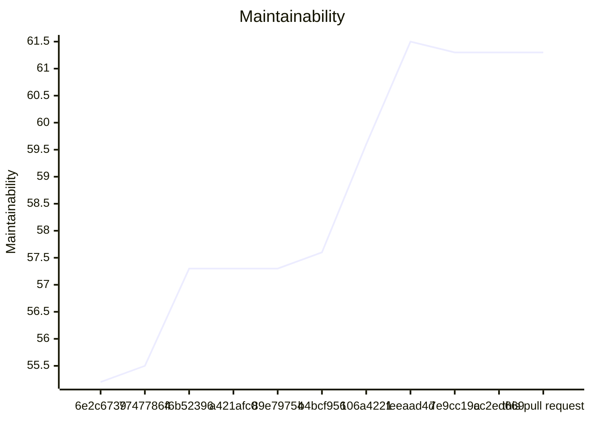
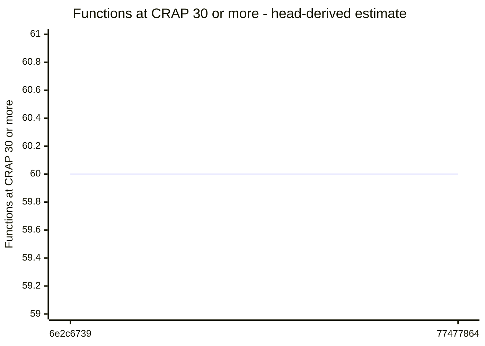
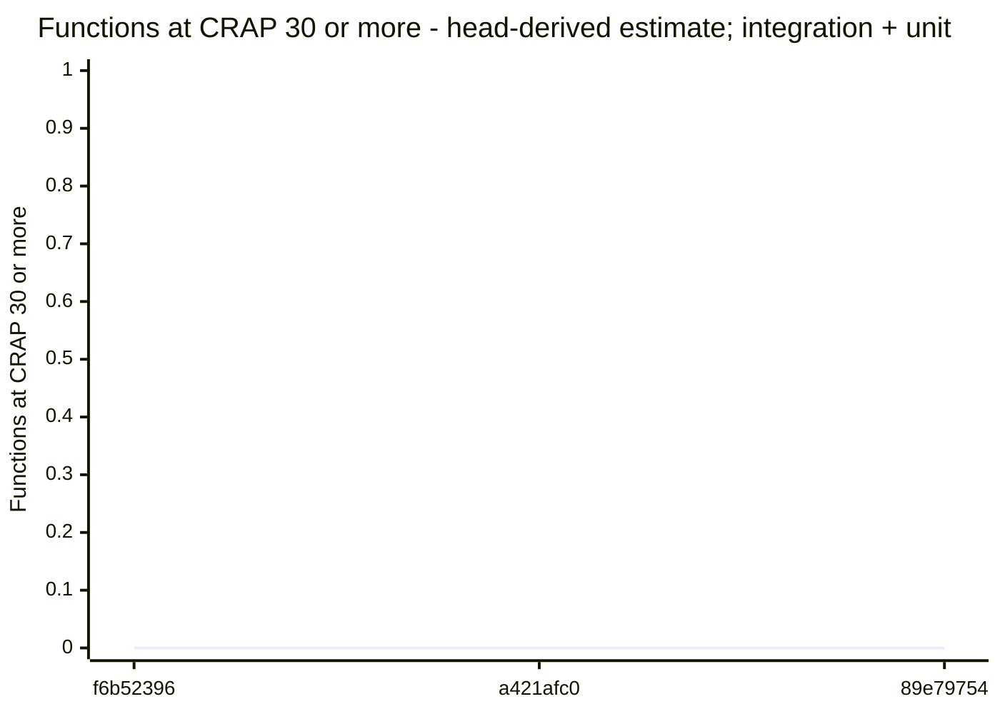
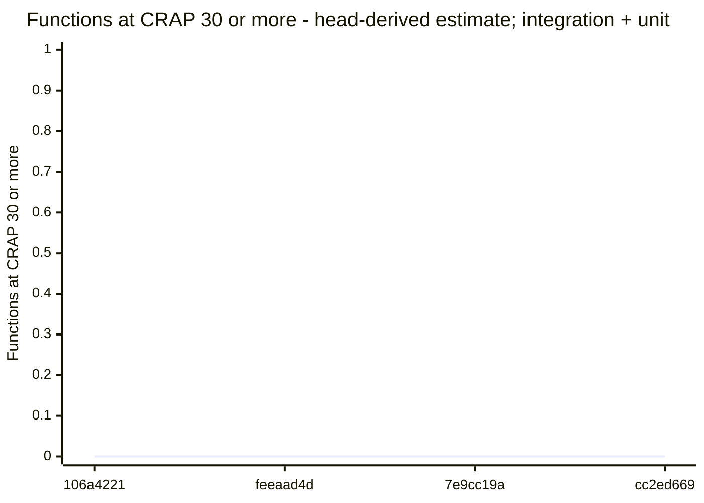

# Code quality process

## Delta

Status: goal miss.

```text
  54.0  src/interfaces/web/account/quick-start-content.ts  below 85
Result: 1 of 1 production file below 85. Goal: 85 or more for each production file.
Comparison with origin/main: ast-report/compare.html
```

## Review

Status: passed.

## AST Metrics found no regression

0 new critical issue(s), 0 other regression(s)

### Summary

- ➖ **Complexity: -**
- ➖ **Ease of maintenance: -**
- ➖ **Outgoing dependencies: -**
- ➖ **Probability of bugs: -**

No architectural change detected on modified code.

## CRAP

Status: passed.

Reused verified compatible unit + integration coverage.

## CRAP goals

Goals: CRAP < 30; new functions also CRAP ≤ 15.

| File | Function | Change | Paths | Coverage | CRAP | To do |
| --- | --- | --- | --- | --- | --- | --- |
| src/interfaces/web/account/quick-start-content.ts | trustedUrl | unchanged | 6 | 100% | 6.0 | ok; unchanged by this PR |
| src/interfaces/web/account/quick-start-content.ts | quickStartContent | unchanged | 2 | 100% | 2.0 | ok; unchanged by this PR |
| src/interfaces/web/account/quick-start-content.ts | (anonymous) | unchanged | 1 | 100% | 1.0 | ok; unchanged by this PR |
| src/interfaces/web/account/quick-start-content.ts | (anonymous) | unchanged | 1 | 100% | 1.0 | ok; unchanged by this PR |
| src/interfaces/web/account/quick-start-content.ts | (anonymous) | unchanged | 1 | 100% | 1.0 | ok; unchanged by this PR |
| src/interfaces/web/account/quick-start-content.ts | markdownLink | unchanged | 1 | 100% | 1.0 | ok; unchanged by this PR |
| src/interfaces/web/account/quick-start-content.ts | markdownText | unchanged | 1 | 100% | 1.0 | ok; unchanged by this PR |

Known limit violations: 0. Measured target misses: 0. Unmeasured functions: 0. Required functions with unknown assessment or identity: 0.

## Architecture

Status: passed.

## Architecture of src/: base cc2ed669 → head

Modularity 0.42 → 0.42 · cross share 0.23 → 0.23 · cycles 1 → 1 · communities 4 → 4 · functions ≥ 30: 0 → 0



Legend: thick border = a community this pull request touched; `· new` and `· gone` = a community or dependency that appeared or disappeared; red dashed edge = part of a cycle; thick edge = a new dependency; border color = the CRAP band of the community (● good: complete assessment, no function at CRAP 30 or more; ▲ warning: some, none added or worse by this pull request; ■ critical: one added or worse); numbers = files · maintainability (LOC-weighted) · decision paths, with the change against the base.

### Community edge evidence

Tool references and deduplicated file pairs have different units. An unchanged import means the same normalized file pair, after proven path moves; evidence kinds can differ.

Dependency evidence incomplete: base has 1 issue; head has 1 issue. A missing pair on an incomplete side does not prove an import change.

- base: <code>src/interfaces/user-portal/main.ts</code> → <code>./style.css</code> — unresolved-local.
- head: <code>src/interfaces/user-portal/main.ts</code> → <code>./style.css</code> — unresolved-local.

No new or gone community edges.

## Components of src/

Component dependency evidence is incomplete: known head dependencies and proven cycles are shown; edge and cycle changes are withheld. Additional dependencies or cycles may exist.



Legend: thick border = a component this pull request touched; `· new` and `· gone` = a component or dependency that appeared or disappeared; red dashed edge = part of a cycle; thick edge = a new dependency; border color = the CRAP band of the component (● good: complete assessment, no function at CRAP 30 or more; ▲ warning: some, none added or worse by this pull request; ■ critical: one added or worse); numbers = files · maintainability (LOC-weighted) · decision paths, with the change against the base. Edges count distinct importing files per target component.

## Complexity of the changed files

| File | Maintainability | Decision paths | CRAP ≥ 30 | Risk rank |
| --- | --- | --- | --- | --- |
| src/interfaces/web/account/quick-start-content.ts | 54.0 → 54.0 | 13 → 13 | 0 → 0 | |

### Functions at CRAP 30 or more, added or worse

None.

Unmatched functions: 0 (anonymous, duplicate, or not in the coverage).

Base functions without an estimated covered share: 94.

Coverage: unit + integration suites at cc2ed669.

## Trend of src/ on main

| Commit | PR | Date | Modularity | Cross share | Cycles | Maintainability | Functions ≥ 30 |
| --- | --- | --- | --- | --- | --- | --- | --- |
| 6e2c6739 | #277 | 2026-10-27 | 0.33 | 0.31 | 1 | 55.2 | 60 (estimate) |
| 77477864 | #279 | 2026-10-27 | 0.34 | 0.17 | 1 | 55.5 | 60 (estimate) |
| f6b52396 | #280 | 2026-10-27 | 0.34 | 0.21 | 1 | 57.3 | 0 (estimate; integration + unit) |
| a421afc0 | #282 | 2026-10-27 | 0.34 | 0.21 | 1 | 57.3 | 0 (estimate; integration + unit) |
| 89e79754 | #281 | 2026-10-27 | 0.34 | 0.21 | 1 | 57.3 | 0 (estimate; integration + unit) |
| b4bcf956 | #284 | 2026-10-27 | 0.36 | 0.24 | 1 | 57.6 | 61 (estimate) |
| 106a4221 | #286 | 2026-10-27 | 0.42 | 0.25 | 1 | 59.6 | 0 (estimate; integration + unit) |
| feeaad4d | #285 | 2026-10-27 | 0.42 | 0.23 | 1 | 61.5 | 0 (estimate; integration + unit) |
| 7e9cc19a | #289 | 2026-10-28 | 0.42 | 0.23 | 1 | 61.3 | 0 (estimate; integration + unit) |
| cc2ed669 | #290 | 2026-10-28 | 0.42 | 0.23 | 1 | 61.3 | 0 (estimate; integration + unit) |
| this pull request | #290 | | 0.42 | 0.23 | 1 | 61.3 | 0 (measured; integration + unit) |

Historical estimates use head coverage from the first recording pull request. Later estimates for the same base can differ. Counts include known lower-bound violations; other unknown functions are not counted.

### Maintainability trend

Missing values are gaps; lines stop at each gap.

Maintainability (maintainability), 6e2c6739 to this pull request.




### Functions ≥ 30 trend

Missing values are gaps; lines stop at each gap or change of count basis.

Functions ≥ 30 (head-derived estimate), 6e2c6739 to 77477864.



Functions ≥ 30 (head-derived estimate; integration + unit), f6b52396 to 89e79754.



b4bcf956: 61 (head-derived estimate). One point; no line.

Functions ≥ 30 (head-derived estimate; integration + unit), 106a4221 to cc2ed669.



this pull request: 0 (measured; integration + unit). One point; no line.


### Trend by component

| Component | 6e2c6739 | 77477864 | f6b52396 | a421afc0 | 89e79754 | b4bcf956 | 106a4221 | feeaad4d | 7e9cc19a | cc2ed669 | this pull request |
| --- | --- | --- | --- | --- | --- | --- | --- | --- | --- | --- | --- |
| app | MI 60.2; functions ≥ 30: 0 (estimate) | MI 60.0; functions ≥ 30: 0 (estimate) | MI 64.1; functions ≥ 30: 0 (estimate; integration + unit) | MI 64.1; functions ≥ 30: 0 (estimate; integration + unit) | MI 64.1; functions ≥ 30: 0 (estimate; integration + unit) | MI 64.2; functions ≥ 30: 0 (estimate) | MI 65.7; functions ≥ 30: 0 (estimate; integration + unit) | MI 68.2; functions ≥ 30: 0 (estimate; integration + unit) | MI 68.2; functions ≥ 30: 0 (estimate; integration + unit) | MI 68.2; functions ≥ 30: 0 (estimate; integration + unit) | MI 68.2; functions ≥ 30: 0 (measured; integration + unit) |
| audit-logs | MI 53.4; functions ≥ 30: 0 (estimate) | MI 54.9; functions ≥ 30: 0 (estimate) | MI 60.9; functions ≥ 30: 0 (estimate; integration + unit) | MI 60.9; functions ≥ 30: 0 (estimate; integration + unit) | MI 60.9; functions ≥ 30: 0 (estimate; integration + unit) | MI 60.9; functions ≥ 30: 0 (estimate) | MI 60.9; functions ≥ 30: 0 (estimate; integration + unit) | MI 61.1; functions ≥ 30: 0 (estimate; integration + unit) | MI 61.1; functions ≥ 30: 0 (estimate; integration + unit) | MI 61.1; functions ≥ 30: 0 (estimate; integration + unit) | MI 61.1; functions ≥ 30: 0 (measured; integration + unit) |
| better-auth | MI 58.7; functions ≥ 30: 2 (estimate) | MI 58.7; functions ≥ 30: 2 (estimate) | MI 58.7; functions ≥ 30: 0 (estimate; integration + unit) | MI 58.7; functions ≥ 30: 0 (estimate; integration + unit) | MI 58.7; functions ≥ 30: 0 (estimate; integration + unit) | MI 58.7; functions ≥ 30: 2 (estimate) | MI 58.7; functions ≥ 30: 0 (estimate; integration + unit) | MI 58.7; functions ≥ 30: 0 (estimate; integration + unit) | MI 58.7; functions ≥ 30: 0 (estimate; integration + unit) | MI 58.7; functions ≥ 30: 0 (estimate; integration + unit) | MI 58.7; functions ≥ 30: 0 (measured; integration + unit) |
| billing | MI 68.8; functions ≥ 30: 0 (estimate) | MI 68.8; functions ≥ 30: 0 (estimate) | MI 68.8; functions ≥ 30: 0 (estimate; integration + unit) | MI 68.8; functions ≥ 30: 0 (estimate; integration + unit) | MI 68.8; functions ≥ 30: 0 (estimate; integration + unit) | MI 90.1; functions ≥ 30: 0 (estimate) | MI 90.1; functions ≥ 30: 0 (estimate; integration + unit) | MI 90.1; functions ≥ 30: 0 (estimate; integration + unit) | MI 90.1; functions ≥ 30: 0 (estimate; integration + unit) | MI 90.1; functions ≥ 30: 0 (estimate; integration + unit) | MI 90.1; functions ≥ 30: 0 (measured; integration + unit) |
| cli | MI 53.7; functions ≥ 30: 3 (estimate) | MI 53.7; functions ≥ 30: 3 (estimate) | MI 53.7; functions ≥ 30: 0 (estimate; integration + unit) | MI 53.7; functions ≥ 30: 0 (estimate; integration + unit) | MI 53.7; functions ≥ 30: 0 (estimate; integration + unit) | MI 53.7; functions ≥ 30: 3 (estimate) | MI 53.7; functions ≥ 30: 0 (estimate; integration + unit) | MI 53.7; functions ≥ 30: 0 (estimate; integration + unit) | MI 53.7; functions ≥ 30: 0 (estimate; integration + unit) | MI 53.7; functions ≥ 30: 0 (estimate; integration + unit) | MI 53.7; functions ≥ 30: 0 (measured; integration + unit) |
| config | MI 59.6; functions ≥ 30: 0 (estimate) | MI 61.4; functions ≥ 30: 0 (estimate) | MI 70.9; functions ≥ 30: 0 (estimate; integration + unit) | MI 70.9; functions ≥ 30: 0 (estimate; integration + unit) | MI 70.9; functions ≥ 30: 0 (estimate; integration + unit) | MI 70.9; functions ≥ 30: 0 (estimate) | MI 72.3; functions ≥ 30: 0 (estimate; integration + unit) | MI 74.7; functions ≥ 30: 0 (estimate; integration + unit) | MI 74.7; functions ≥ 30: 0 (estimate; integration + unit) | MI 74.7; functions ≥ 30: 0 (estimate; integration + unit) | MI 74.7; functions ≥ 30: 0 (measured; integration + unit) |
| execution | MI 83.4; functions ≥ 30: 0 (estimate) | MI 83.4; functions ≥ 30: 0 (estimate) | MI 83.4; functions ≥ 30: 0 (estimate; integration + unit) | MI 83.4; functions ≥ 30: 0 (estimate; integration + unit) | MI 83.4; functions ≥ 30: 0 (estimate; integration + unit) | MI 83.4; functions ≥ 30: 0 (estimate) | MI 83.4; functions ≥ 30: 0 (estimate; integration + unit) | MI 83.4; functions ≥ 30: 0 (estimate; integration + unit) | MI 83.4; functions ≥ 30: 0 (estimate; integration + unit) | MI 83.4; functions ≥ 30: 0 (estimate; integration + unit) | MI 83.4; functions ≥ 30: 0 (measured; integration + unit) |
| html-processing | MI 46.9; functions ≥ 30: 0 (estimate) | MI 46.9; functions ≥ 30: 0 (estimate) | MI 46.9; functions ≥ 30: 0 (estimate; integration + unit) | MI 46.9; functions ≥ 30: 0 (estimate; integration + unit) | MI 46.9; functions ≥ 30: 0 (estimate; integration + unit) | MI 46.9; functions ≥ 30: 0 (estimate) | MI 46.9; functions ≥ 30: 0 (estimate; integration + unit) | MI 46.9; functions ≥ 30: 0 (estimate; integration + unit) | MI 46.9; functions ≥ 30: 0 (estimate; integration + unit) | MI 46.9; functions ≥ 30: 0 (estimate; integration + unit) | MI 46.9; functions ≥ 30: 0 (measured; integration + unit) |
| http | MI 64.5; functions ≥ 30: 0 (estimate) | MI 64.5; functions ≥ 30: 0 (estimate) | MI 64.5; functions ≥ 30: 0 (estimate; integration + unit) | MI 64.5; functions ≥ 30: 0 (estimate; integration + unit) | MI 64.5; functions ≥ 30: 0 (estimate; integration + unit) | MI 64.5; functions ≥ 30: 0 (estimate) | MI 64.5; functions ≥ 30: 0 (estimate; integration + unit) | MI 67.8; functions ≥ 30: 0 (estimate; integration + unit) | MI 67.8; functions ≥ 30: 0 (estimate; integration + unit) | MI 67.8; functions ≥ 30: 0 (estimate; integration + unit) | MI 67.8; functions ≥ 30: 0 (measured; integration + unit) |
| identity | MI 66.4; functions ≥ 30: 0 (estimate) | MI 66.4; functions ≥ 30: 0 (estimate) | MI 85.2; functions ≥ 30: 0 (estimate; integration + unit) | MI 85.2; functions ≥ 30: 0 (estimate; integration + unit) | MI 85.2; functions ≥ 30: 0 (estimate; integration + unit) | MI 85.2; functions ≥ 30: 0 (estimate) | MI 85.2; functions ≥ 30: 0 (estimate; integration + unit) | MI 86.2; functions ≥ 30: 0 (estimate; integration + unit) | MI 86.2; functions ≥ 30: 0 (estimate; integration + unit) | MI 86.2; functions ≥ 30: 0 (estimate; integration + unit) | MI 86.2; functions ≥ 30: 0 (measured; integration + unit) |
| mcp | MI 51.2; functions ≥ 30: 3 (estimate) | MI 51.2; functions ≥ 30: 3 (estimate) | MI 51.7; functions ≥ 30: 0 (estimate; integration + unit) | MI 51.7; functions ≥ 30: 0 (estimate; integration + unit) | MI 51.7; functions ≥ 30: 0 (estimate; integration + unit) | MI 51.7; functions ≥ 30: 3 (estimate) | MI 51.7; functions ≥ 30: 0 (estimate; integration + unit) | MI 67.9; functions ≥ 30: 0 (estimate; integration + unit) | MI 67.9; functions ≥ 30: 0 (estimate; integration + unit) | MI 67.9; functions ≥ 30: 0 (estimate; integration + unit) | MI 67.9; functions ≥ 30: 0 (measured; integration + unit) |
| organizations | MI 69.9; functions ≥ 30: 1 (estimate) | MI 69.9; functions ≥ 30: 1 (estimate) | MI 69.9; functions ≥ 30: 0 (estimate; integration + unit) | MI 69.9; functions ≥ 30: 0 (estimate; integration + unit) | MI 69.9; functions ≥ 30: 0 (estimate; integration + unit) | MI 71.6; functions ≥ 30: 1 (estimate) | MI 71.6; functions ≥ 30: 0 (estimate; integration + unit) | MI 71.6; functions ≥ 30: 0 (estimate; integration + unit) | MI 71.6; functions ≥ 30: 0 (estimate; integration + unit) | MI 71.6; functions ≥ 30: 0 (estimate; integration + unit) | MI 71.6; functions ≥ 30: 0 (measured; integration + unit) |
| page-fetch | MI 49.9; functions ≥ 30: 5 (estimate) | MI 49.9; functions ≥ 30: 5 (estimate) | MI 49.9; functions ≥ 30: 0 (estimate; integration + unit) | MI 49.9; functions ≥ 30: 0 (estimate; integration + unit) | MI 49.9; functions ≥ 30: 0 (estimate; integration + unit) | MI 49.9; functions ≥ 30: 5 (estimate) | MI 49.9; functions ≥ 30: 0 (estimate; integration + unit) | MI 49.9; functions ≥ 30: 0 (estimate; integration + unit) | MI 49.9; functions ≥ 30: 0 (estimate; integration + unit) | MI 49.9; functions ≥ 30: 0 (estimate; integration + unit) | MI 49.9; functions ≥ 30: 0 (measured; integration + unit) |
| render | MI –; functions ≥ 30: – | MI –; functions ≥ 30: – | MI –; functions ≥ 30: – | MI –; functions ≥ 30: – | MI –; functions ≥ 30: – | MI –; functions ≥ 30: – | MI 84.7; functions ≥ 30: 0 (estimate; integration + unit) | MI 84.7; functions ≥ 30: 0 (estimate; integration + unit) | MI 84.7; functions ≥ 30: 0 (estimate; integration + unit) | MI 84.7; functions ≥ 30: 0 (estimate; integration + unit) | MI 84.7; functions ≥ 30: 0 (measured; integration + unit) |
| search | MI 48.3; functions ≥ 30: 7 (estimate) | MI 48.3; functions ≥ 30: 7 (estimate) | MI 48.3; functions ≥ 30: 0 (estimate; integration + unit) | MI 48.3; functions ≥ 30: 0 (estimate; integration + unit) | MI 48.3; functions ≥ 30: 0 (estimate; integration + unit) | MI 48.3; functions ≥ 30: 7 (estimate) | MI 48.3; functions ≥ 30: 0 (estimate; integration + unit) | MI 48.3; functions ≥ 30: 0 (estimate; integration + unit) | MI 48.3; functions ≥ 30: 0 (estimate; integration + unit) | MI 48.3; functions ≥ 30: 0 (estimate; integration + unit) | MI 48.3; functions ≥ 30: 0 (measured; integration + unit) |
| search-engine | MI 33.0; functions ≥ 30: 0 (estimate) | MI 33.0; functions ≥ 30: 0 (estimate) | MI 33.0; functions ≥ 30: 0 (estimate; integration + unit) | MI 33.0; functions ≥ 30: 0 (estimate; integration + unit) | MI 33.0; functions ≥ 30: 0 (estimate; integration + unit) | MI 33.0; functions ≥ 30: 0 (estimate) | MI 33.0; functions ≥ 30: 0 (estimate; integration + unit) | MI 33.0; functions ≥ 30: 0 (estimate; integration + unit) | MI 33.0; functions ≥ 30: 0 (estimate; integration + unit) | MI 33.0; functions ≥ 30: 0 (estimate; integration + unit) | MI 33.0; functions ≥ 30: 0 (measured; integration + unit) |
| sql | MI –; functions ≥ 30: – | MI 41.9; functions ≥ 30: 0 (estimate) | MI 41.9; functions ≥ 30: 0 (estimate; integration + unit) | MI 41.9; functions ≥ 30: 0 (estimate; integration + unit) | MI 41.9; functions ≥ 30: 0 (estimate; integration + unit) | MI 41.9; functions ≥ 30: 0 (estimate) | MI 45.5; functions ≥ 30: 0 (estimate; integration + unit) | MI 45.5; functions ≥ 30: 0 (estimate; integration + unit) | MI 45.5; functions ≥ 30: 0 (estimate; integration + unit) | MI 45.5; functions ≥ 30: 0 (estimate; integration + unit) | MI 45.5; functions ≥ 30: 0 (measured; integration + unit) |
| system-logs | MI 63.1; functions ≥ 30: 0 (estimate) | MI 63.1; functions ≥ 30: 0 (estimate) | MI 63.1; functions ≥ 30: 0 (estimate; integration + unit) | MI 63.1; functions ≥ 30: 0 (estimate; integration + unit) | MI 63.1; functions ≥ 30: 0 (estimate; integration + unit) | MI 63.1; functions ≥ 30: 0 (estimate) | MI 63.1; functions ≥ 30: 0 (estimate; integration + unit) | MI 63.1; functions ≥ 30: 0 (estimate; integration + unit) | MI 63.1; functions ≥ 30: 0 (estimate; integration + unit) | MI 63.1; functions ≥ 30: 0 (estimate; integration + unit) | MI 63.1; functions ≥ 30: 0 (measured; integration + unit) |
| tenants | MI –; functions ≥ 30: – | MI 79.0; functions ≥ 30: 0 (estimate) | MI 79.0; functions ≥ 30: 0 (estimate; integration + unit) | MI 79.0; functions ≥ 30: 0 (estimate; integration + unit) | MI 79.0; functions ≥ 30: 0 (estimate; integration + unit) | MI 79.0; functions ≥ 30: 0 (estimate) | MI 88.1; functions ≥ 30: 0 (estimate; integration + unit) | MI 87.9; functions ≥ 30: 0 (estimate; integration + unit) | MI 87.9; functions ≥ 30: 0 (estimate; integration + unit) | MI 87.9; functions ≥ 30: 0 (estimate; integration + unit) | MI 87.9; functions ≥ 30: 0 (measured; integration + unit) |
| user-portal | MI 51.1; functions ≥ 30: 0 (estimate) | MI 51.1; functions ≥ 30: 0 (estimate) | MI 51.1; functions ≥ 30: 0 (estimate; integration + unit) | MI 51.1; functions ≥ 30: 0 (estimate; integration + unit) | MI 51.1; functions ≥ 30: 0 (estimate; integration + unit) | MI 54.2; functions ≥ 30: 0 (estimate) | MI 54.2; functions ≥ 30: 0 (estimate; integration + unit) | MI 54.2; functions ≥ 30: 0 (estimate; integration + unit) | MI 54.1; functions ≥ 30: 0 (estimate; integration + unit) | MI 54.1; functions ≥ 30: 0 (estimate; integration + unit) | MI 54.1; functions ≥ 30: 0 (measured; integration + unit) |
| web | MI 60.0; functions ≥ 30: 22 (estimate) | MI 60.0; functions ≥ 30: 22 (estimate) | MI 60.0; functions ≥ 30: 0 (estimate; integration + unit) | MI 60.0; functions ≥ 30: 0 (estimate; integration + unit) | MI 59.6; functions ≥ 30: 0 (estimate; integration + unit) | MI 59.9; functions ≥ 30: 23 (estimate) | MI 59.9; functions ≥ 30: 0 (estimate; integration + unit) | MI 61.8; functions ≥ 30: 0 (estimate; integration + unit) | MI 60.9; functions ≥ 30: 0 (estimate; integration + unit) | MI 60.9; functions ≥ 30: 0 (estimate; integration + unit) | MI 60.9; functions ≥ 30: 0 (measured; integration + unit) |
| website-fetcher | MI 60.9; functions ≥ 30: 1 (estimate) | MI 60.9; functions ≥ 30: 1 (estimate) | MI 60.9; functions ≥ 30: 0 (estimate; integration + unit) | MI 60.9; functions ≥ 30: 0 (estimate; integration + unit) | MI 60.9; functions ≥ 30: 0 (estimate; integration + unit) | MI 60.9; functions ≥ 30: 1 (estimate) | MI 60.9; functions ≥ 30: 0 (estimate; integration + unit) | MI 60.9; functions ≥ 30: 0 (estimate; integration + unit) | MI 60.9; functions ≥ 30: 0 (estimate; integration + unit) | MI 60.9; functions ≥ 30: 0 (estimate; integration + unit) | MI 60.9; functions ≥ 30: 0 (measured; integration + unit) |
| workos | MI 55.9; functions ≥ 30: 16 (estimate) | MI 55.9; functions ≥ 30: 16 (estimate) | MI 55.9; functions ≥ 30: 0 (estimate; integration + unit) | MI 55.9; functions ≥ 30: 0 (estimate; integration + unit) | MI 55.9; functions ≥ 30: 0 (estimate; integration + unit) | MI 55.9; functions ≥ 30: 16 (estimate) | MI 55.9; functions ≥ 30: 0 (estimate; integration + unit) | MI 55.9; functions ≥ 30: 0 (estimate; integration + unit) | MI 55.9; functions ≥ 30: 0 (estimate; integration + unit) | MI 55.9; functions ≥ 30: 0 (estimate; integration + unit) | MI 55.9; functions ≥ 30: 0 (measured; integration + unit) |

1 commits of main between b4bcf956 and 106a4221 have no record.
