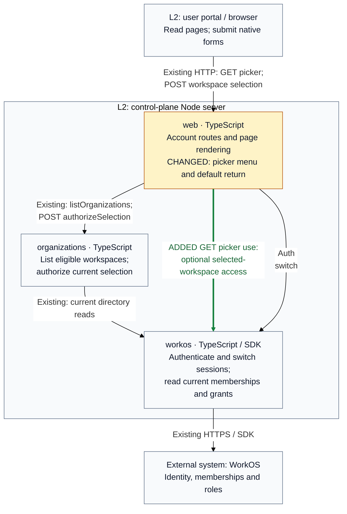

## Description

Choosing an organization changed the session but returned to the same picker, which had no workspace menu. Selection now opens Connect by default, including the current organization. The picker keeps the compact Connect, Switch Workspace, Members, Audit Log menu; non-admin users see only the first two links.

## Review

**T2 Need architect** — Architecture: **T0: no architecture fact**. Declared `contract` and `internalInterface` changes require T2 under the [review policy](https://github.com/tomer-mayara/Thermus/blob/f6b523967223da5ebddafdef1a508d3936cee01c/AGENTS.md#review-tier-and-merge-eligibility).

**Architecture facts** (complete candidate checker):

- None. All 51 public declarations and 17 registry diagrams are unchanged.

[`.pr-impact.json`](https://github.com/tomer-mayara/Thermus/blob/feaddbdec5f9e2cc7bf8e07050a4d5e7aa5e5769/.pr-impact.json) declares the browser return-default change and optional picker access lookup. Registry prose records that runtime use. Owners, imports, public signatures, selection authority, containers, and deployment relationships remain unchanged.

**Merge status: blocked only by current-candidate human architect/owner approval.** All selected local release gates pass; retained metric and habit findings have reviewed reasons. The fix is not yet deployed.

### Architecture comparison

Supplementary C4 Level 3 view, control-plane Node server; base `f6b52396` → head `feaddbde`. Amber marks changed behavior, green added runtime use, and neutral relationships remain.

- Bare picker forms return to the normalized Connect path. Explicit safe destinations retain their exact value.
- The menu requires selected-workspace, identity-bound Admin access and product permission. Denial, mismatch or lookup failure preserves the basic picker; cancellation propagates.
- The optional lookup reads current membership/roles and may read the existing display profile. It grants no selection authority; provider timeouts and retries remain unchanged.
- POST retains Origin, CSRF, return-path and current-membership checks before one session switch. Cookie order, other sessions, and MCP bindings remain unchanged.

L3 plus these notes answers the changed default and recovery; L4 would repeat private branches. The inherited tenant container is outside this picker flow. Full provenance and limits are in Quality review.

---
Candidate: [feaddbde](https://github.com/tomer-mayara/Thermus/commit/feaddbdec5f9e2cc7bf8e07050a4d5e7aa5e5769) · [Validation](https://github.com/tomer-mayara/Thermus/pull/281#issuecomment-6453601476) · [Quality review](https://github.com/tomer-mayara/Thermus/pull/281#issuecomment-6453601866)
