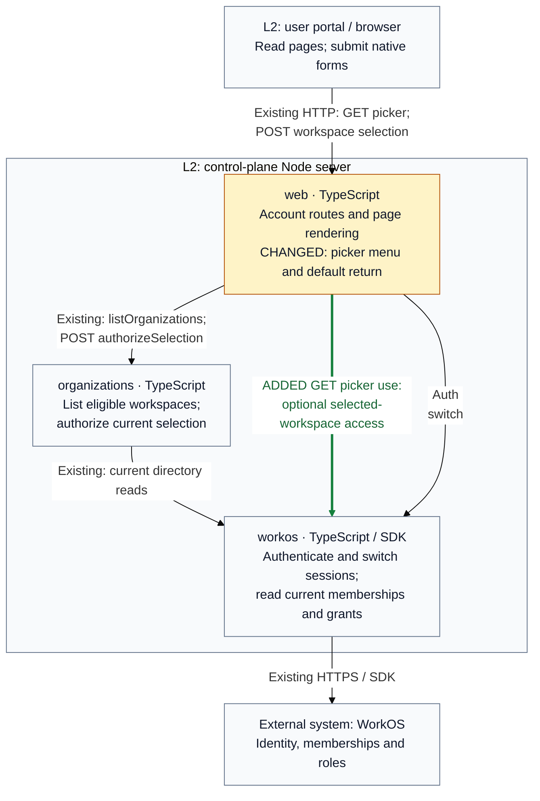

## Description

Selecting an organization changed the session but returned to the picker, which had no menu. Selection now opens Connect by default. The picker uses the compact Connect, Switch Workspace, Members, Audit Log menu; non-admin users see only the first two links.

Approved `feaddbde` is **live and verified for both production roles**: [deployment and actual button journeys](https://github.com/tomer-mayara/Thermus/blob/5fec0d05c3991a41a1ce474b6bebf3c19c0130c7/workspace-selection-production/README.md). This PR later inherited SO-02 without changing any app source or test file.

## Review

**T2 Need architect** — Architecture: **T0: no architecture fact**. The declared `contract` and `internalInterface` changes require T2 under the [review policy](https://github.com/tomer-mayara/Thermus/blob/a421afc056ce3e400f2779c75683ea45270b96cb/AGENTS.md#review-tier-and-merge-eligibility).

**Architecture facts**:

- None. All 51 public declaration snapshots and 17 registry diagrams are unchanged.

[`.pr-impact.json`](https://github.com/tomer-mayara/Thermus/blob/44753a72a7c1cecbf076e1448c26a4ae4b93a9f2/.pr-impact.json) declares the default-return change and optional current-access lookup. Registry prose records that use; owners, selection authority, contracts, containers and deployment relationships remain unchanged.

**Merge status: blocked; Draft.** The refreshed staging gate passed 22/29 cases but hit WorkOS's sandbox invitation-email quota. Retry after quota availability is confirmed. Current-head owner/architect approval is also required: the recorded approval covers deployed `feaddbde`. Other selected checks pass; retained metric/habit findings have reviewed reasons. No source correction or deployment migration is requested.

### Architecture comparison

Supplementary C4 Level 3 view, control-plane Node server; actual base `a421afc0` → head `44753a72`.

- Bare picker forms return to normalized Connect; explicit safe destinations keep their value.
- Only identity-bound, selected-workspace Admin access with product permission shows privileged links.
- Denial, mismatch or optional lookup failure preserves the basic picker; cancellation propagates. Provider timeout/retry rules remain.
- POST keeps Origin, CSRF, return-path and current-membership checks before one switch. Cookie order and MCP bindings remain.

L3 plus these notes answers the changed return contract and recovery; L4 would repeat private branches. Inherited SO-02 delivery and SO-03 tenant work are outside this increment. Full provenance and limits are in Quality review.

---
Candidate: [44753a72](https://github.com/tomer-mayara/Thermus/commit/44753a72a7c1cecbf076e1448c26a4ae4b93a9f2) · [Validation](https://github.com/tomer-mayara/Thermus/pull/281#issuecomment-6453601476) · [Quality review](https://github.com/tomer-mayara/Thermus/pull/281#issuecomment-6453601866)
