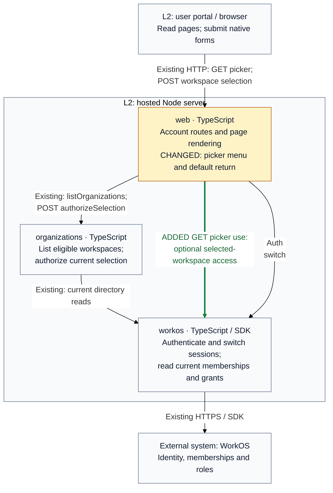

## Description

Choosing a workspace changed the session but returned to the same picker, which lacked the compact menu. Selection now opens Connect by default, including when choosing the current workspace. The picker keeps Connect, Switch Workspace, Members, and Audit Log; only current Admin access in the selected workspace shows the final two links.

## Review

**T2 Need architect** — Architecture: **T0: no architecture fact**. The declared `contract` and `internalInterface` changes require T2.

**Architecture facts** (checker, `2907d105` vs `77477864`):

- None; all 50 public declarations and 16 registry diagrams are unchanged.

Why, from [`.pr-impact.json`](https://github.com/tomer-mayara/Thermus/blob/2907d105f85c9596401312d7082af86a5711df06/.pr-impact.json): the browser navigation default changes, and picker GET/HEAD adds an optional current-access lookup for menu visibility. Existing selection authority and deployment relationships remain unchanged. Registry prose records the new runtime use.

**Merge status: blocked.** Remaining gates: hosted image, self-hosted container and hosted live. Required human approval: an independent authorized architect or owner must approve this current candidate and its architecture impact.

### Architecture comparison

Supplementary C4 Level 3 view, hosted Node server; base `77477864` → candidate `2907d105`. Amber marks changed behavior; green marks added runtime use; other relationships stay neutral.

- Bare picker forms now return to the normalized Connect path. Explicit safe destinations retain their exact value.
- The menu uses the selected workspace's current identity-bound Admin grant and product access. Denial, mismatch or lookup failure leaves the picker usable with basic links. Cancellation propagates; list failures retain their existing safe error and cookies.
- The new optional lookup reads selected membership/roles and may read the existing display profile. It grants no selection authority; provider timeouts and retries remain unchanged.
- POST still checks Origin, CSRF, return path and current membership before one session switch. Cookie order, other sessions and MCP-token bindings remain unchanged.

L3 plus these notes cover the changed default and recovery; L4 would repeat private branches. Full provenance, omissions and review evidence are in Quality review.

---
Candidate: [2907d105](https://github.com/tomer-mayara/Thermus/commit/2907d105f85c9596401312d7082af86a5711df06) · [Validation](https://github.com/tomer-mayara/Thermus/pull/281#issuecomment-6453601476) · [Quality review](https://github.com/tomer-mayara/Thermus/pull/281#issuecomment-6453601866)
