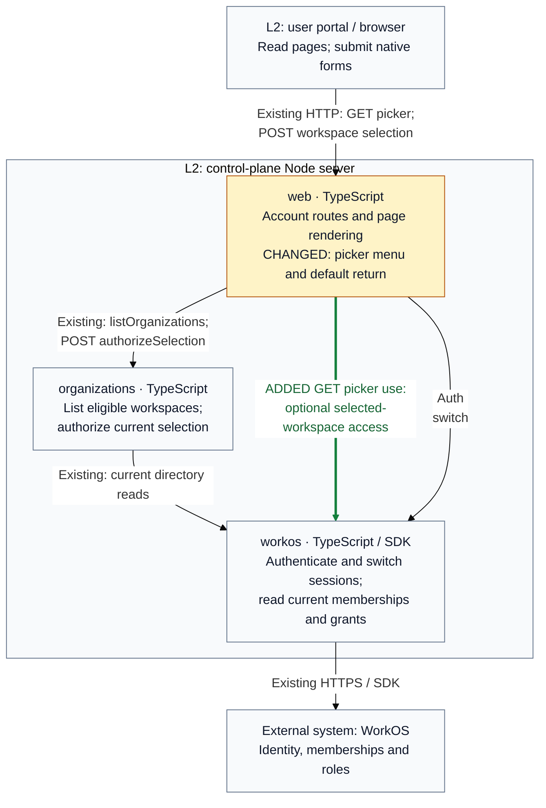

## Architecture comparison — final candidate v4

**T2 Need architect** applies because the picker adds an optional runtime
use of the supplied AccessResolver (`internalInterface=true`) and changes the
browser/server default return destination (`contract=true`). Base:
`a421afc056ce3e400f2779c75683ea45270b96cb`; head `44753a72a7c1cecbf076e1448c26a4ae4b93a9f2`.

Supplementary C4 Level 3 comparison: the hosted Node server keeps the same owners.
Arrows show runtime calls through supplied contracts. Amber marks changed web
behavior; green marks the added picker GET use. Neutral calls remain.

- **Return:** bare picker forms now return to Connect at the normalized public
  base path. Explicit validated destinations keep their existing behavior.
- **Display:** the picker gains one compact native menu. Only current allowed
  grants for the selected workspace can show Members and Audit Log.
- **Recovery:** an optional role lookup denial or outage hides privileged links
  while the picker remains usable. Cancellation propagates; list failures retain
  the existing safe failure page and cookie effects.
- **Authority:** selection POST still checks Origin, CSRF, return path and current
  eligible membership before one session switch. Cookie order, refusal outcomes,
  other browser sessions and MCP-token workspace bindings remain unchanged.

The neutral Auth/switch arrow condenses session authentication and the POST-only
switch. App composition, identity-owned contracts, unrelated account routes and
MCP are omitted. The existing external API and HTTPS edge remain; its new caller
context is on the green arrow. The strongest changed callable behavior is the omitted-return_to default and
resulting selection 303. L3 plus these notes answer redirect compatibility and
optional lookup ordering/recovery; L4 would repeat private branches without adding
boundary detail, so it is omitted. All 17 registry blocks remain unchanged;
prose names the new behavior. The committed head is `44753a72a7c1cecbf076e1448c26a4ae4b93a9f2`; base is `a421afc056ce3e400f2779c75683ea45270b96cb`.

The base already includes SO-03 tenant composition, signed-context admission and
audit relay, and SO-02 release delivery from GitHub Actions through GHCR to Render.
They are inherited and omitted from this focused control-plane runtime view.
Production remains Git-backed with automatic deploys off until SO-12 step 5; the
image deploy job refuses its current docker runtime. The manager confirms that
mode by fresh API readback. No production migration or new setting is required
for this picker fix. Fresh verified unit/integration coverage and final metric reports are available;
remaining checks retain their actual status in Validation.
The prior owner approval names feaddbde; current-head approval remains required.

Final head adds only the immutable a421afc0 base metric record to reviewed source
`e36e34c9304444312b52d76cc1c91aa365ccc719`. The separate final-head-input-bridge-v4.json
proves identical remaining tracked inputs. The pending manual production deploy
is the separately approved `feaddbde`, not this PR head. No current-head approval
or deployment is inferred from that earlier authorization.
